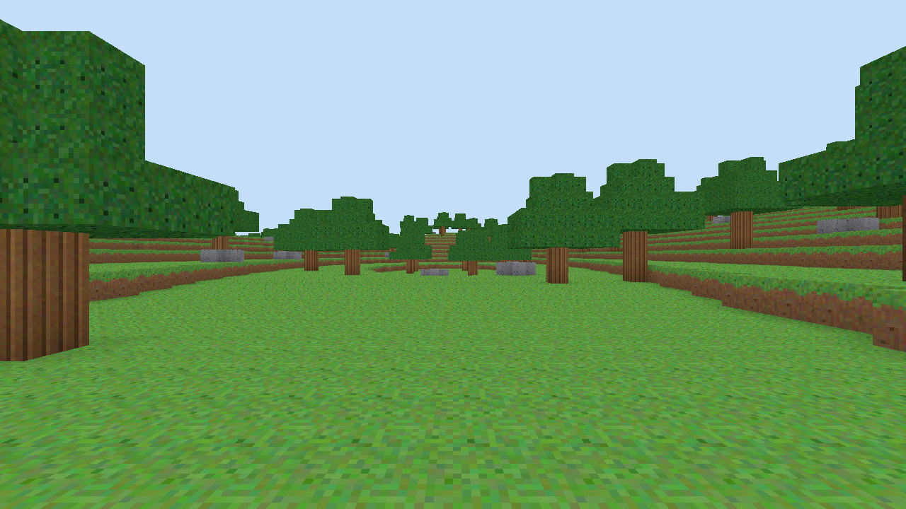

<p align="center">
  <h1 align="center">OpenBlock</h1>
  <p align="center"><strong>A fast, deeply moddable, server-first voxel sandbox — written in Rust.</strong></p>
</p>

<p align="center">
  <a href=".github/workflows/ci.yml"></a>
  <a href="LICENSE-MIT"></a>
  
  
  
</p>

OpenBlock is an open-source voxel sandbox: mine, build, explore and survive
alone or with friends on servers you host yourself. It is designed around four
promises:

- **Performance by architecture** — GPU-driven rendering, paletted 16³
  sections, parallel simulation, budgets enforced in CI. Target: 512-block
  view distance at 120–144 FPS on mid-range hardware.
- **Visuals that scale** — a modern forward+ pipeline with cascaded shadows,
  AO, TAA, screen-space water, volumetric atmosphere, and a *contract-based*
  shader-pack API instead of fragile bytecode patching.
- **Moddability as a core feature** — data-driven content packs, sandboxed WASM
  behaviour mods with a versioned host ABI, and opt-in native plugins. The base
  game itself is built on the public API.
- **Server-first multiplayer** — an authoritative, headless dedicated server
  that runs on a GPU-less VPS, with self-signed identity, content-hash
  verification and progressive world streaming.

**Linux is the primary platform, and Fedora is the reference distribution** — the
current + previous Fedora release at any ship date (44/45 at the time of writing),
Wayland + Vulkan + PipeWire, Flathub Flatpak first, COPR RPM for native installs,
and a hardened Fedora Server package for hosting. Windows and macOS ship as
supported secondary platforms at 1.0.

Minecraft Java Edition's feature set is the reference, delivered in stages: the
**1.0 Early Access** release targets Tier-1 parity plus the platform (modding,
multiplayer, visuals), and **2.0** targets full Tier-2 parity. Beyond parity,
OpenBlock is designed to express content and systems Minecraft cannot:
programmable logic blocks, first-class energy/fluid networks, scriptable mob
AI, procedural dungeons, server-side minigames and more.



<p align="center"><em>v0.0.2, seed 42: textured procedural terrain with greedy-meshed chunks and ambient occlusion (offscreen capture on Fedora 45, RADV).</em></p>

> **Status: v0.0.2 tech preview.** A runnable single-player vertical slice now
> exists: procedural terrain, chunk streaming, walk/fly physics, block
> break/place, hotbar selection, save/load and a headless host with a
> determinism smoke test. It is the first slice of MS-03, not a finished game:
> multiplayer, UI text, audio and the GPU-driven render path are later
> milestones. The full specification, research and plan live in
> [`docs/`](docs/README.md); if you want to help, start with
> [`CONTRIBUTING.md`](CONTRIBUTING.md) and
> [`docs/plan/01-milestones.md`](docs/plan/01-milestones.md).

---

## Table of contents

- [Why another block game?](#why-another-block-game)
- [What is planned](#what-is-planned)
- [Documentation](#documentation)
- [Architecture at a glance](#architecture-at-a-glance)
- [Roadmap](#roadmap)
- [Performance targets](#performance-targets)
- [Frequently asked questions](#frequently-asked-questions)
- [Contributing](#contributing)
- [License and legal](#license-and-legal)

## Why another block game?

The genre's incumbent is fifteen years old, and the things players and server
owners complain about are structural, not cosmetic:

| Problem | OpenBlock's answer |
| --- | --- |
| FPS collapses with render distance and entity count | GPU-driven culling and submission, greedy meshing, paletted sections, budgeted streaming |
| Shader packs are fragile and mutually exclusive | Render graph with declared pass contracts; packs are composed, validated, and cannot affect gameplay |
| Mods break every version and can wreck servers | Three-tier modding with a versioned ABI, capabilities, quotas and content-hash verification |
| Servers are expensive and hard to run | Deterministic parallel simulation, headless GPU-free server, one-command container deploy, metrics and backups |
| Multiplayer UX is hostile | Self-hosted reference server, invite tickets, progressive join, no mandatory central account |

Minecraft is a masterpiece and its design is why this genre exists. We are
arguing that its implementation and extension model left room for a modern,
open, performance-first engine — not that the game is bad.

Read the full reasoning in [`docs/vision.md`](docs/vision.md).

## What is planned

**1.0 is an Early Access release** ([DEC-051](docs/decisions.md)): Tier-1 parity,
the Tier-2 infrastructure, and the modding platform. Full Tier-2 parity is the
**2.0** track. The split matters, so it is explicit here:

| Area | 1.0 Early Access | 2.0 / post-1.0 |
| --- | --- | --- |
| **World** | Infinite deterministic terrain, climate-blended biomes, caves, aquifers, ores, villages and major structures, the underworld and terminus dimensions and portals, day/night, weather, flowing fluids | The remaining biomes, structures and dimensions content, full worldgen edge cases |
| **Survival** | Health, hunger and XP; tools, armor and durability; crafting, smelting, brewing and enchanting basics, anvils and trading basics; common mobs with pathfinding; basic redstone; farming and breeding; boats and minecarts | Full Tier-2 mob set, full redstone, bosses and terminus progression, raids, potions, advancements/statistics, commands and game rules |
| **Creative** | Unlimited palette, fast block picker, structure/clipboard tools, undo; spectator as a Tier-3 item delivered early | — |
| **Multiplayer** | Authoritative dedicated server, LAN play, invite tickets, content-hash verification, interest-managed replication, prediction and reconciliation, anti-cheat validation, admin console and metrics; 50 **co-located** players at 20 TPS, with a separate distributed-player capacity row | Proxy/lobby, native-plugin servers, web client |
| **Modding** | Content packs (blocks, items, recipes, loot, worldgen, biomes, sounds, models, UI, translations), server-side WASM mods with capabilities, hot reload, per-mod profiling; **1.0 clients run no mod code** ([DEC-049](docs/decisions.md)) | Client code tier (needs a new decision), native plugins |
| **Visuals** | Render graph, CSM shadows, GTAO, TAA, water, volumetric atmosphere, shader-pack API, controller support | Far-terrain LOD at 1,024 blocks, ray-traced quality tier |
| **Beyond Minecraft** | — | Programmable blocks, energy/fluid networks, scriptable AI, procedural dungeons, per-biome shaders and ambience, server-side minigame scripting |

The specification is explicit about what is **not** planned: no Minecraft
client/protocol compatibility at launch, no Minecraft assets or names in shipped
content (base-pack dimensions are `openblock:underworld` and
`openblock:terminus`), no paywall or marketplace, no blockchain. See the
[non-goals](docs/vision.md#7-non-goals).

## Documentation

The repository is documentation-first: code follows the spec, not the other way
around.

| Start here | |
| --- | --- |
| [Vision](docs/vision.md) | The product, pillars, scope tiers, success metrics, non-goals |
| [Decision register](docs/decisions.md) | Every binding technical decision (`DEC-xxx`) with rationale |
| [Specification](docs/spec/00-conventions.md) | Terminology, then 25 chapters from architecture to performance budgets |
| [Roadmap](docs/plan/00-roadmap.md) | Phases, releases, the two-track effort model and the critical path |
| [Milestones](docs/plan/01-milestones.md) | `MS-00 … MS-16` for 1.0, `MS-17` for the 2.0 track, and the post-1.0 releases |
| [Research](docs/research/01-weft-teardown.md) | Prior-art teardowns and technology surveys used to make the decisions |

Full document map: [`docs/README.md`](docs/README.md).

## Architecture at a glance

```
Processes:  openblock (client + integrated server)   openblock-server (headless)
            openblock-tools (asset/pack/world tools) xtask (build automation)

Crates:     ob_core   app loop, scheduler, config, diagnostics, platform
            ob_math   coordinates, AABBs, deterministic RNG, pinned math
            ob_world  paletted 16³ sections, chunks, light, world queries
            ob_worldgen  deterministic parallel terrain, biomes, structures
            ob_content   registries, tags, content packs, validation
            ob_sim    authoritative simulation: entities, physics, gameplay
            ob_protocol  versioned bit-packed wire protocol
            ob_net    QUIC transport, replication, interest management
            ob_modding  content-pack runtime, WASM host, native ABI
            ob_render  wgpu 30 renderer: render graph, voxel pipeline, post
            ob_ui / ob_audio  retained UI, text, localization; sound engine
            ob_client / ob_server / ob_tools  binaries

Key decisions: Rust + wgpu 30 (not Bevy), 16×16×16 paletted sections with
packed 4-bit light, 32³ default render mesh clusters, GPU-driven
multi-draw-indirect submission, 20 Hz fixed tick, server-authoritative QUIC
multiplayer, MIT OR Apache-2.0.
```

- [`spec/01-technical-architecture.md`](docs/spec/01-technical-architecture.md)
- [`ADR-0002 — Rust and a purpose-built engine`](docs/adr/0002-rust-and-purpose-built-engine.md)
- [`ADR-0003 — wgpu-first renderer`](docs/adr/0003-wgpu-first-renderer.md)
- [`ADR-0005 — Server-authoritative QUIC multiplayer`](docs/adr/0005-server-authoritative-quic.md)

## Roadmap

| Phase | Releases | What you can do |
| --- | --- | --- |
| A | `0.0.1` | Walk around a generated world, break and place blocks, save and reload |
| B | `0.1.0-alpha` | Play at 512 blocks of view with a real UI, inventory and content packs |
| C | `0.2.0-alpha` | Play with friends on your own headless server |
| D | `0.3.0-beta` | Survive: biomes, caves, structures, dimensions, crafting, hunger, combat |
| E | `0.4`–`0.5` | Common mobs, basic redstone, enchanting and trading basics; WASM mods; shadows and audio |
| F | `0.6`, `1.0-rc` | Tier-1 parity gate, parity-corpus infrastructure, 50 co-located players, anti-cheat, accessibility |
| G | `1.0` | **Early Access** launch: signed installers, updater, docs, mod API 1.0 freeze |
| H | `2.0` | Full Tier-2 parity on the funded post-1.0 track (`MS-17`, ~500–800 dev-weeks) |

Nominal effort to **1.0 Early Access** is ~200–240 engineering dev-weeks plus
content and QA — about 20–23 months for a three-person team (24–28 with the
risk allowance), or roughly 4.5–5.5 years solo full-time before the
risk-register delay. The 2.0 Tier-2 track is a further ~500–800 dev-weeks and
needs a funded 6–10 person team for 2–3 years. The plan and its assumptions are
public: [`docs/plan/00-roadmap.md`](docs/plan/00-roadmap.md).

## Performance targets

Measured on the reference machine (8-core CPU, 32 GiB RAM, RTX 3060-class GPU,
NVMe, 1080p) and enforced by benchmarks in CI:

| Metric | Target |
| --- | --- |
| 512-block render radius (32 chunks), default quality | ≥ 120 FPS average, 1% low ≥ 90 FPS |
| 512 blocks, performance mode | ≥ 144 FPS verified |
| 1024-block render distance (post-1.0, `MS-20`) | ≥ 60 FPS |
| CPU main-thread frame time | ≤ 2.0 ms |
| Client memory at 512 blocks | ≤ 4 GiB |
| Join time, pregenerated world | ≤ 5 s to playable |
| Worldgen throughput (8 threads) | ≥ 250 columns/s |
| Dedicated server, 50 **co-located** players (shared column cache), 256-block render/simulation distance | 20 TPS on 4 vCPU / 8 GiB |
| Dedicated server, **distributed** players (each needs their own columns) | Separate, lower published row (`MS-15`) |

Budgets and their enforcement: [`spec/25-performance-budgets.md`](docs/spec/25-performance-budgets.md).

## Platforms

| | Target |
| --- | --- |
| **Primary (launch)** | **Fedora Linux x86_64**, current + previous at ship time (44/45 now) — Wayland session, Vulkan (Mesa RADV/ANV or NVIDIA), PipeWire; **Flathub Flatpak** first, COPR RPM, AppImage/tarball fallbacks |
| **Supported secondary (launch)** | Windows 10/11 x86_64 (DX12), macOS 12+ universal2 (Metal) |
| **Best effort** | Other Linux distributions via Flatpak/AppImage; Linux aarch64 |
| **Dedicated server — primary** | **Fedora Server** (current + previous) — RPM + hardened systemd unit + firewalld service; container image |
| **Post-1.0** | Android, Steam Deck verification, WebGPU feasibility |

The reference machine, CI gates and packaging order all follow Fedora ([DEC-054](docs/decisions.md)).
Packaging sources (RPM spec, systemd unit, firewalld service, Flatpak manifest,
AppStream metadata) live in [`packaging/`](packaging/README.md).

## Running the v0.0.1 tech preview

```sh
# Client (single player; Fedora 44/45, Wayland, Vulkan)
cargo run --release -p ob_client --bin openblock -- --seed 42

# Headless host: generate, tick, save, reload and verify determinism
cargo run --release -p ob_server --bin openblock-server -- --smoke --seed 42

# Dedicated host (no networking yet; MS-06)
cargo run --release -p ob_server --bin openblock-server -- --world demo --seed 42

# Headless render check / screenshot (works without a display; needs a Vulkan driver)
cargo run --release -p ob_client --bin openblock -- --screenshot openblock.png --seed 42 --fly

# Benchmark: cached-geometry render timing, JSON output, optional CI gate
cargo run --release -p ob_tools --bin openblock-tools -- bench --frames 60 --seed 42 --render-distance 8 --json bench.json

# Measure the real window for 10 seconds and print p50/p95/p99 frame times
cargo run --release -p ob_client --bin openblock -- --seed 42 --fly --seconds 10
```

Measured on the reference dev machine (Fedora 45, RADV integrated GPU,
1280×720): **115 FPS at a 128-block radius, 135 FPS at a 192-block radius**
(steady state, p95 ≤ 17 ms), and **0.62 ms p50** for a cached offscreen frame at
1280×720. These are 720p integrated-GPU numbers, not the 512-block discrete-GPU
gate. Full log: [`docs/plan/08-measurements.md`](docs/plan/08-measurements.md).

Controls: mouse look (click to capture), `WASD` move, `Space` jump, `Shift`
sprint, `F` toggle fly, left/right click break/place, `1`–`8` select block,
`Esc` release the pointer. Saves live under
`${XDG_DATA_HOME:-~/.local/share}/openblock/worlds/`.

The client needs a Vulkan-capable GPU and driver (Fedora:
`mesa-vulkan-drivers` for AMD/Intel, or the NVIDIA driver from RPM Fusion).
On a machine without a display/GPU only the headless host runs — that is the
target for dedicated servers.

### Building on Fedora (for contributors)

```sh
sudo dnf install gcc gcc-c++ pkgconf-pkg-config git   alsa-lib-devel wayland-devel libxkbcommon-devel   vulkan-loader-devel fontconfig-devel freetype-devel systemd-devel
# Rust toolchain (the pinned stable channel is in rust-toolchain.toml)
curl --proto '=https' --tlsv1.2 -sSf https://sh.rustup.rs | sh
cargo check --workspace --all-targets
```

The workspace is a specification-stage scaffold today: it compiles and CI passes,
but the playable client arrives at milestone `MS-03`. Fedora 44 and 45 container
jobs are required CI entries.

## Frequently asked questions

**Is this a Minecraft clone?**
It is a voxel sandbox in the Minecraft genre, aiming for feature parity as a
baseline and going beyond it. It contains no Minecraft code, assets, names or
data, and is not affiliated with Mojang or Microsoft.

**Can I use my Minecraft worlds or play with vanilla clients?**
Not planned for launch. World import and an optional compatibility gateway are
post-1.0 community-style projects, never core features.

**Why Rust?**
Memory safety under adversarial input (network, saves, mods), no GC pauses in
the 20 Hz simulation, and native-speed GPU/CPU work with a strong crate
ecosystem. The alternatives are analysed in
[`ADR-0002`](docs/adr/0002-rust-and-purpose-built-engine.md).

**Why not use Bevy?**
Bevy is excellent, but its renderer does not solve voxel streaming, LOD,
visibility or GPU-driven submission, and its release cadence would add migration
cost. We use a purpose-built engine on wgpu; see
[`research/02`](docs/research/02-engine-and-render-stack.md).

**What platforms will it run on?**
Fedora Linux first (44/45, Wayland + Vulkan), then Windows and macOS at 1.0; a
Flatpak will be the recommended install for players, with an RPM for native Fedora
setups and a hardened RPM + systemd + firewalld package for servers.

**When can I play?**
The first playable tech preview (`0.0.1`) is the `MS-03` milestone. Until then
the repository is the specification and plan. `1.0` is an **Early Access**
release with Tier-1 parity; full Tier-2 parity is the `2.0` track.

**Is 1.0 "all of Minecraft"?**
No, and the plan no longer claims it. 1.0 ships Tier-1 parity, the Tier-2
infrastructure and the modding platform; full Tier-2 parity is 2.0
([DEC-051](docs/decisions.md)). The parity gate is two numbers — 100% of
in-scope checks passing, and at least 85% vanilla behavioural coverage on a
hand-authored checklist — and both are published with every release. 1.0 must
pass its Tier-1 in-scope checklist and meet the 85% behavioural coverage floor;
full Tier-2 content (every remaining block, mob, structure and command) is the
2.0 promise.

**Is it free? Can I run a server commercially?**
Yes. Code is MIT OR Apache-2.0; self-hosting and commercial hosting are allowed.
There will be no paywall, marketplace cut or required central account.

**Can I contribute if I use AI tools?**
Yes, under the same review, test and provenance standards as any contribution —
see [`CONTRIBUTING.md`](CONTRIBUTING.md) and
[`plan/04-team-and-process.md`](docs/plan/04-team-and-process.md).

## Contributing

OpenBlock is at the stage where **specification and design contributions are as
valuable as code**. Good entry points:

- Review a spec chapter and open an issue with questions or contradictions.
- Take a `good first issue` from the milestone board.
- Improve the research documents with better evidence.
- Write a content pack template or an example mod once the API exists.

Read [`CONTRIBUTING.md`](CONTRIBUTING.md) and the
[spec conventions](docs/spec/00-conventions.md) first. Participation is covered
by our [Code of Conduct](CODE_OF_CONDUCT.md).

## License and legal

- **Code**: [MIT](LICENSE-MIT) OR [Apache-2.0](LICENSE-APACHE), at your option.
- **Original assets**: CC BY 4.0 (see [`docs/research/07-legal-licensing-and-ip.md`](docs/research/07-legal-licensing-and-ip.md)).
- **Contributions**: inbound = outbound under DCO 1.1; no CLA.

OpenBlock is not an official Minecraft product. It is not approved by or
associated with Mojang Studios or Microsoft. OpenBlock contains no Minecraft
code or assets, and does not read Minecraft worlds.

The project is inspired by prior art, in particular the Rust voxel engine
[Weft](https://github.com/Weft-Rust/Weft) (MPL-2.0), which is studied for ideas
and measured numbers only — no Weft code is copied. See
[`ADR-0008`](docs/adr/0008-license-and-provenance.md) for our provenance rules.

"OpenBlock" is a working project name pending trademark clearance
(DEC-037).
