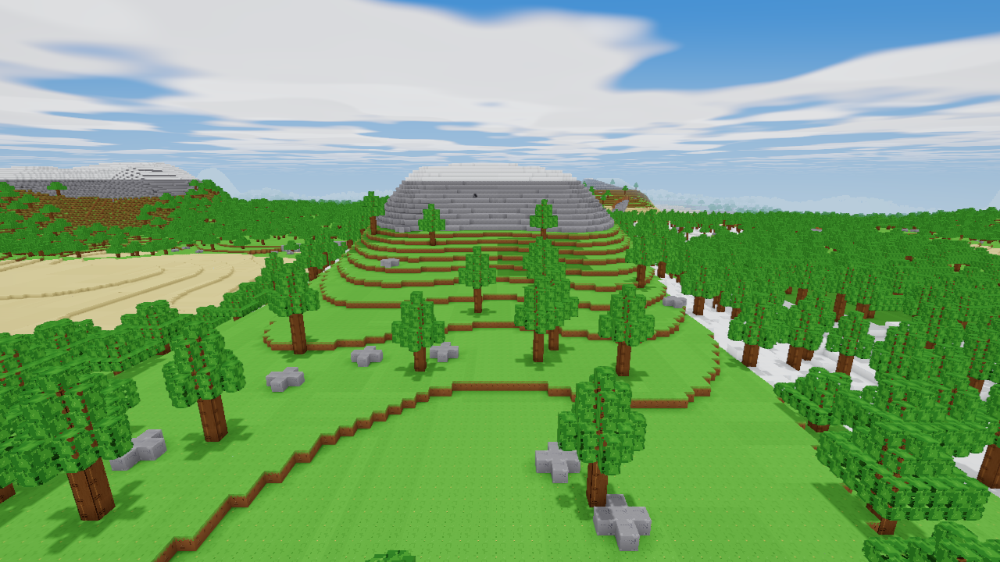
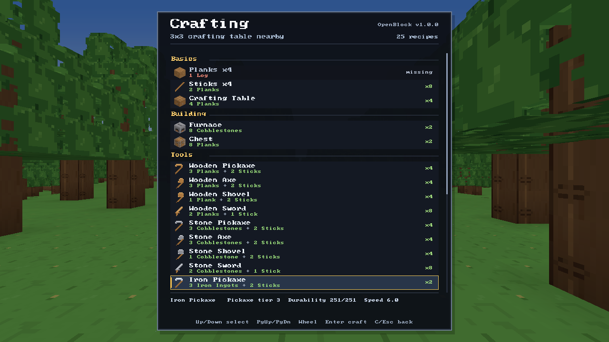
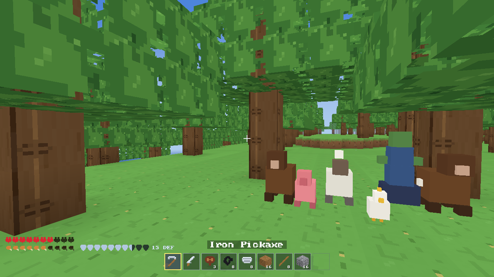
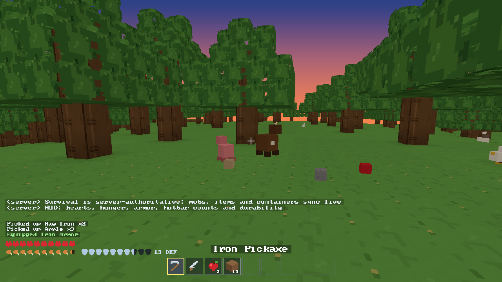
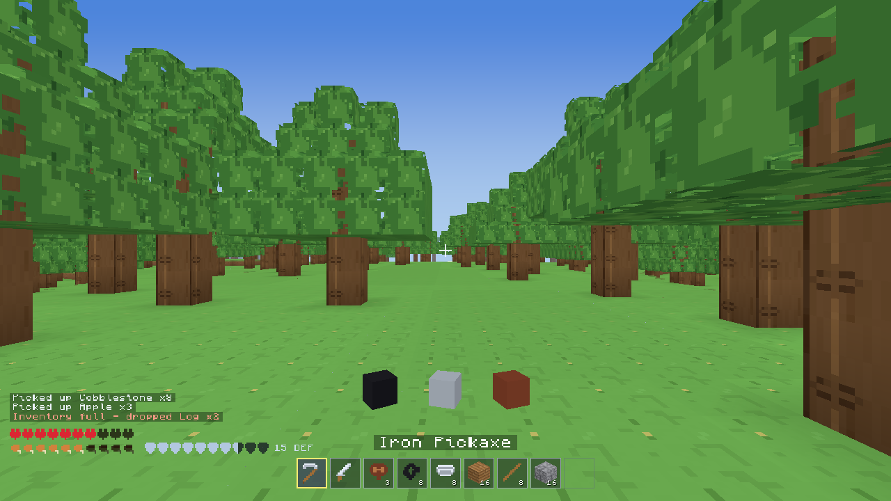
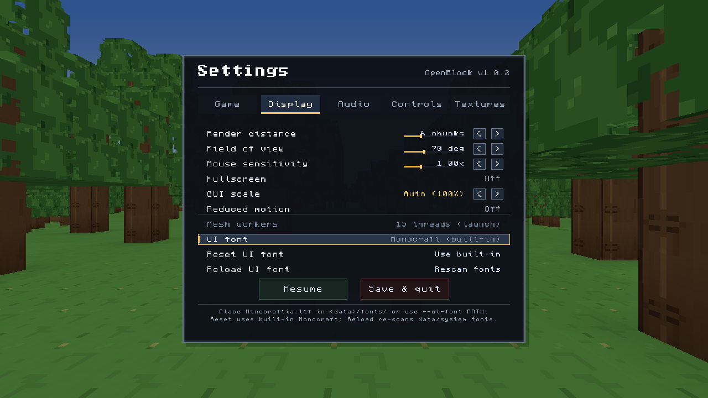

<p align="center">
  <h1 align="center">OpenBlock</h1>
  <p align="center"><strong>A fast, self-hostable voxel sandbox — written in Rust.</strong></p>
</p>

<p align="center">
  <a href=".github/workflows/ci.yml"></a>
  <a href="LICENSE-MIT"></a>
  
  
  
</p>

OpenBlock is an open-source voxel sandbox: mine, build, explore and survive alone
or with friends on servers you host yourself. **1.1.0 is an Early Access
release**: the core survival game and self-hosted multiplayer are playable and
tested end-to-end, while crafting-grid, lighting, farming, weather and the
modding track are explicitly post-1.0 (see [Known limitations](#known-limitations)).



## What's in 1.0

- **Survival core** — procedural world with five biomes, caves/ravines and
  coal/iron/copper ore veins; health/hunger, fall damage, starvation and
  regeneration; mining with tool requirements, speeds and durability; block
  drops as visible item entities with a pickup magnet; death/respawn with
  persisted vitals and inventory.
- **Progression** — 25 recipes (planks, sticks, crafting table, wooden/stone/
  iron tools, leather/iron armor), furnace smelting with fuel, chests, 27-slot
  container windows; iron tools and armor with real stat/durability changes.
- **Mobs and combat** — cows, pigs, sheep, chickens and zombies with
  deterministic AI, day/night/depth spawning, sun burn, melee combat, knockback,
  armor mitigation (up to 80%), mob drops and client-side blocky avatars.
- **Self-hosted multiplayer** — dedicated server with world streaming, chat,
  player roster, avatars/name tags and **server-authoritative survival**
  (inventories, vitals, equipment, actions, containers, death/respawn,
  persistence); protocol v2 over TCP with strict limits. No TLS yet: use it on a
  LAN, VPN or SSH tunnel.
- **Audio** — 79 procedurally synthesized clips total: 77 SFX (material
  footsteps, break/place, pickup, hurt/death, eat, craft, tool break, splash,
  UI) plus two loops (wind/forest ambience and a music pad); master/SFX/music
  volumes and mute in the Audio tab. Real output on Linux via PulseAudio loaded
  at runtime; Windows/macOS build with a silent stub in 1.0.
- **512-block reach and shaders** — up to **32 chunks / 512 blocks** of view
  distance with a surface-shell LOD, adaptive streaming and measured 90+ FPS at
  720p / 60+ FPS at 1080p (High, 512 blocks); HDR pipeline with sun-shadow
  cascades, translucent animated water, procedural clouds, bloom, ACES
  tonemapping and FXAA; Low/Medium/High/Ultra presets and a Graphics settings tab.
- **Exploration content** — deterministic ruined towers, abandoned camps, stone
  circles and mineshaft adits in every world (1.1), with more structures/loot
  planned.
- **Front-end and accessibility** — title screen (Continue/New World/Load World/
  Multiplayer/Settings/Quit), world browser, direct connect with recent servers,
  interactive key rebinding for 17 actions, reduced motion, persisted HUD
  visibility, **GUI scale (Auto/75/100/125/150)**, readable spaced UI at
  1280×720 and 960×540, and a **Minecraft-style UI font** (Monocraft, SIL OFL)
  with the original 8×8 pixel font kept for titles/headings. Body text uses a bundled **Monocraft** (SIL OFL 1.1)
  Minecraft-style font; titles and panel headings keep the original 8×8
  bitmap look, and a personal `Minecraftia.ttf` can be selected with
  `--ui-font PATH` or dropped into `<data-dir>/fonts/`.
- **Resource packs** — load Minecraft-format pack directories at runtime
  (`--texture-pack PATH`), with biome tinting, animated first frames and
  per-layer fallback. No third-party assets are bundled or redistributed.
- **Server operations** — hardened systemd unit, dependency-free container image
  + compose file, backup/restore scripts, load-test bots, periodic JSON metrics
  snapshots (`--metrics-json`), admin handbook and graceful SIGINT/SIGTERM
  saves.

| Survival | Crafting | Mobs | Multiplayer |
| --- | --- | --- | --- |
|  |  |  |  |

More captures (new world, world browser, connect, controls, settings, furnace,
chest, death, F3, name tags) are in [`docs/img/`](docs/img/README.md).

## Quick start

Build requirements: Rust 1.100+, a working Vulkan driver, and on Linux
Wayland/X11 libraries. The repository's `./dev-cargo` wrapper pins a workspace
`CARGO_HOME` and a Zig-based linker for systems without a C compiler; plain
`cargo` works on normal Fedora/Ubuntu installs.

```sh
# single player (title screen)
cargo run --release -p ob_client --bin openblock

# host a survival world (no GPU or audio device needed)
cargo run --release -p ob_server --bin openblock-server -- \
  --listen 0.0.0.0:25565 --world myworld --motd "My server"

# join it
cargo run --release -p ob_client --bin openblock -- \
  --connect 127.0.0.1:25565 --name alice
```

Packaging recipes: [packaging/](packaging/README.md) holds the Flatpak manifest,
COPR RPM spec, systemd units and container files; [docs/admin/](docs/admin/README.md)
covers hosting, backups, upgrades and security. **No RPM, Flatpak or container
artifacts were published for v1.0.0** (the GitHub release carries only the four
screenshots below), so build from source or from a reviewed tag until the 1.0.x
packaging wave publishes binaries (tracked in the
[1.0.1 audit](docs/plan/1.0.1-audit.md)).

## Controls

| Input | Action |
| --- | --- |
| WASD / mouse | move / look |
| Space | jump (swim up in water) |
| Shift | crouch/sneak (edge-safe, lower camera) |
| Ctrl | sprint |
| F | toggle flight |
| Hold LMB | mine; attacks a mob under the crosshair |
| RMB | place / eat / open furnace or chest / use |
| 1–9, wheel | select hotbar slot |
| E | inventory (armor slots included) |
| C | crafting |
| T / Tab | chat / player roster (multiplayer) |
| F1 / F2 / F3 | hide HUD / screenshot / debug overlay |
| Esc | settings (or back) |

All gameplay keys can be rebound in **Settings → Controls**.

### UI font (1.0.2)

Body text, HUD, menus and chat use a Minecraft-style TTF font — **Monocraft**,
bundled under the SIL Open Font License 1.1 — while the logo, panel titles and
big headings keep the original 8×8 bitmap font. You can use the exact
**Minecraftia** font locally (its licence is personal-use only, so it is not
bundled):

```sh
mkdir -p "${XDG_DATA_HOME:-$HOME/.local/share}/openblock/fonts"
cp /path/to/Minecraftia.ttf "${XDG_DATA_HOME:-$HOME/.local/share}/openblock/fonts/"
# or persist a path:
openblock --ui-font /path/to/Minecraftia.ttf
# back to the bundled font:
openblock --default-ui-font
```

**Settings → Display → UI font** shows the active font/source and has Reset and
Reload actions; F3 reports it too. Any `.ttf`/`.otf` in `<data-dir>/fonts/` is
auto-discovered (files named `minecraftia` are preferred), with system-font
discovery as a fallback. See [docs/client-ui-font.md](docs/client-ui-font.md).

| Font/UI | Settings → UI font |
| --- | --- |
|  |  |

UI font: **Settings → Display → UI font** shows the active font and source, with
**Reset UI font** and **Reload UI font** actions. `--ui-font PATH` loads a
TTF/OTF for this and future runs; `--default-ui-font` returns to the bundled
Monocraft; placing `Minecraftia.ttf` in `<data-dir>/fonts/` selects it
automatically. Titles remain in the 8×8 bitmap font by design. See
[client UI font](docs/client-ui-font.md) for the exact paths, fallback rules and
Minecraftia licensing note.

## Multiplayer and servers

The dedicated `openblock-server` ships with a flat `server.toml`, CLI flags,
console commands (`help`, `list`, `say`, `kick`, `save`, `tps`, `stop`), a
whitelist, autosave, per-player persistence by name and a metrics JSON stream
(`--metrics-json`). The interim wire protocol is **plain TCP + JSON without
TLS or authentication**, and movement is client-authoritative within server
bounds/reach/rate checks — do not expose it directly to the public internet.
Full guidance: [docs/admin/security.md](docs/admin/security.md).

The load gate in CI runs four bot clients on every push to `main` and on every
pull request; the full 8-client load gate and a 10-minute soak are available
locally:

```sh
python3 scripts/load-gate.py --quick     # CI profile
python3 scripts/load-gate.py             # 8 clients, 60 s
python3 scripts/load-gate.py --soak      # 8 clients, 10 min
```

## Performance

The benchmark suite (`worldgen_bench`, `server_bench`, `save_bench`, `soak`)
runs quick profiles in CI; measured reference numbers live in
[docs/plan/08-measurements.md](docs/plan/08-measurements.md) and
[docs/plan/09-benchmarks.md](docs/plan/09-benchmarks.md).

- Worldgen: **0.92 ms/chunk** mean (p99 1.15), caves + ores included.
- Server simulation: tick p99 **≤0.03 ms** single-player baseline; 8-client load
  gate tick p99 **0.163 ms**, 20.0 TPS, RSS 22.3 MiB, 0 overruns >35 ms.
- Saves: 21 ms at 289 columns, 156 ms at 2,025 columns (synchronous save is the
  known pause gap below); v1–v4 migrations verified.
- Test suite: 753 passing tests (764 test functions; 11 intentionally ignored
  GPU, measurement and local-pack probes), including adversarial
  protocol/save/pack tests, network loopback survival tests, a full acceptance
  scenario and GPU probes.

## Known limitations

These are the accepted 1.0.0/1.0.x limitations; items marked 1.0.1 or post-1.0
are not shipped in the initial release.

- Crafting is **recipe-book based**; a spatial 3×3 grid is post-1.0.
- No torches/block lighting, farming, weather, beds, dimensions or redstone;
  mob spawning uses time-of-day and depth.
- Multiplayer has no TLS/auth/anti-cheat and client-authoritative movement;
  crafting is not yet available on servers (single-player only).
- Windows/macOS audio is a silent stub in 1.0; Linux audio is real.
- Whole-world saves are synchronous (autosave can cause a >50 ms tick spike on
  large worlds; 2,025-column save ≈156 ms).
- The 4-vCPU/8-GiB reference capacity claim, 16/50-player rows and async save are
  planned for the 1.0.x hardening line.
- Only the base 20 blocks / 52 items / 5 mobs / 25 recipes are shipped; the WASM
  modding track, shader packs beyond the built-in styles and controller support
  remain post-1.0.

The full 1.0 checklist, accepted limitations and audit results:
[docs/plan/1.0-scope.md](docs/plan/1.0-scope.md),
[docs/plan/1.0-acceptance.md](docs/plan/1.0-acceptance.md),
[docs/plan/1.0.1-audit.md](docs/plan/1.0.1-audit.md).

## Documentation

- [docs/README.md](docs/README.md) — specification, research and project plan.
- [docs/spec/01-technical-architecture.md](docs/spec/01-technical-architecture.md) — crate graph and architecture.
- [docs/spec/18-networking-multiplayer.md](docs/spec/18-networking-multiplayer.md) — protocol v2 and multiplayer design.
- [docs/admin/](docs/admin/README.md) — server quickstart, configuration, admin, security, backup, upgrade, troubleshooting.
- [docs/plan/1.0.1-audit.md](docs/plan/1.0.1-audit.md) — post-release docs/security/metadata audit findings and accepted risks.
- [CONTRIBUTING.md](CONTRIBUTING.md) — build, test and review workflow.

## Architecture at a glance

A Cargo workspace of 16 crates: `ob_math`/`ob_core` (foundation),
`ob_content`/`ob_world`/`ob_worldgen`/`ob_sim`/`ob_protocol` (headless data and
simulation), `ob_render`/`ob_audio` (presentation), `ob_server`/`ob_client`
(hosts), `ob_tools` (benchmarks/soak), plus `xtask`. Three further crates —
`ob_net`, `ob_ui` and `ob_modding` — are post-1.0 scaffolds: they are empty
placeholders declared in `architecture.toml` so the planned edges stay explicit,
and nothing in the shipped binaries links them yet. The dedicated server is
GPU-free (enforced by the architecture guard and a CI dependency check); the
client and renderer never run on the server.

## Contributing

Contributions are welcome. Start with [CONTRIBUTING.md](CONTRIBUTING.md); the
CI gates are `./dev-cargo fmt`, `clippy -D warnings`, workspace tests, rustdoc,
the architecture guard and the docs checker (see the workflow for the exact
commands). No third-party game assets may be committed; resource packs are
loaded from user-owned files only.

## License and legal

OpenBlock is dual-licensed under MIT or Apache-2.0 (see `LICENSE-MIT` /
`LICENSE-APACHE`). It is not affiliated with Mojang or Microsoft. Minecraft
resource packs are read at runtime from local paths selected by the user and are
never bundled or redistributed by OpenBlock; respect each pack's licence.
