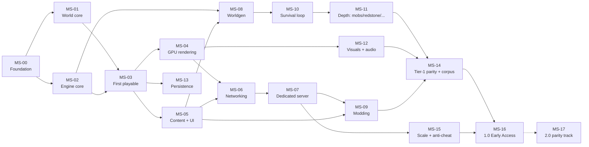

# Roadmap — from an empty repository to 1.0 Early Access and 2.0

> Status: normative planning · Last updated: 2026-11-24
> Depends on: [vision](../vision.md), [decision register](../decisions.md)
> Companion: [Milestones](01-milestones.md) (exit criteria), [MVP definition](02-mvp.md)

## 1. How to read this roadmap

- The unit of progress is a **milestone** (`MS-xx`), not a date. Each milestone
  ends in something runnable, demonstrable and measurable.
- Effort is expressed in **dev-weeks** (one experienced, full-time engineer).
  AI-assisted development improves some of this (see §13) but is not assumed for
  hard debugging, driver work or game feel.
- **Dependencies are real.** The milestone graph below is the critical path; the
  numbering is the recommended build order, not a strict sequence.
- **Performance gates are part of every milestone**, not a final phase (DEC-035,
  [spec/25](../spec/25-performance-budgets.md)).
- Public releases are cut from milestones that pass their exit criteria. There
  are no "release engineering weeks" outside `MS-16`.

## 2. Release philosophy

1. **Nothing stays unplayable for long.** From `MS-03` onward, `main` always
   builds into a game you can launch and walk around in. If a refactor breaks
   that, it lands behind a flag or not at all.
2. **Release early, release often, be explicit about state.** Every public
   release says which parity tier it covers and what is missing.
3. **Saves are sacred from the first public build.** Once `0.1-alpha` ships, a
   save opened by a newer version upgrades automatically and never silently
   corrupts (DEC-033). Pre-0.1 saves may break; the format is documented anyway.
3. **The protocol is documented from the first multiplayer release.** Third-party
   tools, bots and server implementations are a feature (DEC-027).
4. **Semver for crates and the protocol; marketing versions for releases.**
   `0.x` may break APIs; `1.0` freezes the save format (with forward migrations),
   the mod host ABI (DEC-020) and the documented protocol.
5. **Every release has a demo video and a changelog.** Progress must be visible
   to players and contributors.

## 3. Phases at a glance

| Phase | Milestones | Release | Player-visible outcome | Engineering effort |
| --- | --- | --- | --- | --- |
| **A — Foundation and first playable** | MS-00, MS-01, MS-02, MS-03 | `0.0.1` tech preview | A window, a generated world, a blocky person, mine and place | 26–30 dev-weeks |
| **B — Engine maturity and content platform** | MS-04, MS-05 | `0.1.0-alpha` | 512-block view at high frame rates, inventory, HUD, content packs | 26–32 |
| **C — Multiplayer and servers** | MS-06, MS-07 | `0.2.0-alpha` | Invite a friend or join a self-hosted server; 20 TPS server binary | 23–29 |
| **D — World and survival** | MS-08, MS-10, MS-13 | `0.3.0-beta` | Biomes, caves, structures, dimensions; health/hunger/crafting/furnaces | 43–53 |
| **E — Depth and ecosystem** | MS-09, MS-11, MS-12 | `0.4.0-beta`, `0.5.0-beta` | Common mobs, basic redstone, enchanting/trading basics; WASM mods; shadows and audio | 44–53 |
| **F — Parity, scale and polish** | MS-14, MS-15 | `0.6.0-beta`, `1.0.0-rc` | Tier-1 parity gate green; parity-corpus infrastructure; 50 co-located players; anti-cheat; accessibility | 28–33 |
| **G — Early Access launch** | MS-16 | `1.0.0` | Signed builds, updater, docs, Early Access launch | 10 |
| | | | **Total to 1.0 (Early Access)** | **≈ 200–240 dev-weeks** + content/QA |
| **2.0 track** | MS-17 | `2.0` | Full Tier-2 parity: the remaining blocks, items, mobs, structures, redstone, bosses and commands | **≈ 500–800 dev-weeks** + art/audio |

The 1.0 column is a bottom-up engineering estimate for a deliberately scoped
Tier-1 release. The previous 159-dev-week total was **5–8× below** the project's
own research inventory; the honest comparison is the two-track total
(200–240 + 500–800 ≈ **700–1,040 dev-weeks**), reconciled in §11. Content, art,
audio and QA are budgeted separately (§12).

## 4. Phase A — Foundation and first playable (`0.0.1`)

**Goal:** prove the architecture end-to-end with the smallest possible vertical
slice: a real world, real chunks, real meshing, real physics, real save file —
not a tech demo with fake data.

| Milestone | What it delivers | Effort |
| --- | --- | --- |
| **MS-00 Foundation** | Workspace, CI gates, conventions, decision register, benchmark harness skeleton, asset/license policy, `hello window` through wgpu, `hello headless server` process | 1 |
| **MS-01 World core** | Paletted 16³ sections, chunk columns, dimension height model, world storage, block changes, light storage, deterministic RNG, serialization round-trip tests | 6–7 |
| **MS-02 Engine core** | App loop, stages, fixed tick, scheduler, job system, platform abstraction, config, diagnostics/profiler, determinism test harness, `hecs` entity store | 5–6 |
| **MS-03 First playable** | `openblock` window, wgpu device, naive mesher → greedy mesher, chunk streaming around the player, first-person controller with AABB voxel physics, break/place with raycast, minimal content registry, integrated server, save/load, HUD crosshair/FPS | 14–16 |

**Phase A exit criteria**

- Launch `openblock`, spawn in a deterministic test world, walk, jump, fall,
  collide, break and place blocks for ten minutes without a crash.
- A 256-block view distance holds 60 FPS on a mid-range GPU with the naive
  pipeline (this is the baseline the next phase must beat by 4×).
- Save, quit, relaunch, and every block and inventory slot is exactly as left.
- The headless test harness can run 10,000 ticks of the same world and produce a
  bit-identical state hash on Linux and Windows CI runners.
- CI enforces fmt, clippy `-D warnings`, tests, cargo-deny, shader validation and
  the `ob_server` GPU-free dependency rule.

**Demo:** a 60-second clip of walking through generated terrain, breaking and
placing blocks, FPS counter visible.

## 5. Phase B — Engine maturity and content platform (`0.1.0-alpha`)

**Goal:** turn "a prototype that renders" into "an engine that holds 512 blocks
of view at speed, with a content pipeline and a real UI".

| Milestone | What it delivers | Effort |
| --- | --- | --- |
| **MS-04 GPU rendering** | Render graph, 32³ default cluster meshing on worker threads (DEC-048), GPU upload ring, region/cluster culling, multi-draw-indirect submission, texture arrays, CSM shadows, basic post (tone map, TAA), streaming budgets, benchmark scenes and CI perf gates at p95/p99 | 12–15 |
| **MS-05 Content + UI** | Registry/tags/pack loader and validator, `base` pack as data, retained UI (taffy + cosmic-text), main menu, HUD, inventory/containers with server-authoritative transactions, settings, localization scaffolding, audio event bus with placeholder sounds | 14–17 |

**Phase B exit criteria**

- 512-block render distance sustains **≥ 120 FPS** on the reference machine,
  p99 frame time within the budget; a scripted fly-through benchmark is enforced
  in CI (DEC-035).
- Content packs load from a directory/zip, are schema-validated, hot-reload in
  development, and the base game is itself a pack with no private hooks.
- Inventory transactions are server-authoritative and survive 30% packet loss in
  the in-process harness without item duplication.
- All UI strings are localizable; one non-English locale is shipped as proof.

**Demo:** a fly-through at 512 blocks with the FPS overlay; creating a new block
via a content pack and placing it.

## 6. Phase C — Multiplayer and servers (`0.2.0-alpha`)

**Goal:** two players on the same world, one of them on a VPS, with prediction
that feels good on a 60 ms link.

| Milestone | What it delivers | Effort |
| --- | --- | --- |
| **MS-06 Networking** | QUIC transport (quinn) with datagrams/streams, protocol v1 with content-hash + view-hash handshake (DEC-050), join and progressive world streaming, interest management by render distance (DEC-052), entity replication, client prediction/reconciliation, LAN discovery, in-process network simulator, netem-style loss/latency tests | 16–20 |
| **MS-07 Dedicated server** | `openblock-server` binary, TOML config, console commands, ops/whitelist/bans, backups, graceful shutdown, structured logs, Prometheus metrics, pregeneration CLI, Docker image, systemd unit, server administration docs; 256-block render default (DEC-052) | 7–9 |

**Phase C exit criteria**

- Two clients join a dedicated server over the internet; movement feels local
  under 80 ms RTT and 2% packet loss; block edits from one player appear on the
  other within one tick.
- A 4 vCPU / 8 GiB VPS runs a 16-player world at 20 TPS with 2,000 loaded chunks,
  with the players **co-located** in a shared spawn region (shared column cache;
  DEC-052).
- A 512-block-radius join (opt-in setting; DEC-052) reaches playable within the
  published budget; the default 256-block join is materially cheaper.
- The server survives a malicious-client fuzz corpus without crashing, and
  movement/reach violations are detected and logged.
- `docker compose up` in an empty directory produces a joinable server in under
  a minute, with the ticket printed to the log.

**Demo:** a split-screen recording of two players building together, and a
`docker compose up` terminal capture.

## 7. Phase D — World and survival (`0.3.0-beta`)

**Goal:** the game becomes a *survival game*: a generated world worth exploring
and a progression loop worth playing.

| Milestone | What it delivers | Effort |
| --- | --- | --- |
| **MS-08 Worldgen** | Noise stack, terrain shapes, biomes (climate-based), caves/aquifers/ravines, ore distribution, vegetation and features, structures (villages, temples, strongholds, …), underworld and terminus dimensions (`openblock:underworld`, `openblock:terminus`), deterministic parallel generation at ≥ 250 columns/s on 8 threads, pregeneration | 20–24 |
| **MS-10 Survival loop** | Health/damage types/armor/combat, hunger and food, XP, tools and tiers, drops and block-breaking rules, crafting/stonecutting/furnaces/blast furnace/smoker, containers and hoppers, item entities, death/respawn, beds/anchors, difficulty, weather effects | 16–20 |
| **MS-13 Persistence maturity** | Region file format v1 frozen, migrations, world management UI, backup/restore, corruption recovery, `ids.json` content mapping, import/export tooling, save-size benchmarks | 7–9 |

**Phase D exit criteria**

- A player can start a world, survive a night, mine, smelt, craft tools and armor,
  build a house, explore 2,000 blocks in every direction, and enter the
  underworld — all without admin commands.
- Worldgen is deterministic across platforms and produces no floating structures,
  broken biomes or unplayable spawns over a 10,000-seed corpus (nightly run).
- The save format round-trips a modded world with unknown content IDs without
  data loss (unknown content is preserved, not dropped).

**Demo:** a 10-minute "first day" survival playthrough.

## 8. Phase E — Depth and ecosystem (`0.4.0-beta`, `0.5.0-beta`)

**Goal:** the Tier-1 depth that makes it a survival game, and the modding
platform that makes it more than a clone. Full Tier-2 depth is the 2.0 track
(`MS-17`).

| Milestone | What it delivers | Effort |
| --- | --- | --- |
| **MS-09 Modding** | Content pack SDK and validator, WASM mod host (wasmtime) with capabilities and quotas, event/query host ABI v1, mod template and examples, server mod verification, per-mod profiler, `base` game fully migrated onto the public API, hot reload | 14–17 |
| **MS-11 Depth (Tier 1)** | Common mobs and AI (pathfinding, spawning, behaviours), basic redstone (wire, torch, repeater, comparator, pistons, lamps), farming/breeding, brewing/enchanting basics, anvil and trading basics, boats/minecarts, portals, statistics and a guided advancement chain; full Tier-2 mob/block/structure sets move to `MS-17` | 18–21 |
| **MS-12 Visuals and audio** | Full post stack (GTAO, SSR water, volumetric atmosphere, bloom), weather, particles, ambient sound and music system, dynamic range and spatialisation, quality presets, shader-pack API v1, controller support | 12–15 |

**Phase E exit criteria**

- The Tier-1 depth checklist passes for common mobs, basic redstone, enchanting
  and trading basics, and portals (the parity corpus is executable, see
  [MS-14](01-milestones.md)).
- A mod written against the template adds a block, an item, a recipe, a mob and a
  UI screen (server-computed data, no client mod code; DEC-049) and runs on a
  server with unmodified clients; a misbehaving mod is stopped by quotas instead
  of crashing the host.
- Redstone circuits behave deterministically and survive save/load; a suite of
  Tier-1 reference circuits (door, clock, comparator logic) passes.
- The audio mix has a documented voice/streaming budget and never drops the
  frame budget.

**Demo:** a modded server minigame written entirely as a WASM mod, plus a redstone
contraption showcase.

## 9. Phase F — Parity, scale and polish (`0.6.0-beta`, `1.0.0-rc`)

**Goal:** clear the Tier-1 parity gate, build the parity-corpus infrastructure
that 2.0 will need, make servers scale, and make the game feel finished rather
than feature-complete. 1.0 does **not** close Tier 2; `MS-17` does.

| Milestone | What it delivers | Effort |
| --- | --- | --- |
| **MS-14 Tier-1 parity + corpus** | Hand-authored behavioural parity checklist and executable corpus (DEC-051), Tier-1 parity closure, Tier-2 coverage reporting and gap list for `MS-17`, spectator, full datapack semantics (where we adopt them), accessibility (narrator, remap, colour-blind, subtitles, controller), localization completeness, UX polish, tutorial/onboarding, world creation screen, performance presets | 18–21 |
| **MS-15 Scale + anti-cheat** | Interest-management tuning for 50 **co-located** players and a separately measured **distributed** row (DEC-052), parallel region ticking, anti-cheat validation suite and replay evidence, moderation tools, admin RPC, load/stress harness (bots), server capacity model and benchmark, DDoS/rate-limit hardening, crash containment | 10–12 |

**Phase F exit criteria**

- The parity report states the two numbers separately (DEC-051) and **meets them
  for 1.0**: 100% of the in-scope Tier-0/1 checks pass, and vanilla coverage of
  the pinned baseline is ≥ 85% on the hand-authored behavioural checklist. The
  Tier-2 content gap list is published and labelled as the 2.0 commitment.
- 50 co-located bot players on the 4 vCPU VPS reference hold 20 TPS for one hour
  with p99 tick ≤ 35 ms at 256-block render/simulation distance; the distributed
  player row is measured and published separately and is lower, and a 100-player
  co-located stress test is documented with the config that achieves it on 8 vCPU.
- Accessibility checklist passes: full keyboard/gamepad navigation, remappable
  bindings, UI scale, subtitles, narrator on menus, colour-blind palettes.
- No known crash, duplication, or remote-exploit issue from the fuzz corpus.

## 10. Phase G — 1.0 Early Access launch (`1.0.0`)

**Milestone MS-16** delivers the boring-but-critical launch work: signed builds
for all 1.0 platforms, auto-updater with delta patches and rollback, Flatpak/
AppImage/AUR packaging, container images, website and download page, migration
from 0.x saves, mod API 1.0 freeze and compatibility promise, launch trailer,
trademark clearance sign-off (DEC-037), and the support/security playbook.

1.0 is an **Early Access** release (DEC-051): Tier-1 parity + Tier-2
infrastructure + the modding platform. Full Tier-2 parity is `MS-17` (2.0) and
the launch notes say so explicitly.

**1.0.0 ship criteria** are the union of the Tier-1 phase criteria plus: both
parity numbers are met — 100% of in-scope Tier-0/1 checks pass and vanilla
behavioural coverage is ≥ 85% on the hand-authored checklist — and both are
published with the Tier-2 gap list; 30 consecutive days of release-candidate play
without a P0 bug; a save from `0.1-alpha` migrates to `1.0` losslessly; the
dedicated server runs 7 days unattended on the reference VPS without leaking
memory or corrupting a save; and the release notes state the Tier-1 scope, both
parity numbers, and the 2.0 commitment.

## 11. Effort model and calendar scenarios

The review board found the previous **159 dev-week** total to be 5–8× below the
project's own research inventory: [research/05](../research/05-minecraft-feature-inventory.md)
§2 estimates Tier 0 at ~80–125 person-months and Tier 2 at ~190–300
person-months (≈ 823–1,300 dev-weeks at 4.33 dev-weeks per person-month), before
art and audio. The plan is therefore **two tracks**, and the numbers below are
the honest ones. Content, art, audio and QA are separate (§12).

### 11.1 Track 1 — 1.0 Early Access (Tier 1 + Tier-2 infrastructure + modding)

| Phase | Dev-weeks |
| --- | --- |
| A Foundation + first playable | 26–30 |
| B Rendering + content/UI | 26–32 |
| C Multiplayer + servers | 23–29 |
| D World + survival | 43–53 |
| E Modding + Tier-1 depth + audio/visuals | 44–53 |
| F Parity + scale | 28–33 |
| G Early Access launch | 10 |
| **Total to 1.0** | **≈ 200–240** |

That is **≈ 4–5 person-years of engineering** (200–240 ÷ 52) before content/QA
and before the risk-register delay. It is a deliberately narrowed *scope* — Tier
1 parity, not full parity — but it is a bottom-up estimate, still ±30%; the
MS-03 exit review replaces it with measured throughput. Track 1 and Track 2 are
not comparable one-by-one with the inventory's tiers (the inventory's Tier 1
already includes much of what this plan defers to `MS-17`): the **combined**
two-track total is ~700–1,040 dev-weeks, which brackets the lower half of the
inventory's 823–1,300 dev-week Tier-2 range. The remainder to the inventory's
upper bound is content authoring, art and audio, budgeted in §12, not a hidden
reserve.

Calendar scenarios (full-time equivalents; team figures already include 20%
coordination overhead). The final column adds the risk-register allowance of
roughly 20% (§16 and [risks](05-risks.md)):

| Scenario | Throughput assumption | First playable (`0.0.1`) | Public alpha (`0.1`) | Multiplayer (`0.2`) | `1.0` Early Access (base) | `1.0` with risk allowance |
| --- | --- | --- | --- | --- | --- | --- |
| **Solo, full-time, AI-assisted** | ~0.85 dev-week per calendar week | ~7–8 months | ~14–17 months | ~20–25 months | **~4.5–5.5 years** | **~5.5–6.5 years** |
| **Solo, part-time** | ~0.4 dev-week per calendar week | ~1.3–1.5 years | ~2.5–3 years | ~3.5–4.5 years | **~9.5–11.5 years** | **~12–14 years** |
| **Team of 3** | ~2.4 dev-weeks per calendar week | ~2.5–3 months | ~5–6 months | ~7–9 months | **~20–23 months** | **~24–28 months** |
| **Team of 6** | ~4.4 dev-weeks per calendar week | ~6–7 weeks | ~3 months | ~4–5 months | **~11–13 months** | **~13–15 months** |

The old "159 ÷ 0.85" was already ~3.6 years solo; the honest base is now ~4.5–5.5
years, and with the risk allowance it is ~6 years. That is the cost of the scope
the project actually promised.

### 11.2 Track 2 — 2.0 full Tier-2 parity (`MS-17`)

| Item | Estimate |
| --- | --- |
| Engineering: remaining blocks/items/mobs/biomes/structures, full redstone, bosses and progression, villagers/raids, commands, advancements/statistics, full server properties, Modern Delta re-baseline | **500–800 dev-weeks** |
| Art and audio for the full parity set | 30–50 dev-weeks equivalent (plus commissioning lead time) |
| Content authoring and QA | 20–30% of engineering, i.e. 100–240 dev-weeks |
| Team | **6–10 people for 2–3 years**, funded |

The 500–800 dev-week figure sits below the inventory's 823–1,300 dev-week Tier-2
estimate because it is an engineering-only estimate for the *remaining* work
after Track 1 has built the engine, content pipeline, networking and tooling; the
inventory's ranges include Tier-0/1 code and content authoring that Track 1
already pays for. Full parity remains a **2.0 promise, not a 1.0 one**, and it
requires funding that does not exist yet ([OPEN-019](../decisions.md)).

The single most common failure mode for projects like this is scope. The roadmap
is deliberately structured so that **each phase is a shippable product**: a
multi-year solo timeline is survivable because `0.1-alpha` arrives in months, not
years, and because 1.0 no longer pretends to be 2.0.

## 12. Content production (not in the numbers above)

Engineering effort does not include the content a parity game needs. Content is
budgeted per track, and none of it is in the dev-week totals above.

### Track 1 — 1.0 Early Access

| Work | Estimate | Notes |
| --- | --- | --- |
| Art: Tier-1 block/item textures, common-mob models, UI | 8–14 dev-weeks equivalent | Commission or license; must be original (DEC-009) |
| Audio: SFX, ambience, music | 4–6 dev-weeks equivalent | CC0/CC-BY sourcing plus commissioned music |
| Level design / structures / worldgen tuning | 4–8 weeks | Overlaps with MS-08 and MS-14 testing |
| QA / playtesting / parity verification | 20–30% of engineering time, i.e. 40–72 dev-weeks | The parity corpus makes this tractable |
| Localization (community) | Ongoing | Tooling from MS-05 makes it cheap |
| **Track 1 content/QA subtotal** | **≈ 56–100 dev-weeks** | Additive to the 200–240 |

### Track 2 — 2.0 full parity

| Work | Estimate | Notes |
| --- | --- | --- |
| Art and audio for the full Tier-2 set | 30–50 dev-weeks equivalent | Commissioned; separate from engineering |
| Level design, structure and dungeon content | 10–16 weeks | |
| QA / parity verification at full parity | 20–30% of 500–800, i.e. 100–240 dev-weeks | |
| **Track 2 content/QA subtotal** | **≈ 140–306 dev-weeks** | Additive to the 500–800 |

Recommendation: build a **placeholder pack** early (MS-03) with programmer art
so engineering never blocks on art, and commission the Tier-1 pack in Phase D so
it is ready for the alpha releases. Full-parity art is a 2.0 decision funded with
the 2.0 team (OPEN-019).

## 13. AI-assisted development (how this plan actually uses agents)

The plan is sized for a human team; AI agents are a multiplier on specific kinds
of work, and the plan should be honest about which.

| Work type | AI leverage | Why |
| --- | --- | --- |
| Research and specification drafting | High | Parallel synthesis of prior art, checklists, first drafts |
| Boilerplate, data schemas, CLI tools, tests | High | Mechanical, verifiable by CI |
| Documentation, changelogs, API references | High | Verifiable against code and specs |
| Content data (recipes, loot tables, block definitions) | High | Schema-validated, mass-produced |
| Refactors with strong tests | Medium | Tests are the safety net |
| GPU driver bugs, frame-time mysteries, netcode feel | Low | Requires measurement and judgment |
| Game design and balance | Low–medium | Needs playtesting taste |
| Security review and threat modelling | Medium | Useful as a second pair of eyes, not a substitute |

Process assumptions used for the calendar scenarios: AI-generated work is
reviewed by a human, CI gates it (DEC-035), and provenance rules apply
(DEC-036). Teams that skip review will spend the saved time on debugging
regressions.

**AI does not close a 5–8× gap.** The 200–240 dev-week 1.0 estimate already
assumes the high-leverage mix above (specs, schemas, boilerplate, content data,
tests) at the 0.85 dev-week-per-calendar-week solo throughput. AI leverage is
concentrated in work that is cheap relative to GPU driver debugging, netcode
feel, level design and playtesting, which stay low-leverage. The plan no longer
quotes an "AI-collapsed" number: the previous 159 dev-weeks implicitly did, and
that is how the estimate drifted from the inventory. Re-measure the real
throughput at MS-03 and re-baseline §11 with data.

## 14. Parallel tracks and the critical path

The real longest path is **`MS-05 → {MS-08, MS-10} → MS-11 → MS-14 → MS-16`**,
not the old `MS-03 → MS-04 → MS-06 → MS-11 → …` chain. The renderer and
networking are large, but they gate the content chain rather than lie on it:

- `MS-05 → MS-08` and `MS-05 → MS-10`: worldgen and survival both need the
  content model.
- `MS-06 → MS-11`: entity replication and the protocol carry the mob set, so
  depth cannot finish before networking.
- `MS-11 ↔ MS-09` (base migration): the "base game on the public API" epic in
  MS-09 cannot close before MS-11's content exists, so MS-11 gates MS-09's last
  epic; MS-09 then feeds MS-14. The arrow runs MS-11 → MS-09, not the reverse.
- `MS-05 → MS-13` (content mapping): `ids.json` and unknown-content
  quarantine are MS-13 work but need the MS-05 registry; MS-13 cannot close
  early.
- `MS-04 → MS-06` (streaming under join) and `MS-04 → MS-12` (post stack).
- `MS-14, MS-15 → MS-16`; `MS-16 → MS-17` is the 2.0 track, off the 1.0 path.

MS-11 is the long pole: 18–21 dev-weeks behind the 20–24 dev-week worldgen and
the 16–20 dev-week survival milestones. Safe parallelisation for a 3-person team:

| Track | Owner | Milestones |
| --- | --- | --- |
| Rendering and engine | Engineer A | MS-02, MS-04, MS-12, perf |
| Simulation and gameplay | Engineer B | MS-01, MS-08, MS-10, MS-11 |
| Networking, content, tools | Engineer C | MS-05, MS-06, MS-07, MS-09, MS-13 |

Content/art/audio can be commissioned from Phase C onward. Documentation and
content packs are ideal for AI-assisted parallel work.

## 15. Post-1.0 roadmap

**2.0 full Tier-2 parity is the first and largest post-1.0 commitment** and the
only one that needs a staffed, funded team (OPEN-019). It runs as its own track
in parallel with the smaller 1.x feature releases below; those releases do not
wait for it and do not require full parity.

| Release | Milestone | Theme | Highlights | Effort |
| --- | --- | --- | --- | --- |
| `2.0` | `MS-17` | **Full Tier-2 parity** | Remaining blocks/items/mobs/biomes/structures, full redstone, bosses and terminus progression, raids, potions, advancements/statistics, commands and game rules, full server properties; Modern Delta re-baseline (OPEN-020); full-parity art/audio | **500–800 dev-weeks**, 6–10 people for 2–3 years |
| `1.1` | `MS-24` | Flagship content I | First-party differentiators built on the mod API: programmable logic blocks (an in-world computer), first-class energy/fluid networks, one showcase tech pack | 10–14 |
| `1.2` | `MS-18` | Worlds and dungeons | Procedural dungeon/structure API, showcase adventure pack, map sharing | 8–12 |
| `1.3` | `MS-19` | Mobile | Android port, touch UI, mobile perf tiers, Play Store release | 8–12 |
| `1.4` | `MS-20` | Far terrain | Visual-only LOD/far-terrain renderer out to 128+ chunks and 1024-block render distance | 4–6 |
| `1.5` | `MS-21` | Native plugins + server mesh | Signed native plugin tier in a supervised process, multi-server network (proxy/lobby) | 6–10 |
| `1.6` | `MS-22` | Web and reach | WebTransport/web client feasibility, better Steam Deck and accessibility passes | 8–12 |
| TBD | `MS-23` | Compatibility gateway | Optional Minecraft-client gateway as an isolated, best-effort bridge (not core) | 10–16 |

Milestone IDs are stable identifiers, not release order (`MS-09` already follows
`MS-13` in the 1.0 plan). `MS-17` was assigned to the 2.0 track when it became the
first post-1.0 commitment; flagship content moved to the next free id, `MS-24`.
Community mods and content packs still fill most of the long-tail content
surface, but the engineering roadmap **grows** after 1.0: 1.0 is Early Access, and
2.0 is the remaining half of the parity promise.

## 16. Risks to this schedule (summary)

Full register: [Risks](05-risks.md). The schedule-sensitive ones:

| Risk | Impact | Mitigation |
| --- | --- | --- |
| Custom renderer takes longer than estimated | +30–50% on Phase B | Vertical slice first, buy UI/audio/text libraries, cut shadows/post if needed; the 200–240 dev-week 1.0 track carries the overrun |
| Netcode "feel" iterations | +50% on MS-06 | In-process simulator from day one; reference netcode patterns; accept correction |
| Parity content velocity (Minecraft ships 70–145 blocks/year) | Unbounded | Pinned baseline 1.21.11; hand-authored behavioural checklist; full Tier 2 is the 2.0 track with its own funding, not a 1.0 commitment |
| Effort model was 5–8× low (review finding) | Credibility and burnout | Two-track re-baseline (§11); measured throughput at MS-03 replaces the estimate |
| Solo founder burnout | Project death | Public milestones, playable builds, community early, scope tiers, a 1.0 that is honestly Early Access |
| Performance target missed at 144 FPS | Reputation | 120 FPS release gate, 144 FPS performance mode, honest benchmarking |
| Art/audio production | Blocks releases | Placeholder pack early; commission in Phase D; CC0 fallback; full-parity art is a 2.0 decision |

## 17. What to do in the first two weeks

If the team is one person and today is day zero:

1. Freeze the specification skeleton and the decision register (done in this
   repo).
2. Build the `MS-00` foundation: CI, profiler harness, `wgpu` window, headless
   server process, benchmark scene.
3. Start `MS-01` (paletted sections + tests) and `MS-02` (tick loop + determinism
   harness) in parallel.
4. Publish a weekly devlog. Recruiting contributors is easier when progress is
   visible.
5. Do **not** start with the worldgen or the mobs. The vertical slice is the
   single most important de-risking step in the entire plan.

## 18. Open questions

1. **Funding and staffing shape (owner: project lead, before Phase B).** The
   calendar scenarios assume full-time effort; the roadmap does not assume a
   funding source. Decide whether to pursue grants/sponsorship before or after
   the `0.1` alpha. The 2.0 track has its own, larger question (OPEN-019). →
   [Team and process](04-team-and-process.md) §7.
2. **Whether `0.0.1` is distributed publicly (owner: MS-03).** A public tech
   preview recruits contributors earlier but commits to save compatibility
   messaging and support load.
3. **Benchmark hardware (owner: MS-00/MS-04).** The performance gates require a
   dedicated bench box or a stable self-hosted runner; hosting cost is not yet
   budgeted.
4. **Content production timing (owner: MS-08/MS-14).** When to commission the
   real art/audio pack depends on the first public release date; see §12.
5. **Whether to ship 1.0 on Steam (owner: MS-16).** Steam adds Deck verification,
   store review and revenue-share considerations but reaches far more players
   than GitHub Releases alone. → [Platforms](01-milestones.md).
6. **2.0 staffing and funding (OPEN-019, owner: lead).** The 500–800 dev-week
   Tier-2 track needs 6–10 funded people for 2–3 years; the plan states the
   requirement rather than assuming it is met.
7. **Modern Delta (OPEN-020, owner: MS-17).** 1.21.11 is the 1.0 baseline; before
   the 2.0 parity claim, re-baseline to the then-current Minecraft release with a
   separate delta manifest that cannot destabilise the pinned corpus.

## 19. References

- [Vision](../vision.md), [decision register](../decisions.md)
- [Milestones](01-milestones.md), [MVP definition](02-mvp.md),
  [Work breakdown](03-work-breakdown.md), [Team and process](04-team-and-process.md),
  [Risks](05-risks.md), [Release and operations](06-release-and-operations.md)
- [Performance budgets](../spec/25-performance-budgets.md)
- Research: [Weft teardown](../research/01-weft-teardown.md),
  [engine stack](../research/02-engine-and-render-stack.md),
  [voxel rendering](../research/03-voxel-rendering-sota.md),
  [networking](../research/04-networking-sota.md),
  [Minecraft inventory](../research/05-minecraft-feature-inventory.md),
  [modding](../research/06-modding-and-content-system.md),
  [legal](../research/07-legal-licensing-and-ip.md),
  [UI/audio/i18n](../research/08-ui-audio-localization.md),
  [persistence/packaging](../research/09-persistence-assets-packaging.md),
  [custom content](../research/10-custom-content-and-differentiation.md)
