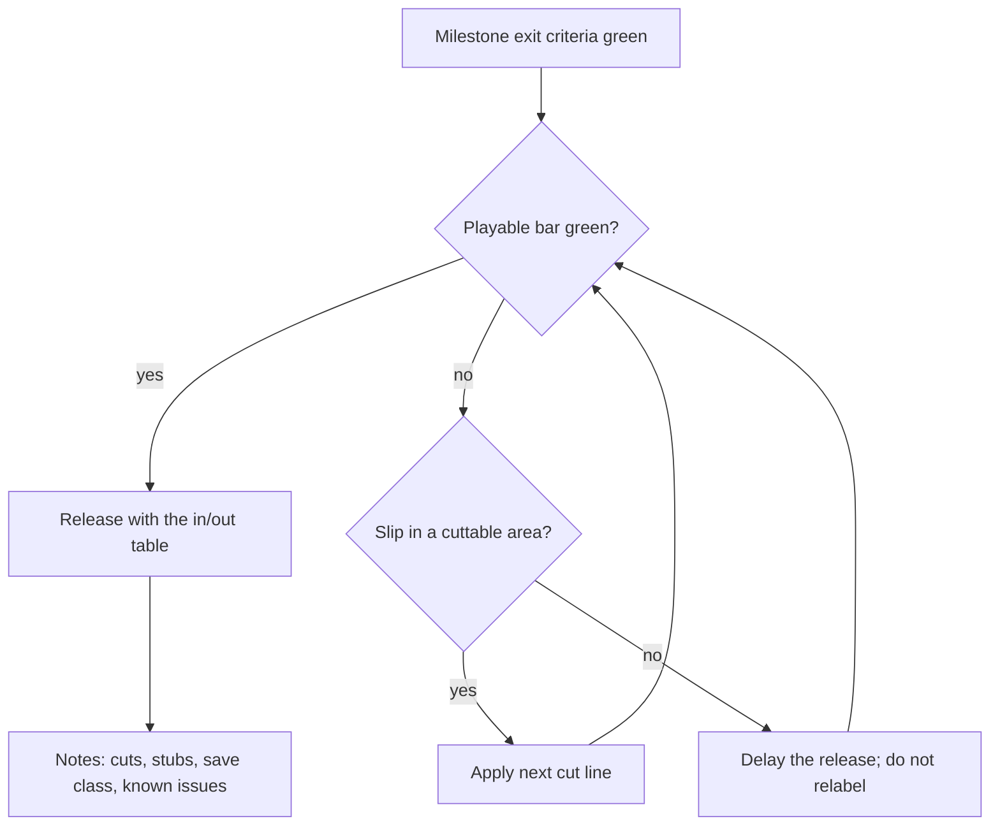

# MVP definition — the promise at `0.0.1`, `0.1` and `0.2`

> Status: normative planning · Last updated: 2026-11-24
> Depends on: [DEC-010](../decisions.md), [DEC-018](../decisions.md), [DEC-022](../decisions.md), [DEC-033](../decisions.md), [roadmap](00-roadmap.md), [milestones](01-milestones.md)
> Implements: MS-03 (`0.0.1` tech preview), MS-05 (`0.1.0-alpha`), MS-07 (`0.2.0-alpha`)

## 1. Purpose and scope

[Milestones](01-milestones.md) say what engineering must prove; this chapter says
what a **player** is promised at each MVP checkpoint, what is deliberately missing,
what we cut when something slips, and which feedback we may act on. It binds
releases, not milestones: a milestone can exit while its release waits, but a release
cannot ship over an unmet promise.

| Checkpoint | Version | Milestones | Effort | The question it answers |
| --- | --- | --- | --- | --- |
| **A** | `0.0.1` | MS-00–MS-03 | 26–30 dev-weeks | Does the architecture work end to end — world, mesh, physics, edit, save — with no faked layer? |
| **B** | `0.1.0-alpha` | MS-04, MS-05 | 26–32 dev-weeks | Is it a game a stranger can use, at 512 blocks of view and 120 FPS, with content that is data? |
| **C** | `0.2.0-alpha` | MS-06, MS-07 | 23–29 dev-weeks | Can two people play together on a server an ordinary person can run? |

The 1.0 feature set is in [vision §6](../vision.md), the two-track schedule in
[roadmap §11](00-roadmap.md), the tasks in [03](03-work-breakdown.md). The MVP
checkpoints are all **pre-1.0**; 1.0 itself is Early Access at Tier-1 parity
(DEC-051), not the full Tier-2 set.

**Parity statement.** 1.0 Early Access ships **Tier-1 parity plus the Tier-2
infrastructure and the modding platform**. Full Tier-2 parity is the **2.0**
track (`MS-17`), with its own ~500–800 dev-week budget. The parity gate is two
numbers, never one (DEC-051): (a) **100% of in-scope checks pass** and (b) **≥ 85%
vanilla coverage** of the pinned 1.21.11 baseline, measured by a hand-authored
behavioural checklist (never a copied registry dump). 1.0 must pass **100% of its
Tier-0/1 in-scope checks** and meet the **85% vanilla behavioural coverage
floor**; 2.0 must meet both for the full Tier-2 baseline, which is also where
every remaining block, item, mob, structure and command ships. No MVP checkpoint
may advertise "all Minecraft features".

## 2. Requirements

Every requirement is verifiable by inspection of the repository, the issue tracker or
a CI artifact. A checkpoint passes only when every acceptance criterion has a linked
artifact in its milestone issue; green CI without a playtest is not a passed checkpoint.

| ID | Requirement | Verification |
| --- | --- | --- |
| REQ-MVP-001 | Each checkpoint MUST publish its in/out table (§4–§6) in the release notes before the download is public. | Release-page inspection. |
| REQ-MVP-002 | A build MUST NOT be called "playable" unless every row of the playable bar (§3) is green for its checkpoint. | Checklist attached to the milestone issue. |
| REQ-MVP-003 | Every acceptance criterion MUST be an automated test, a benchmark, or a recorded demonstration linked from the milestone. | Artifact or recording link per criterion. |
| REQ-MVP-004 | Shipping anything listed as *out* requires a DEC and a milestone update in the same PR. | Diff of [decisions](../decisions.md) and [milestones](01-milestones.md). |
| REQ-MVP-005 | Cut lines MUST be applied in the recorded order; deviation is stated in the release notes with measured data. | Release-notes inspection. |
| REQ-MVP-006 | Playtest feedback MUST be collected per §10 and MUST NOT change a decision within 30 days of a checkpoint release. | Triage log; no DEC dated inside the window. |
| REQ-MVP-007 | Each release MUST state its save class: `0.0.1` saves may be rejected later with a clear message; from `0.1` forward migrations are mandatory (DEC-033). | Migration fixture test; release notes. |
| REQ-MVP-008 | Performance acceptance uses p95/p99 on the reference machine, never averages alone (DEC-035). | `benchmarks/<milestone>.md` artifact. |
| REQ-MVP-009 | The deferred table (§11) MUST match [milestones](01-milestones.md); disagreement is a docs bug. | Both files reviewed in the same PR. |

## 3. The playable bar

"Playable" is not "fun". Fun needs survival and mobs, which arrive at `0.3`–`0.5`. The
bar is the minimum for a build a stranger can use with no developer in the room, and
it is what makes this a game rather than a demo: a loop (explore, gather, build, keep)
that survives a restart and needs no author present. At A and B that loop is creative
expression, which is complete; survival is a second loop and is not promised here
(register item needed, §13).

| # | Test | A `0.0.1` | B `0.1` | C `0.2` |
| --- | --- | --- | --- | --- |
| 1 | **Unaided start**: first-time player reaches the core verb in 60 s. | Break and place, 3/3 testers | Create a world, place 10 blocks, open inventory, 5/5 | Join by ticket and place a block, 3/3 pairs |
| 2 | **Session**: continuous play, no developer, no console. | 10 min | 30 min | 30 min with two players |
| 3 | **Persistence**: quit, relaunch, same world, position, inventory, edits. | Yes | Yes | Yes, plus a server restart |
| 4 | **Performance floor** at the default preset. | 256 blocks, ≥60 FPS | 512 blocks, ≥120 FPS | As B, plus 20 TPS with 16 bots |
| 5 | **Recovery**: crash or disconnect returns to a usable state, no data loss. | World intact after `kill` | Same | Reconnect resumes at the last acknowledged state |
| 6 | **Blocker bugs** open at release. | 0 P0 | 0 P0, ≤3 P1 with a workaround | 0 P0, ≤2 P1 with a workaround |

### 3.1 Performance gates (subset of [spec/25](../spec/25-performance-budgets.md))

The spec chapter is authoritative; these are the checkpoint gates, copied there.

| ID | Budget | Checkpoint |
| --- | --- | --- |
| PERF-MVP-001 | 256-block view, 1080p, default preset: ≥60 FPS average, p95 frame ≤20 ms, reference machine. | A |
| PERF-MVP-002 | Break/place at camera: geometry and light remeshed within 2 frames; at 128 blocks within 100 ms. | A, B, C |
| PERF-MVP-003 | 512-block view: ≥120 FPS average, p99 frame ≤11.1 ms, no frame >33 ms in a 30 blocks/s fly-through. | B, C |
| PERF-MVP-004 | CPU main-thread frame time ≤2.0 ms; client RSS ≤4 GiB at 512 blocks; GPU memory ≤768 MB. | B, C |
| PERF-MVP-005 | Join a 512-block-radius world at 10 Mbit/s: playable ≤60 s, p99 tick ≤35 ms during join. | C |
| PERF-MVP-006 | 16 players (bots) for 1 h on 4 vCPU / 8 GiB: 20 TPS, p99 tick ≤35 ms, RSS ≤2 GiB + 20 MiB/player. | C |

## 4. Checkpoint A — tech preview `0.0.1` (MS-03)

**The promise.** "A real, savable world you can walk around in: generated terrain, a
body that collides, blocks you can break and place, and the same simulation the
dedicated server will run. Programmer art, no sound, no menu, no inventory screen, one
test world type. A preview of the engine, not of the game."

| Area | In at `0.0.1` | Out → owner, and why |
| --- | --- | --- |
| Rendering | wgpu 30 opaque chunk pass, greedy mesher v1 with AO, texture array, 256-block streaming, FPS overlay | 512 blocks, MDI, CSM, TAA, water → MS-04: prove geometry and streaming before scaling. |
| Lighting | Stored sky light with a naive height-map pass; baked AO in vertices | Flood-fill propagation with incremental updates → MS-05: quality lighting is a B promise. |
| World data and persistence | 16³ paletted sections, chunk columns, edit batching, save v0 for world, player and hotbar | Region v1 and migrations → MS-13: storage first, format freeze later. |
| World generation | Deterministic flat/valley test generator behind a flag; fixed spawn search | Biomes, caves, structures, dimensions → MS-08: the largest milestone, not a preview task. |
| Player, physics, interaction | Walk, jump, sprint, fly, AABB collision, raycast break/place, block highlight, instant break, no drops | Health, hunger, combat, tools, drops → MS-10: creative verbs are the whole surface here. |
| UI and inventory | Crosshair, debug overlay, pause/quit, fixed nine-slot creative hotbar | Menus, world list, containers, catalogues → MS-05: a menu system is a B deliverable. |
| Content, audio, modding | In-code registry of ~40 block types and a programmer-art pack; no sound; data files are not loadable packs | Packs → MS-05, WASM → MS-09, audio → MS-05/MS-12: no value before the loop exists. |
| Multiplayer and operations | Integrated server plus in-process loopback; the headless binary idles but serves no players | QUIC, LAN, a serving dedicated server → MS-06/MS-07: the code path exists, the wire format can wait. |
| Platform, i18n, accessibility | Windows and Linux x86_64 zip builds, macOS from source; English strings in code; remappable keys | Installers → MS-16; catalogues, UI scale, gamepad → MS-05/MS-14. |

**Acceptance criteria**

- [ ] 10 minutes on Windows and Linux: no crash, no fall-through at normal speed, no
      visible seam between sections (5 screenshots against a checklist).
- [ ] Edit → remesh within 2 frames at camera and ≤100 ms at 128 blocks (PERF-MVP-002).
- [ ] 256-block view ≥60 FPS average, p95 ≤20 ms (PERF-MVP-001); cold start ≤10 s with
      a pregenerated 512×512 test world (estimate).
- [ ] A 60-second input replay reproduces the final state hash on a second machine;
      integrated server and `openblock-server --headless` hash-equal over 1,000 ticks.
- [ ] Save → quit → relaunch restores world hash, position (±0.05 blocks) and hotbar;
      3 external testers × 30 minutes, zero P0 crashes, each places ≥20 blocks.

**Cut order.** 1) render distance 256 → 192 blocks, keeping the 60 FPS and 2-frame
gates; 2) drop the translucent pass and AO, keeping greedy meshing; 3) drop the valley
generator and ship flat; 4) drop debug overlay and teleport; 5) ship source plus zip
only. Never cut: save/load, determinism replay, collision correctness, the
integrated-server path — those are what A exists to prove.

**Stubbed.** Sky light is a height map; water is a solid opaque block; no day/night,
no entities but the player; "inventory" is palette selection; no audio.

**Demo (60 s).** Valley spawn with the FPS overlay (0–10 s); walk, jump, sprint, fall
into a hole and climb out (10–25 s); break a column, build a 20-block arch with
sub-frame remesh (25–40 s); fly up to show 256-block streaming (40–50 s); save, quit,
relaunch, same view plus the state-hash banner (50–60 s).

## 5. Checkpoint B — playable alpha `0.1.0-alpha` (MS-04, MS-05)

**The promise.** "A game-shaped alpha: main menu, world creation, settings, an
inventory you can trust, 512 blocks of view at 120 FPS, and content that is data files
rather than engine code — install a pack that replaces a texture, a recipe and a sound
without touching the binary. Still creative building in a test world: no survival, no
mobs, no internet multiplayer."

| Area | In at `0.1` | Out → owner, and why |
| --- | --- | --- |
| Rendering | Render graph v1, 32³ cluster meshing **on by default** (DEC-048), region/cluster culling, MDI, KTX2 texture arrays, 3-cascade CSM, tone mapping, TAA, sky, translucent water, presets | GTAO, SSR, volumetrics, particles, shader packs → MS-12: ship the 120 FPS pipeline, spend the look later. |
| Lighting | CPU flood-fill sky and coloured block light with incremental updates (DEC-015); colour mode per OPEN-004 | Dynamic and emissive lights → MS-12: lighting is gameplay state and belongs to the world. |
| World data and persistence | Save format documented and versioned; `0.0.1` saves refused with a message; forward migrations start here | Region v1, repair tooling, world UI → MS-13: freeze the format after the data model settles. |
| World generation | The deterministic test generator, now selectable as a world type | Biomes, caves, structures, dimensions → MS-08: `0.3` is the world release. |
| Player, physics, interaction | As A, plus a camera-feel pass, configurable sensitivity and a placement preview | Survival state, combat, tools → MS-10: movement quality is fixed before content scales. |
| UI and inventory | Menu, world list, create world, settings, pause, HUD, inventory and containers, drag/split/shift-click, UI scale 50–200%, server-authoritative transactions (DEC-023) | Accessibility depth, full remap, recipe book → MS-12/MS-14: this release makes the UI a product surface. |
| Content, audio, modding | Registry, tags, typed components, pack loader (dir/zip), schema validation, hot reload, `openblock:base` as a pack, template pack; audio event bus with placeholder SFX | WASM mods and server content delivery → MS-09; music and occlusion → MS-12: behaviour needs a stable contract. |
| Multiplayer and operations | Loopback only; packs are client-side data | QUIC and the dedicated server → MS-06/MS-07: `0.2` is the multiplayer release. |
| Platform, i18n, accessibility | Windows, Linux, macOS builds from the release page; Fluent catalogues, one non-English locale, `en-XA` lint, bitmap plus vector font fallback | Signed builds → MS-16; community translations and RTL → MS-14: i18n cannot be retrofitted (DEC-032). |

**Acceptance criteria**

- [ ] 512 blocks at 1080p: ≥120 FPS average, p99 ≤12 ms, CPU ≤2.0 ms, GPU ≤768 MB
      (PERF-MVP-003/004), no frame >33 ms in the fly-through, zero wgpu validation
      errors across the benchmark suite in a debug build.
- [ ] A pack overriding a block texture, a recipe and a sound changes the game with no
      `ob_content` code change; a malformed pack reports file, pointer and fix; base-pack
      hot reload ≤2 s.
- [ ] Inventory transactions survive 30% loss and 150 ms RTT in the in-process simulator
      with zero duplications and zero item loss under fuzz.
- [ ] Every screen reachable keyboard-only and gamepad-only; pixel-crisp at 1080p and 4K
      with UI scale 50–200%; all strings catalogued (lint-enforced), `en-XA` truncation
      within widget policy.
- [ ] 5 external testers complete create-world → place 10 blocks → move a stack →
      change a setting → quit in under 5 minutes unaided; 0 P0 and ≤3 P1 open, each with
      a documented workaround.
- [ ] A `0.0.1` save is refused with an actionable message; a `0.1` save reopens
      byte-identically after re-save (first fixture in the migration suite).

**Cut order.** 1) TAA → render scale plus a cheap spatial filter; 2) CSM to one cascade
below medium; 3) drop screen-space water reflections, keep translucent water; 4) cut
container screens to inventory-only, keeping the transaction layer; 5) drop the second
locale, keeping the catalogue lint and `en-XA`; 6) last resort: default 384 blocks and
re-baseline PERF-MVP-003 through OPEN-003 with measured data. Never cut: authoritative
transactions, pack validation and hashing, save versioning, the 120 FPS gate at the
shipped default.

**Stubbed.** One dimension; no mobs or item entities; recipes are validated data but
the crafting loop is MS-10, so blocks come from the creative palette; fluids and
gravity blocks are static; block light is monochrome until OPEN-004 closes.

**Demo (90 s).** Fly-through at 512 blocks with the frame-time overlay and a live
preset change (0–30 s); create a world, place blocks, open the inventory, split a stack
(30–50 s); add a pack, hot reload, show the replaced texture, recipe and sound
(50–75 s); quit to desktop and relaunch into the same world (75–90 s).

## 6. Checkpoint C — multiplayer alpha `0.2.0-alpha` (MS-06, MS-07)

**The promise.** "Invite a friend, or rent a 4 vCPU VPS, run `docker compose up`, and
play together. Edits appear within a tick, movement feels local on an 80 ms link, the
join is progressive with a loading screen, and `kill -9` during a save does not eat the
world. Still creative, still one world type, still placeholder art; public PvP servers
are not supported yet."

| Area | In at `0.2` | Out → owner, and why |
| --- | --- | --- |
| Networking | QUIC datagrams and streams behind a `Transport` trait, protocol v1, content-hash handshake, interest management, snapshot plus delta, progressive join, prediction/reconciliation, LAN discovery, tickets (DEC-024–DEC-027) | 50-player tuning → MS-15: two players must feel correct before fifty are attempted. |
| Multiplayer operations | `openblock-server` binary, TOML config, console, ops/whitelist/bans, permissions, graceful shutdown, backups with retention, JSON logs, Prometheus, `/health`, pregeneration, RCON, container, compose, systemd, admin docs | Proxy and Kubernetes operator → post-1.0: an ordinary person must run this for a month. |
| Authority and gameplay | Server-authoritative movement, edits and inventory with sanity clamps on reach and speed (DEC-008) | Survival → MS-10; anti-cheat suite, replay evidence, moderation → MS-15: authority exists, policy does not. |
| Rendering, lighting, world | Unchanged from B; world directory layout stable and shared by client and server | Region v1 and repair → MS-13; visual depth → MS-12: no churn in a networking release. |
| Worldgen, content, modding | Unchanged from B; packs hashed in the handshake | Worldgen → MS-08; server mod verification and WASM → MS-09. |
| UI and inventory | As B, plus a join screen, ticket/address entry, connection error dialogs and a player list | Moderation UI → MS-15; accessibility depth → MS-14. |
| Platform and audio | Server images and archives for Linux/Windows/macOS x86_64 and aarch64; client builds as B; placeholder SFX | Signed installers and updater → MS-16; full audio → MS-12. |

**Acceptance criteria**

- [ ] Two players on a dedicated server over the internet build together; edits appear
      within one tick; no ghost blocks or duplication at 2% loss.
- [ ] At 80 ms RTT and 2% loss: input-to-photon within one frame of single-player, no
      rubber-banding in normal movement, ≤1 correction per 10 s of sprinting.
- [ ] A 512-block-radius join is playable in ≤60 s at 10 Mbit/s with progress shown and
      p99 tick ≤35 ms during the join (PERF-MVP-005).
- [ ] 16 bots for 1 hour on 4 vCPU / 8 GiB: 20 TPS, p99 tick ≤35 ms, RSS within budget
      and flat over the hour (PERF-MVP-006).
- [ ] `kill -9` during a save, 100 iterations: world readable, at most the last save
      lost; a fresh VPS reaches a joinable server via `docker compose up -d` in under 5
      minutes with the ticket in the log.
- [ ] Content-hash mismatch names the mismatched packs; an extra client-side resource
      pack joins; a differing base pack is refused.
- [ ] Protocol fuzz: 10 million mutated packets over 24 h, no panic, OOM or hang;
      malformed input closes with a reason; the image contains no `wgpu`, `winit`,
      `cpal`, X11, Wayland, PulseAudio or ALSA libraries.

**Cut order.** 1) drop LAN discovery, ticket connections only; 2) drop RCON, stdin
console only; 3) cap the supported player count at 12 and re-baseline PERF-MVP-006 with
a published capacity note; 4) drop the pregeneration CLI, keep config-driven
pregeneration; 5) drop the systemd unit, keep compose and the archive; 6) cut
replication to players only. Never cut: the content-hash handshake, server authority,
atomic saves and backups, QUIC datagrams as the tick path (DEC-024), joining without
starving the tick.

**Stubbed.** No anti-cheat enforcement; no mods; no survival; one dimension; no server
list or accounts (tickets and TOFU keys only, DEC-026); no voice chat.

**Demo (120 s).** Terminal: `docker compose up -d`, ticket printed (0–15 s). Client A
joins, loads progressively, builds a 40-block bridge (15–55 s). Client B joins
mid-build, both edit, B drops its connection and reconnects (55–90 s). Terminal:
`kill -9` during a save, restart, world intact; metrics show tick time and player count
(90–120 s).

## 7. Cut-line policy

- The cut order is a plan, not a menu. Only the lead may reorder it, and a reorder is
  written into the release notes with the measured reason.
- Cutting quality is allowed, cutting latency is allowed, cutting correctness is not. A
  cut must not weaken a trust property: no duplication, no desync, no silent save loss.
- Every cut moves a feature to a **named** later milestone (§11). Two or more cut lines
  from one checkpoint drop the release label one tier (alpha → preview), because labels
  are claims.
- A cut that changes a DEC is a DEC change, not a cut.

## 8. Risk-driven ordering

The order proves the irreversible things first: save format, protocol semantics,
determinism and the content contract are expensive to change after a public release,
while frame rate and content volume are cheap to improve. This is why multiplayer
(`0.2`) precedes worldgen and survival (`0.3`) — the protocol and server contract
constrain later features, a biome is additive.

| Order | Risk retired | Proven at | Kill criterion | If it fires |
| --- | --- | --- | --- | --- |
| 1 | Determinism across platforms | MS-02, before A | Hash differs between Linux and Windows after 10,000 ticks | Fixed-point simulation math (OPEN-002) before gameplay work. |
| 2 | Save round-trips unknown content | MS-01, A | A saved world cannot be reloaded byte-identically | Freeze the format later; block MS-13, not A. |
| 3 | The slice is usable enough to build in | A | 3 testers cannot place 20 blocks in 10 minutes | Cut MS-03 further; fix camera and placement feedback. |
| 4 | 120 FPS at 512 blocks with headroom | B | <100 FPS after the optimisation pass | Re-baseline the default distance (OPEN-003); `ash` only with a measured >20% gap (DEC-002). |
| 5 | The base game runs on the public API | B | The base pack needs one private hook | Stop and fix the content model; a private hook invalidates pillar P4. |
| 6 | Netcode feels local on a poor link | C | Visible corrections at 60 ms during normal movement | Cut fast features (boats, item entities) before cutting prediction. |
| 7 | A stranger can operate a server | C | First join from a clean VPS takes >10 min | Stop and fix packaging, docs and defaults. |
| 8 | Fifty **co-located** players and anti-cheat, plus a published distributed row | MS-15 | p99 tick >35 ms with 50 co-located bots, or no measured distributed row | Publish a lower supported count for both distributions; never fake the benchmark (DEC-052). |

## 9. Explicit stubs

Programmer art; a flat/valley generator labelled "Test world"; height-map sky light at A
only; monochrome block light at B and C until OPEN-004 closes, with the setting label
naming the mode; placeholder SFX; a creative hotbar with no containers and a CLI-only
launch at A; no anti-cheat enforcement at C ("not for public PvP yet"). Every stub has a
named successor in §4–§6 and may not appear in marketing as finished.

## 10. What feedback we need, and what we must not decide

| Question | A | B | C | Method |
| --- | --- | --- | --- | --- |
| Reached the core verb unaided? | 3 testers | 5 testers | 3 pairs | Task observation, stopwatch, think-aloud. |
| Where did you stop; what did you expect to exist? | Yes | Yes | Yes | Free text, coded into themes — never counted as votes. |
| Would you start a second session tomorrow? | Yes | Yes | Yes | One question, followed up after 7 days. |
| Frame time on your hardware | Optional | Optional | Optional | Voluntary overlay screenshot; no automatic upload (P7). |
| Did the other player's edits feel immediate? | — | — | Yes | Recorded session plus server tick log. |
| Time to first join on a clean VPS | — | — | Yes | Stopwatch, recorded terminal. |

**We must not decide these from early feedback:** art direction or palette (placeholder
art, n<20); survival balance, hunger and mob difficulty (not shipped); controls redesign
from fewer than ten testers (measure task completion, and bindings are remappable
anyway); performance conclusions from one machine (reference machine plus percentiles,
DEC-035); scope changes such as "add X" (route to a feature request and the tiers,
DEC-022); monetisation (non-goal, P7); multiplayer architecture from friendly LAN games
(the network simulator decides, because friends do not reproduce 150 ms and 2% loss);
whether modding matters (not shipped until `0.4`, so absence of demand is an artefact);
copying a mechanic verbatim because a player asked (clean-room rules, DEC-009).

Rule: feedback changes **priority inside a milestone**, never **scope across
milestones**. Scope changes need a DEC (REQ-MVP-006).

## 11. Deferred, with owners

| Feature | First release | Milestone | Why deferred |
| --- | --- | --- | --- |
| Survival: health, hunger, XP, combat, crafting, furnaces, weather | `0.3.0-beta` | MS-10 | Needs items, block behaviour and a world worth surviving in. |
| Worldgen: biomes, caves, ores, structures, underworld, terminus | `0.3.0-beta` | MS-08 | Large milestone; needs the content model. |
| Persistence maturity: region v1, migrations, repair, world UI | `0.3.0-beta` | MS-13 | Format freeze after the data model stops moving. |
| WASM mods, pack SDK, server mod verification | `0.4.0-beta` | MS-09 | Needs stable content and protocol contracts. |
| Common mobs, basic redstone, enchanting and trading basics, portals | `0.4`–`0.5` | MS-11 | Tier-1 depth after the platform; full Tier-2 depth is the 2.0 track. |
| Full visuals, shader packs, music, particles | `0.5.0-beta` | MS-12 | Presentation after performance headroom exists. |
| Tier-1 parity gate, parity-corpus infrastructure, Tier-2 coverage reporting, accessibility, localization breadth, onboarding | `0.6.0-beta` | MS-14 | Needs a complete enough Tier-1 feature set to audit; Tier-2 closure is `MS-17`. |
| 50 **co-located** player scale, anti-cheat, moderation; separate distributed-player row | `1.0.0-rc` | MS-15 | Only meaningful once the protocol is stable and the player distribution is stated (DEC-052). |
| **Full Tier-2 parity**: remaining mobs/blocks/structures, full redstone, bosses, commands, advancements | `2.0` | MS-17 | A funded 6–10 person, 2–3 year track (OPEN-019), not a 1.0 commitment. |
| Native plugins, Android, far-terrain LOD, web client, proxy | post-1.0 | MS-19–MS-22 | Platform expansion after 1.0 (DEC-018, DEC-034, OPEN-007/008). |
| Minecraft world or resource-pack import, protocol compatibility | never in v1 | — | Non-goal (vision §7); legal and product risk. |
| Marketplace, paid-mod cut, telemetry sale, crypto, voice chat | never / post-1.0 | — | Non-goals (vision §7); voice needs moderation tooling (DEC-031). |

## 12. Failure modes of the MVP plan

| Failure | Early signal | Response |
| --- | --- | --- |
| The preview is judged as a product. | Demands for survival or mobs in week one. | Publish the in/out table before the download; pin a "what this is not" post. |
| A slice that runs but is unusable. | Testers build nothing in ten minutes. | Freeze MS-03 scope; fix camera, placement feedback and frame pacing. |
| An alpha with no loop. | `0.1` testers quit before 15 minutes. | Accept it as a creative alpha; measure "did they build something they showed someone". |
| A performance gate that exists only on paper. | Benchmarks run on a laptop or only nightly. | Bench box, p95/p99, gating job on `main` (DEC-035). |
| Multiplayer shipped with duplication or desync. | One fuzz seed duplicates an item. | Cut the release; `0.2`'s only durable value is trust. |
| A silent calendar slip. | Two checkpoints in a row miss their demo. | Re-baseline publicly in the roadmap with the reason. |

## 13. Open questions

1. **Register item needed: MVP is creative-first.** No MVP checkpoint promises a survival
   loop. The roadmap places survival at MS-10, but the promise is unstated, and an
   unstated boundary is the first thing negotiated in public. Owner: MS-05.
2. **Register item needed: release gate.** A public MVP build needs the playable bar plus
   3 testers at A, 5 at B and 3 pairs at C, with a recorded demo. Without numbers, "we
   tested it" is unfalsifiable. Owner: MS-03.
3. **macOS support level at A.** Source build versus signed app; blocked by the signing
   identity and MS-16 packaging (DEC-034). Owner: MS-16.
4. **`0.0.1` distribution channel and save policy.** GitHub Releases only or also
   itch.io; and whether a `0.0.1` save is ever migrated (proposal: no, reject with a
   clear message per roadmap §2). Owners: [release operations](06-release-and-operations.md), MS-13.
5. **"No visible mesh seams" is a visual checklist.** Proposal: an automated
   border-vertex comparison in the mesher tests from MS-04. Owner: MS-04.
6. **Minimum spec for the preview.** The 1.0 minimum is in the vision; integrated GPUs may
   need their own floor. Owner: MS-04.

## 14. References

- [Decision register](../decisions.md): DEC-002, DEC-008, DEC-009, DEC-010, DEC-015,
  DEC-018, DEC-022, DEC-023, DEC-024, DEC-026, DEC-032, DEC-033, DEC-035,
  DEC-048, DEC-049, DEC-050, DEC-051, DEC-052, DEC-053.
- [Vision](../vision.md): pillars, parity tiers, non-goals, reference machine.
  [Roadmap](00-roadmap.md) and [milestones](01-milestones.md) for phases and criteria.
- [Work breakdown](03-work-breakdown.md), [team and process](04-team-and-process.md),
  [risks](05-risks.md), [release and operations](06-release-and-operations.md).
- [Performance budgets](../spec/25-performance-budgets.md),
  [testing and benchmarks](../spec/24-testing-benchmarks.md),
  [UI and UX](../spec/13-ui-and-ux.md), and the
  [Minecraft feature inventory](../research/05-minecraft-feature-inventory.md) for the
  Tier-0 boundary this chapter draws on.
