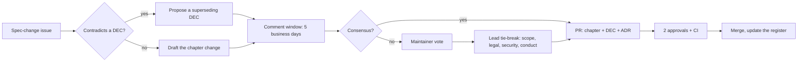
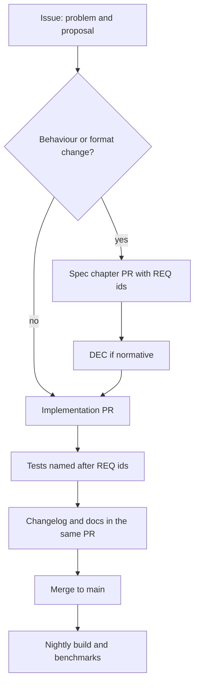

# Team and process — how OpenBlock is built

> Status: normative planning · Last updated: 2026-11-24
> Depends on: [DEC-009](../decisions.md), [DEC-010](../decisions.md), [DEC-035](../decisions.md), [DEC-036](../decisions.md), [vision](../vision.md), [roadmap](00-roadmap.md), [research 06](../research/06-modding-and-content-system.md), [research 07](../research/07-legal-licensing-and-ip.md)
> Implements: MS-00 onward; governance, review and AI policy for every milestone

## 1. Purpose and scope

This chapter defines who does the work, how decisions are made, how code and documents
are reviewed, how AI assistance is governed, and how the project stays healthy. It is
deliberately opinionated: a small project with vague process spends its scarce review
capacity on meta-work. The rules are sized for one to six people and are written to
survive growth to a dozen without a rewrite. Not here: the roadmap ([00](00-roadmap.md)),
the task list ([03](03-work-breakdown.md)) and the release procedure
([06](06-release-and-operations.md)), which this chapter constrains but does not duplicate.

## 2. Requirements

| ID | Requirement | Verification |
| --- | --- | --- |
| REQ-TEAM-001 | Every merge to `main` MUST have a DCO sign-off and the approvals required by §4.3. | Branch protection + DCO CI job. |
| REQ-TEAM-002 | Every DEC MUST have a public proposal issue and a comment window of at least 5 business days, unless labelled `security-embargo`. | Issue timestamps at register review. |
| REQ-TEAM-003 | Review latency for PRs not labelled `needs-design` MUST stay at p50 ≤24 h and p90 ≤72 h. | Monthly API query (PERF-PROC-001). |
| REQ-TEAM-004 | Pull-request CI MUST stay at p50 ≤15 min; a red pipeline MUST NOT be merged, including by admins. | Actions timing report; branch protection. |
| REQ-TEAM-005 | Agent-assisted work MUST disclose tool and scope in the commit trailer and the PR template. | Trailer check job; PR inspection. |
| REQ-TEAM-006 | Security-critical paths MUST have two human reviewers, at least one able to explain every hunk. | Reviewer list on the PR. |
| REQ-TEAM-007 | No contributor MUST be required to sign a CLA; inbound licensing is MIT OR Apache-2.0. | `CONTRIBUTING.md` inspection. |
| REQ-TEAM-008 | A maintainer inactive for 6 months MUST become emeritus without losing credit. | `MAINTAINERS.md` history. |
| REQ-TEAM-009 | A code-of-conduct report MUST receive a first response within 72 h. | Private moderation log audit (PERF-PROC-002). |
| REQ-TEAM-010 | Every release MUST ship a changelog, upgrade notes and a devlog entry. | Release checklist. |

## 3. Roles and the minimum viable team

### 3.1 Disciplines

| Discipline | Owns | Must have | Primary crates |
| --- | --- | --- | --- |
| **Rendering / GPU** | Render graph, shaders, frame budget | wgpu/WGSL, GPU profiling (RenderDoc, PIX), linear algebra, cross-backend debugging | `ob_render` |
| **Engine / platform** | App loop, scheduler, jobs, config, diagnostics, packaging | Rust systems programming, profiling, build systems, CI | `ob_core`, `ob_math`, `xtask` |
| **Simulation / gameplay** | World, physics, items, redstone, entities | Deterministic systems, data-oriented design, gameplay literacy | `ob_world`, `ob_sim`, `ob_worldgen` |
| **Network / server** | Protocol, transport, replication, dedicated server | QUIC/TLS, distributed systems, Linux operations, observability | `ob_protocol`, `ob_net`, `ob_server` |
| **Tools / content pipeline** | Schemas, validators, asset pipeline, release automation | serde/schemars, build automation, developer UX | `ob_tools`, `ob_content` |
| **Content / art** | Base pack, textures, models, audio, UI look | Pixel art, 2D/3D production, sound design | `assets/`, `openblock:base` |
| **Design / production** | Vision, milestones, playtests, community, docs | Writing, planning, QA, triage | `docs/`, tracker |

One person may cover several rows; the table exists so that an unowned row is visible
before it becomes an incident.

### 3.2 Configurations

| Configuration | Throughput | Can | Cannot | First to break | First to buy |
| --- | --- | --- | --- | --- | --- |
| **1**, solo, full-time | ~0.85 dev-wk/wk | Ship the slice and `0.1`; keep one coherent architecture; talk to players directly | Parallelise performance and content; second review for saves, protocol, security; 24/7 ops | Bus factor, then burnout around month 9 | Art/audio commission; one external security review per phase |
| **3**, the roadmap's tracks | ~2.4 dev-wk/wk | Run A/B/C in parallel; `0.1` in ~4 months, `1.0` Early Access in 20–23 months | Two critical paths at once; in-house art or QA | Review bottleneck when two tracks need one crate | Art/audio, QA contractor, external security review |
| **6**, pairs per area | ~4.4 dev-wk/wk | Feature and performance work in parallel; `1.0` in 10–12 months; on-call rotation | Avoid coordination overhead; staff legal or 24/7 ops | Duplicated work without area ownership | Bench hardware, community manager, legal counsel |

Hiring order beyond the lead: rendering/GPU, tools/content, network/server, art,
design/production. The lead is the engine/simulation generalist until the first two hires
exist, which is why MS-00 to MS-02 are lead-sized.

### 3.3 Single points of failure

| Area | Owner at N=1 / 3 / 6 | Mitigation |
| --- | --- | --- |
| Save format and migrations | Lead / C / B+C | Fixtures, spec chapter, two reviewers on format changes |
| Protocol and handshake | C / C / C+pair | Documented wire format, fuzz corpus, external review at `0.2` |
| Renderer and frame budget | A / A / A+pair | Render-graph contracts and a benchmark a second person can run |
| WASM sandbox | — / C / C+security | Threat model, capability tests, external review before `0.4` |
| Release keys and moderation | Lead | Two release managers; two moderators before `0.1` |

## 4. Contribution model and governance

### 4.1 Roles and rights

**Lead** — product and architecture owner; tie-break for scope, legal, security and
conduct. **Maintainers** — merge rights and a vote on contested decisions; listed in
[MAINTAINERS.md](../../MAINTAINERS.md). **Area owners** — maintainers who own a crate or
domain and review there by default. **Release manager** — rotates per release, holds the
checklist, signs tags. **Security steward** — triages advisories and embargoes fixes.
**Provenance steward** — asset register, licence audits, DMCA playbook. **Moderators** —
conduct enforcement. **Triage rota** — one maintainer per week, new issues cleared in
three working days.

Governance is a BDFL with published rules today, moving to a maintainer council when five
or more active maintainers exist. The transition is itself a DEC, not a chat agreement.

### 4.2 DCO and licensing

Contributions use the [DCO 1.1](https://developercertificate.org/): every commit carries
`Signed-off-by` (`git commit -s`), and inbound licensing is `MIT OR Apache-2.0` (DEC-009,
DEC-036). There is no CLA, so future relicensing would need contributor permission; that
cost buys low friction ([research 07 §9.1](../research/07-legal-licensing-and-ip.md)).
Corporate contributors confirm their employer permits the sign-off. Anyone who has read
decompiled Minecraft code, or non-public Weft sources for a given feature, discloses it
and recuses from that feature. New assets need a `.license` sidecar and an
`asset-register.tsv` row before review.

### 4.3 Review rules

| Change | Approvals | Required reviewer | Extra gate |
| --- | --- | --- | --- |
| Typo, comment, formatting-only | 1 | Any maintainer | CI green |
| Code, S or M | 1 | Area owner or any maintainer | Tests, clippy |
| Code, L/XL or new subsystem | 2 | Area owner + maintainer | Short design note linked |
| Normative spec chapter | 2 | Area owner + lead | DEC added or cited |
| New or superseding DEC | 2 | Lead + maintainer | 5-day comment window |
| Save format, protocol, mod ABI | 2 | Format owner + maintainer | Migration or compatibility test, fixture |
| Security-critical path | 2 | Security steward + area owner | Threat note, abuse or fuzz test |
| New dependency | 1 | Any maintainer | `cargo-deny`, licence and maintenance check |
| Asset | 1 | Content owner | Provenance row, similarity review |
| Release tag | 2 | Release manager + lead | Full checklist and demo |

Authors never approve their own work, including maintainers. Approval means "I would
ship this", not "CI is green". A reviewer responds within 24 h or hands the PR on; the
author resolves comments and requests re-review explicitly.

### 4.4 Decisions, disagreements and maintainer lifecycle

Lazy consensus is the default: a PR with no objection in 72 hours and the required
approvals may merge; a DEC needs five business days. Contested decisions go to a simple
majority of active maintainers with a two-thirds quorum, and the lead breaks ties only in
the four domains above, with the rationale written into the DEC. The escalation ladder is:
comment, design note, DEC, vote, appeal to the lead. Forking is a legitimate last resort;
the licence permits it, and the trademark policy (DEC-037) requires a rename. Conflicts of
interest are disclosed in the PR and the person recuses. Maintainers are nominated after
ten merged contributions across three months in an area, confirmed by consensus, and move
to emeritus after six months of inactivity. Removal for cause needs a written reason and
30 days' notice with an appeal, except for conduct or security breaches, where access is
suspended immediately and reviewed afterwards.

## 5. Development process

### 5.1 Spec-first flow

Code follows `docs/spec/`; a behaviour change without a spec change, or a normative spec
change without a DEC, is rejected (DEC-010).

### 5.2 Pull-request shape

One logical change. Target ≤400 changed lines excluding lockfiles, generated code and
data; 400–800 needs a maintainer's acknowledgement before review; above 800 it is split.
Refactors never ride along with behaviour changes. Draft PRs early, stacked PRs with an
explicit base branch, branches live at most three days, squash-merge keeps `main` linear
and revertible.

### 5.3 CI gates

| Job | Blocking | p50 | Catches |
| --- | --- | --- | --- |
| `fmt` | Yes | 30 s | Style drift |
| `clippy -D warnings` | Yes | 4 min | Whole classes of bugs and dead code |
| `nextest` on Linux, Windows, macOS | Yes | 8 min | Platform-specific behaviour |
| `rustdoc -D warnings` | Yes | 1 min | Broken links, undocumented public API |
| `cargo-deny` | Yes | 1 min | Licence, advisory, source and wildcard policy |
| `markdownlint` + `lychee` | Yes | 1 min | Broken links, stale docs |
| `naga` shader validation | Yes | 1 min | Shaders that fail on a backend |
| `cargo tree -p ob_server` guard | Yes | 20 s | GPU or audio crates leaking into the headless server |
| DCO and label check | Yes | 20 s | Missing sign-off, missing `area:`/`size:` |
| Determinism hash (paths touching `ob_sim`) | Yes | 6 min | Cross-platform simulation drift |
| Benchmark gate (nightly) | Yes on `main` | 30 min | Frame or tick regressions beyond tolerance |
| Fuzz corpora (nightly) | Yes on `main` | 60 min | Parser, save and protocol crashes |

PERF-PROC-001: PR CI p50 ≤15 min, p95 ≤25 min. A red pipeline blocks everyone including
admins; an emergency is a revert, not an override.

### 5.4 What reviewers must check

1. The change matches a REQ, milestone criterion or DEC, and the PR links it.
2. Tests fail without the change and name the requirement they verify.
3. Determinism: no wall clock, thread identity, unordered iteration or platform `libm` in
   simulation paths.
4. No allocation, lock or I/O on a budgeted hot path without a measured reason.
5. Errors are values, not panics; every `unwrap` is justified or absent.
6. `unsafe` has a safety comment, a test, and an entry in the audited list.
7. Public API changes are additive or pass through deprecation.
8. Save, protocol and content-hash compatibility is preserved or migrated.
9. No copied code or assets; asset rows present; AI assistance disclosed.
10. Docs, changelog and spec updated in the same PR; no hard-coded user-facing strings.
11. The reviewer can explain every hunk; "CI is green but I do not understand this" is a
    request for changes.

### 5.5 Branches, releases, triage and cadence

Trunk-based: `main` is always releasable and nightly builds come from it. `release/0.N`
branches are cut at milestone exit and take cherry-picked fixes only. Tags are signed and
follow `v0.N.P[-alpha.N]`; protocol, save-format and mod-API versions are separate and
stated in the notes. Hotfixes branch from the tag, merge back to `main`, and ship as a
patch. Release procedure lives in [06](06-release-and-operations.md).

| Priority | Meaning | Target |
| --- | --- | --- |
| **P0** | Data loss, security exploit, remote crash, broken release | Acknowledge <24 h, patch <72 h |
| **P1** | Core feature unusable, no workaround | Next release, milestone if not patchable |
| **P2** | Workaround exists, visible defect | Current or next milestone |
| **P3** | Polish, unclear benefit, future idea | Backlog; closed after 90 days idle |

The triage rota clears `needs-triage` within three working days. Weekly grooming (30 min)
checks three groomed epics per milestone, named blockers on `blocked` issues, a spec
chapter on `needs-design`, and an owner on the critical path. Stale `P3` issues are closed
with a one-line note; silence is not a backlog.

| When | What | Output |
| --- | --- | --- |
| Monday, 30 min | Planning: three outcomes for the week, unblock | Updated board |
| Wednesday, 60 min | Office hours and pairing, open to contributors | First PRs unblocked |
| Friday, 60 min | Demo, devlog draft, benchmark dashboard | Devlog, regressions filed |
| Monthly, 90 min | Roadmap re-baseline against actuals | Roadmap delta, 90-day update |
| Per milestone | Demo, retro, definition-of-done audit | Release or explicit delay |

## 6. AI-assisted development policy

### 6.1 Principles

AI is a tool used by an accountable human, not an author. Agent output passes the same CI,
review, licence and provenance rules as human output. Disclosure is a duty, not a
permission: saying a model wrote a hunk does not make the hunk acceptable. Agents never
approve, merge, sign off, moderate, or hold a maintainer role.

### 6.2 What agents may and may not do

| Work | Suitability | Review level |
| --- | --- | --- |
| Research synthesis, prior-art summaries, checklists | High | Human verifies every citation and number |
| Spec and ADR first drafts | Medium | Human rewrites the argument and owns the decision |
| Tests, fixtures, fuzz targets, bench harnesses | High | Reviewer checks assertions are not tautological |
| Boilerplate, schemas, CLI and error plumbing | High | Normal review; CI catches most defects |
| Documentation, changelogs, API references | High | Verified against code, link-checked |
| Content data: recipes, loot, block definitions | High | Schema-validated, plus a balance spot-check |
| Refactors with strong tests | Medium | Tests exist before the refactor |
| Performance investigation | Low | Instrument and measure first; agents may analyse traces |
| GPU driver bugs, frame-time mysteries, netcode feel | Low | Needs hardware, profiling judgement and playtests |
| Game feel, balance, difficulty, art direction | Low | Human playtesting and taste |
| Security-critical design and final review | Not as sole reviewer | Two humans, one owning the threat model |
| Legal, trademark, provenance decisions, moderation | No | Steward, counsel and moderators only |

### 6.3 Provenance, disclosure and hygiene

1. Never paste decompiled, deobfuscated or leaked code into a prompt, and never ask a
   model to reconstruct a named work's code, prose, textures or sounds.
2. Asset prompts must not reference a specific game or artist ("Minecraft-style", "like
   Creeper") and must record tool, version and prompt scope; generated art is higher risk
   and needs a similarity review before it enters the register.
3. Third-party code pasted into a model keeps its licence; check it before committing, and
   prefer a clean-room description over a code sample.
4. Generated data must be reproducible by a committed command (`cargo xtask gen ...`), or
   it is rejected as an unverifiable blob.
5. The DCO sign-off is the human's attestation that they may contribute the work,
   including model output.

Commits carry `AI-Assisted: <tool> <version>; scope: plan|code|tests|docs|data`, matched by
a PR checkbox. The human author is the author of record and the only signatory;
`Co-authored-by` never substitutes for sign-off. Release notes may report the share of
merged changes with AI assistance as a transparency metric, never as a target. Agents are
not listed in `MAINTAINERS.md` and cannot hold commit rights. Prompts must contain no
secrets, customer data, embargoed security reports or personal data; use providers with
no-training terms for private content or a self-hosted model; never commit transcripts or
agent workspaces; give agent-triggered CI a token and time budget; allow at most three
open agent-assisted PRs per contributor.

### 6.4 Defending against slop volume

1. No issue, no review: every PR links an issue with acceptance criteria.
2. One logical change; generated reformatting never mixes with behaviour.
3. Bug fixes show red-green evidence in the PR description.
4. A human reviewer must be able to explain every hunk (REQ-TEAM-006), and must run it.
5. Generated files must be reproducible by a committed command.
6. Search issues and PRs before opening; merge or extend instead of multiplying.
7. PRs stale for 14 days are closed with a one-line reason and reopened only with an owner.
8. Maintainers may close template-violating PRs without a line-by-line review, naming the
   rule broken.
9. Revert rate, defect-escape rate and review latency are tracked by cohort; a high revert
   rate means more scrutiny for that work, not a ban.

## 7. Documentation culture

Each chapter in [docs/README.md](../README.md) has an owning area; the area owner is the
default reviewer and may not merge normative changes alone. `cargo xtask req-coverage`
reports every `REQ-*` that no test names — a requirement with no test is either a missing
test or a requirement to delete. ADRs are immutable and record the story; the
[decision register](../decisions.md) holds current state. Changelogs use Keep-a-Changelog
sections plus explicit "save format", "protocol" and "mod API" compatibility lines. Weekly
devlogs and milestone demo recordings are part of the release, not marketing extras.
Generated documentation — protocol catalogue, JSON schemas, CLI help, metrics list — is
built from source in CI so it cannot drift silently.

## 8. Community

| Channel | Purpose | Rule |
| --- | --- | --- |
| GitHub Discussions | Design questions, RFCs, help | Searchable and permanent; decisions link here |
| GitHub Issues | Work with an owner and acceptance criteria | Not a support forum |
| Matrix or Discord | Real-time chat, office hours | Not a decision record; copy decisions to an issue |
| Monthly community call | Roadmap, demos, Q&A | Notes published within 48 h |
| Private advisory / moderation inbox | Security, conduct | See [SECURITY.md](../../SECURITY.md) and [CODE_OF_CONDUCT.md](../../CODE_OF_CONDUCT.md) |

Enforcement follows a written ladder: private word, formal warning, temporary ban of 7–30
days, permanent ban. Reporter and accused are told the outcome, the log stays private, and
appeals go to the lead, who must not be the person who imposed the sanction. Onboarding
starts from `good first issue` tickets that fit in a day, name the files and come with a
mentor; target is a first PR merged within seven days of a first comment. Release
communication is a devlog, changelog, upgrade notes and known issues on the day of the
build; server operators get breaking-change notes at least two weeks before a release that
changes the world directory or protocol.

## 9. Sustainability, funding and legal

Sustainable pace: about 35 focused hours per week, no crunch, 20% slack per milestone, at
most two active tasks per person, and a hardening week at the end of each phase. Two
trained release managers so holidays do not block a patch. Burnout signals are explicit —
self-reported hours above 45 for three weeks, two missed milestone demos, review latency
doubling, a maintainer quiet for three weeks — and the response is to cut scope publicly,
not to push.

| Funding option | Allowed | Conditions |
| --- | --- | --- |
| Donations (GitHub Sponsors, Open Collective) | Yes | No roadmap influence; quarterly public summary above a threshold |
| Grants (open-source infrastructure funds) | Yes | Deliverables published under the same licences; no exclusivity |
| Corporate sponsorship | Yes | Disclosed; max 25% of annual budget without a diversification plan |
| Third-party hosting and paid servers | Yes | Encouraged; no official-server advantage, no paywall, no marketplace cut |
| Paid priority support or consulting | Yes | Must not gate features or fixes |
| Mods sold by authors elsewhere | Yes | No project cut, no DRM or entitlement service |
| Ads, telemetry sale, loot boxes, crypto | No | Non-goals (vision §7) |

A fiscal host is enough to accept donations. A legal entity (association, foundation or
company) is formed before hiring, before trademark filing, before revenue needing accounts,
and before the 1.0 commercial launch; it holds the trademark (DEC-037), signs releases and
owns the domain. The DCO and the code licence survive any entity change.

## 10. Project health metrics

| Metric | Definition | Target | Cadence |
| --- | --- | --- | --- |
| Review latency (PERF-PROC-001) | p50 / p90 from review request to first substantive review | ≤24 h / ≤72 h | Monthly |
| CI duration | PR pipeline p50 | ≤15 min | Weekly |
| Flaky test rate | Tests failing on rerun without a change | ≤2% | Weekly |
| Requirement coverage | Normative REQs with a named test | 100% (manual ones marked) | Per release |
| Parity corpus coverage | In-scope pass rate + hand-authored vanilla coverage | 100% of in-scope Tier-0/1 checks at 1.0; ≥85% coverage of the Tier-2 checklist at the 2.0 gate | Monthly from MS-14 |
| Open P0 / P1 | Count at any time | 0 P0, ≤5 P1 | Weekly |
| Contributor retention | First-time contributors landing a second PR within 90 days | ≥40% | Quarterly |
| New contributors | Distinct first-time contributors merged per month | ≥3 after `0.1` | Monthly |
| Bus factor | Areas with two or more maintainers | All areas by `0.2` | Quarterly |
| Decision latency | Median days from DEC proposal to merge | ≤10 business days | Quarterly |
| Benchmark trend | p95 frame or tick regression on `main` | No >10% regression | Nightly |
| Moderation response (PERF-PROC-002) | First response to a report (REQ-TEAM-009) | ≤72 h | Quarterly audit |

Banned metrics: lines of code, commit counts, hours worked, issue counts and download
counts as health proxies. They reward the wrong behaviour, especially with agents in the
loop.

## 11. Failure modes

| Failure | Signal | Response |
| --- | --- | --- |
| Governance capture by a sponsor or employer | Roadmap shifts after a private conversation | Disclose funding, record decisions, cap single-sponsor share |
| Review bottleneck | p90 latency beyond a week, idle PRs | Add an area owner, narrow required reviewers, split the PR |
| AI slop flood | Many PRs, low merge rate, rising reverts | Enforce §6.4, close template violators, slow that cohort's path |
| Maintainer burnout | Hours, latency and P1 backlog all rise | Stop feature work, cut scope, recruit, rotate |
| Provenance incident | Asset without a register row, copied code in a PR | Remove, root-cause, publish the fix; evidence pack off-site |
| Security report mishandled | Report public before a fix | Follow `SECURITY.md`, 72 h acknowledgement, embargo, advisory |
| Conduct failure by a maintainer | Reports naming a maintainer | Independent moderators, suspend access, review afterwards |
| Funding shortfall | Runway under three months | Pause features, keep `0.x` patched, publish the position |

## 12. Open questions

1. **Register item needed: governance rule.** Lazy consensus, 5-day DEC window, maintainer
   vote, and lead tie-break limited to scope, legal, security and conduct. The register
   states DCO and maintainers but not the decision procedure. Owner: MS-00.
2. **Register item needed: AI contribution policy.** The trailer, human sign-off, two-human
   rule for security-critical paths and the asset restrictions in §6. DEC-036 requires
   "explicit provenance rules" without defining them. Owner: MS-00.
3. **Register item needed: money and entity.** The funding table in §9, the no-paywall and
   no-marketplace rules, and when a legal entity is formed. Owner: MS-16.
4. **Code of conduct version.** The repository carries Contributor Covenant 2.1; 3.0
   changes enforcement wording. Owner: MS-00, with a moderation review.
5. **Benchmark hardware.** Self-hosted bench box versus cloud runners with pinned GPUs:
   cost against measurement stability. Owner: MS-04, budgeted in MS-16.
6. **Maintainer compensation.** Unpaid volunteers versus small stipends for triage and
   release management once donations exceed infrastructure costs. Owner: MS-16.

## 13. References

- [Decision register](../decisions.md): DEC-009, DEC-010, DEC-035, DEC-036, DEC-037 and
  OPEN-001 – OPEN-008.
- [Vision](../vision.md), [roadmap](00-roadmap.md), [milestones](01-milestones.md),
  [MVP definition](02-mvp.md), [work breakdown](03-work-breakdown.md),
  [release and operations](06-release-and-operations.md).
- [Contributing](../../CONTRIBUTING.md), [maintainers](../../MAINTAINERS.md),
  [security policy](../../SECURITY.md), [code of conduct](../../CODE_OF_CONDUCT.md) and
  the [pull-request template](../../.github/pull_request_template.md).
- [Research 06 — modding and content](../research/06-modding-and-content-system.md) for
  ecosystem lessons and per-mod budgets; [research 07 — legal and licensing](../research/07-legal-licensing-and-ip.md)
  for DCO, provenance and evidence practice.
- [Developer Certificate of Origin 1.1](https://developercertificate.org/),
  [Contributor Covenant 2.1](https://www.contributor-covenant.org/version/2/1/code_of_conduct/),
  [REUSE 3.3](https://reuse.software/spec-3.3/) and
  [cargo-deny licence configuration](https://embarkstudios.github.io/cargo-deny/checks/licenses/cfg.html).
- [Testing and benchmarks](../spec/24-testing-benchmarks.md) and
  [performance budgets](../spec/25-performance-budgets.md) for the gates this process
  enforces.
