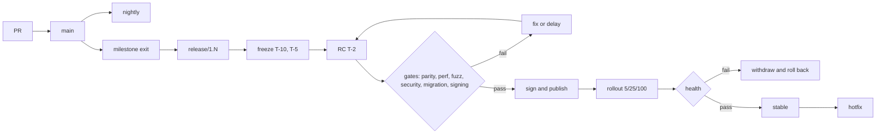

# Release and Operations

> Status: normative planning - Last updated: 2026-11-24
> Depends on: [DEC-020](../decisions.md), [DEC-026](../decisions.md), [DEC-027](../decisions.md), [DEC-028](../decisions.md), [DEC-033](../decisions.md), [DEC-034](../decisions.md), [DEC-035](../decisions.md), [DEC-036](../decisions.md), [DEC-037](../decisions.md), [milestones](01-milestones.md), [team and process](04-team-and-process.md), [risks](05-risks.md)
> Implements: the release process for `0.0.1` … `1.0.0`, and the operational commitments that start at `0.2.0-alpha`

## 1. Purpose and scope

This document is the contract between the project and the people who install it: what a version
number means, how a build becomes downloadable, how a bad build is withdrawn, how long a server
release is supported, and what happens on the worst day. It binds releases, not milestones: a
milestone can exit while its release waits, but a release cannot ship over an unmet gate.

In scope: versioning, branches, channels, the checklist, hotfixes and rollback, compatibility and
LTS, server distribution, the mod index, launch, monitoring, incidents and docs releases. Out of
scope: milestone exit criteria, the review policy ([milestones](01-milestones.md),
[team](04-team-and-process.md)) and marketing beyond §15.

**One rule underneath everything:** a release is a promise with a checkbox trail; if the trail is
missing the release is delayed and the delay announced. Nothing here is worth a silent save loss, a
silent security fix or a silent format change.

## 2. Requirements

| ID | Requirement | Verification |
| --- | --- | --- |
| REQ-REL-001 | Every public artifact MUST be built by CI from a signed tag, never a laptop, and MUST publish a signed manifest, SHA-256/BLAKE3 sums, an SBOM, a changelog, upgrade notes, the four version numbers of §3 and a versioned docs site. | tag workflow, artifact inspection, site build |
| REQ-REL-002 | A save written by any version from `0.1.0-alpha` forward MUST open (after migration) in every later version of the same major, or the release is blocked; a newer format MUST be refused with a message naming the build, never downgraded. | migration suite, negative test |
| REQ-REL-003 | A protocol mismatch MUST fail the handshake with a message naming both versions and the mismatched packs (DEC-027). | integration test |
| REQ-REL-004 | The mod API MUST remain source-compatible within a major; a deprecation MUST be announced two minors before removal. | compatibility suite, register |
| REQ-REL-005 | A hotfix MUST contain only the fix, its test and the version bump; a release MUST NOT be withdrawn by deleting artifacts but marked `withdrawn`, with the manifest updated and the reason published. | diff review, manifest diff |
| REQ-REL-006 | A server upgrade MUST have a documented backup-and-rollback path; a rollback that needs a save downgrade MUST say so. | admin docs, drill |
| REQ-REL-007 | Supported versions, security windows and advisory timing (within 7 days of a fix) MUST be published, and only supported lines receive fixes. | support table, advisory record |
| REQ-REL-008 | No release MAY enable telemetry by default; every upload MUST be opt-in, redacted and documented (vision §7). | config inspection, privacy review |
| REQ-REL-009 | The release-day runbook and rollback MUST be rehearsed before 1.0, and metrics reviewed monthly with an owner for any miss. | drill record, metrics page |

## 3. Versioning

Four numbers move independently. Conflating them is how "we support mods" becomes untrue.

| Thing | Scheme | Examples | Frozen at | Promise |
| --- | --- | --- | --- | --- |
| **Product** | Semver tag `vMAJOR.MINOR.PATCH[-pre.N]` | `v0.0.1`, `v0.1.0-alpha.1`, `v1.0.0`, `v1.0.3` | 1.0 | `0.x` is pre-stability; `1.x` keeps saves, protocol and mod API working |
| **Save format** | `format.major.minor` plus `min_reader` | `1.0`, `1.1` | MS-13 (v1) | Forward migrations from `0.1`; newer formats refuse to open; no silent regeneration (DEC-033, DEC-047) |
| **Protocol** | `u16` semantic wire version | `7`, `8` | MS-06 (v1) | Negotiated at the handshake; mismatch fails with names; minor additions optional (DEC-027) |
| **Mod API** | `api.major.minor` plus host-ABI schema hash | `1.0`, `1.1` | MS-09 / 1.0 | Source-compatible within a major; two-minor deprecation window (DEC-020) |
| **Content schema** | `schema` plus `min_engine` in every pack | `openblock.pack/1` | MS-05 | New fields additive; unknown fields preserved |

**`0.x` policy.** Minor versions may break save formats (with a migration), the protocol and the mod
API; patches fix defects and touch a save format only to repair an unreadable one, which is a P0.
From `0.1.0-alpha` the save and protocol promises of §9 are in force; `0.0.1` saves may be refused
with a clear message stated in the release notes.

**`1.0` policy.** `MAJOR` may break the save format (with a migration), the mod API and the protocol.
`MINOR` adds content without breaking a save, a mod built against the previous minor or a client in
the documented protocol range; `PATCH` fixes only. `alpha.N`, `beta.N` and `rc.N` never supersede a
stable version in the updater, and every release page states all four numbers.

## 4. Branches, tags and builds

Trunk-based, as in [team and process §5.5](04-team-and-process.md): `main` is always releasable,
nightly builds come from it, and release branches are cut at milestone exit. Long work lands behind
flags, not on a `next` branch.

| Ref | Created from | Rules | Lifetime |
| --- | --- | --- | --- |
| `main` | — | Protected; green CI; every commit releasable; no direct pushes to a release branch | Forever |
| `release/0.N`, `release/1.N` | `main` at milestone exit | Fixes only; cherry-picks reference the original PR | Until the next major |
| `vX.Y.Z[-pre.N]` tag | The release branch tip | Signed with the Ed25519 release key; annotated; immutable; never moved | Forever |
| `nightly-YYYYMMDD-<sha>` | `main`, daily 02:00 UTC | Unsigned, unsupported; artifacts kept 90 days | — |

All public artifacts come from CI (REQ-REL-001). Linux targets glibc 2.35 for the client and musl for
the server; Windows and macOS use native runners with Authenticode, Developer ID and notarisation
(DEC-034, [research 09 §6](../research/09-persistence-assets-packaging.md)). Toolchain,
`Cargo.lock`, `SOURCE_DATE_EPOCH` and `--remap-path-prefix` are pinned, two clean Linux builds must
match before a release is called reproducible, and signed artifacts are attestable rather than
bit-identical. Update manifests are Ed25519-signed canonical JSON with a key id, rotation list,
version floor and per-target hashes: TLS protects transport, the signature protects a compromised
CDN. The updater stages into `versions/<version>`, health-checks for 30 s and keeps N−1 and N−2.

## 5. Channels and cadence

| Channel / line | Source | Cadence | Version example | Support | Audience |
| --- | --- | --- | --- | --- | --- |
| **Nightly** | `main` | Daily, 02:00 UTC | `nightly-20270314-9f3c1ab` | None | Contributors, CI, smoke tests |
| **Beta** | Release branch | Every 2–4 weeks in Phases D–F; ad hoc later | `v0.5.0-beta.2` | Best effort, known issues listed | Testers, opt-in operators |
| **Stable** | Release branch | Each milestone exit; post-1.0 every 6–8 weeks | `v1.0.0` | Full, per §9 and §10 | Players and operators |
| **LTS line** | Last minor of a major | Annually, delivered on `stable` | `v1.0.12` | 12 months of security and save fixes | Operators upgrading rarely |
| **Hotfix** | Tag, delivered on the patched line | As needed; P0 within 72 h | `v1.0.3` | Same as the patched line | Everyone affected |

The three update *channels* are `stable`, `beta` and `nightly`
([22 REQ-PLAT-035](../spec/22-platforms-and-distribution.md)); LTS is a support line and hotfix a release
kind, both delivered through `stable`, not a fourth channel.

**Freeze and rollout.** Feature freeze at T−10 days, content and string freeze at T−5, release
candidate at T−2, release at T−0; during the freeze only P0/P1 fixes land, each with two reviewers
and a re-run of the affected gates, and a broken freeze resets the clock publicly. Stable updates
reach 5% of the update-check population for 24 h, 25% for 24 h, then 100%; a regression above the
§12 thresholds pauses the rollout and pages the release manager.

## 6. Release flow

## 7. Release checklist

The release manager owns the checklist and signs it off; each row links an artifact, not a feeling.
Rows 1–4 may not be waived, and other waivers are recorded on the release issue.

| # | Check | Owner | Evidence |
| ---: | --- | --- | --- |
| 1 | Scope, version and four version numbers agreed; changelog and upgrade notes in the release issue | Release manager, Lead | Release issue |
| 2 | Save migrations from every released version pass | MS-13 | CI migration job |
| 3 | Performance gates meet [spec/25](../spec/25-performance-budgets.md); security delta closed with no open high finding | MS-04/MS-15, security steward | Bench report, review record |
| 4 | Parity corpus run; failures fixed or documented divergences | MS-14 | Corpus report |
| 5 | Protocol, save, pack and mod-ABI fuzz clean for 24 h; `cargo-deny`, `cargo-vet` and `cargo-audit` clean; asset register and licences complete | Owner crates, MS-00, content owner | Nightly job, CI, register |
| 6 | Localization, pseudo-locale, RTL, accessibility smoke and the docs site build for the tag | MS-14, docs owner | Lint job, site build |
| 7 | Windows signing, macOS notarisation, Linux signatures, SBOM, reproducibility; server image, tarballs, compose and systemd unit published | MS-16, MS-07 | Signature check, release assets |
| 8 | Backup, restore, upgrade and rollback drilled on a copy of a real world; store metadata, requirements and demo updated; announcement and support rota ready | MS-07/MS-13, MS-16, Lead | Drill log, store draft, rota |

## 8. Hotfix, rollback and withdrawal

**Hotfix.** Branch `hotfix/x.y.z` from the tag with the fix, a regression test and the version bump
(REQ-REL-005); two reviewers, one the security steward; run the reduced gates (perf smoke, save
migration, fuzz subset, pack validation); publish to every affected line, acknowledge a P0 within 24
hours and patch within 72, then merge back so the next release cannot regress it.

**Rollback.** The client updater keeps N−1 and N−2; two failed health checks switch back
automatically, and `--safe-mode` starts without packs, mods or GPU features so a bad driver or pack
can be isolated. A rolled-back client keeps its saves and refuses a newer format with a message
rather than truncating. Servers do not self-update, and rolling back a migrated world requires the
backup taken by the upgrade procedure because migrations are forward-only (DEC-033, REQ-REL-002);
upgrade notes say so and `--migrate --dry-run` reports source and target format. Rolling forward is
always safe; rolling back is safe only with the copy.

**Withdrawal.** A bad release is marked `withdrawn` with a published reason, artifacts stay for
forensics, storefront builds are pulled through the store's mechanism, and the manifest is reverted
first and restored last.

## 9. Compatibility, deprecation and LTS

| Subject | Promise | Window | Break requires |
| --- | --- | --- | --- |
| Saves | Any save from `0.1.0-alpha` opens in a later version of the same major, after migration with a pre-migration backup | Permanent within a major | New major plus migration and a repair path |
| Mod API | Source-compatible within a major; deprecated items keep working | Two minors or six months, whichever is longer | New major |
| Protocol | Same-major clients and servers interoperate within the documented range; mismatches fail with names | Per major | New major plus a protocol bump |
| Content packs | New optional fields additive; unknown fields preserved; a pack declares `min_engine` | Per major | New schema version |
| Server config, commands, metrics, OS support | Stable names within a major; a rename warns for one major. Windows 10/11, Linux X11/Wayland, macOS 12+ at 1.0 (DEC-034) | One major; OS changes announced one minor ahead | New major |

**LTS and deprecation.** The last minor of a major becomes an LTS line at the next major, supported
12 months with security and save-critical fixes only — no content, no performance work beyond
regressions, no mod-API additions — with end of life announced six months ahead. A deprecated API is
marked in docs and schema, warns at compile or load time naming its replacement and is listed in the
release notes; removing one early is a release-process bug, not a judgement call.

## 10. Server distribution and support

`openblock-server` is a first-class product (DEC-028): one binary plus a world directory, no GPU,
no window, no audio stack.

| Artifact | Tag / name | Notes |
| --- | --- | --- |
| Container image | `ghcr.io/openblock/openblock-server:1.0.3`, `:1.0`, `:latest`, `:nightly` | Multi-arch amd64/arm64, scratch or distroless, UID 10001, read-only root, `/data`, exec health check |
| Tarballs and recipes | `openblock-server-1.0.3-linux-x86_64.tar.zst` (+ arm64, Windows, macOS), compose file, systemd unit, Kubernetes notes | Static musl on Linux; SHA-256 and signature beside it; `SIGTERM` drains and exits within 30 s |
| Admin docs | First-day checklist, firewall, backups, upgrade, troubleshooting | Versioned with the docs site |

**Upgrade and support.** The operator procedure is owned by
[19 §3.11](../spec/19-server-administration.md): pre-upgrade backup, `--migrate --dry-run`, replace,
health-check, keep the previous binary and backup for rollback. Downgrades are refused when the world
format is newer and otherwise allowed only from the backup. Supported versions are the current
stable and the previous minor for 12 months after the next minor ships, plus every active LTS line
(REQ-REL-007, [22 REQ-PLAT-048](../spec/22-platforms-and-distribution.md)); nightlies and betas are
best effort. Security fixes are backported or documented as not backportable, and support runs
through GitHub Discussions and the tracker, except security reports per `SECURITY.md`.

## 11. Community and mod index curation

The index is a curated list of links and metadata, not a store: no payments, no DRM, no revenue
share, no paid placement.

**Entry requirements.** A manifest with resource ID, version, API range, a licence compatible with
the engine's distribution rules, a BLAKE3 hash, an optional signature, a source link for code mods
and no native binaries in the WASM tier. Automated checks reject a malformed manifest, hash
mismatch, missing licence, reserved namespace or oversized pack; a human reviews requested
capabilities and obvious similarity to protected work.

**Moderation and security.** Reports go to a named moderator. Delisting applies to malware, an
unfixed security defect, a licence violation, impersonation, or abandonment that breaks an API
range; it is appealable, the reason is recorded and the hash stays blocked. Namesquatting is
resolved by namespace policy, a name matching a well-known project is refused, and DMCA notices
follow the designated-agent process. A capability escalation is a §13 incident: the entry is
quarantined at once and the author is contacted privately before publication.

## 12. Post-launch monitoring

No telemetry by default: every signal below is opt-in, aggregate and anonymous, or publicly
observable, with a stated collection and retention rule.

| Signal | Source | Collection | Target |
| --- | --- | --- | --- |
| Crash-free sessions and signatures | Opt-in self-hosted, redacted crash reporter | Consent on first crash; 90 days | ≥ 99.5%; no signature above 5 per 1,000 |
| Update adoption and join | Signed update checks without identifiers; client join buckets | Daily | ≥ 70% within 14 days; median join ≤ 5 s |
| Server health and integrity | Voluntary `openblock-server report`: version, players, TPS histogram, tick p99; opt-in crash reports | Opt-in weekly, no world or player data, 90 days | ≥ 95% of reports at 20 TPS; zero corruption reports |
| Issue response and mod index | Tracker timestamps; anonymous index and client counters | Public; monthly aggregate | < 72 h (P0 < 24 h); install failures < 1% |

The launcher lists the categories with one-click disable; `--diagnose` is local, and one server key
disables all reporting.

## 13. Incident response

| Severity | Examples | Acknowledge | Mitigate | Disclose |
| --- | --- | --- | --- | --- |
| **S1** | Remote exploit, sandbox escape, save corruption or data loss, malicious update | < 2 h | < 24 h; patch < 72 h | Advisory within 7 days of the fix |
| **S2** | Widespread crash, broken release, regression with no workaround | < 24 h | Next release or hotfix | Release notes; postmortem if visible |
| **S3** | Cosmetic or localized defect, documentation error | < 72 h | Next scheduled release | Changelog |

A P0 bug report keeps the tracker's 24-hour acknowledgement ([team §5.5](04-team-and-process.md));
the S1 clock above starts when an incident is confirmed.

**Security advisory.** The inbound process — 3-day acknowledgement, 10-day triage, 90-day embargo,
CVE request — is owned by [20 §3.17](../spec/20-security-and-anti-cheat.md); the S1 clock in the table
starts when an incident is *confirmed*, not when a report arrives. Reproduce privately, fix on a
private branch, backport, publish patch and advisory together, credit the reporter unless they
decline, and keep a 90-day deadline for anything unfixed.

**Save corruption and bad updates.** For corruption: stop the rollout, withdraw the artifact,
publish a repair tool and recovery steps, request affected worlds with consent, reproduce from a
fixture, fix, add the fixture and publish a postmortem — the world is the player's asset, so the
response is measured in hours. For a bad update: revert the manifest, restore the previous version as
`latest`, and check whether the bad build wrote a newer save format before telling anyone to
downgrade. A signed manifest means a CDN compromise cannot ship code, and a CDN outage is covered by
the GitHub Releases fallback. Never discuss an embargoed issue publicly.

## 14. Documentation release process

The site is built from `docs/` at the release tag and published under `/1.0/`; `/latest/` tracks the
newest stable, `/nightly/` tracks `main`, and a page that exists only in `latest` is marked. Chapter
statuses (`normative`, `draft`, `deprecated`) are published with the page, so a reader sees which
spec was binding. The protocol reference is generated from the message catalog, the mod API
reference from schemas and the host-ABI table, and both must build in CI. Every release rebuilds the
site, runs the link check and archives it; a normative change without its chapter update is a
release blocker (DEC-010).

## 15. Launch plan

| Beat | When | Deliverable | Owner |
| --- | --- | --- | --- |
| Announce and demo | T−12 / T−8 weeks | Devlog, wishlist/store page, Discord/Matrix; then public beta and demo build with a feedback form | Lead, MS-16 |
| Press kit and trailer | T−6 / T−4 weeks | Fact sheet, screenshots, 90 s trailer with captions, three clips, logo, key art, sourced comparison page | MS-16, Lead |
| Store pages | T−5 weeks | GitHub Release is the primary channel and updater source ([22 REQ-PLAT-023](../spec/22-platforms-and-distribution.md)); Steam/itch/Flathub pages, requirements from the hardware tiers and the demo depot follow | MS-16 |
| RC and launch | T−2 weeks | `1.0.0-rc.1` on beta with migration tested from every release; signed builds, announcement, support rota and `/1.0/` at T−0 | Release manager |
| Stabilize | T+2 weeks | Hotfix window, daily crash review, rollout to 100%; postmortem and roadmap re-baseline at T+4 | Release manager, Lead |

**Press kit and demo.** The kit carries a description, feature bullets matching the parity tier
actually shipped, original 1080p/4K screenshots and GIFs, logo and key art with licence terms, a
captioned trailer, developer bio, contact and a "what this is not" section (no Minecraft assets, no
affiliation, no marketplace); every performance claim links a benchmark report with preset,
resolution, distance and scene. The demo is a build of the same version and save format — a 45–90
minute creative slice plus the tutorial world, no server browser or mod install, saves compatible
with the full game — and is not a second product to maintain.

**Launch rule.** If a gate fails on the launch candidate, the launch moves: a delay is a schedule
event, a launch with a save-corruption bug is a trust event the project does not recover from.

## 16. Release-day runbook

| Time | Step | Owner | Rollback point |
| --- | --- | --- | --- |
| T−7 d | Final gates, freeze confirmed, store assets uploaded but unpublished; RC to beta at T−2 with the migration drill | Release manager, MS-13 | Nothing published; beta only |
| T−1 d | Sign and stage; verify the manifest on a clean machine; confirm the support rota | MS-16 | Staged, not offered |
| T−2 h | Manifest at 5%; watch opt-in crash-signature rate (crash-free sessions are unmeasurable without telemetry), join failures and server reports; raise to 25% at T+2 h if green | Release manager | Revert manifest |
| T−0 | Announcement; store pages public; `/1.0/` live; support staffed | Lead | Correction, manifest revert |
| T+2 h | Publish first-day metrics | Release manager | Revert to 5% |
| T+24 h | Raise to 100%; take a hotfix decision on any S2 | Release manager | Roll back to N−1 |
| T+7 d | Close the hotfix window; publish the postmortem and metrics at T+4 weeks | Lead | — |

The runbook is rehearsed before 1.0 (REQ-REL-009) with a deliberately broken build, so rollback is
exercised rather than described.

## 17. Post-launch roadmap governance

After 1.0 the roadmap stays public and the decision register append-only:

- **Minor releases** follow [roadmap §15](00-roadmap.md) (`1.1` content, `1.2` worlds, `1.3` mobile,
  `1.4` far terrain, `1.5` native plugins, `1.6` web/reach). A theme may slip; a compatibility
  promise may not slip without a major version.
- **Proposals** arrive as public issues with a design note and, if they change a settled decision, a
  DEC; community RFCs are welcome, but a roadmap slot is not reserved by enthusiasm. Re-baselining
  happens monthly against actuals, with a public new target for any slipped theme.
- **LTS and scope.** LTS lines are cut at each major, maintained 12 months and announced before an
  upgrade is recommended. No new engine subsystem enters a minor release: flagship content is built
  on the public API, as the base game is (DEC-010, DEC-020), and a private hook is rejected.

## 18. Success metrics for operations

| Area | Metric | Target | Review |
| --- | --- | --- | --- |
| Reliability | Crash-free sessions ≥ 99.5%; save-corruption reports 0 | ≥ 99.5% / 0 | Monthly and immediately |
| Delivery | Update adoption ≥ 70% within 14 days; median join ≤ 5 s | 70% / 5 s | Monthly |
| Trust and support | P0 acknowledged < 24 h and patched < 72 h; advisory < 7 days; first response < 72 h for ≥ 95% of issues | 100% / 95% | Per incident, monthly |
| Docs | First contributor PR merged unaided ≥ 1 per quarter | ≥ 1 | Quarterly |
| Ecosystem | ≥ 200 published packs and mods at 1.0; ≥ 100 public servers running 30+ days | Both | Quarterly |
| Cost | Server cost per player-hour on commodity VPS | ≤ $0.02 | Quarterly |

A missed target gets an owner and a date in the next devlog, not a quieter metric (REQ-REL-009).

## 19. Open questions

1. **Steam timing.** GitHub Releases is the primary channel and updater source
   ([22](../spec/22-platforms-and-distribution.md)); whether Steam ships at 1.0 or later changes the
   checklist and RISK-028. Owner: MS-16.
2. **Crash and telemetry hosting.** Self-hosted and privacy-first is the assumption; a managed
   service and server minidumps are undecided. Owner: MS-16 with the security steward.
3. **LTS and rollback semantics.** Annual LTS with 12 months of fixes is the proposal; whether every
   major gets a line, and whether a save-downgrade tool should exist at all, are one lifecycle
   decision with RISK-032. Owner: MS-16 with MS-13.
4. **Mod index and demo.** Whether the index is in-repo, a static site or a separate service, who
   moderates it, and whether the demo can join servers and carries the tutorial world, are launch
   decisions. Owner: MS-09 with MS-16.
5. **Register items needed:** (a) release channels, support windows and the withdrawal rule become
   normative, so a channel change is a decision rather than a habit; (b) one incident severity scale
   and disclosure timeline shared with [the risk register](05-risks.md), so security, save corruption
   and bad updates use one vocabulary. Owners: MS-16 (a), security steward (b).

## 20. References

Decisions: [DEC-009](../decisions.md), [DEC-020](../decisions.md), [DEC-026](../decisions.md),
[DEC-027](../decisions.md), [DEC-028](../decisions.md), [DEC-033](../decisions.md),
[DEC-034](../decisions.md), [DEC-035](../decisions.md), [DEC-036](../decisions.md),
[DEC-037](../decisions.md). Planning: [roadmap](00-roadmap.md) · [milestones](01-milestones.md) ·
[MVP](02-mvp.md) · [work breakdown](03-work-breakdown.md) · [team](04-team-and-process.md) ·
[risks](05-risks.md) · [performance budgets](../spec/25-performance-budgets.md) · [persistence](../spec/17-persistence.md).

Research: [persistence, assets and packaging](../research/09-persistence-assets-packaging.md)
(signing, updater, channels, image size) · [networking](../research/04-networking-sota.md) (server
operations) · [legal and licensing](../research/07-legal-licensing-and-ip.md) (trademark) ·
[modding and content](../research/06-modding-and-content-system.md) (API stability, distribution).

External:

- Semantic Versioning 2.0.0 — <https://semver.org/spec/v2.0.0.html>; The Update Framework (TUF) — <https://theupdateframework.github.io/specification/latest/>
- Apple, *Notarizing macOS software* — <https://developer.apple.com/documentation/security/notarizing-macos-software-before-distribution>; GitHub, *Artifact attestations* — <https://docs.github.com/en/actions/security-for-github-actions/using-artifact-attestations>
- ISO/IEC 29147:2018, *Vulnerability disclosure* — <https://www.iso.org/standard/72311.html>
