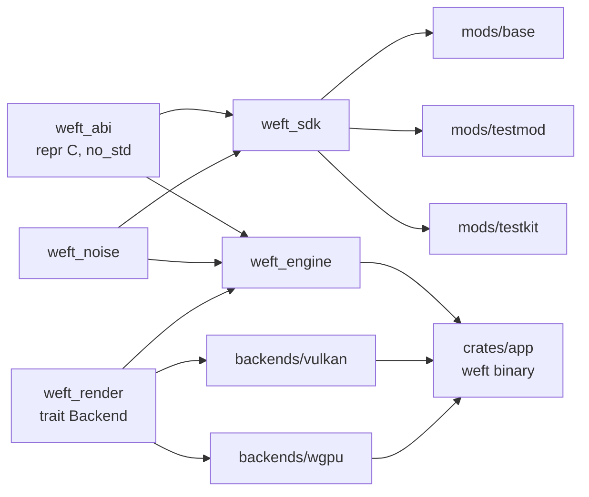

# Weft teardown: what to borrow, improve, and avoid

**Status:** draft for review · **Research date:** 2026-11-24 · **Subject:** Weft 26.11.7 (MPL-2.0), local read-only clone `/home/martintondel/Projects/weft`, 159,232 lines of Rust across `crates/`, `backends/`, `mods/`, `examples/`. **Method:** source reading, `grep`, line counts and arithmetic; the research host has no GPU (`/dev/dri` absent, no Vulkan loader), so no frame was rendered and no benchmark was run against Weft — every number below is read from source, computed, or cited, and crate/toolchain versions were checked against crates.io and `static.rust-lang.org` on 2026-11-24. **Related docs:** `research/02-engine-and-render-stack.md`, `research/03-voxel-rendering-sota.md`, `research/07-legal-licensing-and-ip.md`; `spec/03-rendering.md`, `spec/05-world-model.md`, `spec/15-content-system.md`, `spec/16-modding.md`, `spec/18-networking-multiplayer.md`; ADR-0003 (wgpu-first), ADR-0004 (32³ sections), ADR-0005 (server-authoritative QUIC), ADR-0006 (three-tier modding).

## 1. Executive summary

- Weft is a credible, unusually complete voxel engine: a 16³-section world with paletted storage, GPU-driven culling and indirect draws, GPU-generated terrain and far LOD, region-parallel ticking, an iroh/QUIC multiplayer stack, and a 45-kind content registry that any mod can edit in place.
- The best idea to copy is the **content model**: named entries, typed components, tags, and `EDIT`/`REPLACE`/`REMOVE` semantics decided at freeze time. It is what makes "Minecraft parity plus custom content" a data problem rather than a fork problem.
- The best rendering idea to copy is the **decoupling of section count from draw calls**: geometry lives in 64 MiB storage pages, a compute pass culls per section against the previous frame's Hi-Z depth, and the CPU submits one indirect draw per group. This is what lets 16³ sections stay small without paying a draw call each.
- The largest architectural bet to **not** copy as-is is client-side generation of the visible world from the seed. It removes almost all chunk-streaming bandwidth, but it hands every client the terrain it has not "seen" yet (ore positions included) and demands bit-exact determinism across CPU, GPU, mods, and platforms.
- The weakest subsystems are the ones ADR-0005 and ADR-0006 already plan to replace: movement is client-authoritative with no validation, mods are unsandboxed native libraries pinned to a source hash, and shadows are delegated to shader packs. OpenBlock's planned QUIC + prediction and three-tier modding are the right corrections.
- Performance claims cannot be validated from here; Weft itself ships no published frame-time data. Its constants (12-chunk default view, 2–5 ms/frame client budget, 20 TPS, 2 ms server reserve) look tuned for a 16.6 ms frame, not the 144 FPS / 32-chunk / 4 ms target in the brief.
- Version posture is healthy. Weft's declared requirements are current within their majors — wgpu 30, winit 0.30, glam 0.34, ash 0.38, naga 30, iroh 1, rayon 1 — and today's crates.io releases are wgpu 30.0.2, winit 0.30.13 (0.31 still beta), glam 0.34.3, iroh 1.5.0. The pins are not a project risk.
- OpenBlock should borrow roughly a dozen ideas, improve six, and avoid four. The mapping to our crates is in §11; the licensing constraints are in §12.
- Not verified here: runtime frame times or memory high-water marks (no GPU), cross-vendor GPU-generation determinism, the dedicated server under load, and the mod index's build pipeline. Those claims are source-derived, not measured; §13 lists what to measure first.

## 2. Size and shape of the codebase

| Area | LOC | Role |
|---|---:|---|
| `crates/engine` | 107,719 | Everything: app loop, client, server, world, content, UI, audio, net glue |
| `crates/sdk` | 17,268 | Safe Rust builders mods use; depends only on `weft_abi` + `weft_noise` |
| `mods/testkit` | 13,242 | Integration tests and scripted runs, written as a mod |
| `crates/abi` | 6,957 | `repr(C)` boundary: 6,315-line `lib.rs`, data, environment, editor |
| `mods/base` | 6,433 | The game itself, as an ordinary mod (100-line `init`) |
| `backends/vulkan` | 2,446 | `ash` backend, Vulkan 1.1 + descriptor indexing |
| `mods/testmod` | 1,664 | Extends/replaces base without engine changes |
| `backends/wgpu` | 1,369 | wgpu 30 backend for Metal/DX12/older Vulkan |
| `crates/app` | 817 | CLI, renderer selection, `dist`, mod packing, asset optimizer |
| `crates/render` | 542 | Backend-neutral command list and `Backend` trait |
| `crates/noise` | 335 | Deterministic fixed-point noise, hashing, RNG |
| `examples/examplemod` | 315 | Copy-me mod with every registration kind |
| `crates/android` | 125 | `NativeActivity` shim |

Two ratios matter. The engine is 68% of the code in one crate (58 top-level modules, 141 files), which buys privacy (`pub(crate)`) and simple refactors but taxes incremental builds. The test kit is twice the size of the game mod: the tests exercise the public SDK, so a passing test suite is also an API-completeness proof.

`Cargo.lock` at the clone pins wgpu 30.0.1, winit 0.30.13, glam 0.34.1 (with 0.33.12 also in the graph), ash 0.38.0, iroh 1.4.1, naga 30.0.1, rayon 1.12.0 — one patch or minor behind crates.io on 2026-11-24 (wgpu 30.0.2, glam 0.34.3, iroh 1.5.0), and current within the majors Weft declares.

## 3. Crate decomposition and dependency direction



- Dependencies point inward to `abi`, `noise`, `render`. `render` knows nothing of worlds or content; `engine` implements the world and the game; `app` is the only place that picks a backend.
- There is no ECS. Entities are structs in per-dimension arrays (`server/entity.rs`, `server/dim.rs` is 4,378 lines), components are id-keyed byte blobs, and gameplay code reads them field by field. This is fast and explicit; it also means "add a component" is an engine change, not a mod change, unless the component is declared through the ABI (see §8).
- `mods/base` is not privileged: its `lib.rs` is 100 lines of `r.block` / `r.dimension` / `r.sky_body` calls through `weft_sdk`, and `mods/testmod` replaces parts of it without engine edits. The engine contains no reference to stone, water, or zombies.
- The build script of `crates/engine` parses the SDK's own source with `syn`/`quote` to publish every builder method and doc line to the in-game editor. Generated-from-source introspection is a pattern worth keeping (§10, lesson 14).

### 3.1 The C ABI (`weft_abi`, 6,957 lines)

- Everything crossing the boundary is `#[repr(C)]`; strings are `(ptr, len)` UTF-8; slices are borrowed for the duration of a call; the crate is `no_std` + `alloc`. A mod can be written in any language that can produce a C ABI shared library.
- `ABI_VERSION` is an FNV-1a hash of the ABI's own source text (`lib.rs`, `data.rs`, `editor.rs`). Any layout change rejects every previously built mod, and `--mod-abi` prints the hash for launchers and the mod index. This is honest and safe, and brutal: every ABI edit forces a rebuild of the ecosystem. It is also slightly unsound today — `environment.rs` (222 lines of `repr(C)` structs) is not in the hash, so an environment-layout change would be accepted by old mods.
- The host surface is **226 function pointers** in one `Host` struct plus a `Callback { func, data }` pair. 45 entry kinds (`entry_kind::NAMES`) cover blocks through phases and templates. Calls are direct, zero-copy, and synchronous.
- Registration is parallel across mods, then ordered: `deps`, `after`, `before` in `ModDecl` decide whose edits win. Registration failures are accumulated, not fatal, until freeze.
- Fault isolation is a non-zero return plus per-mod counters (`nanos`, `calls`, `faults`, first 10 logged). A segfault in a native mod still takes down the process; there is no memory isolation and no capability model.
- Mods load from a folder or a zip (unpacked once per version), and the library must be named after the crate. The mod index builds each mod from source, checks a SHA-256, and marks "verified" when a maintainer has read the source.

## 4. World model

### 4.1 Sections, palettes, and per-block metadata

- Sections are 16³ (`world/cube.rs`, `SIZE = 16`, `VOLUME = 4096`), indexed `(y*16 + z)*16 + x`, addressed by `block >> 4`.
- Block storage is an enum: `Uniform(u32)` or `Packed { palette: Vec<u32>, bits, words: Box<[u64]> }` with 4, 8, or 16 bits per index. Widths divide 64, so an index never straddles two words; `per_shift` turns the divide into a shift. The wire format writes palette length, palette states, a bits byte, then words; a uniform section is palette length 1 and bits 0.
- `extras: BTreeMap<u16, CellLayout>` holds the rare cells with more than one thing in them (snow on a slab, a plant in water). It is empty for almost every section and costs nothing until used.
- Light is `Uniform(u32)` or `Full(Box<[u32; 4096]>)`: one `u32` per block, sky in bits 0..8 and R/G/B block light in 8..16, 16..24, 24..32. Colored light is three independent channels; each block state declares per-channel absorption, so stained glass tints light.
- Biomes are 256 × `u16` per section (the column's biomes), and each section carries `ticked` (world time when last simulated, for catch-up) and `edits` (the last area edit applied).
- Dimensions have `min_cube_y`/`max_cube_y` and a `sky_above` cube height. The base overworld sets only `sky_above(16)`, i.e. effectively unbounded vertical extent; a flat "test" dimension uses `-2..8`. This differs from Minecraft's fixed 384-block overworld and has consequences for parity (build limits, "void" behaviour, lighting shortcuts).

| Per-section cost | 16³ | 32³ |
|---|---:|---:|
| Blocks at 4 bpp | 2 KiB | 16 KiB |
| Blocks at 8 bpp | 4 KiB | 32 KiB |
| Light (`u32`/block) | 16 KiB | 128 KiB |
| Biomes | 0.5 KiB | 2 KiB |
| Typical total | ~18.5 KiB | ~146 KiB |
| Bytes per block | 4.6 | 4.6 |

The important number is the light row: **light is ~86% of a section's memory**, not blocks. Any memory strategy that ignores light is optimizing the wrong 14%. Packing all four light channels to 4 bits each (2 B/block) would bring a 16³ section to ~10.5 KiB and the whole model to ~2.6 B/block.

### 4.2 Lighting

Flood fill across section boundaries with a single rule: light loses at least one level per step, except full sky going straight down through clear blocks (`light::step`). Sky light is 15 levels; "enclosed" is sky < 6. Lighting is budgeted per server tick during load, precomputed for GPU-generated terrain (`prelight`) and compared against a reference (`prelight_reference`) in debug runs. Colored light doubles the channel count of a sky + monochrome scheme and is the reason stored light is 4 bytes/block; it also enables stained glass, glowing custom blocks, and modded light colors, which the brief wants.

### 4.3 Streaming: the server simulates, the client generates

This is Weft's biggest architectural bet. Defaults: view distance 12 chunks (192 blocks, max 64), simulation distance 8 chunks (128 blocks, max 64); the client generates **every** section in view from the seed, and the server sends only what differs from generation: the list of saved sections (`Saved`), the sections themselves when edited (`Cube`), block changes, area edits, and LOD columns for distant buildings. The client is told which sections are "saved" so it waits instead of generating a wrong copy.

Consequences:

- Chunk streaming bandwidth is near zero for unmodified terrain, and distant terrain is essentially free (see LOD, §5.4).
- Terrain generation must be **bit-exact** across the server's CPU path, the client's CPU path, the GPU path, and every mod. Weft enforces integer-only noise on both sides, uses `seed32` for every salted seed, and ships `core:terrain_check` to compare GPU and CPU results (`GPU_MISMATCHES` counter).
- Every client knows the ore layout of every chunk in view before it "sees" it. Combined with client-authoritative movement (§7), this is not a competitive-server design. Minecraft deliberately does not do this.
- A mod that changes generation must produce identical results on both sides; the content hash check on join is necessary but not sufficient (same mods, different CPU features or GPU driver math, different results).

| Property | Weft: client generates in view | Minecraft-style: server sends in view |
|---|---|---|
| Chunk bandwidth | ~0 for unmodified terrain, edits only | proportional to view distance, every session |
| Determinism required | bit-exact across CPU, GPU, mods, platforms | server only |
| Hidden information | client knows ungenerated ore and terrain | client knows only what it is sent |
| Mod surface | generators must be portable and deterministic | generators can be server-only code |
| Far terrain | free coarse LOD from the same generator | separate LOD data or none |

The table is the whole argument: Weft buys bandwidth and free LOD with determinism and secrecy. OpenBlock should take the LOD half and refuse the secrecy half.

### 4.4 Persistence

- Only sections that differ from generation are written. The generator is the storage format's compression.
- Region files hold 8³ = 512 sections: a 4 KiB header of `(u32 offset, u32 length)` then LZ4 blobs (size-prepended) appended at the end. New versions append; the file is rewritten and renamed once dead bytes exceed live bytes by more than 1 MiB.
- `ids.txt` maps stored world ids to names, so adding/removing mods never shifts what is on disk; runtime ids are remapped on load. Unknown names are dropped rather than remapped to the wrong thing.
- `SAVE_FORMAT = 3`; a newer format is refused with a message. There is no migration path yet. Per-cube records carry a version and optional fields behind flags (biomes, `ticked`, `edits`, extras).
- No checksums, no journal, no fsync discipline beyond `write` + `rename`, no backup/rotation.

### 4.5 Ticking

20 TPS by default, configurable at runtime (`/tick`, freeze, sprint), with per-dimension time. The world is split into regions: a region is a connected set of 4×4×4-cube sections (64³ blocks) joined in a 26-neighbourhood; players far apart land in different regions that tick in parallel, regions merge when players approach and split when they part. A build that spans two sections merges them into one region, so multiblocks and cables are always inside a single region. Timers carry their holder and catch up on missed time when reloaded, so furnaces and crops advance while unloaded. This is Folia's model, and the code says so.

The model is attractive for many-player servers, but it changes update ordering relative to vanilla: cross-region redstone is either impossible by construction or subtly different. For OpenBlock, region parallelism should be an explicit, documented semantic with tests, not an optimization bolted onto a vanilla-order simulator.

### 4.6 16³ vs 32³: what the evidence supports

At a 32-chunk render distance (512 blocks) there are 65×65 = 4,225 columns. With a 12-section vertical span, 16³ gives 50,700 sections; 32³ gives 6,534 for the same volume. Memory per block is identical. The differences that matter:

| Criterion | 16³ | 32³ | Winner |
|---|---|---|---|
| Padded volume for meshing (n+2)³ | 5,832 (+42%) | 39,304 (+20%) | 32³, slightly |
| Blocks remeshed per edit (1–8 sections) | 4k–32k | 32k–262k | 16³, 8× lower latency |
| Sections to cull/bookkeep at a 512-block radius | 50,700 | 6,534 | 32³, 8× less CPU/GPU culling |
| Culling precision (Hi-Z, frustum) | finer | coarser, more overdraw | 16³ |
| Uniform-section fast path | covers 4 KiB | covers 32 KiB | 32³ (fewer exceptions) |
| Worldgen job granularity | 1 workgroup / 4,096 blocks | 1 / 32,768 (needs 1,024 threads or a loop) | 16³ |
| Save/network unit | 2–18 KiB | 16–146 KiB | 16³ for latency |
| Convention with Minecraft, Blockbench, structure sizes | matches | diverges | 16³ |

**Verdict:** ADR-0004's 32³ storage is defensible *if* three conditions hold: (a) light is packed to ≤2 bytes/block (see lesson 6), (b) meshing, lighting and remesh dirty-tracking are done in 16³ sub-blocks inside a 32³ section, and (c) an all-uniform fast path is retained. Without (b), a corner edit at 32³ dirties 262k blocks instead of 32k — 8× the meshing work and an 8× larger upload. Measure that latency before freezing the format; do not assume it away.

## 5. Rendering

### 5.1 One abstraction, two backends

`crates/render` (542 lines) defines `Backend`, a `CommandList` of ~20 commands, slab handles, 2 frames in flight, and one WGSL-only shader model: no per-mesh vertex buffers (terrain, model, particle and UI geometry are pulled from storage buffers), textures bindless in group 0, per-draw buffers in group 1, small per-draw data as push constants (Vulkan) or immediates (wgpu).

| | Vulkan (`ash` 0.38) | wgpu 30 (locked 30.0.1; 30.0.2 current) |
|---|---|---|
| Lines | 2,446 | 1,369 |
| Minimum API | Vulkan 1.1 + `descriptor_indexing` + `scalar_block_layout` | whatever wgpu 30 supports |
| Bindless | descriptor array, 65,536 textures | `binding_array`; the adapter must report ≥65,536 elements per stage, partial-bound only if supported |
| Draw count from shader | `vkCmdDrawIndexedIndirectCount` when available, else compute compaction into a plain indirect buffer | `MULTI_DRAW_INDIRECT_COUNT` when available and not DX12, else the same compaction shader |
| Push data | push constants | immediates (`var<immediate>`, `Features::IMMEDIATES`) |
| Readback | device-local + host-visible staging in chunks; a 100 MB write-combined read was measured at 0.5 s and led to "never read staging" | mirrors HOST/READBACK buffers, copies in/out per frame slot |
| Shader compile | naga WGSL → SPIR-V, optional disk cache for phones | wgpu's own WGSL front end |
| Extras | 16 GPU timestamp marks per frame | same |

Two backends for one 542-line interface is a real maintenance cost, but it bought Weft macOS (via MoltenVK), phones, and old drivers without giving up descriptor indexing. OpenBlock's wgpu-first ADR is still right: write the renderer against WebGPU limits, keep the backend trait as thin as this one, and only add a native backend if a measured gap appears. Note the asymmetry: the escape hatch is 1.8× the code of the portable path.

Two features this design leans on are not universal on wgpu 30: `PARTIALLY_BOUND_BINDING_ARRAY` is listed for Vulkan and DX12 only, and `MULTI_DRAW_INDIRECT_COUNT` for DX12 and Vulkan 1.2+ — neither lists Metal, which is why Weft's wgpu backend carries a full binding-array path and a compute draw-compaction shader. A wgpu-first OpenBlock must budget those fallbacks from day one, or macOS becomes the slowest supported platform.

Device admission is stricter still: `WgpuBackend::open` refuses any adapter without `TEXTURE_BINDING_ARRAY`, non-uniform sampled-texture and storage-buffer indexing, `IMMEDIATES`, `INDIRECT_FIRST_INSTANCE`, and at least 65,536 binding-array elements per shader stage. That is a desktop-class bindless budget, and it is why Weft's Android build uses Vulkan directly. A wgpu-first OpenBlock should treat 65,536 as tunable — 4,096 plus an atlas fallback, or one descriptor set per texture page — or integrated GPUs and phones will be locked out by an admission check rather than by performance.

### 5.2 Geometry and draw strategy

- Faces are 4 `u32` (16 B): position in section (4 bits/axis), direction, corner AO (2 bits × 4), tint kind, quarter turns; texture (16 bits) and biome (16 bits); two more words of corner light (16 bits per corner, 4 bits per channel). Free-form shapes (plants, boxes, liquids) are 8-word quads (32 B) with explicit corners and UVs.
- One static index buffer covers `0 .. 6*4096*2 = 49,152` quads; a draw selects `first_index`/`vertex_offset` into the shared pages. No per-mesh index buffers.
- All records live in 64 MiB storage pages allocated by a best-fit free list with neighbour coalescing (`by_start` + `by_len`); a big edit frees/allocates tens of thousands of ranges, which a scanned list took seconds to do.
- Per section and layer, a `CubeEntry` records the direction runs. A compute pass (`occlusion.wgsl`, workgroup 16×16) tests each section's box against the frustum and the previous frame's depth pyramid, then writes draw records and counts; the CPU submits one `DrawIndexedIndirectCount` per (page, layer, kind) group. **Draw calls scale with pages and layers, not sections** — which is exactly why 16³ sections are affordable.
- Transparency is the third of four layers (opaque, cutout, translucent, overlay), sorted per section within 48 blocks of the camera, re-sorted when the camera crosses a block; sorting runs on rayon and is logged at debug level with cube/quad counts and milliseconds.

### 5.3 Visibility and LOD

- Culling is layered. Opaque world sections live in a GPU table and a compute pass tests each one against the frustum and the previous frame's Hi-Z depth, writing draw records and counts; the CPU does not walk them per frame. Meshes are also grouped into 8³-section regions, and the CPU frustum-culls regions first for the per-frame work it does have to do (translucent runs, moving structures). Finally the CPU submits one indirect draw per group. Boxes are expanded by the camera's movement since the previous frame; anything behind the camera or off-screen is conservatively drawn, and `view.hiz == 0` disables the depth test on the first frame or when unsupported.
- One-frame latency is accepted. Disocclusion is mitigated by the motion expansion, not by a depth prepass. For OpenBlock, this is the right default (cheap, GPU-only) but needs a debug view and a "disable Hi-Z" switch to diagnose ghosting.
- Distant terrain is a quadtree of tiles, each 32×32 cells of `2^level` blocks. `FAR_LEVEL = 5` means 32-block cells for the coarsest; a tile is a few kilobytes of GPU-generated faces, with a parent/child split by projected cell size, 250 ms dither between levels, and a coverage mask (`lod_tile_covered`) so LOD pixels are discarded where real sections exist. Server-sent `LodColumns` replace the terrain column where players built something, so a distant town shows its roofs.
- Caps: 48,000 quads per tile, 256 tiles in flight, 32 MiB of spare quad storage, 4,096 sections per frame for GPU generation, 64 LOD tile jobs per frame (32 of them far-tile builds), and `UNDERGROUND = 32` blocks below the surface skipped entirely. The coarsest LOD is generated and drawn entirely on the GPU (`far_lod` pipelines), so only a few words per tile cross PCIe.

### 5.4 Shadows, water, sky

- There is no engine shadow map. A shader pack that wants sun shadows must call `solid_at(p)`, which the prelude implements against a 2 MiB occupancy cache: 4,096 section slots (cube position mod 16) × 128 words (1 bit per block, 512 B per section, 0.125 B/block), refreshed 192 sections per frame, enabled only when the chosen `world.wgsl` contains the string `solid_at`. The shader guide says it answers for roughly 112 blocks around the camera and false beyond. That is a duplicate world representation, a hard range limit, and capability detection by substring search. **Avoid** all three.
- Water and other translucent surfaces are a separate pipeline and pass; the far LOD has its own water pass and sea-level fill; sky, clouds, weather, wakes and particles each have a dedicated shader and pass. Post-processing is a full-screen pass with named, stackable environment sources (fog, overlays, acoustics, cloud tint) rather than a fixed chain — a strong idea for moddable visuals.

### 5.5 Shaders, packs, and the single source of truth

- `gpu_layout.rs` (1,376 lines) is the contract: macros emit both Rust structs and WGSL constants for every buffer, binding, bitfield and entry point. Engine shaders, pack replacements and mod snippets write only functions; structs, bindings, constants and `common.wgsl` helpers are injected. This is the best defense against host/shader drift I have seen in a project of this size.
- 22 WGSL files, 4,230 lines total (`world.wgsl` 795, `terrain.wgsl` 847, `common.wgsl` 797, `sky.wgsl` 458, `occlusion.wgsl` 174).
- Shader packs replace whole files (`world`, `model`, `entity`, `particle`, `wake`, `weather`, `sky`, `post`, `ui`) and may keep snippets working; a file that fails to compile falls back to the built-in with a log line. Mods ship snippets in `shaders/<kind>/<name>.wgsl` for nine kinds, all stitched into one shader per kind and selected by index.
- Nothing validates shaders offline: compilation happens at startup or on pack switch, and the phone path precompiles into a disk cache because a driver took "most of a minute" on the terrain shader. CI should compile every shader and every shipped pack with naga; Weft does not.

### 5.6 GPU world generation

The client can generate terrain on the GPU from a serialized description of the dimension: fields, features, rules, cave biomes, seeds. One workgroup of 256 threads per 16³ section, integer-only Perlin/FBM/site/cave math mirroring `weft_noise::fixed`, two output buffers so the next batch fills while the previous is read. Up to 4,096 sections/frame; the CPU then applies features, structures and lighting, and compares against a CPU reference when asked. The concept (GPU as an accelerator for a deterministic CPU generator, with a verification path) is sound; making it the *only* client path is not (see lesson 8). The dedicated server never needs a GPU: generation there is the CPU path only, which is exactly the split OpenBlock's headless-server requirement calls for.

## 6. Threading, jobs, and frame pacing

```mermaid
sequenceDiagram
  participant Main as Client main thread
  participant Urg as mesh urgent (4 threads)
  participant Mesh as mesh pool (workers)
  participant Bg as background pool (workers)
  participant Gen as terrain thread / GPU gen
  participant Srv as Server thread (20 TPS)
  Main->>Gen: view(center, radius), edits
  Gen->>Bg: generate section (CPU) or GPU batch (4,096/frame)
  Bg-->>Main: finished Cube
  Main->>Mesh: schedule dirty sections, nearest first
  Urg-->>Main: edits around player
  Mesh-->>Main: mesh batches; upload within budget (2-5 ms)
  Srv->>Srv: tick; load_until(next - 2 ms); sync players
```

- `workers() = cores − 2` (14 on this 16-thread host, 2 on a 4-core laptop), cached; a global rayon pool plus three owned pools: `background` (bulk generation/saving), `meshing` (loading queue), `meshing_urgent` (4 normal-priority threads for edits and the player's surroundings). Bulk pools set below-normal priority on Windows and `nice` on Linux.
- The client targets 16 ms frames and gives terrain intake plus mesh upload `(16 − rest)/2` clamped to 2–5 ms per frame, with smoothing so one fast frame does not starve the next. That constant is wrong for a 6.9 ms target and must become a function of the frame budget.
- The server ticks at a fixed rate and spends the slack before the next tick loading sections, reserving 2 ms; if it falls more than 10 ticks behind it skips rather than fast-forwards. A dedicated server with no players still loads nothing (the load loop exits when the backlog is empty).
- Channels are `crossbeam_channel::unbounded` per stage; GPU readbacks are double-buffered; the mesh queue is drained after the frame's simulation work. There is no work-stealing job graph, no priority inheritance, and no backpressure on most channels — the separate pools are the entire QoS story.

Against the brief's target: 144 FPS is a 6.9 ms frame (4 ms GPU, ~2 ms CPU, ~1 ms slack). Weft budgets 16.6 ms frames and defaults to 12 chunks; its architecture (GPU culling, indirect draws, GPU LOD, budgeted streaming) can be retuned for 32 chunks, but none of its constants are. The retune needs (a) frame-derived budgets, (b) GPU-driven visibility with no per-section main-thread loop, (c) LOD that covers the far half of the 512-block view, and (d) an upload path that never blocks on a 64 MiB page allocation. Items (a)–(c) are design commitments, not optimizations to add later.

## 7. Multiplayer

- Transport is iroh (locked 1.4.1; 1.5.0 current) over QUIC, ALPN `weft/1`, with a ticket that hides addresses and falls back to a relay. Identity is an ed25519 key stored in `config/identity.key`; servers key player saves by it, and a whitelist is a list of public keys. `weft server --port` also accepts direct `host:port` connections; the README asks forwarders to open both TCP and UDP.
- Handshake exchanges `PROTOCOL = 25` and a `content_hash` over mod ids/versions and every registered name; a mismatch refuses the connection. There is no schema negotiation and no capability list: protocol and content must match exactly.
- The message set is large and typed: 57 `ToClient` variants (sections, edits, clock, teleports, moves, menus, components, gizmos) and 39 `ToServer` variants. Moves for all entities are batched per tick; up to 8,192 sections are sent per player per tick; block changes are separate messages.
- Interest management is a per-player flood fill through loaded sections, following the faces that connect (`cube::exits`), so a player behind a wall does not receive the cave behind it. It is incremental: moving drops what left the range and continues from frontier faces; editing a section re-explores it. The comment records that a fresh fill at a 64-section radius took over 100 ms of a tick, which is why it is incremental.
- **Movement is client-authoritative.** `ToServer::Move` carries position, velocity, yaw, pitch, pose and flags; the server checks only `is_finite`, a 4-block radius after a teleport, and then assigns `e.pos = pos`. There is no speed, acceleration, collision, or reach validation, and no prediction/reconciliation loop: the client simulates itself and the server follows. World edits are server-authoritative, with a client-side "placed" hint sent back so the client can correct the predicted block.

| System | Authoritative side in Weft |
|---|---|
| Player movement, pose, look | client (server accepts, teleport check only) |
| Block edits | server; the client shows the placement at once and is corrected by the server's block change |
| Inventories, menus, containers | server |
| Entity motion | server; clients interpolate between tick positions |
| World generation | both, and they must agree bit for bit |
| Ticking, weather, time | server |

- For OpenBlock this is the clearest "avoid": ADR-0005's server-authoritative model with prediction needs input sequencing, server tick stamps, reconciliation, and validation budgets. Weft is evidence that skipping them is easy, fast to build, and unacceptable for public servers.

## 8. Content system

- 45 entry kinds (`block`, `item`, `entity`, `biome`, `dimension`, `menu`, `particle`, `sound`, `damage cause`, `attribute`, `recipe`, `loot`, `feature`, `liquid`, `template`, `palette`, `spawn`, `terrain`, `step`, `phase`, ...). Every kind shares one registration and freeze pipeline.
- An entry is a name plus components. A component is a name, a schema string (`u32`, `f32`, `str`, `{a:u32,b:f32}`) and bytes; all uses of a name must agree on the schema, checked at freeze. Tags are components with no value that other entries carry; matchers support `#tag`, `*` wildcards, `name[prop=value]`, `name[]`, and negation.
- Four registration modes: `NEW`, `EDIT` (apply operations to an existing entry, whoever registered it), `REPLACE` (start over), `REMOVE` (as if never registered). Edits support set/unset/list push/insert/remove/replace with anchors. This is what lets a mod change vanilla's iron ore generation or a furnace's fuel without forking base.
- Freeze walks the merged registrars, resolves references, numbers everything into dense runtime ids, builds per-state lookup tables (`Tight`), matchers, item/block tables, and reports accumulated errors. Runtime code then indexes arrays, not hashmaps.
- Content beyond entries is data-driven: recipes and loot by tags; structures as layered templates with keys, slots (`@wall`, `@ground`), palettes, joints and growth; worldgen as features with spread, shape, replaces, stage and priority, or a `plan` closure with deterministic RNG. Blockbench `.geo.json` models and keyframe animations are first-class, as are OptiFine-style CTM rules, `.anim` texture strips and `_e` glow masks.
- The data model is code-first rather than JSON-first: recipes are named `<kind>/<output>` (with `/2` suffixes) and pattern-editable (`base:smelting/*`), loot tables are named after their block or entity or standalone, and a dimension's terrain is a component tree of fields, features, rules and cave biomes — the same structure the GPU description serialises. Files (`structures/*.json`, `.wst`) exist for templates, not for the whole content set.
- Packs: resource packs stack by path per namespace and reload with F3+T; shader packs replace files; snippets add per-kind functions. A local importer can build a resource pack from the player's own Minecraft jar using `assets/minecraft.txt` path mappings — never redistributed.

Weft implements only the native row for behaviour and requires code for content (data files cover templates, structures and packs, not new blocks or logic), and pays for that with exact-hash ABI pinning and no memory isolation. This is the gap ADR-0006 exists to close.

| Tier | Expressiveness | Safety | Versioning | Hot reload | Cost |
|---|---|---|---|---|---|
| Declarative content packs | data: blocks, items, recipes, loot, tags, worldgen data, structures | safe by construction (validated parser) | schema-versioned, migratable | yes (reload assets/data) | lowest |
| WASM behaviour mods | arbitrary logic inside a capability sandbox | memory-safe; escape only through granted host calls | host ABI semver, one host for many mods | possible (new instance, re-register) | interpreter/JIT overhead to measure |
| Native plugins | arbitrary code and engine access | none: UB, crashes, and full filesystem/network access | exact ABI hash, rebuild per engine release | no (process restart) | native speed |

The design's strength is that parity content and modded content are the same kind of object, edited by the same operations, with load order as the only conflict rule and `step_order.txt` as the escape hatch for value chains. That is the single most reusable idea in the repository.

## 9. Build, release, CI

- Profiles: `dev` opt-level 1 with dependencies at 3 (fast iteration, usable debug frames); `release` only `debug = "line-tables-only"` — no LTO, no `codegen-units = 1`, no `panic = "abort"`. OpenBlock's scaffold already does thin LTO + single codegen unit + abort; keep it and measure the delta rather than assuming.
- CI has four workflows: format (rustfmt on workspace and example mod), metadata (desktop file, AppStream), docs site, and release. Release builds Windows x64, Linux x64 (Ubuntu 22.04 for glibc floor), macOS arm64 and x64 (bundling a pinned, checksum-verified MoltenVK), plus an Android arm64 APK; Linux also gets a checksum-pinned AppImage.
- **No test, clippy, bench, audit, or fuzz job runs in CI**, despite 188 `#[test]` functions in 59 files and a 13k-line in-game test kit. This is the cheapest gap to fix on day one: `cargo nextest`, `clippy -D warnings`, `cargo deny`, a shader-compile job, and a headless server smoke test.
- Mod distribution: `weft pack-mod` zips a folder, `weft dist` builds a shareable folder, `weft submit-mod` opens a PR against a source-built index; the index builds each commit against a release tag and records a SHA-256. Reproducibility is not claimed; "verified" means a human read the source at some point.
- Android ships one APK with `NativeActivity` via `crates/android`, assets in `game.zip`, and every mod's `.so` inside. The first launch spends "about a minute" compiling shaders; `precompile` exists specifically for this.
- There is no web build and no WASM target in the workspace; wgpu's web backend is never selected. This matches ADR-0003's platform order (desktop, then Android, web much later) and keeps browser constraints out of the renderer for now.

## 10. Assessment: 20 lessons

1. **Borrow — game-as-mod with no private hooks.** `mods/base/src/lib.rs` is 100 lines of SDK calls; the engine names no vanilla content; `mods/testmod` extends base without engine edits. Cost: base must always load, and engine features are only as good as the API exposing them. Benefit: the API is dogfooded by the game.
2. **Borrow — one source of truth for GPU layout.** `gpu_layout.rs` (1,376 lines) generates Rust structs and WGSL constants from the same macros, and injects them into engine shaders, packs and snippets. Prevents the classic silent layout drift; makes shader packs survive engine changes.
3. **Improve — the native C ABI.** 226 host functions, 45 entry kinds, `ABI_VERSION` = hash of 6,957 lines of ABI source (with `environment.rs` accidentally left out of the hash). Fast and zero-copy, but every edit rebuilds the ecosystem, and a bad mod is a process crash. OpenBlock should make WASM the default, keep a much smaller versioned host surface, and reserve native plugins for trusted, capability-scoped code.
4. **Borrow — the entry/component/tag registry with `EDIT`/`REPLACE`/`REMOVE`.** 45 kinds through one pipeline, freeze-time schema agreement, pattern matchers, parallel registration ordered by deps/after/before. This is the mechanism that makes parity + custom content tractable.
5. **Borrow — 16³ paletted sections with a uniform fast path.** 4/8/16 bpp in `u64` words, no index straddling, `per_shift` instead of division, `Uniform(u32)` for the common all-air/all-stone case, `extras` for rare co-occupied cells. Cheap, cache-friendly, proven by Minecraft's own format.
6. **Improve — light storage.** 4 bytes/block is 86% of section memory (16 KiB of 18.5 KiB at 16³; 128 KiB of 146 KiB at 32³). Pack all four channels to 4 bits each (2 B/block, halving the dominant term), and keep a 1 B sky + monochrome mode for dimensions that opt out of colored light. Colored light is a differentiator; its storage should not be 4× Minecraft's.
7. **Borrow — flood-fill lighting with per-channel absorption.** One `step` rule, sky-down shortcut, per-state absorption, `prelight` for generated sections, reference comparison in tests. Colored light falls out naturally.
8. **Avoid as-is — client-side generation of the visible world.** It saves bandwidth and makes far terrain free, but leaks ungenerated ore/terrain to every client and requires bit-exact CPU/GPU/mod/platform determinism. Use server-sent sections inside simulation distance; use deterministic *coarse* columns for LOD beyond it, never gameplay-relevant data.
9. **Borrow — region-parallel ticking with catch-up.** Regions are connected sets of 64³-block sections (4³ cubes) in a 26-neighbourhood, merged on touch, split deferred, ticked in parallel, with timers that count missed time. This is how a server survives many spread-out players. Make update ordering a documented semantic and test redstone across region boundaries.
10. **Borrow — append-only region files with a fixed header and LZ4.** 8³ sections per file, 4 KiB header, append + compact at >50% garbage, size-prepended LZ4, `ids.txt` name mapping, only-differs-from-generation storage, format gate. Add per-blob checksums, atomic durable header updates, and migrations.
11. **Borrow — bindless textures instead of an atlas.** 65,536 slots, one descriptor array, animated frames and CTM as separate textures, mipmapped samplers with clamp (never wrap) to avoid seam bleed. It removes the atlas packing/UV/bleed class of bugs, but at 65,536 slots the admission check excludes many devices; make the budget a setting with an atlas fallback (§13, question 13).
12. **Borrow — GPU-driven visibility with indirect counts.** Per-section culling in compute against the previous frame's Hi-Z, draw records and counts written on GPU, one CPU draw per (page, layer, kind). This is what makes small sections affordable and keeps CPU submission flat as view distance grows.
13. **Improve — 64 MiB pages and a best-fit free list.** Great for churn, bad for small GPUs and phones: a page is allocated for the first mesh. Use size-class suballocation, a cap on resident pages, and an explicit defrag/compaction pass; keep the coalescing free list — the code notes a scanned list took seconds.
14. **Borrow — generated-from-source API introspection.** The engine build script parses the SDK to feed the in-game content editor every builder method, parameter and doc line. The same mechanism can publish a JSON schema for content packs and keep docs, editor and code in sync.
15. **Borrow — temporal far LOD with per-tile GPU generation.** 32×32 cells at `2^level` blocks, quadtree split by projected size, 250 ms crossfade, coverage mask over real sections, server-sent modified columns. A few KiB per tile, drawn with its own compute-written indirect buffers.
16. **Avoid — shadows delegated to shader packs.** No engine shadow path; packs must call `solid_at`, detected by substring-matching the WGSL source, backed by a 2 MiB 1-bit-per-block occupancy cache refreshed 192 sections/frame. For "high quality shaders" as a product goal, own cascaded sun/moon shadows and a block-light ambient path, with quality presets and a debug view.
17. **Improve — transparency sorting.** Per-section quad sort within 48 blocks on rayon each time the camera crosses a block is O(n log n) and bursty. Budget it, sort on GPU or use weighted/stochastic transparency, and measure the 1% worst frame; a 6.9 ms budget has no room for a multi-millisecond sort spike.
18. **Borrow — separate bulk, meshing, and urgent pools with priorities.** 14 worker threads on a 16-thread host, below-normal priority for bulk, 4 normal-priority threads for edits and the player's surroundings, and a mesh queue ordered by distance. The `cores − 2` rule is too conservative on 4-core machines; make it adaptive and keep the urgency split.
19. **Improve — make budgets derive from the frame target.** The client's 2–5 ms terrain/upload budget is hard-coded against 16.6 ms and the server reserves a fixed 2 ms of a 50 ms tick. At 144 FPS every constant changes; store budgets as fractions of the frame/tick and assert them in CI benchmarks.
20. **Avoid — unvalidated client movement and exact-match-only session negotiation.** `ToServer::Move` is accepted after a finiteness and teleport-radius check; protocol/content mismatch is a hard refusal with no capability list. Adopt input sequencing + server reconciliation + movement validation, and a versioned handshake with capabilities and a content manifest.

## 11. Proposed OpenBlock crate topology

Mapping Weft's parts onto the crate names already scaffolded. Arrows are dependencies; the rule is that `world` never depends on `render`, and `server` never depends on `client`/`render`.

| OpenBlock crate | Weft source (concept) | Responsibility | Depends on |
|---|---|---|---|
| `core` | `crates/app`, `app.rs`, `paths`, `config`, `diag`, `log`, `bench` | App lifecycle, scheduler, config, diagnostics, platform, crash reports | `math` |
| `math` | `glam` usage, `weft_noise` | Vectors, fixed-point noise, hashing, deterministic RNG, section math | — |
| `world` | `world/*`, `saves.rs`, `server/regions.rs`, `server/area.rs` | Section storage/palettes, light *storage*, streaming state, region files, ticking regions | `math`, `content` |
| `worldgen` | `server/terrain.rs`, `features.rs`, `structure.rs`, `client/terrain_gpu.rs` | Deterministic CPU generators, features, structures, biomes; optional GPU accelerator with verification | `world`, `content`, `math` |
| `sim` | `server/dim.rs`, `entity.rs`, `signal.rs`, `buoyancy.rs`, `physics/*`, `server/actions.rs` | Tick loop, entities, physics, block entities, redstone, inventories, combat | `world`, `content`, `math` |
| `content` | `content.rs`, `registry.rs`, `entries.rs`, `loot.rs`, `template.rs`, `refs.rs` | Registries, components, tags, matchers, freeze, templates, recipes, loot | `math` |
| `render` | `crates/render`, `backends/wgpu`, `client/world_render.rs`, `mesher.rs`, `lod.rs` | Backend trait, wgpu backend, meshing, culling, LOD, shader pipeline, frame graph | `world`, `content`, `math` |
| `modding` | `crates/abi`, `sdk`, `modloader.rs`, `host.rs`, `mod_index.rs`, `packs.rs` | WASM host + native plugins, manifests, capabilities, ABI versioning, pack loading | `content`, `world` (host calls only) |
| `protocol` | `net/mod.rs`, `net/codec.rs` | Message schemas, encoding, versioning, handshake, content manifest | `math`, `world` |
| `net` | `net/p2p.rs`, `server/sync.rs` | QUIC transport (quinn/iroh), sessions, replication, interest management | `protocol`, `world`, `sim` |
| `server` | `dedicated.rs`, `server/mod.rs`, `server/menu.rs`, `builtin.rs` | Headless process, console, ops, whitelist, world management, observability | `world`, `worldgen`, `sim`, `content`, `net`, `protocol` |
| `client` | `client/*`, `input.rs`, `screens.rs`, `hud.rs`, `camera.rs` | Window, input, prediction/reconciliation, interpolation, HUD, screens glue | `render`, `world`, `content`, `net`, `ui`, `audio` |
| `ui` | `ui/*`, `modui.rs`, `hud_editor.rs` | Immediate-mode UI, text layout, localization, accessibility | `render`, `content` |
| `audio` | `audio.rs`, `client/acoustics.rs` | Mixer, spatialization, environment effects | `math`, `content` |
| `tools` / `xtask` | `crates/app` (dist, pack-mod, optimize-assets), build scripts | Asset pipeline, pack compiler, doc/schema generation, dev tasks | everything (dev-only) |

Notes: keep `weft_render`'s discipline of a tiny command list with slab handles; put GPU layout generation in `render` behind a `build.rs` like `gpu_layout.rs`; put the 45-kind registry in `content` but the *code* hooks (events, chains, phases) in `modding` + `sim`, since they need game state. Do not put the whole engine in `core`: Weft's 107k-line crate is the main reason its build times and review surface are large. And keep encoding out of storage types: Weft's `world::cube::Cube` implements the network `Wire` trait directly (`use crate::net::codec::Wire`), which makes the world depend on the protocol crate; in OpenBlock, `world` should expose plain block/light data and let `protocol` (wire) and `world`/persistence (save) encode it separately.

## 12. MPL-likeness and licensing constraints

MPL-2.0 is file-level copyleft. Reading Weft to learn concepts and numbers is fine; copying source, comments, doc prose, WGSL, or data tables into MIT/Apache-2.0 files is not. Concretely:

- No code, shader, comment or doc text from `/home/martintondel/Projects/weft` may appear in OpenBlock. This document paraphrases and cites; it does not reproduce.
- Do not copy `assets/minecraft.txt` mappings, the 640-file base asset tree, or generated tables. Derive our own mappings from public documentation and our own art.
- The clean-room story should be explicit: this teardown is evidence, and implementations are written from the spec and their own tests, not by translating Weft files. Keep a provenance note in `docs/research/07-legal-licensing-and-ip.md`.
- Weft's name and marks are its author's; use "Weft" only descriptively in research docs and comparisons, never in OpenBlock branding or store copy.
- If a Weft file is ever vendored (it should not be), it must stay MPL-2.0 with its source made available, and the combined distribution has to say so per file; our blanket MIT/Apache grant would no longer be accurate for those files. The policy should be "no MPL files, ever" to keep the audit trivial.

## 13. Open questions for the Lead

1. **Section size (ADR-0004):** do we accept 32³ storage + 16³ mesh/light sub-sections, or hold the line at 32³ everywhere? This needs an edit-latency benchmark (corner edit, 8 dirty sub-volumes) before the world format is frozen. Owner: spec/05 (world model) + spec/17 (persistence).
2. **Client-side generation:** is any deterministic client generation acceptable given the information leak? My proposal is server-sent sections within simulation distance and deterministic *coarse* columns only for LOD. Owner: spec/06 (worldgen) + spec/18 (networking).
3. **Movement authority (ADR-0005):** what is the validation budget per player per tick (speed, acceleration, collision, reach), and do we accept a small correction rate in exchange for anti-cheat? Owner: spec/18 (networking).
4. **Light storage:** 2 B/block packed (four 4-bit channels) vs 4 B/block simple, and do we keep a 1 B sky + monochrome mode for dimensions or quality presets that opt out of colored light? Owner: spec/05 (world model) + spec/07 (light and weather).
5. **Mod host surface:** which capabilities does a WASM mod get (world read, world write, entity spawn, UI, network), and is there a separate "content pack" sandbox with no code at all? Owner: spec/15 (content system) + spec/16 (modding).
6. **Native plugin policy:** what is "trusted" (signed by us, built from source by our index, user-installed with a warning), and does a native crash take the server down or a supervised worker? Owner: spec/16 (modding) + spec/20 (security).
7. **Shadows:** engine-owned cascaded shadow maps at what cost (16-bit depth, 2–4 cascades, 2048² or 4096²), and do shader packs get a stable shadow API instead of `solid_at`? Owner: spec/04 (shaders and visuals).
8. **Performance target:** is 144 FPS at 32 chunks the launch gate or an aspirational tier? At 512 blocks of view, a 2 ms CPU budget allows about 19 ns per resident 16³ section (101k of them) or ~300 ns per 32³ section (6.5k) — both forbid any naïve per-section main-thread loop, so the target is effectively a commitment to GPU-driven visibility before the renderer contract is frozen. Owner: spec/03 (rendering) + spec/25 (performance budgets).
9. **Region ticking:** do we ship Folia-style parallel regions at 1.0, and what is the redstone ordering contract across regions? Owner: spec/05 (world model) + spec/12 (redstone and logic).
10. **Save compatibility:** do we promise forward-compatible worlds (migrations) from the first public build, or version-gate like Weft and break saves until 1.0? Owner: spec/17 (persistence).
11. **Transport:** quinn 0.11 directly, or iroh 1.5 for NAT traversal and relays? iroh brings tickets, relays and identity, at the cost of a large dependency and an opinionated endpoint model. Owner: spec/18 (networking).
12. **Determinism scope:** which systems must be bit-exact across platforms (worldgen only, or also physics/redstone), and what CI job proves it? Owner: spec/06 (worldgen) + spec/24 (testing and benchmarks).
13. **Bindless budget:** is 65,536 simultaneously bound textures a hard requirement for us, or do we cap at 4,096 with an atlas or per-page descriptor sets so integrated GPUs and Android qualify? The answer decides how much texture-array code the renderer needs. Owner: spec/03 (rendering) + spec/22 (platforms and distribution).

## 14. Sources

- Weft repository, local read-only clone at version 26.11.7: `/home/martintondel/Projects/weft` — `Cargo.toml` and `Cargo.lock` (authority for the pins), `crates/{abi,app,engine,render,sdk,noise}`, `backends/{vulkan,wgpu}`, `mods/{base,testmod,testkit}`, `docs/`, `.github/workflows/`.
- [wgpu version history](https://index.crates.io/wg/pu/wgpu) (30.0.2, 2026-11-12)
- [winit version history](https://index.crates.io/wi/ni/winit) (0.30.13 stable, 0.31.0-beta.4)
- [glam version history](https://index.crates.io/gl/am/glam) (0.34.3, 2026-11-08)
- [ash version history](https://index.crates.io/3/a/ash) (0.38.0)
- [naga version history](https://index.crates.io/na/ga/naga) (30.0.2)
- [iroh version history](https://index.crates.io/ir/oh/iroh) (1.5.0, 2026-11-19)
- [quinn version history](https://index.crates.io/qu/in/quinn) (0.11.12)
- [rayon version history](https://index.crates.io/ra/yo/rayon) (1.12.0)
- [tokio version history](https://index.crates.io/to/ki/tokio) (1.54.1)
- [bevy version history](https://index.crates.io/be/vy/bevy) (0.20.1, for the framework comparison in `research/02`)
- [Rust stable channel manifest](https://static.rust-lang.org/dist/channel-rust-stable.toml) and [Rust blog](https://blog.rust-lang.org/) (1.100.0, 2026-11-12)
- [Minecraft Wiki: Chunk](https://minecraft.wiki/w/Chunk) — 16×16 columns, 16-block sections, 384-block Overworld height, 98,304 blocks per chunk
- [wgpu 30.0.2 `Features`](https://docs.rs/wgpu/30.0.2/wgpu/struct.Features.html) — platform support for `MULTI_DRAW_INDIRECT_COUNT`, `PARTIALLY_BOUND_BINDING_ARRAY`, `VERTEX_WRITABLE_STORAGE`, `max_binding_array_elements_per_shader_stage`
