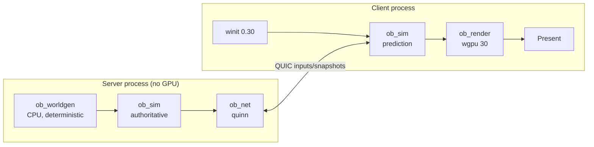
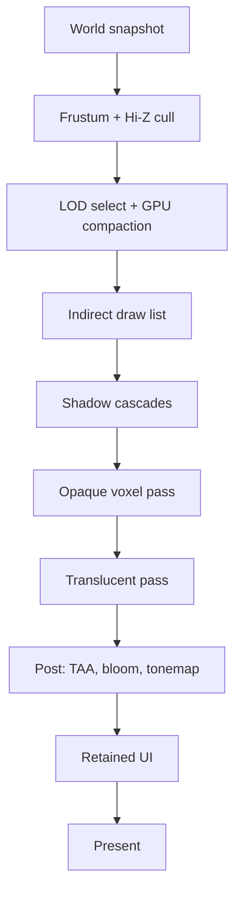

# 02 — Engine and Render Stack: Framework, Graphics API, ECS and Tooling

> **Status:** draft for review · **Research date:** 2026-11-24 · **Related docs:** [Weft teardown](01-weft-teardown.md), [Voxel rendering SOTA](03-voxel-rendering-sota.md), [Networking SOTA](04-networking-sota.md), [Modding and content](06-modding-and-content-system.md), [Legal and licensing](07-legal-licensing-and-ip.md), [UI, audio and localization](08-ui-audio-localization.md), [ADR-0002](../adr/0002-rust-and-purpose-built-engine.md), [ADR-0003](../adr/0003-wgpu-first-renderer.md), [ADR-0004](../adr/0004-section-size-and-storage.md), [Engine core](../spec/02-engine-core.md), [Rendering](../spec/03-rendering.md), [Performance budgets](../spec/25-performance-budgets.md).

## 1. Decision

**Build a purpose-built engine on wgpu 30.0.2, winit 0.30.13, glam 0.34.3, hecs 0.11.2, rayon 1.12.0 and mimalloc 0.1.52.** Do not adopt full Bevy 0.20 for v1. Keep the renderer API thin enough to add an `ash` Vulkan escape hatch later, not a second backend now. This is the best fit for a CPU-authoritative voxel game that needs a custom GPU-driven chunk pipeline, a headless server, and a credible path to 144 FPS without taking on Vulkan-only platform risk.

Confidence is **high** on the version facts (queried from crates.io on 2026-11-24), **medium-high** on the framework decision, and **medium** on the performance projections: this sandbox has no GPU (`/dev/dri` is absent) and no C linker, so no local GPU or clean-build benchmark was possible. Every number below is either sourced, arithmetic from a documented spec, or explicitly marked as an estimate.

## 2. Assumption check

| # | Lead assumption | Verdict | Evidence and required change |
|---|---|---|---|
| 1 | Rust everywhere; own engine on wgpu; winit; glam | **Accept** | wgpu 30.0.2, winit 0.30.13, glam 0.34.3 are current and healthy [1][22][23]. “Own engine” does not mean “write an OS layer”: use winit, wgpu, hecs, rayon. |
| 2 | Sections 32×32×32, paletted storage | **Challenge** | A 32³ section cannot live inside the 16×16 chunk column defined in the conventions. Either make columns 32×32 or use 16³ sections. See §10.2; resolve in DEC-004 before code. |
| 3 | CPU-authoritative worldgen, headless server | **Accept** | The server crate must not link wgpu, winit or shader tooling. GPU terrain generation can be a client preview only; it cannot be the authority. |
| 4 | QUIC (`quinn`) with prediction/reconciliation | **Accept** | QUIC is UDP-only; some networks block UDP. The networking doc should define a TCP/TLS fallback or an explicit “UDP required” support policy. |
| 5 | Packs + WASM + trusted native plugins | **Accept** | `wasmtime` 51.0.0 is current [53]; native plugins via `libloading` 0.9.1 [54]. Keep the renderer and GPU handles out of the mod ABI. |
| 6 | MIT OR Apache-2.0; Weft inspiration only | **Accept** | All recommended runtime crates are permissively licensed and compatible with MIT OR Apache-2.0: `winit` and `ktx2` are Apache-2.0, `mimalloc` is MIT, Tracy/`tracy-client` is BSD-3-Clause, `libloading` is ISC. Weft is MPL-2.0 and Minecraft’s code/assets are not ours to copy; read Weft for concepts, do not copy it [42]. |
| 7 | Desktop first; Android later; web much later | **Accept** | wgpu covers Vulkan/DX12/Metal/GLES/WebGPU; winit 0.30 covers Windows/macOS/Linux and Android. WebGPU browser coverage is still uneven; treat web as a separate product. |
| 8 | 144 FPS at 1080p, 32-chunk distance, 4 ms GPU, <2 ms CPU | **Partially accept** | 144 FPS is a 6.94 ms frame, so 4 ms GPU leaves 2.94 ms for CPU/present. “32 chunks” is ambiguous once column width changes: 32×16 = 512 blocks, 32×32 = 1024 blocks (4× area, 4× memory). Define render distance in blocks. See §10. |

## 3. Framework choice

### 3.1 Bevy 0.20.1: excellent engine, wrong renderer for this job

Bevy 0.20.1 was released 2026-10-28, requires Rust 1.97.1, is MIT OR Apache-2.0, has ~50k GitHub stars and ~2.2M recent crates.io downloads [9]. It depends on wgpu ^30 but pins glam ^0.33.2 [45]; mixing full Bevy with our glam 0.34.3 would create duplicate math types, so this is another reason to keep the engine boundary clean. Bevy 0.20 added WESL shaders, mesh-shader support integrated with its pipeline cache, a retained render world, Solari path tracing and DLSS, and texture-compression improvements [8]. It is a serious, well-funded engine, not a toy.

Its renderer is still a **generic scene renderer**. The frame is organised around `Extract → PrepareMeshes → CreateViews → Specialize → PrepareViews → Queue → PhaseSort → Prepare → Render → Cleanup`, with a render graph and `TrackedRenderPass` [8]. The built-in 3D path is `Mesh`-asset- and material-centric; it does not ship voxel section streaming, section LOD, hierarchical occlusion culling, or GPU-driven indirect draw compaction. A voxel renderer therefore has two options:

1. Create one `Mesh` per section and let Bevy batch it. This creates thousands of assets, per-section asset churn, and per-material bind-group changes; it is not a 32-chunk design.
2. Write a custom render phase/node with its own arenas, culling compute and `multi_draw_indirect_count`, bypassing `bevy_pbr`. At that point Bevy provides ECS, app, assets and UI, but you still own the hard renderer.

Bevy 0.20’s mesh-shader path (`MeshPipelineDescriptor`, `draw_mesh_tasks`) is explicitly “for advanced users” and is integrated with its pipeline cache [8]. It is promising for a future nvidium-style voxel path, but the underlying wgpu features are experimental and not portable to WebGPU. Do not make it the v1 requirement.

Bevy’s compile story is real overhead. Its setup guide calls the compile times “rather long”, recommends `dynamic_linking` as the “most impactful” iterative improvement, and recommends `lld` [10]. A community report puts a cold debug build at roughly 5 minutes on a Ryzen 5 5600X and incremental builds at 20–30 seconds with dynamic linking [11]; treat that as community data, not a controlled benchmark. A Bevy upgrade every 3–5 months is a migration project for custom render code. Third-party plugins are version-locked to a Bevy release and often lag it; a custom `RenderNode` written against 0.20 internals should be expected to break at 0.21. Pin 0.20.1 and budget an upgrade window rather than tracking `main`.

Bevy ECS is usable standalone: the official README says it “can easily be used as a standalone crate” [12]. It is not lightweight. Mandatory dependencies include `bevy_platform`, `bevy_ptr`, `bevy_tasks`, `bevy_utils`, `bumpalo`, `concurrent-queue`, `fixedbitset`, `indexmap`, `nonmax`, `slotmap`, `smallvec`, `thiserror` and `variadics_please`; reflection and serde are optional. Choose it if you want Bevy’s scheduler/observers/relations, not because it is the cheapest ECS.

### 3.2 Fyrox 1.0.1 and macroquad 0.4.16

Fyrox 1.0.1 (2026-03-28, MIT, ~9.7k stars) is a full engine with an editor, scene graph and physics [16]. Its default graphics backend is still OpenGL; the wgpu backend is an optional `fyrox-graphics-wgpu` 2.0.0-rc.1 dependency [17]. For a custom voxel renderer that wants indirect draws and modern GPU features, the wgpu path is too young and the OpenGL path has the wrong performance ceiling.

macroquad 0.4.16 (2026-07-30, MIT OR Apache-2.0) is a miniquad-based GL/GLES/WebGL framework with an immediate-mode batcher [18]. It has no compute-shader or indirect-draw pipeline and is 2D-first. It is excellent for prototypes and tools, not for 32-chunk voxel rendering at 144 FPS.

### 3.3 Framework comparison

| Option | Control | Perf ceiling | Time to first playable | Cross-platform | Risk | Verdict |
|---|---|---|---|---|---|---|
| Custom wgpu engine | 5/5 | 5/5 | 6–10 engineer-weeks | 5/5 | High: you own renderer, UI, assets | **Choose** |
| Bevy 0.20 full | 3/5 | 3/5 | 2–4 engineer-weeks | 5/5 | Medium: generic renderer, API churn, compile | Reject for v1; revisit if team lacks a renderer engineer |
| Fyrox 1.0 | 3/5 | 2/5 (GL default) | 4–6 engineer-weeks | 4/5 | Medium-high: wgpu backend RC, no voxel pipeline | Reject |
| macroquad 0.4 | 1/5 | 1/5 | ~1 engineer-week | 3/5 | Low, but wrong product | Prototype only |
| ash/vulkano | 5/5 | 5/5 | 8–12 engineer-weeks | 2/5 | High: unsafe or Vulkan-only, macOS via MoltenVK | Deferred escape hatch |

Time estimates assume 2–3 experienced Rust engineers, one of whom has shipped a renderer. They are planning estimates, not measured data.

**Decision:** purpose-built engine. The differentiator is the voxel pipeline; outsourcing the frame to a generic scene renderer creates the worst kind of dependency. If the team has no renderer-capable engineer, reverse this decision and use Bevy full — but then accept a lower performance ceiling and a multi-minute clean build.

## 4. Graphics API: wgpu vs ash vs vulkano vs glow

### 4.1 wgpu 30.0.2 state

wgpu 30.0.2 was published 2026-11-12; 30.0.0 shipped 2026-07-01 and 30.0.1 on 2026-08-22 [1][2]. It is MIT OR Apache-2.0, MSRV 1.87, and the de-facto Rust graphics API. It supports Vulkan, DX12, Metal, GLES/WebGL2 and WebGPU [41]. The 30.x line renamed push constants to **immediates** (`set_immediates`, WGSL `var<immediate>`), made `MULTI_DRAW_INDIRECT` unconditional where `DownlevelFlags::INDIRECT_EXECUTION` exists, kept `MULTI_DRAW_INDIRECT_COUNT` as a feature, and added full mesh-shader support across Vulkan/DX12/Metal (experimental, with passthrough shaders on non-Vulkan) [2][3].

wgpu 30 is not a thin Vulkan wrapper. Its `wgpu-core` layer validates resources and state on API calls. There is no documented supported switch to remove that validation; `strict_asserts` adds more checks, and the only sanctioned bypasses are `create_shader_module_trusted` (skip shader runtime checks) and `create_shader_module_passthrough` (bypass Naga entirely, unsafe) [43]. Release builds must therefore be designed around **few, cached, batched API calls**, not “validate later”.

### 4.2 Alternatives

**ash 0.38.0+1.3.281** is raw Vulkan bindings: full control of queues, synchronization, descriptor indexing, mesh shaders and ray tracing, at the cost of `unsafe` everywhere and manual memory/swapchain management. Its crates.io release is from 2024-04-01 and tracks Vulkan 1.3.281 headers; the repository is active, but there has been no new release in ~2.5 years [19]. Vulkan 1.4 additions require newer bindings or a git dependency. That is a supply-chain and maintenance risk for a new project.

**vulkano 0.35.2** (2025-08-16) is a safer Vulkan wrapper with shader reflection; it is capable but has a slower release cadence and a smaller ecosystem than wgpu [20]. It is still Vulkan-only.

**glow 0.18.0** (2026-07-09) is an OpenGL/GLES/WebGL binding [21]. It is the compatibility fallback, not a performance path: no mesh shaders, no descriptor indexing, no portable ray tracing, and limited indirect-count support.

### 4.3 Capability matrix

| Capability | wgpu 30.0.2 | ash 0.38 | vulkano 0.35 | glow 0.18 |
|---|---|---|---|---|
| Mesh shaders | ⚠️ experimental; Vulkan/DX12/Metal; passthrough on non-Vulkan | ✅ `VK_EXT_mesh_shader`, GPU/driver dependent | ⚠️ extension-dependent; verify | ❌ |
| Bindless / descriptor indexing | ⚠️ binding arrays, partially bound, non-uniform indexing; limits default to 0 | ✅ full descriptor indexing | ⚠️ extension coverage varies | ❌ |
| Multi-draw indirect | ✅ core where downlevel allows | ✅ | ✅ | ⚠️ GL 4.3+ / not WebGL |
| Indirect draw count | ✅ feature; not Metal | ✅ | ✅ | ⚠️ GL 4.6 only |
| Timestamp queries | ✅ native; WebGPU restrictions | ✅ | ✅ | ✅ timer queries |
| Async compute queues | ❌ one queue per device | ✅ queue families | ✅ | ❌ |
| Ray tracing | ⚠️ experimental ray query/pipelines | ✅ KHR ray tracing, GPU dependent | ⚠️ partial/extension-dependent | ❌ |
| Platform reach | Vulkan, DX12, Metal, GLES/WebGL2, WebGPU | Vulkan only; macOS via MoltenVK | Vulkan only; macOS via MoltenVK | GL/GLES/WebGL |
| Maintenance | ✅ 30.0.2, Nov 2026 | ⚠️ active repo, stale release | ⚠️ 0.35.2, Aug 2025 | ✅ but legacy |
| Shader input | WGSL first; SPIR-V/GLSL optional | SPIR-V; GLSL/HLSL offline | GLSL via `vulkano-shaders`; SPIR-V | GLSL |

### 4.4 wgpu features and limits we must request

Defaults are deliberately WebGPU-safe and too small for a voxel engine. From wgpu 30’s `Limits::defaults()`: `max_buffer_size` 256 MiB, `max_storage_buffer_binding_size` 128 MiB, `max_uniform_buffer_binding_size` 64 KiB, `max_bind_groups` 4, `max_storage_buffers_per_shader_stage` 8, `max_texture_dimension_2d` 8192, `max_texture_array_layers` 256, `max_immediate_size` 0, `max_binding_array_elements_per_shader_stage` 0 [4][44]. Request these explicitly and clamp to `adapter.limits()`:

| Feature / limit | Default | Request | Why |
|---|---:|---:|---|
| `max_buffer_size` | 256 MiB | 1 GiB (fallback 512 MiB) | Chunk vertex/index arenas and large staging buffers |
| `max_storage_buffer_binding_size` | 128 MiB | 256 MiB (fallback 128 MiB) | GPU culling lists and large section data; WebGPU stays at 128 MiB |
| `max_immediate_size` + `IMMEDIATES` | 0 | 128 B | Per-draw chunk origin, LOD, material base, flags without uniform offsets |
| `max_texture_array_layers` | 256 | 1024 (fallback 256) | Block texture array with room for modded tiles |
| `max_bind_groups` | 4 | 4 | Keep WebGPU portability; do not spend a group casually |
| Binding-array limits | 0 | 4096 only if bindless is proven necessary | Avoid bindless by default; texture arrays + material buffer are enough |
| `INDIRECT_FIRST_INSTANCE` | off | on | GPU culling with per-instance base IDs |
| `MULTI_DRAW_INDIRECT_COUNT` | off | on native, fallback fixed count | GPU compaction; not available on Metal |
| `TIMESTAMP_QUERY` + inside encoders | off | on | Per-pass GPU budgets; inside-pass optional |
| `PIPELINE_CACHE` | off | on | Persist compiled pipelines; reduce first-run stutter |
| `TEXTURE_COMPRESSION_BC` | off | on desktop | BC7 albedo, BC5 normals |
| `EXPERIMENTAL_MESH_SHADER` | off | off in v1; optional later | Experimental + passthrough; not a baseline |
| `EXPERIMENTAL_RAY_QUERY` | off | off in v1; optional later | RT is not a 144 FPS voxel baseline |

`IMMEDIATES` is supported on DX12, Vulkan, Metal, desktop GL and (as a proposal) WebGPU; `INDIRECT_FIRST_INSTANCE` is not available on GLES/WebGL [3]. `MULTI_DRAW_INDIRECT_COUNT` is DX12/Vulkan 1.2+ only, so macOS needs a fixed-count indirect fallback [3]. Request only what the device reports, and keep a capability record in the renderer. On Windows, benchmark DX12 and Vulkan and expose a backend override; driver behaviour differs enough that a single default is not defensible without data.

### 4.5 Validation overhead on hot paths

The expensive wgpu calls are resource creation and state changes, not the draw call itself. Historical wgpu issues show the mechanism clearly: `create_buffer` taking ~4 ms [7], a 23% regression in wgpu 22 where profiling pointed at bind creation [6], and a Bevy Caldera scene going from **50 ms to 109 ms** when every mesh used a unique material [5]. Those are not wgpu 30 numbers, but they are the right design warning.

Rules for the renderer:

- Cache pipelines, pipeline layouts, bind groups and samplers; create them at load or on content reload, never per frame.
- Use one material/parameter buffer plus texture arrays; do not switch bind groups per section.
- Batch sections into a small number of indirect draws per pass; one `multi_draw_indirect_count` can cover thousands of sections.
- Use a staging belt/ring for uploads; avoid per-chunk `queue.write_buffer` in the frame loop.
- Timestamp queries only when profiling; resolve and read back 1–2 frames later, never stall.
- Keep `InstanceFlags::VALIDATION` and backend validation layers for debug; do not ship them.
- Validate shaders offline with Naga; ship trusted shader modules and a disk pipeline cache.

There is no controlled public “wgpu vs ash overhead” number that applies to a well-batched voxel frame. My estimate: **single-digit percent overhead for a few batched draws, but large penalties for per-material state changes and per-frame resource creation.** Measure with timestamp queries and Tracy before considering a Vulkan backend.

### 4.6 Shader tooling

WGSL is the right default: it is portable across all wgpu backends and is the only language that works on WebGPU. Its weaknesses are no include/preprocessor and uneven advanced-feature coverage. Use `naga` 30.0.2 for validation and `naga_oil` 0.23.0 for `#import`-style composition; naga_oil 0.23 depends on naga 30 and wgpu 30, so the versions align [29][30][47]. WESL 0.6.0 is a WGSL superset with imports and conditional compilation; Bevy 0.20 adopts it, but it is young enough that I would not make it a hard dependency for v1 [31].

wgpu accepts WGSL, SPIR-V and GLSL inputs, but not HLSL source; authoring in HLSL/DXIL means an offline DXC/SPIR-V toolchain and a passthrough path, outside the portable default. For Vulkan-only experiments, SPIR-V passthrough is available but non-portable. Do not build the shipping shader graph on it. Compile shader variants ahead of time, pre-warm pipelines at load, and persist the wgpu pipeline cache. High-quality visuals come from HDR `Rgba16Float`, reverse-Z, cascaded shadows, SSAO, TAA, bloom and a good tonemap — not from requiring ray tracing.

## 5. ECS

### 5.1 What actually matters for a voxel game

- **Do not put blocks or sections in the ECS.** A 512-block-radius world is hundreds of millions of blocks; ECS entities are for players, mobs, dropped items, projectiles and block entities. Chunks/sections belong in a spatial store keyed by `(cx, cz, sy)`.
- **Entity counts are modest.** Expect <100 players, 1k–10k mobs/items, 10k–100k block entities. A simple query over 100k entities is typically sub-millisecond on desktop (order of magnitude; measure); ECS microbenchmarks are not the deciding factor.
- **Replication needs stable IDs.** ECS entity handles are generational and change across save/load. Add a `NetId` and a stable entity kind; replicate from a sorted snapshot, not from archetype iteration order.
- **Determinism is not free.** Archetype iteration order depends on insertion/removal history; parallel schedules can execute non-conflicting systems in arbitrary order. If the authoritative tick must be deterministic, run gameplay systems in a fixed order or single-threaded, and do not rely on `HashMap` iteration.
- **Serialization is schema work.** ECS reflection helps snapshots, but the world save is a custom section format. Do not serialize the ECS world as the save file.
- **Avoid archetype churn.** Adding/removing components every tick moves entities between archetypes (memcpy + bookkeeping) and fragments iteration order. Model stable state as components; use tags/resources for rare mode changes.
- **Cache hot queries.** In hecs, use `PreparedQuery` for repeatedly executed systems; do not build a generic query per block or per section. Keep hot simulation loops as explicit SoA passes.
- **Server safety.** `bevy_ecs` has no wgpu/winit dependency and can run headless, but its mandatory Bevy support crates still cost compile time; hecs is the leaner server choice.

### 5.2 Options

| Option | Scheduling/resources | Determinism | Serialization | Compile weight | Verdict |
|---|---|---|---|---|---|
| `bevy_ecs` 0.20.1 | Full scheduler, resources, events, observers, relations | Possible with single-threaded/fixed schedule | Optional reflect/serde; snapshot code still needed | High (many Bevy crates) | Only if full Bevy or you need its scheduler |
| `hecs` 0.11.2 | Minimal; you write the loop | Full control | `row-serialize` / `column-serialize` features | Low | **Choose for high-level entities** |
| `shipyard` 0.11.5 [14] | Workloads, parallel views, tracking | Workload order under your control | `serde1` feature | Medium | Capable, smaller ecosystem; not chosen |
| `legion` 0.4.0 [15] | Scheduler | — | — | — | Unmaintained since 2021; reject |
| Custom SoA | Hand-written systems | Easiest to make exact | Hand-written, exact | Lowest | **Use for hot simulation data** |

hecs’ own documentation describes archetype/columnar storage and a minimalist “library, not a framework” design [13]. That fits OpenBlock: we need entity storage, not an app model. Use hecs for mobs/items/players and a custom SoA for physics hot loops (positions, velocities, AABBs). Keep block entities in a `HashMap<BlockPos, BlockEntity>` or a spatial chunk side-table, not as ECS entities.

### 5.3 Determinism warning

glam uses `f32`; SIMD/FMA codegen and math-library differences can produce different results across CPUs and compilers. If the spec’s “deterministic simulation” means **bit-exact across client/server platforms**, use fixed-point integer math for authoritative movement/physics and keep glam for rendering. If it means “same inputs produce the same result in practice, with server reconciliation correcting drift”, f32 is acceptable but must be tested with a replay corpus. This is a decision for the Lead before the simulation crate is designed.

## 6. Supporting crates

### 6.1 Window, math, jobs, memory

**winit 0.30.13** (2026-10-24) is the current stable release; there is no 0.31 stable on crates.io at the cutoff [22]. Use the `ApplicationHandler` API, `raw-window-handle` 0.6.2, and handle suspend/resize/scale-factor/surface-loss explicitly. Prefer `PresentMode::Mailbox` with a `Fifo` fallback, and cap frames in flight at 2–3 to keep latency bounded. Android support exists but is a separate integration project (lifecycle, touch, audio, thermals).

**glam 0.34.3** (2026-11-08) is the right math library: `Vec3A`/`Mat4`/`Quat`, SIMD-friendly, `bytemuck` support, and it is what Bevy and much of the ecosystem use [23]. Do not add nalgebra unless a physics solver demands generics; it is heavier and slower for game math.

**rayon 1.12.0** is the workhorse for worldgen and meshing [24]. Use separate `ThreadPool`s for bulk worldgen and latency-sensitive meshing; rayon has no priorities, so a long job can delay a near-player remesh. Use `crossbeam-channel` 0.5.17 bounded queues for job submission/results and `parking_lot` 0.13.0 only for cold shared state. Use `rustc-hash` 2.1.3 (`FxHashMap`) for integer-coordinate maps; `hashbrown` 0.17.2 if you need SwissTable controls.

**mimalloc 0.1.52** is the default global allocator recommendation for client and server. Its official benchmark page reports, on a 16-core Ryzen 5950X, a 13% speedup over tcmalloc on the Lean compiler workload and ~1.6× faster allocator time on that workload; the page itself notes the benchmarks are old (2021) and that other allocators have improved [25]. Treat that as directional, not a promise. Pair it with `bumpalo` 3.20 per-frame/per-job arenas so frame code does not allocate. `tikv-jemallocator` 0.7.0 is a reasonable Linux-server alternative, but cross-compiling jemalloc to Windows/Android is extra pain; one allocator is simpler.

### 6.2 Profiling

**tracing 0.1.44** + `tracing-subscriber` for structured logs and spans; `tracing-tracy` 0.12.0 + `tracy-client` 0.19.0 for frame timelines [26][28]. Use wgpu timestamp queries for GPU pass budgets (`TIMESTAMP_QUERY`, inside-encoder optional). `wgpu-profiler` 0.28.0 is compatible with wgpu 30 if you want a higher-level GPU profiler [49]. Puffin 0.20.0 is a good in-game frame profiler [27], but `puffin_egui` 0.30.0 pins egui ^0.33.3, not 0.37 [55], so do not assume the latest egui integration works; use Puffin’s data with a custom overlay or pin compatible versions. RenderDoc and Nsight are the GPU capture tools [48]. Superluminal 0.4 is a Windows-only alternative; use it only if the team is Windows-first, because Tracy already covers cross-platform CPU timelines [57].

### 6.3 Assets and textures

Use `image` 0.25.10 for import only (PNG source assets), `ktx2` 0.5.0 for the runtime container, and `intel_tex_2` 0.5.0 offline for BC7/BC5 compression [32][33]. BC7 is 8 bpp versus 32 bpp RGBA8 (4:1); BC5 is 8 bpp versus 16 bpp RG8 (2:1). KTX2 carries mip levels and supercompression cleanly [32]. For block textures, prefer a `texture_2d_array` (one layer per tile) over a giant atlas: it removes bleeding, simplifies mip generation, and lets the shader sample by layer index. `max_texture_array_layers` defaults to 256, so request 1024 for modded content [4].

`basis-universal` 0.3.1 is stale (last release 2023-11-02); runtime transcoding adds a C++ dependency and a startup cost [34]. Do offline per-platform compression instead. Add ASTC for Android later; do not block desktop v1 on it.

### 6.4 Text and UI

For shipping UI, build a **retained** UI layer: widget tree, layout, keyboard/controller focus, localization, and a quad renderer. This is required for Minecraft-like menus, inventory drag/drop, accessibility and controller navigation. Use `cosmic-text` 0.19 + `glyphon` 0.12 for shaping/fallback and wgpu text rendering; glyphon 0.12 targets wgpu 30 and cosmic-text 0.19, so it aligns [35][48]. `parley` 0.13 is a strong alternative for rich text/layout, but it does not give you a ready wgpu text renderer [36].

Use `egui` 0.37 only for developer/debug overlays and tools [37]. Ship OFL-licensed fonts (or a commissioned pixel font), never Minecraft’s font or texture assets. `egui-wgpu` 0.37 depends on wgpu ^30, so it will not force a second wgpu [38][46]. Immediate-mode UI is a poor fit for a shipping game menu: it rebuilds every frame, has limited native accessibility, and makes controller focus/animation state awkward. Audio is deliberately out of scope here (see [UI, audio and localization](08-ui-audio-localization.md)); keep it client-only so the server stays headless.

### 6.5 Network-adjacent choices

`quinn` 0.11.12, `tokio` 1.54.1, `rustls` 0.23.46, `postcard` 1.2.0, `zstd` 0.14.4 and `lz4_flex` 0.14.2 are the natural client/server set [39]. The networking doc owns the protocol; the stack constraint is that the server crate must compile without wgpu/winit, and the client must not run a Tokio runtime it does not need.

## 7. Compile time and iteration speed

### 7.1 Workspace split

Split by **GPU dependency**, not by taste:

| Crate | GPU/window deps? | Responsibility |
|---|---|---|
| `ob_core` | no | App lifecycle, scheduler, config, diagnostics, platform traits |
| `ob_world` | no | Sections, palettes, block states, storage, streaming model |
| `ob_worldgen` | no | CPU terrain/biomes/caves/features, deterministic |
| `ob_sim` | no | Authoritative tick, physics, gameplay rules |
| `ob_net` | no | Protocol, replication, quinn transport |
| `ob_content` | no | Registries, packs, tags, recipes |
| `ob_render` | **yes** (wgpu) | Device, arenas, render graph, voxel pipeline, shaders |
| `ob_client` | **yes** (winit + render) | Window, input, presentation, UI |
| `ob_server` | **no** | Headless host |
| `ob_mod` | no | wasmtime host, native plugin loader |
| `ob_tools` | no | Asset/pack compiler, inspectors |

CI must assert `cargo tree -p ob_server` contains no `wgpu`, `winit` or `naga`. This one rule prevents the most common headless-server regression.

### 7.2 Profiles, linker and dynamic linking

The repo already has the right shape: `dev` opt-level 1, dependencies opt-level 3, release with thin LTO, `codegen-units = 1`, `panic = "abort"`, split debug info. Keep it. Add `lld` on Linux/Windows (`-C link-arg=-fuse-ld=lld`); macOS’s `ld-prime` is already fast. mold is faster than lld in its own benchmarks but has license/compatibility considerations; do not make it a requirement.

For iteration, split `ob_sim`/`ob_render` into dylibs and use `hot-lib-reloader` 0.8.2 with a thin binary [51]. Rust has no stable ABI: the dylib and host must be built by the same compiler, and hot reload must never cross a release boundary. Do not ship hot reload. If using Bevy, its `dynamic_linking` feature is the equivalent lever [10], but it does not fix the renderer’s API churn. The repo’s `panic = "abort"` is right for the client release; evaluate `panic = "unwind"` for the dedicated server so one bad connection or mod cannot take down every player.

### 7.3 Nightly, PGO and shipping

- Evaluate `-Zshare-generics` and the Cranelift backend on a branch; Cranelift is nightly-only and lags LLVM features. Do not put nightly in the required developer path.
- Use PGO/BOLT for release builds only after the frame is stable; measure, do not assume.
- Ship with `-C target-cpu=x86-64-v2` (or v3 with a runtime check); never ship `target-cpu=native`.
- Use `sccache` in CI and `cargo-hakari` to unify features and avoid duplicate builds [50][52].
- Track `cargo build --timings`: clean build under ~5 min, incremental under ~10 s are reasonable gates for this stack.

### 7.4 How a small team ships

A 2–3 person team can ship this stack only with brutal scope control: one dimension, creative mode first, 16³ sections, 512-block render distance, 2–8 player multiplayer, content packs before WASM, custom UI before an editor. Build a vertical slice in 6 months: walk, break/place, stream, save/load, one mob, one network client. Do not build an editor, ray tracing, mesh shaders, a scripting language and a mod marketplace in the same year.

## 8. Recommended stack (pinned)

| Layer | Crate | Version | Notes |
|---|---|---:|---|
| Toolchain | Rust | 1.100.0 | Repo pin; Bevy 0.20 needs 1.97.1, wgpu 30 needs 1.87 |
| GPU | `wgpu` | 30.0.2 | `default-features=false`; `std`, `parking_lot`, `vulkan`, `dx12`, `metal`, `wgsl`; add `gles` for fallback |
| Shader compiler | `naga` | 30.0.2 | Match wgpu; offline validation |
| Shader includes | `naga_oil` | 0.23.0 | `#import` composition; depends on naga 30/wgpu 30 |
| Window/input | `winit` | 0.30.13 | `ApplicationHandler`; rwh 0.6.2 |
| Math | `glam` | 0.34.3 | `bytemuck`; SIMD; f32 determinism caveat |
| ECS | `hecs` | 0.11.2 | High-level entities; no blocks/sections |
| Jobs | `rayon` | 1.12.0 | Separate pools for worldgen vs meshing |
| Channels | `crossbeam-channel` | 0.5.17 | Bounded queues |
| Locks | `parking_lot` | 0.13.0 | Cold shared state only |
| Hash maps | `rustc-hash` | 2.1.3 | Integer keys; `FxHashMap` |
| Allocator | `mimalloc` | 0.1.52 | Global allocator; arenas for frame data |
| Logs/spans | `tracing` | 0.1.44 | + `tracing-subscriber` 0.3 |
| CPU profiling | `tracing-tracy` | 0.12.0 | + `tracy-client` 0.19.0 |
| GPU profiling | wgpu timestamps | 30.0.2 | `wgpu-profiler` 0.28 optional |
| Import images | `image` | 0.25.10 | PNG only where possible |
| Texture container | `ktx2` | 0.5.0 | BC7/BC5 payloads, mips |
| Offline compression | `intel_tex_2` | 0.5.0 | BC7/BC5 at build time |
| Text | `cosmic-text` | 0.19.0 | + `glyphon` 0.12.0 |
| Debug UI | `egui` | 0.37.0 | Dev-only; `egui-wgpu`/`egui-winit` 0.37 |
| Net | `quinn` | 0.11.12 | Networking doc owns protocol |
| Async (server) | `tokio` | 1.54.1 | Server only |
| Serialization | `postcard` | 1.2.0 | + `serde` 1.0.229 |

Optional/deferred: `wgpu` experimental mesh shaders, `ash` Vulkan backend, GPU meshing, `basis-universal`, `parley`, `bevy_ecs`, `puffin`.

## 9. Rejected alternatives

| Alternative | Why rejected | What would reverse it |
|---|---|---|
| Bevy 0.20 full | Generic scene renderer; custom voxel pipeline still ours; per-material state changes; multi-minute clean builds; roughly 3–5 month breaking releases | No renderer-capable engineer, or a 3-month prototype mandate |
| Fyrox 1.0 | OpenGL default; wgpu backend RC; no chunk streaming/LOD; custom voxel renderer fights the engine | A tools/editor-first product rather than a performance-first game |
| macroquad | GL/GLES/WebGL only; no compute/indirect; 2D-first | Prototype, game jam, or UI tool |
| ash baseline | Unsafe, Vulkan-only, stale crates.io release; macOS via MoltenVK; no web | Windows/Linux-only + mesh shaders/RT/async compute are proven must-haves |
| vulkano baseline | Vulkan-only; slower cadence; no advantage over wgpu for this feature set | A Vulkan-specific feature that wgpu cannot expose and ash is too unsafe |
| glow baseline | Legacy GL feature set; no modern pipeline | WebGL2-only fallback, or very old hardware |
| legion | Unmaintained since 2021 | Never for new code |
| shipyard | Capable, but smaller ecosystem and more machinery than needed | A systems-heavy simulation that benefits from workloads |
| bevy_ecs standalone | Heavier than hecs; API churn; scheduler not needed | Full Bevy path, or editor/tooling needs |
| basis-universal runtime | Stale crate (2023), C++ build, startup transcode cost | Web/Android universal asset fallback |
| egui shipping UI | Immediate-mode rebuild, weak accessibility/controller focus | Debug tools only |

### 9.1 What would change the answer

| Trigger | Change |
|---|---|
| Measured wgpu submission >1 ms/frame or state changes >0.5 ms at target draw counts | Prototype an `ash` Vulkan backend behind `ob_render`; keep wgpu for macOS/web |
| Mesh shaders, ray tracing or async compute are required to hit 144 FPS | Use `ash` on Windows/Linux, or wgpu’s experimental Vulkan mesh path; accept reduced platform reach |
| No renderer-capable engineer, or a hard six-month ship date | Adopt Bevy full; accept the generic renderer and compile-time tax |
| Web is a launch platform | wgpu + WebGPU only; drop immediates, MDI count and mesh shaders; keep buffers ≤256 MiB |
| macOS must ship at launch | Design and test the Metal path from month one; no MDI-count dependency |
| 32³ storage sections are mandatory | Make columns 32×32 and use 16³ mesh bricks or 8³ dirty regions; define distance in blocks |
| Bit-exact cross-platform simulation is mandatory | Fixed-point integer simulation; glam stays presentation-only |

## 10. Performance feasibility check

### 10.1 Target arithmetic

144 FPS = **6.94 ms/frame**. A 4 ms GPU budget consumes 57.6% of the frame and leaves 2.94 ms for CPU, presentation and OS jitter. That is consistent with a sub-2 ms CPU main-thread target, but only if chunk meshing/worldgen run off-thread and draw submission is batched.

The RTX 3060 12 GB has roughly **12.7 TFLOPS FP32, 360 GB/s and 12 GB GDDR6** [40]. At 1080p (2.07M pixels), a 4 ms frame is ~518 Mpix/s; the card’s ROP/TMU throughput is far above that. The real risks are CPU visibility/draw submission, state changes, overdraw and memory; raw fill rate and triangle throughput are not the expected limiter on a heightmap.

A planning budget, not a measurement:

| Pass | Budget (ms) | Notes |
|---|---:|---|
| Shadow cascades | 0.8 | 3–4 cascades, 2048 maps, PCF |
| Opaque voxels | 1.8 | GPU-culled, indirect, LOD0–L2 |
| Translucent | 0.4 | Water/glass, sorted, no full-screen refraction |
| Post | 0.8 | HDR, bloom, TAA, tonemap |
| UI | 0.2 | Retained quads/text |
| **Total** | **4.0** | Leaves 2.94 ms for CPU/present |

CPU planning budget: input 0.2, simulation 0.5, streaming/job dispatch 0.4, draw submission 0.4, UI 0.3 and audio 0.1 = **1.9 ms**. That leaves 0.1 ms before the 2 ms target, so per-frame allocation, synchronous IO and unbounded job queues are out.

### 10.2 32³ vs 16³ sections

A 32³ section is 8× the volume of 16³. It cuts section count and draw calls by 8× for the same volume, but also makes a single block edit dirty 8× more blocks and makes culling/lighting coarser. With `multi_draw_indirect_count`, draw-call count is not the bottleneck it was in 2015; remesh latency and network delta size are. The comparison below is same-volume at a 512-block radius; the memory table uses a 32-chunk radius, so volume grows 4× when column width doubles.

| Property | 16³ storage | 32³ storage | Consequence |
|---|---:|---:|---|
| Blocks per section | 4,096 | 32,768 | 8× remesh work per edit |
| Visible sections at 512-block radius, ~4 surface sections/column | ~12,900 | ~1,600 | 8× fewer draws, but batchable either way |
| Full sections to 384 height | ~77k | ~9.7k | 8× fewer objects, same blocks |
| Uncompressed block bytes (1 byte/block) | 4 KiB | 32 KiB | 8× larger network delta before palette/RLE |
| 4-bit packed storage | 2 KiB | 16 KiB | Same total world memory at equal volume |
| Culling granularity | Fine | Coarse | More overdraw and coarser occlusion |
| Chunk column fit | Fits 16×16 | **Needs 32×32** | Current conventions say 16×16 columns; contradiction |

**Recommendation:** keep **16×16 chunk columns and 16³ storage/light/edit sections** for v1, matching Minecraft’s 16³ sections and Weft’s 16³ chunks, and keeping remesh/network deltas small [42][56]. If flat-build meshing dominates, mesh **32³ clusters of 2×2×2 sections** — a render cluster, not a storage section — which captures most of 32³’s quad-merging win without its edit/light cost. A 32³ *storage* section still forces 32×32 columns; do not let it straddle 16×16 column ownership.

### 10.3 Memory reality at 32 chunks

Assume a circular radius of 32 chunks, 3,217 columns, height 384, and packed palettes:

| Case | Blocks | 4-bit | 1 byte | 2 bytes |
|---|---:|---:|---:|---:|
| 16×16 columns, 32-chunk radius | 316M | 158 MB | 316 MB | 632 MB |
| 32×32 columns, 32-chunk radius | 1.264B | 632 MB | 1.26 GB | 2.53 GB |
| 16×16 columns, 32-chunk radius, height 256 | 211M | 105 MB | 211 MB | 422 MB |

Mesh memory is not the dominant term on a heightmap: at 512-block radius, a few thousand to ~20k greedy quads (10k–40k triangles) is under ~10 MB at 16 B/quad plus indices; cave, indoor and flat-build worst cases can reach tens to low hundreds of MB. Budget 10–100 MB and measure. The sibling [voxel rendering survey](03-voxel-rendering-sota.md) derives roughly 5k–20k quads for this radius. Block storage dominates, and the 32×32-column case is 4× worse before LOD. LOD is not optional at 32 chunks if “32 chunks” means 32×32-block columns.

## 11. Risks

| Risk | Likelihood | Impact | Mitigation |
|---|---|---|---|
| Custom renderer takes longer than gameplay | High | Schedule slip | Vertical slice first; no mesh shaders/RT/editor in v1 |
| wgpu feature gap (async compute, mesh shaders, RT) | Medium | Perf ceiling | Keep renderer API thin; prototype ash only if measured gap |
| macOS Metal gaps (no MDI count, timestamp/pass limits) | Medium | Platform slip | Test Metal from month one; design fixed-count fallback |
| 32³ + 32×32 columns memory blow-up | Medium-high | Can’t hit 32 chunks | 16³/16×16 first; LOD; compression; define distance in blocks |
| Shader compile/pipeline stutter | Medium | Bad first-run feel | Offline Naga validation; pipeline cache; pre-warm at load |
| Driver bugs on Intel/AMD/Metal | Medium | Crashes/artifacts | CI on at least one AMD and one Intel GPU; RenderDoc captures |
| ECS/API churn (if Bevy) | Medium | Upgrade tax | Pin 0.20.1; isolate behind traits; only upgrade at milestones |
| Solo/small-team burnout | High | Project death | 6-month vertical slice; cut scope; buy assets; no custom engine subsystem without a milestone |

## 12. Open questions for the Lead

1. **DEC-004 contradiction:** are chunk columns 16×16 with 16³ sections, or 32×32 with 32³ sections? A 32³ section cannot fit a 16×16 column. Which is normative?
2. **Render distance units:** does “32 chunks” mean 512 blocks (Minecraft 32×16) or 1024 blocks (32×32 columns)? The memory and triangle budgets differ by 4×.
3. **Determinism:** is bit-exact cross-platform simulation required, or is server-authoritative reconciliation with f32 drift acceptable? This decides fixed-point vs glam in `ob_sim`.
4. **Team shape:** do we have a renderer-capable engineer for 6–12 months? If not, should we choose Bevy full despite the performance ceiling?
5. **macOS at launch:** is Metal a launch requirement? If yes, no MDI-count-dependent design; mesh shaders/RT remain experimental.
6. **Web:** is browser play a real v1 requirement or aspirational? If real, keep buffers ≤256 MiB, avoid immediates/MDI count/mesh shaders, and budget a separate WebGPU port.
7. **GPU floor:** RTX 3060 is the target, but what is the minimum (GTX 1060, Steam Deck, integrated)? This determines LOD, texture formats and memory budgets.
8. **Bevy decision deadline:** when must we commit? A two-week Bevy prototype is cheap; a six-month Bevy custom-renderer detour is not.
9. **Modding timeline:** does WASM ship in v1 or after 1.0? If v1, the host ABI and capability model constrain the ECS/renderer boundaries now.
10. **Server scale:** 8 players or 100? Interest management and chunk residency dominate server RAM and CPU, not wgpu.

## Sources

1. wgpu 30.0.2 on crates.io — https://crates.io/crates/wgpu/30.0.2
2. wgpu v30.0.2 changelog — https://github.com/gfx-rs/wgpu/blob/v30.0.2/CHANGELOG.md
3. wgpu 30 `Features` documentation — https://docs.rs/wgpu/30.0.2/wgpu/struct.Features.html
4. wgpu 30 `Limits` documentation — https://docs.rs/wgpu/30.0.2/wgpu/struct.Limits.html
5. wgpu issue #6357, state-change/draw-call overhead — https://github.com/gfx-rs/wgpu/issues/6357
6. wgpu issue #6434, wgpu 22 regression — https://github.com/gfx-rs/wgpu/issues/6434
7. wgpu issue #5984, create_buffer latency — https://github.com/gfx-rs/wgpu/issues/5984
8. Bevy 0.20 release notes — https://bevy.org/news/bevy-0-20/
9. Bevy 0.20.1 on crates.io — https://crates.io/crates/bevy/0.20.1
10. Bevy setup and fast-compile guidance — https://bevy.org/learn/quick-start/getting-started/setup/
11. Bevy discussion #9146, cold/incremental compile reports — https://github.com/bevyengine/bevy/discussions/9146
12. `bevy_ecs` 0.20.1 documentation — https://docs.rs/bevy_ecs/0.20.1/bevy_ecs/
13. hecs README and design — https://github.com/Ralith/hecs
14. shipyard README — https://github.com/leudz/shipyard
15. legion 0.4.0 on crates.io — https://crates.io/crates/legion/0.4.0
16. Fyrox 1.0.1 on crates.io — https://crates.io/crates/fyrox/1.0.1
17. Fyrox workspace manifest (OpenGL default, optional wgpu backend) — https://github.com/FyroxEngine/Fyrox/blob/master/fyrox-impl/Cargo.toml
18. macroquad 0.4.16 on crates.io — https://crates.io/crates/macroquad/0.4.16
19. ash 0.38.0+1.3.281 on crates.io — https://crates.io/crates/ash/0.38.0
20. vulkano 0.35.2 on crates.io — https://crates.io/crates/vulkano/0.35.2
21. glow 0.18.0 on crates.io — https://crates.io/crates/glow/0.18.0
22. winit 0.30.13 on crates.io — https://crates.io/crates/winit/0.30.13
23. glam 0.34.3 on crates.io — https://crates.io/crates/glam/0.34.3
24. rayon 1.12.0 on crates.io — https://crates.io/crates/rayon/1.12.0
25. mimalloc benchmarks — https://github.com/microsoft/mimalloc#benchmarks
26. tracing 0.1.44 on crates.io — https://crates.io/crates/tracing/0.1.44
27. puffin 0.20.0 on crates.io — https://crates.io/crates/puffin/0.20.0
28. rust_tracy_client — https://github.com/nagisa/rust_tracy_client
29. naga 30.0.2 on crates.io — https://crates.io/crates/naga/30.0.2
30. naga_oil 0.23.0 on crates.io — https://crates.io/crates/naga_oil/0.23.0
31. WESL 0.6.0 on crates.io — https://crates.io/crates/wesl/0.6.0
32. Khronos KTX2 overview — https://www.khronos.org/ktx/
33. intel_tex_2 0.5.0 on crates.io — https://crates.io/crates/intel_tex_2/0.5.0
34. basis-universal 0.3.1 on crates.io — https://crates.io/crates/basis-universal/0.3.1
35. cosmic-text 0.19.0 on crates.io — https://crates.io/crates/cosmic-text/0.19.0
36. parley 0.13.0 on crates.io — https://crates.io/crates/parley/0.13.0
37. egui 0.37.0 on crates.io — https://crates.io/crates/egui/0.37.0
38. egui-wgpu 0.37.0 on crates.io — https://crates.io/crates/egui-wgpu/0.37.0
39. quinn 0.11.12 on crates.io — https://crates.io/crates/quinn/0.11.12
40. NVIDIA RTX 3060 12 GB specifications — https://www.techpowerup.com/gpu-specs/geforce-rtx-3060-12-gb.c3835
41. WebGPU specification — https://www.w3.org/TR/webgpu/
42. Weft repository (reference only; MPL-2.0) — https://github.com/Weft-Rust/Weft
43. wgpu 30 `Device` documentation (trusted/passthrough shaders) — https://docs.rs/wgpu/30.0.2/wgpu/struct.Device.html
44. wgpu 30 default limits source — https://github.com/gfx-rs/wgpu/blob/v30.0.2/wgpu-types/src/limits.rs
45. bevy_render 0.20.1 dependency metadata (wgpu 30, glam 0.33.2) — https://crates.io/api/v1/crates/bevy_render/0.20.1/dependencies
46. egui-wgpu 0.37.0 dependency metadata (wgpu ^30) — https://crates.io/api/v1/crates/egui-wgpu/0.37.0/dependencies
47. naga_oil 0.23.0 dependency metadata (naga ^30) — https://crates.io/api/v1/crates/naga_oil/0.23.0/dependencies
48. glyphon 0.12.0 on crates.io — https://crates.io/crates/glyphon/0.12.0
49. wgpu-profiler 0.28.0 on crates.io — https://crates.io/crates/wgpu-profiler/0.28.0
50. cargo-hakari 0.9.39 on crates.io — https://crates.io/crates/cargo-hakari/0.9.39
51. hot-lib-reloader 0.8.2 on crates.io — https://crates.io/crates/hot-lib-reloader/0.8.2
52. sccache — https://github.com/mozilla/sccache
53. wasmtime 51.0.0 on crates.io — https://crates.io/crates/wasmtime/51.0.0
54. libloading 0.9.1 on crates.io — https://crates.io/crates/libloading/0.9.1
55. puffin_egui 0.30.0 dependency metadata (egui ^0.33.3) — https://crates.io/api/v1/crates/puffin_egui/0.30.0/dependencies
56. Minecraft chunk format (16×16×16 sections) — https://minecraft.wiki/w/Chunk_format
57. Superluminal 0.4.0 on crates.io — https://crates.io/crates/superluminal-perf/0.4.0
