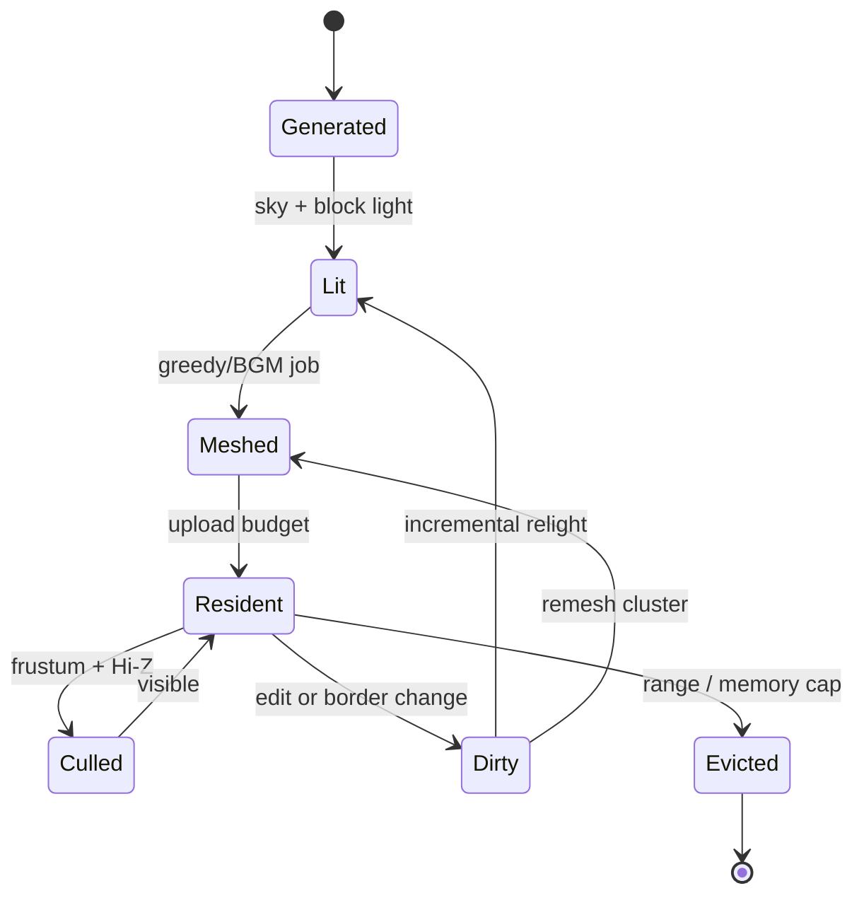

# Voxel Rendering at 144 FPS: State of the Art and a Pipeline for OpenBlock

**Status:** draft for review · **Research date:** 2026-11-24 · **Scope:** section storage, meshing, visibility, LOD, lighting, shading/post, GPU resources, frame pacing · **Related docs:** `docs/research/` (sibling surveys), `docs/adr/` (decision records; empty at time of writing), `docs/spec/` (empty at time of writing) · **Evidence tags:** **[M]** measured or published with a source, **[E]** estimated or derived in this document, **[U]** unverified · **Network note:** crates.io, docs.rs, GitHub raw, 0fps.net and minecraft.wiki (through a reader proxy) were reachable; `c0de-o.com` refused connections, so its binary-greedy-meshing article is cited but its numbers are **unverified**, and the reference implementation's README supplied the measured figures instead. Weft (`/home/martintondel/Projects/weft`) was read for concepts and constants only.

## 0. Verdict

- **At 32 chunks the geometry is small; the frame is not raster-bound.** 65×65 columns × 24 sections = **101,400 sections**, but a heightmap world exposes roughly 5k–20k quads after greedy merging and culling (≈10k–40k triangles) [E]. A 3060-class GPU shades that in ~0.2–0.5 ms at 1080p [E]. Budgets are consumed by **CPU visibility, draw submission, streaming and memory**, not by triangle throughput.
- **Keep 16³ sections for storage, lighting and edits; mesh at 32³.** Every production reference inspected (Minecraft, Sodium, Weft) stores 16³. 32³ only pays off as a *render cluster* (4× fewer quads on flat builds, 8× fewer draw records), not as the unit of simulation or light.
- **Paletted 4-bit blocks + uniform sections is the right default.** 4 bits = **500 B per 1000 blocks** (2 KiB per 16³ section); a uniform section is 8 B total. 8-bit and 16-bit are escape hatches, not the common case ([M] Minecraft, [M] Weft).
- **One 16-byte quad record per face, vertex-pulled, is the target format.** Weft already does 16 B/face [M]; binary greedy meshing does 8 B/quad [M]. Sodium's per-vertex format is 20 B/vertex = 80 B/quad [M]. Per-quad is 4–5× denser and loses nothing for blocky geometry.
- **Submit 3–6 draws per frame, not thousands.** GPU Hi-Z culling + atomic compaction + multi-draw-indirect is the only approach that survives 64+ chunks. Weft's per-section indirect records are a good *intermediate* design but must be compacted.
- **Light at 2 B/block** (sky 4 + RGB 4/4/4) instead of Weft's 4 B/block [M]; this halves the largest memory line item at 32 chunks (~200 MB vs ~400 MB).
- **Shadows: 2–3 cascade CSM at MVP, virtual shadow maps or voxel-DDA ray-marched shadows later. Baked AO is mandatory; screen-space AO is optional.** TAA + render scale first; DLSS/FSR/XeSS are post-1.0 and must ship as separately distributed binary plugins, because their SDK licenses are not MIT-compatible.
- **`wgpu` 30 has no async-compute queue.** Design for overlap via frames-in-flight and compute on the graphics queue; do not plan a separate compute queue.

## 1. Evidence quality and method

1. Versions were checked against crates.io on 2026-11-24: `wgpu` **30.0.2** (2026-11-12, MSRV 1.87), `naga` 30.0.2, `winit` **0.30.13** (0.31.0-beta.4 exists), `glam` 0.34.3, `quinn` 0.11.12, `ash` 0.38.0, `rayon` 1.12.0, `bytemuck` 1.25.2, `lz4_flex` 0.14.2, `zstd` 0.14.4, `meshopt` 0.7.0, Rust **1.100.0** (2026-11-12) [M].
2. Weft pins exactly this generation (`wgpu 30`, `naga 30`, `winit 0.30`, `glam 0.34`, `ash 0.38`, `rayon 1`) [M].
3. No controlled public benchmark of "Minecraft 32 chunks @144 FPS on RTX 3060" was found; every FPS statement here is a budget derivation, marked [E], and should be replaced by OpenBlock's own benchmark harness before being treated as fact.
4. Draw counts, memory totals, meshing latency and culling costs below are arithmetic from the stated assumptions. The assumptions are listed inline so they can be challenged.
5. Prior art in the same shape: Sodium (region MDI + compact vertices), Distant Horizons (LOD), Voxel-rs and Luanti (chunk meshes, no 144 FPS claim), Veloren (a Rust/wgpu-scale renderer). Teardown (ray-traced voxel GI) and Noita (per-pixel simulation) are different budget classes and are not used for any number here.

## 2. Section representation

### 2.1 16³ versus 32³

| Property | 16³ section | 32³ section | Comment |
|---|---:|---:|---|
| Blocks per section | 4,096 | 32,768 | 8× |
| 4-bit payload | 2 KiB | 16 KiB | same bytes/block |
| Light at 2 B/block | 8 KiB | 64 KiB | same bytes/block |
| Remesh work per edit | 1× | 8× | 16³ wins edit latency |
| Max greedy quad | 16×16 | 32×32 | 32³ wins flat builds |
| Culling granularity | 4,096 blocks | 8× coarser | 16³ wins caves/indoors |
| Draw records at RD 32 | 101,400 | 12,675 | only matters if per-section draws |
| Palette pressure | low (often ≤16 states) | higher (caves/ores) | pushes 4→8 bits |
| Edit-to-visible [E] | 10–40 µs | 80–300 µs | with AO + light |
| Production references | Minecraft [M], Sodium [M], Weft [M] | none inspected | strong prior |

**Decision:** store, light and edit at **16³**; build meshes per **32³ cluster** (2×2×2 sections) so flat terrain merges across section seams. This captures most of the 32³ win without inheriting its edit/light granularity. Revisit only if measured remesh p99 exceeds 2 ms or flat-build quad counts dominate.

Minecraft's format is the parity baseline: 16×16×16 sections, palette indices packed into 64-bit words that never straddle a word, **minimum 4 bits**, at most 12 bits in vanilla (4,096-entry palette), and 2,048-byte BlockLight and SkyLight arrays (4 bits per block per channel) [M]. The same wiki page still describes the legacy 16-section column; the current overworld is 384 blocks = 24 sections [U, general knowledge].

### 2.2 Paletted bit-packing, counted in bytes per 1000 blocks

| Bits/entry | Bytes/1000 blocks | 16³ (4,096) | 32³ (32,768) | Typical use |
|---:|---:|---:|---:|---|
| 1 | 125 | 512 B | 4 KiB | binary occupancy, not block states |
| 2 | 250 | 1 KiB | 8 KiB | ≤4 states (air/stone/dirt/grass) |
| 3 | 375 | 1.5 KiB | 12 KiB | rare |
| **4** | **500** | **2 KiB** | **16 KiB** | **default; ≤16 states** |
| 5 | 625 | 2.5 KiB | 20 KiB | 17–32 states, awkward packing |
| 6 | 750 | 3 KiB | 24 KiB | 33–64 states |
| 8 | 1,000 | 4 KiB | 32 KiB | 17–256 states, cheap unpack |
| 12 | 1,500 | 6 KiB | 48 KiB | Minecraft vanilla ceiling |
| 16 | 2,000 | 8 KiB | 64 KiB | >256 states; Weft's escape hatch |

- **Uniform section:** 4 B block-state ID + 4 B light = **8 B** (≈2 B per 1000 blocks for 16³). In a 24-section column most sections are uniform air, stone or deepslate; the uniform fast path matters more than bit width [M, Weft `Blocks::Uniform`, `Light::Uniform`].
- **Palette overflow:** 4-bit holds 16 entries including air; at 17 the section promotes to 8-bit, at 257 to 16-bit. Vanilla caps at 12 bits because 16³ has 4,096 blocks; a `u16` palette index is the sane maximum for modded content.
- **Power-of-two widths (4/8/16) over 5/6-bit:** branch-free unpack via shift/mask, and a 5-bit stream wastes 4 bits per 64-bit word (12 entries per word) anyway. 5-bit saves 37.5% versus 8-bit in the 17–32-state band, but that band is a minority of sections. Instrument section-bit histogram before adding it.
- **Weft's actual layout** [M]: a packed section holds a palette of u32 state IDs, a bit width of 4/8/16, and a boxed array of u64 words, packed so an index never straddles a 64-bit word; light is a u32 per block (sky + RGB, 8 bits each) = 16 KiB per non-uniform section. That is 4× Minecraft's light memory and the single largest saving available to OpenBlock.

### 2.3 Alternatives, disk and network

| Scheme | Bytes per 1000 blocks | Random read | Edit | Verdict |
|---|---:|---|---|---|
| Uniform (single state) | ~2 | O(1) | replace | **adopt** (most sections) |
| Paletted 4/8/16-bit | 500 / 1,000 / 2,000 | shift+mask | in place | **adopt** |
| RLE (runs) | 100–800 typical | needs run index | insert/delete | disk/network only |
| 3D brick map / SVO | 300–1,500 | O(log n) | pointer churn | reject for gameplay |
| Heightfield (2.5D) | 8–16 per column | O(1) | trivial | far LOD only |
| Uncompressed `u16` | 2,000 | O(1) | in place | >256-state fallback |

- **Disk:** 2 KiB (16³, 4-bit) compresses poorly with generic codecs because palette indices are high-entropy. LZ4 (`lz4_flex` 0.14.2) gives ~1.5–2.5× at 300–600 MB/s; zstd 0.14.4 level 3 gives ~2.5–4× at 300–500 MB/s compress / 1–1.5 GB/s decompress [E]. Use **zstd for cold region files** (32×32 chunks, Minecraft-MCA-like sectors) and **LZ4 for network packets** where decode latency is on the critical path. Skip uniform sections on disk (store the state ID).
- **Network:** a fresh 16³ section is 2–8 KiB raw; a view-edge burst at RD 32 is 1,560 sections (new 65-column strip), i.e. 3–12 MB, which at 50 Mbit/s is 0.5–2 s. Send column heightmaps + section data priority-ordered, rate-limit, and never block the main thread on compression.
- **Weft** uses `lz4_flex` plus zip/deflate for resource packs [M]; it is a reasonable precedent for latency-first compression.

## 3. Meshing

### 3.1 Algorithms and published costs

| Algorithm | Quad count | Meshing cost | Ao/light/UV merging | Use |
|---|---|---|---|---|
| Naive exposed-face | 690 quads on the 0fps demo scene | linear, simplest | per-face, easy | reference/debug |
| Greedy 2D slices | **22 quads** same scene (31× fewer); 4,770→2,100 (2.3×); 2,198→1,670 (1.3×) [M, 0fps] | linear, multi-pass | breaks on AO/light/texture changes | **default** |
| Binary greedy (BGM v2) | greedy-equivalent | **50–200 µs per 64³ chunk; 74 µs single-thread average, 108 µs in a pool (Ryzen 3800X)** [M] | occupancy mask, 64 faces/op | **default at 16³/32³** |
| Meshlet/cluster (Nanite-like) | ≤128-tri clusters | GPU cull + LOD | overkill for cubes | far terrain, high-poly props |
| Per-vertex mesh (Sodium) | same greedy output | 20 B/vertex, 80 B/quad [M] | per-vertex AO/light | raster-friendly, bandwidth-heavy |

- BGM's 64-bit trick: a 64×64 array of `u64` occupancy masks per axis lets one AND/ANDN cull 64 faces at a time; the merge step packs four 16-bit row masks into one 64-bit word (the "quadrant" trick) so a 2×2 block of faces is tested and merged in one comparison. The v2 demo emits **8 B/quad** and renders an entire 96×96-chunk world in **one `glMultiDrawElementsIndirect`** [M, cgerikj/binary-greedy-meshing].
- Extrapolating BGM to a 16³ section is 1/64 of the 64³ work: **~2–15 µs** per section once fixed overhead is included [E]; 32³ is **~40–150 µs** [E]. Both are far below a 4 ms frame.
- **Greedy merging factor on real content is not 30×.** Ambient occlusion, per-corner light and texture boundaries break merges. Expect **1.5–3×** over naive on natural terrain and **4–16×** on flat builds [E]. This is why 32³ clusters are worth it for player-built content but do not transform natural terrain.
- **Mesh shaders are not the portability answer.** Nvidium reports large terrain wins on Turing+ NVIDIA hardware [M] and its OpenGL path uses mesh shaders [U]; `wgpu` 30 gates mesh shaders behind `EXPERIMENTAL_MESH_SHADER`, and they need Turing/RDNA2-class hardware. Compute culling + MDI works on Vulkan/DX12 and (with caveats) Metal, so it is the baseline.
- **Do not adopt Nanite-style clusters for block terrain at MVP.** A flat 32³ top is 1,024 quads = 2,048 triangles, i.e. 16 clusters at 128 tris; cluster culling and LOD selection would add overhead for geometry that is already tiny. Reserve clusters for far LOD tiles and modded high-poly models.
- **AO/light/tiling constraints:** merge only faces with identical texture layer, tint, AO pattern and (ideally) corner light. Per-vertex AO can be preserved across a merged quad by evaluating AO at the quad's own corners, but the interior of a large merged quad no longer matches per-block AO — an acceptable, standard approximation (Sodium does per-vertex AO; Weft bakes 2-bit AO per corner and 4-bit light per corner) [M].
- **Texture tiling:** arbitrary-width quads need repeated UVs. With a texture array + `fract(uv)` derivatives break at wrap seams; use `textureGrad` with derivatives from world position, clamp anisotropy, or split merges at texture repeats. Sodium's format stores a per-quad texture **centroid** plus 15-bit relative UVs to keep atlas precision [M] — evidence that atlas + merging needs deliberate precision design.

### 3.2 Cross-section seams, clusters, threading

- **Do not merge quads across 16³ section boundaries for opaque geometry** unless the mesher owns the 32³ cluster. Cross-section merging creates ownership ambiguity (which section's buffer owns the quad?), breaks per-section culling, and forces 27-neighbor remeshes on edits.
- **Cluster design:** 32³ mesh cluster = 8 sections + 1-block border (`PAD = 18` in Weft for 16³; a 32³ cluster needs 34³). Remesh the whole cluster on any edit in it; 8× work but still ~100–300 µs [E], and it removes 7/8 of the seam quads on flat builds.
- **Threading budget:** Weft schedules up to `meshing_threads × 512` sections per frame and keeps a separate urgent pool for edits [M] — copy this shape. At 20 blocks/s flight, a 16-block boundary crossing needs `65 columns × 24 sections = 1,560` new sections every 0.8 s ≈ **2k sections/s**; elytra at 40–60 blocks/s needs **4–6k sections/s** [E]. With 8 threads at 40 µs/section the ceiling is 200k/s; the real limit is worldgen + light + upload, so budget 8–16k/s sustained.
- **Latency rule:** cap each meshing job at ≤1 ms; edits go to the urgent pool so they never queue behind 4,000 streaming jobs. Weft's two-pool split is the right precedent [M].

### 3.3 Vertex format and quantization

| Format | Bytes/quad | Position precision | AO/light | Notes |
|---|---:|---|---|---|
| Weft block face | **16** | 4-bit local (0–15) + section origin | 2-bit AO + 4-bit × 4 channels per corner | vertex pulling [M] |
| Weft free quad | 32 | 10-bit, 1/16 block, ±2 blocks | 4-bit × 4 per corner | models/liquids [M] |
| BGM v2 | **8** | 6-bit x/y/z + 6-bit w/h in 64³ | none (v1 had baked AO) | vertex pulling [M] |
| Sodium compact | 80 (20/vertex) | 20-bit per axis over 32 blocks (1/32768) | 8-bit color/AO, 8-bit light+data | indexed 4-vertex [M] |
| **OpenBlock target** | **16** | 3×5-bit in 32³ + 2×6-bit extent | 4-bit sky + 4-bit RGB per corner | vertex pulling |

- 16 B/quad packs: word 0 = position/direction/extent/flags; word 1 = texture layer + tint + AO; words 2–3 = four corners × (sky4 + R4 + G4 + B4). A monochrome-light variant is **12 B/quad**; an LOD variant with no light is **8 B**.
- **No per-vertex normals are stored.** The 3-bit face direction derives the normal in the shader; there are no tangent frames for block faces. Only arbitrary-orientation model quads pay for a normal, which is why 16 B/quad is achievable while Sodium's per-vertex pipeline spends 20 B/vertex [M].
- **Quantization:** 5 bits (0–31) is exact for a 32³ cluster; merged quads reaching the 32 boundary need an extent field up to 32 (6 bits) and a "reaches edge" flag. 10-bit positions at 1/16 block are only needed for model/liquid quads (Weft's 32 B format), not block faces.
- **Bandwidth is not the constraint:** 100k visible quads × 16 B = 1.6 MB/frame, 230 MB/s at 144 FPS — 0.06% of a 3060's 360 GB/s [E]. Optimize for meshing speed and precision, not bytes, below ~32 B/quad. Sodium's 80 B/quad is a deliberate trade for hardware vertex reuse; OpenBlock does not need it.

## 4. Visibility and draw submission

### 4.1 Culling hierarchy

| Level | Unit | Count at RD 32 | Cost [E] | Purpose |
|---|---|---:|---|---|
| Region | 8³ sections (Weft `REGION = 3`) [M] | 486 | trivial | coarse frustum + Hi-Z |
| Section/cluster | 16³ storage, 32³ mesh | 101,400 / 12,675 | 0.2–0.5 ms CPU for all AABBs | fine cull |
| Face | quad | 5k–20k visible | GPU | backface/raster |

- Plane/AABB frustum tests are ~6 dot products; 101k tests are 0.2–0.5 ms single-core, 399k at RD 64 are 1–2 ms — **parallelize or move to GPU** [E].
- **Hi-Z occlusion:** test AABBs against last frame's depth pyramid, reprojected and grown by camera motion (Weft does exactly this: `view.prev`, `view.moved.w`, reverse-Z "farther is less") [M]. One frame of latency is acceptable (6.9 ms at 144 FPS) but disocclusion on fast turns is the failure mode; growing boxes by the frame's translation is a cheap fix.
- **Alternative/complement:** Sodium/vanilla-style section visibility graph (BFS through opaque sections) is conservative and CPU-only; it handles caves well and needs no depth readback. Use graph culling at MVP, Hi-Z at 1.0.

### 4.2 GPU-driven submission and draw counts

| RD | Columns | Sections (24/col) | Per-section draws (3 layers) | Per-32³ cluster | Region batches (8×4×8, 3 passes) | Compacted MDI |
|---:|---:|---:|---:|---:|---:|---:|
| 16 | 33² = 1,089 | 26k | 78k | 9.8k | 450 | 3–6 |
| **32** | **65² = 4,225** | **101k** | **304k** | **38k** | **1,458** | **3–6** |
| 64 | 129² = 16,641 | 399k | 1.2M | 150k | 5,202 | 3–6 |
| 128 | 257² = 66,049 | 1.58M | 4.7M | 593k | 19,602 | 3–6 |

Region batches are upper bounds before frustum culling; roughly one quarter are visible. Sodium uses regions of **8×4×8 = 256 sections** and a per-region, per-pass `MultiDrawBatch` sized `6 × 256 + 1 = 1,537` arguments [M]. At RD 32 that is 486 regions × 3 passes ≈ **1.5k native batches**, each with up to 1,537 arguments. That is viable at ~0.1–0.2 µs/batch (0.15–0.3 ms) but leaves no headroom at 144 FPS.

- **Target:** one indirect argument per visible cluster per layer, written on GPU into per-layer buckets via `atomicAdd`, then **3–6 `multi_draw_indexed_indirect` calls**. Weft's `put_draw` bucket compaction is this design [M]; its earlier per-(cube, layer) records are the thing to improve on.
- **Avoid GPU→CPU readback of the draw count.** `multi_draw_indexed_indirect_count` needs `MULTI_DRAW_INDIRECT_COUNT` (Vulkan 1.2+/DX12) and is **unimplemented on Metal in wgpu 30** (a no-op stub) [M]. Instead submit a fixed upper bound with `instance_count = 0` for culled arguments — Weft zeroes `draws[i*5+1]` for exactly this reason [M].
- **wgpu 30 specifics** [M]: `multi_draw_indexed_indirect` is native on Vulkan/DX12 but **loops per draw on Metal** (`wgpu-hal/src/metal/command.rs`); on macOS keep clusters larger and batches few. `IMMEDIATES` (push-constant replacement, `max_immediate_size` default 0) is available and Weft already uses `var<immediate>` — request it in `DeviceDescriptor` for per-draw origin/layer data.
- **CPU cost of args:** 101k × 20 B = 2 MB/frame written by the CPU if every section is emitted, 288 MB/s at 144 FPS — acceptable but wasteful; GPU culling writes only visible arguments.

### 4.3 Buffers, bindless and fragmentation

- **One mega-buffer per layer** (opaque/cutout/translucent), 512 MB–1 GB address space, sections suballocated in **1/2/4/8/16/32/64 KiB size classes** with free lists. Track fragmentation; compact when free space <15–20%, copying 4–8 MB/frame in the background. Draw arguments store byte offsets, so compaction only rewrites offsets (cheap).
- **Persistent mapping:** wgpu 30 has `MAPPABLE_PRIMARY_BUFFERS`; otherwise use a 3-deep staging ring + `Queue::write_buffer`. Weft writes per-frame draw args through a mapped buffer from worker threads (`Mapped(*mut u8)`), which is the pattern to copy for the draw-argument path [M].
- **Bindless is not needed for chunk buffers.** One storage buffer + `(offset, count)` beats `BUFFER_BINDING_ARRAY` and avoids driver limits. Use binding arrays for **textures/materials** only.
- **wgpu 30 bindless limits:** `TEXTURE_BINDING_ARRAY`, `BUFFER_BINDING_ARRAY`, `PARTIALLY_BOUND_BINDING_ARRAY`, `SAMPLED_TEXTURE_AND_STORAGE_BUFFER_ARRAY_NON_UNIFORM_INDEXING` exist, but `max_binding_array_elements_per_shader_stage` defaults to **0** [M] — query the adapter, request the limit, and keep a texture-array fallback for GLES/WebGPU/macOS tiers where it is absent.
- **Defrag risk:** a 1 GB copy at 300 GB/s is 3 ms if done at once; never do it in one frame. Prefer per-region arenas if compaction proves hitchy: 256 sections × ~4 KiB = 1 MB per region, rebuilt wholesale on edit (simpler, no fragmentation, more remesh).

## 5. LOD and distant terrain

### 5.1 What Minecraft-class games actually need

| Render distance | View width | Full-detail sections | LOD required? | Notes |
|---:|---:|---:|---|---|
| 8–16 chunks | 128–256 blocks | 7k–26k | no | MVP target; 144 FPS plausible on mid-range |
| 24–32 | 384–512 blocks | 58k–101k | no (vanilla has none) | **default 1.0 target** |
| 48–64 | 768–1,024 blocks | 226k–399k | optional 2× LOD | memory and culling dominate |
| 128+ | 2,048+ blocks | 1M+ | mandatory | heightfield/impostor beyond ~64 |

Minecraft itself has no LOD; Distant Horizons adds one explicitly to "render simplified chunks outside of the normal render distance" [M]. Sodium has none [M]. So LOD at RD 32 is a differentiator, not a parity requirement.

### 5.2 Techniques and costs

- **Distance-based section merging:** 2×2×2 sections → 32³ mesh, then 4×4×4 → 64³. Geometric error doubles per level; for blocky terrain the artifact is missing detail, not cracks, if the coarser mesh samples the *same* heightfield.
- **Heightfield + walls (recommended for far tiles):** Weft's far LOD uses **32×32 cells per tile, 35×35 samples** (2-cell border), 4 words per sample (ground height/top block, biome/under block, water or cave depth, cave floor/roof + soil), i.e. **4,900 words ≈ 19.6 KB per tile** [M]. It emits compact ground/wall and water records: `SOLID_MAX = 32*32*3 + 64 = 3,136`, `WATER_MAX = 1,024`, 3 words each ≈ **50 KB scratch** [M].
- **Cost:** GPU generation of a 32-cell tile is one dispatch; Weft allows **32 far tiles/frame, 256 in flight, 48,000 quads/tile cap, 32 MiB spare** for tiles leaving the tree [M]. A CPU pregeneration pipeline would spend ~1–5 ms per chunk column and huge disk [E]; GPU far terrain is effectively free at these tile counts.
- **Popping/stitching:** no transvoxel — that is for smooth scalar fields. Use **vertical skirts/extruded walls** (Weft's `lod_box` has an `EXTRUDE` flag) and **dithered cross-fade over 250 ms** between a parent tile and its four children [M]. Select tiles by projected cell size, not fixed rings, so widescreen/FOV changes do not pop.
- **GPU worldgen is visual-only.** It must never feed gameplay, collision or anti-cheat: the dedicated server stays CPU-authoritative (assumption 3 holds). Weft can afford GPU terrain because it regenerates the same noise on CPU with fixed-point math; any mismatch is a visual seam, not a simulation bug. For OpenBlock, gate far terrain behind "beyond loaded/simulated distance" and regenerate on CPU when the player approaches.

## 6. Lighting

### 6.1 Storage

| Scheme | Bytes/block | 16³ section | 101k sections @25% non-uniform | Notes |
|---|---:|---:|---:|---|
| Minecraft (sky4 + block4) | 1 | 4 KiB | 104 MB | monochrome block light [M] |
| Weft (sky8 + R8G8B8) | 4 | 16 KiB | 415 MB | colored, absorption per channel [M] |
| **Proposed (sky4 + RGB4×3)** | **2** | **8 KiB** | **208 MB** | colored, half of Weft |
| Proposed + sparse RGB | 1 + sparse | 4 KiB + list | ~110 MB | only sections with colored emitters pay |

Light is the largest per-voxel cost after block data; at 32 chunks 2 B/block costs ~200 MB, which is tolerable, 4 B/block is not. Store light in its own paletted/uniform container, not inside block words, so relighting does not rewrite block storage. Light is even more uniform than blocks — open sky is one value, deep underground another — so a per-section palette of a few `(sky, r, g, b)` tuples with 4-bit indices is usually smaller than raw 2 B/block, and the uniform case costs 2 B.

### 6.2 Propagation: CPU vs GPU

- **CPU flood fill is the correct authority.** 15 levels, decreasing by max(1, opacity), with a removal BFS for unlighting; sky light keeps full strength straight down through transparent blocks. Weft implements exactly this with four 8-bit channels and per-channel absorption [M].
- **Sky light is cheap to seed:** per column, propagate downward until the first opaque block, then BFS sideways. Recompute only affected columns after an edit.
- **GPU flood fill is a bad fit:** 15 sequential passes × 32³ voxels with ping-pong buffers = ~500k voxel updates and 15 barriers per section; memory traffic dominates and it steals GPU time from shading. GPU is good at **sky visibility** (heightmap) for far LOD and at **dynamic light clustering**, not at authoritative voxel light.
- **Starlight data point:** a full rewrite of Minecraft's light engine reports **≈50× faster propagation** in a glowstone benchmark, while its author notes the absolute times make it "unlikely to affect FPS in any situation on the client" [M]. Translation: lighting speed matters for **chunk-load and edit stutter**, not steady-state FPS. Budget it as a latency problem, not a frame-time problem.

### 6.3 Borders, relight cost, emissive and dynamic lights

| Event | Voxels/sections touched | Cost [E] | Mitigation |
|---|---|---:|---|
| Block place/break | 1 section + 1-block border | 50–300 µs | urgent pool; remesh cluster |
| Roof/wall removal (sky cascade) | up to 27 sections, 384-block column | 0.5–3 ms | cap cascade per frame, queue rest |
| Explosion (5³ crater) | ~125 blocks, 27 sections | 5–20 ms | split across frames; dirty-region queue |
| Full column light (new chunk) | 24 sections | 1–3 ms | parallel jobs, pregen queue |

- **Cross-border correctness:** the mesher reads a 1-block border (`PAD = 18` for 16³) and must be invalidated when any of the 26 neighbors changes a border cell. Weft's `around_mask` maps exactly which neighbor cubes a face at `(x,y,z)` depends on [M]. Copy this; it prevents the classic "dark seam after edit" bug.
- **Emissive blocks:** light level 15 at the source, color from the block's emission; bake into the light volume. Dynamic lights (torches held by entities, projectiles, explosions) should be a small clustered point-light list (256–1,024), not a relight.
- **AO:** compute per-vertex from the 3 neighbors (4 levels); pack 2 bits × 4 corners = 1 byte. Bake at mesh time and never recompute per frame. For temporal stability, this is the single most important decision: **screen-space AO on top of voxel AO is optional; vertex AO is not.**

## 7. Shading and post

### 7.1 Material model

- **Stylized by default, PBR optional.** Base: albedo (texture array layer), per-vertex AO, sky/block light, sun + sky ambient, fog. Optional material layer: normal, roughness/metallic, emissive, flags (cutout, foliage, translucent). This preserves Minecraft parity while letting custom content look modern.
- **Forward+ with a depth prepass**, not a full deferred G-buffer. At 1080p a G-buffer (albedo+normal+depth+roughness) costs ~20–32 B/pixel of bandwidth; forward+ with clustered lights is cheaper for opaque terrain and gives the depth buffer needed for Hi-Z, SSR and fog. Deferred remains an option for a "shader pack" tier.
- **Weft's shader-pack hook is a useful precedent:** packs can opt into shadows by calling `solid_at(p)` against ~112 blocks of occupancy on the GPU [M]. That is a data-driven, low-cost shadow path for packs, not a replacement for engine shadows.

### 7.2 Shadows

| Technique | Win | Cost @1080p [E] | Complexity/risk | Verdict |
|---|---|---:|---|---|
| CSM 2–3 × 2048², 3×3 PCF | correct sun shadows, cheap | 0.5–1.0 ms, doubles geometry submission | low | **MVP** |
| Static cascade caching | re-render only on sun move/edit | saves 30–60% of shadow cost | medium | 1.0 |
| Virtual shadow maps (UE5-style pages) | high effective res, cached static pages | 0.8–1.5 ms, page alloc/caching/marking | **high** | defer past 1.0 |
| Ray-traced shadows (BVH) | exact, no bias | BVH rebuild on edits; 3060 RT budget tight | high | reject for MVP |
| Voxel DDA ray-march (near field) | exact block shadows, no shadow map | 0.3–0.8 ms, ~112-block range | medium | 1.0 optional |

- CSM is the only shadow technique that fits the MVP risk budget. Cascade count 2 at 16 chunks, 3 at 32+; 2048² each; depth-only pass with the same MDI draw arguments as opaque.
- **Voxel-DDA shadows** are attractive for a block game: at 1 bit/block a 112³ occupancy neighborhood is ≈172 KiB (1.4 MB if stored one byte per block), and the march is 64–128 steps. Use it for contact shadows and as the shader-pack path; pair with CSM for distance.

### 7.3 AO, reflections, fog, clouds, bloom

- **SSAO/GTAO:** baked AO already darkens voxel corners. GTAO adds contact shading for entities/decals and needs TAA to denoise; cost 0.3–0.8 ms at half res. Optional, off by default at 144 FPS.
- **SSR for water:** half-res march (32–64 steps), fallback to sky cubemap; 0.3–0.6 ms. Only worth it if water is a headline feature; a planar reflection for the water plane is cheaper and more stable but doubles the terrain pass.
- **Volumetric fog/clouds:** half-res raymarch with temporal reprojection, 0.4–0.8 ms; Minecraft-style 2.5D cloud layer is far cheaper. Ship simple height/distance fog at MVP; volumetric fog at 1.0.
- **Bloom/tonemap:** dual-filter bloom at half res (5 mips), exposure histogram, AgX or ACES; 0.3–0.6 ms. HDR `RGBA16F` target.
- **Sky/atmosphere:** Hillaire's LUT-based atmosphere (transmittance + multiple-scattering + sky-view LUT) [M, EGSR 2020] gives physically plausible sunsets for ~0.2–0.5 ms; Weft already ships an atmosphere cache shader [M]. Do not raymarch the atmosphere per pixel at 144 FPS.

### 7.4 Temporal stability and upscalers

- **TAA:** jitter with an 8-sample Halton sequence, camera-only velocity for static world geometry (exact reprojection), YCoCg neighborhood clamp for dynamic objects. Voxel edges are long, straight and axis-aligned, so TAA ghosting is mild; texture detail is the casualty — offer a "crisp" mode with MSAA 2× + FXAA.
- **Upscalers require jitter, motion vectors, depth, exposure and a sharpening pass**; all are compatible with the above. Integration reality [M]:
  - **FSR:** FidelityFX SDK **2.4.0 "Redstone"**, D3D12/Vulkan — the best technical fit for `wgpu` (Vulkan path). **License is binary-redistribution-only (no reverse engineering); only the samples are MIT** [M]. Incompatible with vendoring source into an MIT/Apache repository; distribute as an optional binary plugin with notices, or write an in-house EASU/RCAS-class upscaler.
  - **DLSS:** DLSS 4.5 / DLSS 5 family; the Streamline wrapper is MIT, but the DLSS-G plugin is prebuilt-only and DLSS itself is proprietary, Windows/NVIDIA only. High effort, platform-limited.
  - **XeSS:** `intel/xess`, **Intel Simplified Software License: binary form only, no modification or reverse engineering** [M], D3D12/SM 6.4-oriented; frame generation is Arc/non-Intel with SM 6.4. Not a natural fit for a cross-platform `wgpu` renderer or a permissive license.
- **Recommendation:** ship TAA + render-scale (0.75–1.0) at 1.0. Treat every vendor upscaler as an optional, separately distributed binary plugin outside the core MIT/Apache tree; do not put any of them in the MVP or the default download.

### 7.5 Transparency, water and sky

- **Opaque + cutout (alpha test) + translucent** as separate layers, matching Weft's four-layer model (opaque, cutout, translucent, upper) [M].
- **Per-cluster back-to-front sort** of translucent quads, not global sort: Sodium uses a per-section BSP tree plus radix sort [M]. Sorting 100k quads globally is 1–2 ms [E] and pointless; sorting a few hundred quads per visible cluster is microseconds, refreshed only when the camera moves enough.
- **WBOIT** (weighted blended OIT) for particles and overlapping glass/water: one extra accumulation pass, 0.3–0.8 ms, order-independent, but no refraction and it needs a resolve. Use as fallback, not as the water path.
- **Water:** depth prepass → refraction (scene color with normal offset), reflection (SSR + sky cubemap), Fresnel, animated normals, foam at intersections, underwater fog via a volume. Render after opaque and cutout, before particles.
- **Sky:** atmosphere LUT + sun/moon disc + stars + cloud layer; drive time-of-day and weather from the server (visual only on the client).

## 8. GPU resources and memory budgets

### 8.1 Budgets at 32 / 64 / 128 chunks

Assumptions: 24 sections per column; 25% of sections non-uniform; 80% of those at 4 bits, 20% at 8 bits (≈2.8 KiB blocks/section including palette and header overhead); light 2 B/block (8 KiB non-uniform); 35% of sections have meshes at 4 KiB average; 64 MB for textures/shadow/post/UI at 32, scaled 2× per distance doubling [E].

| RD | Sections | Block data | Light | Meshes | Other | **Total** |
|---:|---:|---:|---:|---:|---:|---:|
| **32** | 101,400 | 73 MB | 208 MB | 145 MB | 64 MB | **~490 MB** |
| 64 | 399,000 | 286 MB | 817 MB | 572 MB | 128 MB | **~1.80 GB** |
| 128 | 1,580,000 | 1.14 GB | 3.25 GB | 2.27 GB | 256 MB | **~6.9 GB (not viable full-detail)** |

- RD 32 fits comfortably in 8 GB VRAM; RD 64 fits on 8 GB cards but is the practical ceiling before LOD; RD 128 requires LOD (Section 5) and aggressive eviction. With Minecraft-style 1 B/block light, subtract ~100 MB at RD 32 and ~400 MB at RD 64.
- Budget **768 MB** at RD 32 and **2.5 GB** at RD 64 as hard caps, with eviction by distance and a "mesh only within N chunks" policy for far sections.

### 8.2 Textures, atlases, compression

| Approach | Bleeding | Draw calls | Layers | Mips | Notes |
|---|---|---|---|---|---|
| Atlas (16 px tiles, 4 px pad) | needs padding + mip clamp | 1 | 65k tiles per 4K page (256×256 grid) | manual | Minecraft-like, fragile with greedy UVs |
| **Texture array** | none | 1 with array indexing | 256 default, 2,048 typical max [U] | hardware | **recommended** |
| Virtual texture | none | 1 | unbounded | streaming | overkill for 16–64 px pixel art |

- **Memory is trivial for base art:** 2,048 layers × 32×32 RGBA8 = 8 MiB (10.7 MiB with mips); 64×64 is 32 MiB (42.7 MiB with mips). BC7 or ASTC 4×4 (4:1, 8 bpp) cuts this to 2–10.7 MiB; ASTC 6×6 (~9:1) to 1–5 MiB — worth it for HD packs, not for the base game.
- **Atlas bleeding fixes:** 2–4 px edge padding, limit mips to `log2(tile) − 2`, `textureGrad` with world-space derivatives for merged quads, anisotropy 8–16×. Nearest filtering + mipmaps still aliases at distance; offer "mip + aniso" as the default and "nearest" for purists.
- **Compression:** BC7 (4:1, 8 bpp) for albedo/alpha, BC5 (8 bpp) / BC4 (4 bpp) for normal/roughness, ASTC 4×4 (4:1) or 6×6 (~9:1) for Android; pixel art at 16 px can visibly blur under BC7, so keep uncompressed as an option and test with the default pack.
- **Material layers:** per-face material ID indexes a descriptor (albedo array, normal array, roughness, emissive, flags). Keep the layer count ≤64 at MVP; bindless indexing later.

## 9. Frame pacing, latency and budgets

### 9.1 Target budgets at 144 FPS (6.94 ms)

| GPU stage | Budget | CPU stage | Budget |
|---|---:|---|---:|
| Depth prepass + opaque/cutout terrain | 1.2 ms | Simulation/net/ECS | 0.5 ms |
| Shadow CSM (2–3 cascades) | 0.7 ms | Streaming + mesh dispatch | 0.4 ms |
| Water/translucent (sort + shade) | 0.5 ms | Visibility + draw args | 0.4 ms |
| Sky/atmosphere/clouds | 0.4 ms | Encode + submit | 0.4 ms |
| Post (AO, SSR, fog, bloom, TAA, tonemap) | 0.9 ms | UI | 0.2 ms |
| UI | 0.2 ms | Slack | 0.1 ms |
| **Total GPU** | **4.0 ms** | **Total CPU** | **2.0 ms** |

Leaves **0.94 ms** for OS compositor, driver and present at 144 Hz [E]. This is tight: a 6-core CPU and a 3060-class GPU are the floor, not the average. Treat 120 FPS as the safe default and 144 FPS as the "performance mode" verified by benchmarks. If GPU exceeds 4 ms, drop render scale to 0.85 or enable the optional upscaler; if CPU exceeds 2 ms, move culling to GPU and cut per-frame work.

### 9.2 Overlap, present and latency

- **2–3 frames in flight**, triple-buffered swapchain, upload ring sized to one frame's meshes (~8 MB). Weft's `frame.slot`-indexed buffers are the pattern [M].
- **Present mode:** prefer `Mailbox` where supported (tear-free, lowest latency), else `Fifo`; use `Immediate` only for latency experiments. Cap at refresh − 3 (141) to avoid the FIFO standby queue; measure with PresentMon.
- **Async compute is not available in wgpu 30** (single `Queue` from `request_device`); do not design a separate compute queue. Meshing and lighting are CPU worker-pool work, so a second GPU queue would only help culling/compaction — run those on the graphics queue early in the frame; GPUs overlap them with vertex work when dependencies allow.
- **VSync:** off by default; expose `Fifo` as "VSync" and `Mailbox` as "low latency". Adaptive VSync is not exposed by wgpu; the frame limiter is the control.
- **NVIDIA Reflex:** low-latency mode + latency markers, via Direct3D/Vulkan on Windows/NVIDIA only [M]. `wgpu` exposes native handles, so an optional FFI integration is possible, but it is platform-specific and not MVP. Most of the latency win is a frame limiter plus `Mailbox`/low-latency present.
- **Instrument first:** `TIMESTAMP_QUERY` per pass (wgpu 30 supports timestamps inside encoders/passes), CPU scopes around update/cull/encode/submit, and a 10-second p99 frame-time log. Weft's bench module already splits `update, ui, acquire, record, submit` and GPU `upload, world, after, ui, rest` [M] — copy that taxonomy.

## 10. Recommended pipeline

### 10.1 MVP (RD 8–16, 60–144 FPS, single-player and LAN)

1. **Generate** 16³ sections on a rayon pool; palette 4/8/16-bit + uniform fast path; 1-byte light (sky4 + block4) initially.
2. **Light** per column: sky seed + block-light flood fill; urgent pool for edits, background pool for new chunks.
3. **Mesh** per 32³ cluster with greedy/BGM; bake AO and corner light; emit 16 B/quad records into per-cluster vectors.
4. **Upload** into one mega-buffer per layer via a size-class allocator; cap at 8 MB/frame; reuse freed blocks.
5. **Cull** on CPU: region AABB frustum, then cluster AABB; build indirect args per layer; one MDI call per layer (3 total).
6. **Draw** opaque → cutout → water (per-cluster sorted) → sky → UI.
7. **Shade** with texture array, baked AO/light, one directional sun, one 2048² shadow cascade, distance fog, ACES tonemap, FXAA.
8. **Present** with Mailbox/Fifo, 2 frames in flight, frame limiter; log p99 frame time.

### 10.2 1.0 (RD 32 default, 64 optional, 144 FPS performance mode)

1. **GPU visibility:** Hi-Z from last frame's depth (reprojected, motion-grown), compute test + atomic compaction into per-layer arguments; 3–6 MDI calls, zero-instance args for culled clusters.
2. **Far LOD:** 32×32-cell tiles, heightfield + walls + water, GPU-generated from the world seed, parent/child tree selected by projected cell size, 250 ms dithered fade, skirts at seams.
3. **Lighting:** 2 B/block (sky4 + RGB4×3), colored emitters, incremental relight with a per-frame budget; clustered dynamic lights for entities/projectiles.
4. **Shadows:** 3-cascade CSM 2048² with static cascade caching; optional voxel-DDA near-field shadows for shader packs; no VSM until measured.
5. **Post:** TAA (jitter + reprojection), half-res bloom, AgX/ACES, optional GTAO and half-res SSR water, half-res volumetric fog/clouds.
6. **Upscaling:** render scale + TAA first; an optional, separately distributed FSR-class binary plugin behind a flag; DLSS/XeSS only with a platform-specific path and an explicit licensing decision.
7. **Streaming:** zstd region files, async IO, LZ4 network chunks, defrag/compaction, hard memory caps with eviction.
8. **Textures:** one array per resolution tier, BC7/ASTC, 8–16× anisotropy, padded mips; bindless where the adapter supports it, layer index otherwise.

### 10.3 Diagrams

## 11. Technique matrix

| Technique | Expected win | Cost | Risk | Verdict |
|---|---|---|---|---|
| 16³ storage, 4-bit palette, uniform | 2 KiB/section, parity with MC/Weft | unpack ALU | low | **adopt** |
| 32³ mesh clusters | 2–4× fewer quads on flat builds; 8× fewer draw records | 8× remesh per edit | low | **adopt** |
| Binary greedy meshing | 74 µs/64³; 8 B/quad [M] | bitmask complexity | medium | **adopt** |
| Greedy + baked AO/light | cheap contact shading | limits merge factor | low | **adopt** |
| 16 B/quad vertex pulling | 4–5× denser than 20 B/vertex | shader ALU | low | **adopt** |
| Region + cluster frustum cull | 4× fewer submits | 0.2–0.5 ms | low | **adopt** |
| Hi-Z GPU occlusion | 20–60% fewer draws indoors | 0.1–0.3 ms, 1-frame lag | medium | 1.0 |
| GPU compaction + MDI | 3–6 draws vs ~1.5k | 0.1–0.2 ms | medium | 1.0 |
| Bindless texture arrays | fewer binds, material variety | limits/backends | medium | 1.0 optional |
| Mega-buffer + incremental defrag | stable memory | compaction hitches | medium | **adopt** |
| 2 B/block light | halves light memory vs Weft | 4-bit color banding | low | **adopt** |
| CSM 3 × 2048² | correct sun shadows | 0.7 ms, double geometry | low | **adopt** |
| Static shadow caching | 30–60% shadow saving | update bookkeeping | medium | 1.0 |
| Virtual shadow maps | high effective res, cache | 0.8–1.5 ms + complexity | high | defer |
| Ray-traced BVH shadows | exact, no bias | rebuild on edits; RT budget | high | reject |
| Voxel-DDA near shadows | exact block shadows | 0.3–0.8 ms, ~112 blocks | medium | 1.0 optional |
| GTAO/SSAO | contact shading | 0.3–0.8 ms + noise | medium | optional |
| TAA + jitter | stability, upscale base | ghosting/blur | low | **adopt** |
| FSR / DLSS / XeSS | 1.3–2× FPS at fixed quality | platform FFI; binary-only SDKs | high | post-1.0, separate binaries |
| WBOIT | order-independent translucency | 0.3–0.8 ms | low | optional |
| Per-cluster translucent sort | correct water at low cost | 0.2–1 ms CPU | low | **adopt** |
| SSR water | reflections | 0.3–0.6 ms | medium | 1.0 |
| Volumetric fog/clouds | atmosphere | 0.4–0.8 ms | medium | 1.0 optional |
| GPU far LOD tiles | distance without CPU/disk | visual-only, non-authoritative | medium | 1.0 |
| Texture array + BC7/ASTC | no bleeding, 4× texture memory (≈9× at ASTC 6×6) | pixel-art quality loss | low | **adopt** |
| Async compute queue | overlap | not exposed by wgpu 30 | high | **reject** |
| Reflex low latency | click-to-photon | platform SDK | medium | optional |

## 12. Open questions for the Lead

1. **Is 144 FPS a hard ship gate on a 3060 at 32 chunks, or a performance mode?** The budget leaves <1 ms of slack; 120 FPS would materially de-risk the schedule.
2. **Is render-scale/upscaling allowed to count toward the 144 FPS target?** If yes, TAA at 0.85× render scale (plus an optional upscaler) is the cheapest path; if no, the raster budget must grow.
3. **Does the mod ABI expose 16³ sections?** If mods can read/write blocks by section coordinates, moving to 32³ storage later is a breaking change; the 16³ decision should be recorded in an ADR now.
4. **Colored light or Minecraft parity?** 2 B/block RGB costs ~100 MB more than monochrome at RD 32; is that acceptable for the visual identity?
5. **What is the maximum world height?** 384 blocks (24 sections) vs 512 (32 sections) changes memory by 33% and shadow/LOD ranges.
6. **Are macOS and Linux first-class at 1.0?** wgpu emulates MDI on Metal and leaves `indirect_count` unimplemented; macOS may need a different submission strategy.
7. **Do we require Vulkan/DX12 and drop GLES/WebGPU?** Bindless arrays and MDI-count are gated; a WebGPU target forces the lowest-common-denominator path.
8. **What is the low-end target (Steam Deck, Intel iGPU, 4 GB VRAM)?** The RD 32 memory budget (~490 MB) is fine, but 144 FPS is not.
9. **Should the engine ship a shader-pack system (Iris-like) or only material layers?** Weft's opt-in `solid_at` shadow hook shows the low-cost version of this.
10. **Is GPU far terrain acceptable if it can disagree with CPU generation?** It must never affect collision or gameplay; confirm the visual-only boundary.
11. **Are binary-only third-party SDKs acceptable as optional downloads?** FSR and XeSS forbid source redistribution/modification; if that is incompatible with "MIT OR Apache-2.0", upscaling is TAA + render scale only, and the license constraint should be recorded in an ADR.

## 13. Sources

1. Weft reference clone (local, read-only): `/home/martintondel/Projects/weft` — 16³ sections, 4/8/16-bit palettes, 16 B face records, u32 light, 8³ regions, per-(cube, layer) indirect draws, Hi-Z occlusion, 32-cell far LOD, two meshing pools.
2. Minecraft Wiki, Chunk format — 16³ sections, 4-bit minimum palette, 4,096-entry cap, 2,048-byte light arrays: https://minecraft.wiki/w/Chunk_format
3. c0de-o, "Binary Greedy Meshing" (unreachable at research time; cited for the technique): https://c0de-o.com/2023/binary-greedy-meshing/
4. Binary Greedy Meshing v2 reference implementation and measurements (74 µs/chunk, 8 B/quad, one MDI): https://github.com/cgerikj/binary-greedy-meshing
5. 0fps, "Meshing in a Minecraft Game" (greedy vs naive quad counts: 690→22, 4,770→2,100, 2,198→1,670): https://0fps.net/2012/06/30/meshing-in-a-minecraft-game/
6. Sodium source (20 B vertex, 8×4×8 regions, per-region MDI batches, BSP/radix translucent sorting): https://github.com/CaffeineMC/sodium
7. Sodium on Modrinth (~256M downloads): https://modrinth.com/mod/sodium
8. Distant Horizons (LOD beyond vanilla render distance): https://gitlab.com/distant-horizons-team/distant-horizons
9. Nvidium (NVIDIA mesh-shader terrain renderer for Sodium): https://github.com/MCRcortex/nvidium
10. VulkanMod (Vulkan renderer for Minecraft): https://github.com/xCollateral/VulkanMod
11. Voxel-rs, Rust Minecraft-like engine (read-only reference): https://github.com/Technici4n/voxel-rs
12. Luanti (open-source voxel game, read-only reference): https://www.luanti.org/
13. Veloren (Rust voxel RPG; GPL-3.0, no code reuse): https://github.com/veloren/veloren
14. Unreal Engine 5.9, Nanite virtualized geometry (hierarchical clusters, crack-free LOD): https://dev.epicgames.com/documentation/en-us/unreal-engine/nanite-virtualized-geometry-in-unreal-engine
15. meshoptimizer, meshlet/cluster guidance (64 verts/126 tris NVIDIA; 64/64 or 128/128 AMD): https://github.com/zeux/meshoptimizer
16. Ubisoft, "GPU-Driven Rendering Pipelines" (SIGGRAPH 2015): https://www.advances.realtimerendering.com/s2015/aaltonenhaar_siggraph2015_combined_final_footer_220dpi.pdf
17. NVIDIA, Cascaded Shadow Maps: https://developer.download.nvidia.com/SDK/10.5/opengl/src/cascaded_shadow_maps/doc/cascaded_shadow_maps.pdf
18. Hillaire, "A Scalable and Production Ready Sky and Atmosphere Rendering Technique" (EGSR 2020): https://sebh.github.io/publications/egsr2020.pdf
19. McGuire & Bavoil, "Weighted Blended Order-Independent Transparency" (JCGT 2013): https://jcgt.org/published/0002/02/09/
20. PaperMC Starlight (≈50× light propagation, author notes unlikely to affect client FPS): https://github.com/PaperMC/Starlight
21. wgpu 30.0.2 API docs: https://docs.rs/wgpu/30.0.2/wgpu/
22. wgpu 30 feature definitions (`IMMEDIATES`, binding arrays, `MULTI_DRAW_INDIRECT_COUNT`): https://github.com/gfx-rs/wgpu/blob/trunk/wgpu-types/src/features.rs
23. wgpu-hal 30 Metal backend (multi-draw loops per sub-draw): https://github.com/gfx-rs/wgpu/blob/trunk/wgpu-hal/src/metal/command.rs
24. Rust stable channel manifest (1.100.0, 2026-11-12): https://static.rust-lang.org/dist/channel-rust-stable.toml
25. Intel XeSS SDK (Intel Simplified Software License: binary only, no modification/reverse engineering; SM 6.4/DP4a; frame generation on Arc and SM 6.4 non-Intel): https://github.com/intel/xess
26. AMD FidelityFX SDK 2.4.0 "Redstone" (binary-redistribution license, no reverse engineering; samples MIT; D3D12/Vulkan; ML upscaling on RX 9000+): https://github.com/GPUOpen-LibrariesAndSDKs/FidelityFX-SDK
27. AMD FSR technology page: https://www.amd.com/en/products/graphics/technologies/fidelityfx/super-resolution.html
28. NVIDIA Streamline (MIT wrapper; DLSS-G prebuilt only): https://github.com/NVIDIAGameWorks/Streamline
29. NVIDIA DLSS technology page (DLSS 4.5 / DLSS 5): https://www.nvidia.com/en-us/geforce/technologies/dlss/
30. NVIDIA Reflex SDK: https://developer.nvidia.com/reflex
31. crates.io API for versions cited in this document: https://crates.io/api/v1/crates/wgpu (and same for `winit`, `glam`, `quinn`, `ash`, `naga`, `rayon`, `lz4_flex`, `zstd`)
