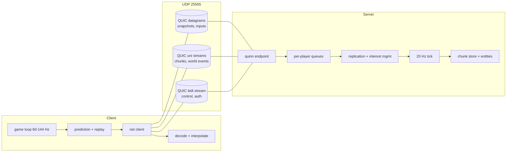

# OpenBlock networking: transport, netcode, and dedicated-server operations

**Status:** draft for review · **Research date:** 2026-11-24 · **Related docs:** `docs/research/README.md` (index; not yet populated) and the planned sibling notes on rendering, world generation, ECS architecture, modding, and server operations. Scope: transport, netcode, replication, dedicated-server operations, security, and optional Minecraft compatibility. Out of scope: voice chat, matchmaking, public server browsers.

**Evidence standard.** Crate versions and repository activity were read from the crates.io API and GitHub on 2026-11-24; quinn's defaults were read from the `quinn-proto-0.11.19` source tag; Minecraft wire-format and server defaults come from minecraft.wiki. Figures marked **model** are analytic estimates, not measurements from a built server, and come with the benchmark that would confirm them. Valve's developer wiki was behind an Anubis bot wall on the research date; Source-engine specifics below are flagged **unverified**.

## Decisions at a glance

| Area | Decision | Confidence |
|---|---|---|
| Transport | QUIC via `quinn` 0.11: unreliable datagrams for snapshots, reliable uni streams for chunk/world-event transfer, one bidi stream for control. | High |
| Encryption | TLS 1.3 via `rustls` 0.23; self-signed Ed25519 identity pinned by clients by default, ACME for public servers. | High |
| Topology | Authoritative dedicated server by default; listen-server mode for LAN; host-authoritative P2P over `iroh` 1.5 in phase 3. No consensus P2P. | High |
| Tick rate | 20 Hz world simulation and snapshot rate (Minecraft parity), 30 Hz server option for PvP, client inputs sampled at 60 Hz and batched per tick. | Medium |
| Replication | Per-section versioned deltas plus unreliable entity snapshots; interest-managed, distance-tiered, bit-packed. | High |
| Serialization | Hand-rolled bit-packing for hot packets; `postcard` for control/ops messages; no Serde in the per-tick path. | High |
| Compression | `zstd` level 1–3 for chunk payloads, precompressed and cached; no general compressor for snapshots or block edits. | High |
| Web | WebTransport (`wtransport` 0.7) as a later front-end; WebSocket only for login/console, never gameplay. | Medium |
| Minecraft compat | Deferred until after 1.0; if pursued, isolated gateway process translating the MC protocol, never core data-model changes. | Medium |
| License hygiene | `quinn`/`rustls`/`iroh` are permissive; Pumpkin is GPL-3.0 and Valence is MIT but stale — neither contributes code. | High |

## Assumption check (Lead's working assumptions)

| Assumption | Evidence found | Verdict |
|---|---|---|
| 2. 32×32×32 sections with paletted storage | A 32³ section holds 8× the blocks of 16³. Palette cardinality and therefore bits/block grow with volume, and a full-section resend costs 8× more. Lighting is 16 KB/section at 32³ versus 2 KB at 16³ (nibble-packed, both light channels). | **Partially challenge.** Keep 32³ for simulation/LOD/storage, but make network deltas and resends 16³-granular. Measure real bits/block before locking the format. |
| 4. QUIC + client prediction + reconciliation | QUIC's wins are encryption, multiplexing, migration, and ops; its raw latency is not better than raw UDP, and its 1200-byte default MTU and 1-RTT handshake are real costs. | **Adopt with caveats.** Datagrams for state, streams for bulk, pinned certs, MTU discovery on. |
| 3. CPU-authoritative worldgen, headless | Correct and cheap on the server. But it forces sending voxel data: a 512-block-radius join is 50–170 MB. Deterministic client-side generation from seed + edits would cut that 10–100× at the cost of anti-cheat and version coupling. | **Keep server-authoritative**, but design the chunk stream so a "seed + edit log" mode can be added later for vanilla dimensions. |
| 8. 144 FPS, 4 ms GPU, sub-2 ms client CPU | Network + replication must fit inside the 2 ms main-thread budget alongside everything else. | **Budget:** ≤0.4 ms net receive/send, ≤0.5 ms replication/interest, ≤0.3 ms prediction replay per frame. Server has 50 ms/tick at 20 Hz. |

## 1. Protocol stack

### 1.1 Requirements

1. 20–60 Hz small state messages (tens to hundreds of bytes) with sub-100 ms added latency.
2. Reliable, ordered bulk transfer for chunks and world events, without stalling gameplay traffic.
3. Encryption and server authentication on the open internet by default; self-hosters will not run a PKI.
4. NAT/firewall traversal for friend-to-friend play, and a browser path later.
5. One protocol shared by Linux/Windows/macOS server and client, with a headless server build that pulls in no GPU or windowing code.

### 1.2 Options

| Option | Loss behaviour | Head-of-line blocking | Encryption | Browser | CPU/packet | Verdict |
|---|---|---|---|---|---|---|
| TCP | Retransmit + RTO ambiguity; latency spikes on loss | Connection-wide | TLS 1.3, extra RTT | Via WS | Low | **Rejected** for gameplay; Minecraft's TCP design is the cautionary example |
| Raw UDP + custom reliability | Best case; you own loss detection | Only what you build | None (DTLS or custom crypto) | No | ~1 µs (est.) | LAN and test transports only |
| QUIC (`quinn`) | RFC 9002 loss detection; datagrams are not retransmitted | Per-stream; a lost packet still blocks every stream it carried | TLS 1.3 built in | Via WebTransport | 2–5 µs (model) | **Chosen** |
| WebTransport (`wtransport`) | Same as QUIC | Same | TLS 1.3 + HTTP/3 | Yes (Baseline 2026) | QUIC + HTTP/3 overhead | Phase 4 web front-end |
| WebSocket | TCP underneath | Connection-wide | TLS | Yes | Low | Login, console, server-list only |

TCP is rejected for gameplay on first principles, not taste: a single lost segment stalls every later byte (including newer snapshots that are already obsolete), retransmission ambiguity inflates tail latency, and Nagle/congestion interactions add jitter. Minecraft Java lives with this because 20 Hz state and local prediction mask it; it still produces the familiar "rubber-band while chunks load" behaviour.

### 1.3 QUIC specifics that change the design

**Header overhead.** A QUIC short-header packet is 1 byte flags + 0–20 bytes connection ID + 1–4 bytes packet number + 16-byte AEAD tag. With an 8-byte CID and 2-byte packet number that is 27 bytes: 2.25% of a 1200-byte datagram, 1.9% of 1400. TCP/IPv4 is 40 bytes plus TLS record framing (5 + 16), roughly 5% at 1200-byte packets and much worse for small ones. QUIC has the cheaper header, but its packets are smaller because of the MTU floor.

**MTU.** QUIC forbids IP fragmentation and mandates a minimum datagram size of 1200 bytes (RFC 9000 §14). quinn's `initial_mtu` and `min_mtu` default to 1200 (`quinn-proto/src/lib.rs`: `INITIAL_MTU = 1200`, `MAX_UDP_PAYLOAD = 65527`). IPv6's minimum link MTU is 1280; PPPoE is 1492; many VPNs sit at 1400. Set `initial_mtu = 1200`, enable DPLPMTUD (`mtu_discovery_config` is `Some` by default), and cap at 1400–1450. Every snapshot must be sized from `Connection::max_datagram_size()`, not from a constant, or it will silently fail on constrained paths.

**Handshake.** QUIC's TLS 1.3 handshake completes in 1 RTT, versus 2 RTT for TCP + TLS 1.3. 0-RTT resumption removes the RTT on reconnect but is replayable: never put block edits, purchases, or chat in 0-RTT; only session resume and camera state.

**Head-of-line blocking, precisely.** QUIC removes cross-stream ordering at the delivery layer, but a lost packet blocks delivery of every stream whose bytes it carried until recovery. There is no FEC in RFC 9000. The practical consequence for OpenBlock: put snapshots in **datagrams** (dropped, superseded by the next tick) and chunk bytes in **independent uni streams** (one per section or per column). Then a chunk loss only stalls that chunk, and a snapshot loss costs one tick.

**Congestion control.** quinn defaults to CUBIC (`congestion::CubicConfig::default()`), with a 0.7 multiplicative decrease on loss. Game state is app-limited at 20–60 KB/s, so the congestion window is only a handful of packets and a single loss can cost a retransmit RTT for reliable streams. Datagrams do not retransmit, so they degrade gracefully. Do not enable BBR or tweak the controller before measuring; the default is appropriate for small flows. Note that a large chunk burst and a snapshot share one congestion controller — schedule chunk sending so it cannot fill the pipe ahead of a tick's snapshot.

**Connection migration.** QUIC identifies connections by connection ID, so a client can change IP without re-handshaking. quinn implements path validation on the server side; client-initiated migration coverage must be verified at the pinned version. Do not promise Wi-Fi→LTE handover until a test proves it; treat it as a phase-3 mobile feature.

**CPU and memory per connection (model, to be benchmarked).** Assume 2–5 µs per datagram for header parse, AEAD open/seal, and UDP syscall batching. At 20 Hz with about three datagrams per player per tick in both directions combined, 100 players is ~6k pps ≈ 1–3% of one core. At 64 Hz with 4 packets, 500 players is ~128k pps ≈ 0.3–0.6 core. Crypto at these rates is noise; per-packet overhead dominates. quinn's `enable_segmentation_offload` defaults to true, which matters on Linux (GSO/GRO). Default buffer sizes are tuned for bulk transfer and are too generous for many connections: `stream_receive_window` 1.25 MB, `send_window` 10 MB, `datagram_send_buffer_size` 1 MB, `datagram_receive_buffer_size` ~1.25 MB. For a game server, cut these to 128–256 KB per connection and bound total memory explicitly.

**Idle and keep-alive.** quinn's `max_idle_timeout` defaults to 30 s and `initial_rtt` to 333 ms (RFC 9000's conservative default). Snapshots every 50 ms act as keep-alive traffic, so idle timeout only matters for a paused client; 15–30 s is fine. The 333 ms initial RTT makes the first loss recovery slow; set `initial_rtt` to 100 ms on a game server or seed it from a pre-handshake ping.

**Connection setup cost and DoS.** quinn exposes stateless Retry (`Endpoint::retry` / `Incoming::may_retry`), address-validation tokens, and the protocol's 3× anti-amplification limit. Enable Retry under load and rate-limit handshakes per source IP; QUIC handshakes are cheap for the client and comparatively expensive for the server.

**Certificates are the UX problem.** QUIC requires a TLS certificate. Three modes, in order of default preference:

1. **Self-signed Ed25519 identity, pinned by SPKI.** The server prints a fingerprint and a shareable ticket; the client stores the pin on first connect (TOFU) and warns loudly on change. This is the only mode that works for a teenager hosting on a home connection with zero configuration, and it matches what `iroh` does with public-key identities.
2. **ACME (Let's Encrypt, DNS-01 or TLS-ALPN-01)** for public servers with a domain. UDP 443 or a custom port must be reachable; no HTTP reverse proxy in front of QUIC.
3. **Enterprise CA / raw public keys** later, if a hosting provider wants fleet-wide trust.

Rustls 0.23.46's default feature set includes `aws_lc_rs` and `prefer-post-quantum` (X25519 + ML-KEM-768 hybrid). The hybrid ClientHello is roughly 1.2 KB larger, so the first flight may need two datagrams and some middleboxes behave worse. Test on real networks; `ring` remains the easier provider for static musl builds and small cross-compiles, and matches what Weft already pins.

### 1.4 Architecture at the transport boundary



The transport boundary is a trait (`Transport`), not `quinn` types. Implementations: in-process loopback (tests, single-player), raw UDP (LAN, fuzzing), QUIC (default), iroh (P2P), WebTransport (web). This keeps the netcode testable without a network and lets LAN play avoid certificates entirely.

### 1.5 Web clients

WebTransport is Baseline 2026 ("newly available" since March 2026 per MDN) and gives browsers QUIC datagrams plus streams. In Rust, `wtransport` 0.7.2 (August 2026, quinn-based) is the practical server. Costs: HTTP/3 request handling, origin checks, TLS certificates that browsers trust (self-signed pins do not work in browsers), and a second front-end to test. A web client also cannot use native WASM mods and will be bandwidth- and CPU-limited. **Decision:** phase 4, behind the same `Transport` trait, sharing the protocol layer. Do not design the protocol around browser constraints now.

## 2. Server architecture and netcode

### 2.1 Topology

| Topology | Latency | Cheat resistance | Ops cost | Use |
|---|---|---|---|---|
| Authoritative dedicated | RTT + tick + interp (~100–200 ms perceived) | Strong: server owns world | Hosting, 24/7, backups | Default |
| Listen server (host is a player) | Host ~0 ms, others RTT | Host can cheat | None | LAN, small friends group |
| Host-authoritative P2P (`iroh`) | Direct ~RTT; relay adds 20–80 ms | Host can cheat, but world is theirs | None, no port forwarding in most cases | Friend-to-friend phase 3 |
| Relay-only (TURN-style) | +20–80 ms, cost per GB | Same as host | Relay bandwidth | Fallback when hole punching fails |
| Consensus/rollback P2P | Best-case LAN | Everyone can cheat | Determinism burden | **Rejected** for a persistent voxel world |

For P2P, `iroh` 1.5.0 (13.1k stars, pushed 2026-11-23) provides QUIC connections dialled by public key, hole punching with relay fallback, and pluggable relays (`RelayMode`, custom `RelayUrl`). Its ticket model — endpoint id plus relay and direct addresses — is the right UX: one string to share, no port forwarding. Weft's implementation (read-only reference) confirms the shape: an ALPN-tagged endpoint, a bridge thread turning QUIC streams into engine channels, and a ticket string. We should not copy its single-reliable-stream-per-peer model; gameplay needs datagrams, and its stream framing gives TCP-like behaviour on loss.

### 2.2 Tick model

- **20 Hz** (50 ms) world tick, matching Minecraft's TPS and the natural cadence of redstone, mob AI, and crop growth.
- **30 Hz** server option for PvP-focused servers: +50% simulation and replication cost, 33 ms snapshots.
- **64 Hz** is not a world-tick option. If competitive combat later needs it, run a combat sub-simulation at 60 Hz over the same 20 Hz world state; do not tick 400M blocks at 64 Hz.
- Client renders at 60–144 Hz with a fixed-step accumulator; movement input is sampled per render frame, accumulated, and sent once per server tick (bundled 2–3 frames at 60 Hz). Camera yaw/pitch is sent at tick rate; look is client-local.

The classic shooter numbers (Source at 64/128 tick, Valorant at 128) come from hit-scan combat where a 15 ms tick granularity is visible. A block game's melee and projectiles tolerate 50 ms with lag compensation; Minecraft has shipped 20 Hz for over a decade. **Decision:** 20 Hz default, 30 Hz config, revisit only with playtest data.

### 2.3 Prediction and reconciliation

```mermaid
sequenceDiagram
  participant C as Client
  participant S as Server
  Note over C: tick 100 simulated locally from input 100
  C->>S: Input(seq 100..102, redundant last 3)
  S->>S: apply in order, simulate tick 100
  S-->>C: Snapshot(tick 100, ack 100, authoritative state)
  alt position error < 0.1 m
    C->>C: keep prediction; decay visual offset over 100 ms
  else error >= 0.1 m
    C->>C: rewind to server state; replay 101..103
  end
  Note over S: keeps 1 s of states for lag compensation
```

**Input command (client → server), ~12 bytes packed:** `seq u32`, movement axes `i8 ×2`, yaw `u16`, pitch `u16`, flags/actions `u16`. Send the last three commands in every packet (36 bytes) so a single loss does not create a gap; the server de-duplicates by `seq` and applies in order.

**Snapshot (server → client), datagram, ≤ MTU:** `tick u32`, `ack_seq u32`, local player state (position 3×f32 or fixed-point 1/32, velocity 3×f32, flags), then entity deltas against the last snapshot the client acked. The local player's state is always sent in full (24–32 bytes); never delta the thing the client predicts.

**Reconciliation:** keep a ring of unacked commands; on snapshot, set the player to the authoritative state, replay commands newer than `ack_seq`, and compare. Small errors are absorbed as a decaying visual offset (100–200 ms); large errors snap. The server must be tolerant of a client replaying an input it already applied — idempotence by `seq` is mandatory.

**Interpolation of remote entities:** render at `now − interp_delay`, default 100 ms (two 20 Hz snapshots). Adapt: `interp_delay = 2×tick + 2×jitter`, clamped 50–250 ms. Extrapolate at most 250 ms on missing snapshots, then freeze. At 20 Hz, a 100 ms buffer hides one lost snapshot and one late packet without visible stutter.

**Jitter buffer:** estimate jitter with an RFC 3550-style running variance over snapshot inter-arrival times; do not use a fixed delay. A player on Wi-Fi with 30 ms of jitter needs a 150–180 ms buffer; a fibre player needs 100 ms.

### 2.4 Lag compensation and combat

- Keep a 1 s ring of player AABBs at 20 Hz: 20 states × 64 players × ~64 bytes ≈ 80 KB. Cheap.
- On a hit-scan, rewind targets by `client_interp_delay + RTT/2`, clamped to 300 ms. Validate line of sight and reach against the rewound boxes, then apply damage to the current state (never resurrect a dead entity).
- "Favor the shooter" within the clamp: if the rewound ray hits, accept it, but log the discrepancy for anti-cheat scoring.
- Melee and projectiles: server-authoritative simulation; client predicts only the visual. Full world rollback is infeasible with a mutable voxel world and 100 players, and unnecessary for this genre.

Reference patterns: Source's snapshot/delta model with client prediction, interpolation, and a bounded lag-compensation window is still the canonical design (Valve wiki **unverified**, blocked on the research date). Overwatch's GDC 2017 netcode talk is the standard reference for server rewind and "favor the shooter" (video, not re-verified here). Minecraft Java is the reference for a 20 Hz, TCP, chunk-streaming voxel game — and for its failure modes under loss and chunk load.

### 2.5 What the client must never trust

Client-reported values that affect only its own bandwidth (view distance, frustum, render distance) may be trusted with caps. Everything else — position, reach, mining time, inventory contents, entity health, block edits — is server-computed. The client sends **intent** (move, look, attack, use, place, break-start/stop, container click), never outcomes.

## 3. World streaming and replication

### 3.1 Data model

- **Column:** 32×32 footprint × world height (assume 384 blocks = 12 sections of 32³). A 16³ design would use 24 sections per 16×16 column.
- **Section:** palette of block-state IDs + bit-packed indices, 1–12 bits per entry. At 32³ a section is 32,768 blocks: 4 bits/block = 16 KB, 8 bits = 32 KB, 12 bits = 48 KB. Lighting adds 16 KB at 32³ (nibble-packed sky + block light).
- **Versions:** per-section `u32` version; per-column version is the max of its sections. Clients track a known-set bitset over the interest radius.
- **Deltas:** per-section ring of the last 4 versions; each entry is a sorted list of `(local_index u15, state u16)`. Apply only if `version == known + 1`; otherwise request a full section resend.
- **Interest:** the set of columns within the player's radius, minus a small hysteresis band, plus the column under the player and its 3×3 neighbours unconditionally.

### 3.2 Snapshot versus delta

State replication is **snapshot + delta against the last acknowledged snapshot**, not a command log. Each snapshot is self-contained enough to recover from one loss (the next snapshot supersedes it), and entity deltas reference the last acked snapshot id; if the client's ack is older than the retained baselines (2 s), the server sends a full state. Block edits are not snapshots: they are **reliable world events** on a stream, applied in version order, because losing a block edit desynchronizes the world permanently. This split is the main reason to use QUIC rather than one custom reliable channel.

### 3.3 Priority and scheduling

Per player, a deficit-round-robin scheduler with four queues:

1. **Safety:** column under the player and 3×3 neighbours; may exceed the rate cap by 2×.
2. **Near ring (≤2 chunks):** full detail, highest bandwidth.
3. **Directional prefetch:** columns in the velocity cone at 1–2 s of travel.
4. **Background:** everything else by distance.

Per-tick budget: e.g. 32 KB/tick/player normal, 96 KB/tick when the queue is empty and the client is starved, hard cap 1–2 MB/s during join. Compression runs on a dedicated worker pool (rayon) with a bounded queue; if the queue is full, drop background work rather than block the tick. Precompress chunks at save time and cache `(column, version, level) → Bytes`; most chunks never change, so join bandwidth is mostly memcpy and socket writes.

### 3.4 Bandwidth budget (model, not measured)

Assumptions: 384-block height; 7 of 12 sections non-empty at 32³, average 6 bits/block plus light; zstd 2.5–4× on terrain; entity and event traffic excluded. Per-column compressed payload: **50–140 KB at 32³**, **15–40 KB at 16³**. Columns = `(2R/s + 1)²` for radius `R` and section footprint `s`.

| View radius | Section | Columns | Join payload (model) | Steady down (model) | Note |
|---|---|---|---|---|---|
| 256 blocks | 32³ | 289 | 14–40 MB | 15–35 KB/s | Small server, fast join |
| 512 blocks | 32³ | 1,089 | 54–152 MB | 20–50 KB/s | Equivalent world volume to MC view-distance 32 |
| 512 blocks | 16³ | 4,225 | 63–169 MB | 20–50 KB/s | More columns, more headers |
| 1024 blocks | 32³ | 4,225 | 211–591 MB | 25–60 KB/s | "32 chunks" if a chunk is 32 blocks — 4× the volume |

Two conclusions. First, **define render distance in blocks, not chunks**, before anyone writes a performance target; "32-chunk render distance" means 512 blocks at 16³ and 1024 blocks at 32³, a 4× difference in join size and streaming load. Second, a 50–150 MB join is normal at Minecraft-parity distance: it needs progressive streaming, a rate cap, and a loading UI, not a single burst. At 100 Mbit/s a 100 MB join is 8 s; at 20 Mbit/s it is 40 s, which is exactly why Minecraft servers show "loading terrain".

Steady-state extras: 200 visible entities × 12 bytes × 20 Hz = 48 KB/s raw, 10–25 KB/s after delta and tiering; block-edit events at a few per second are negligible; player input is <1 KB/s up. **Per-player budget: 64 KB/s steady, 2 MB/s burst, 256 entities max per snapshot, configurable.**

Flying is the worst case. At 30 m/s with a 512-block radius and 32³ columns, roughly 31 new columns enter the interest set per second — about 3 MB/s at 100 KB each. No residential uplink sustains that. Mitigations, in order: prioritize the leading edge, accept pop-in, cap flight speed on servers, and only later add LOD (send a coarse heightmap column first, refine on approach). This is a design constraint, not an optimisation.

### 3.5 Initial join, world transfer, and pregeneration

1. Handshake and auth on the control stream, including protocol version, content manifest hash, and mod list.
2. Send spawn 3×3 columns (≤1 MB), then rings outward; the client can start rendering when the centre is complete.
3. Background: the rest of the interest set at the rate cap, cancellable when the player moves.
4. Optional **"download the world"** path: an HTTP(S) endpoint serving a content-addressed archive with range requests and a manifest, for spectators, server migrations, and players who want the full map. This is far cheaper than streaming 500 MB through the game protocol at 20 Hz.

Pregeneration CLI writes region files ahead of time so join is I/O-bound rather than CPU-bound: `openblock world pregen --world main --radius 4096 --threads 8 --resume`. Determinism is mandatory: same seed + same generator version + same content pack hashes ⇒ identical columns on every machine, or the client cache and any future seed-based streaming break.

### 3.6 Compression

Vendor benchmark, Silesia corpus, Core i7-9700K, Ubuntu 24.04, lzbench (zstd README, zstd 1.5.7):

| Codec | Ratio | Compression | Decompression | Use in OpenBlock |
|---|---|---|---|---|
| zstd -1 | 2.896 | 510 MB/s | 1,550 MB/s | **Default for chunk payloads** |
| zstd --fast=4 | 2.146 | 665 MB/s | 2,050 MB/s | When the server is CPU-bound |
| lz4 1.10 | 2.101 | 675 MB/s | 3,850 MB/s | Latency-critical bulk, if zstd decode shows up |
| zlib 1.3.1 -1 | 2.743 | 105 MB/s | 390 MB/s | Minecraft-compat path only |

Block data is far more repetitive than Silesia, so expect 3–6× rather than 2.9×; measure on real saves. Per-chunk zstd at 100 KB costs ~0.2 ms at 510 MB/s, so 1,000 chunk-sends/s is ~0.2 core. That is affordable, but precompression at save time removes it from the join path entirely.

Do not compress snapshots or block-edit batches: a zstd frame adds ~9–13 bytes of header and costs more CPU than it saves below ~1 KB. Bit-pack them instead.

### 3.7 Serialization

| Format | Small-struct size | Speed | Schema evolution | Verdict |
|---|---|---|---|---|
| Hand-rolled bit-packing | 4–16 B | GB/s, zero allocation | Manual, explicit versioning | **Hot path** |
| `postcard` 1.2.0 | varint, compact | Very fast | Additive fields with care | Control, admin, mod messages |
| `bitcode` 0.6.9 | bit-level, very compact | Very fast | Limited; derive-heavy | Evaluate for entity state |
| `bincode` 3.0.0 | compact fixed-int | Fast | None | **Avoid** until the new major is audited (released 2025-12-16, little ecosystem evidence) |
| `rkyv` 0.8.18 | zero-copy archived | Fast | Layout-coupled | Save files, not untrusted wire input |
| JSON | Large | Slow | Excellent | Debug tooling only |

A block edit is 5 bytes packed: section `u8` (0–11), local index `u15` (0–32767), state `u16`. The same record through a Serde struct with `usize` fields is 8–16 bytes and allocates. Entity state packs to ~12 bytes with quantized position and velocity; 40+ bytes as three `f32` triples plus metadata. At 20 Hz × 200 entities the difference is 30 KB/s versus 100 KB/s per player.

Wire compatibility rule: a `u16` protocol version in the handshake, explicit message IDs, and no reliance on Serde layout. Mod-defined messages carry a namespace and schema hash; an unknown message id is a protocol error, not a silent skip.

## 4. Rust ecosystem survey (versions verified 2026-11-24)

| Crate | Version | Last release | Signal | Role | Verdict |
|---|---|---|---|---|---|
| `quinn` | 0.11.12 | 2026-09-14 | 5.4k stars, pushed 2026-11-24 | QUIC transport | **Use** |
| `quinn-proto` | 0.11.19 | 2026-09-30 | same repo | Internals if needed | Use transitively |
| `rustls` | 0.23.46 | 2026-11-12 | very active | TLS 1.3 | **Use** (`ring` or `aws-lc-rs`) |
| `tokio` | 1.54.1 | 2026-10-21 | de facto runtime | Server async I/O | **Use** |
| `wtransport` | 0.7.2 | 2026-08-11 | 1.3M downloads | WebTransport server | Phase 4 |
| `iroh` | 1.5.0 | 2026-11-19 | 13.1k stars, very active | P2P QUIC + relays | **Phase 3** |
| `libp2p` | 0.57.1 | 2026-10-15 | active, heavy | General P2P | No; iroh is closer to the need |
| `bevy_replicon` | 0.45.7 | 2026-11-23 | 271k downloads | Bevy replication | No (not using Bevy); ideas only |
| `lightyear` | 0.31.0 | 2026-10-21 | 1.2k stars, active | Bevy client/server netcode | No; study prediction/replication design |
| `naia-client`/`naia-server` | 0.25.0 | 2026-05-12 | 1.2k stars, active | UDP/WebRTC + scope | No; not QUIC, extra stack |
| `laminar` | 0.5.0 | 2021-05-06 | unmaintained | UDP reliability | **No** |
| `renet` | 2.0.1 | 2026-10-30 | active, 222k downloads | Simple UDP client/server | Reference only; no encryption/QUIC |
| `aeronet` | 0.22.0 | 2026-10-29 | Bevy-oriented | Low-level transport | No |
| `valence` | 0.2.0-alpha.1+mc.1.20.1 | 2023-08-11 | 3.3k stars, last push 2026-06 | MC Java protocol | Defer; see §7 |
| `pumpkin` (server) | 0.2.2 | 2026-11-08 | 13.1k stars, very active | MC server in Rust | **GPL-3.0: concepts only, no code** |
| `zstd` | 0.14.4 | 2026-11-12 | active | Chunk compression | **Use** |
| `lz4_flex` | 0.14.2 | 2026-11-15 | active | Low-latency codec | Optional |
| `postcard` | 1.2.0 | 2026-11-21 | active | Control messages | **Use** |
| `bitcode` | 0.6.9 | 2025-12-18 | stable | Compact derives | Evaluate |
| `rkyv` | 0.8.18 | 2026-08-05 | active | Zero-copy saves | Evaluate |
| `wasmtime` | 51.0.0 | 2026-11-20 | very active | Server mod sandbox | **Use** server-side |
| `metrics` | 0.24.6 | 2026-05-13 | stable | Prometheus metrics | **Use** |
| `clap` | 4.6.9 | 2026-11-20 | stable | CLI | **Use** |
| `tracing` | 0.1.44 | 2025-12-18 | stable | Logs | **Use** |

Alternatives if quinn disappoints on CPU: `s2n-quic` 1.92.0 (Rust, AWS, Apache-2.0) and `quiche` 0.30.1 (C, Cloudflare, FFI). Both are credible; switching costs a transport implementation behind the `Transport` trait, which is exactly why that trait exists.

**Build vs use.** Use: QUIC/TLS/runtime, compression, P2P, sandbox, metrics, CLI. Write: protocol schema and versioning, snapshot/delta replication, interest management, prediction/reconciliation, lag compensation, auth/session, chunk cache and scheduler, ops tooling. No existing Rust crate implements the Minecraft-like replication model we need; the Bevy crates assume ECS and a different authority model, and pulling in Bevy to reuse them would violate the engine decision.

## 5. Server operations

### 5.1 Binary and configuration

`openblock-server` is a separate binary in the workspace, built with `--no-default-features` so it never links wgpu, winit, or shader tooling. Shared crates (`openblock-proto`, `openblock-world`, `openblock-content`) must be `no_std`-friendly or at least GPU-free. This matters for image size, cross-compilation, and the guarantee that worldgen runs on a GPU-less host.

Configuration is TOML (`serde` + `toml`), validated at load with explicit errors, plus a generated default file on first run. Keep the surface small and document every key:

```toml
[server]
bind = "0.0.0.0:25565"        # UDP; QUIC
max_players = 20
tick_rate = 20                # 20 or 30
view_distance_blocks = 512
motd = "OpenBlock"

[world]
name = "main"
seed = 123456789
height = 384

[limits]
bytes_per_second_per_player = 65536
join_burst_bytes_per_second = 2097152
entities_per_snapshot = 256
```

CLI (`clap`, subcommands): `serve`, `world pregen`, `world export`, `backup`, `restore`, `whitelist add|remove|list`, `op`, `ban`, `mod verify`, `ctl` (admin client). `--config` and `--data-dir` override the defaults; environment variables use an `OPENBLOCK_` prefix.

### 5.2 Container and service

Docker: multi-stage build (`rust:1.100-bookworm` → `gcr.io/distroless/cc-debian12:nonroot`), UDP 25565 exposed, `/data` volume, read-only root filesystem, `ENTRYPOINT ["/openblock-server","serve","--config","/data/openblock.toml"]`. Beware `aws-lc-rs`: it needs cmake and a C toolchain at build time and complicates static musl cross-builds. `rustls` with `ring` is the pragmatic default for reproducible images; choose `aws-lc-rs` deliberately if post-quantum hybrid key exchange or its throughput matters.

systemd unit essentials: `Restart=on-failure`, `RestartSec=5`, `LimitNOFILE=65536`, `MemoryMax=8G`, `TasksMax=4096`, `ProtectSystem=strict`, `ProtectHome=true`, `PrivateTmp=true`, `ReadWritePaths=/var/lib/openblock`, `NoNewPrivileges=true`, `AmbientCapabilities=CAP_NET_BIND_SERVICE` only if binding below 1024. Graceful `SIGTERM`: stop accepting connections, finish the current tick, flush dirty chunks and player data, close QUIC connections with an application error code, exit 0.

### 5.3 Observability and administration

Prometheus metrics on `127.0.0.1:9090/metrics` (never public by default): `openblock_players{state}`, `openblock_tick_duration_seconds` (histogram), `openblock_tick_overruns_total`, `openblock_chunk_queue_depth{player}`, `openblock_net_rtt_seconds`, `openblock_net_loss_ratio`, `openblock_net_bytes_total{direction}`, `openblock_snapshot_bytes`, `openblock_save_duration_seconds`, `openblock_mod_fuel_exhausted_total`, `openblock_auth_failures_total`. Label cardinality: per-player metrics only for the top N by bandwidth; never label by IP.

Admin surface: a Unix domain socket with newline-delimited JSON (permissions 0600, same user as the server) for `status`, `kick`, `ban`, `whitelist`, `save`, `stop`, `mod list`, `world pregen`; an `openblock ctl` client wraps it. Optionally implement the Minecraft RCON wire protocol on TCP for existing tooling, but keep it off by default and bind to localhost.

### 5.4 Persistence, backups, crash resilience

- **World format:** region files (32×32 columns), per-column zstd-compressed payload with CRC32C, length prefix, and a format version. Writes are atomic: write to `*.tmp`, fsync, rename, fsync the directory. Never rewrite a region in place during a tick.
- **Save-on-tick:** a dirty set flushed by a 2 ms/tick budget on a background writer; player data and world manifest every 30 s; full save on `SIGTERM` and before backups. Backpressure: if the writer falls behind, throttle chunk generation, not saves.
- **Backups:** `openblock backup --to /backups --incremental` writes a manifest of region files with BLAKE3 hashes, hardlinks or reflinks unchanged regions, and keeps N daily/M weekly copies. Test restores in CI — an untested backup is not a backup.
- **Crash resilience:** panic hook logs and attempts a final flush; `catch_unwind` around the tick so a mod or a malformed packet cannot kill the process silently; a watchdog thread that aborts if a tick exceeds 10 s; on restart, replay the manifest and discard incomplete region temp files.
- **Resource limits:** max connections per IP, max players, per-player bandwidth and chunk budgets, WASM fuel/memory/epoch limits, entity and item caps, and a hard world-size limit.

### 5.5 Capacity and CPU cost (model)

Server tick budget at 20 Hz is 50 ms. For 100 players at 512-block view distance, a plausible allocation on 4 modern cores is: 15 ms simulation (entities, block ticks, fluids), 10 ms replication and interest management, 8 ms chunk compression/streaming, 4 ms saves, 13 ms headroom. This is an allocation to validate, not a measurement. Cost drivers, in order: loaded chunks (ticking and random ticks), entities with AI, per-player interest queries, and chunk compression during join/flight. Network crypto is not a driver at these player counts.

Practical capacity: a 4-core/8 GB host should carry 50–100 players at 512-block view distance with entity caps; 20 players (Minecraft's default `max-players`) is comfortable. Publish a benchmark harness (`cargo bench` plus a headless bot client) before promising numbers: 100 bots joining, flying a fixed path, and fighting for 10 minutes, measuring tick p95, join bytes, and per-player bandwidth.

## 6. Security

### 6.1 Transport and DDoS

TLS 1.3 everywhere, no plaintext mode except loopback/LAN opt-in. Self-signed Ed25519 identity with SPKI pinning by default; ACME for public servers; rotate keys with an explicit fingerprint-change flow and a server log line. Enable QUIC Retry under load, rate-limit handshakes per IP and per subnet, cap concurrent connections, and use stateless resets. QUIC's 3× amplification limit helps, but handshake floods and oversized-cookie floods are still possible; for public servers, put the host behind a provider with UDP DDoS scrubbing and document the requirement.

Post-quantum hybrid key exchange is on by default in rustls 0.23. It is the right long-term default; test the larger ClientHello against real middleboxes and provide a config switch to disable it if a hosting provider's path MTU handling breaks.

### 6.2 Authentication and identity

Default: **self-hosted keypairs**. Each player generates an Ed25519 keypair; the server stores the public key on first join (TOFU) and the client proves possession with a challenge-response inside the TLS session. The player's identity is the public key hash; display name is a separate, mutable claim. No passwords are ever transmitted or stored. Whitelist entries are public keys plus names; bans are public keys plus optional IP and subnet.

Optional: a central account service using OIDC device-code flow, for players who want one identity across servers and for cross-server friends lists. The dedicated server must work without it; "bring your own auth" is a hard requirement for self-hosting. Session tokens (HMAC, short TTL) support reconnect without a full challenge, and QUIC 0-RTT resumption must never authorize world-changing actions.

Privacy: do not log IPs by default; hash them for abuse correlation, with a documented retention window. Chat logs are content and need a retention policy.

### 6.3 Rate limiting and abuse

Per connection: token bucket on packets/s and bytes/s, both directions, with a burst allowance for join. Per IP: handshake attempts, concurrent connections, and failed-auth rate. Per player: chat (e.g. 5 messages/10 s), commands, container clicks, and block actions. Exceeding limits kicks with a machine-readable reason and increments a metric; repeated offences escalate to a temporary ban. Never let a client's declared view distance raise its own budget beyond the server cap.

### 6.4 Anti-cheat for an authoritative server

| Vector | Server-side validation | Detection signal |
|---|---|---|
| Movement | Max speed/acceleration per state (walk, sprint, swim, elytra, knockback), collision resolution, ground check, no-clip, teleport cooldown | Position error vs predicted, air time, vertical speed, rotation snap |
| Reach | Distance to block/entity ≤ 4.5 blocks (survival), line-of-sight raycast, valid block face | Hit distance distribution, hits through walls |
| Mining speed | Block hardness, tool tier/efficiency, enchantments, haste, water/air penalties; reject faster than expected × 1.2 | Time-to-break histogram, ore-to-stone ratio, time-to-ore |
| Placement | Adjacency, inventory contains the item, target not occupied, world border, permission | Placement rate, impossible states |
| Inventory | Slot bounds, stack limits, transaction IDs, server-owned container state, no negative/overflow counts | Duplication attempts, desync replays |
| Combat | Attack cooldown, invulnerability frames, reach, knockback authority | Hit rate outliers, rotation before hit |
| X-ray | Not fully preventable: the client must receive terrain | Ore/stone ratio, branch-mining patterns, time-to-ore; optional ore obfuscation in sent chunks |
| Fly | Server gravity and ground state; creative/spectator flags | Sustained air time, hover |

X-ray deserves honesty: any client that renders the world can read ores. Server-side ore obfuscation (send stone until a player is near) works but costs CPU, breaks client-side prediction of mining, and is visible in caves. Start with statistical detection, replay evidence, and moderation; do not promise prevention.

Keep a 60 s ring of inputs per player plus a snapshot hash every second. On a report or an automatic threshold, dump the ring to a case file for human review. This is also the seed of a replay system for bug reports. Document retention and access.

### 6.5 Mods

Content packs: a signed manifest (Ed25519) listing every file's BLAKE3 hash. The server sends the manifest hash in the handshake; clients with a mismatched pack either download the pack from the server's HTTP endpoint or are refused. Server operators choose "strict" (hash must match), "compatible" (declarative content only), or "vanilla-only" pools.

Behaviour mods: WASM only on servers by default, compiled with `wasmtime` 51, `fuel` and epoch interruption for CPU limits, explicit memory caps, no WASI filesystem/network by default, deterministic RNG seeded per tick, and host functions exposed as capability handles (read block, set block, spawn entity, send message) rather than raw pointers. Server operators allowlist modules by hash. The native plugin escape hatch exists for trusted operators, is off by default, and is documented as "can read your world and your players' data".

Protocol implication: mods can define messages, so the handshake negotiates a set of `(namespace, message_id, schema_hash)` and the server rejects unknown IDs. Do not let a mod silently change the meaning of a core message.

## 7. Optional Minecraft Java compatibility via Valence

**Status:** `valence` 0.2.0-alpha.1+mc.1.20.1 was published 2023-08-11; the repository (3.3k stars, MIT) had its last push 2026-06-15, but no release since 2023. It targets protocol 763 (1.20.1), roughly three years behind current Java versions.

**Cost.** Minecraft protocol work is a treadmill: handshake/status/login, compression threshold and zlib framing, NBT and registry data, chunk packets (palette + packed longs + light), entity metadata and attributes, inventory/container transactions, scoreboard/teams, commands, resource packs, player list, and the encryption handshake. Each Minecraft release changes a subset; a single-version gateway is 2–6 weeks of focused work per release, plus regression testing. Full parity — entities, redstone-adjacent behaviours, commands — is months, and it competes with the actual game.

**What is representable.** Vanilla block states, items, entities, 16³ sections, 20 TPS, light and biomes. Custom blocks need a resource pack and item-model overrides; custom mechanics are invisible to a vanilla client. OpenBlock's content model must be clamped to vanilla IDs on that path, which means the gateway is a lossy translator, not a second server implementation.

**Strategic value.** Vanilla clients can join, which is a powerful onboarding and demo tool; existing ecosystem tooling (bots, map renderers, server list ping, moderation bots) works; "OpenBlock server, join with Minecraft" is a memorable pitch.

**Pitfalls.** The compatibility target pins the data model (block-state IDs, chunk format, 20 TPS) if it leaks into core; performance is limited by the MC client's chunk requests; anti-cheat rules differ; modded clients will not match; and the maintenance burden is permanent. There is also the trademark/EULA surface: do not ship Minecraft assets, do not imply affiliation, and do not sell access.

**Recommendation.** Defer until after 1.0. If pursued, build `openblock-mc-gateway` as a separate process speaking MC on one side and the OpenBlock protocol on the other, target exactly one MC version per OpenBlock release, and keep the core data model independent. Budget one engineer-quarter per year for protocol maintenance. Do not use Pumpkin (GPL-3.0) code; it is a useful behavioural reference for protocol handling only.

## 8. Recommended stack and phased plan

### 8.1 Stack

| Layer | Choice | Version | Why |
|---|---|---|---|
| Transport | `quinn` + `rustls` | 0.11.12 / 0.23.46 | Mature, permissive, datagrams + streams, active |
| Runtime | `tokio` | 1.54.1 | Ecosystem, timer/IO ergonomics |
| Serialization (hot) | `openblock-proto` bit-packing | — | 2–4× smaller than Serde structs |
| Serialization (control) | `postcard` | 1.2.0 | Compact, no_std-friendly, stable |
| Compression | `zstd` | 0.14.4 | 510 MB/s at -1, 2.9× on SBS; better on block data |
| P2P | `iroh` | 1.5.0 | Key-addressed QUIC, hole punching, relays |
| Web | `wtransport` | 0.7.2 | WebTransport over quinn |
| Sandbox | `wasmtime` | 51.0.0 | Fuel/epoch, production-proven |
| Ops | `clap`, `tracing`, `metrics` | 4.6.9 / 0.1.44 / 0.24.6 | Standard, low-risk |

### 8.2 Phases

| Phase | Scope | Exit criteria | Rough effort |
|---|---|---|---|
| 0. Loopback + LAN | `Transport` trait, in-process and raw-UDP backends, 20 Hz tick, input/snapshot codec, 2–8 players, no auth | Two clients play 30 min on a LAN with no desync; fuzz the decoder; measure join bytes and tick p95 on a 100-chunk world | 4–6 weeks |
| 1. Dedicated server | QUIC + pinned certs, chunk streaming with priority and caps, prediction/reconciliation, interpolation, config, console, Docker/systemd, Prometheus | 20 players at 512-block view distance for 2 h; join ≤ 30 s on 50 Mbit/s; tick p95 < 25 ms; no unbounded memory growth | 8–12 weeks |
| 2. Auth, ops, anti-cheat | Ed25519 challenge-response, whitelist/ban/op, backups + restore test, pregen CLI, validation rules, replay ring, mod manifest + WASM allowlist | Restore drill passes; cheat test suite (speed, reach, mining, duplication) blocked; mod sandbox escapes reviewed | 6–10 weeks |
| 3. P2P | `iroh` host-authoritative mode, tickets/invites, relay fallback, host migration not promised | Two players behind different NATs connect via ticket in < 10 s; relay path measured; host quitting does not corrupt saves | 4–6 weeks |
| 4. Web / MC gateway | WebTransport front-end; optional MC gateway spike | Browser client joins and plays at ≥30 FPS on a mid-range laptop; gateway supports one MC version for a demo | TBD |

### 8.3 Decision and risk register

| Decision | Risk | Likelihood | Impact | Mitigation |
|---|---|---|---|---|
| QUIC via quinn | Per-packet CPU or memory higher than modelled at 200+ players | Medium | Medium | Benchmark 1k idle + 200 active connections in phase 0; `Transport` trait allows s2n-quic/raw UDP |
| 32³ sections | Palette entropy inflates bits/block; resends cost 8× | Medium | High | Measure bits/block on real saves; 16³ network granularity; fall back to 16³ storage if needed |
| 20 Hz tick | PvP feels unresponsive to shooter players | Medium | Medium | 30 Hz option; lag-compensated hitscan; playtest before locking |
| Self-signed pinning | Players click through warnings; key rotation breaks trust | High | Medium | Show fingerprint in ticket/QR; explicit re-pin flow; ACME mode for public servers |
| 512-block view distance | Join 50–150 MB; flying saturates uplink | High | High | Progressive streaming, rate caps, precompression, accept pop-in, LOD later |
| WASM mods | Performance cliffs, determinism bugs, sandbox escape | Low–Medium | High | Fuel/epoch limits, no WASI, allowlists, fuzzing, native escape hatch off by default |
| iroh P2P | Relay dependency and NAT failures; host cheating | Medium | Medium | Direct-first with relay fallback; label host-authoritative worlds; no competitive P2P |
| Minecraft gateway | Permanent protocol maintenance; data-model leakage | High if started early | Medium | Defer to post-1.0; isolated process; one version per release |

## Open questions for the Lead

1. **What does "32-chunk render distance" mean** — 32 sections of 32 blocks (1024-block radius) or Minecraft's 32 chunks of 16 blocks (512 blocks)? The join payload differs by 4×, and the performance target is unmeasurable until this is fixed.
2. **Is 20 Hz acceptable for PvP**, or should we fund a 30 Hz default and a 60 Hz combat sub-simulation? This changes CPU budget and anti-cheat design.
3. **Accounts:** purely self-hosted keypairs, or a central account service with OIDC? The former is a hard requirement for self-hosting; the latter costs ongoing infra and privacy work.
4. **Client-side deterministic worldgen:** do we want a "seed + edit log" mode for vanilla dimensions to cut join bandwidth 10–100×, accepting the anti-cheat and version-coupling costs?
5. **Minecraft compatibility:** is "join with a vanilla client" a launch feature, a demo, or a non-goal? The answer changes whether the gateway is funded in 2027.
6. **Target capacity per server:** 20 players (Minecraft default), 100, or 500? This sets the QUIC benchmark and the ops documentation.
7. **Voice chat:** proximity voice is the most requested social feature in this genre and adds a whole media stack (Opus, jitter buffer, mixing, relay bandwidth). In or out of the 1.0 scope?
8. **Network reachability:** is UDP 25565 acceptable, or do we need a 443/udp fallback for restrictive networks? Do we support IPv6-only hosts?
9. **Mod protocol:** do server-side WASM mods get to define their own network messages in 1.0, or only declarative content plus server-side behaviour with no client packets?
10. **Host migration for P2P:** when the host quits, does the world end, or do we transfer authority? The latter is a distributed-systems project; I recommend documenting "host owns the world" explicitly.

## Sources

- crates.io API, crate metadata for quinn, rustls, tokio, iroh, wtransport, naia, lightyear, renet, laminar, bevy_replicon, valence, pumpkin, zstd, lz4_flex, postcard, bitcode, bincode, rkyv, wasmtime, metrics, clap, tracing — queried 2026-11-24. <https://crates.io/api/v1/crates/quinn>
- quinn repository and `quinn-proto-0.11.19` source (`config/transport.rs`, `lib.rs`, `endpoint.rs`) — defaults for MTU, idle timeout, buffers, CUBIC, Retry. <https://github.com/quinn-rs/quinn/tree/quinn-proto-0.11.19>
- quinn documentation. <https://docs.rs/quinn/0.11.12/quinn/>
- RFC 9000, QUIC: A UDP-Based Multiplexed and Secure Transport (§14 datagram size, amplification limit). <https://www.rfc-editor.org/rfc/rfc9000>
- RFC 9001, Using TLS to Secure QUIC. <https://www.rfc-editor.org/rfc/rfc9001>
- RFC 9002, QUIC Loss Detection and Congestion Control. <https://www.rfc-editor.org/rfc/rfc9002>
- RFC 9221, An Unreliable Datagram Extension to QUIC. <https://www.rfc-editor.org/rfc/rfc9221>
- MDN, WebTransport API (Baseline 2026, newly available since March 2026). <https://developer.mozilla.org/en-US/docs/Web/API/WebTransport_API>
- zstd README benchmarks (Silesia corpus, i7-9700K, zstd 1.5.7, lz4 1.10, zlib 1.3.1). <https://github.com/facebook/zstd#benchmarks>
- minecraft.wiki, Chunk format (16×16×16 sections, 12-bit palette indices, 16×384×16 columns). <https://minecraft.wiki/w/Chunk_format>
- minecraft.wiki, Server.properties (view-distance default 10, max-players 20, network-compression-threshold 256, online-mode). <https://minecraft.wiki/w/Server.properties>
- minecraft.wiki, Java Edition protocol. <https://minecraft.wiki/w/Java_Edition_protocol>
- iroh documentation and repository (QUIC dialled by public key, relays, hole punching). <https://github.com/n0-computer/iroh>
- rustls documentation (TLS 1.3, provider selection, `prefer-post-quantum`). <https://docs.rs/rustls/0.23.46/rustls/>
- wtransport repository (WebTransport over quinn). <https://github.com/BiagioFesta/wtransport>
- Valence repository and crates.io release history (0.2.0-alpha.1+mc.1.20.1, 2023). <https://github.com/valence-rs/valence>
- Pumpkin repository (GPL-3.0; protocol behaviour reference only). <https://github.com/Pumpkin-MC/Pumpkin>
- Valve Developer Community, Source Multiplayer Networking — **unverified**, blocked by Anubis bot protection on 2026-11-24. <https://developer.valvesoftware.com/wiki/Source_Multiplayer_Networking>
- Overwatch GDC 2017, "Overwatch Gameplay Architecture and Netcode" (Timothy Ford) — video, not re-verified. <https://www.gdcvault.com/play/1024001/-Overwatch-Gameplay-Architecture-and>
- Weft reference clone (read-only, MPL-2.0): `crates/engine/src/net/` — iroh endpoint, ticket format, ALPN, bridge threads; concepts only, no code copied.
