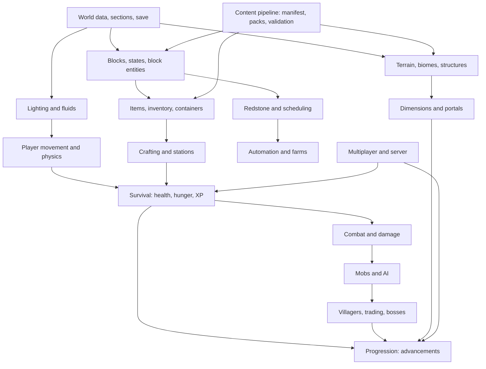

# Minecraft Java Edition Feature Inventory and Parity Scope

**Status:** draft for review
**Research date:** 2026-11-24
**Reference baseline:** Minecraft Java Edition 1.21.11 ("Mounts of Mayhem", 2025-12-09), protocol 774, data version 4671, data pack 94.1, resource pack 75.0, Java 21
**Latest release at research date:** 26.3 ("Wilderness Bound", 2026-09-15), protocol 777, data version 5023, data pack 121.0, resource pack 97.1, Java 25; 26.4 is in development
**Related docs:** [01 Weft teardown](01-weft-teardown.md), [03 Voxel rendering SOTA](03-voxel-rendering-sota.md), [04 Networking SOTA](04-networking-sota.md), [08 UI/audio/localization](08-ui-audio-localization.md); planned spec chapters `docs/spec/05-world-model.md`, `06-worldgen.md`, `08-gameplay-survival.md`, `09-entities-ai.md`, `11-inventory-crafting-items.md`, `12-redstone-and-logic.md`, `15-content-system.md`, `17-persistence.md`, `18-networking-multiplayer.md`

## 0. Method, confidence, and baseline

This is a scope-control document, not a design spec. Each area gets a tier, a complexity band, a parity definition, a "do differently" note, and an explicit cut line. Counts come from `minecraft.wiki`, `misode/mcmeta` registry dumps, and `PrismarineJS/minecraft-data` where available; hand-written lists go stale within one game drop, so the checklist itself must be generated.

Confidence: **high** for 1.21.11 registry counts and version metadata; **medium** for 1.21.5-1.21.11 behavior details and 26.x content, verified at headline level only; **low** for exact command/game-rule counts, mob-cap constants, and fluid tick delays. The author's reliable first-hand knowledge ends near 1.21.4. Content from the 2025 drops and the 2026 "26.x" rename is counted but not individually verified; do not implement from this document without a registry diff.

### 0.1 Baseline versus latest

| Metric | 1.21.11 baseline | 26.3 / 26.4-dev |
|---|---:|---:|
| Release date | 2025-12-09 | 2026-09-15 (26.3) |
| Protocol / data version | 774 / 4671 | 777 / 5023 |
| Data pack / resource pack | 94.1 / 75.0 | 121.0 / 97.1 |
| Minimum Java | 21 | 25 |
| Block IDs | 1,166 | 1,311 (26.4-dev) |
| Item IDs | 1,505 | 1,686 (26.4-dev) |
| Block IDs with an item form | 1,013 | not computed |
| Entity types | 157 | 163 |
| Mobs (derived) | 89 | not computed |
| Biomes | 65 | 67 |
| Enchantments / effects | 43 / 40 | 43 / 41 |
| Potions / damage types | not computed | 48 / 51 |
| Visible advancements | not computed | 127 (+1,792 recipe unlocks) |
| Structure definitions / families | not computed / 21 | 85 / 22 |
| Default `server.properties` keys | not computed | 69 |
| Sound event IDs | not computed | 2,049 |

Block IDs include air, fluids, technical and command-only blocks. "1,013 with an item form" is the intersection of block and item registry names for 1.21.11, a good proxy for placeable player-facing blocks. The 26.x column mixes the 26.3 release (biomes, versions) with the 26.4-dev registry (block, item, effect counts); do not treat it as a released-version snapshot.

### 0.2 Content velocity is the scope trap

From 1.21.4 to 1.21.11 the game added ~71 block IDs, ~120 item IDs, 8 entity types, 1 enchantment, and 1 effect. From 1.21.11 to the 26.4-dev registry it added ~145 block IDs, ~181 item IDs, 6 entity types, and 2 biomes. That is 70-145 new block IDs per year, mostly variants of existing materials.

A target pinned to "latest" decays continuously. Pinning a baseline and treating later drops as a separate delta is the only way to finish an acceptance suite.

## 1. Tier definitions and the fantasy floor

| Tier | Name | Test | Content budget | Exit criterion |
|---|---|---|---|---|
| 0 | Core MVP ("First Night") | Punch a tree, craft tools, survive a night, mine iron, build a shelter? | ~120 blocks, ~80 items, 8-10 mobs, 3-5 biomes, 8 redstone components | 60-90 min scripted playthrough, no missing dependency |
| 1 | Parity essentials | Is the loop recognizably Minecraft to a returning player? | ~400 blocks, ~500 items, 25-35 mobs, 20-30 biomes, Nether, villages, basic redstone, enchanting, potions | Two-hour playtest reaches the Nether and enchants diamond gear |
| 2 | Full parity | Are all vanilla systems present, even if numbers differ? | 1,166 blocks, 1,505 items, 89 mobs, 65 biomes, 21 structure families, all enchantments/effects, full redstone | Generated registry diff shows every in-scope ID classified and tested |
| 3 | Deep parity | Do commands, data packs, advancements, statistics, spectator, and save import behave? | Command surface, pack formats, Anvil reader, 127 advancements | A 1.21.11 world and a simple data pack load and behave |
| 4 | Deliberate divergence | Which vanilla quirks do we refuse to copy? | Negative list | Documented replacements, compat flags where cheap |

**Fantasy floor (non-negotiable):** mine, craft, build, survive, explore, improve gear, enter the Nether, share a server. Anything that does not serve one of those seven verbs is deferrable. Apply this test when a feature is expensive but emotionally central (redstone, villagers, the End) or cheap but irrelevant (statistics, spectator). Parity is the floor, not the pitch: performance, self-hosting, and the content API need their own budget and must not be financed by silently dropping core features.

Complexity bands: **S** ≤ 2 person-months (pm), **M** 3-6, **L** 7-15, **XL** 16-40. Estimates cover code plus content definition/authoring, excluding art, audio, and the renderer. Treat them as ±50%; they are for relative planning, not budgeting.

## 2. Top-level feature inventory

| Area | What parity requires | Size | Est. pm | Tier | Depends on |
|---|---|---|---:|---|---|
| World data, sections, save/load | 32³ sections per ADR-0004, 16³-compatible block/light semantics at boundaries, palettes, block entities, persistence | L | 6-10 | 0 | engine |
| Terrain and biome generation | Noise terrain, surface rules, caves, aquifers, 65 biomes, seams | XL | 18-30 | 0 partial / 1 | world data |
| Structures and worldgen features | 21 families, jigsaw, loot, placement, ores, geodes, fossils | XL | 14-24 | 1 / 2 | terrain |
| Blocks and block states | 1,166 IDs, state schemas, models, collisions, drops, sounds, 49 block entities | XL | 14-22 | 0 partial | world data, lighting |
| Items, inventory, containers | 1,505 IDs, stacks, components, 36-slot inventory, chests, crafting grids | L | 6-10 | 0 | blocks |
| Crafting and stations | ~1,800 recipes, 16 station types, recipe unlock, shift-click, tags | L | 8-12 | 0 / 1 | items |
| Player movement and physics | Walk, sprint, sneak, jump, swim, climb, fall, elytra, collisions, step-up | L | 6-10 | 0 | blocks, fluids |
| Survival loop | Health, hunger, saturation, XP, death, respawn, beds | M | 4-6 | 0 | movement, items |
| Combat and damage | 51 damage types, cooldown, armor, shields, projectiles, knockback | L | 7-11 | 0 / 1 | survival, items |
| Mobs and AI | 89 mobs, pathfinding, spawning, despawn, breeding, taming, loot | XL | 24-40 | 0 partial / 2 | combat, world data |
| Villagers, trading, raids | 15 villager types, trade levels, POI, schedules, raids, golems | L | 6-9 | 1 / 2 | mobs, structures |
| Bosses | Ender dragon, wither, elder guardian, warden, raid encounters | L | 5-8 | 2 | dimensions, mobs |
| Dimensions and portals | Overworld, Nether, End, 8:1 scaling, portal linking, respawn anchors | M | 3-5 | 1 / 2 | world data |
| Fluids | Water/lava levels, flow, waterlogging, infinite sources, interactions | L | 4-7 | 0 | blocks, lighting |
| Lighting | Sky and block light, propagation, smooth lighting, updates, dimensions | L | 5-8 | 0 | world data |
| Redstone | ~35 components, 0-15 signal, delays, update semantics, comparators | XL | 14-26 | 1 basics / 2 | blocks, scheduling |
| Farming and breeding | Crops, growth, bone meal, irrigation, animals, composting, fishing | M | 4-6 | 0 / 1 | blocks, items, mobs |
| Weather and time | Rain, snow, thunder, lightning, 20-minute day, moon phases | S | 1-2 | 0 | world data |
| UI and HUD | Inventory, crafting, chat, menus, settings, server list, tooltips | L | 9-14 | 0 / 1 | items, networking |
| Audio | Positional SFX, footsteps, music, 2,049 sound events, ambience | M | 4-7 | 1 | engine, assets |
| Multiplayer and social | Dedicated server, chat, tab list, skins, permissions, whitelist, RCON | XL | 10-18 | 1 | networking |
| Commands and game rules | ~70 commands, ~90 rules, selectors, scoreboard, functions | XL | 10-16 | 2 / 3 | world, entities |
| Advancements and statistics | 127 advancements, 5 tabs, triggers, rewards, stats screens | M | 4-6 | 2 / 3 | progression, mobs |
| Game modes | Creative, survival, adventure, spectator, hardcore | M | 3-5 | 1 / 2 | player, permissions |
| World format interop | Read/write Anvil and NBT, item components, data versions | L | 5-8 | 3 | world data |
| Data and resource packs | JSON registries, tags, loot, functions, predicates, models, fonts | XL | 9-15 | 3 | content pipeline |
| Accessibility and localization | Subtitles, text scaling, narrator, keybinds, translations | M | 3-5 | 3 | UI |
| Performance scaling features | Render distance 2-32, simulation distance 2-32, chunk budgets | L | 5-8 | 0 | engine |

**Sum:** ~210-355 pm of code and content for Tier 0-3, before art and audio. Tier 0 alone is ~80-125 pm; Tier 0-1 is ~140-220 pm; Tier 2 lands at ~190-300 pm; Tier 3 at ~210-355 pm. At 6 effective engineers that is 2-3 years to Tier 1, 3-4.5 years to Tier 2, and 4-6 years to Tier 3 including overhead. A 12-person team halves the calendar, not the cost.

This is the central planning fact: **Minecraft parity is a content-graph problem disguised as a game-feature problem.** The engine can be excellent and the project still loses years to 1,166 blocks, 89 mobs, and 1,792 recipe unlocks.

## 3. Content inventories

### 3.1 Blocks: 1,166 IDs, 102 stairs, 117 copper-related blocks

Counts are the latest (26.4-dev) registry unless noted; 1.21.11 is 145 IDs smaller. They are ID counts, not state counts.

| Family | Count | Note |
|---|---:|---|
| Stairs / slabs / walls | 102 / 106 / 37 | shape, orientation, waterlogged; walls have connection states |
| Fences / gates | 14 / 13 | connection graph, waterlogged |
| Doors / trapdoors | 22 / 22 | hinge, open, powered, half |
| Signs | 52 | standing/wall, 4 rotations, glowing, hanging |
| Carpets / planks / logs / leaves | 18 / 13 / 20 / 14 | 13 wood types, axis and stripped variants |
| Wool / concrete / terracotta | 16 / 16 / 32 | 16-color families dominate variant count |
| Candles / beds / shulker boxes | 16 / 17 / 16 | light level, respawn point, portable storage |
| Banners / glass panes | 32 / 16 | 43 patterns, layer data, connections |
| Copper-related blocks | 117 | oxidation × waxed × shape (block, cut, grate, bars, chain, lantern, bulb, door, trapdoor, stairs, slab) |
| Ores | 18 | 11 base ores plus deepslate variants |
| Block entity types | 49 | chests, furnaces, hoppers, signs, spawners, vaults, etc. |

The 117 copper IDs are the clearest warning: one material with oxidation, waxing, and shape variants costs almost as much content surface as the entire Tier 0 block list. A 26.3 wood type costs 23 block IDs; a stone family with polished/brick/chiseled variants costs 10-15.

**Notable, non-cube behaviors:** waterlogging (a state on hundreds of blocks, with fluid, redstone, and explosion interactions); gravity (sand, gravel, concrete powder, anvils, suspicious blocks, scaffolding); directional/axis blocks (logs, pistons, observers, hoppers, furnaces, signs, beds, doors, rails); partial shapes (slabs, stairs, walls, fences, gates, carpets, snow, chains, bars, panes, vines, candles).

**Interactive and content systems:** interactive blocks (doors, trapdoors, gates, buttons, levers, repeaters, comparators, note blocks, jukeboxes, lecterns, looms, cartography/smithing tables, grindstones, stonecutters, beacons, conduits, respawn anchors, beds, cake, cauldrons, composters, campfires, bells, crafters, vaults, trial spawners); plants and crops (wheat, carrots, potatoes, beetroot, stems, sugar cane, bamboo, cactus, kelp, sea pickle, cocoa, nether wart, chorus, berries, torchflower, pitcher plant, saplings, mushrooms, vines, dripleaf, spore blossom, petals, leaf litter, shelf mushroom); special systems (copper oxidation, amethyst geodes, sculk sensors/shriekers/catalysts, trial chambers, mud, deepslate, mangrove, bamboo, cherry, pale oak, poplar, reinforced deepslate, barrier/light/structure void/jigsaw/command blocks).

**26.x additions (headline-verified):** sulfur, cinnabar, potent sulfur and geysers, brittle ice, icicles, ice crystal, packed ice bricks, calcite variants, cushions, straw beds, abandoned-camp content. These are Modern Delta, not baseline.

**Parity / delta / cut:** every ID needs hardness, tool class and tier, drops, blast resistance, flammability, light, collision, sound group, map color, piston behavior, waterlogging, gravity, note-block instrument, beacon validity, and entity interactions — ~20 properties × 1,166 IDs before state combinatorics. We make blocks data, not classes: a versioned schema declares states, properties, models, tags, drops, and behavior hooks; a validator rejects impossible state counts; models are generated. Cut 16-color families to a palette over one definition, ship six wood types before the full set, and trim copper's shape matrix to block/cut/stairs/slab/bulb at first. Stone, dirt, wood, ores, fluids, crafting table, furnace, chest, torch, bed, doors, stairs, slabs, glass, and wool cannot be cut.

### 3.2 Items, tools, and armor: 1,505 IDs, 7 tool tiers

Of 1,505 item IDs, 1,013 are block items; the remaining ~492 are tools, armor, food, potions, buckets, spawn eggs, discs, banners, templates, and miscellany.

- **Tool tiers (7):** wooden, stone, copper, iron, golden, diamond, netherite; sword, pickaxe, axe, shovel, hoe each. Copper tools exist in 1.21.11 and change early-game balance.
- **Armor (8 materials):** leather, chainmail, copper, iron, golden, diamond, netherite, turtle (helmet only); armor points, toughness, knockback resistance, durability, enchantability, repair.
- **Food (44) and consumables:** ~48 potions, 40 effects (41 in the latest registry), 21 music discs, 19 smithing templates, 10 banner-pattern items (43 designs), 87 spawn eggs, buckets, boats, minecarts, saddles, name tags, leads, compasses, clocks, maps, spyglasses, bundles, goat horns, brushes, trial keys, ominous bottles, maces, wind charges.
- **Components:** since 1.20.5 items carry typed data components rather than free-form NBT; this is the most important format change for modding and for our item model.

**Parity / delta / cut:** stack size, durability, mining speed and tier gating, attack damage/speed, enchantability, repair, nutrition/saturation/effects, rarity, fuel, compost chance, and tags. Use one item schema with typed components; no untyped NBT escape hatch in the public API; tool tiers are data so mods can add tiers. Cut music discs, banner patterns, smithing templates, and goat horns to Tier 2/3; generate spawn eggs from the entity registry. Do not cut tools, armor, food, or buckets.

### 3.3 Crafting and stations: ~1,800 recipes, 16 station types

The 1,792 recipe-unlock advancements in the latest registry are a good proxy for recipe count. Recipe types are few; instances are many. The graph is the product. Rows below combine related blocks: 11 rows cover 16 station block types.

| Station | Role | Parity notes | Tier |
|---|---|---|---|
| Crafting table | 3×3 shaped/shapeless | recipe book, shift-click, tags, remaining items | 0 |
| Furnace | smelting, fuel, XP | burn time, smelt time, fuel values, lit state | 0 |
| Blast furnace / smoker / campfire | specialized or fuel-free cooking | same graph, different rates and fuel rules | 1 |
| Stonecutter | 1:1 variant cutting | separate recipe set, no XP | 1 |
| Smithing table | transform + trim | 19 templates including netherite upgrade | 1 |
| Brewing stand | potions | 48 potions, 40 effects, ~20 s per step, blaze powder | 1 |
| Enchanting table | 43 enchantments | bookshelf power, lapis, three offers, seeded rolls | 1 |
| Anvil / grindstone | repair, combine, rename, disenchant | prior-work penalty, level cost, breakage, XP return | 2 |
| Loom / cartography table | banners, maps | 43 patterns, zoom/copy/lock | 2 |
| Beacon / conduit | area effects | pyramid tiers, frame activation | 2 |
| Crafter (1.21) | automated crafting | redstone pulse, comparator output, slot disable | 2 |

**Parity / delta / cut:** the graph must produce the same items from the same inputs, tags resolve identically, the recipe book unlocks on first acquisition, and station UIs enforce the same slot rules. A missing recipe is noticed immediately; a 10% smelt-time difference almost never is. Validate the graph at load (no cycles, no missing tags, every item obtainable), generate the recipe book from it, and expose one API to packs and WASM. Cut anvil prior-work penalty and grindstone XP to simplified rules at Tier 1; keep the recipe book, which is the difference between "Minecraft-like" and "obtuse".

### 3.4 Entities and mobs: 157 entity types, 89 mobs

157 entity types break down into 89 mobs and 68 non-mob types: 20 boats/rafts with chest variants, 7 minecarts, 25 projectiles/effects, 13 display/marker/player types, plus items, TNT, and falling blocks.

| Group | Examples | Count |
|---|---|---:|
| Passive and utility | allay, armadillo, axolotl, bat, camel, cat, chicken, cod, cow, donkey, fox, frog, glow squid, happy ghast, horse, mooshroom, mule, nautilus, ocelot, panda, parrot, pig, pufferfish, rabbit, salmon, sheep, sniffer, snow golem, squid, strider, tadpole, tropical fish, turtle, villager, wandering trader, copper golem | 36 |
| Neutral | bee, dolphin, enderman, goat, iron golem, llama, polar bear, spider, trader llama, wolf, zombified piglin, piglin | 12 |
| Hostile | blaze, bogged, breeze, cave spider, creaking, creeper, drowned, elder guardian, endermite, evoker, ghast, guardian, hoglin, husk, illusioner, magma cube, phantom, piglin brute, pillager, ravager, shulker, silverfish, skeleton, slime, stray, vex, vindicator, warden, witch, wither skeleton, zoglin, zombie, zombie villager, parched, camel husk, zombie nautilus | 36 |
| Bosses | ender dragon, wither | 2 |
| Unused or spawn-only | giant, skeleton horse, zombie horse | 3 |

The classification is approximate at the edges (spider, piglin, iron golem), but the total is derived from the 1.21.11 registry. Post-1.21.4 additions include copper golem, happy ghast, nautilus, zombie nautilus, camel husk, and parched; verify their behavior individually.

**Parity / delta / cut:** pathfinding and sensing, spawn rules and caps, despawn, breeding and taming, equipment and loot, villager and piglin AI, boss phases, sounds and animations, persistence. Mob AI is the largest code area after worldgen and where "looks like Minecraft" is won or lost. Use ECS plus behavior trees, AI LOD (full brain within ~48 blocks, simplified steering beyond), deterministic spawn tables, and a 1-2 ms per-tick budget for ~200 mobs. Cut to 8-10 mobs at Tier 0 (zombie, skeleton, creeper, spider, pig, cow, sheep, chicken, villager placeholder), ~25 at Tier 1, all 89 at Tier 2. Cutting illusioner, giant, and unused variants costs nothing; cutting creepers costs identity.

### 3.5 Villagers, trading, bosses, and raids

- **Villagers:** 15 villager types (13 professions plus nitwit and unemployed), five trade levels from novice to master, workstation and bed POIs, schedules, gossip, zombie-villager curing, iron-golem spawning.
- **Trading:** roughly 100 offers, demand/price adjustment, restocking at workstations, wandering-trader randomness.
- **Bosses and raids:** ender dragon (crystals, perch, breath, egg), wither (spawn explosion, phases, wither roses, nether star), elder guardian (mining fatigue), warden (darkness, sonic boom), raids (bad omen, waves scaling with difficulty, evokers and ravagers, hero of the village).

**Parity / delta / cut:** the emerald economy, villager breeding and workstation binding, raid triggers, boss bars and unique drops. This is the main non-combat progression path and the reason villages matter. Use a transparent trade table with visible restock timers, price rerolls instead of lectern-break exploits, configurable raid difficulty, and telegraphed boss attacks. Cut schedules and gossip to Tier 2; keep curing and hero of the village. The dragon and wither are Tier 2, but they are also the game's ending, so "full parity" cannot omit them.

### 3.6 Biomes: 65 baseline, 67 latest

1.21.11 has 65 biome registry entries. The latest count is 67: 56 Overworld, 5 Nether, 5 End, plus `the_void` for superflat. The additions are `dappled_forest` (26.3) and `sulfur_caves` (26.2).

- **Overworld (54 baseline, 56 latest):** badlands, bamboo jungle, beach, birch forest, cherry grove, cold ocean, dark forest, deep cold ocean, deep dark, deep frozen ocean, deep lukewarm ocean, deep ocean, desert, dripstone caves, eroded badlands, flower forest, forest, frozen ocean, frozen peaks, frozen river, grove, ice spikes, jagged peaks, jungle, lukewarm ocean, lush caves, mangrove swamp, meadow, mushroom fields, ocean, old growth birch forest, old growth pine taiga, old growth spruce taiga, pale garden, plains, river, savanna, savanna plateau, snowy beach, snowy plains, snowy slopes, snowy taiga, sparse jungle, stony peaks, stony shore, sunflower plains, swamp, taiga, warm ocean, windswept forest, windswept gravelly hills, windswept hills, windswept savanna, wooded badlands; plus dappled forest and sulfur caves.
- **Nether (5):** basalt deltas, crimson forest, warped forest, nether wastes, soul sand valley.
- **End (5):** end barrens, end highlands, end midlands, small end islands, the end. **Void (1):** the void.

A biome is not decoration: it bundles temperature/downfall, terrain parameters, surface rules, features, spawn lists, foliage/water/fog colors, ambient sounds, and music — roughly 15 data tables each. That is why "just add 50 biomes" is XL even with a data pipeline.

**Parity / delta / cut:** the right biome in the right climate and terrain, with the right blocks, mobs, structures, colors, and sounds; statistical distribution matters more than seed-identical placement. Build a data-driven multi-noise biome source, biome packs, and a debug preview map. Ship 20-25 silhouette-diverse biomes at Tier 1 (plains, forest, birch, desert, savanna, taiga, snowy plains, jungle, swamp, badlands, ocean, deep ocean, beach, river, windswept hills, lush caves, cherry grove, mangrove, mushroom, ice spikes); complete the set at Tier 2. Deep dark, lush caves, and dripstone caves can slip without breaking the fantasy.

### 3.7 Dimensions, portals, and respawn

- **Overworld:** 384-block height (Y -64 to 320), sea level 63, skylight, weather, beds work.
- **Nether:** 256-block height, no skylight, 8:1 coordinate scale, lava sea, beds explode, respawn anchors, ceiling bedrock at Y=127.
- **End:** 256-block height, no skylight, central island, outer islands, end cities, gateways, dragon fight, beds explode.
- **Portals and respawn:** obsidian frame 4×5 minimum (2×3 interior), 8:1 linking, portal search and creation, 12-eye end portal, end gateways; beds set spawn and skip night; respawn anchors charge with glowstone and explode elsewhere; spawn-point safety checks.

**Parity / delta / cut:** separate dimension storage, vanilla-like portal distance math, per-dimension height/light/fluid rules, spawn differences, and the dragon/elytra loop. Portal-linking bugs are among the most visible multiplayer issues. Use one world container with dimension stacks, portal search on a worker thread, deterministic link selection, and a configurable "no nether roof" rule; offer official fast travel instead of preserving a bedrock-hole exploit. The End is Tier 2; the Nether is Tier 1 and is the biggest content multiplier per engineering month.

### 3.8 World generation: 21 structure families, 11 base ores

**Structure families (21 baseline, 22 with 26.3 abandoned camps):** ancient city, abandoned camp, bastion remnant, buried treasure, desert pyramid, end city, nether fortress, igloo, jungle pyramid, woodland mansion, mineshaft, ocean monument, nether fossil, ocean ruins, pillager outpost, ruined portal, shipwreck, stronghold, swamp hut, trail ruins, trial chambers, village. The latest registry has 85 definitions because villages, ruins, portals, shipwrecks, and camps have biome variants.

**Ores (11 base):** coal, copper, iron, gold, redstone, lapis, diamond, emerald, nether gold, nether quartz, ancient debris; deepslate variants exist for overworld ores except emerald. Generation is per-biome configured features with count, size, height range, discard chances, and vein shapes.

**Terrain and caves:** density functions and noise router, surface rules, carvers (cave, canyon), noise caves (cheese, spaghetti, noodle), aquifers, lava aquifers, ravines, geodes, fossils, monster rooms, desert wells, lakes, springs, ice spikes. **Archaeology:** suspicious sand/gravel, brushing, pottery sherds, trail ruins.

**Parity / delta / cut:** structures in plausible places with correct loot and mobs; ore distribution supporting the progression curve; navigable caves. It does not mean seed-identical terrain. Use staged deterministic generation on async workers, cached structure placement, pack-defined structures, and a server "structure density" knob. Statistical tests (ore histogram, biome area, structure spacing) replace golden seeds. Tier 1 needs villages, dungeons/mineshafts, strongholds, nether fortresses, and ruined portals; ocean monuments, woodland mansions, ancient cities, trial chambers, and end cities are Tier 2.

### 3.9 Fluids, gravity, lighting, weather, time, and performance features

- **Fluids:** water/lava levels, falling fluid, source creation, infinite water, waterlogging, bubble columns, currents, obsidian/cobblestone generation, lava ignition, fluid-redstone interactions. Vanilla delays are roughly 5 ticks for water and 30 for lava in the Overworld; verify before encoding.
- **Gravity:** falling-block entities for sand, gravel, concrete powder, anvils, suspicious blocks, dragon eggs; scaffolding and pointed dripstone have their own rules.
- **Lighting:** 0-15 sky/block light, per-dimension skylight, emission and opacity, smooth lighting, incremental updates, light-aware spawning.
- **Weather and time:** rain, biome-dependent snow, thunder, lightning, cauldron filling, farmland hydration, fire spread, reduced sky light; 24,000-tick day (20 minutes), moon phases, beds skipping to morning, insomnia and phantoms.
- **Performance-facing features:** render distance 2-32 chunks, simulation distance 2-32, chunk loading tickets and spawn chunks, entity/block-entity culling, and the vanilla assumption that render distance, simulation distance, and chunk generation are separate budgets. Our 144 FPS target makes these first-class design knobs, not options screens.

**Parity / delta / cut:** water flows where expected, light looks right and drives spawns, weather changes sky and ground, the day is 20 minutes. Fluid and light updates are also the top source of simulation bugs and frame spikes. Use a deterministic work queue with per-tick budgets instead of recursive immediate updates; put waterlogging in the state schema on day one; keep weather mostly cosmetic; make day length configurable. Exact fluid tick parity can be approximated if flow distance, source rules, and relative lava speed are preserved; lightning fire can wait for Tier 1.

### 3.10 Redstone: ~35 components and one scheduling model

- **Power sources:** redstone block, redstone torch, lever, button (wood/stone/polished blackstone), pressure plates (wood, stone, polished blackstone, light/heavy weighted), target block, daylight detector, observer, detector rail, tripwire hook, sculk sensor, calibrated sculk sensor, lightning rod, trapped chest and comparator-readable containers.
- **Transmission:** redstone wire (0-15 directional decay), repeater (1-4 redstone-tick delay, locking), comparator (compare/subtract, container reading, fixed delay).
- **Mechanisms:** piston/sticky piston (12-block push limit), dispenser, dropper, hopper (8-tick transfer), redstone lamp, note block, bell, powered/activator rail, doors, trapdoors, fence gates, TNT, TNT and hopper minecarts, crafter, copper bulb.
- **Java quirks:** quasi-connectivity (pistons, dispensers, droppers powered from one block above), block-update order, 0-tick pulses, update suppression, instant wire, comparator timing, sticky-piston block dropping, RNG dispensers.

**Parity / delta / cut:** signal strength, delays, and observable behavior, not the update-order accidents that make Java farms possible. This is the sharpest "what is parity" question in the project. Use a deterministic scheduler with documented update order; no QC, no 0-tick, no update suppression; component behavior as data plus scripts; conformance tests as truth tables and timing traces. Offer a "classic redstone" flag only if adoption proves it necessary, because emulating accidents taxes every future block. Tier 0 needs 8 components (lever, button, pressure plate, wire, torch, repeater, piston, lamp); Tier 1 ~18-20; full redstone is Tier 2.

### 3.11 Farming, food, hunger, and XP

- **Crops:** wheat, carrots, potatoes, beetroot, pumpkin, melon, sugar cane, bamboo, cactus, kelp, cocoa, nether wart, chorus, sweet berries, torchflower, pitcher plant; random-tick growth gated by light, hydration, and bone meal.
- **Animals:** breeding, baby growth, taming (wolf, cat, parrot), mounting (horse, donkey, mule, camel, nautilus, happy ghast), leads, shearing, milking, egg laying, wool regrowth, mooshroom stew.
- **Hunger and food:** 20 hunger points, saturation, exhaustion from sprinting/jumping/attacking/mining, regeneration thresholds, starvation damage, 44 foods with nutrition/saturation/effects.
- **XP:** orb entities and merging, levels, enchanting and anvil costs, furnace output, ore mining, breeding, fishing, boss rewards; level 30 is the enchanting ceiling.

**Parity / delta / cut:** the survival pressure curve and farming loop must feel the same: feed yourself, breed animals, reach level 30 at roughly the same pace. Use data-driven crops and foods, expose saturation/exhaustion in the debug UI, and make growth rates configurable. Cut exotic crops and bee pollination to Tier 1/2; simplify fishing to a timed catch. Hunger cannot be cut: it is the clock that makes survival a loop.

### 3.12 Combat, damage, difficulty, and spawning

- **Damage types (51 in the latest registry):** physical, fire, explosion, projectile, magic, drowning, starvation, fall, void, sonic boom, wither, dragon breath, freezing, and the rest, each with tags, immunity, and a death message.
- **Combat:** attack cooldown, critical hits, sweeping, knockback, shields and disabling, armor points/toughness, enchantment bonuses, arrows and tipped arrows, crossbows, tridents, maces, wind charges, potions, totems.
- **Difficulty:** peaceful, easy, normal, hard, hardcore; local difficulty scaling with world time; mob damage and spawn rules by difficulty.
- **Spawning:** light rules, biome/structure-specific lists, pack spawning, per-player mob caps, despawn distances, spawn chunks, raid and patrol triggers.

**Parity / delta / cut:** the damage formula, armor curve, cooldown feel, and spawn pressure. Combat is where small numeric differences are felt immediately; wrong knockback reads as "not Minecraft". Use server-authoritative hit validation with client prediction and lag compensation, one damage-type registry shared by packs and mods, spawn tables as data, and visible combat numbers in debug. Hardcore and local difficulty can wait; 51 damage types can start as 15 categories if extensible. Do not cut shields, bows, or the cooldown.

### 3.13 Enchanting, potions, and effects

**Enchantments (43):** aqua affinity, bane of arthropods, binding curse, blast protection, breach, channeling, density, depth strider, efficiency, feather falling, fire aspect, fire protection, flame, fortune, frost walker, impaling, infinity, knockback, looting, loyalty, luck of the sea, lunge, lure, mending, multishot, piercing, power, projectile protection, protection, punch, quick charge, respiration, riptide, sharpness, silk touch, smite, soul speed, sweeping edge, swift sneak, thorns, unbreaking, vanishing curse, wind burst.

**Effects (41):** absorption, bad omen, blindness, breath of the nautilus, conduit power, darkness, dolphins grace, fire resistance, freezing, glowing, haste, health boost, hero of the village, hunger, infested, instant damage, instant health, invisibility, jump boost, levitation, luck, mining fatigue, nausea, night vision, oozing, poison, raid omen, regeneration, resistance, saturation, slow falling, slowness, speed, strength, trial omen, unluck, water breathing, weakness, weaving, wind charged, wither.

**Potions (48 registry entries):** water, awkward, mundane, thick, and effect potions in drinkable, splash, and lingering forms; tipped arrows; beacon and conduit effects; suspicious stew; enchanted golden apples.

**Parity / delta / cut:** stacking rules, durations/amplifiers, particles and icons, potion recipe tree, enchanting offers, anvil rules, curses. Enchantments are data-driven since 1.21, so our pack format can mirror the registry. Put effects and enchantments in registries with typed modifiers; no hard-coded potion table; show possible enchantments while keeping the roll; make mending and infinity configurable. Tier 1 ships ~12 enchantments and ~10 effects; all 43/41 is Tier 2. Curses are cheap flavor; keep them.

### 3.14 Advancements, statistics, and recipe unlocks

The latest registry has 127 visible advancements across five tabs: 48 adventure, 31 husbandry, 23 nether, 16 story, 9 end, plus 1,792 recipe-unlock advancements. Statistics cover blocks, items, mobs, distance, damage, playtime, and custom counters.

**Parity / delta / cut:** criteria trigger on the same events, rewards grant XP/loot/recipes, tabs and hidden advancements behave, and the recipe book unlocks from the same triggers. Advancements are the tutorial and the completionist metagame, and a cheap content multiplier because they reuse existing systems. Use typed triggers in data, usable by packs and mods; a progress screen that doubles as a quest guide; per-player stats with export. Statistics can wait for Tier 3; advancements ship as a small guided chain at Tier 1 and full parity at Tier 2. Ship at least a minimal chain: new players need the guidance.

### 3.15 Multiplayer, commands, server properties, and game rules

- **Multiplayer:** dedicated server, player list, chat, teams, scoreboard, whitelist, ops, bans, permissions, RCON, server-list ping, skins, LAN discovery.
- **Commands:** ~70 top-level commands plus subcommands and selectors (`@a`, `@e[type=...]`, component arguments, scoreboard operations, functions, tags, predicates, loot tables).
- **Server properties:** 69 keys in the default 26.3 file, covering difficulty, view/simulation distance, whitelist, RCON, resource pack, spawn protection, idle timeout, chat/command spam thresholds.
- **Game rules:** ~90, covering daylight cycle, weather, mob spawning, fire spread, keep inventory, insomnia, raids, random tick speed, command output.

**Parity / delta / cut:** a server owner can configure the same knobs, and a mapmaker can run the same commands. This is invisible to solo players and decisive for the community that sustains a sandbox. Use typed TOML with generated docs, a permission system from day one, no chat signing or client reporting, command parsing shared with the scripting API, and capability checks shared with mods. Full command parity is Tier 3; a curated 25-command set is Tier 2. RCON can become an authenticated admin API. Whitelist, ops, and bans are Tier 1.

### 3.16 Modes, UI, audio, and accessibility

- **Modes:** survival, creative (flight, instant break, infinite items), adventure (no break/place), spectator (no collision/interaction), hardcore (one life, locked difficulty).
- **Screens:** main menu, world creation/list, options, server list, pause, inventory, crafting, furnace family, chest/barrel/shulker, villager trading, enchanting, anvil, beacon, sign/book, chat, advancements, statistics, debug overlay.
- **Audio:** ~2,000 sound event IDs (2,049 in the latest registry), positional attenuation, block-specific break/place/step, mob sounds, biome ambience, weather, music, 21 music discs.
- **Accessibility:** subtitles, narrator, text scaling, high contrast, reduced motion, key rebinding, FOV, colorblind-safe UI; vanilla Java has no controller support.

**Parity / delta / cut:** a player can navigate, build, craft, chat, and configure without a wiki. Fidelity is less about pixel-identical screens than interaction cost. Ship a searchable item/recipe browser, settings search, controller support, scalable UI, and a mod manager; these are cheap differentiators against a 15-year-old UI. Narrator and full screen-reader support are Tier 3; the debug overlay is cheap and should ship early; subtitles are high value for low cost. Do not cut creative mode: it is the builder on-ramp.

### 3.17 World formats, NBT, data packs, and resource packs

- **Anvil:** region files (`.mca`) of 32×32 chunks, 4 KiB sectors, offset/timestamp header, chunk NBT with 16³ sections, palettes, heightmaps, 3D biome palettes, block entities, entities, data version.
- **NBT and components:** typed tags, modified UTF-8 strings, item components since 1.20.5.
- **Data packs:** JSON registries, tags, recipes, loot tables, advancements, functions, predicates, item modifiers, dimension/worldgen definitions, enchantment definitions; pack format 94.1 for 1.21.11 and 121.0 for 26.3.
- **Resource packs:** blockstates, models, textures, fonts, sounds, shaders, UI; pack format 75.0 for 1.21.11 and 97.1 for 26.3.

**Parity / delta / cut:** read a 1.21.11 world, load a simple data pack, honor resource pack models. Anvil import repacks 16³ sections into our 32³ sections and must preserve block, light, and biome boundaries; it does not mean byte-identical Anvil output or every vanilla pack. Use a native, versioned, ECS-friendly save format with an Anvil importer; data packs and WASM share one pipeline; no obfuscation; explicit schema migrations. Anvil export, resource-pack shaders, and full predicate/function semantics are Tier 3 or later. Reading Anvil is strategically valuable for migration and test fixtures; writing it is not.

### 3.18 Java versus Bedrock differences worth knowing

| Area | Java | Bedrock | OpenBlock choice |
|---|---|---|---|
| Redstone | QC, 0-tick, update-order farms | Different component rules, no QC | One documented model, no QC or 0-tick |
| Combat | Attack cooldown, offhand shield, sweeping | Different cooldown and shield rules | Java-like modern combat |
| Saves | Anvil region files | LevelDB | Native format plus Anvil import |
| Modding | Bytecode mods (Fabric/NeoForge) | Add-ons and behavior packs | WASM plus native plugins |
| Accounts | Microsoft account | Xbox Live | Self-hosted identity, no third party |
| Spawning | Per-player mob caps | Density-based caps | Explicit configurable caps |
| Hardcore | Locked difficulty, one life | Added later, different rules | One life, configurable |
| Cross-play | Via Geyser proxy | Via Geyser proxy | Protocol adapter, not a day-one goal |

Two editions produced two redstone cultures and two combat feels. OpenBlock must publish one canonical ruleset and treat deviations as compatibility modes, or every mechanic becomes a debate.

## 4. Tier 4: quirks we should not copy

| Quirk | Why it exists | Cost to copy | OpenBlock replacement |
|---|---|---|---|
| Quasi-connectivity | Historical update-order accident | Permanent tax on block updates and tests | Explicit power propagation; no QC |
| 0-tick pulses / update suppression | Emergent from update order | Fragile, exploit-driven, hard to secure | Deterministic scheduler, no 0-tick |
| Nether roof travel | Bedrock ceiling gap | Breaks world-height assumptions | No roof gap; fast travel or config |
| Villager lectern reroll | Emergent POI behavior | Encourages tedious UI spam | Visible trade pool, priced reroll |
| Iron farms / mob cramming | Spawn-cap and panic mechanics | Server performance liability | Explicit spawn caps, bounded farms |
| Exponential anvil prior-work penalty | Historical repair counter | Punishes normal play, opaque | Linear or capped repair cost |
| Opaque enchantment RNG | Slot-machine design | Frustration with no counterplay | Show possible enchants, keep the roll |
| Chat signing and reporting | Mojang safety infrastructure | Privacy and moderation burden | Plain chat, server-side moderation |
| Microsoft account requirement | Platform integration | Blocks self-hosting and LAN | Local accounts, optional OIDC |
| Obfuscated code, no mod API | Historical | Forces invasive patching | Stable API, no obfuscation |
| Java/Bedrock divergence | Two codebases | Doubles every mechanic | One ruleset, explicit compat modes |
| Seed-identical worldgen expectation | Community tooling | Effectively impossible clean-room | Statistical parity, our seeds only |
| Hidden hunger/saturation math | Legacy UI | Confusing, unmoddable | Same math, visible in debug UI |
| Duplication glitches as content | Emergent bugs | Anti-cheat and economy damage | No dupes; classic-bugs flag by demand |

The test is not "is it iconic" but "does copying it make the next five years harder". Redstone accidents are iconic and still not worth permanent emulation; nether roof travel is beloved and still a world-model hack.

## 5. Parity definition and acceptance corpus

### 5.1 Reference version: pin 1.21.11, track 26.3 as delta

**Proposal:** OpenBlock Parity Baseline (OPB) is Java Edition **1.21.11**, released 2025-12-09: protocol 774, data version 4671, data pack 94.1, Java 21.

- It is the last 1.21.x release listed before the 26.x renumbering, with a stable protocol and a mature, well-documented data pack/mod ecosystem.
- It is the newest version fully covered by community registry datasets such as `minecraft-data` (which carries 26.1 but not later); 26.x tooling is still catching up.
- It runs on Java 21, so a vanilla 1.21.11 fixture server is easy to host in CI for golden data.
- A pinned numeric baseline is easier to test and cite than "current".

The counterargument is real: a new player in 2026 sees 26.3, not 1.21.11, and 26.x added copper gear, mounts, sulfur caves, and poplar forests. Shipping a 2025 feature set in 2029 would read as old. **Mitigation:** ship OPB parity as v1.0, then a **Modern Delta (MD)** milestone for 26.3. Most 26.x additions are block/item/mob content and should be data-pack-sized work; if they require engine changes, the pipeline is wrong. Keep MD in a separate manifest so it cannot destabilize OPB acceptance.

### 5.2 Parity score

Do not report one "percent complete". Report two:

- **In-scope coverage:** fraction of manifest entries in Tiers 0-2 passing behavior tests. Target 100% for a v1.0 claim.
- **Vanilla coverage:** weighted fraction of the full 1.21.11 manifest, including deliberately cut Tier 3/4 items. Superseded by DEC-051: 1.0 gates Tier-1 parity; the ≥85% hand-authored coverage floor applies to the 2.0 Tier-2 claim. Never claim 100% and never generate the checklist from Minecraft registry dumps.

Suggested weights: world/blocks 20%, survival 15%, crafting/items 15%, mobs/combat 15%, worldgen/biomes/structures 15%, dimensions/progression 10%, redstone 5%, meta 5%. The weights are a product decision, not a measurement; publish them so the number cannot be gamed.

### 5.3 Acceptance corpus

| Layer | What it checks | Tooling | Pass criterion |
|---|---|---|---|
| L1 registry diff | Every block, item, entity, biome, enchantment, effect ID classified | Generated manifest vs mcmeta | Zero unclassified IDs; counts match or have approved exceptions |
| L2 behavior units | Hardness, tools, drops, states, waterlogging, light, collisions | Headless harness | Every Tier 0-2 block/item has a test row |
| L3 worldgen statistics | Biome area, ore histogram, structure spacing, cave connectivity | Fixed seeds plus Monte Carlo | Distributions within tolerance; no missing structure family |
| L4 simulation | Damage, hunger, breeding, redstone truth tables, mob caps | Deterministic replay | Golden traces match; timing tolerances documented |
| L5 playtests | First night, iron age, Nether, dragon, multiplayer | Scripted plus human | Completion within target time; no blocking bug |
| L6 formats | Anvil import, data pack load, save round-trip | Fixture worlds and packs | 1.21.11 fixture loads; simple pack applies |

The manifest is the core artifact: one JSON row per registry entry with `id`, `tier`, `owner`, `test`, `status`, `exception_reason`. CI regenerates the registry diff weekly and fails on unclassified additions. This is how a 1,166-block game stays honest.

**v1.0 definition of done:**

- [ ] 100% of Tier 0-2 manifest entries have a passing behavior test.
- [ ] A new player completes the first-night script in 90 minutes or less.
- [ ] A returning player reaches the Nether and enchants diamond gear in two hours or less.
- [ ] An 8-player dedicated server holds 20 TPS for one hour at 10-chunk simulation distance.
- [ ] A 1.21.11 fixture world imports with block, entity, and biome counts within tolerance.
- [ ] License audit confirms no Mojang code, asset, sound, or font in the repository.
- [ ] The parity score and its weights are published with every release.

### 5.4 Non-goals and legal boundary

- **No Mojang code, assets, sounds, textures, or fonts.** Behavior is learned from the wiki and black-box observation, not decompilation.
- **No seed-identical worldgen.** It requires reverse-engineering proprietary generation and still breaks on version changes.
- **No byte-identical NBT or Anvil output.** Import is a migration aid, not a compatibility promise.
- **No vanilla client protocol compatibility** at v1.0; a protocol adapter can come later. **No Bedrock parity promise:** one canonical ruleset, optional compat flags.
- **License boundary:** OpenBlock code is MIT OR Apache-2.0; Minecraft assets, names, and sounds are not. Keep asset licenses, fonts, and music separate from the code license.
- **Trademark hygiene:** do not present OpenBlock as Minecraft; use "Minecraft-compatible" carefully and keep our own art direction.

## 6. Prioritization and build order

### 6.1 Value versus cost

| Feature | Player value (1-5) | Cost (pm) | Tier | Order |
|---|---:|---:|---|---:|
| Mine, place, break, inventory, creative flight | 5 | 8-12 | 0 | 1 |
| First-night survival (health, hunger, 8 mobs, bed) | 5 | 10-14 | 0 | 1 |
| Crafting table, furnace, tools, armor | 5 | 6-9 | 0 | 1 |
| Caves, ores, water, lava, lighting | 5 | 12-18 | 0 | 2 |
| Farming, animals, food | 5 | 6-9 | 1 | 3 |
| Nether and portals | 5 | 6-9 | 1 | 3 |
| Villages, trading, iron golems | 4 | 6-9 | 1 | 4 |
| Enchanting, brewing, anvil | 4 | 7-10 | 1 | 4 |
| Redstone basics (18 components) | 4 | 7-10 | 1 | 4 |
| Structures (villages, dungeons, fortresses, strongholds) | 5 | 10-16 | 1 | 5 |
| All 65 biomes | 5 | 12-18 | 2 | 5 |
| The End, dragon, elytra, shulkers | 5 | 8-12 | 2 | 5 |
| All 89 mobs | 4 | 18-30 | 2 | 6 |
| Raids, mansions, ancient cities, trial chambers | 4 | 8-14 | 2 | 6 |
| Full redstone | 3 | 10-18 | 2 | 7 |
| Advancements and recipe-book polish | 3 | 4-6 | 2 | 7 |
| Commands, scoreboard, functions | 3 | 10-16 | 3 | 8 |
| Spectator and adventure modes | 2 | 2-3 | 3 | 8 |
| Statistics | 2 | 2-3 | 3 | 9 |
| Data/resource pack compatibility | 3 | 9-15 | 3 | 8 |
| Bedrock/Geyser cross-play | 2 | 15+ | 4 | never unless demanded |
| Seed-identical worldgen | 2 | 40+ | 4 | never |

The top-left quadrant (high value, low cost) is the MVP: movement, building, crafting, first-night survival, caves and ores. The bottom-right is where scope dies: seed parity, Bedrock parity, full command semantics, and 89 mobs before the core loop is fun.

### 6.2 Milestones

- **M0 "Vertical slice" (Tier 0):** 120 blocks, 80 items, 3-5 biomes, caves/ores, 8-10 mobs, crafting/furnace, health/hunger, save/load, 8-player dedicated server. Exit: 60-90 minute scripted playthrough.
- **M1 "Survival" (Tier 0 complete):** farming, breeding, beds, weather, 20 biomes, 20-25 mobs, boats/minecarts, enchanting, brewing, stonecutter and smithing basics, 18 redstone components. Exit: two-hour playtest reaches diamond gear and the Nether.
- **M2 "Overworld" (Tier 1):** 30+ biomes, villages and trading, 10+ structure families, strongholds, full early progression, recipe book, minimal advancements. Exit: a returning player says "this is Minecraft" without Overworld caveats.
- **M3 "Dimensions" (Tier 1/2):** Nether complete, End and dragon, wither, elytra, raids, 30+ mobs. Exit: a stable multiplayer dragon run.
- **M4 "Parity" (Tier 2):** 65 biomes, 21 structure families, 89 mobs, 43 enchantments, 40 effects, full redstone, trial chambers, ancient cities, archaeology, all bosses. Exit: in-scope coverage ≥ 98%.
- **M5 "Meta" (Tier 3):** commands, advancements, statistics, spectator, data packs, Anvil import, accessibility, localization. Exit: 1.21.11 fixture world and a simple pack load.
- **M6 "Modern Delta":** 26.3 content as a pack where possible. Exit: MD manifest complete with no engine changes.

The ordering is dependency-driven, not value-driven: M2 cannot start before blocks and world data are stable, and M4 cannot be tested before the manifest exists.

### 6.3 Resourcing reality

A 6-person team at 210-355 pm is 35-59 months before art and audio. A realistic v1.0 with Tier 0-2 plus a slice of Tier 3 is ~220-320 pm, or 3-4.5 years for six engineers. Art and audio at 40-60% of code/content effort push the total to 300-500 pm.

The credible ways to shorten this without lying about parity:

1. **Generate content, don't hand-author it.** One material pipeline produces 23 wood blocks, 102 stairs, and 117 copper variants. If each is a Rust type, the project cannot finish.
2. **Cut variant depth, not systems.** Ship 6 wood types and 8 wool colors before the full set and 16; 30 biomes before 65; 40 mobs before 89. The fantasy survives; the checklist does not.
3. **Buy time with a smaller baseline.** 1.21.11 rather than 26.3; Overworld plus Nether before the End.
4. **Treat art and audio as a parallel track with its own budget.** 2,049 sound event IDs and 1,166 block models are not a side quest.

## 7. Open questions for the Lead

Each question is owned by the Lead and should be resolved before M1 planning locks.

1. **Baseline pin:** accept 1.21.11 as OPB with 26.3 as a post-v1.0 delta, or target 26.3 and accept a moving target?
2. **Worldgen fidelity:** is statistical parity sufficient, or does seed sharing force a specific generator? Recommendation: statistical only.
3. **Redstone:** ship deterministic, QC-free redstone as canonical, with an optional classic mode? This is a product identity decision, not an engineering one.
4. **Content depth at v1.0:** 30 biomes and 40 mobs, or 65 and 89? What is the minimum that reads as "Minecraft" to a returning player?
5. **Data pack compatibility:** native packs only, or import vanilla data packs? The latter is a large surface with low player visibility.
6. **Bedrock/Geyser cross-play:** in or out? It changes protocol, combat, and redstone commitments.
7. **Art and audio:** what is the budget and license strategy for 1,166 block models, 1,505 item icons, 89 mob models, and ~2,000 sound events?
8. **Combat authority:** server-authoritative hit validation with lag compensation will feel different from Java's client-trust model. Is that acceptable?
9. **Variant policy:** ship all 16-color and all wood families, or a palette/material system that generates them? This determines the content budget.
10. **Success metric:** is v1.0 "in-scope 100%" or "vanilla coverage 85%"? Publish the number before work starts.

## Sources

- [Java Edition version history](https://minecraft.wiki/w/Java_Edition_version_history)
- [Java Edition 1.21.11](https://minecraft.wiki/w/Java_Edition_1.21.11)
- [Java Edition 26.1](https://minecraft.wiki/w/Java_Edition_26.1)
- [Java Edition 26.2](https://minecraft.wiki/w/Java_Edition_26.2)
- [Java Edition 26.3](https://minecraft.wiki/w/Java_Edition_26.3)
- [Biome](https://minecraft.wiki/w/Biome)
- [Mob](https://minecraft.wiki/w/Mob)
- [Block](https://minecraft.wiki/w/Block)
- [Server.properties](https://minecraft.wiki/w/Server.properties)
- [Advancement](https://minecraft.wiki/w/Advancement)
- [Game rule](https://minecraft.wiki/w/Game_rule)
- [misode/mcmeta registry dumps](https://github.com/misode/mcmeta)
- [PrismarineJS/minecraft-data](https://github.com/PrismarineJS/minecraft-data)
