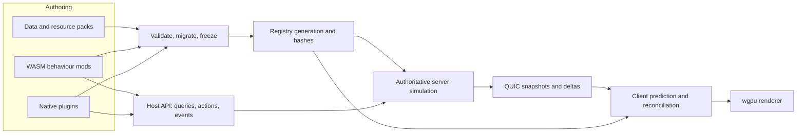
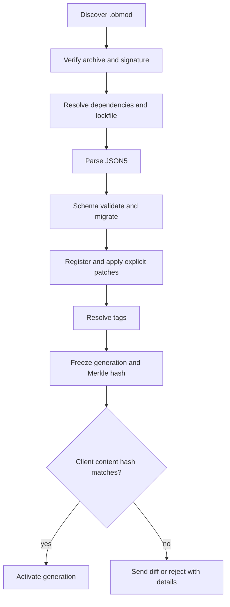

# Modding and Content System: Architecture and Ecosystem Strategy

**Status:** draft for review · **Research date:** 2026-11-24 · **Related docs:** [01-weft-teardown.md](01-weft-teardown.md) (ABI and content lessons), [04-networking-sota.md](04-networking-sota.md) (handshake, server authority), [05-minecraft-feature-inventory.md](05-minecraft-feature-inventory.md) (parity scope and counts), [08-ui-audio-localization.md](08-ui-audio-localization.md) (UI mod hooks). This document proposes a three-tier modding system for OpenBlock: validated data/resource packs, sandboxed WASM behaviour mods, and a trusted native plugin escape hatch. The central claim is that the **content schema, canonical hashing, and load/freeze pipeline are the ecosystem contract**, not the scripting runtime. Get those wrong and no runtime choice saves the project; get them right and the runtime can be upgraded behind a stable boundary. Nothing here is copied from Weft (MPL-2.0); Weft is cited for concepts and measured numbers only, and OpenBlock remains MIT OR Apache-2.0.

## 1. Verdict and constraints

**Adopt:** data-first content, WASM behaviour mods on the server, native plugins only for operators, explicit pack layering, Merkle content hashes, and hard per-mod budgets.

**Reject:** in-process Lua/Rhai as the untrusted-mod boundary, Mixin-style binary patching, exact-source-hash ABI pinning as a public contract, and "last mod loaded wins" conflict resolution.

**Defer:** client-side gameplay code, native plugin auto-download, visual scripting, and a JavaScript/Luau authoring frontend.

The target budgets are 144 FPS (6.94 ms frame), ≤2 ms client main-thread CPU, and a 20 Hz server tick (50 ms). Mod code cannot be allowed to consume the whole budget: allocate **≤0.3 ms/frame client presentation**, **≤1.5 ms/tick server behaviour**, with per-mod caps and mandatory attribution. These are initial budgets to benchmark, not measurements.

| Lead assumption | Evidence | Adjustment |
|---|---|---|
| Sandboxed WASM behaviour mods | Veloren runs WASM components on Wasmtime 49 but its plugin config enables only the component model — no fuel, epoch deadline, or memory limiter — so a plugin can hang or exhaust host memory [S24]. Wasmtime's own docs report epoch interruption at roughly a 10% execution slowdown, and fuel costs more [S34]. | Keep WASM, but make **epoch + memory + host-call + action quotas** part of the sandbox definition, not an operational afterthought. |
| Trusted native plugin escape hatch | Weft exposes 226 host functions across 6,957 lines of `repr(C)` ABI, hashes the ABI source, and loads native libraries in-process; every ABI edit invalidates mods and a bad mod is a process crash [S3][S4]. `abi_stable` 0.11.3 has had no release since 2023 [S47]. | Native is **not** a modder escape hatch. Defer to post-1.0, operator-allowlisted, separate process, tiny versioned C ABI. |
| Client prediction and reconciliation | The networking note budgets ≤0.3 ms/frame for prediction replay and forbids trusting client outcomes [networking note](04-networking-sota.md). Arbitrary server mod code cannot run on clients without leaking code and enabling cheats. | Server-side WASM is authoritative. Clients receive **content + prediction descriptors**, not mod code. Complex modded behaviour gets correction, not prediction. |
| Minecraft Java parity | The parity inventory counts ~1,166 blocks and ~1,505 items at 1.21.11; the current release is 26.3 with pack format 121.0. Parity is a content-graph problem, not a loader problem [parity inventory](05-minecraft-feature-inventory.md) [S7][S12]. | Vanilla must be **pack #0** using the same schema and hooks as mods. No private engine hooks for vanilla. |
| 144 FPS, sub-2 ms CPU | 144 FPS is 6.94 ms/frame; the networking note already allocates 0.4 ms receive/send, 0.5 ms replication, and 0.3 ms prediction [networking note](04-networking-sota.md). | Mod callbacks must fit inside those allocations; no per-block or per-entity host calls. |

**Scope boundary.** The dedicated server is headless and GPU-less. The content pipeline, validator, registry, hashing, and WASM runtime must build and run with `--no-default-features` and never link wgpu/winit. Client-only assets and shaders are a separate view layer.

## 2. Prior art

### 2.1 Minecraft Java: third-party loaders, Mixin, data packs, resource packs
No supported Java mod API is documented; Fabric, NeoForge, and Forge are third-party. As of 2026-11-24: Minecraft Java **26.3** is the current release (26.4 snapshots in flight), Fabric loader **0.20.1**, and the latest observed NeoForge 26.3 build is **26.3.0.117** [S7][S8][S9]. Fabric and NeoForge both rely on Mixin bytecode weaving and version-specific mappings; the API surface is the transformed game, not a stable contract.

| Dimension | Assessment |
|---|---|
| Capabilities | Effectively unlimited: new blocks/items/entities/dimensions, UI, rendering, networking, client and server behaviour. Datapacks add JSON registries, tags, recipes, loot, advancements, functions, predicates, and worldgen; resource packs add models, textures, sounds, fonts, and shaders. Datapacks cannot add new blocks/items or arbitrary behaviour without a code mod [S12][S13]. |
| Safety | None for code mods: arbitrary JVM bytecode in-process, full filesystem/network access, no per-mod permissions or budgets. Mixin conflicts and private-field access produce crashes that are hard to attribute. Supply-chain attacks are a real distribution risk. |
| Performance | JVM JIT is near-native after warmup; Mixin dispatch overhead is usually small. Mods can allocate, stall the tick, or deadlock without any engine enforcement. |
| Tooling | Gradle with Loom/NeoGradle, Mixin tooling, IDE debuggers, `/reload` for datapacks. Mature but version-coupled [S14][S15]. |
| Distribution | Modrinth and CurseForge dominate. Modrinth alone reports **170,533 projects, 1,594,841 versions, 73,508 authors**; loader facets show **62,956 Fabric, 34,600 NeoForge, 40,167 Forge, 15,985 datapack** projects (categories overlap). Create alone has 28.4M downloads [S10][S11]. |
| Failure modes | Version lock, mapping/remap breakage, Mixin conflicts, opaque crash stacks, client/server mod mismatch, abandoned mods, malicious jars. |

**Lesson:** the ecosystem size is the benchmark; the loader architecture is the anti-pattern. Adopt datapack breadth (registries, tags, loot, worldgen, advancements) and resource-pack separation; reject bytecode patching and unrestricted code.

### 2.2 Luanti: Lua, formspec, mapgen, ContentDB
Luanti **5.18.0** (2026-10-29) uses Lua 5.1/LuaJIT, a formspec UI language, and a large mapgen API. ContentDB currently lists **3,231 mods, 189 games, and 132 texture packs** [S16][S17][S19]. Server mods run as trusted Lua; `secure.trusted_mods` can request an insecure environment and `secure.http_mods` can request HTTP. Server-sent client-side mods (SSCSM) have a Lua sandbox, but the project's own security document says process isolation is **not yet implemented**, the network is unauthenticated, and clock precision is reduced to 20 µs to limit side channels [S18].

| Dimension | Assessment |
|---|---|
| Capabilities | Deep content and mapgen control, client/server Lua, formspec UI, no build step. |
| Safety | Trusted-server model. Lua is memory-safe as an interpreter, but the sandbox depends on interpreter correctness and a restricted global environment. SSCSM is explicitly defence-in-depth, not a hard boundary today. |
| Performance | LuaJIT is fast for tight loops; mapgen and entity callbacks can still stall. No per-mod budget or attribution. |
| Tooling | Very low friction; ContentDB; live reload of Lua files in many workflows. |
| Distribution | ContentDB packages; reviews, not cryptographic sandboxing. |
| Failure modes | Malicious or buggy mods crash/lag the server; API breakage; clients trust server-sent code within the sandbox's limits. |

**Lesson:** low-friction authoring and a declarative UI format are worth copying. In-process Lua is not acceptable as the untrusted multiplayer boundary; a formspec-like data UI is preferable to handing mods a widget toolkit.

### 2.3 Vintage Story: C# code plus JSON assets, explicit network metadata
Vintage Story **1.22.7** loads JSON assets for blocks, items, worldgen, recipes, and patches, and C# code mods for systems. Its `modinfo` is the best multiplayer metadata model in this survey: `version`, `networkVersion`, `side` (`Server`/`Client`/`Universal`), `requiredOnClient`, `requiredOnServer`, and SemVer dependency ranges [S20][S21][S22].

| Dimension | Assessment |
|---|---|
| Capabilities | Deep code mods plus broad data content; client/server sides; asset patches and overrides. |
| Safety | C# assemblies run in-process with full trust. No sandbox, no capability model, no CPU/memory quota. |
| Performance | .NET JIT; content-heavy mods can patch hot paths; no budget enforcement. |
| Tooling | .NET toolchain, wiki, asset system, ModDB. Smaller ecosystem than Minecraft. |
| Distribution | ModDB and manual packs; `networkVersion`/side flags do the compatibility negotiation. |
| Failure modes | Version mismatch, patch conflicts, in-process crashes, code mods that assume client/server symmetry. |

**Lesson:** copy `networkVersion`, `side`, `requiredOnClient`, and `requiredOnServer` into the OpenBlock manifest. They are cheap and prevent a class of multiplayer failures.

### 2.4 Veloren: Rust ECS plus WASM components
Veloren **0.18.0** uses a Rust ECS and, for plugins, WASM components on Wasmtime 49 with `component-model` and `async` enabled. The WIT package is `veloren:plugin@0.0.1`; plugins are `.plugin.tar` archives with `plugin.toml`, SHA-256 content addresses, and a server-side cache. The API is narrow: load/join/command events, animation bodies, and entity health/name reads. A server can send a plugin archive to a client, and the client stores it by hash [S23][S24][S25][S26].

The important negative finding is in `common/state/src/plugin/module.rs`: `Config::new()` sets only `wasm_component_model(true)`. There is no `consume_fuel`, no `epoch_interruption`, no `StoreLimits`, and no call quota. Each plugin gets a `Store`, but a guest loop can run indefinitely; the host ECS access uses a raw pointer behind `AtomicRefCell`. The plugin API is limited and there is no hot reload [S24].

Capabilities are narrow (server commands, join gating, animation, entity queries), tooling is `cargo component` plus WIT, distribution is hash-addressed tar with server push, and failure modes are infinite loops, memory growth, a small API, and an unsafe host pointer. Veloren is GPL-3.0; it is a reference, not a code source.

**Lesson:** WIT components are viable for game mods, and server-pushed hash-addressed artifacts are a good distribution primitive. Resource limits are not optional.

### 2.5 Weft: native C ABI, game-as-mod, tags/events/value chains
Weft **26.11.7** is the closest architectural reference. It loads native shared libraries through `libloading`, exports a `weft_mod` symbol, and checks an `ABI_VERSION` equal to an FNV hash of the ABI source; a mismatch refuses the mod. Registration runs in parallel and is ordered by dependencies/`after`/`before`. The base game is itself a mod with no private hooks. Content is 45 entry kinds sharing one registration/freeze pipeline: an entry is a name plus typed components; tags are valueless components; `NEW`/`EDIT`/`REPLACE`/`REMOVE` let any mod change any entry. Events are batched per tick; value chains (damage, attributes, questions) run in phases (`BASE`, `ADD`, `PERCENT`, `MULTIPLY`, `RULES`, `OVERRIDE`, `FINAL`) with named steps and explain tools. The catalog stores SHA-256 and a human "verified" flag; mods reload on restart, assets reload at runtime. `set_block` is documented at ~1.6 µs per block, with bulk fills much cheaper [S1][S2][S3][S4][S5][S6].

Capabilities are broad and native-speed (226 host functions); safety is absent (the exact hash only prevents layout mismatch); tooling is a Rust SDK with no code hot reload; distribution is folder/zip plus a local SHA-256 catalog with no signatures. Failure modes are ABI churn, process crashes, and mandatory restarts.

**Lesson:** copy the **entry/component/tag registry**, game-as-mod dogfooding, explicit `EDIT`/`REPLACE`/`REMOVE`, freeze-time validation, batched events, and phase-based value chains. Do not copy the exact-source-hash ABI or the absence of a sandbox.

### 2.6 Terraria tModLoader: C# in-process, Workshop distribution
tModLoader **2026.09.3.1** (2026-11-03) loads C# mods in-process, ships `.tmod` archives, and distributes through Steam Workshop. All players need tModLoader and the same mods; tModPorter helps migrate source across versions. The ecosystem is large and the tooling is mature, but there is no sandbox and version lock is strict [S27].

**Lesson:** Workshop-grade distribution and migration tooling are ecosystem features, not nice-to-haves. They do not solve trust; OpenBlock needs both.

### 2.7 Hytale: server-side first, Java plugins, JSON assets, no text scripting
Hytale is in early access; public docs are version **0.7.7**. Its stated model is server-side first: clients should join modded servers without downloading external mods, and there are **no client mods**. Modding categories are Java server plugins (`.jar`), JSON data assets, art assets, and save/prefab files. The team explicitly rejects text-based scripting in favour of visual scripting (planned), with Java plugins remaining for programmers; it acknowledges missing tooling, crashes, and data-loss risk. The server source was promised after release, and distribution is still immature [S28][S29][S30].

Capabilities are deep server plugins plus broad data/assets with no client code; safety is full-trust Java with visual scripting only planned; tooling is Asset Editor/Blockbench/Mod Browser with incomplete docs; distribution is early and has no stable catalog. Failure modes are early-access churn, plugin trust, missing client presentation hooks, and immature packaging.

**Lesson:** the server-side-only model is correct for consistency and anti-cheat, and it validates our "no client gameplay WASM" decision. Java plugins are still an in-process trust problem; WASM can provide the sandboxed behaviour path Hytale has not shipped yet.

### 2.8 Comparison

| System | Code model | Capabilities | Safety | Performance |
|---|---|---|---|---|
| Minecraft Java | JVM bytecode + Mixin | Unbounded, client/server | None for code | JVM-native; ungoverned |
| Luanti | Lua/LuaJIT in-process | Broad content/mapgen/UI | Trusted; SSCSM sandbox, no process isolation yet | LuaJIT fast; ungoverned |
| Vintage Story | C# in-process + JSON assets | Deep content/systems | None for code | .NET-native; ungoverned |
| Veloren | WASM components (Wasmtime) | Narrow server/commands/animation | Memory-safe, **no resource limits** | JIT; ungoverned |
| Weft | Native C ABI | Very broad | None; exact ABI hash only | Native; no sandbox |
| tModLoader | C# in-process | Very broad | None | .NET-native; ungoverned |
| Hytale | Java server plugins + JSON | Broad server + data | Java full trust; visual scripting planned | Unknown |
| **OpenBlock target** | **Data + WASM + native** | **Data broad; WASM broad; native narrow** | **Validated data; capability sandbox + quotas; native operator-only** | **Budgets enforced and attributed** |

Tooling/distribution does not change the safety verdict: Gradle/Modrinth (Minecraft), ContentDB (Luanti), .NET/ModDB (Vintage Story), cargo component/hash-addressed tar (Veloren), Rust SDK/zip (Weft), Steam Workshop (tModLoader), and Asset Editor/Mod Browser (Hytale, early). Minecraft and tModLoader are the only surveyed ecosystems with clearly large third-party catalogs; the rest range from small to early. Both large ecosystems pay for their reach with full-trust in-process code.


## 3. Execution models


### 3.1 Native shared libraries
A native mod is a `cdylib` loaded with `dlopen`/`LoadLibrary` (`libloading` 0.9). A C ABI is mandatory; Rust has no stable ABI, and `abi_stable` 0.11.3 (last release 2023-10-12) is not a safe foundation for a 2026 ecosystem [S47]. The boundary should be a small versioned struct/vtable: `abi_major`, `abi_minor`, `struct_size`, function pointers, `(ptr,len)` strings, and caller-owned buffers. No Rust types, no unwinding across the boundary, no allocator crossing.

The appeal is the lowest call overhead, direct engine access, and platform/GPU APIs. The cost is full trust: crashes, UB, filesystem/network access, data exfiltration, per-platform binaries, no hot reload, and no client anti-cheat. Use native only for first-party/official extensions and operator-installed integrations, behind an allowlist and preferably a separate process. Weft's 226-function ABI demonstrates both the power and the maintenance burden [S1][S3].

### 3.2 WebAssembly
WebAssembly gives memory isolation, a typed boundary, and cross-platform binaries. The relevant 2026 state:

| Runtime | Version (2026-11-24) | Model | Fit | Decision |
|---|---|---|---|---|
| Wasmtime | **51.0.0** (2026-11-20); **48.0.10** is the current LTS line | Cranelift JIT, component model, WASI p1/p2/p3, fuel/epoch, pooling allocator | Best desktop/server JIT; strong tooling; component model | **Primary**: pin 51.0.0 for current features, keep 48.x LTS as the conservative fallback. 51 requires Rust 1.97; OpenBlock is on 1.100 [S31][S32]. |
| Wasmi | **2.0.2** (2026-11-19) | Interpreter, no component model, WASI p1 only | Portable/no_std, deterministic, cheap startup; 2.2× faster than Wasmi 1.0 | **No initial fallback**: it cannot run the component-model ABI without a second core-WASM ABI. Revisit for Android/web/console only with a measured need [S37][S38]. |
| Wasmer | **7.5.0** (2026-10-01) | Singlepass/Cranelift/LLVM JIT, WASIX, V8/browser backends | Broad backend matrix; WASIX ecosystem | **Not chosen**: component model is not in its documented runtime feature set, and WASIX is a separate ABI direction [S39][S40]. |
| Extism | **1.41.0** (2026-10-09) | Wasmtime 49, p1, plugin framework | Fast host-function linking, runtime limiters, many PDKs | **Not chosen for core**: extra framework ABI; p1 only; revisit for a JS/guest SDK [S43]. |
| Javy | **8.1.0** (2026-07-30) | JS→WASM (QuickJS) | JavaScript mods; 869 KB default modules, 1–16 KB with dynamic linking | **Optional frontend later**, not the core ABI [S44]. |

**Component model and WASI.** WASI 0.2 is stable; WASI **0.3** is ratified and adds native async, but Component Model **1.0 is still on the roadmap** [S45][S46]. Use the component model now for typed WIT interfaces, pin the toolchain, and avoid WASI 0.3 async in the authoritative tick until it is boring. Do not expose filesystem or network through WASI; give mods capability-checked host functions instead. The security model is a capability sandbox, not a guarantee against host-function bugs or side channels [S35].

**Resource limits are the sandbox.** Wasmtime's docs are explicit: fuel is deterministic but imposes more overhead; epoch interruption is cheaper (measured around a 10% slowdown) but nondeterministic [S34]. Use both, for different purposes:

- **Epoch deadline per callback** (wall-clock safety): 1 ms hard cap for behaviour callbacks, 0.3 ms for client UI value calls; a watchdog thread increments the epoch. This is the non-negotiable DoS guard.
- **Fuel budget per event** (determinism): optional, enabled for competitive servers and replay verification; a trapped mod is disabled and the trap is recorded. Determinism also requires canonical NaNs, deterministic imports, and usually fuel [S36]. Do not pay fuel cost on every server by default until measured.
- **Memory limit**: `StoreLimits` with 64 MiB per mod, one instance, bounded tables/memories; `ResourceLimiter` rejects growth. Veloren's missing limiter is the cautionary example [S24].
- **Host-call quota**: 10,000 calls/tick/mod, 4,096 queued actions/tick, 16,384 events/tick; log rate limits.
- **Trap policy**: three strikes in 60 s disables the mod; the world stays up; the operator gets the trap, mod id, version, hash, and last host call.

**Call overhead.** There is no OpenBlock measurement yet. Do not budget from vendor claims. Wasmtime's Cranelift is reported at **1.2×–1.8× slower than native** for compute, and canonical ABI string/list copies can dominate small calls [S33]. Planning estimate only: a native C call is single-digit ns, a canonical-ABI Wasm host call is tens to low hundreds of ns, and an in-process Lua C call is similar but GC/allocation can dominate. Batch anything that would run per block or per entity; measure in M2 with 1M trivial host calls and 100k 1KB strings.

### 3.3 Embedded Lua, Luau, Rhai, Koto, JavaScript
- **Lua/Luau (`mlua` 0.12.3; Luau 0.748):** small, fast with LuaJIT, game-proven (Luanti). In-process interpreters are not a security boundary, GC pauses complicate the 2 ms budget, and Luanti's own SSCSM design says process isolation is not implemented [S18][S41][S48].
- **Rhai 1.27 / Koto 0.16:** pure-Rust, resource-capped interpreters are good for trusted config/logic; they are slower than LuaJIT and have small ecosystems, so they are not untrusted gameplay [S42].
- **JS via Javy 8.1:** familiar language and a WASM sandbox, but QuickJS-in-WASM adds size and a second ABI; an optional guest frontend, not the host contract [S44].

**Decision:** no embedded Lua/Rhai/Koto in the core. If a text-scripting frontend is wanted later, compile it to the same WASM ABI (Luau or JS) so it inherits the sandbox, quotas, and capability model. Hytale's public reasoning against text scripting is a useful counterweight: two languages often produce a "nerfed" second language and split the toolchain [S29].

### 3.4 Data-only packs
Data packs have no runtime code, load quickly, are easy to validate and hash, and cannot escape a sandbox because there is none. They are the correct default for blocks, items, recipes, loot, tags, worldgen, advancements, UI layout, sounds, models, textures, translations, and shaders. They are insufficient for machines, AI, minigames, and arbitrary behaviour. A restricted expression language (conditions, loot predicates, UI bindings) can cover more than JSON alone without becoming a programming language.

### 3.5 Comparison
- **Native:** no safety, lowest call overhead, native debuggers, per-platform binaries; trusted operators only.
- **Wasmtime 51:** strong memory isolation, 1.2–1.8× native compute, DWARF/`wasm-tools` debugging, x86_64/arm64 desktop/server; the primary behaviour tier.
- **Wasmi/Wasmer:** Wasmi is portable but lacks the component model; Wasmer is a capable JIT with broad backends but not aligned with the WIT ABI. Neither is the initial path.
- **Lua/Rhai/JS/data:** in-process scripts are not a sandbox and have excellent live reload; JS is an optional WASM frontend; data-only is the default and has the best schema tooling.

### 3.6 ABI versioning strategy
- **Data:** integer `content_format`; engine-owned migration chain; support current + previous major; never execute migration code from a pack; write migrated cache; keep source immutable.
- **WASM:** WIT package `openblock:mod@1.0.0`; semver. Additive minor changes; breaking changes bump major and may be hosted in parallel (`@1` and `@2`) during a deprecation window. The mod manifest declares `api = "1"` and a `game` range. Loader rejects unknown major, warns on deprecated minor.
- **Native:** `abi_major`, `abi_minor`, `struct_size`, and a capability manifest; reject major mismatch; ignore unknown trailing fields when `struct_size` says they are absent. Do not use an exact hash for the public contract; Weft's exact hash guarantees safety but forces every mod to rebuild on every ABI edit, which is incompatible with a third-party ecosystem [S3].
- **Content IDs:** removed IDs are tombstoned for the world lifetime; re-adding a tombstoned ID is a warning and a new numeric ID. Never reuse a numeric ID silently.

### 3.7 Host function design
Host functions are capability handles, not raw pointers:

- **Numeric IDs at the boundary.** Strings/IDs are resolved at init; hot paths use `u32` block/item/state IDs and `u64` entity IDs. A registry manifest maps IDs to names for debugging and network compatibility.
- **Queries return snapshots.** `get_block` returns a value; `entities_in` returns a list or a handle; no borrowed host memory that can outlive the call.
- **Actions are queued.** `set_block`, `spawn`, `damage`, `play_sound`, and `send` append to a per-mod queue. The host validates capabilities, budgets, and targets, then applies at a defined commit point. A mod cannot mutate the world mid-iteration or observe partially applied actions.
- **Events are batched.** One `on_events(list<event>)` per tick beats one host call per block/entity. Per-block tick callbacks are not exposed; use scheduled ticks or systems.
- **No ambient authority.** No filesystem, network, wall clock, environment variables, or process APIs. Time is the deterministic tick; RNG is host-seeded and per-mod; logs are rate-limited.
- **Panic/trap containment.** Guest traps are values; host closures must not panic across the boundary. The host catches, attributes, and disables on repeated traps.

## 4. Content model


### 4.1 What is first-class data
The schema must cover vanilla before it covers mods. The sibling parity inventory counts ~1,166 block IDs, ~1,505 item IDs, 89 mobs, 65 biomes, and 21 structure families at 1.21.11 [parity inventory](05-minecraft-feature-inventory.md). If a domain is not data, parity content becomes engine code and mods cannot extend it without native code.

| Domain | Data | Hash layer | Notes |
|---|---|---|---|
| Blocks/states | ID, sorted properties, collision/outline, light, hardness, drops, tags, model/texture refs, block-entity schema | Content + view | State count validated; properties immutable at runtime |
| Items | stack, durability, use action, food, fuel, equipment, inventory, tool tier, model/texture | Content + view | One typed component schema; no untyped NBT escape |
| Recipes | shaped/shapeless/processing/custom kinds, tags, outputs, time | Content | Graph validated for missing tags/cycles; recipe book generated |
| Loot | pools, conditions, functions, luck | Content | Deterministic RNG; caps on nested tables |
| Worldgen | dimensions, biomes, climate fields, terrain, caves, features, structures, templates, spawn rules | Content | Server-authoritative; deterministic seed + content hash |
| Entities/mobs | attributes, body, AI graph/tasks, spawn, loot, effects, model/animation | Content + view | AI data plus WASM tasks, not Java-like classes |
| UI | screens, HUD, menus, bindings, styles, accessibility | View | `ui_values` at 10 Hz; actions are intents |
| Assets | textures, models, animations, particles, sounds, music, fonts, sky, weather | View | Client resource packs can override |
| Tags | memberships, nested tags, optional entries | Content | `#namespace:path`; resolved after registration |
| Advancements/quests | criteria, rewards, tabs, visibility | Content + view | Typed triggers; shared with packs/WASM |
| Shaders | WGSL modules, uniforms, render features, per-biome overrides | View | Declared interface; fallback if unsupported |
| Rules/config | game modes, damage types, effects, spawn caps, world presets | Content | Server-authoritative; typed TOML |
| Prefabs/structures | layered templates, slots, palettes, entities, loot | Content | Validated at load; no arbitrary code |

### 4.2 Schema and canonicalization
**Authoring:** JSON5 (comments, trailing commas, familiar to JS tooling), `json5` 1.3.8. **Runtime/canonical:** JSON via `serde_json` 1.0.154, with keys sorted, no insignificant whitespace, UTF-8, and canonical numbers. **Schema:** Rust `serde` types plus `schemars` 1.2.3 to generate JSON Schema and TypeScript types for editors/CI. **Manifests/config:** TOML 1.2.2, which is readable and has good typed support. **Internal only:** RON 0.12.3 for Rust-centric debug fixtures; not a public authoring format [S49].

Authoring is JSON5 because comments and trailing commas matter to content authors and JS tooling; runtime and hashing use canonical JSON because it is universal and strict. Manifests/config use TOML because they are flat; RON is internal-only for Rust debug fixtures; binary formats are cache-only and never the hash source. JSON5's ambiguous numbers are why canonicalization is mandatory [S49].

**Rules that prevent hash drift:**

- Reject NaN, infinities, and `-0`; simulation values are integers or fixed-point (e.g., 1/16 block, ticks, per-mille). Floats are allowed only in the view layer, or as canonical decimal strings with fixed precision if unavoidable.
- Unknown fields are errors in strict mode. Namespaced extension data goes under `components` or `x-<namespace>` and is schema-validated; never silently ignored in simulation data.
- Arrays are ordered only where order is semantic; tag members, map keys, and registry entries are sorted before hashing.
- Errors carry file, JSON Pointer, schema path, and a suggested fix. `ob check --strict` is a CI gate.
- Engine migrations are Rust code, not pack code; a pack declares `content_format` and the engine runs built-in migrations, then writes a cache. A pack cannot ship executable migration logic.

### 4.3 IDs, states, tags
**Resource IDs** are `namespace:path`: lowercase ASCII, namespace `[a-z0-9_]+`, path `[a-z0-9_./-]+`, max 128 bytes. `openblock`, `core`, and `minecraft` are reserved namespaces; `#` prefixes tags; `?` marks optional tag entries. No dynamic IDs in saved data. Runtime numeric IDs are assigned after sorting the frozen registry; they are never persisted. Saves store strings and a registry snapshot; chunks store a per-chunk palette plus the registry generation, and remap on load.

**Block states** are the block ID plus a sorted property map. Property names/values are schema-declared; state count is capped (start with 4,096 states/block) and validated. No runtime-created states; if a mod needs combinatorial state, it uses block entities/components instead.

**Tags** are sets, not ordered lists. Nested tags are expanded with cycle detection. Tags resolve after all registrations; membership is sorted and hashed. A missing optional entry warns; a missing required entry fails the pack. Compile hot tags to bitsets for query speed. Use `#c:` common tags (`#c:ingots`, `#c:storage_blocks`) for cross-mod interoperability, and domain tags (`#mineable/pickaxe`, `#energy/storage`) for behavior.

### 4.4 Pack layering, dependencies, load order

```toml
id = "mymod"
version = "0.3.0"
api = "1"
content_format = 1
license = "MIT OR Apache-2.0"
capabilities = ["world.read", "entities.read", "actions.world"]
[depends]
"openblock:core" = "1"
[optional_depends]
"othermod:energy" = "2"
```

- **Layers:** `openblock:base` (priority -1000), official content, server pack, mod data packs, client resource packs (view only). Base is always present and uses the same schema; no private hooks.
- **Resolution:** semver ranges, highest compatible version unless a lockfile pins exact hashes; cycles are errors; optional dependencies gate features via tags/capabilities, not `if mod_loaded("x")` string checks.
- **Order:** topological sort, then `(priority, id, version, content_hash)` as a stable tie-break. Registration order is not a conflict-resolution mechanism. Runtime numeric overrides use value chains with phases, as in Weft [S2].
- **Overrides:** `patch` applies to an existing entry and fails if the target is absent; `replace` starts over and must be declared; `remove` tombstones. Two packs replacing the same target with different payloads is a conflict, not "last wins." A server lockfile decides.
- **Determinism:** no timestamps, absolute paths, map iteration order, or locale-dependent sorting in the frozen registry. CI loads the same packs on Windows/Linux/macOS and compares hashes.

### 4.5 Content hashing and multiplayer agreement
Split the hash by who needs it:

| Hash | Covers | Who checks it | Mismatch behavior |
|---|---|---|---|
| `content_hash` | Frozen sim definitions, tags, recipes/loot/worldgen, block/item IDs, prediction descriptors, content format, API major | Client + server at join | Refuse until the missing leaves are downloaded; then reload and retry |
| `view_hash` | Textures, models, sounds, lang, shaders, UI layout | Client + server optionally | Allow by default; a competitive server may require exact view hash |
| `behavior_hash` | WASM bytes, host API version, capabilities, budgets/policy | Server operator only | Allowlist/deny; never sent to clients as executable code |
| `world_hash` | Seed, generator version, world-edit root | Server + replay tools | Reject replay/join into a different world identity |

`content_hash = BLAKE3(canonical content leaves)` with a Merkle tree: one leaf per content registry entry, sorted by ID. The view tree is separate, with one leaf per asset group. The root is the manifest hash. BLAKE3 is fast, parallel, and already the choice in the [networking note](04-networking-sota.md) [S49]. Include `content_format` and `api_major`; exclude pack order, mod version, author, timestamps, download URLs, and license text. Sign the manifest root with Ed25519; a signature proves origin, not safety.

**Join flow:** client sends `content_hash`, `view_hash`, `api`, and protocol version. Server compares `content_hash` and `api`; if equal, joins. If not, server sends a Merkle manifest/diff; client fetches only missing leaves from the server's content-addressed HTTP endpoint or the catalog, verifies each leaf and the root, installs into a per-server pack cache, hot-reloads content, and retries. If it still fails, the server kicks with a machine-readable diff, not a generic "mod mismatch." Server-only behaviour mods never go to clients; their effects arrive as normal world state.

**Prediction descriptors:** a mod that adds a moving platform, conveyor, or custom collision must provide a declarative descriptor (shape, velocity field, friction, damage-on-touch) in `content_hash`. The client predicts from that descriptor; it does not run the server's WASM. Complex mechanics without a descriptor are server-authoritative and may rubber-band. This is the explicit price of not shipping arbitrary code to clients.

## 5. Hot reload and developer loop

- **Content:** validate into a new registry generation at the end of a tick, remap numeric IDs, preserve string IDs, quarantine unknown IDs, keep the old generation for rollback.
- **Assets:** reload at a frame boundary, keep the previous GPU resources until the new ones are ready, fall back to placeholders.
- **WASM:** swap at a tick/match boundary, keep host-owned KV, optional snapshot/restore, retain the old instance until the new one passes init.
- **Native/protocol:** native requires a process restart; content-hash changes require a client reconnect or bundle diff.

**State migration.** Prefer **host-owned state** for WASM mods: block entities and entities store typed components in the host, and mod code is stateless between callbacks. This makes code reload trivial and prevents a mod from holding stale world pointers. If a mod needs private state, use a versioned per-mod KV with a quota; `snapshot`/`restore` is an advanced, optional interface. Saves include a registry snapshot and ID map; on load, remap chunk palettes and entity components. If an ID is missing, place `openblock:unknown` with the original string in metadata and quarantine the chunk rather than corrupting it.

**Two-generation retention.** Keep the previous registry and WASM instance alive until the new generation has passed validation and, for multiplayer, all clients have acked or a timeout expires. A failed reload must never leave a half-applied registry.

**Developer tools.**

- `ob check --strict` validates schema, dependencies, tags, recipes, state counts, asset references, budgets, and hash.
- `ob dev --watch` watches packs, debounces, validates, and hot-swaps content/WASM; errors overlay in-game and on stderr.
- In-game inspector: registry search, block/item browser, tag graph, recipe viewer, entity AI debug, event/action log, per-mod timings, content diff, reload button.
- `ob profile` / server `/mods timings`: p50/p95/max per mod, host-call counts, trap counts, action queue depth, flamegraph export.
- `ob replay`: record seed, inputs, content hashes, and host RNG; scrub tick-by-tick with event/action attribution. Deterministic replay is a test, not a promise, until fuel/epoch policy is settled.
- CI: schema validation, golden hash vectors across OS/arch, load-order fixtures, fuzz packs (zip bombs, path traversal, deep JSON, huge state counts), WASM conformance, budget regressions, headless server smoke test.

Targets to validate: content reload <100 ms for 1,000 entries; cached WASM compile <50 ms/mod; instantiate <5 ms; full asset reload <200 ms. These are engineering targets, not measurements.

## 6. Custom content that vanilla Minecraft does not do

These are not "mods we ship"; they are **generic services** the engine exposes so mods can build them without forks. "Vanilla MC gap" means vanilla cannot do it; Minecraft mods can with invasive loaders, which is the ecosystem we are competing with.

| Direction | Player-facing capability | Engine enabler (no hardcoding) | Vanilla MC gap |
|---|---|---|---|
| Programmable blocks/computers | In-world CPUs, screens, wired networks, user programs | Per-block WASM instance with 1 ms/tick budget; framebuffer UI; network graph; host query/action API; deterministic tick | Needs CC:Tweaked/OpenComputers |
| Energy/fluid/heat/mechanical networks | Machines, cables, pipes, shafts, storage, conversion | Generic network graph with conservation, capability endpoints (`energy.storage`, `fluid.port`), data-driven machines, per-tick solver with budgets | No first-class energy/fluids; every mod invents its own |
| Data-driven magic | Aspects, spell graphs, rituals, altars, cooldowns, custom reagents | Aspects as data, spell graph nodes, deterministic RNG, block/entity events, value-chain modifiers | Enchantments/potions are fixed registries |
| Scriptable mob AI | Utility AI, perception, squad tactics, custom pathing | Behavior graph + utility scoring in data; WASM tasks for special logic; perception queries; deterministic scheduling | Java AI goals/classes |
| Per-biome/world shaders | Biome-specific fog, sky, water, post effects, material shaders | Render graph, WGSL module interface, biome/material uniforms, per-dimension overrides, fallback | Shader packs are global (Iris/OptiFine) |
| Dynamic climate/weather | Seasons, storm cells, wetness/temperature, crop stress, regional climate | Climate fields, weather simulation, server-authoritative state, client visual interpolation | Global rain/snow only |
| Server-side minigames | Match state machines, teams, scoreboards, maps, spectators, hot reload between rounds | WASM match script, map templates, team/score APIs, round lifecycle, content reload boundary | Needs server plugins |
| Cross-dimension logistics | Portals, trains, item/fluid transfer, offline simulation, chunk tickets | Transfer queues, dimension handles, chunk ticket API, deterministic catch-up | No cross-dimension logistics |
| Procedural dungeons | Room graphs, connectors, themes, locked doors, boss rooms | Graph-grammar API, connector validation, template/palette composition, deterministic seed | Jigsaw/template structures are limited |
| Modular vehicles/contraptions | Moving grids, joints, seats, physics, collision | Moving-grid entity, joint constraints, server-authoritative physics, prediction descriptors | Pistons/contraptions only |
| In-game authoring/visual scripting | Node graphs for logic, export as a pack, share | Sandboxed graph-to-WASM compiler or interpreter; same capabilities/budgets; pack exporter | No official visual scripting; Hytale plans it |
| Cross-mod compatibility | Mods interoperate via capabilities/tags, not hardcoded IDs | Capability registry, common tags, recipe kinds, `provides`/`requires`, conflict diagnostics | Tags help; no capability system |

**Acceptance test for each:** base game uses the same service; a second mod can add another implementation; no engine code names the mod; content is hot-reloadable; the service has a budget and a replay story. If a direction needs a new engine subsystem, it goes through the same extension API the base game uses.

Two especially strong differentiators are **first-class networks** and **server-side minigames**. Minecraft's energy/fluid ecosystem is fragmented across incompatible APIs; a conservation-aware network service with capability endpoints would make every tech mod interoperable. Minecraft minigames require Java plugins; a sandboxed match script with map templates and hot reload would make server creation a data exercise.

## 7. Distribution and safety


### 7.1 Package format and catalog
An `.obmod` is a deterministic zip containing `mod.toml`, `content/` (JSON5, canonicalized on build), `assets/`, optional `wasm/mod.wasm`, `migrations/`, `LICENSE`, `README.md`, and `icon.png`. No symlinks, absolute paths, path traversal, duplicate names, or case-colliding paths.

Limits (proposed, enforced before unpack): ≤64 MiB compressed, ≤256 MiB unpacked, ≤20k entries, compression ratio cap, JSON depth ≤64, ≤10k recipes, ≤4,096 states/block, ≤16 MiB WASM, ≤4096×4096 textures. Reject absolute paths, `..`, symlinks, duplicate names, and case-colliding paths on case-insensitive filesystems. Hash the archive and the canonical tree; sign the manifest.

The catalog stores project metadata, versions, `api`/`game` ranges, dependencies, capabilities, BLAKE3 hashes, Ed25519 signatures, review status, download counts, and a content-addressed download URL. A server lockfile pins exact versions/hashes/signers. Unsigned local packs are allowed with `--allow-unsigned`; the public catalog requires a signature. A human "verified" badge means source was reviewed, not that the mod is safe.

### 7.2 Sandbox and permissions

| Capability | Grants | Default | Enforcement |
|---|---|---|---|
| `world.read` | Read blocks, block entities, raycast, region snapshots | Off | Host call checks + quota |
| `actions.world` | Queue block place/break/use, explosions, fluids | Off | Validate target, protection, rate, budget |
| `entities.read` | Read public components, inventories, effects | Off | Redact hidden/private components |
| `entities.write` | Spawn, damage, heal, effects, mount | Off | Server-only; validate reach/consent |
| `ui.client` | Open known screens, HUD values, notifications | Off | Client-only; `ui_values` 10 Hz, 0.3 ms; no gameplay writes |
| `net.server` | Send namespaced mod messages | Off | Schema hash negotiated; rate limited |
| `storage` | Per-mod KV | Off | 8 MiB quota; versioned; no world pointers |
| `assets.read` | Read own pack assets | On | Path confined to pack root |
| `http` | Outbound HTTP | Off | Server-only, explicit allowlist/proxy; never in gameplay callbacks |
| `native` | Load a native plugin | Off | Operator allowlist only; separate process preferred |

WASM gets no WASI filesystem or network by default. Capabilities are declared in `mod.toml`, approved by the operator at install, checked at link time (missing imports fail instantiation) and at call time (defense in depth). A mod cannot grant itself a capability by importing a host function.

### 7.3 Server verification and conflict resolution
1. Server loads its lockfile, validates signatures/hashes, computes `content_hash`/`behavior_hash`, and records the manifest.
2. Client joins; server compares protocol, `api`, and `content_hash`. `behavior_hash` is not sent as code.
3. On mismatch, server sends a Merkle diff and content-addressed URLs; client downloads missing leaves, verifies root/signature, hot-reloads, retries. On repeated failure, kick with the diff.
4. View mismatch is allowed by default; a competitive server may require exact `view_hash`. Server-only behaviour mods never require a client download.
5. Unknown mod messages are a protocol error; messages are negotiated as `(namespace, message_id, schema_hash)` [networking note](04-networking-sota.md).
6. Conflicts are detected at resolution: duplicate IDs, missing `patch` targets, two `replace`s, incompatible semver, missing required tags. The lockfile or operator decides; no last-wins. Runtime numeric overrides use phases with `before`/`after` and an explain command.

### 7.4 Performance guards and API stability

| Guard | Initial budget | Action on violation |
|---|---|---|
| Server mod CPU | 1.5 ms/tick total; 0.25 ms/mod average; 1 ms/callback hard | Trap/disable; log attribution; keep tick |
| Client UI/WASM CPU | 0.3 ms/frame average; 1 ms/callback | Drop values, disable mod, show notification |
| Memory | 64 MiB/mod | Growth denied; trap; disable |
| Host calls | 10k/tick/mod | Trap; disable |
| Actions | 4,096/tick/mod | Reject excess; log |
| Events | 16,384/tick/mod | Coalesce/drop low-priority; log |
| Logs | 100/s/mod | Rate limit |
| Content | package limits in 7.1 | Reject pack before unpack |

Measure with spans around every host call and callback, attribute by mod ID/version/hash, expose p50/p95/max, and keep a ring buffer for the last N ticks. Auto-disable after three violations in 60 s; an operator can pin a mod but cannot make the tick unbounded. The server watchdog aborts only on a 10 s tick, not on a normal overrun.

**API stability:** semver for WIT and native; additive minor; breaking major with parallel hosting and migration notes; deprecation for at least two minor releases or six months; support current + previous `content_format`; conformance packs run in CI; warnings at load and `--deny-warnings` for authors. The 1.0 freeze should happen only after the base game has shipped on the same API for one full content cycle.

## 8. Recommended architecture


### 8.1 Three tiers

| Tier | Artifact | Runs | Trust | Use |
|---|---|---|---|---|
| T0 Data/resource | `.obmod` with JSON5/assets | Client + server | Validated, no code | Blocks, items, recipes, loot, worldgen, UI, assets, tags, advancements |
| T1 WASM behaviour | `.obmod` with `wasm/mod.wasm` | Server (client UI later) | Capability sandbox + quotas | Machines, AI, minigames, computers, dynamic systems |
| T2 Native plugin | `.dll`/`.so`/`.dylib` | Operator machine | Full trust, allowlist, process isolation | First-party integrations, platform APIs, performance-critical trusted extensions |





### 8.2 Host ABI sketch
This is a sketch, not final WIT. It deliberately exposes numeric IDs, batched events, and queued actions; the tooling is `wit-bindgen`/`wasm-tools` [S50].

```wit
package openblock:mod@1.0.0;

interface types {
  record pos { x: s32, y: s32, z: s32 }
  type block-id = u32;  type state-id = u32;  type entity-id = u64;
  enum log-level { trace, debug, info, warn, error }
  variant event { tick(u64), player-join(string), block-break(tuple<pos, block-id>),
                  entity-hurt(tuple<entity-id, f32>), use-item(string), custom(tuple<string, list<u8>>) }
  variant action { set-block(tuple<pos, state-id>), spawn(tuple<string, pos>),
                   damage(tuple<entity-id, f32>), add-effect(tuple<entity-id, string, u32, u32>),
                   play-sound(tuple<string, pos>), open-ui(string), send-message(string), custom(tuple<string, list<u8>>) }
}

interface host {
  use types.{pos, state-id, entity-id, event, action, log-level};
  get-block: func(p: pos) -> option<state-id>;
  get-block-entity: func(p: pos) -> option<list<u8>>;
  entities-in: func(min: pos, max: pos) -> list<entity-id>;
  get-component: func(e: entity-id, name: string) -> option<list<u8>>;
  tag-contains: func(tag: string, id: string) -> bool;
  submit: func(a: action) -> result<u64, string>;
  kv-get: func(key: string) -> option<list<u8>>;
  kv-set: func(key: string, value: list<u8>) -> result<_, string>;
  rng-u64: func() -> u64;
  tick: func() -> u64;
  log: func(level: log-level, message: string);
}

world behaviour-mod {
  import host;
  export init: func(manifest: string) -> result<_, string>;
  export on-events: func(events: list<event>) -> result<_, string>;
  export on-tick: func(tick: u64) -> result<_, string>;
}
```

**Interface rules.** `on-events` is batched; there is no per-block callback. `submit` queues; the host validates and applies at the tick commit point. Queries are snapshots and count against the host-call quota. `custom` payloads are opaque bytes with a declared schema hash; core events are typed. A separate optional `hooks` interface can intercept `damage`, `loot`, and `recipe` value chains, but only for whitelisted chains and with the same budgets. UI mods add `ui-values(screen, revision)` at 10 Hz and `ui-action(screen, action, args)`; no GPU, filesystem, network, or raw input.

### 8.3 Event/query/action surface
- **Query:** block/block-entity/entity/component/tag reads, tick, RNG. Read-only snapshots, quota, cached within a tick, no pointers.
- **Action:** set block, spawn, damage, effect, sound, UI, message. Queued, capability-checked, validated at commit, rate-limited.
- **Event/interceptor/UI:** high-level events batched once per tick; whitelisted damage/loot/recipe chains with phases and no side effects; UI values at 10 Hz on the client only.

### 8.4 Runtime and policy choices
- **WASM engine:** Wasmtime **51.0.0**, pinned; 48.x LTS is the fallback if monthly upgrades are too costly. Component model on; WASI p2 only for non-gameplay services; no filesystem/network; p3 async deferred. `wasmi` is not a drop-in because it lacks the component model; do not promise an Android/web fallback until a core-WASM ABI or a different runtime is measured.
- **Native ABI:** tiny C ABI, semver, `struct_size`, capability manifest, operator allowlist, separate process. No `abi_stable`, no auto-download, no public catalog listing.
- **Packaging:** deterministic `.obmod` zip, BLAKE3 + Ed25519, content-addressed catalog, server lockfile, Merkle diffs.
- **Schema:** JSON5 → canonical JSON, `schemars`-generated JSON Schema/TS types, integer `content_format`, built-in migrations, strict validation.
- **Base game:** pack #0, same APIs, no private hooks; every vanilla feature is an API test.

### 8.5 Phased delivery plan
Indicative for 2–3 engineers; exit criteria matter more than dates.

| Milestone | Scope | Exit criteria |
|---|---|---|
| **M0 Content core** (weeks 0–6) | Registry/freeze, IDs/states/tags, JSON5 schema, loader, hash, validator, base pack, `ob check` | Base blocks/items/recipes/worldgen load from data; hash identical on Windows/Linux/macOS; no private hooks |
| **M1 Multiplayer content** (weeks 6–12) | Layering/deps/lockfile, content/view hashes, server bundle/diff, inspector, data hot reload | A client with a different resource pack joins; a sim mismatch is rejected with an actionable diff; reload <100 ms for 1k entries |
| **M2 WASM MVP** (weeks 12–20) | Wasmtime 51, WIT, capabilities, queries/actions/events, epoch + memory + quotas, three sample mods (machine, AI, minigame), per-mod profiler | A malicious sample cannot exceed CPU/memory quotas or crash the server; 20 mods fit in 1.5 ms/tick; API minor upgrade needs no rebuild |
| **M3 Ecosystem** (weeks 20–28) | Catalog, signatures, lockfile, WASM hot reload, SDK/docs, conflict diagnostics, conformance suite | Three external mods built without engine changes; signed install/update works; hot reload preserves state; deprecation policy exercised |
| **M4 Native** (post-1.0) | Tiny C ABI, process isolation, operator allowlist, crash containment | A native plugin crash does not take down the server; no auto-download; audit guide shipped |

## 9. Open questions for the Lead

1. **Client-side gameplay code:** confirm it is permanently out of scope. If UI WASM is allowed, is the 0.3 ms/frame budget and 10 Hz value rate acceptable?
2. **Wasmtime cadence:** pin 51.0.0 and upgrade monthly/quarterly, or start on 48.x LTS for 24-month support? The networking note currently says 51 [networking note](04-networking-sota.md); this needs one owner.
3. **Determinism:** is epoch-only interruption enough, or do competitive/replay servers require fuel metering? This changes the per-callback cost and the replay guarantee.
4. **Android/web:** does the 1.0 platform promise include Android? If yes, is Wasmtime JIT acceptable there, or do we need a core-WASM ABI plus Wasmi, and who pays for the second runtime?
5. **Native policy:** confirm native plugins are post-1.0, operator-only, and process-isolated. Is a first-party native plugin allowed before 1.0 for performance work?
6. **Catalog governance:** own catalog or federated mirrors? Who holds the Ed25519 signing keys, how are they rotated, and what is the moderation/appeal process?
7. **Server asset push:** may a server push content/assets to clients by default? What are the size, licensing, and consent rules? Hytale's server-side-first model implies yes for content, not for code.
8. **1.0 content surface:** which domains must be data at 1.0? Recommendation: blocks/states, items, recipes, loot, tags, worldgen, advancements, UI, assets. Mobs/AI and shaders can follow if the schema is extensible.

## 10. Sources
- [S1] Weft modding; [S2] Weft events — https://github.com/Weft-Rust/Weft/blob/master/docs/modding.md · https://github.com/Weft-Rust/Weft/blob/master/docs/events.md
- [S3] Weft ABI; [S4] Weft mod loader — https://github.com/Weft-Rust/Weft/blob/master/crates/abi/src/lib.rs · https://github.com/Weft-Rust/Weft/blob/master/crates/engine/src/modloader.rs
- [S5] Weft catalog; [S6] Weft world-block API — https://github.com/Weft-Rust/Weft/blob/master/crates/engine/src/mod_index.rs · https://github.com/Weft-Rust/Weft/blob/master/docs/details/world-blocks.md
- [S7] Minecraft version manifest; [S8] Fabric loader versions — https://piston-meta.mojang.com/mc/game/version_manifest_v2.json · https://meta.fabricmc.net/v2/versions/loader
- [S9] NeoForge Maven; [S10] Modrinth statistics — https://maven.neoforged.net/releases/net/neoforged/neoforge/maven-metadata.xml · https://api.modrinth.com/v2/statistics
- [S11] Modrinth search; [S12] Minecraft data pack — https://api.modrinth.com/v2/search · https://minecraft.wiki/w/Data_pack
- [S13] Minecraft resource pack; [S14] Fabric docs — https://minecraft.wiki/w/Resource_pack · https://docs.fabricmc.net/develop/getting-started/project-structure
- [S15] NeoForge docs; [S16] Luanti 5.18.0 — https://docs.neoforged.net/docs/gettingstarted/ · https://github.com/luanti-org/luanti/releases/tag/5.18.0
- [S17] Luanti Lua API; [S18] Luanti SSCSM security — https://github.com/luanti-org/luanti/blob/master/doc/lua_api.md · https://github.com/luanti-org/luanti/blob/master/doc/sscsm_security.md
- [S19] Luanti ContentDB; [S20] Vintage Story 1.22.7 — https://content.luanti.org/api/packages/ · https://api.vintagestory.at/stable.json
- [S21] Vintage Story modinfo; [S22] Vintage Story assets — https://wiki.vintagestory.at/Modding:Modinfo · https://wiki.vintagestory.at/Modding:Asset_System
- [S23] Veloren WIT; [S24] Veloren Wasmtime host — https://github.com/veloren/veloren/blob/master/plugin/wit/veloren.wit · https://github.com/veloren/veloren/blob/master/common/state/src/plugin/module.rs
- [S25] Veloren plugin cache; [S26] Veloren releases — https://github.com/veloren/veloren/blob/master/common/state/src/plugin/mod.rs · https://gitlab.com/veloren/veloren/-/releases
- [S27] tModLoader; [S28] Hytale docs — https://github.com/tModLoader/tModLoader · https://docs.hytale.com/
- [S29] Hytale modding strategy; [S30] Hytale Update 7 notes — https://hytale.com/news/2025/11/hytale-modding-strategy-and-status · https://hytale.com/news/2026/10/modder-facing-patch-notes-update-7
- [S31] Wasmtime crate; [S32] Wasmtime LTS policy — https://crates.io/crates/wasmtime · https://docs.wasmtime.dev/stability-release.html
- [S33] Wasmtime fast execution; [S34] Wasmtime interruption — https://docs.wasmtime.dev/examples-fast-execution.html · https://docs.wasmtime.dev/examples-interrupting-wasm.html
- [S35] Wasmtime security; [S36] Wasmtime determinism — https://docs.wasmtime.dev/security.html · https://docs.wasmtime.dev/examples-deterministic-wasm-execution.html
- [S37] Wasmi crate; [S38] Wasmi 2.0 post — https://crates.io/crates/wasmi · https://wasmi-labs.github.io/blog/posts/wasmi-v2.0/
- [S39] Wasmer crate; [S40] Wasmer features — https://crates.io/crates/wasmer · https://docs.wasmer.io/runtime/features
- [S41] mlua crate; [S42] Rhai README — https://crates.io/crates/mlua · https://github.com/rhaiscript/rhai
- [S43] Extism; [S44] Javy — https://github.com/extism/extism · https://github.com/bytecodealliance/javy
- [S45] WASI releases; [S46] Bytecode Alliance articles — https://wasi.dev/ · https://bytecodealliance.org/articles/
- [S47] abi_stable; [S48] Luau releases — https://crates.io/crates/abi_stable · https://github.com/luau-lang/luau/releases
- [S49] Content crates: `json5`, `ron`, `toml`, `schemars`, `serde_json`, `blake3`, `ed25519-dalek`, `notify` — https://crates.io/crates/json5 · https://crates.io/crates/ron · https://crates.io/crates/toml · https://crates.io/crates/schemars · https://crates.io/crates/serde_json · https://crates.io/crates/blake3 · https://crates.io/crates/ed25519-dalek · https://crates.io/crates/notify
- [S50] WASM tooling: `wasm-tools`, `wit-bindgen`, `cargo-component` — https://crates.io/crates/wasm-tools · https://crates.io/crates/wit-bindgen · https://crates.io/crates/cargo-component
