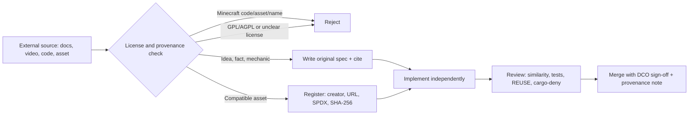

# 07 — Legal, Licensing and IP

> **Status:** draft for review · **Research date:** 2026-11-24 · **Related docs:** `docs/vision.md`, `docs/adr/0008-license-and-provenance.md`, `docs/spec/16-modding.md`, `docs/spec/18-networking-multiplayer.md`, `docs/spec/22-platforms-and-distribution.md`. This is a good-faith engineering analysis by a non-lawyer, not legal advice; obtain qualified counsel before launch, trademark filing, or responding to a claim.

## 1. Decision summary

| # | Decision | Recommendation | Reason |
|---|---|---|---|
| D1 | Code license | **Keep `MIT OR Apache-2.0`** (already in `Cargo.toml` and the vision) | Rust convention; permissive; Apache gives an express patent grant; MIT keeps GPLv2-only users compatible; no source-disclosure duty for proprietary forks, mods or hosting businesses |
| D2 | Asset license | **CC BY 4.0** for original art/audio; **CC0 1.0** for placeholders; **OFL 1.1** for fonts | Commercial use and modding allowed; attribution is cheap; avoids the share-alike and “NC/ND” traps of many asset licenses |
| D3 | Name and logo | **Trademark policy, not an open license.** Logo copyright reserved. **Public launch is gated on a name clearance search** | “OpenBlock” is already used by several software projects and a domain; a code license never grants trademark rights |
| D4 | Weft | **Ideas and numbers only; no MPL files, ever** | MPL-2.0 is file-level copyleft; a copied file stays MPL and cannot be relicensed MIT/Apache. Independent reimplementation of ideas is permitted |
| D5 | Minecraft | **No Minecraft code or assets; no Minecraft-specific names, fonts or sounds in the product; no import/conversion in v1** | Copyright, trademark and trade-dress risk; the EULA does not grant reuse rights. Feature parity is about mechanics, not Mojang’s expression |
| D6 | Contributions | **DCO 1.1, inbound = outbound `MIT OR Apache-2.0`; no CLA initially** | Lowest friction; contributors keep copyright; Apache’s patent grant flows through. A CLA is only needed if unilateral relicensing is a goal |
| D7 | Dependency policy | **`cargo-deny` + `cargo-about` + REUSE 3.3**; permit CDLA-Permissive-2.0 via a narrow exception and MPL-2.0 with source-offer notices; deny GPL/AGPL/SSPL/BUSL/Commons-Clause | Keeps the shipped binary compatible with the dual license and produces auditable notices |
| D8 | Enforcement readiness | **Evidence pack + DMCA counter-notice playbook + redundant distribution** | In 2026 even original voxel games were delisted by automated notices; a baseless claim can cost weeks |

The rest of this document records the evidence behind these decisions and the exceptions the Lead should consciously accept. Nothing here overrides advice from counsel in the relevant jurisdiction.

Confidence: high on the license texts, crate metadata and pages observed here; medium on how MPL/CC obligations apply to a specific artifact and on reported takedown outcomes; low on trademark clearance, patent risk and whether a particular visual is confusingly similar. No full transitive dependency audit or trademark search was run.

## 2. What Minecraft IP actually protects

### 2.1 Protected subject matter

| Layer | Protected? | Examples | Our rule |
|---|---|---|---|
| Code | Yes, as literary/software work | Java and Bedrock source, obfuscated jars, decompiled output, mappings, protocol implementations, server jars | Never copy, decompile, extract or import. Do not use Minecraft mappings or mod-loader code |
| Art | Yes | Block/item textures, mob and player models, skins, GUI, icons, splash text, logo, promotional art, fonts | Never copy or trace. Commission or license original art; no “faithful” recreations |
| Audio | Yes | Music, ambient loops, sound effects, villager/portal/mob sounds, voice lines | Never sample or imitate distinctive sounds; use CC0/CC BY or commissioned audio |
| Names and marks | Often, depending on use | “Minecraft”, “Mojang”, the Minecraft logo, “Creeper” name and face, Steve/Alex character designs, and other distinctive game terms | No use as product/feature/domain/namespace; original taxonomy; nominative references only where legally necessary |
| Trade dress | Sometimes | The grass-block look, Creeper face, hotbar/inventory layout, main-menu composition, the “total look and feel” | Keep a clearly different palette, silhouettes, UI grid and iconography; do not pixel-match |
| Mechanics and genre | Generally not copyrightable | Mining, placing, crafting, survival loops, voxels, chunks, day/night, mob AI | Implement freely from behaviour, not from code/assets; check patents separately |
| Facts and numbers | Not copyrightable, but source text may be | Block counts, recipe inputs, tick rates, world heights | Use facts with citation; do not copy wiki prose, tables or images |
| Compilations/databases | Possible (e.g. EU sui generis database right) | A complete block list, recipe list, advancement list, loot tables | Generate our own taxonomy and data; do not copy a vanilla registry wholesale |
| Patents | Separate from copyright | Rendering, networking, compression, audio codecs | No freedom-to-operate review yet; do one before a commercial launch |

The EULA itself is aggressive about the visual unit: it states that “a single Minecraft block (including its textures and its ‘look and feel’) - we own that” ([Minecraft EULA](https://www.minecraft.net/en-us/eula)). That is not a legal conclusion we should test. The safe reading is: **copy the mechanic, never the specific expression**.

### 2.2 What is generally not protected

- **Game rules and mechanics.** Copyright protects expression, not ideas, procedures, systems or methods of operation ([17 U.S.C. §102(b)](https://www.law.cornell.edu/uscode/text/17/102)). The [EU Software Directive](https://eur-lex.europa.eu/legal-content/EN/TXT/?uri=CELEX:32009L0024) draws a similar line. Voxel mining, crafting grids, survival hunger and block lighting are mechanics.
- **Genre and aesthetic at the concept level.** “A blocky voxel sandbox” is a genre, not a work. Minecraft itself followed *Infiniminer* (2009); Luanti’s authors make the same point in their 2026 DMCA response ([Luanti, 2026-08-27](https://blog.luanti.org/2026/08/27/luanti-dmca-tracer-ai/)).
- **Generic words.** “Stone”, “dirt”, “sand”, “water”, “coal”, “iron”, “gold”, “diamond”, “craft” and “block” are common nouns or descriptive terms. That does **not** mean a distinctive combination, logo, character or trade dress is free.
- **Short names as copyright.** Individual names are usually too short for copyright, but they can be trademarks, and a systematically copied list can attract database or unfair-competition claims. Do not rely on “it is only a name”.

### 2.3 Names, “craft”, and trade dress

- **“Minecraft” is a famous mark.** Do not put it in the product name, binary name, domain, app title, package namespace, logo, splash text or SEO keywords. The Usage Guidelines say: “You may not use the Minecraft name as the primary or dominant name or title” ([Minecraft Usage Guidelines](https://www.minecraft.net/en-us/usage-guidelines)).
- **“Craft” alone is weak and crowded** (*Warcraft*, *StarCraft*, *CraftBukkit*). “OpenBlock” does not use it, which is good. Do not add “Craft” later without clearance; a name like “OpenCraft” would share the famous mark’s distinctive suffix and invite a confusion argument.
- **Distinctive game terms are risky**: “Creeper”, “Enderman”, “Ender Dragon”, “Nether”, “Redstone”, “Netherite”, “Shulker”, “Warden”, “Steve”, “Alex”. Use original names even when the mechanic matches. Common material names (“iron”, “diamond”, “oak”) are lower risk but the full set and visual presentation must still be original.
- **Trade dress** protects a distinctive total image if it identifies source and confusion is likely ([Lanham Act §43(a)](https://www.law.cornell.edu/uscode/text/15/1125)). A voxel game is not infringing merely because it is blocky, but a grass block that reads as Minecraft’s, a Creeper-shaped mob, a copied hotbar or a near-identical main menu is exactly the kind of expression a claim would target.
- **No Minecraft screenshots, trailers, textures or music in our repo, press kit or store listing.** Capture OpenBlock itself. Do not use “Minecraft but faster” as the tagline.

## 3. Mojang’s terms in practice

### 3.1 The EULA is not an open-source license

The current [Minecraft EULA](https://www.minecraft.net/en-us/eula) says, in substance:

- You may download, install and play; for Java Edition you may install the server and host online play.
- You “must not distribute anything we’ve made” — including game software/content, modified versions, or commercial use — without permission.
- You may develop “tools, plug-ins and services” only if they “do not seem official or approved by us”, for example by not using Mojang’s logos.
- Mods must be original and must not contain “a substantial part of our copyrightable code or content”; you may distribute the mod, but **not a modded version of the game**.
- Mojang/Microsoft retain ownership of the game, its content and derivatives; player-created worlds/builds remain the player’s content.

Consequences for OpenBlock:

1. The EULA binds people who use Minecraft, not a clean-room game that ships none of it. We do not need a Minecraft license to build an original voxel game.
2. It gives us **no** right to reuse Minecraft code, textures, sounds, models, UI, fonts or world data.
3. Developers may play Minecraft to observe behaviour, but must not copy code or extract assets; do not decompile or use mappings — it is unnecessary and contaminates provenance.
4. Do not ship a “Minecraft resource-pack converter” or world importer in v1. Weft does this from a user’s local installation; that is a legal grey area and unnecessary for our MVP ([Weft README](https://github.com/Weft-Rust/Weft)).
5. Our own EULA/ToS for hosted worlds must be written from scratch; do not copy Mojang’s text.

### 3.2 The Usage Guidelines are the current brand rules

The former `account.mojang.com/documents/brand_guidelines` URL now redirects into minecraft.net; the operative public document is the [Minecraft Usage Guidelines](https://www.minecraft.net/en-us/usage-guidelines). Key rules:

- Do not suggest the product is official, approved, endorsed or associated with Mojang/Microsoft.
- Do not redistribute their games, alterations or game files.
- Do not make commercial use of their name, brand or assets except as the guidelines permit.
- If you use their name/brand/assets, prominently include a disclaimer like: **“NOT AN OFFICIAL MINECRAFT [PRODUCT/SERVICE/EVENT/etc.]. NOT APPROVED BY OR ASSOCIATED WITH MOJANG OR MICROSOFT.”**
- Use “Minecraft” only as a secondary, descriptive reference — never as the dominant name or title, logo or a keyword for an unrelated or infringing product. Do not use their logos, fonts or other brand elements.
- The guidelines are discretionary, revocable and change over time; they are not a license to build a competing game with Mojang’s expression.

**Our line:** use “Minecraft” only in a factual non-affiliation disclaimer and, sparingly, in internal research prose. Public store copy says “voxel sandbox”, not “Minecraft clone”. No Minecraft logo, font, screenshot or character.

### 3.3 Operating rules for an open-source clone

1. **Original code.** No Minecraft jars, decompiled classes, mappings, mod-loader code, Bukkit/Spigot/Paper code, or copied protocol implementations.
2. **Original assets.** Every texture, model, sound, music track, font and icon is commissioned, CC0, CC BY 4.0, or OFL; no rips, no “found on Google”, no traced Minecraft art.
3. **Original names.** A naming guide forbids Minecraft-specific proper nouns and requires legal review for new proper nouns.
4. **No compatibility promises in v1.** Custom protocol, custom save format, no Minecraft client/server interoperability, no resource-pack/world import.
5. **No Minecraft Wiki text.** The current wiki is **CC BY-NC-SA 3.0** ([minecraft.wiki](https://minecraft.wiki/)); its prose, tables and images cannot be imported into a commercially usable MIT/Apache repo. Facts and counts may be cited; generate registry data from dumps under their own licenses.
6. **No AI lookalikes.** Do not prompt an image/audio model to produce “Minecraft-style” assets, textures, mobs or sounds. Record tool, prompt scope and human review.
7. **No contributor contamination.** A contributor who has read decompiled Minecraft code or proprietary mod code must disclose it and recuse from the corresponding feature.
8. **Evidence.** Keep the provenance log, asset register, license texts, commit history and an off-site evidence pack.

## 4. Clone history and enforcement

| Project | License | Lesson |
|---|---|---|
| **Minetest / Luanti** | Engine LGPL-2.1+; media CC BY-SA 3.0/4.0 ([LICENSE](https://github.com/luanti-org/luanti/blob/master/LICENSE.txt)) | A 2010 Minecraft-inspired engine can mature into an independent platform, but the name and early identity followed it for years; renamed to Luanti in 2024 to shed the “Minecraft clone” framing ([rename post](https://blog.luanti.org/2024/10/13/Introducing-Our-New-Name/)). Its app was still hit by a Minecraft copyright DMCA in 2023 and 2026. Coexistence is not a license. |
| **Terasology** | Apache-2.0 code; CC BY 4.0 artwork ([repo](https://github.com/MovingBlocks/Terasology)) | A long-lived, original-art, permissively licensed voxel project. Permissive code plus CC BY art is workable. |
| **Craft** | MIT ([repo](https://github.com/fogleman/Craft)) | A deliberately small “Minecraft clone” in C. No reported takedown, but that is not a legal safe harbour. |
| **Veloren** | GPL-3.0 code; CC BY-SA 4.0 art ([repo](https://github.com/Veloren/Veloren)) | A GPL voxel RPG with original assets; not a Minecraft clone. Shows a strong-copyleft/CC BY-SA ecosystem can work, but it is not our adoption strategy. |
| **ClassiCube** | BSD-3-Clause ([repo](https://github.com/ClassiCube/ClassiCube), [license](https://github.com/ClassiCube/ClassiCube/blob/master/license.txt)) | A Minecraft Classic-compatible client built with a stated clean-room approach; it downloads required assets at first run instead of shipping them. Clean-room discipline plus no asset distribution is the pattern to study — but we should not build a runtime Minecraft asset downloader. |
| **Weft** | MPL-2.0 ([repo](https://github.com/Weft-Rust/Weft)) | A from-scratch Rust voxel engine with its own textures and a README claim of “no Minecraft code or assets”. Its optional conversion of a user’s Minecraft install into a resource pack is a risk we should not copy. |
| **CraftBukkit** | GPL/LGPL, but contained proprietary Mojang code | A contributor DMCA in September 2014 shut the project down; Spigot rebuilt with a CLA and build tooling ([Minecraft server history](https://en.wikipedia.org/wiki/Minecraft_server)). One contributor's DMCA was enough to take down a whole ecosystem. Provenance is not paperwork. |

### 4.1 2026 enforcement timeline

| Date | Event | Duration / outcome |
|---|---|---|
| 2014-09-05 | CraftBukkit DMCA by a contributor over proprietary Mojang code | Project effectively shut down; Spigot migrated and added a CLA |
| 2023-03 | Luanti Android app hit by a DMCA from the same brand-protection vendor later used by Microsoft | **46 days** to reinstatement after counter-notice |
| 2026-01/02 | *Allumeria*, an indie voxel sandbox, removed from Steam after a Microsoft DMCA | Withdrawn after public pressure; developer reported no counter-claim needed ([PC Gamer](https://www.pcgamer.com/games/survival-crafting/i-genuinely-do-not-know-what-to-do-says-developer-of-minecraft-like-allumeria-after-microsoft-issues-a-dmca-takedown-forcing-it-off-steam/)) |
| 2026-08-27 | Luanti app removed from Google Play by a Microsoft/Tracer.AI DMCA citing Minecraft copyright registration **TX 8-192-097** | Notice rescinded **2026-09-08**; app reinstated ([Luanti post](https://blog.luanti.org/2026/08/27/luanti-dmca-tracer-ai/), [update](https://blog.luanti.org/2026/09/08/dmca-rescinded/)) |
| Statutory | US DMCA counter-notice replacement window | **10–14 business days** after receipt, unless the claimant files suit ([17 U.S.C. §512(g)(2)(C)](https://www.law.cornell.edu/uscode/text/17/512)) |

The Luanti notice cited the US copyright registration for *Minecraft Java Edition 1.9* but did not identify specific copied assets ([Copyright Office record](https://publicrecords.copyright.gov/detailed-record/voyager_28402120)). That is the signature of automated brand-protection notices: vague, cheap to file, expensive to fight.

### 4.2 What the record supports

- We found **no reported judgment** holding that voxel mining/crafting mechanics alone infringe. Enforcement we found targets copied code/assets, confusing names, or automated notices; this is a research observation, not a legal conclusion.
- A clean-room, original-asset game is the right side of the line, but **being right does not prevent a takedown**. Budget for the process, not only the merits.
- App stores and Steam are single points of failure. Direct downloads, GitHub Releases, itch.io and F-Droid-style channels are resilience, not just distribution strategy.
- The risk is higher once money is involved: commercial use attracts more scrutiny, and the Usage Guidelines’ fan permissions explicitly do not authorise commercial companies to exploit Minecraft.

DMCA response, in order: preserve the notice, timestamp and listing snapshot; compare the claim to the asset register and commit history and identify the specific work (or state that none is present); if baseless, file a counter-notice with the statutory elements and publish a short factual statement; if valid, remove or replace the material, root-cause it and notify users; keep the evidence pack off-site and switch to direct downloads while the listing is down.

## 5. Clean room, provenance, and how to document it



“Clean room” is evidence of independent creation, not a license and not a complete defence. For a game, the highest-risk expression is **art, audio, names and UI**, not engine code; asset hygiene matters more than a dramatic code wall. Use the lightest process that produces evidence:

| Level | When | Evidence |
|---|---|---|
| L0 — asset-clean | Always | Every asset has a source, license and SHA-256; no Minecraft/ripped assets |
| L1 — spec-first | Every parity feature | A spec written in our words from public behaviour; code written from the spec and tests, not from a reference implementation |
| L2 — source-wall | High-risk features (worldgen, UI, models, networking) | The implementer did not read the corresponding Minecraft/Weft source; if they did, a second reviewer checks for similarity |
| L3 — full clean room | A specific claim or an unusually risky feature | Separate spec and implementation contributors, documented access controls; overkill for most of the game |

### 5.1 Repository artifacts

| Path | Purpose |
|---|---|
| `docs/legal/README.md` | Index, scope, “not legal advice” notice |
| `docs/legal/clean-room-policy.md` | The rules above, roles, disclosure and escalation |
| `docs/legal/provenance-log.md` | Every external source: URL/commit, date, license, what was learned, copied? reviewer |
| `docs/legal/asset-register.tsv` | `path`, `sha256`, `creator`, `source_url`, `license`, `modifications`, `evidence_url`, `reviewer` |
| `docs/legal/dmca-playbook.md` | Preserve, verify, counter-notice, communicate, restore, root-cause |
| `docs/legal/name-clearance.md` | Search results, counsel opinion, decision, fallback names |
| `docs/legal/third-party-texts.md` | URLs, versions and access dates for EULA, guidelines, CC/OFL/MPL texts |
| `.github/pull_request_template.md` | Provenance/DCO/asset checkboxes |

The provenance log is not a vibe log. It is a table with one row per source and a reviewer. Example:

```markdown
| Date | Source | License | Used | Copied? | Reviewer |
|---|---|---|---|---|---|
| 2026-11-24 | Weft README + docs (github.com/Weft-Rust/Weft) | MPL-2.0 | section-size trade-offs, palette concept | no | @lead |
| 2026-11-24 | Minecraft Usage Guidelines | proprietary terms | brand rules, disclaimer wording | no | @legal-reviewer |
| 2026-11-24 | minecraft.wiki (facts only) | CC BY-NC-SA 3.0 | block counts, version numbers | no prose/images | @research |
```

PR template additions:

```markdown
- [ ] I have read `docs/legal/clean-room-policy.md`.
- [ ] No copied Minecraft, Weft, Luanti, Veloren or other code/assets; no decompiled output.
- [ ] I license this contribution under MIT OR Apache-2.0 and sign off (DCO).
- [ ] New assets have a `.license` sidecar and an `asset-register.tsv` row.
- [ ] AI assistance (tool/model/prompt scope) is disclosed; I reviewed the output for similarity.
```

### 5.2 Weft-specific provenance

Weft is MPL-2.0, so reading it is permitted; **copying expression is not permitted under our policy**. The practical rules are in §6. The existing Weft teardown (`docs/research/01-weft-teardown.md`) is the model: paraphrase, cite, do not reproduce code, comments, WGSL, tables or doc prose. Do not copy Weft’s `assets/minecraft.txt` mappings, base asset tree or generated tables. If a Weft file is ever vendored, it must stay MPL-2.0 with source available; the project policy should be “no MPL files, ever” to keep the audit trivial.

## 6. Weft and MPL-2.0

MPL-2.0 is a **file-level copyleft** license: the copyleft applies to files containing MPL code, not to new files in a larger work ([MPL FAQ Q11–Q12](https://www.mozilla.org/en-US/MPL/2.0/FAQ/)). The license grants copyright and patent rights, but **not trademark rights** ([MPL §2.3](https://www.mozilla.org/media/MPL/2.0/index.txt)).

| Action | MPL-2.0 permits? | Obligation / our policy |
|---|---|---|
| Read Weft to learn ideas, numbers, trade-offs | Yes | None; record the source in the provenance log |
| Independently reimplement an idea | Yes | Ideas are not protected; do not copy structure, identifiers, comments or doc text |
| Copy a Weft source file into OpenBlock | Yes, technically | The copied file remains MPL-2.0; keep notices; make source available; **our policy forbids it** |
| Modify a Weft file | Yes | Modifications must be MPL-2.0; source available; notices preserved; **forbidden** |
| Link/combine Weft code with our code | Yes | Larger work may be under other terms; MPL files stay MPL; binary distribution must offer source for those files |
| Use Weft’s name/logo | No trademark license | Nominative reference only; no endorsement claim |
| Patent | Grant for contributors’ contributions; terminates on patent aggression | Independent code gets no Weft patent license; no known patent issue, but not a clearance |

**Policy:** no MPL file enters the repo. If we ever need one, add `LICENSES/MPL-2.0.txt`, a file header, a `THIRD-PARTY-NOTICES` entry and a source offer; the blanket `MIT OR Apache-2.0` claim would no longer be accurate for that file. Weft does not attach the Exhibit B notice, so its MPL is not “Incompatible With Secondary Licenses”; that matters if someone combines it with GPL code, not for our dual license.

Weft facts relevant to us:

- README: “Weft is not a Minecraft clone and does not read Minecraft worlds; it plays like one and borrows its numbers where that makes sense.” It also says: “Weft contains no Minecraft code or assets.” We treat that as the author’s statement, not an audited legal opinion.
- Weft ships its own textures, but can build a resource pack from a user’s local Minecraft installation. **Do not copy that feature.** It is a legal grey area, creates Minecraft-derived artifacts on user machines, and is not needed for OpenBlock.
- Weft’s AI policy says “No Mojang assets, generated look-alikes of them included.” That is a good rule to adopt in our CONTRIBUTING.
- Weft’s MPL license does not grant rights to its name or logo; use “Weft” only descriptively in research docs.

## 7. License choice

### 7.1 Code: `MIT OR Apache-2.0`

| License | Copyleft scope | Proprietary mods | Commercial hosting | Patent grant | Source disclosure | Fit |
|---|---|---|---|---|---|---|
| **MIT OR Apache-2.0** | None | Yes | Yes | Apache: yes; MIT: no | No | **Recommended** |
| MPL-2.0 | Files containing MPL code | Yes, separate files | Yes | Yes | Modified MPL files, source offer for binaries | Viable if we want engine improvements shared; not now |
| GPL-3.0 | Derivative works | Likely no for linked mods | Yes (no network clause) | Yes | Whole derivative | No |
| AGPL-3.0 | Derivative + network use | No | Modified server source to users | Yes | Whole modified server | No; deters hosting businesses |
| LGPL-3.0 | Library | Possible with dynamic linking | Yes | Yes | Library modifications | Poor fit for statically linked Rust |
| Apache-2.0 only | None | Yes | Yes | Yes | No | GPLv2-incompatible; dual MIT avoids that |

**Recommendation: keep the dual license.** It matches Rust convention ([Rust licenses](https://www.rust-lang.org/policies/licenses)), gives users a patent grant if they choose Apache, and keeps GPLv2-only projects able to take the MIT branch. It maximises modding and hosting adoption. The cost is that a competitor may fork OpenBlock closed; accept that, and compete on execution, content and hosting, not on code exclusivity. If the Lead later wants a copyleft moat, **MPL-2.0 is the least disruptive alternative**; GPL/AGPL would contradict the “self-hostable, mod-friendly” pitch.

### 7.2 Assets: CC BY 4.0 for core, CC0 for placeholders, OFL for fonts

| License | Attribution | Commercial | Derivatives | Modding/proprietary packs | Fit |
|---|---|---|---|---|---|
| **CC BY 4.0** | Yes | Yes | Yes | Yes, with credit | **Recommended for original core art/audio** |
| CC0 1.0 | No | Yes | Yes | Yes | Placeholders, programmer art, test fixtures |
| CC BY-SA 4.0 | Yes | Yes | Share-alike on adapted assets | Possible friction with proprietary texture packs | Optional separate “community commons” pack |
| CC BY-NC 4.0 | Yes | **No** | Yes | No | Forbidden |
| CC BY-ND 4.0 | Yes | Yes | **No** | No | Forbidden |
| “Royalty-free” stock | Varies | Varies | Often restricted | Often restricted | Legal review; avoid if it forbids redistribution in a game |

**Recommendation:** CC BY 4.0 for the core game’s original art, music and sound; CC0 for placeholders and test assets; OFL 1.1 for fonts; CC BY 4.0 for documentation prose, with code blocks in docs dual-licensed MIT/Apache. CC BY-SA 4.0 is a defensible choice for a fully commons asset pack, but it is a separate product decision: share-alike can complicate proprietary texture packs, DLC and commissioned assets. Never use NC or ND assets in a game that may accept donations, sell cosmetics or be hosted commercially.

### 7.3 Name and logo: trademark policy

- **Word mark and logo are trademarks of the project owner**, not licensed by MIT/Apache. Apache-2.0 §6 expressly withholds trademark rights; MIT grants only copyright permissions, so it grants no trademark license either. A separate `TRADEMARK.md` is required.
- **Permitted:** nominative references (“OpenBlock is a voxel sandbox”), unmodified redistribution of official builds with the name/logo, community servers and mod descriptions, tutorials and reviews, with a clear non-affiliation statement.
- **Not permitted without written permission:** modified forks using the name/logo, domain names, company/product names, merchandise, altered/combined logos, anything implying “official”, “certified” or “partner”.
- **Forks** must rename and re-logo. Publish a fork kit later (name policy, logo replacement, package rename) to make compliance easy.
- **Use ™, not ®,** until a registration issues. Do not claim registration.
- **Logo copyright:** all rights reserved, with limited permission in `TRADEMARK.md`; do **not** put the logo under CC BY, because that would grant a broad copyright license that undercuts the trademark policy.
- **Clearance red flag:** “OpenBlock” is descriptive (open + block) and crowded. Existing uses do not prove infringement, but they weaken scope, may support a descriptiveness refusal, and make confusion more likely. The GitHub handle `openblock` is also taken.

### 7.4 Mods, hosting, and the commercial door

- Mods own their code and may be any license, including proprietary. The official SDK/API crates are MIT/Apache; mods link to a permissive engine, so no copyleft spreads. If we chose GPL for the engine, native mods could be argued to be derivatives; another reason to stay permissive.
- We treat WASM mods as separate works; the sandbox is a security boundary, not a license boundary. Content packs are separate assets with their own licenses. A mod portal should require a license field and run a DMCA process.
- Hosting businesses may run, modify and charge for OpenBlock under MIT/Apache, keeping their changes private. That is compatible with “self-hostable multiplayer dedicated servers”; it is not “open core”.
- If we later want a certification/partner programme, use a trademark license, not a code license. Do not promise exclusivity we cannot enforce.
- Add server-operator privacy guidance: IPs, logs, account identifiers and chat are personal data in many jurisdictions; provide retention controls and a privacy-policy template before running an official service.

## 8. Asset and dependency licensing hygiene

### 8.1 Asset sourcing

| Source | Rule |
|---|---|
| CC0 packs (Kenney, Poly Haven, ambientCG, Quaternius) | Preferred for placeholders; still record source URL, author, SHA-256 and any third-party marks |
| CC BY 4.0 assets | Allowed with attribution in `CREDITS.md`/about screen; keep license text and URL |
| Commissioned art/audio | Written agreement: assignment or exclusive license, right to modify/sublicense/distribute, source files, moral-rights waiver where available, indemnity, delivery date, credit |
| Fonts | OFL 1.1; bundle `OFL.txt`; do not use the Minecraft font; if modifying a font with Reserved Font Names, rename it |
| Music/SFX | CC0/CC BY or commissioned; avoid “royalty-free” libraries that forbid redistribution in a game; prefer Opus/Vorbis/FLAC; check codec patent and license terms before shipping AAC |
| Models | glTF/Blockbench `.geo.json` formats are fine; using GPL Blockbench to author does not GPL the output, but bundling Blockbench code or its bundled Minecraft templates would; do not copy Minecraft models |
| Icons/UI | Original or CC0/CC BY; do not imitate Minecraft’s hotbar, hearts, inventory or logo |
| AI-generated | Disclose tool/model/prompt scope; human review; no “Minecraft-style” prompts or lookalikes; generator terms may not give clean copyright; treat as higher-risk |
| Minecraft Wiki | **CC BY-NC-SA 3.0**; facts/numbers only, no prose, tables or images. Do not paste wiki text into MIT/Apache docs |
| Registry dumps (mcmeta, minecraft-data) | Third-party data with their own licenses; check each, attribute, and prefer generated facts over copied prose |

`docs/legal/asset-register.tsv` is the gate: no asset enters `assets/` without a row and a `.license` sidecar. For commissioned work, store the contract and the layered source files outside the repo; the repo gets the license metadata, not the contract PDFs with personal data.

### 8.2 Rust crates: versions and licenses

Verified against crates.io on 2026-11-24. License fields are self-reported metadata, not a legal audit; transitive dependencies can differ. “Allowed” means the current `deny.toml` allow-list accepts it, not that every obligation is satisfied.

| Crate | Version | License | Status / action |
|---|---|---|---|
| `wgpu` | 30.0.2 | MIT OR Apache-2.0 | Allowed |
| `winit` | 0.30.13 | Apache-2.0 | Allowed; Apache-only, include license/notices |
| `glam` | 0.34.3 | MIT OR Apache-2.0 | Allowed |
| `quinn` | 0.11.12 | MIT OR Apache-2.0 | Allowed |
| `iroh` | 1.5.0 | MIT OR Apache-2.0 | Allowed, but large; `iroh-relay` pulls `webpki-roots` (CDLA) — see below |
| `wasmtime` | 51.0.0 | Apache-2.0 WITH LLVM-exception | Allowed; include exception text |
| `wasmi` | 2.0.2 | MIT OR Apache-2.0 | Allowed; lighter interpreter alternative |
| `valence` | 0.1.0+mc1.19.2 | MIT | Allowed, but stale (Aug 2023) and Minecraft-protocol-adjacent; not recommended |
| `ash` | 0.38.0+1.3.281 | MIT OR Apache-2.0 | Allowed, but Vulkan-only; unnecessary with wgpu |
| `zstd` | 0.14.4 | BSD-3-Clause | Allowed; include BSD text; bundled C via `zstd-sys` (BSD-3 AND BSD-2) |
| `rayon` | 1.12.0 | MIT OR Apache-2.0 | Allowed |
| `naga` | 30.0.2 | MIT OR Apache-2.0 | Allowed |
| `bevy` | 0.20.1 | MIT OR Apache-2.0 | Allowed, but not used; framework choice is separate |
| `image` | 0.25.10 | MIT OR Apache-2.0 | Allowed; avoid optional AVIF codecs unless reviewed |
| `rodio` | 0.23.0 | MIT OR Apache-2.0 | Allowed; if `symphonia` is enabled, see MPL note |
| `cpal` | 0.18.2 | Apache-2.0 | Allowed; Apache-only, include license |
| `rustls` | 0.23.46 | Apache-2.0 OR ISC OR MIT | Allowed |
| `webpki-roots` | 1.0.12 | **CDLA-Permissive-2.0** | **Not in current allow-list**; add it or avoid the dependency |
| `ring` | 0.17.14 | Apache-2.0 AND ISC | Allowed; metadata may be incomplete for bundled code; review notices |
| `aws-lc-rs` | 1.19.0 | ISC AND (Apache-2.0 OR ISC) | Allowed; large C/assembly build; review notices, prefer `ring` if it works |
| `symphonia` | 0.6.1 | **MPL-2.0** | Allowed but file-level copyleft; if shipped, provide MPL source offer and notices |
| `zstd-sys` | 2.1.3+zstd.1.5.7 | BSD-3-Clause AND BSD-2-Clause | Allowed; include both texts |
| `unicode-ident` | 1.0.27 | (MIT OR Apache-2.0) AND Unicode-3.0 | Allowed; Unicode notice |
| `cargo-deny` | 0.22.0 | MIT OR Apache-2.0 | Tool; pin version in CI |
| `cargo-about` | 0.9.3 | MIT OR Apache-2.0 | Tool; use it to generate notices |

Two concrete flags:

1. **`iroh` → `iroh-relay` → `webpki-roots`.** `iroh-relay 1.4.2` declares `webpki-roots ^1.0.3` as a non-optional dependency; `webpki-roots 1.0.12` is CDLA-Permissive-2.0. The current `deny.toml` does not allow CDLA, so enabling `iroh` will fail `cargo deny check licenses` until we add it and ship the CDLA text. CDLA is permissive (no copyleft), but requires making the agreement text available with shared data ([CDLA-Permissive-2.0](https://spdx.org/licenses/CDLA-Permissive-2.0.html)). If we use `quinn` directly, we can avoid this tree.
2. **`symphonia` is MPL-2.0.** It is compatible with our code license, but shipping a binary that includes it triggers MPL source-availability and notice duties for the MPL files. Either ship a source offer in `THIRD-PARTY-NOTICES.md` (crate name, version, repository, how to obtain source) or avoid it by using permissive decoders where they meet quality needs.

Also note: `winit`, `cpal`, `hound` and some other crates are **Apache-2.0 only**. That is fine, but the Apache license text and any `NOTICE` file must be included. `ring` and `aws-lc-rs` are composite cryptography licenses; `cargo-deny` accepts the SPDX expressions, but a manual notice review is still required.

### 8.3 `cargo-deny` policy

The repository already has a `deny.toml` with a sensible allow-list (`MIT`, `Apache-2.0`, `Apache-2.0 WITH LLVM-exception`, BSD, ISC, Zlib, Unicode-3.0, MPL-2.0, CC0-1.0, OFL-1.1, BSL-1.0), `yanked = "deny"`, crates.io-only sources and a `wildcards = "deny"` ban. Keep that. Recommended changes:

```toml
[licenses]
# Reject a stale allow-list entry rather than letting it hide a future change.
unused-allowed-license = "warn"
confidence-threshold = 0.95
allow = [
  "MIT", "Apache-2.0", "Apache-2.0 WITH LLVM-exception",
  "BSD-2-Clause", "BSD-3-Clause", "ISC", "Zlib",
  "Unicode-3.0", "MPL-2.0", "CC0-1.0", "OFL-1.1", "BSL-1.0",
]

[[licenses.exceptions]]
allow = ["CDLA-Permissive-2.0"]
name = "webpki-roots"
```

- Add the CDLA exception only when a dependency actually needs it; if `iroh` is dropped, remove it and let `unused-allowed-license` tell us. Use the exception rather than a global allow so a future CDLA crate still gets scrutiny.
- Keep `MPL-2.0` allowed only because unmodified MPL dependencies are acceptable; if we ever vendor/patch one, the source-offer process in §8.4 is mandatory.
- Do **not** allow `GPL-*`, `AGPL-*`, `SSPL-*`, `BUSL-*`, `Elastic-2.0` or `Commons-Clause` globally. If a crate is dual `MIT OR GPL-3.0`, the MIT branch is fine; if it is GPL-only, find another crate.
- Run `cargo deny check` in CI (already configured) and add `cargo about generate` plus `reuse lint`. `cargo-deny` checks licenses, not asset licenses and not notice completeness.

### 8.4 Notices and release gate

The release artifact must contain:

- `LICENSE-MIT` and `LICENSE-APACHE` for our code; `LICENSES/` with SPDX texts for every license in the dependency graph.
- `THIRD-PARTY-NOTICES.md` generated from the **locked** graph: crate, version, license, repository, license text; include CDLA, MPL source offer, BSD, Apache and Unicode notices.
- Attribution for CC BY assets (`CREDITS.md` or an in-game about screen), OFL font licenses, and any `NOTICE` files from dependencies.
- The MPL source offer (if any MPL crate is shipped): where to get the exact source, and the fact that it is MPL-2.0.
- The same notices in the installer/about screen, container image and server distribution; app-store metadata is not a substitute.

Release gate: `cargo deny check` + `cargo about` diff + `reuse lint` + asset-register check + no-Minecraft-asset review. Block the tag on failure.

## 9. Contributors, governance, and the mod API

### 9.1 DCO vs CLA

| | DCO 1.1 | CLA |
|---|---|---|
| Contributor friction | Low: `git commit -s` | Higher: sign a form, sometimes corporate approval |
| Copyright | Contributor retains | Retained or assigned, depending on CLA |
| Relicensing | Only under the project license; a later license change needs contributor permission | Broad grant can allow relicensing/commercial licensing |
| Patent | Apache-2.0 contribution includes a patent grant | Can be explicit |
| Corporate contributors | Usually acceptable | Often required by employers |
| Recommended | **Yes, now** | Only if unilateral relicensing or a commercial license is a real goal |

Use the [DCO 1.1](https://developercertificate.org/) text, require `Signed-off-by`, and state in `CONTRIBUTING.md` that contributions are licensed inbound under `MIT OR Apache-2.0`. DCO certifies provenance, not ownership and not a relicensing right. If the Lead wants the option to move to MPL/GPL or sell a proprietary license later, adopt a lightweight CLA **before** accepting contributions; retrofitting is painful. This is an open question, not a default.

### 9.2 Files the repo must have

| File | Status | Notes |
|---|---|---|
| `LICENSE-MIT`, `LICENSE-APACHE` | Present | Keep; add SPDX headers to source files |
| `CONTRIBUTING.md` | Present | Add DCO sign-off, provenance/asset rules, AI policy |
| `CODE_OF_CONDUCT.md` | Present | Add version URL, license/attribution, scope and a dedicated contact; do not assume a CC license for the text without checking |
| `SECURITY.md` | Present | Good; add a legal-contact path for vulnerability reports that become IP claims |
| `MAINTAINERS.md` | Present | Add a trademark/legal steward and release-signing owner |
| `GOVERNANCE.md` | Missing | Roles, lazy consensus, DEC process, conflicts of interest, trademark and moderation authority |
| `TRADEMARK.md` | Missing | Word mark/logo policy; ™ usage; fork rename rule; contact |
| `THIRD-PARTY-NOTICES.md` | Missing | Generated; release-blocking |
| `LICENSES/`, `REUSE.toml` | Missing | REUSE 3.3; `reuse lint` in CI |
| `README.md` disclaimer | Missing | Add the wording in §10 |
| `docs/legal/*` | Missing | Clean-room, provenance, asset register, DMCA playbook, name clearance |

### 9.3 Mod API and hosting

- State explicitly in `docs/spec/16-modding.md`: **mods do not have to be open source.** The SDK/ABI crates are MIT/Apache; mods and content packs carry their own licenses. The mod portal must expose a license field, a source URL when available, and a DMCA/takedown process.
- Do not require a CLA from mod authors. Do not claim ownership of mods. Do not bundle Minecraft assets in the SDK or examples.
- Native plugins are trusted code; the permissive engine license means no copyleft obligation, but the sandbox/consent policy still applies.
- Hosting is allowed and encouraged. A hosting provider may say “runs OpenBlock”; it may not say “OpenBlock Official Hosting” without a trademark license. Publish a one-page hosting guide covering attribution, privacy and no-Minecraft-assets.
- If we run an official server or mod portal, register a DMCA designated agent (US), publish a privacy policy, and provide a data-retention/export path. Those are operator duties, not code-license duties.

## 10. Pre-publication checklist

### P0 — blocks publication

- [ ] **Name:** commission a knockout search for “OpenBlock” in USPTO classes 9/41/42, EUIPO, UKIPO and common-law use; decide keep/rename. Do not buy the domain, logo or merchandise first.
- [ ] **README disclaimer:** add the non-affiliation paragraph and the uppercase store disclaimer; no Minecraft logo/screenshot/font.
- [ ] **Licenses:** `Cargo.toml` `license = "MIT OR Apache-2.0"`, `LICENSE-MIT`, `LICENSE-APACHE`, SPDX headers, `LICENSES/` (MIT, Apache-2.0, CC-BY-4.0, OFL-1.1 as used).
- [ ] **Trademark:** `TRADEMARK.md`, logo copyright notice, fork rename rule, ™ usage.
- [ ] **Provenance:** `docs/legal/clean-room-policy.md`, `provenance-log.md`, `asset-register.tsv`, `dmca-playbook.md`.
- [ ] **No Minecraft/Weft code or assets:** audit `git log`, `assets/`, docs, tests and build scripts; no `.jar`, decompiled output, mappings or wiki prose.
- [ ] **Dependency notices:** `THIRD-PARTY-NOTICES.md` from the lockfile; `cargo deny check` passes; CDLA/MPL/BSD/Apache texts present.
- [ ] **Contributor terms:** DCO sign-off, inbound dual license, AI/provenance attestation, PR template.

### P1 — before the first commercial or app-store release

- [ ] `reuse lint` in CI; every binary asset has a `.license` sidecar.
- [ ] Commissioned-art contracts and layered source files; OFL font licenses; music/SFX licenses.
- [ ] Similarity review: compare screenshots, palette, UI, names and audio against Minecraft; document differences.
- [ ] Store listings: no “Minecraft” in title/tags; no Minecraft screenshots; disclaimer visible.
- [ ] DMCA evidence pack stored off-site; counter-notice template; direct-download fallback.
- [ ] Trademark application after clearance; legal entity/insurance decision before revenue.
- [ ] Patent/freedom-to-operate review before a commercial launch (rendering, networking, audio codecs).
- [ ] Privacy policy and data-retention settings for any official server or mod portal.

### README wording

```markdown
OpenBlock is an independent, open-source voxel sandbox game. It is not an
official Minecraft product and is not approved by or associated with Mojang
Studios or Microsoft. "Minecraft" and related marks are trademarks of Mojang
Studios or its affiliates. OpenBlock contains no Minecraft code, assets, or
other proprietary content.

Third-party licenses and credits are listed in THIRD-PARTY-NOTICES.md and
CREDITS.md.
```

For app stores, add the exact uppercase line where the guidelines require it:

> NOT AN OFFICIAL MINECRAFT PRODUCT. NOT APPROVED BY OR ASSOCIATED WITH MOJANG OR MICROSOFT.

## 11. Open questions for the Lead

1. **Name:** keep “OpenBlock” or rename? Existing uses include `openblocks-dev/openblocks` (6.2k stars), `openblockcc/openblock-desktop` (block programming), `OpenMods/OpenBlocks` (a Minecraft mod) and `openblock.com` (a blockchain platform). Owner: Lead / MS-00.
2. **Code license:** confirm `MIT OR Apache-2.0`, or choose MPL-2.0 for the engine? This changes contributor expectations, notices and the modding story. Owner: Lead / ADR-0008.
3. **Asset license:** CC BY 4.0 for the core, or CC BY-SA 4.0 for a stronger commons? Who funds commissioned art and under what contract? Owner: Art / MS-15.
4. **Relicensing:** DCO forever, or a CLA to preserve the option of a future license change or commercial license? Owner: Lead.
5. **Minecraft compatibility:** confirm no protocol, world or resource-pack import in v1. If any is wanted, scope a legal review first. Owner: MS-17/MS-18.
6. **Trademark/entity:** who owns the mark, who signs filings, and do we form an entity before revenue? Owner: Lead.
7. **AI assets:** allowed with disclosure, or banned for art/audio? If allowed, what review proves no Minecraft lookalikes? Owner: Art / Legal.
8. **Hosted content:** will we run an official mod portal or server? If yes, who is the DMCA agent and privacy owner? Owner: MS-19/MS-20.

## 12. Sources

All URLs accessed 2026-11-24 unless noted. License metadata from crates.io is self-reported and was not independently audited.

- [Minecraft End User License Agreement](https://www.minecraft.net/en-us/eula)
- [Minecraft Usage Guidelines](https://www.minecraft.net/en-us/usage-guidelines)
- [Former Mojang Brand Guidelines URL](https://account.mojang.com/documents/brand_guidelines) — now redirects; the Usage Guidelines are the current public rules
- [17 U.S.C. §102 — subject matter of copyright](https://www.law.cornell.edu/uscode/text/17/102)
- [17 U.S.C. §512 — DMCA notice and counter-notice](https://www.law.cornell.edu/uscode/text/17/512)
- [Mozilla Public License 2.0](https://www.mozilla.org/media/MPL/2.0/index.txt)
- [MPL 2.0 FAQ](https://www.mozilla.org/en-US/MPL/2.0/FAQ/)
- [Choose a License: MIT](https://choosealicense.com/licenses/mit/)
- [Choose a License: Apache-2.0](https://choosealicense.com/licenses/apache-2.0/)
- [Choose a License: MPL-2.0](https://choosealicense.com/licenses/mpl-2.0/)
- [Choose a License: GPL-3.0](https://choosealicense.com/licenses/gpl-3.0/)
- [Choose a License: AGPL-3.0](https://choosealicense.com/licenses/agpl-3.0/)
- [Rust project licenses](https://www.rust-lang.org/policies/licenses)
- [Developer Certificate of Origin 1.1](https://developercertificate.org/)
- [REUSE Specification 3.3](https://reuse.software/spec-3.3/)
- [cargo-deny license configuration](https://embarkstudios.github.io/cargo-deny/checks/licenses/cfg.html)
- [cargo-about](https://github.com/EmbarkStudios/cargo-about)
- [SPDX: CDLA-Permissive-2.0](https://spdx.org/licenses/CDLA-Permissive-2.0.html)
- [EU Software Directive 2009/24/EC](https://eur-lex.europa.eu/legal-content/EN/TXT/?uri=CELEX:32009L0024)
- [Lanham Act §43(a), 15 U.S.C. §1125](https://www.law.cornell.edu/uscode/text/15/1125)
- [Creative Commons CC0 1.0](https://creativecommons.org/publicdomain/zero/1.0/)
- [Creative Commons BY 4.0](https://creativecommons.org/licenses/by/4.0/)
- [Creative Commons BY-SA 4.0](https://creativecommons.org/licenses/by-sa/4.0/)
- [SIL Open Font License 1.1](https://openfontlicense.org/)
- [Contributor Covenant 2.1](https://www.contributor-covenant.org/version/2/1/code_of_conduct/)
- [Minecraft Wiki](https://minecraft.wiki/) — content licensed CC BY-NC-SA 3.0
- [Luanti: DMCA notice (2026-08-27)](https://blog.luanti.org/2026/08/27/luanti-dmca-tracer-ai/)
- [Luanti: DMCA rescinded (2026-09-08)](https://blog.luanti.org/2026/09/08/dmca-rescinded/)
- [Luanti: new name (2024-10-13)](https://blog.luanti.org/2024/10/13/Introducing-Our-New-Name/)
- [PC Gamer: Allumeria DMCA](https://www.pcgamer.com/games/survival-crafting/i-genuinely-do-not-know-what-to-do-says-developer-of-minecraft-like-allumeria-after-microsoft-issues-a-dmca-takedown-forcing-it-off-steam/)
- [Minecraft server / Bukkit history](https://en.wikipedia.org/wiki/Minecraft_server)
- [U.S. Copyright Office record cited by the Luanti notice](https://publicrecords.copyright.gov/detailed-record/voyager_28402120)
- [Luanti repository](https://github.com/luanti-org/luanti)
- [Luanti media license](https://github.com/luanti-org/luanti/blob/master/LICENSE.txt)
- [Terasology repository](https://github.com/MovingBlocks/Terasology)
- [Craft repository](https://github.com/fogleman/Craft)
- [Veloren repository](https://github.com/Veloren/Veloren)
- [ClassiCube repository](https://github.com/ClassiCube/ClassiCube)
- [ClassiCube license](https://github.com/ClassiCube/ClassiCube/blob/master/license.txt)
- [Weft repository](https://github.com/Weft-Rust/Weft)
- [Blockbench (GPL-3.0 authoring tool)](https://github.com/JannisX11/blockbench)
- [OpenBlocks (Retool alternative)](https://github.com/openblocks-dev/openblocks)
- [OpenBlock Desktop (block programming)](https://github.com/openblockcc/openblock-desktop)
- [OpenBlocks Minecraft mod](https://github.com/OpenMods/OpenBlocks)
- [openblock.com](https://openblock.com/)
- [crates.io API: wgpu](https://crates.io/api/v1/crates/wgpu), [winit](https://crates.io/api/v1/crates/winit), [quinn](https://crates.io/api/v1/crates/quinn), [iroh](https://crates.io/api/v1/crates/iroh), [wasmtime](https://crates.io/api/v1/crates/wasmtime), [valence](https://crates.io/api/v1/crates/valence), [ash](https://crates.io/api/v1/crates/ash), [zstd](https://crates.io/api/v1/crates/zstd), [webpki-roots](https://crates.io/api/v1/crates/webpki-roots)
- [Kenney CC0 assets](https://kenney.nl/assets)
