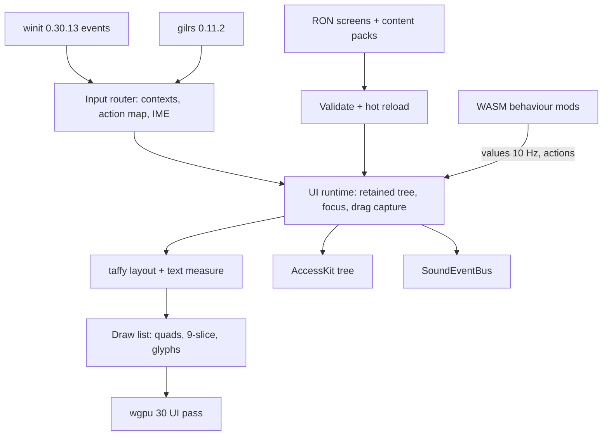
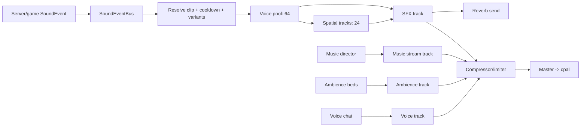

# UI, Audio, Text, and Localization for OpenBlock

**Status:** draft for review · **Research date:** 2026-11-24 · **Scope:** client/UX stack: retained UI and inventory interactions, text/font pipeline, audio and voice, localization, input, accessibility, and the performance budgets that constrain them · **Related docs:** `docs/research/01-weft-teardown.md`, `docs/research/03-voxel-rendering-sota.md`, `docs/research/04-networking-sota.md`, `docs/research/05-minecraft-feature-inventory.md`; planned `02-engine-and-render-stack.md`, `06-modding-and-content-pipeline.md`, `07-legal-licensing-and-ip.md`.

Versions below were checked against the crates.io sparse index on 2026-11-24. No first-party GPU or audio benchmark was run: this sandbox has no GPU and no C toolchain for native build scripts, so figures marked **(est.)** are budgets or arithmetic, not measurements. Weft is read-only inspiration (MPL-2.0); no Weft source is copied. Its implementation is cited only for scale and design evidence.

## 1. Executive decisions

| Area | Decision | Why | Main cost/risk |
|---|---|---|---|
| UI runtime | **Retained, data-driven UI** in Rust; RON screen definitions; custom wgpu renderer | Pixel-exact Minecraft look, stable IDs for mods/accessibility, batching, hot reload, inventory state | 8–12k first-party LOC; needs strong validation/tooling |
| Layout | **taffy 0.16** flex/grid/block with a text measure closure; pixel-snap results | Mature CSS layout used by Bevy/Slint/Zed [5]; avoids owning flexbox bugs | f32 layout; must snap and clamp to GUI pixels |
| Shipping UI toolkit | **No egui/iced/Slint in the game binary**; egui 0.37 only in `openblock-devtools` | egui is immediate-mode and Rust-closure-defined; game UI needs serializable screens and stable IDs | Two UI codebases, but devtools are a separate binary |
| Text | **cosmic-text 0.19 + glyphon 0.12** behind a `TextLayout` façade; evaluate **parley 0.13** at the inventory milestone | glyphon is the readiest shaping-capable wgpu-30 text renderer; cosmic-text has bidi, fallback, emoji; parley has better inline boxes/WPT conformance but no renderer | Possible mid-project migration; two text stacks would be worse |
| Fonts | Bitmap pixel atlas for the default font; dynamic vector glyph cache for CJK/RTL/emoji; **no MSDF by default** | Crisp integer-scaled pixel art; CJK MSDF atlases are huge/expensive; vector raster at device size is cheap and hinted | Atlas paging/eviction; font licensing and download size |
| Audio | **kira 0.12.6 + cpal 0.18.2 + symphonia 0.6.1**, event bus, fixed voice pool | Tracks/effects/spatial/streaming/clocks; rodio is mid-rewrite and has only simple spatialization | Audio-thread discipline; platform backends |
| Localization | **Fluent 0.17** (FTL) with BCP-47 locale IDs; JSON adapter for Minecraft packs | Plural/gender/select, translator comments; JSON cannot express plurals; gettext is poor on Windows/Rust | Fluent tooling gaps; syntax learning curve |
| Input | Action map with contexts; **winit 0.30.13 + gilrs 0.11.2**; physical keys for gameplay, logical keys for shortcuts | Remap everything, controller/touch parity, IME correctness | Per-platform glyph/gesture work |
| Accessibility | **AccessKit 0.25.2 + accesskit_winit 0.34.2** for menus; first-party narrator, captions, focus system | AccessKit covers desktop AT; games still need custom TTS and captions | Desktop-first; Android AT integration later |
| Voice | **Post-1.0**, feature-gated: Opus over QUIC relay first, WebRTC only if browser/P2P needs appear | Server relay reuses QUIC/TLS and keeps moderation; WebRTC adds ICE/TURN/DTLS complexity | Moderation, privacy, bandwidth |

## 2. Assumption check

1. **Rust + own engine + wgpu/winit/glam:** supported. Do not interpret “own engine” as “write every library”; taffy, cosmic-text, kira, and AccessKit remove years of undifferentiated work.
2. **32³ chunk sections:** orthogonal to UI/audio. UI must not assume world-unit coordinates; all layout is in GUI pixels.
3. **CPU-authoritative worldgen:** the dedicated server must build with **no cpal/alsa/winit/GPU** dependencies. Put audio and UI behind client-only features; a headless Docker image should not link ALSA.
4. **QUIC authoritative server:** works for inventory transactions, but use a **reliable ordered stream per container** for click intents and responses; do not mix inventory mutations with unreliable datagrams.
5. **Declarative packs + WASM + native escape hatch:** this is the strongest argument *against* Weft-style Rust closures for screens. UI must be serializable; WASM supplies values/actions, never draw commands.
6. **MIT OR Apache-2.0:** avoid Slint: it is GPLv3, commercial, or a non-OSI royalty-free license with attribution/embedded restrictions, all of which complicate a permissively licensed engine. Audit any Steam Audio integration before use. Symphonia is MPL-2.0 (weak, file-level copyleft); acceptable as an unmodified dependency, but record it in the license audit.
7. **Desktop first, Android later:** design input/safe-area/text-scale abstractions now. Android API 36 is mandatory for new apps/updates on Google Play from 2026-08-31 [25]; retrofitting edge-to-edge, 48 dp targets, and TTS later is expensive.
8. **144 FPS / 1080p / 32 chunks / 4 ms GPU / 2 ms CPU:** achievable only with a strict UI budget and p99 measurement. At 144 Hz the whole frame is 6.94 ms; UI should consume **≤0.5 ms CPU and ≤0.3 ms GPU**, leaving room for simulation and the world renderer.

## 3. UI architecture

### 3.1 Options compared

| Option | Version | Model | Fit for Minecraft-like UI | Modding | Verdict |
|---|---|---|---|---|---|
| egui | 0.37.0 | Immediate mode | Fast to prototype; non-pixel style; IDs can shift; no serializable screen format | Rust closures only | Devtools only |
| iced | 0.14.0 | Retained, Elm-style | App-level widgets; custom slot/drag/container model still needed | Rust code | No |
| Slint | 1.19.1 | Retained, declarative `.slint` | Good desktop UI, wrong visual language; GPLv3/proprietary terms do not fit our license posture | Slint language | No |
| bevy_ui | 0.20.1 | Retained ECS | Requires Bevy; we are not using Bevy | Bevy plugins | No |
| kayak_ui / lunex | 0.5 / 0.0 | Retained | Stale (2024/2023) | Rust | No |
| Custom retained + taffy | taffy 0.16.0 | Retained, RON | Pixel-perfect, stable IDs, batching, containers | RON + WASM + native | **Yes** |

egui 0.37 is a strong *tool*: it has AccessKit integration, wgpu 30 and winit 0.30.13 backends, system font/emoji support, and a large widget set [1]. It is a poor *shipping game UI*: screens are imperative Rust, widget IDs can be positional, and restyling to Minecraft's 9-slice pixel language fights the framework. Keep it for the level editor, mod inspector, and performance HUD in a separate `openblock-devtools` binary.

### 3.2 Recommended layering

The concrete desktop stack is winit 0.30.13 [11], wgpu 30.0.2 [12], glam 0.34.3, and gilrs 0.11.2; no 0.31 beta APIs.



The key split is **structure/data vs. behaviour**: RON defines widgets, layout, classes, bindings, and action IDs; Rust or WASM implements game logic and supplies values. A pack can rearrange the inventory or add a settings page without executing code. A WASM mod can add a machine screen, but it cannot issue raw draw calls, read files, or open sockets. The same widget set must eventually cover title/world/multiplayer, settings/language/controls/resource packs/mods, pause/death, the full container family (inventory, crafting, furnace, chest, villager, beacon, anvil, enchanting, brewing, hopper, dispenser, shulker), recipe book, advancements/statistics/social, chat, and debug. HUD surfaces include hotbar, health/hunger/armor/XP/air, boss bar, scoreboard/tab list, chat, subtitles, title/subtitle/actionbar, toasts, and effect icons. That list is the parity checklist; the MVP needs menus/settings, inventory, and the hotbar/chat HUD.

### 3.3 Screen model and hot reload

Recommended schema (`openblock.ui/v1`, RON 0.12.3 [32]), deliberately not Turing-complete:

```ron
(
  id: "openblock:inventory",
  root: (
    kind: "panel",
    class: "inventory",
    layout: (direction: "row", gap: 8, padding: 7),
    children: [
      (kind: "slot_grid", group: "crafting", cols: 3),
      (kind: "slot", group: "result", index: 0),
      (kind: "player_inventory"),
      (kind: "label", text: (key: "openblock.inventory.hint")),
    ],
  ),
)
```

- **IDs are stable and namespaced** (`openblock:inventory/crafting`). State (focus, scroll, drag source) survives rebuilds and hot reloads by ID.
- **Styling is class-based**: `class: "button"` resolves `gui/button.png`, `_hover`, `_pressed`, `_disabled`, with pack overrides. Classes are data, not code.
- **Bindings are restricted expressions**: `bind: "player.health"`, `bind: "menu.energy"`, `format: "openblock.hud.energy"`. No arbitrary Rust/JS. Complex values come from WASM at 10 Hz or on change.
- **Actions are typed IDs**: `on_click: (action: "openblock:settings/set", args: { key: "render_distance", value: 24 })`. The UI emits `UiAction`; the game, server, or mod validates it.
- **Limits:** ≤2,048 nodes/screen, depth ≤32, ≤64 KiB text/screen, ≤256 glyphs per label, ≤16 inline objects per line. Reject with a screen-ID error, not a panic.
- **Hot reload:** `notify` 9.0.0 [31] watches `ui/`, `lang/`, and pack roots with 100 ms debounce; parse and validate on a worker; swap at a frame boundary; preserve state by ID; roll back and toast on error. Defer reload while a pointer drag or IME composition is active.
- **Shaders:** UI WGSL hot reload is separate; validate with naga/wgpu before swapping; keep the last good pipeline on failure.

### 3.4 Rendering, batching, and performance

One UI pass after the world pass, on the **same `wgpu::Device`/`Queue`** as the world renderer, `LoadOp::Load`, no depth, sRGB target. Flatten the retained tree into a draw list only when dirty; batch by pipeline/texture/atlas; use a single instance buffer; scissor rectangles for clipping; 9-slice as a shader mode, not nine quads per widget. Text is a glyph instance stream into one or more atlas pages. Avoid per-widget bind groups and per-widget uniforms.

| Item | Target | Basis |
|---|---|---|
| UI CPU/frame, 1,000 widgets | ≤0.5 ms desktop, ≤1.5 ms Steam Deck **(est.)** | 2 ms total CPU budget; UI must leave ≥1.5 ms |
| UI GPU/frame, 1080p | ≤0.3 ms **(est.)** | 4 ms GPU budget; UI is small but overdraw/blur is not |
| Draw calls | ≤64 | batching by texture/atlas; measure with RenderDoc |
| Vertices | ≤200k | 1,000 widgets × ~100 vertices plus text |
| Layout | dirty-only; ≤0.5 ms for 1,000 nodes **(est.)** | taffy; text measure is the expensive part |
| Hit test | ≤20 µs for 1,000 nodes **(est.)** | reverse draw-list walk with clip rects |
| Memory | UI CPU <8 MiB; glyph atlas 4–16 MiB | atlas pages, caches |

Do **not** blur the world behind menus by default. A full-screen blur is 1–2 ms at 1080p **(est.)** and worse on Steam Deck. Use a pre-blurred panorama or a static background; make blur an option with a measured warning.

### 3.5 Hit testing, focus, and drag

- Flattened draw list entries carry `id`, `rect`, `clip`, `layer`, `hit_test`, `capture`. Hit test reverse order, intersect clips, ignore `hit_test=false`; tooltips only after 400 ms hover and never over a drag.
- Pointer capture on press: a drag continues outside the widget and outside the window until release. Escape cancels drag and returns the cursor stack.
- Click vs. drag threshold: 4 GUI px. Double-click: 250 ms. These are gameplay-feel constants; expose them only in dev config.
- Keyboard/gamepad focus is a separate graph: document order by default, explicit `tab_index` override, arrow-key spatial navigation for grids, focus trap in modals, restore focus on close, visible focus ring (2 px high-contrast).
- Touch: virtual stick + look region + buttons; 48 dp minimum; safe-area insets; Android back gesture closes the top modal; long-press is contextual, not a hidden primary action.
- IME: enable on text focus, position the candidate window at the caret, commit only on `Ime::Commit`; never fire gameplay binds during composition.

### 3.6 Inventory and container semantics (the hard part)

Minecraft's protocol is a useful minimum bar: one Click Container packet carries window ID, state ID, slot, button, mode, an array of changed slots, and the carried item; the server compares the client's claimed changes and resends a full snapshot when the state ID is stale [19]. Modes cover left/right click, shift-click, number-key swap, creative clone, drop, drag start/add/end, and double-click collect [19].

We should keep the semantics but **not** copy the trust model. Send an **intent**, not predicted slot contents:

```text
ContainerAction { tx: u32, window: u16, revision: u32,
                  intent: Click{mode, slot, button} | Drag{button, slots} | Close }
ContainerDiff   { tx: u32, revision: u32, changed: [(slot, ItemStack)], cursor: ItemStack }
ContainerSnapshot { revision: u32, slots: [ItemStack], cursor: ItemStack }
```

```mermaid
sequenceDiagram
  participant UI as Client UI
  participant P as Predictor (shared crate)
  participant S as Server container
  UI->>P: click(intent, revision)
  P-->>UI: optimistic slots + cursor
  UI->>S: ContainerAction(tx, revision, intent)
  S->>S: validate + apply atomically
  alt revision current and result matches
    S-->>UI: ContainerDiff(tx, new revision, changed, cursor)
  else mismatch / stale
    S-->>UI: ContainerSnapshot(new revision, all slots, cursor)
  end
  UI->>UI: reconcile; animate only if server differs
```

- **Shared deterministic crate:** `openblock_inventory` implements `apply(state, intent) -> Result<Diff, Reject>`. Client and server compile it. Client prediction is cosmetic; server is authoritative. Divergence is a bug, not a cheat vector, because the server never trusts predicted data.
- **Shift-click:** server decides merge order (existing matching stacks, then empty slots; hotbar before main inventory unless configured). Client predicts with the same function. Never send “move 3 from A to B” as an authoritative request; it is an intent the server resolves.
- **Drag:** send start, ordered visited slots, end. Left-drag distributes as evenly as possible; right-drag places one per slot; middle-drag clones in creative. The ordered list matters; the server recomputes from the start snapshot. Rate-limit to 20 clicks/s.
- **Double-click collect:** server collects matching items into the cursor up to the stack limit; client predicts the same. Creative mode is a separate permission.
- **Close/disconnect:** put the cursor stack back into the inventory if it fits, otherwise drop at the player's feet; never delete items. Server is the only writer; the client's cursor is a view.
- **Tests:** model-based property tests with random intents, simulated 50–200 ms RTT, loss/reorder on the unreliable channel, and invariants: total item count conserved (except creative/drop), stack limits respected, no negative counts, client equals server after quiescence.

### 3.7 Mod UI hooks

WASM modules export `ui_values(screen, revision) -> Map`, `ui_action(screen, action, args)`, and optional `ui_tick(dt)`. Host imports are capability-limited: read own mod state, read public player/world snapshot, send `UiAction`, play a UI sound, open a known screen. No filesystem, network, GPU, or raw input. Call values at 10 Hz, actions immediately, with fuel/memory caps (e.g. 1 ms and 64 MiB) and a kill-and-disable path on trap. Native trusted plugins may register custom widgets and render passes through a versioned ABI; that path is not for UGC.

## 4. Text and fonts

### 4.1 Layout engine

| Engine | Version | Strengths | Gaps | Use |
|---|---|---|---|---|
| cosmic-text | 0.19.0 | HarfRust shaping, bidi, fallback, color emoji, editing types; mature | No inline-box primitive for item icons; editor copy/paste incomplete | **Baseline** |
| parley | 0.13.0 | ICU4X bidi/segmentation, WPT suite, inline boxes, strong complex-script story | Layout only; no wgpu renderer; README MSRV 1.96 | Spike at M3 |
| swash | 0.2.10 | High-quality rasterizer, used by cosmic-text | Rasterizer only | Under text engine |
| fontdue | 0.9.5 | Fast simple rasterizer | No shaping/bidi/fallback | No |
| ab_glyph / wgpu_text | 0.2.32 / 30.0.1 | Simple Latin text on wgpu | No shaping or bidi | No |

cosmic-text 0.19 explicitly targets bidi, per-character fallback, ligatures, and color emoji; its README's UDHR test lays out 8 MB of translations and verifies 106,746 lines [2]. That is a correctness signal, not a speed benchmark. parley is the stronger long-term layout engine: it uses ICU4X for bidi/segmentation, has inline boxes for icons, and is tested against Web Platform Tests [3]. glyphon 0.12 is the pragmatic accelerator: it depends on cosmic-text 0.19 and wgpu 30, packs glyphs into an atlas, and renders in an existing pass [4].

**Decision:** ship cosmic-text + glyphon behind `trait TextLayout`. At the inventory milestone, run a one-week parley spike against the same corpus (English, Arabic, Hebrew, Hindi, Chinese, mixed chat with item icons). Switch only if parley wins on inline-object correctness, bidi line breaking, or layout p99. Budget 1–2 weeks for a parley renderer if the switch is triggered.

### 4.2 Pixel font, fallback, and atlas math

Minecraft's default font is an 8×8 bitmap (`ascii.png`) with a 1 px shadow and support for higher-resolution glyphs [20]. Reproduce that look deliberately:

1. **Default/pixel font:** bitmap atlas, 16×16 cells, 64 columns; nearest sampling; integer GUI scales only; optional 1 px shadow. A 1024×1024 R8 atlas holds 4,096 cells (1 MiB) — enough for Latin, punctuation, and UI glyphs.
2. **Fallback/vector font:** bundled Noto Sans (Latin/Greek/Cyrillic) plus Noto Sans CJK (SIL OFL 1.1) and Arabic/Hebrew/Devanagari faces as language packs; rasterize on demand at physical pixel size with swash/skrifa; hint at small sizes.
3. **Last resort:** Unifont-style coverage for missing glyphs, but never as the primary CJK face.
4. **No MSDF by default.** A 4,096² R8 page is 16 MiB; 20,000 CJK glyphs at 32×32 need 20.5 M pixels, which does not fit; at 24×24 it is 11.5 M pixels and only fits with tight packing. MSDF generation for that set is expensive and blur-prone at small UI sizes. Use vector rasterization at device size and page the atlas (LRU, 2–4 pages).

| Technique | Pixel sharpness | Scale behavior | Atlas cost | Generation | Use |
|---|---|---|---|---|---|
| Bitmap | Exact at integer scale | Bad at fractional | Tiny | Instant | Default pixel font, HUD |
| Vector raster | Hinted, crisp | Good per size | Per-size cache | Per glyph, cached | CJK/RTL/body text |
| SDF | Soft at small sizes | Good | 4 B/px | Moderate | Large titles, world labels |
| MSDF | Sharp corners | Excellent | 4 B/px | High | Only if vector UI demands it |

At 1080p, Minecraft's auto GUI scale is 4 (`max(1, min(floor(1920/320), floor(1080/240)))`), so 8 px font becomes 32 physical px; at Steam Deck 1280×800 it is 3, so 24 px [18]. This is why integer UI scale and pixel snapping matter more than exotic font rendering.

### 4.3 Rich text and editing

Rich text is a span list, not HTML: color, bold/italic, underline, shadow, inline item/block icon, inline GUI image, key glyph, link, and translation insertion. Inline objects are placeholders (U+FFFC) resolved by the UI layer, not glyphs. Allow built-in animation effects only (rainbow, wave) in MVP; per-glyph custom WGSL (as Weft does) is a security and batching hazard for mod UGC.

Text editing needs grapheme-aware cursor movement, bidi caret, selection, clipboard (`arboard` 3.7.0), undo/redo, and IME composition. Do not build this on raw bytes. cosmic-text's `Editor` types help, but its README still lists copy/paste as unfinished, so own the clipboard/undo layer and test it.

Performance rules: cache layout by `(text, locale, width, style, revision)`; only re-layout changed labels; cache glyphs by `(font, size, subpixel bin)`; never lay out hidden/closed screens; measure tooltip paragraphs once per hover. A 100-line chat with cached layouts should cost <0.2 ms/frame **(est.)**; first layout of a long CJK line is the spike to measure.

## 5. Audio

### 5.1 Stack choice

| Stack | Version | Fit | Problems | Verdict |
|---|---|---|---|---|
| kira | 0.12.6 | Game mixer: tracks, effects, spatial tracks, clocks, streaming, tweens | Not an HRTF engine; per-voice tracks need pooling | **Yes** |
| cpal | 0.18.2 | Low-level cross-platform output (WASAPI/CoreAudio/ALSA/AAudio) [8] | No mixer/scene graph | Backend under kira |
| rodio | 0.23.0 | Simple playback; symphonia decoders | Core engine rewrite in progress; simple `SpatialPlayer`, not hundreds of managed voices | No |
| bevy_audio | 0.20.1 | Convenient inside Bevy | Bevy dependency; not our engine | No |
| custom + cpal | — | Maximum control | Rebuilds mixing, effects, streaming, spatialization | No |

kira provides a mixer with sub-tracks, effects (compressor, EQ/filter, reverb, delay, distortion, panning, volume), spatial tracks driven by listener distance, clocks for musical timing, and streaming sounds [6]. That is the right feature set. Disable default features and enable only `cpal`, `wav`, `ogg`, `vorbis`, `flac`, `mp3`; symphonia is MPL-2.0 and must be recorded in the license audit [7].

### 5.2 Graph and event model



Server events carry only **registry IDs and parameters**, never file paths: `SoundEvent { id, emitter: Option<EntityId>, position, volume, pitch, seed, range }`. The client resolves variants, applies category volume, cooldown, and max instances. UI sounds are client-only. Loops attach to entities and stop/fade on despawn. This keeps the protocol small (~24 bytes/event) and makes mod sounds server-safe.

```ron
(
  id: "openblock:block.stone.break",
  clips: ["sounds/block/stone/break1.ogg", "sounds/block/stone/break2.ogg"],
  category: "blocks",
  volume: 1.0,
  pitch: (0.94, 1.06),
  attenuation: 16.0,
  caption: "openblock.subtitles.block.break",
  priority: "gameplay",
  max_instances: 4,
  cooldown_ms: 30,
)
```

### 5.3 Budget, mixing, occlusion, HRTF

- **Decoded vs. streamed:** decode short SFX (≤2 s) into PCM at load and keep them resident; stream music and long ambience from disk through kira's `StreamingSoundData` with a 2 s read-ahead. Do not stream footstep/block sounds: disk seek latency and decoder jitter are worse than the memory cost.
- **Doppler:** only for fast entities (arrows, boats, minecarts, elytra, sprinting players), using radial velocity relative to the listener; clamp pitch shift to ±10% and disable it in the accessibility preset. Never apply Doppler to block/UI/ambient sounds.
- **Voices:** 64 logical (24 spatial, 8 music/ambience, 8 UI, rest gameplay). Track hundreds of emitters as lightweight handles, but mix at most 64; steal by priority, then distance, then age; never steal music/voice.
- **Mix:** master → limiter → category tracks (music, ambient, blocks, hostile, neutral, player, weather, UI, voice); reverb send from SFX; low-pass per environment. Target integrated loudness around −16 LUFS for music and −16 to −20 LUFS for SFX, true peak ≤−1 dBTP **(est.; measure with ebur128)**.
- **Attenuation:** linear or inverse-square rolloff per event, cull beyond 48 m; low-pass cutoff drops with distance/occlusion. Do not simulate speed-of-sound delay for gameplay-critical sounds; Weft's 343 m/s travel time is 140 ms at 48 m, which reads as lag for block breaks. Cap delays at 40 ms for distant explosions only.
- **Occlusion:** MVP: one raycast at 10 Hz for important sounds. Full: probe the listener's 24 m neighborhood (14 directions) at 100 ms and test up to 24 reflections, as Weft does; its constants are a useful budget reference [29].
- **HRTF:** kira does amplitude panning, not binaural. A 128-tap, 2-ear FIR at 48 kHz is ~12.3 M multiply-adds/s per source; 16 sources is ~197 M/s, 100 sources is ~1.23 G/s **(calc.)**. FFT convolution lowers the constant but not the scaling. The `hrtf` crate's own docs call it “heavy” and use overlap-save FFT convolution [28]. Limit HRTF to **8–16 prominent sources**, default off, and keep panning + attenuation for the rest. Do not build HRTF into MVP.
- **Music:** state machine (menu, day, night, cave, boss, credits), weighted non-repeating track pools, 3–5 s crossfade, 8–20 min cooldown, duck −6 dB under dialogue/voice. Stream from disk; preload metadata and next-track header only.
- **Ambience:** 2–4 looping beds (wind, birds, cave, water) crossfaded by biome/time/weather, plus random one-shots every 5–30 s. Keep them client-side; the server sends weather/time state only.

### 5.4 Voice chat (deferred)

| Option | NAT | Moderation | Complexity | Verdict |
|---|---|---|---|---|
| WebRTC (`webrtc` 0.17.3) | ICE/STUN/TURN | Server sees media only if relayed; E2EE blocks it | DTLS-SRTP, ICE, codec, C++ audio processing | Only for browser/P2P |
| Opus over QUIC relay | Server relay; no extra NAT traversal | Server can mute/ban/record if policy allows | Jitter buffer, FEC/PLC, echo cancellation | **Preferred if pursued** |
| Steam Voice | Steam only | Platform | Low | Not self-hostable |
| Mumble/TeamSpeak | External | External | Low integration | External client; positional integration is plugin-specific |

Opus scales from 6 to 510 kbit/s; 32 kbit/s mono at 20 ms frames is a sane default [27]. Ten speakers is ~320 kbit/s down per client plus overhead; selective forwarding by distance/team and silence suppression are required. The receiver spatializes each speaker from the server-synced player position, so no per-packet position is needed. iroh 1 could carry voice datagrams, but the game transport is already quinn; keep voice on the same relay rather than adding a second NAT-traversal stack. Use server relay, per-player mute/deafen/volume, push-to-talk, and no recording by default; recording consent and moderation policy are product decisions, not code details.

## 6. Localization

### 6.1 Format choice

| Format | Plurals/gender | Tooling | Runtime | Verdict |
|---|---|---|---|---|
| Fluent (FTL) | Native select/plural, terms, attributes | Weblate supports FTL; plural-aware UI is limited (format table says plural: No) [14] | fluent 0.17 / fluent-bundle 0.16, stable but low cadence | **Yes** |
| gettext PO | `ngettext`, contexts | Mature; Weblate excellent | Rust bindings often need libintl; Windows pain | No |
| ICU MessageFormat 2 | Standard, powerful | ICU4X 2.4; tooling less mature | `icu` 2.4 (Unicode-3.0) | Watch |
| JSON key-value | Ad hoc | Universal; Minecraft-compatible | Trivial | Import/export adapter only |

Fluent gives translators comments, terms, attributes (`.tooltip`), and asymmetric grammar: a one-word English string can become a multi-branch Arabic or Russian translation [13]. Its Rust implementation is stable but not fast-moving; pin it and own a small loader. Weblate's Fluent component can edit FTL but does not expose plural-aware editing/checks as of 2026.12 [14], so add CI validation for placeholder parity, plural categories, and syntax.

### 6.2 Conventions

- **Locale IDs:** BCP-47 internally (`en-US`, `pt-BR`, `zh-Hans`); map to Minecraft-style codes (`en_us`, `pt_br`, `zh_cn`) only at the resource-pack boundary.
- **Keys:** `<namespace>.<domain>.<subject>[.<variant>]`, e.g. `openblock.menu.singleplayer`, `openblock.block.stone.name`, `openblock.chat.player_joined`, `openblock.tooltip.durability`. Never use English text as a key. Never concatenate translated fragments; use one message with placeables.
- **Placeables:** typed (`string`, `number`, `date`, `item` placeholder). Numbers formatted through ICU4X (`icu_decimal`) [15], not `format!`. Player names and coordinates wrapped in Unicode bidi isolates when embedded in RTL text [16].
- **Plurals/gender:** FTL selectors, with all CLDR plural categories for the locale, not just `one`/`other` [17]; select on gender or noun class where the target language needs it. Russian needs one/few/many/other; Arabic needs zero/one/two/few/many/other. CI checks that required categories exist.
- **RTL:** layout direction from locale; use `start`/`end`, never `left`/`right`; mirror directional icons (arrows, progress) via a per-asset flag, not blind flipping; keep numbers, coordinates, and key names LTR; test Arabic/Hebrew with mixed English chat.
- **Pseudo-locale:** `en-XA` expands strings ~30% and accents letters; run every screen through it to catch hardcoded text, clipping, and missing keys. German/Finnish compound words expose fixed-width buttons; allow wrapping, min-width, and truncation with a tooltip.
- **Tooling choice:** Weblate self-hosts and supports FTL directly; Crowdin is a viable hosted alternative only if its FTL workflow is verified first. Do not commit to a proprietary translation memory without an export path.

### 6.3 Tooling and shipping

Self-host **Weblate** (open source, fits the project) with one component per FTL file, a glossary, screenshots, and reviewer roles. CI runs `fluent-syntax` parsing, key parity, placeholder parity, plural-category checks, and a missing-key report; a PR fails on syntax errors, not on incomplete translations. Source language is `en-US`.

Ship `en-US` in the base install. Ship complete community locales as signed `.oblang` packs (manifest, FTL, fonts, credits) downloaded on demand, with SHA-256 and a signature; fall back to `en-US` per key. Do not bundle Minecraft's translations: they are proprietary. Accept user-supplied Minecraft resource packs locally through a JSON adapter (`assets/<ns>/lang/<code>.json`), converting `%s`/`%1$s` to placeables and mapping keys, but never redistribute the result.

Fonts per locale: Noto Sans for Latin/Greek/Cyrillic, Noto Sans CJK for Chinese/Japanese/Korean, Noto Sans Arabic/Hebrew/Devanagari as needed; all SIL OFL 1.1. A full CJK face is ~16–25 MB, so put it in the language pack, not the base installer. Use system fonts only as an optional fallback; never depend on them for consistent layout.

**Asset localization:** never bake UI labels into textures; signs, books, and item names are runtime text. Localized voice packs are optional and keyed by locale; subtitles always come from the localized caption key, not from the audio file. Audio assets fall back to `en-US` with a visible “voice unavailable” marker rather than silence.

## 7. Input, accessibility, and platform

### 7.1 Input abstraction

- **Actions, not keys:** `ActionId` registry (`move.forward`, `inventory`, `chat`, `narrator.toggle`), each with multiple `Binding`s (key, mouse button, gamepad button/axis, touch gesture). Contexts (`Gameplay`, `Menu`, `Chat`, `Inventory`, `Dev`) gate dispatch; the top context consumes.
- **Physical vs. logical:** gameplay movement uses physical `KeyCode` (WASD position stays WASD on AZERTY); text shortcuts use logical `Key`; display names are localized. Show both in the rebind UI when they differ.
- **Gamepad:** gilrs 0.11.2 [30] for hotplug and SDL mappings (including Steam's `SDL_GAMECONTROLLERCONFIG`); deadzone 0.15, trigger threshold 0.3, repeat delay 250 ms; glyph set by controller type; Steam Input action manifest later.
- **Mouse:** raw motion in gameplay, absolute GUI coordinates in menus; capture/release on context changes; double-click and drag thresholds; horizontal scroll.
- **Touch:** virtual stick, look region, action buttons; 48 dp targets; safe areas; back gesture; no hover-only actions. Design now even if Android ships later.
- **Remapping:** conflict detection, reset defaults, import/export RON, per-context bindings, hold-vs-toggle for sprint/sneak/attack, and a “narrate focused widget” binding. No hardcoded gameplay key checks.

**Settings surface:** one searchable list with sections Video, Audio, Controls, Language, Accessibility, Chat, Resource Packs, and Mods. Each row has a localized label, control, default, tooltip, and optional “restart required” badge; changes apply live unless the renderer/audio device requires a restart. Provide reset-section, reset-all, per-device graphics settings, and read-only server-enforced values. The same RON widget set renders settings, so mods add rows instead of forking the screen.

### 7.2 Accessibility

| Feature | Implementation | Standard/evidence |
|---|---|---|
| Screen reader menus | AccessKit tree with roles/names/values/actions; `accesskit_winit` adapter | AccessKit desktop adapters (Windows/macOS/Unix); used by egui/Bevy/Slint [9][10] |
| Narrator | Platform TTS queue: SAPI, AVSpeech, speech-dispatcher/Flite, Android TTS; priorities, rate, volume, verbosity | Minecraft's narrator uses OS TTS, system language, Flite on Linux [21] |
| Captions | Per-sound `caption` key, direction `<`/`>`, fade, merge repeats, category toggles | Minecraft closed captions list nearby sounds, direction arrows, fade [22] |
| Focus navigation | Tab/arrow/gamepad, modal traps, restore focus, visible ring | WCAG focus-visible principles; test with keyboard only |
| Contrast | ≥4.5:1 normal text, ≥3:1 large text; high-contrast UI mode | WCAG 1.4.3 [23] |
| Colorblind | Okabe–Ito palette option, patterns/icons, never color-only signals | Palette + redundant encoding |
| Difficulty assists | Auto-jump, toggle sprint/sneak, aim assist for controller, attack indicator, recipe book; server rules stay separate | Minecraft accessibility options [18] |
| Motion | Bobbing, shake, distortion, FOV effects, glint, flash, panorama toggles; “reduce motion” preset | Minecraft accessibility settings list [18] |
| UI scale | Integer GUI scale; formula `max(1, min(floor(w/320), floor(h/240)))`; text size follows | Minecraft GUI scale formula [18] |
| FOV | Vertical 30–110°, default 70; horizontal computed by aspect; separate FOV-effects slider | Minecraft FOV behavior [18] |

Narration must not double-speak with a screen reader. There is no portable “screen reader active” query across all platforms; make the custom narrator explicitly opt-in, and let AccessKit own menu semantics. Read on focus for keyboard/gamepad and on hover for mouse, with a toggle. Narrate slot contents as “Oak Log, 32, slot 12” and expose quick-move as a custom action. All accessibility names/labels use the same FTL keys as visible text; select the narrator voice from the game locale where the platform exposes voices, falling back to the system language. Build the AccessKit tree from the retained nodes after layout, send tree **diffs** rather than rebuilding, and keep accessibility focus/selection synchronized with UI focus.

### 7.3 Platform checklists

| Platform | What matters | When |
|---|---|---|
| Windows/Linux/macOS | Code signing/notarization, Wayland/X11, high-DPI, ALSA/PipeWire, controller glyphs | MVP |
| Steam Deck | 1280×800; readable text at 3× GUI scale; gamepad; on-screen keyboard for text input is required for Deck Verified; no launcher friction [26] | Beta |
| Steam store | Accessibility features are self-declared metadata, not a certification; be accurate | Launch |
| Android | Target API 36 for new apps/updates from 2026-08-31; 64-bit; 48 dp targets; TalkBack; font scale; edge-to-edge/safe areas; back gesture; AAudio latency | Post-1.0 |
| iOS | HIG accessibility, Metal via wgpu, no sideloading; later | Later |
| Consoles | Xbox XR / PlayStation TRC / Switch lotcheck if pursued: focus, safe areas, suspend/resume, controller glyphs, user permissions | Only if pursued |

“Certification” does not exist for accessibility on Steam; do not plan for a badge. Plan for **usability review**: keyboard-only completion, screen-reader completion of menus, captions for all gameplay-critical sounds, and no color-only information.

## 8. Performance budgets and what to measure

| Metric | Budget | Basis |
|---|---|---|
| Frame at 144 Hz | 6.94 ms | arithmetic |
| CPU main thread | ≤2 ms, p99 | lead target |
| UI CPU | ≤0.5 ms | leaves 1.5 ms for game/sim |
| UI GPU at 1080p | ≤0.3 ms | 4 ms GPU frame |
| Audio control/event processing | ≤0.1 ms/frame for 100 events | event queue + no raycasts on main thread |
| Audio mixing | ≤5% of one core for 64 voices **(est.)** | 64 × 48 kHz × 2 ch, simple gain/pan |
| Text layout | ≤50 µs per 80-char line, cached otherwise **(target)** | interactive typing/chat |
| 1,000-widget layout | ≤0.5 ms desktop, ≤1.5 ms Deck **(est.)** | taffy + measure closures |
| Glyph atlas | 4–16 MiB | 2048²/4096² R8 pages |
| Inventory click round trip | <150 ms perceived; optimistic <16 ms | 50–150 ms RTT target |
| Voice | 32 kbit/s per speaker, 20 ms frames | Opus sweet spot [27] |

Reference figures used above (not local measurements):

| Figure | Value | Source/basis |
|---|---:|---|
| Weft UI/text/render + HUD/screens/input/touch/controller/settings | 11,191 LOC | line counts, read-only clone [29] |
| Weft bitmap font | 16 px cell, 64-column R8 atlas | source constants [29] |
| Weft acoustics | 14 probes, 24 m, 100 ms, 24 reflections | source constants [29] |
| cosmic-text UDHR test | 8 MB, 106,746 lines | README [2] |
| MC auto GUI scale | 4 at 1080p, 3 at 1280×800 | formula [18] |
| Opus bitrate range | 6–510 kbit/s | RFC 6716 [27] |
| Text contrast | 4.5:1 normal, 3:1 large | WCAG 1.4.3 [23] |
| Android touch target | 48 dp | Android accessibility [24] |
| 4,096² R8 atlas | 16 MiB; 20k glyphs at 32² = 20.5 M px | arithmetic |
| HRTF FIR | 12.3 M MAC/s per source at 48 kHz, 128 taps, 2 ears | arithmetic |

Measure with GPU timestamp queries for the UI pass, `tracing` spans for layout/text/hit-test, and a deterministic replay of a 1,000-widget settings screen plus a 46-slot inventory. Report p50/p95/p99 on RTX 3060-class, Steam Deck, and a low-end integrated GPU. Do not tune to averages; a 0.8 ms average with a 3 ms p99 will miss 144 Hz.

## 9. Phased plan

| Phase | Scope | Exit criteria |
|---|---|---|
| 0 (2–3 wk) | `openblock-ui` crate, input action map, wgpu UI pass, bitmap font/atlas, debug HUD, RON loader | 1080p HUD + debug overlay; UI ≤0.3 ms; no per-frame allocations in steady state |
| 1 (4–6 wk) | HUD, chat, pause/settings/language/controls screens, sliders/toggles/text input, UI scale, FOV, key rebinding | Keyboard/gamepad-only navigation; full settings round-trip; pseudo-locale passes |
| 2 (6–8 wk) | Inventory/container framework, slots/items/tooltips, creative inventory, drag/shift-click/double-click, prediction + reconciliation, server protocol | Property tests converge under 200 ms RTT + 5% loss; no item duplication; inventory usable at 30 FPS |
| 3 (4–6 wk) | kira mixer, sound events, categories, music/ambience, occlusion MVP, captions | 64 voices stable; no audio-thread allocations; captions cover all critical sounds |
| 4 (4–6 wk) | AccessKit, narrator, focus traps, high contrast/colorblind, motion settings, language packs, Weblate pipeline, controller/touch polish | Screen-reader menu run; Arabic/Hebrew layout review; Steam Deck readability pass |
| 5 (post-1.0) | Voice chat (QUIC+Opus), HRTF experiment, console certification, web | Only after 1.0 performance/quality gates |

The sibling feature inventory estimates UI/HUD at 9–14 person-months, audio at 4–7, and accessibility/localization at 3–5 for parity scope (`05-minecraft-feature-inventory.md`). The table above is an MVP-to-1.0 sequencing sketch, not a full-parity budget; the phases overlap and assume a small team with art/content support.

## 10. Risks

- **Custom UI/text stack cost:** 8–12k LOC is realistic; Weft's comparable UI/text/HUD/input stack is ~11.2k LOC [29]. Mitigate with taffy, cosmic-text, and a strict widget set.
- **Text engine churn:** cosmic-text 0.19 and parley 0.13 are pre-1.0; APIs can break. Pin versions and keep the `TextLayout` façade narrow.
- **Font size/licensing:** CJK faces are 16–25 MB; OFL requires attribution. Language packs add supply-chain and download-failure paths.
- **Accessibility retrofit:** AccessKit is desktop-first; narrator/TTS and captions are platform-specific. Build the tree and focus model in phase 0–1, not phase 4.
- **Localization tooling:** Weblate's Fluent plural support is limited; translators can break selectors. CI lint and reviewer workflow are mandatory.
- **Inventory prediction bugs:** divergence, ghost items, and duplication are high-severity. Shared deterministic crate, model-based tests, server snapshots, and conservative rate limits.
- **Audio/voice scope creep:** HRTF and voice chat can consume the schedule. Keep both feature-gated and post-1.0.
- **Mod UI abuse:** spoofed trade windows, focus stealing, layout bombs. Validate/limit screens; never let UGC draw raw or access inventory directly.
- **Performance target mismatch:** 144 FPS at 1080p with 32 chunks is a desktop goal; Steam Deck is 800p/40–60 FPS **(est.)**. Do not ship full-screen blur/transparency defaults that assume desktop headroom.
- **Platform surprises:** Android API 36, 48 dp targets, TTS, and safe areas; Steam Deck on-screen keyboard and readability. These are cheaper to design in now.

## 11. Open questions for the Lead

1. Is **Minecraft resource-pack compatibility** (JSON lang, font providers, GUI textures) a 1.0 requirement? It determines whether `minecraft.*` keys and MC-style locale codes are first-class or adapter-only.
2. What is the **installer size budget**? Bundling Noto Sans CJK (~16–25 MB) versus downloading language packs changes first-run UX and offline play.
3. Is **full RTL layout mirroring** in 1.0, or is bidi text sufficient? Mirroring doubles UI layout/icon testing and affects every 9-slice asset.
4. Is **voice chat** a 1.0 feature? If yes, is server-side moderation (no E2EE) acceptable, and what is the recording/consent policy?
5. What is the **minimum supported device** (RAM/GPU/CPU)? It sets the glyph atlas, font bundle, and UI effects budget.
6. Do we prioritize **AccessKit screen-reader semantics** or a **Minecraft-style narrator** first? Both are needed eventually; Linux TTS (speech-dispatcher/Flite) is the weak link.
7. May **egui** be used for devtools and the level editor, or do we want one UI stack everywhere to reduce maintenance?
8. Do we need **console certification** eventually (Xbox/PlayStation/Switch)? That changes focus/safe-area/controller requirements and rules out some custom rendering shortcuts.
9. Should shipping builds **hot-reload UI packs**, or is hot reload dev-only? Shipping reload needs signature/validation and a rollback UX.
10. Can a **server force a custom UI screen** (e.g., a server menu) or only provide data to client-defined screens? This is a trust/spoofing decision.

## Sources

1. egui 0.37.0 and changelog — https://crates.io/crates/egui and https://github.com/emilk/egui/blob/master/CHANGELOG.md
2. cosmic-text 0.19.0 — https://crates.io/crates/cosmic-text and https://docs.rs/cosmic-text/latest/cosmic_text/
3. parley 0.13.0 — https://crates.io/crates/parley and https://docs.rs/parley/latest/parley/
4. glyphon 0.12.0 — https://crates.io/crates/glyphon
5. taffy 0.16.0 — https://crates.io/crates/taffy and https://github.com/DioxusLabs/taffy
6. kira 0.12.6 — https://crates.io/crates/kira and https://docs.rs/kira/latest/kira/
7. rodio 0.23.0 and Symphonia licensing — https://crates.io/crates/rodio and https://github.com/RustAudio/rodio
8. cpal 0.18.2 — https://crates.io/crates/cpal and https://github.com/RustAudio/cpal
9. AccessKit 0.25.2 — https://crates.io/crates/accesskit and https://accesskit.dev/
10. accesskit_winit 0.34.2 — https://crates.io/crates/accesskit_winit
11. winit 0.30.13 — https://crates.io/crates/winit
12. wgpu 30.0.2 — https://crates.io/crates/wgpu
13. Project Fluent — https://projectfluent.org/ and https://docs.rs/fluent/latest/fluent/
14. Weblate Fluent format (plural support noted as No) — https://docs.weblate.org/en/latest/formats/fluent.html
15. ICU4X 2.4.0 — https://crates.io/crates/icu and https://icu4x.unicode.org/
16. Unicode Bidirectional Algorithm (UAX #9) — https://www.unicode.org/reports/tr9/
17. CLDR plural rules — https://cldr.unicode.org/index/cldr-spec/plural-rules
18. Minecraft Wiki, Options (GUI scale, FOV, accessibility settings) — https://minecraft.wiki/w/Options
19. Minecraft Wiki, Java Edition protocol, Click Container — https://minecraft.wiki/w/Java_Edition_protocol/Packets#Click_Container
20. Minecraft Wiki, Font (default 8×8 bitmap, shadow, HD glyphs) — https://minecraft.wiki/w/Font
21. Minecraft Wiki, Narrator (OS TTS, system language, Flite on Linux) — https://minecraft.wiki/w/Narrator
22. Minecraft Wiki, Closed captions (direction arrows, fade) — https://minecraft.wiki/w/Closed_captions
23. WCAG 2.2, Contrast (Minimum), 4.5:1 / 3:1 — https://www.w3.org/WAI/WCAG22/Understanding/contrast-minimum.html
24. Android accessibility guidance, 48 dp touch targets — https://developer.android.com/guide/topics/ui/accessibility/apps
25. Google Play target API level requirement (API 36 from 2026-08-31) — https://developer.android.com/google/play/requirements/target-sdk
26. Steam Deck / Steam Machine compatibility and recommendations — https://partner.steamgames.com/doc/steamhardware/recommendations and https://partner.steamgames.com/doc/steamhardware/compat
27. RFC 6716, Opus (6–510 kbit/s) — https://www.rfc-editor.org/rfc/rfc6716
28. hrtf 0.10.0 — https://crates.io/crates/hrtf and https://docs.rs/hrtf/latest/hrtf/
29. Weft reference implementation (MPL-2.0, read-only; UI/text/HUD/input scale, font and acoustics constants) — https://github.com/Weft-Rust/Weft
30. gilrs 0.11.2 — https://crates.io/crates/gilrs
31. notify 9.0.0 — https://crates.io/crates/notify
32. ron 0.12.3 — https://crates.io/crates/ron
