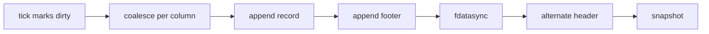

# Persistence, Asset Pipeline and Distribution: A Storage-First Design for OpenBlock

**Status:** draft for review · **Research date:** 2026-11-24 · **Related docs:** [01-weft-teardown.md](01-weft-teardown.md) (region-file baseline), [02-engine-and-render-stack.md](02-engine-and-render-stack.md) (crate set), [03-voxel-rendering-sota.md](03-voxel-rendering-sota.md) (section size, memory), [04-networking-sota.md](04-networking-sota.md) (join and chunk transport), [06-modding-and-content-system.md](06-modding-and-content-system.md) (pack manifests, content hashing), [07-legal-licensing-and-ip.md](07-legal-licensing-and-ip.md) (asset licences), [08-ui-audio-localization.md](08-ui-audio-localization.md) (fonts, audio, text) · **Assumption:** 16³ storage/light/edit sections, 32×32-column regions, 384-block Overworld, 20 Hz simulation, 512-block default render radius. If the section or height decision changes, the container still applies; section blob sizes and, for non-16³, the record version change. This is research, not a decision record.

**Evidence:** crate versions and API claims were checked against crates.io and docs.rs on 2026-11-24; every size, throughput and latency marked **[E]** is derived here from the stated assumptions and must be replaced by measurement. Weft is cited for design and measured behaviour only; no code is copied.

## 0. Verdict

| Area | Recommendation | Version / format | Why |
|---|---|---|---|
| Save container | Custom append-only region files with a footer directory and double-buffered header | OBR v1, 32×32 columns | Bounded file count, cheap random reads, no C dependency, mod-inspectable, column-atomic commits |
| Compression | zstd per column; network codec owned by `ob_protocol` | `zstd` 0.14.4, level 3 (dirty flush level 1) | 2.5–4× on block data at 300–500 MB/s [E]; frame checksum; seek-free per-column decode |
| Section encoding | Hand-written little-endian bit-packed records; no Serde in the hot path | OBR section blob | Smallest, deterministic, versioned; a `u16`-field Serde struct costs 2–4× |
| Content IDs | Embedded, append-only content table mapping dense world IDs to resource IDs | `content-table.bin` | One authoritative mapping per world; no `ids.txt`/save desync; missing mods are recoverable |
| Textures | Texture arrays, 256-layer pages, KTX2 payloads; BC7/BC5 desktop, ASTC mobile | KTX2 + `intel_tex_2` 0.5.0 | No atlas bleeding, correct mips, bindless pages; 16×16 base textures are tiny even uncompressed |
| Audio | Ogg Vorbis for SFX/music; Opus only for voice later | `kira` 0.12.6 + `symphonia` 0.6.1 | Pure-Rust Vorbis decode; Symphonia 0.6.1 has no Opus codec feature |
| Build | `cargo-dist` + GitHub Actions + sccache; native runners for each OS | `cargo-dist` 0.34.0, `sccache` 0.20.0 | Reproducible archives, less CI glue; cross-compiling MSVC/Apple remains the fragile path |
| Updates | Signed manifest, staged versions, health check, rollback; zstd prefix delta | Ed25519 + `zstd` `with_ref_prefix` | Signature verification is independent of CDN/TLS; rollback survives bad drivers and bad worlds |
| Crash reporting | Opt-in `sentry` + `sentry-minidump`; no default upload on servers | `sentry` 0.49.6, `sentry-minidump` 0.49.6 | Minidumps need a separate process; memory dumps are sensitive and must be consented |

**Target budgets.** At 512-block radius: join disk+decode ≤ 2 s on SATA SSD, ≤ 5 s on HDD; sustained save ≤ 4 MB/s and ≤ 8 ms p99 per commit; normal streaming ≤ 8 MB/s read; client binary ≤ 40 MB stripped; server binary ≤ 40 MB; base assets ≤ 150 MB. These are proposals to benchmark, not measurements.

## 1. Workload, sizes and budgets

### 1.1 What is persisted

A column carries sections (10–12 KiB raw per non-empty 16³ section [E]), block entities, entities (45–120 B + payload) and ticks; it is large and rewritten on any edit. Player files are 5–100 KiB and rewritten often; metadata is a 2–20 KiB JSON manifest plus a 0.5–2 MB content table (5–20 MB modded [E]) that must never be half-written. A database tuned for small player writes pages a 22 KiB column badly; one tuned for columns makes player snapshots expensive.

### 1.2 World size at 512-block radius

Assumptions: radius 512 blocks = 1,024×1,024 blocks = 64×64 = **4,096 columns**; Overworld 384 blocks = 24 sections; a non-empty section averages 5-bit palette indices (2,560 B), 8,192 B packed light, ~200 B palette/biome/header = **10.9 KiB raw**; zstd 3 gives 2.5–3.5× on this mix, but block indices are high-entropy so assume 3× [E]. Typical explored terrain has ~6 non-empty sections per column (surface, caves, structures); a fully generated/edited column has 24.

| Scenario | Raw | Compressed | At 512 radius | At 2,048 radius (16× area) |
|---|---:|---:|---:|---:|
| Surface-explored, 6 sections/column | 65 KiB/col | ~22 KiB/col | **88 MiB** | **1.4 GiB** |
| All 24 sections present | 262 KiB/col | ~90 KiB/col | **360 MiB** | **5.6 GiB** |
| Poorly compressible (noise/random edits) | 262 KiB/col | ~240 KiB/col | **960 MiB** | **15 GiB** |

Add 20% for entities/block entities: +18–72 MiB at 512 radius. Four region files of 32×32 columns (~22 MiB each typical, ~90 MiB all-height) make a cacheable working set; at 2,048 radius there are 64. **Compaction and backup copy cost**, not region-file count, are the limit. A 1,024-block-tall dimension raises the section count from 24 to 64; light is 75% of raw section bytes, so compressing light matters as much as blocks.

### 1.3 IO budget at 512-block radius

At 10 m/s, crossing one 16-block strip exposes 64 new columns; new columns/s = 64 × (10/16) = **40 columns/s**, or ~0.9 MB/s compressed at 22 KiB/column. At 40 m/s (elytra) it is 160 columns/s, ~3.5 MB/s. The disk is not the bottleneck for normal flight; generation, meshing, lighting and network are.

A join reads 88 MiB and decodes to ~260 MiB: ~44 + 170 ms on NVMe, ~176 + 300 ms on SATA SSD, ~590 + 500 ms on HDD, plus 200–400 ms parse/copy [E]. A 22 MiB region compacts in 25/90/300 ms respectively. Targets: join ≤ 2 s p95 on SATA SSD, ≤ 5 s on HDD; streaming ≤ 8 MB/s; save ≤ 4 MB/s; commit p99 ≤ 8 ms; no tick stall. At 100 Mbit/s a client join is network-bound at ~7 s, so render progressive/local data.

## 2. Save container: options and choice

### 2.1 Options

| Option | Write amplification | Random read | Crash safety | Compaction | Mod/tool inspectability | Verdict |
|---|---|---|---|---|---|---|
| **Region files, append records + footer directory** | 1 column per dirty column (22–90 KiB) | One footer read + one record read | Strong: CRC + append + double-buffered header + fsync order | Rewrite live records per region | Good: documented bytes, CLI dump | **Adopt** |
| Append-only log + periodic snapshot | Low | Index lookup; log scan on recovery | Strong if records self-validating | Snapshot + truncate | Good | Viable alternative; worse locality at 512 radius |
| SQLite (`rusqlite` 0.43.0) / Turso 0.8.4 | Page-level, BLOB rewrite + WAL | B-tree lookup, page cache | Excellent (WAL, fsync) | `VACUUM` / incremental vacuum | Excellent SQL tooling | Reject for chunk blobs: C build or young Rust rewrite, page fragmentation, opaque mod data |
| redb 5.0.0 [S4] | B-tree page copy-on-write | in-memory page cache | ACID, MVCC, `compact()` | Explicit compaction | Rust tooling, opaque pages | Use only for metadata if it grows; not for 4,096 large blobs |
| fjall 3.1.13 / sled 0.34.7 | LSM: repeated rewrite of levels | Memtable + SSTables | Good | Background compaction | Opaque SSTables | Reject: write amplification, compaction jitter; sled's last release was 2024 |
| One file per chunk | None (file replaced) | Filesystem lookup | Atomic rename per chunk | Directory-dependent | Easiest to inspect | Reject at 4,096+ files: directory scans, inode overhead, slow backup; keep as an export format |

The dominant write decides. Rewriting a 22 KiB column for 100 edits/s across 30 columns is ~0.7 MB/s, trivial. SQLite's WAL is excellent, but a 22 KiB zstd BLOB rewrites pages and adds a C dependency and a second locking model beside the engine's region locks. A custom container stays deterministic, streamable and inspectable, and the server can send compressed column bytes without re-encoding.

### 2.2 Weft's baseline: what to keep, what to fix

Weft writes only sections that differ from deterministic generation; untouched sections are regenerated instead of stored [01-weft-teardown.md](01-weft-teardown.md). Its region files hold 8³ sections (512 entries) with a 4 KiB `(offset, length)` header, size-prepended LZ4 blobs appended at the end, compaction when dead bytes exceed live bytes by more than 1 MiB, and an `ids.txt` mapping world IDs to names [S1]. `SAVE_FORMAT = 3` refuses other formats and has no migration path [S1].

Keep only-differs-from-generation storage (the generator is the best compressor), append-only records, fixed header, name-stable IDs, a format gate and one region file per spatial group.

Fix, in order of risk:

1. **In-place, unchecked header writes.** A torn 8-byte `(offset, length)` entry can point at garbage. Use two header slots, CRC, sequence numbers and a data-before-header fsync order.
2. **No per-record checksum, and `u32` offsets.** Add CRC32C per stored record and per uncompressed body plus a zstd frame checksum; use `u64` offsets and cap a single record at 4 GiB, not the file.
3. **Compaction on open is blocking and not crash-atomic.** `tmp` + rename without fsync can lose the rewrite. Compact in the background with fsync, directory fsync and an atomic replace.
4. **Missing content silently becomes air/empty.** Preserve world IDs and raw payloads, render a placeholder, and keep a quarantine list.
5. **No migrations, group commit or snapshot isolation.** Version every layer and ship a migration harness before 1.0; batch commits and publish immutable footer snapshots.
6. **Section-based regions (8³ sections) do not align with the 32×32-chunk region in the conventions.** Column records match streaming and are simpler; the cost is write amplification, addressed in phase 4 if measurements demand it.

### 2.3 Chosen shape



The save thread is the only writer that appends to live region files; compaction writes a private `.tmp` on a separate thread and swaps under the region lock. Readers take an immutable `Arc<RegionSnapshot>` containing the header generation and directory; commits append new records and a new footer, then publish a new snapshot. An append-only log plus snapshot is a viable export/backup format, but a per-region directory gives O(1) random reads and bounds compaction units. Old records remain readable until compaction rewrites the file, so readers never see a half-written column.

## 3. Proposed OBR v1 format

All integers are little-endian. All CRCs are CRC32C (Castagnoli, hardware-accelerated by `crc32c` 0.6.9 [S6]). Offsets are bytes; records and footers start on 8-byte boundaries. Strings are UTF-8 with a varint length; resource IDs follow [00-conventions.md](../spec/00-conventions.md) (`namespace:path`, ASCII). `varint` is LEB128, unsigned.

### 3.1 World directory

```text
<world>/
  world.json, world.json.bak       canonical manifest + previous generation
  world.lock                       advisory lock (fs4 1.1.0), PID/host/boot ID
  content/content-table.bin        zstd frame, CRC32C, append-only world IDs
  dimensions/0000-overworld/region/r.<x>.<z>.obr
  players/<uuid>.obp
  quarantine/<unix_ms>-<uuid>.json  lost/unknown content report
```

Backups live **outside** the world directory (`backups/<world-uuid>/<timestamp>/`) to avoid recursive copies. Hard links are **not** backups for region files: region files are modified in place (append + header update), so a hard-linked “snapshot” changes with the live file. Use filesystem CoW snapshots (ZFS/Btrfs/LVM thin) or a copy.

### 3.2 `world.json` (the `level.dat` equivalent)

Canonical JSON: UTF-8, sorted keys, no insignificant whitespace, `\n` at end, no floats where an integer is meant; the example is abbreviated and not sorted. The seed is a decimal **string** because JSON numbers lose precision beyond 2⁵³.

```json
{"schema":"openblock.world/1","format":{"major":1,"minor":0,"min_reader":1},
 "world_uuid":"018f...","seed":"-4172144997902289642",
 "default_dimension":"openblock:overworld",
 "dimensions":[{"id":"openblock:overworld","uuid":"018f...",
   "dir":"dimensions/0000-overworld","min_y":-64,"height":384,"section_size":16,
   "generator":"openblock:noise/1"}],
 "time":{"tick":1234567,"day":42,"weather":"clear"},
 "game_rules":{"do_fire_tick":true,"keep_inventory":false},
 "content":{"table":"content/content-table.bin","blake3":"...","count":26431},
 "packs":[{"id":"openblock:base","version":"1.0.0","hash":"blake3:..."}],
 "created_unix_ms":1790000000000,"last_saved_unix_ms":1790000000000}
```

Write order: `world.json.tmp` → `fdatasync` → rename over `world.json` → `fsync` parent directory. Keep one `.bak`. If the new file is unreadable at open, fall back to `.bak` and warn; never silently continue with defaults.

### 3.3 Content table

The table is the replacement for `ids.txt` and the reason missing mods are recoverable. It is a **single binary file**, zstd-compressed with a frame checksum and a trailing CRC32C over the uncompressed bytes, referenced by BLAKE3 from `world.json` and the multiplayer pack handshake.

```text
Header (32 B)
0   4  magic "OBC1"
4   2  version (1)
6   2  flags
8   4  entry_count
12  4  reserved
16  16 table_uuid
32  ... entries, each:
      1   kind          0=block_state, 1=item, 2=entity, 3=biome,
                      4=block_entity, 5=scheduled_tick
      1   flags
      2   reserved
      varint id_len; bytes id
      varint payload_len; bytes payload
end 4  CRC32C over the decompressed header + entries
```

Write the new table and fsync it before `world.json`; if their hashes disagree at open, fail closed and require `world repair --content`, which re-derives the manifest from the append-only table and the pack lock instead of guessing. The `id` is the canonical state/type string (for block states it includes sorted properties); for `block_state`, the payload is a structured state: `varint type_len + type`, `varint prop_count`, then sorted `(key, value)` string pairs. For items/entities/biomes, the payload carries the canonical type ID plus an optional schema version. Entries are **ID-append-only**: a new state gets the next dense `u32` world ID, and IDs are never renumbered or deleted; the file itself is atomically rewritten in a batch when entries are added. A vacuum that removes entries is a full-world rewrite with a remap pass and is explicitly out of scope for v1.

Section palettes store world IDs, not runtime IDs. On load, `world_id -> runtime_id` is resolved once through the registry. If the content is missing, the world ID **stays in the section** and resolves to a placeholder at runtime; if the player does not edit that block, it is written back unchanged. This is materially better than Weft's `unwrap_or(AIR)` [S1], which loses the original state on the next save.

### 3.4 Region file layout

Filename `r.<region_x>.<region_z>.obr`; region coordinates are floor(chunk/32). The container is deliberately Minecraft-shaped — 32×32 columns, 4 KiB header sectors, 1,024 directory slots [S2] — but uses append-only records and `u64` offsets. A file may exceed 4 GiB. The first 8,192 bytes hold two 2,048-byte header slots, each in its own 4 KiB sector (A at 0, B at 4,096), so one torn sector cannot destroy both. Payload records begin at 8,192, interleaved with footers; only the footer referenced by the newest valid header is authoritative. A fresh file may have no footer yet; an all-absent directory is the implicit empty state.

**Header slot (2,048 B; both slots identical layout):**

| Offset | Size | Field |
|---:|---:|---|
| 0 | 4 | magic `OBR1` |
| 4 | 2 | format major |
| 6 | 2 | format minor |
| 8 | 2 | header length = 2,048 |
| 10 | 2 | flags (bit 0 = clean shutdown) |
| 12 | 4 | region x (`i32`) |
| 16 | 4 | region z (`i32`) |
| 20 | 16 | dimension UUID |
| 36 | 8 | sequence (`u64`, strictly increasing per commit) |
| 44 | 8 | footer offset |
| 52 | 4 | footer stored length (zstd frame bytes) |
| 56 | 4 | footer raw length (41,032) |
| 60 | 4 | footer codec (byte 0 = zstd; bytes 1..3 reserved) |
| 64 | 4 | footer raw CRC32C |
| 68 | 4 | directory entry count (1,024) |
| 72 | 8 | append cursor (end of all appended records/footers) |
| 80 | 8 | live bytes (sum of record lengths) |
| 88 | 8 | dead bytes (footers, old records, padding) |
| 96 | 8 | created Unix ms |
| 104 | 8 | modified Unix ms |
| 112 | 4 | footer stored CRC32C |
| 116 | 4 | header CRC32C over bytes 0..116 |
| 120 | 1,928 | zero |

On open, read both slots, reject bad magic/version/CRC, and choose the valid slot with the highest sequence. A tie is a bug; choose A and log. The new header is never written until its footer is durable.

**Footer (raw 41,032 B, usually compressed to 2–10 KiB):**

| Offset | Size | Field |
|---:|---:|---|
| 0 | 4 | magic `OBF1` |
| 4 | 2 | major |
| 6 | 2 | minor |
| 8 | 8 | sequence (must equal header) |
| 16 | 4 | entry count = 1,024 |
| 20 | 4 | entry size = 40 |
| 24 | 8 | append cursor |
| 32 | 8 | live bytes |
| 40 | 8 | dead bytes |
| 48 | 8 | last write Unix ms |
| 56 | 4 | reserved |
| 60 | 4 | directory CRC32C over bytes 64..41,024 |
| 64 | 40,960 | 1,024 directory entries |
| 41,024 | 4 | footer CRC32C over bytes 0..41,024 |
| 41,028 | 4 | zero padding |

**Directory entry (40 B, one per chunk column):**

| Offset | Size | Field |
|---:|---:|---|
| 0 | 1 | state: 0 absent, 1 present, 2 tombstone |
| 1 | 1 | flags: bit0 block entities, bit1 entities, bit2 ticks, bit3 extensions, bit4 corrupt |
| 2 | 1 | codec: 0 none, 1 zstd, 2 lz4 |
| 3 | 1 | reserved |
| 4 | 8 | record offset |
| 12 | 4 | record stored length (header + payload + padding) |
| 16 | 4 | record raw length |
| 20 | 4 | record stored CRC32C |
| 24 | 8 | section mask (bit `sy - dimension_min_section`) |
| 32 | 4 | column generation (increments per write) |
| 36 | 4 | last modified Unix seconds |

**Record header (32 B):**

| Offset | Size | Field |
|---:|---:|---|
| 0 | 4 | magic `OBK1` |
| 4 | 1 | type: 1 = column |
| 5 | 1 | record version (1) |
| 6 | 1 | codec: 0 none, 1 zstd, 2 lz4 |
| 7 | 1 | flags |
| 8 | 4 | stored payload length |
| 12 | 4 | raw length |
| 16 | 8 | simulation tick at write |
| 24 | 4 | raw body CRC32C |
| 28 | 4 | header CRC32C over bytes 0..28 |

The stored record is `header || codec(payload) || zero padding to 8 B`; `record stored length` includes all three. The body is compressed with zstd level 3 (level 1 for routine dirty flushes), `include_checksum(true)`, `include_contentsize(true)`. Compression is **per column, not per region**: random reads stay random, a corrupt column does not poison its neighbours, and compaction can copy compressed records without recompression. A per-region frame would improve the ratio slightly but forces a whole-region decode and rewrite; LZ4 (`lz4_flex` 0.14.2) is for latency-critical wire messages, and deflate (`flate2` 1.1.11) only for ZIP pack JSON, never for saves, because zstd is faster and smaller at this size.

**Column body (uncompressed):**

```text
0   4  magic "OCL1"
4   2  body version (1)
6   2  flags
8   4  chunk x (i32)
12  4  chunk z (i32)
16  2  min section y (i16)
18  2  section count
20  4  biome palette count
24  ... biome palette: varint world biome ID each
...    sections, in ascending sy:
         2  sy (i16)
         4  section flags (bit0 uniform, bit1 has light, bit2 has biomes)
         varint palette count; palette_count × varint world state ID
         1  bits per index (0..24)
         varint word count; word_count × u64
         1  biome bits (0..6)
         varint biome word count; biome_word_count × u64
         8,192  packed light: four 2,048 B planes (sky/R/G/B), 4 bits/block
...    varint block entity count; entries
...    varint entity count; entries
...    varint scheduled tick count; entries
...    varint extension count; TLV entries
```

Sizes above are for 16³; `dimension.section_size` scales the index count and light length; biome cells stay 4×4×4 per section, with their block resolution changing. Section flags gate the light and biome fields: when bit1 or bit2 is clear, the corresponding 8,192-byte light block or the biome bits/words are omitted. Palette indices are a little-endian bit stream, least-significant bit first; index `i` occupies bits `[i*bits, (i+1)*bits)`, and the 4,096 indices are ordered `x + 16*(z + 16*y)` (X fastest). A uniform section has `palette count = 1`, `bits = 0`, no words. Light uses the same block order; each 4-bit channel is two blocks per byte, low nibble first. Biome cells are 4×4×4 per section in order `bx + 4*(bz + 4*by)`; the palette is column-wide.

**Block entity entry:** `i16 sy`, `u16 local_index` (`x | z<<4 | y<<8`), `varint type_world_id`, `varint payload_len`, `bytes payload`. Payloads are opaque to the storage layer; the core schema or mod owns them. Unknown payloads are preserved verbatim.

**Entity entry:** `16-byte UUID`, `varint type_world_id`, `u8 flags` (velocity/rotation/payload), `f64 x,y,z`, optional `f32 yaw,pitch`, optional `f64 vx,vy,vz`, optional `varint payload_len + bytes`. NaN/Inf and negative zero are rejected/canonicalized on write. On load, duplicate UUIDs across columns are resolved by the record's write tick, then column generation; this covers the crash window where an entity moved chunks but the old column was not yet rewritten.

**Scheduled tick entry:** `i16 sy`, `u16 local_index`, `u64 trigger_tick`, `u8 priority`, `varint type_world_id`, `varint payload_len`, payload. Unknown tick types are kept but not executed, so re-adding the mod restores them.

**Extensions:** `u16 tag`, `varint len`, bytes. Tag `0xFFFF` means a named extension (`varint name_len`, name, `varint data_len`, data) for mod column data. Unknown core tags are preserved; the column is rewritten with them unchanged.

### 3.5 Player data

`players/<uuid>.obp`, atomic replace, 64-byte header + zstd body:

```text
0  4 "OBP1"; 4 2 version; 6 2 flags; 8 16 uuid; 24 8 last tick
32 4 stored len; 36 4 raw len; 40 4 body CRC; 44 4 header CRC; 48 1 codec
49..63 zero; 64 ... zstd(postcard player record)
```

The body holds position/dimension, rotation, game mode, inventory, ender chest, effects, spawn point, stats, advancements, permissions and mod payloads. Write to `.tmp`, `fdatasync`, rename, `fsync` directory; keep `.bak`. The server writes on logout, world save and every 30 s if dirty; a crash loses ≤ 30 s (configurable). One corrupt player file cannot fail the world open.

### 3.6 Atomicity, fsync and crash recovery

Write order: (1) coalesce dirty columns and serialize on the storage thread; (2) append records, then a footer, and `sync_data`; (3) write the inactive header slot with sequence+1 and the new footer pointer, `sync_data`, (4) publish the new snapshot. If step 3 is torn, the other header points to the previous durable footer; if the footer is torn but the header is durable, the footer CRC fails and recovery falls back to the previous slot. If both headers are lost, `openblock world repair` scans from 8,192 for `OBK1`/`OBF1`, validates CRCs and rebuilds a directory choosing the highest generation per column; torn tails are ignored. A referenced record with a bad CRC is **not** silently replaced with air: the world fails to open by default, and `--repair --allow-data-loss` quarantines the column.

`durability` settings: `full` (server default) = fdatasync data + header every commit/1 s; `fast` (client default) = group commit every 2 s; `none` = benchmarks only. On macOS, `File::sync_all` may not survive power loss; use `fcntl(F_FULLFSYNC)` for `full`. On Windows, `FlushFileBuffers` on the file plus a write-through rename for metadata; directory handles cannot be fsynced like POSIX, so the rename is the durability point. Do not claim stronger semantics than the OS provides.

Cross-column operations (entity transfer, portal, multi-block structure) are not transactionally atomic. A crash can duplicate an entity (resolved by UUID) or leave half a structure; v1 accepts this and a phase-4 intent journal is optional.

### 3.7 Compaction and backups

Compaction triggers when `dead_bytes > max(8 MiB, live_bytes / 2)`, bounding a region to ~1.5× live size instead of Weft's “dead > live + 1 MiB”, which rewrites large regions too eagerly [S1]. Rewrite live records in ascending column order to `r.x.z.obr.tmp`, fsync, rename, fsync the directory. Only the target region's commits queue until the swap; other regions keep committing. Readers with the old file descriptor keep the old inode on POSIX; on Windows, open region files with `FILE_SHARE_DELETE` or defer compaction until readers close. A `.tmp` left by a crash is ignored.

Backup: flush writers, pause compaction, copy `world.json`, `content/`, `players/` and each region (or use a CoW snapshot), verify a BLAKE3 manifest, then atomically rename the backup directory. Retention is 7 daily / 4 weekly / 12 monthly. Restore targets a new directory and verifies before swapping. Copying a live region may include an unreferenced tail; the header/footer pair remains consistent, so the copy is valid.

### 3.8 Versioning and migrations

Format version exists at four layers: `world.json.format`, the OBR header, the record header, and the content/item/entity payload envelope. Minor versions are additive; readers skip unknown TLV extensions and preserve them. Major versions run a migration chain `v1 -> v2 -> ...` on a **copy** of the world, verify with the same golden corpus, then atomically swap directories and keep the old one. Refuse a newer major with a message that names the required build; never write a format the current build cannot read. Unlike Weft's `SAVE_FORMAT = 3` with no conversion [S1], the migration harness and fixtures exist from the first public build, even if no migration is implemented yet.

### 3.9 Known weaknesses a reviewer should attack

- **Column/footer write amplification:** an edit rewrites 22–90 KiB and each commit rewrites a 40 KiB footer (2–10 KiB compressed). Coalesce per 1–2 s; phase 4 adds section deltas if profiling shows > 4 MB/s sustained.
- **Content table never shrinks; CRC32C is not cryptographic:** removed mods leave entries until a remap rewrite; CRC32C detects accidents, not tampering, so distribution/backups use BLAKE3 and a local writer is outside the threat model.
- **Single writer, no encryption at rest:** the lock forbids multi-process writers; read-only network shares may serve stale data, and NFS/SMB fsync/locking differ. Use filesystem encryption and do not treat network storage as primary.
- **Entity duplication and `u32` record length:** UUID dedupe hides the transfer window, but exactly-once mods need the phase-4 journal; a pathological column above 4 GiB fails to save and must be reported, not truncated.

## 4. Serialization and schema evolution

| Format | Size | Speed | Self-describing | Schema evolution | Unsafe | Recommended use |
|---|---|---:|---|---|---|---|
| Hand-written LE bit-packed | Smallest | Fastest | No | Explicit version + TLV | No | Sections, light, palettes, directory |
| `postcard` 1.2.0 [S5] | Compact (varint) | Fast | No | Field order + `serde(default)` + envelope | No | Entity/block-entity/mod payloads, control records |
| `bincode` 3.0.0 | Compact (fixed int) | Fast | No | Poor; no field names | No | **Avoid** for saves; new major (2025-12), little ecosystem evidence |
| `rkyv` 0.8.18 | Compact | Very fast | No | Poor; archived layout is ABI | Validation + unsafe | **Avoid** for persistent data |
| JSON | Large | Slow | Yes | Good | No | `world.json`, pack manifests, diagnostics |

**Why not derive Serde on everything?** The hot section arrays are dominated by two large byte arrays (indices + light). A derived `Vec<u16>` or `Vec<u8>` per section adds length prefixes, per-element bounds checks, and allocation; hand-written `Encode`/`Decode` gives a stable byte layout that can be hashed, fuzzed and read by a C/Rust/Python tool. Serde is still useful at the edges: `postcard` payloads are small, schema-versioned and not performance-critical. MessagePack (`rmp` 0.8.15 [S5]) is self-describing but larger and slower; an NBT-like encoding is for import/export and Minecraft tool compatibility, not the native format.

**Compatibility rules.** Every payload starts with a version. New fields go into a TLV extension or a new record version; readers preserve unknown bytes when rewriting, and writers declare `min_reader` rather than letting an older build misinterpret a record. Client and server share `ob_world::codec`; `ob_protocol` owns network encoding and must not be imported by `ob_world` (Weft's `world::Cube` implementing the network `Wire` trait is the anti-pattern [01-weft-teardown.md](01-weft-teardown.md)). Golden files per version live in `crates/world/tests/golden/`; round-trip tests assert byte equality and fuzz targets assert bounded allocation and no panic.

**Missing content.** Default policy is `placeholder` for single-player and `fail` for servers; `--allow-missing-content` downgrades to placeholder plus quarantine. Unknown block states render as `openblock:missing` (visible, non-solid, non-interactive) but keep their world ID. Unknown block entities/entities are preserved as opaque records but not simulated; unknown items keep their type ID/components and are shown as `openblock:unknown_item`; unknown ticks are stored but not executed. Re-adding the mod restores the original data because nothing was renumbered or dropped.

**Deterministic serialization.** Fixed field order, little-endian, sorted arrays (entity UUID, tick position+trigger, extensions by tag), canonical JSON, integer ticks, no `HashMap` iteration. Floats are limited to entity position/rotation; `NaN`, `Inf` and `-0.0` are canonicalized. The same codec runs on all targets; cross-compiling to aarch64 must produce byte-identical golden files.

## 5. Asset pipeline

### 5.1 Texture arrays versus atlases

| Property | Texture array | Atlas |
|---|---|---|
| Bleeding at edges | None: layers are independent | Needs padding/gutters; mip levels bleed |
| Mipmaps | Per layer, correct chain | Manual per-tile clamping; cutout mips shrink |
| Uniform tile size | Required | Flexible |
| Animated/modded | Extra layers; add a layer and repack if the page is full | Strip frames; repack can shift every UV |

**Recommendation: arrays for terrain, items and GUI.** wgpu 30's default `max_texture_array_layers` is **256**; many desktop adapters expose 2,048, but the portable baseline is 256 [S14]. Page at 256 layers: base albedo ~600 layers = 3 pages, normals = 3, mask/roughness = 3, so nine bindings. The shader computes `page = layer >> 8`, `local = layer & 255`, indexes a binding array of page views. If the adapter lacks non-uniform binding-array indexing, fall back to a fixed per-page binding set plus a switch, or to `RGBA8` pages with a smaller page size. Do not build a mega-atlas for terrain; the padding and mip bleeding cost more than the extra bindings.

### 5.2 Texture compression and KTX2

| Platform | Albedo (sRGB) | Normal | Mask/roughness | Fallback |
|---|---|---|---|---|
| Windows/Linux (D3D12/Vulkan) | BC7 | BC5 (reconstruct Z) | BC7 or BC4 | RGBA8 |
| macOS (Metal) | BC7 if `TEXTURE_COMPRESSION_BC`; else ASTC if exposed | BC5 | BC7/BC4 | RGBA8 |
| iOS/Android | ASTC 4×4 or 6×6 | ASTC | ASTC | ETC2, then RGBA8 |

Base 16×16 textures are tiny: 600 layers × 256 B (BC7) = 150 KiB before mips, 200 KiB after. Compression matters for 64–256 px packs and integrated-GPU bandwidth: 600 layers at 128×128 RGBA8 + mips is ~52 MiB, versus ~13 MiB as BC7 (4:1). Encode offline, not at runtime.

Build pipeline: author PNG/TGA (or KTX2 for power users), validate power-of-two dimensions, alpha intent and sRGB/linear intent; generate mips in linear light with alpha-coverage preservation for cutout and renormalized normals; encode per profile with `intel_tex_2` 0.5.0 (BC7/BC5/ASTC modules; ISPC, build-machine only) [S8]; wrap in KTX2 with `vkFormat`, level index, DFD and metadata; pack profile-selected payloads into 256-layer pages. `ktx2` 0.5.0 is a **parser**, not a writer [S8], so either write a small in-repo KTX2 writer validated by `ktx validate` or pin the Khronos `ktx` CLI [S9]. `block_compression` 0.11.0 is a WGPU-compute alternative for GPU CI, but never make GPU hardware a build requirement. The runtime never calls a block compressor.

Basis Universal is not the default: `basis-universal` 0.3.1 dates from 2023 [S9] and the pure-Rust `basisu` 0.1.0 is young (2026-07). Use prebaked per-platform formats for first-party packs; allow Basis/UASTC only for cross-platform mod packs where one payload must serve several GPUs, and transcode once into a content-addressed cache.

### 5.3 Models, animation, fonts and audio

**Models and animation.** Use an internal JSON block/item model schema (elements, faces, UVs, rotation, tint, display transforms) compiled at pack build into GPU quads; it is Minecraft-shaped but original and JSON-Schema-validated. Accept Blockbench `.bbmodel` through a converter, glTF 2.0 through the `gltf` 1.4.1 crate at **build time only** [S10], and MagicaVoxel `.vox` for props. Entities use a small skeletal/keyframe runtime format compiled from glTF animations; block entities use JSON keyframes. No runtime glTF or `.bbmodel` parsing.

**Fonts and audio.** `cosmic-text` 0.19.0 shapes text, `fontdb` 0.24.0 supplies fallback, `glyphon` 0.12.0 renders it on wgpu [S11]. Ship Noto Sans (OFL) plus a small fallback set; subset CJK per locale or stream it, because a full face is 10–20 MB. Use a 2,048² R8 glyph atlas with LRU eviction and cache shaped runs. For audio, `kira` 0.12.6 handles mixing/effects and `symphonia` 0.6.1 decodes; Symphonia 0.6.1 has Ogg/Vorbis, FLAC, WAV, MP3 and AAC features but **no Opus codec** [S11]. Use Ogg Vorbis q4–q6 at 48 kHz, mono SFX and streamed stereo music; add `opus` 0.4.0 only if voice/low-bitrate streaming becomes a requirement. Normalize loudness offline and store per-asset gain.

### 5.4 Hot reload, caching and pack layering

Dev mode watches pack directories with `notify` 9.0.0 (200 ms debounce), validates the changed pack, rebuilds affected assets and swaps a new `AssetGeneration` atomically; the old generation retires with the last GPU frame using it. Release builds do not watch. Failures keep the previous generation rather than a half-loaded array.

Compiled assets are content-addressed by BLAKE3 over `(source bytes, encoder id/version, target profile, mip policy)` in `~/.cache/openblock/assets/<hash>` (or `%LOCALAPPDATA%`); CI and local builds share the key. Cleanup is LRU with a cap and never deletes the active generation. Release packs are deterministic ZIPs (`zip` 9.8.2): KTX2/OGG stored, JSON/defs deflated. `pack.json` declares `id`, `version`, `side`, `required_on_client/server`, dependencies, overrides and a BLAKE3 manifest, matching [06-modding-and-content-system.md](06-modding-and-content-system.md). Layering is base < official DLC < server-required < server-optional < local user; later layers override by resource ID and conflicts are reported. Dedicated servers load content packs but not client assets; the handshake compares pack hashes.

## 6. Build and distribution

### 6.1 Target matrix

| Target | Tier | Runner / method | Artifact | Notes |
|---|---|---|---|---|
| Windows x86_64 / aarch64 MSVC | 1 / 2 | `windows-2025` native; ARM runner or `cargo-xwin` 0.24.1 | `.exe`, MSI | Sign both; SmartScreen reputation; test ARM on hardware |
| Linux x86_64 / aarch64 GNU | 1 | Ubuntu 22.04 (glibc 2.35) native; ARM runner or `cargo-zigbuild` 0.24.1 | `.tar.zst`, optional `.deb` | glibc is forward-only; do not build on the newest distro |
| Linux x86_64 / aarch64 musl | 1 | `cargo-zigbuild` or Alpine; native ARM | static server binary | Docker `scratch` base |
| macOS x86_64 + aarch64 | 1 | Intel and ARM runners | universal `.app`/DMG | `lipo`, then sign + notarize |

Prefer native runners for Windows and macOS: MSVC libraries and the Apple SDK/licence are where “cross-compile” becomes a support burden. `cross` 0.2.5 is from 2023 and should not be adopted; `cargo-xwin` 0.24.1 and `cargo-zigbuild` 0.24.1 are current alternatives [S13]. Build the Linux client against glibc 2.35 so it runs on 22.04+; the musl server has no glibc dependency. Runner labels and store terms change; re-verify them at implementation.

### 6.2 CI, caching and release automation

Use one workflow: fmt, clippy (`-D warnings`), `cargo-nextest` 0.9.152, `cargo-deny` 0.22.0, `cargo-vet` 0.10.3, `cargo-auditable` 0.7.7, build matrix, package, sign, publish; pin every action by commit SHA. `sccache` 0.20.0 with an S3 bucket keyed by rustc version, target, features and `Cargo.lock` hash; target a 70–90% hit rate and ≤ 20 min cold build [S13]. `cargo-dist` 0.34.0 generates archives/installers and the tag workflow; verify MSI/DMG coverage before making it the only packager. A release is tag → tests → `cargo auditable` → strip/split debuginfo → sign → notarize → hash → SBOM/provenance → publish manifest; never build public artifacts on a laptop.

### 6.3 Code signing and notarization

- **Windows:** Authenticode SHA-256 + RFC 3161 timestamp via an EV/OV certificate on an HSM or Azure Trusted Signing; sign the executable, installer and DLLs. An unsigned updater is remote code execution. SmartScreen reputation is per certificate.
- **macOS:** Developer ID Application, hardened runtime, minimal entitlements (`allow-jit` only if the client embeds Wasmtime; avoid `disable-library-validation` at 1.0). Notarize with `notarytool submit --wait`, staple, verify `spctl --assess`. Build universal2 with `lipo`, then sign.
- **Linux and manifest:** publish SHA-256/BLAKE3 sums and a minisign/Ed25519 signature (Sigstore attestation optional); Flatpak and Steam sign their own. The update manifest is Ed25519-signed (`ed25519-dalek` 3.0.0) canonical JSON with `key_id`, rotation list and version floor [S14]; TLS protects transport, the signature protects a compromised CDN. Do not SPKI-pin the CDN.

### 6.4 Auto-updater, delta patching and rollback

```json
{"schema":"openblock.update/1","channel":"stable","version":"1.2.3","min_launcher":"1.0.0",
 "artifacts":[{"target":"x86_64-pc-windows-msvc","url":"...","size":38211042,"blake3":"...","delta_from":"1.2.2"}],
 "signature":"ed25519:..."}
```

Flow: check (opt-out) → verify signature/version → download → verify size/BLAKE3 → stage in `versions/<version>` → `pending.json` → launcher restart → health check (window, world, 30 s) → mark current → keep N−1/N−2. Two failures mark the version bad and revert with safe mode (no packs/plugins, reduced GPU features). Windows cannot replace a running `.exe`: the launcher switches a `current` junction. macOS replaces the `.app` atomically; signing survives because the bundle is copied.

**Delta:** zstd reference-prefix mode (`with_ref_prefix`, `long_distance_matching`, `window_log` 26–27) uses the old artifact as prefix; the decoder uses the same prefix [S3], effectively `zstd --patch-from` without bsdiff. Apply only when the patch is < 70% of full and the old hash matches; verify the reconstructed BLAKE3. A 5–12 MB delta for a 40 MB binary is plausible [E]; measure.

**Channel rules:** Steam and Flatpak own updates; disable the self-updater under `SteamAppId`/`FLATPAK_ID`. Itch builds may self-update. Dedicated servers do not self-update by default; operators use packages, Docker tags or an explicit update after a graceful drain.

### 6.5 Distribution channels

| Channel | Effort | Auto-update | Reach / revenue | Constraints |
|---|---|---|---|---|
| GitHub Releases | Low | Self-updater | Developers, modders | No store audience; you own signing and CDN |
| Steam | Medium–high | Steam | Large PC audience; 30% standard cut | Steamworks onboarding, depot builds, SteamPipe, Steam Deck verification |
| itch.io | Low | itch app; otherwise manual | Indie/demo audience; configurable revenue share | Butler upload; no built-in delta/rollback like Steam |
| Flathub / AUR | Medium / low | Flatpak/OSTree; Pacman | Linux desktop and Arch users | Sandbox/portals and review; AUR is community-maintained |

Recommendation: GitHub Releases is the primary store and updater source [S15]; Steam is the reach channel; itch carries the demo/beta; Flathub/AUR follow once sandbox and save-path portals are tested. No self-updater inside Steam or Flathub; keep signed artifacts identical across channels and record the channel in opt-in telemetry.

### 6.6 Crash reporting, telemetry and logs

`tracing` 0.1.44 + `tracing-subscriber` 0.3.23 + `tracing-appender` 0.2.5 produce JSON logs rotated at 50 MB × 5; `--diagnose` ZIPs redacted logs, config, GPU info, save header, pack hashes and the last 200 lines. Crash reporting uses `sentry` 0.49.6 + `sentry-minidump` 0.49.6, which spawns a separate crash-reporter process and attaches a minidump [S12]. Minidumps contain process memory (chat, tokens, world data): **opt-in**, disabled by default on servers; upload symbols in CI, scrub identifiers in `before_send`, retain 90 days. Telemetry is separate and opt-in: version, OS, CPU/GPU class, driver, frame-time buckets, load times, pack hashes, resettable install ID; no names, IPs, seeds, chat or serials. Self-host the collector and provide `--no-telemetry`, first-run consent and deletion.

### 6.7 Dedicated-server image, reproducibility and size

Docker: multi-stage musl build, `FROM scratch`, UID 10001, `/data` volume, read-only root, `cap_drop: ALL`, `no-new-privileges`, UDP game port, exec-form `HEALTHCHECK` (`openblock-server health`). Validate Wasmtime JIT under musl/`scratch` before shipping; if it needs glibc, switch to distroless/static. Build with `docker buildx build --platform linux/amd64,linux/arm64 --provenance=true`, sign with cosign, target ≤ 50 MB. `SIGTERM` drains, flushes and exits within 30 s (`terminationGracePeriodSeconds: 30`).

Reproducibility: pin toolchain 1.100, `Cargo.lock`, `--locked`, `SOURCE_DATE_EPOCH`, `--remap-path-prefix=$PWD=/build`; strip deterministically and build Linux twice in different directories. Windows PE needs `/Brepro`; macOS is verified before signing because notarization adds timestamps/tickets. Signed artifacts are **attestable, not bit-identical**: publish unsigned hashes plus signature/provenance, embed a dependency list with `cargo auditable` 0.7.7 and generate a CycloneDX SBOM. Do not claim reproducible builds until two CI runs match.

Size budgets (release, stripped, LTO thin, `panic=abort`): client 28–38 MB Linux/Windows x86_64, macOS universal 55–75 MB; server musl 30–40 MB with Wasmtime (15–20 MB without); image 35–50 MB; base assets 80–150 MB with music (20–40 MB without), HD packs 300–800 MB. Treat these as `cargo-bloat` guardrails; a 10% regression needs a reason.

## 7. Storage performance

### 7.1 io_uring versus blocking IO

| Property | Blocking `pread`/`pwrite` on a small thread pool | `io_uring` (`io-uring` 0.7.16) |
|---|---|---|
| Portability | Windows, macOS, Linux, BSD | Linux only (kernel 5.1+, restrictions vary) |
| Complexity | Low; one request per thread | Ring setup, SQE/CQE lifecycle, cancellation, registered buffers |
| Container/CI support | Always | Seccomp profiles, hosted kernels and sandbox policies may block it; must be tested |
| Verdict | **Default for all platforms** | Optional Linux server backend behind `io-uring` feature, benchmarked before enabling |

`tokio-uring` 0.5.0 (2024), `glommio` 0.9.0 (2024) and `monoio` 0.2.4 (2024) are stale; do not depend on them [S7]. Use one writer thread, 2–4 readers, `crossbeam-channel` 0.5.17 and a priority queue keyed by `(deadline, distance, generation)`. Compression runs on the storage thread or a small `rayon` 1.12 pool, never the simulation thread. Keep the blocking backend as the reference and run the same trace against io_uring before enabling it.

### 7.2 mmap versus buffered reads

| Property | `memmap2` 0.9.12 read-only mapping | `pread` into a pooled buffer |
|---|---|---|
| Latency predictability | Page faults can stall; readahead helps | Predictable; explicit readahead |
| Truncate/rename | SIGBUS if the file shrinks; compaction renames must be safe | No SIGBUS |
| Windows | Mapped file blocks deletion/rename unless share flags are set | Simplest |
| Verdict | Optional for immutable asset packs or a read-only world snapshot | **Default for region files** |

Do not mmap a live region file that compaction may rename or replace. If mmap is used for read-only snapshots, keep the old file descriptor and inode alive and never truncate; on Windows, open with `FILE_SHARE_DELETE` or skip mmap.

### 7.3 Async loading, prefetch and IO budget

Chunk states: `Absent -> Queued -> Reading -> Decoding -> Resident -> Meshing -> Ready`; cancellation is checked between states. Requests are prioritized by distance to the camera, view cone, whether the column is on the movement path, and whether it is needed for collision. Prefetch 1.5–2 s ahead of the camera using velocity extrapolation; issue reads for the next strip before the current one is meshed. Use `posix_fadvise(POSIX_FADV_WILLNEED)` on Linux and `PrefetchVirtualMemory` on Windows as hints only; the explicit queue is the guarantee.

At 512 radius, read the four region footers first, sort records by offset and issue sequential `readv`, not 4,096 tiny reads. Target ≤ 2 s p95 disk+decode on SATA SSD; if it exceeds 3 s, profile parse/allocation before blaming the disk. During play, budget ≤ 8 MB/s read and ≤ 4 MB/s write; if the save queue exceeds 64 MiB or 2 s, coalesce harder and backpressure chunk unload, never the tick.

Benchmark with `fio` 3.x before and after every format change:

```bash
fio --name=randread --filename=/data/test.obr --rw=randread --bs=64k --iodepth=32 --ioengine=io_uring --direct=1 --runtime=60
```

Use `--ioengine=windowsaio` on Windows. Replay traces of real joins/saves through `ob_storage`; report p50/p95/p99, MB/s, IOPS and CPU per MiB decompressed on NVMe, SATA SSD, HDD and a network share. The HDD/NFS numbers decide the minimum requirements.

## 8. Phased plan

| Phase | Deliverable | Exit criteria |
|---|---|---|
| **P0 Local save** | OBR v1 container, column codec, `world.json`, content table v1, player files; no compaction; CLI `world info`/`dump` | 1,000 round-trip + fuzz cases; 100 kill-9 injections at each fsync point with no data loss beyond the last commit; 512-radius load ≤ 5 s on SATA SSD at P0, ≤ 2 s by P1; checksum failure refuses to load |
| **P1 Server world** | Group commit, background compaction, backup/restore, `world repair`, advisory lock, save metrics; 20 Hz server integration | 24 h soak at 20 Hz with 20 players and periodic kill -9; p99 commit ≤ 8 ms; no tick stall > 2 ms attributable to storage; 10 GiB world opens in ≤ 30 s; backup verified by BLAKE3 |
| **P2 Modded worlds** | Content table resolution, placeholder/quarantine policy, unknown payload preservation, migration harness, pack-hash lock | Add/remove three mods with blocks/items/entities; original data restored when the mod returns; unknown entity/tick never executes; v0→v1 migration fixture passes; server fails closed by default |
| **P3 Distribution** | Signed update manifest, staged updates + rollback, GitHub/Steam/itch packaging, crash reporting opt-in, Docker image | Update from N−1 to N verified, failed health check rolls back; delta ≤ 70% of full for two consecutive releases; unsigned/bad-hash artifact rejected; image ≤ 50 MB and runs read-only |
| **P4 Scale** | Section-level delta records or immutable segments, incremental backups, optional io_uring backend, multi-world hosting | Only if P1/P2 metrics show write amplification, compaction pause or backup copy cost above budget; otherwise defer |

## 9. Open questions for the Lead

1. **Section size and world height.** This document assumes 16³ sections and 384-block Overworld, but [00-conventions.md](../spec/00-conventions.md) still mentions 32³ and up to 1,024 blocks. Which is frozen before the format is declared stable? Height changes region file size and the directory `section_mask` width (64 sections is the current limit); v1's 12-bit local indices assume 16³, so 32³ needs a new record version.
2. **Save-compatibility promise.** Do we guarantee forward-compatible worlds from the first public build, or only from 1.0? Weft gates formats with no migrations; we recommend building the harness immediately but promising compatibility only from 1.0.
3. **Region granularity.** Is column-level write amplification (22–90 KiB per edit) acceptable for 1.0, or must section-level delta records ship at 1.0? This is the largest format fork.
4. **Missing-content default.** Should a dedicated server fail closed by default (safe data, unhappy operators) or load with placeholders and quarantine (available server, possible gameplay anomalies)? We recommend fail-closed with an explicit override.
5. **Backups and player RPO.** Is a built-in copy/verify/retention tool required, or are filesystem snapshots (ZFS/Btrfs/LVM) supported? Is ≤ 30 s of lost player progress acceptable, or must inventory changes be synchronous? Hard links are not a backup for append-in-place region files.
6. **Asset compression baseline.** Must 1.0 ship KTX2 + BC7/BC5/ASTC, or is uncompressed RGBA8 acceptable for the base 16× pack with compression only for HD packs? This changes build tooling and mod-pack requirements.
7. **Distribution, crash reporting and telemetry hosting.** Steam first (reach, 30% cut, Steamworks work), GitHub first (control, self-updater), or itch first (demo/beta)? Self-host crash/telemetry from day one or use Sentry SaaS under a data-processing agreement, and are server minidumps ever collected?

## 10. Sources

- [S1] Weft save implementation — <https://github.com/Weft-Rust/Weft/blob/master/crates/engine/src/saves.rs> (read locally; region files, `ids.txt`, `SAVE_FORMAT = 3`, compaction); teardown — [01-weft-teardown.md](01-weft-teardown.md).
- [S2] Minecraft Wiki region format — <https://minecraft.wiki/w/Region_file_format>; Anvil lineage — <https://minecraft.wiki/w/Anvil_file_format> (32×32 chunks, 4 KiB sectors, 1,024 entries, zlib/LZ4).
- [S3] `zstd` 0.14.4 — <https://crates.io/crates/zstd>, <https://docs.rs/zstd/0.14.4/zstd/> (`include_checksum`, `with_ref_prefix`, `long_distance_matching`, `window_log`); `lz4_flex` 0.14.2 — <https://crates.io/crates/lz4_flex>.
- [S4] Storage engines: `redb` 5.0.0 — <https://docs.rs/redb/5.0.0/redb/struct.Database.html>; `fjall` 3.1.13 — <https://crates.io/crates/fjall>; `sled` 0.34.7 — <https://crates.io/crates/sled>; `rusqlite` 0.43.0 — <https://crates.io/crates/rusqlite>; `turso` 0.8.4 — <https://crates.io/crates/turso>.
- [S5] Serialization: `postcard` 1.2.0 — <https://crates.io/crates/postcard>; `rmp` 0.8.15 / `rmp-serde` 1.3.1 — <https://crates.io/crates/rmp-serde>; `bincode` 3.0.0 — <https://crates.io/crates/bincode>; `rkyv` 0.8.18 — <https://crates.io/crates/rkyv>.
- [S6] Storage primitives: `crc32c` 0.6.9 — <https://crates.io/crates/crc32c>; `blake3` 1.8.7 — <https://crates.io/crates/blake3>; `memmap2` 0.9.12 — <https://crates.io/crates/memmap2>; `io-uring` 0.7.16 — <https://crates.io/crates/io-uring>; `fs4` 1.1.0 — <https://crates.io/crates/fs4>; `crossbeam-channel` 0.5.17 — <https://crates.io/crates/crossbeam-channel>; `rayon` 1.12.0 — <https://crates.io/crates/rayon>.
- [S7] Stale async IO: `tokio-uring` 0.5.0 (2024-05-27) — <https://crates.io/crates/tokio-uring>; `glommio` 0.9.0 — <https://crates.io/crates/glommio>; `monoio` 0.2.4 — <https://crates.io/crates/monoio>.
- [S8] `intel_tex_2` 0.5.0 — <https://docs.rs/intel_tex_2/0.5.0/intel_tex_2/> (BC1/3/4/5/6H/7, ASTC, ETC1; ISPC); `ktx2` 0.5.0 — <https://crates.io/crates/ktx2> (parser only).
- [S9] Khronos KTX-Software — <https://github.com/KhronosGroup/KTX-Software> (`ktx` CLI, validation, Basis support); `basis-universal` 0.3.1 — <https://crates.io/crates/basis-universal> (2023); `basisu` 0.1.0 — <https://crates.io/crates/basisu> (2026-07).
- [S10] `gltf` 1.4.1 — <https://crates.io/crates/gltf>; `image` 0.25.10 — <https://crates.io/crates/image>; `zip` 9.8.2 — <https://crates.io/crates/zip>; `flate2` 1.1.11 — <https://crates.io/crates/flate2>; `notify` 9.0.0 — <https://crates.io/crates/notify>.
- [S11] Text/audio: `cosmic-text` 0.19.0 — <https://crates.io/crates/cosmic-text>; `fontdb` 0.24.0 — <https://crates.io/crates/fontdb>; `glyphon` 0.12.0 — <https://crates.io/crates/glyphon>; `kira` 0.12.6 — <https://crates.io/crates/kira>; `symphonia` 0.6.1 — <https://crates.io/crates/symphonia> (no Opus feature); `opus` 0.4.0 — <https://crates.io/crates/opus>.
- [S12] `sentry` 0.49.6 — <https://crates.io/crates/sentry>; `sentry-minidump` 0.49.6 — <https://docs.rs/sentry-minidump/0.49.6/sentry_minidump/>; `minidump-writer` 0.14.0 — <https://crates.io/crates/minidump-writer>; `tracing` 0.1.44, `tracing-subscriber` 0.3.23, `tracing-appender` 0.2.5.
- [S13] Build: `cargo-dist` 0.34.0 — <https://crates.io/crates/cargo-dist>; `sccache` 0.20.0 — <https://crates.io/crates/sccache>; `cargo-nextest` 0.9.152; `cargo-deny` 0.22.0; `cargo-vet` 0.10.3; `cargo-auditable` 0.7.7; `cargo-xwin` 0.24.1; `cargo-zigbuild` 0.24.1; `cross` 0.2.5 (2023, avoid); `cargo-bloat` 0.12.1.
- [S14] wgpu 30.0.2 `Limits` — <https://github.com/gfx-rs/wgpu/blob/v30.0.2/wgpu-types/src/limits.rs> (`max_texture_array_layers` 256); `ed25519-dalek` 3.0.0 — <https://crates.io/crates/ed25519-dalek>.
- [S15] Signing/distribution: Authenticode/Azure Trusted Signing — <https://learn.microsoft.com/azure/trusted-signing/>; Apple notarization — <https://developer.apple.com/documentation/security/notarizing_macos_software_before_distribution>; Steamworks — <https://partner.steamgames.com/doc/store/uploadsteam>; butler — <https://itch.io/docs/butler/>; Flathub — <https://docs.flathub.org/>; AUR — <https://wiki.archlinux.org/title/Arch_User_Repository>; Docker multi-platform — <https://docs.docker.com/build/building/multi-platform/>; fio — <https://fio.readthedocs.io/>; reproducible builds — <https://reproducible-builds.org/docs/>.
