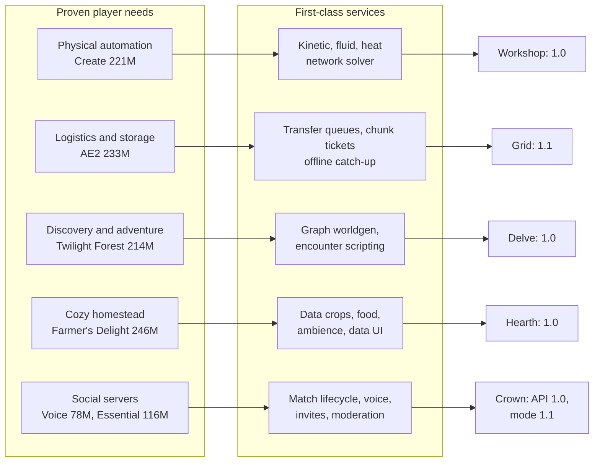

# Custom Content and Differentiation: What OpenBlock Offers That Minecraft Cannot

**Status:** draft for review
**Research date:** 2026-11-24
**Related docs:** [vision.md](../vision.md) (P5 "Beyond Minecraft", §8 success metrics), [06-modding-and-content-system.md](06-modding-and-content-system.md) (three-tier modding, host ABI, §6 generic services), [05-minecraft-feature-inventory.md](05-minecraft-feature-inventory.md) (parity floor and counts), [08-ui-audio-localization.md](08-ui-audio-localization.md) (UI, voice, accessibility), [04-networking-sota.md](04-networking-sota.md) (server and replication budgets), [07-legal-licensing-and-ip.md](07-legal-licensing-and-ip.md) (original names, assets and mod licences). Planned consumers: `docs/spec/15-content-system.md`, `docs/spec/16-modding.md`.
**Basis:** download counts from the Modrinth API and CurseForge (via the CFWidget mirror) on 2026-11-24; no primary player survey was run. This document is research, not a decision; the decision register does not exist yet. Scope figures are engineer-months (EM) for one experienced gameplay engineer, exclude art/audio/QA unless stated, and carry ±50%.

## 1. The claim

OpenBlock should not try to ship more Minecraft than Minecraft, and it should not try to ship a better Create than Create. The first contest is lost on volume: Minecraft has sold over 400M copies and reported 140M monthly players in 2021 [S9]; Create alone has 221M CurseForge downloads and five addons between 7.6M and 13.7M [S3][S12]; JEI, a recipe browser, has 651M [S3]. A new project with a small content team cannot match fifteen years of accumulated content, and should not pretend it can.

The second contest is lost on authorship. Create is seven years old, at 6.0.10, with a coherent art direction, animated contraptions and an in-game teaching system; cloning it is a multi-year content programme, not a launch feature. The same is true of AE2's logistics, GregTech's depth and Twilight Forest's adventure density. None of this is a claim that Minecraft is badly designed; it is a claim that its extension model is structurally fragmented.

What Minecraft *structurally* cannot do is make third-party content compose. Its modding economy is a set of incompatible islands: every tech mod ships its own energy unit, every magic mod its own resource, every server its own plugin stack, every modpack its own version lock. The player pays for that in wikis, config files, crashes and abandoned worlds. OpenBlock's differentiator is therefore not a larger catalogue; it is a small number of first-party packs built on *generic, conserved, server-authoritative services* that any mod can reuse, so that Workshop + Grid + a community magic pack produce one game instead of three overlapping tech trees.

The demo that matters three years out is this: a self-hosted server runs Workshop, Grid and a community magic pack under one content lockfile, a Crown match rotates between rounds, 50 players hold 20 TPS, nobody downloaded client code, and a new player joins in under five seconds. Minecraft can approximate each piece; it cannot do all of them in one process without a loader, a plugin stack and a wiki.

Five claims frame the rest of the document:

1. **The demand is proven and specific.** Physical automation, logistics, adventure, cozy homesteading, social servers and performance are not "more blocks"; each has a measured install base and a known vanilla gap.
2. **The winning design pattern is legibility.** One conserved primitive, visible in the world, failing locally. Create is the existence proof; its README says the game "isn't played inside a bunch of UIs" [S4].
3. **1.0 should ship three flagship packs** — Workshop (scoped), Hearth, Delve — and at most a fourth platform showcase (Crown) if the server team owns it.
4. **Everything else is API.** Grid, Signal, ecology, magic, mob ecology and in-game authoring ship as services first and content later; shipping them as 1.0 content is how the schedule dies.
5. **The engine requirements are testable.** Generic networks, moving grids, typed custom state, content-addressed saves, data-driven machine UI, match lifecycle, voice and in-world teaching scenes. If those are not first-class, every flagship becomes a fork.

**Non-goals.** No Minecraft names, textures or mechanics copied (see [07](07-legal-licensing-and-ip.md)); no marketplace or paid content; no first-party GregTech-scale grind; no single canonical magic system; no friends-list feature to compete with Java 26.4's new Friends list [S8].

## 2. Evidence: what modded players actually install

Method: cumulative download counts from the official Modrinth API [S1][S2] and CurseForge (read through the CFWidget mirror because direct CurseForge pages return 403 to automated fetches). Counts are in millions (M); CF = CurseForge, MR = Modrinth. Counts aggregate downloads of every version; pack installs and updates inflate them, so they measure *install base and ubiquity*, not unique players. CurseForge and Modrinth overlap; do not add the two columns. No public per-mod playtime data exists; Hypixel is the only concurrent-player figure cited here.

**Table A — content mods and packs.**

| Evidence | CF / MR downloads | Player need it addresses |
|---|---:|---|
| Create | 221.2M / 28.4M | Physical automation; visible engineering; creative autonomy |
| Applied Energistics 2 | 232.6M / 6.5M | Storage and logistics without chest walls |
| Mekanism | 180.4M / 4.0M | Ore processing and staged tech progression |
| Immersive Engineering | 199.3M / — | Industrial aesthetic; multiblocks; in-world machines |
| Thermal Expansion | 161.9M / 1.1M | Server-friendly early/mid tech; stable machines |
| Ender IO | 130.6M / 1.0M | Compact conduits: item, fluid, energy, redstone in one block |
| Botania | 172.6M / 4.4M | Magic as machines; in-world automation with little GUI |
| Tinkers' Construct | 196.4M / 4.0M | Tool/gear customisation and mining progression |
| The Twilight Forest | 213.7M / — | Adventure dimension; dungeon crawls; boss loot |
| Ice and Fire: Dragons | 110.2M / — | Creatures, danger and spectacle |
| Ars Nouveau | 118.6M / — | Spell crafting and magical expression |
| Thaumcraft | 63.7M / — | Research and discovery magic (legacy line) |
| Cobblemon | 30.6M / 37.2M | Creature collection and cozy multiplayer |
| Farmer's Delight | 246.3M / 26.1M | Food, farming and homestead comfort |
| GregTech CEu Modern | 9.1M / 0.4M | Very deep, long-horizon engineering (niche) |
| All the Mods 10 / 9 / 8 (ATM) [S11] | 23.2M / 13.7M / 9.3M, all CF | One-install breadth; kitchen-sink modpacks |
| Create addons (five) | — / 7.6M–13.7M each | Extension of a physical automation platform |

The five Create addons are Steam 'n' Rails 13.7M, Crafts & Additions 11.6M, Aeronautics 9.7M, Big Cannons 8.3M and Connected 7.6M [S12]. Their existence is as important as Create's own count: a good primitive spawns an addon economy.

Two caveats on the table. FTB's curated packs are smaller on raw downloads (FTB Academy 0.8M) but anchor the guided/expert segment, and the older Pixelmon has 5.2M on Modrinth against Cobblemon's 37M. Raw downloads favour kitchen-sink breadth and newer projects; the expert and creature segments are real but smaller.

**Table B — platform, information and social mods.**

| Evidence | CF / MR downloads | Player need it addresses |
|---|---:|---|
| JEI (recipe/usage viewer) | 650.9M / — | Information: recipes are opaque without a browser |
| JourneyMap | 360.0M / 15.7M | Orientation, waypoints, death recovery |
| Waystones | 333.0M / 28.3M | Fast travel; respect for limited play time |
| Xaero's Minimap | 263.1M / 122.0M | Spatial memory while exploring |
| Sodium | 166.6M / 256.2M | Frame rate and memory; vanilla stutter is a tax. MR peers: Entity Culling 192M, FerriteCore 170M, Lithium 146M |
| Iris Shaders | — / 197.4M | Visual identity and shader expression |
| Distant Horizons | 29.7M / 38.4M | Far view beyond Java's 32-chunk cap [S7] |
| Essential Mod | 115.6M / 49.4M | Friends, invites and social infrastructure |
| Simple Voice Chat | — / 77.9M | Proximity voice in multiplayer |
| e4mc | 25.7M / — | One-click LAN-style hosting |
| Controlify | — / 25.8M | Controller support on Java |
| ComputerCraft | 23.8M / — | Programmable blocks and in-world computers |
| OpenComputers | 53.3M / — | Programmable blocks and in-world computers |
| Sinytra Connector | — / 27.6M | Cross-loader compatibility (Fabric on NeoForge) |

**What the table says.**

- **Friction removal is as valuable as content.** JEI, JourneyMap, Waystones and minimaps out-download every content mod in the table; players will install four mods to avoid a wiki and a walk. A platform that ships this friction away has a real feature.
- **Create out-downloads older GUI-forward tech and is newer.** It has 221M cumulative downloads against Mekanism's 180M, Thermal Expansion's 162M and Ender IO's 131M, all older CurseForge projects (2013–2017); only AE2, a logistics and storage mod, is higher at 233M. Cumulative counts favour old mods, so Create's lead over those three understates its velocity.
- **Create's addons prove a platform effect.** Five independent addons each reach 7.6M–13.7M. That does not happen around a mod whose internals are closed or brittle; it happens when the primitive is extensible.
- **Adventure is mass-market.** Twilight Forest 214M, Ice and Fire 110M, Cobblemon 37M. Adventure is the second-largest Modrinth category by project count (19,694, after utility), ahead of equipment (18,279), decoration (12,588), mobs (11,492), worldgen (8,860), technology (8,844) and magic (7,462) [S13].
- **Cozy is not a niche.** Farmer's Delight has 246M downloads, more than any tech or magic mod in the table. Decoration (12,588 projects) and food (6,343) are large categories. A cozy flagship is not a concession to casual players; it is the mass market.
- **Social infrastructure is proven, but the easy gap is closing.** Voice 78M, Essential 116M and e4mc 26M [S14] show that vanilla's chat-and-Realms model is insufficient. Java 26.4 is adding a Friends list and Player Options [S8], so "Minecraft has no friends list" will soon be false.
- **Depth is a niche.** GregTech CEu Modern has 9.1M, roughly one order of magnitude below Create, while kitchen-sink ATM10 has 23.2M. The mass market wants breadth and a manageable on-ramp, not a second job.
- **Performance and visuals are table stakes, not differentiation.** Sodium at 256M and Iris at 197M mean the comparison is not vanilla Minecraft; it is Minecraft with Sodium. Shipping 512-block render distance by default is necessary but will not, by itself, make anyone switch.
- **Programmable blocks are a durable, underserved niche.** ComputerCraft 24M and OpenComputers 53M show sustained demand for programmable blocks; vanilla has nothing survival-native.
- **Compatibility pain is measurable.** Sinytra Connector's 27.6M downloads are players trying to make two loader ecosystems coexist. OpenBlock's capability/tag model should make that class of mod unnecessary.

**What the table does not say.** It does not prove that 650M people play modded Minecraft; dependency mods inflate counts, and one player can generate dozens of downloads across versions and packs. It does not measure retention, and it says nothing about players who never mod. The modded audience is likely a minority of Minecraft's 400M buyers, but it is the audience that rents servers, writes wiki pages and publishes packs — the audience a platform play must win first. A player survey and playtest cohort are recommended before locking D4 or D8 ([§9](#9-open-questions-for-the-lead), Q11).

## 3. Why Create is the design exemplar

Three primary-source excerpts from the Create README explain more than any download chart [S4]:

> "Aesthetic Automation."
>
> "The added elements of tech are designed to leave as many design choices to the player as possible. With Create, the game isn't played inside a bunch of UIs, it challenges you to set up contraptions of animated components working together in many possible arrangements."
>
> "Create's visual in-game documentation called 'Ponder' will guide you through all added mechanics and gadgets."

The fantasy is kinetic: power is something you can see turning, not a number in a buffer. The mechanics are one conserved economy. Shafts, cogs, belts and gearboxes transmit rotation; machines consume *stress* measured in SU at a given RPM; generators supply it. A hand crank supplies 256 SU at 32 RPM, a water wheel 128 SU at 8 RPM, a large water wheel 512 SU at 4 RPM, a windmill 512–8,192 SU at 1–16 RPM, and a steam engine 2,048 or 16,384 SU at 16 or 64 RPM. If total stress impact exceeds capacity, the whole network becomes overstressed and shuts down [S5]. One number, one failure mode, visible in the world.

That design beats GUI-forward tech on seven axes:

| Axis | GUI-forward tech (Mekanism, AE2, GregTech) | Create |
|---|---|---|
| Core abstraction | Per-machine recipes, tiers and energy | One network quantity: rotation and stress |
| Player skill | Menu routing, ratios, throughput maths | Spatial layout, gearing, timing, footprint |
| State legibility | Much of the state lives in GUIs and numbers | Motion, items on belts, shafts turning |
| Failure | Can void or stall inputs; failure is often opaque | Overstress stops the network; local and reversible |
| Onboarding | Wiki and recipe browser | Ponder scenes that animate the component |
| Aesthetic | Utilitarian; art direction varies by mod | Coherent brass/copper/wood palette and sound family |
| Extension | Per-machine or per-mod APIs | New generators/consumers plug into one network |

The comparison is not "Create good, others bad". AE2's channel puzzle is genuinely elegant, and Mekanism's multiblocks are readable. The point is that Create converts *understanding* into *progression*: the player's model of the machine is the gate, not a resource count.

**Eight design laws for OpenBlock flagships.**

1. **One conserved primitive, visibly consumed.** Rotation/stress for Workshop; items and fluids for Grid; heat and moisture for ecology. If a system needs five currencies before it is fun, it is not ready.
2. **The world is the UI.** A player should know whether a machine works by looking at it. GUIs configure; they do not report state.
3. **Failure is local and reversible.** Overstress stops the line; it does not delete the ore. Never punish experimentation with rare-input loss.
4. **Teach by showing.** Every complex block ships a 20–60 s animated scene with subtitles and pause/step. Ponder is the model; a wiki dependency is a design defect.
5. **Compose through capabilities, never IDs.** A mod adds a generator by declaring a capability and a tag, not by testing for a specific mod ID.
6. **Creative first, survival second.** Every system must be fun to place and watch in creative mode before it is balanced. Builders are the screenshot engine.
7. **Session-sized progression.** 30–90 minute arcs; expensive recipes are opt-in, not mandatory; no 40-hour gate between the player and the interesting machine.
8. **Aesthetic coherence is a feature.** One palette, one animation language, one sound family. The look is why the mod's screenshots spread; it is not decoration added at the end.

The cost side matters: Create has been in development since 2019 and is now at 6.0.10; its moving-contraption code is the hard part. A Workshop is a multi-year content line, not a launch-week mod. If OpenBlock is not prepared to staff it, it should ship the network and let mods build the machines.

## 4. What vanilla Minecraft cannot give

The gap is not "Minecraft lacks X". Mods have added X for a decade. The gap is that every X is a version-locked fork that does not compose with the next X. The table states the player need, the proxy evidence, what vanilla does today, and the platform answer.

| Player need | Evidence | Vanilla today | OpenBlock answer |
|---|---|---|---|
| Automation with physicality | Create 221M, IE 199M, five Create addons | Redstone logic only; no rotation, stress, heat or pressure | First-class kinetic/fluid/heat networks with conserved state |
| Magic with discovery | Botania 173M, Ars Nouveau 119M, Thaumcraft 64M | Fixed enchantment and potion registries | Aspects, reagents and research as data; hidden recipes; notebook |
| Progression that respects time | Waystones 333M, JEI 651M, ATM10 23M vs GTCEu 9M | Short vanilla arc, then grind in modpacks | 30–90 minute goals; opt-in cost; no mandatory grind |
| Multiplayer social systems | Voice 78M, Essential 116M, e4mc 26M | Chat, Realms; Friends list arriving in 26.4 | Proximity voice, parties, one-click invites, server browser |
| World persistence and servers | vision's 100-server target; Realms is paid | Self-hosting is a config-and-plugin project | One-command server, backups, content lockfile, metrics |
| Performance | Sodium 256M, Iris 197M, DH 38M | 32-chunk cap; stutter on big bases | 512-block default, 1,024-block target, LOD, measured budgets |
| Controller support | Controlify 26M; Java is keyboard/mouse only [S6] | No native controller path | Input abstraction, remapping, UI navigation; full support by tier |
| Accessibility | [08](08-ui-audio-localization.md); platform requirements | Partial narrator/subtitles; uneven remapping | Settings, scaling, colour-blind palettes, screen-reader labels |
| Mod compatibility | Sinytra 28M; JEI 651M | Loader lock; incompatible energy/fluid APIs | Tags + capabilities + content hash + typed components |

The last row is the strategic one. Minecraft's compatibility problem is not a missing API; it is that the API is the transformed game. OpenBlock's content hash, capability registry and common tags are the mechanism by which a server can run content from five authors without five loaders.

**Parity is the floor, not the pitch.** A player will not switch for "Minecraft but faster" if Sodium already gives them the frame rate they want. They switch for content they cannot get in one install, on a server that does not require a plugin degree, with friends who do not need to download anything.

## 5. Eleven differentiating directions

Each direction is a player-facing content bet, not an engine feature. **Platform** names the service the engine must expose; **Scope** is content plus first-party engineering, excluding art unless noted; **API dependency** says how much of the direction is impossible without the modding contract in [06](06-modding-and-content-system.md).

### D1 — The Workshop: engineering you can watch

**Fantasy.** You are the engineer of a visible, clanking factory that lives in the world, not in a menu.
**Loop.** Gather → build power (wind, water, steam) → transmit rotation through shafts, gears and belts → process materials → automate the line → shrink the footprint and raise throughput.
**Vanilla cannot.** Redstone is abstract one-tick logic; there is no rotation, stress, heat, pressure or moving contraption. Create proves the demand at 221M downloads and spawned five addons above 7.6M.
**Platform.** A kinetic network with conserved RPM/SU, moving-grid entities and joints, multiblock validation/assembly, block-entity sleep/wake, in-world overlay UI, prediction descriptors, deterministic 20 Hz.
**Scope.** L · 14–18 EM + 0.5× art · **API dependency.** Very high.
**Proof.** A new player builds windmill → mill → belt → chest in 30 minutes without a wiki; a mod adds a generator using only public tags and capabilities.

### D2 — The Grid: logistics across worlds

**Fantasy.** Your base is a machine that runs while you sleep, across dimensions.
**Loop.** Survey → place endpoints → route items and fluids → measure throughput → extend to another dimension → recover from backpressure and failure.
**Vanilla cannot.** Hoppers stop when chunks unload; there is no cross-dimension transfer, no offline catch-up and no chunk-ticket API. AE2's 233M downloads show the demand for storage and routing.
**Platform.** Transfer queues, dimension handles, chunk tickets, deterministic offline simulation with a bounded catch-up budget, network UI graphs, exactly-once delivery.
**Scope.** M · 7–10 EM · **API dependency.** High.
**Proof.** 10k items/hour runs eight hours offline and reconciles with zero duplication or loss; a mod adds a new endpoint type.

### D3 — Signal: programmable blocks

**Fantasy.** You build a computer, a lock, a game — and share the program.
**Loop.** Mine → craft → wire → program → debug → miniaturise → publish.
**Vanilla cannot.** Command blocks are admin-only, not survival-integrated, and not programmable as a persistent in-world device. ComputerCraft (24M) and OpenComputers (53M) exist because vanilla has nothing.
**Platform.** Per-block WASM instance with a 1–2 ms/tick budget, framebuffer/text UI, wired network graph, deterministic host calls, in-game editor, quotas and signed programs.
**Scope.** L · 12–16 EM for runtime + editor · **API dependency.** Very high.
**Proof.** A 100-line player program controls a door and a scoreboard; 50 resident computers, with at most 10 active per tick, keep tick p99 ≤ 35 ms.
**Decision.** The sub-instance ABI and framebuffer UI are 1.0 API; the first-party computer pack is 1.1 or community territory.

### D4 — Deep Ecology: a world with climate

**Fantasy.** The land has weather, seasons and memory; you farm and build with it, not under a static sky.
**Loop.** Observe → settle → adapt crops and shelter → store surplus → trade → survive rare events.
**Vanilla cannot.** Rain and snow are global and cosmetic; biomes are static; there is no temperature, wetness, soil or crop-stress model.
**Platform.** Climate fields, server-authoritative weather, seasonal state, crop/soil components, client interpolation, per-biome shader and ambience descriptors.
**Scope.** L · 10–14 EM, high tuning risk · **API dependency.** Medium.
**Proof.** A 30-day run shows seasonal crop failure and recovery without manual intervention; a mod adds a biome climate profile.
**Decision.** 1.1 at the earliest. It is the strongest "living world" bet but the weakest 1.0 bet: expensive to tune and easy to make annoying.

### D5 — The Delve: generated expeditions

**Fantasy.** Every descent is a story you retell: the door that needed two keys, the room that collapsed, the thing at the bottom.
**Loop.** Rumor → prepare → descend → solve the room graph → fight → extract → upgrade.
**Vanilla cannot.** Jigsaw structures are hand-authored sets; there is no runtime room-graph grammar, key/lock logic, encounter scripting or connectability guarantee.
**Platform.** Graph-grammar API, connector validation, template/palette composition, deterministic seeds, encounter and boss scripting, loot.
**Scope.** M · 6–9 EM + 0.8× art · **API dependency.** Medium-high.
**Proof.** 100 seeds with zero broken connectors; a 25-minute run with three difficulty tiers.

### D6 — Crown: minigames as content

**Fantasy.** You run a server and can launch a new game mode in an afternoon, not a plugin project.
**Loop.** Pick template → configure rules → host → rotate → spectate → iterate.
**Vanilla cannot.** Minigames require Java plugins; there is no sandbox, round lifecycle or hot reload. During the COVID-19 period, Hypixel regularly exceeded 150k concurrent players and peaked at 216k in 2021 on plugin-built modes [S10].
**Platform.** Match state machine, teams/scores, map templates, spectators, lobby/queue, hot reload between rounds, permissions, replay.
**Scope.** M · 5–8 EM service + 2–3 EM per mode · **API dependency.** Very high.
**Proof.** An operator launches a mode from a template in under 30 minutes; 32 players rotate with a hot reload under 100 ms and no restart.
**Decision.** The service is 1.0; one reference mode only if the server team owns it. Otherwise 1.1.

### D7 — Hearth: homestead and comfort

**Fantasy.** Your house is a place, not a box: it smells of bread, it has a porch, friends sit on it.
**Loop.** Farm → cook → decorate → host → seasonal recipes → comfort.
**Vanilla cannot.** Food is fuel, cooking is one furnace, and there is no furniture, comfort, sitting or social animation. Farmer's Delight's 246M downloads are the proof.
**Platform.** Data-driven crops, food and buffs; block shapes; ambience; recipe-book UI; seating/sleeping; server social hooks.
**Scope.** S–M · 3–5 EM + 0.8× art · **API dependency.** Low-medium.
**Proof.** Four players spend 60 minutes on base-building and cooking without combat; 12 crops and 40 foods ship as data.

### D8 — Wonder: magic as research

**Fantasy.** You discover something nobody told you, write it in your notebook, and teach it to a friend.
**Loop.** Observe → collect → experiment → record → ritual → teach.
**Vanilla cannot.** Enchantments and potions are fixed registries; there is no research state, no hidden recipe, no dynamic aspect.
**Platform.** Aspects and reagents as data, spell graph, hidden-recipe discovery, notebook UI, value-chain modifiers, deterministic RNG.
**Scope.** L · 10–14 EM plus permanent balance cost · **API dependency.** Medium.
**Proof.** A player discovers an unlisted recipe and teaches it; a mod adds an aspect without touching base code.
**Decision.** Community + API, not 1.0. Magic fragments by taste; Botania, Ars Nouveau and Thaumcraft prove demand but do not agree on metaphysics.

### D9 — Commons: the third place

**Fantasy.** Your friends are here, and getting in takes one click.
**Loop.** Invite → voice → shared build → event → return.
**Vanilla cannot (for now).** No proximity voice, no parties, no server discovery, no cross-server identity; Java 26.4 is adding a Friends list [S8], so the easy gap is closing.
**Platform.** Proximity voice (Opus 48 kHz mono, 20 ms frames, 24–32 kbps, jitter buffer 40–80 ms), parties, invites, server browser/pinning, presence, moderation.
**Scope.** M · 6–9 EM platform + ongoing moderation · **API dependency.** Medium.
**Proof.** Two friends join a self-hosted world in under 60 seconds from an invite; voice end-to-end latency is under 150 ms on LAN and under 250 ms on the internet.
**Decision.** Platform, not a content pack; 1.0 baseline, default off for voice. Do not compete feature-for-feature with a friends list Mojang ships for free.

### D10 — Living Mobs: ecology and companions

**Fantasy.** Creatures have lives: they hunt, hide, breed, follow and remember.
**Loop.** Observe → track → tame or breed → defend → discover variants → build a habitat.
**Vanilla cannot.** Mob AI is a fixed goal set; there is no population/ecology simulation, squad tactics, or dialogue/quest state.
**Platform.** Behaviour graph + utility AI, perception queries, population budgets, dialogue/quest state, animation hooks.
**Scope.** M · 5–8 EM service + content · **API dependency.** High.
**Proof.** 200 mobs run in 1.5 ms/tick with predator/prey dynamics; a mod adds a behaviour graph without engine code.
**Decision.** API plus parity mobs at 1.0; content is community territory. Ice and Fire (110M) and Cobblemon (37M) prove appetite, but each is a franchise-sized art bet.

### D11 — Atelier: in-game authoring

**Fantasy.** You make a game inside the game and publish it.
**Loop.** Build map → node graph → test → publish.
**Vanilla cannot.** There is no official visual scripting; command blocks are brittle and admin-oriented.
**Platform.** Node graph compiled to WASM under the same capabilities, pack exporter, live edit, conformance tests.
**Scope.** XL · >20 EM · **API dependency.** Very high.
**Proof.** A player publishes a working minigame pack without text code.
**Decision.** Post-1.0. It is the logical union of Crown and Signal, not a launch feature.

## 6. Prioritisation

Criteria: player value at 1.0, cost to first playable, risk of slip or harm, platform leverage (does it force services other packs reuse), and strength of evidence. Scores are 1–5; cost is EM. The score is an ordering aid, not a formula; strategic bets override it.

| Direction | Value | Cost | Risk | Leverage | Evidence | Decision |
|---|---:|---:|---:|---:|---|---|
| Workshop | 5 | 14–18 | 5 | 5 | Strong | **1.0 flagship, scoped** |
| Hearth | 5 | 3–5 | 2 | 3 | Strong | **1.0 flagship** |
| Delve | 4 | 6–9 | 3 | 4 | Strong | **1.0 flagship** |
| Crown | 4 | 5–8 + modes | 3 | 5 | Medium | **1.0 API; mode if staffed** |
| Grid | 4 | 7–10 | 3 | 5 | Strong | **1.1 flagship** |
| Commons | 4 | 6–9 | 3 | 4 | Strong | **1.0 platform, not a pack** |
| Signal | 3 | 12–16 | 3 | 5 | Medium | **1.0 API; pack 1.1/community** |
| Deep Ecology | 3 | 10–14 | 4 | 3 | Weak-medium | **1.1** |
| Wonder | 3 | 10–14 | 5 | 3 | Medium | **Community + API** |
| Living Mobs | 3 | 5–8 | 3 | 4 | Medium | **API + parity; content community** |
| Atelier | 4 | >20 | 5 | 5 | Weak | **Post-1.0** |

**Reading the matrix.** Hearth has the best value-to-cost ratio in the table and should not be cut. Workshop has the worst cost and risk among the 1.0 candidates but the highest differentiation; scope it, do not drop it. Delve is the cheapest route to twenty hours of authored-feeling adventure. Grid and Crown have higher platform leverage than Delve but do not carry single-player or co-op at 1.0; Grid is a 1.1 flagship and Crown is a server-side API bet. Wonder and Deep Ecology are 1.0 traps: high cost, taste-dependent, and balance-heavy; let mods prove demand while the API is ready.

**Why these three flagships.**

- **Workshop is the signature, not Grid.** Create's 221M and its addon economy prove a large, differentiated audience for physical, in-world engineering that vanilla cannot serve. A generic network plus moving grids also unlocks vehicles, elevators, trains and automation mods; it is the highest-leverage engine work in the plan. It is also the riskiest, so ship a constrained version: bearings, pistons, ropes and tracks, no free rigid-body physics.
- **Hearth is non-negotiable.** Farmer's Delight has 246M downloads, more than AE2, Create, Mekanism or Botania. Cozy content is cheap, broad, screenshot-friendly and gives multiplayer a reason to exist beyond combat. It also dogfoods the data pipeline earlier than any other pack.
- **Delve is the adventure answer.** Adventure is the second-largest Modrinth category by project count, Twilight Forest has 214M, and a dungeon graph showcases the worldgen and encounter services with less systemic risk than Workshop. It gives the game a "go there, bring friends back" loop.
- **Crown is a showcase, not a fourth pack.** Server operators are a smaller, harder audience and minigame content is a treadmill. The API must exist at 1.0 so 1.1 can ship one mode; the mode itself should be owned by the server team, not the content team.
- **Grid waits for 1.1.** It needs cross-dimension transfer, offline catch-up and chunk tickets, all engine-deep. Shipping Workshop first proves moving state and deterministic networks; Grid then reuses both.

**How the three interlock.** The flagships are one game, not three packs. Hearth gives the player a base worth returning to and a use for the Workshop's output; Workshop turns Hearth's harvest and Delve's salvage into automated supply; Delve consumes Workshop gear and Hearth comfort buffs and returns rare inputs that unlock the next tier. Shared tags (`#c:food`, `#c:ingots`, `#workshop:kinetic_input`) and capability endpoints make the crossovers data, not special cases. The test is a player who plays all three in one world and cannot tell where one pack ends and the next begins.

Art direction is part of the bet: a grounded, tactile palette (timber, copper, brass, stone, warm light) rather than a primary-colour toybox, so a screenshot reads as OpenBlock at a glance. The engine owns legibility; the packs own the look.

**Recommended sequence.**

| Gate | Content | Platform | Exit criteria |
|---|---|---|---|
| **G0 Foundation** | No flagship; Hearth crop and Workshop shaft as data prototypes | P1 network skeleton, P3 scheduling, P4 typed state, P5 save round-trip, P11 scene format | 100 blocks from data; save/load identical; content hash stable across OSes |
| **G1 Multiplayer alpha** | Hearth slice: 6 crops, 20 foods, comfort | P1 + P2 prototype, P8 invite and voice prototype | Four-player co-op at 20 TPS; client joins with a content diff, not a client mod |
| **G2 Feature alpha** | Workshop slice: wind/water/steam, shaft/belt/bearing; Delve generator + 8 rooms; Crown API + one mode prototype | P2 moving grids, P6 data UI, P7 match lifecycle, P9 AI graph | 30-minute Workshop line; 100 dungeon seeds clean; 32-player mode rotates |
| **G3 Beta/content lock** | Workshop 40–60 blocks, two contraption families; Delve 16 rooms, 3 themes, 3 bosses; Hearth 12 crops, 40 foods; tutorial scenes | P10 worldgen graph, P13 multiblocks, P15 environment, P12 budgets, Grid transfer behind a flag | Content freeze; every flagship is a pack; an external Create-like mod runs on the API |
| **G4 1.0** | Polish, balance, onboarding, accessibility and controller per scope | All P1–P15 at budget; replay and profiler | Vision's 1.0 metrics; three flagships; zero native content code |
| **G5 Post-1.0** | Grid pack, Deep Ecology, Signal pack, Wonder support, Atelier | Hardening, second implementations | 1.1 ships a fourth flagship and a community magic pack |

```mermaid
gantt
  title Indicative content sequence (units are gates, not calendar dates)
  dateFormat X
  axisFormat %s
  section Platform
  Networks and moving grid :p1, 0, 3
  Typed state and save     :p2, 0, 2
  Match and social         :p3, 1, 3
  section Flagships
  Hearth slice             :h1, 1, 2
  Hearth full              :h2, after h1, 2
  Delve                    :d1, 2, 3
  Workshop slice           :w1, 2, 3
  Workshop full            :w2, after w1, 3
  section Post-1.0
  Grid                     :g1, 6, 3
  Deep Ecology             :e1, 7, 3
  Signal                   :s1, 8, 3
```

**Schedule reality check.** Flagship content alone is 28 EM (Workshop 16, Delve 8, Hearth 4). Add 40% for integration, polish and QA: about 39 EM, or roughly 13 months for a three-engineer content team. Art at 0.5–0.8× must be staffed in parallel, and platform work is not separable — P3–P6 are also needed by parity content. If the content team is two FTE, ship Workshop + Hearth and move Delve to 1.1. If it is five or more, three flagships are credible. This is the single largest schedule risk in the plan ([RISK-101](#8-risks)).

**Cut order, if the date slips.** (1) Crown reference mode → API only. (2) Workshop contraption families → one. (3) Delve themes and rooms → 8 rooms, 2 themes. (4) Hearth foods and furniture → 20 foods, 10 blocks. (5) Voice → invite + text first, voice default-off. Never cut: content hash and save compatibility, tutorial scenes, data-driven UI, network budgets.

## 7. Platform requirements

[06](06-modding-and-content-system.md) §6 lists the generic services. This section turns them into a content-facing contract and adds what 06 leaves implicit: moving grids, typed replication, teaching scenes, voice, multiblocks, sub-instance scripting and environment descriptors. It also refines one point: the network *service* is first-class, the *unit* is not. If a requirement is not first-class, the flagship becomes a fork and the modding promise fails.

**Must be first-class.**

| ID | Requirement | Why it cannot be a mod | Used by | Test / budget |
|---|---|---|---|---|
| P1 | **Generic network service** with nodes, edges, conserved or budgeted quantities, capability endpoints, deterministic solve order, replication and UI descriptors; may span dimensions via transfer queues | Every tech mod reinvents it; per-mod networks do not compose and cannot share a solver budget | Workshop, Grid, community tech | ≤0.5 ms/tick for 2,000 nodes; ≤2 KB/s per player for 100 networks |
| P2 | **Moving-grid entity** with assembly, joints, collision, seats, save/load and prediction descriptors | Moving blocks need engine collision and network authority; a mod cannot patch the physics loop | Workshop, vehicles, trains, elevators | Grids ≤64³; ≤4 grids per interest set; correction ≤1 tick |
| P3 | **Block-entity behaviour scheduling** with tick buckets, sleep/wake and deterministic order | Ten thousand machines at 20 Hz require sleep/wake and budgets; per-block callbacks do not scale | Workshop, Grid, Hearth | 10k active block entities ≤1.5 ms/tick; sleep after 20 idle ticks |
| P4 | **Typed custom-state replication** with components, dirty tracking, interest management and deltas | Opaque NBT blobs cannot drive client UI, animation or prediction, and do not compress or diff | Every machine, mob, match | ≤0.2 ms/tick per 1k entities; ≤64 B per changed entity per tick |
| P5 | **Content-addressed save compatibility** with unknown-content quarantine, schema migrations and per-entry Merkle leaves | Servers run for years and packs update; without it, an update corrupts the world | Every pack, every server | Save round-trip on a 10k-chunk world <5 s; unknown content never crashes |
| P6 | **Data-driven machine UI** with slots, tanks, energy, graphs, buttons, server-authoritative values at 10 Hz | Complex machines need UI without native code; WASM-only mods otherwise cannot ship a machine | Workshop, Grid, Signal, community | ≤16 element groups per screen; no per-frame host calls; accessible labels |
| P7 | **Match/round lifecycle** with teams, scores, phases, spectators, map templates and hot reload | Minigames need a lifecycle; plugins cannot hot-reload safely | Crown, community modes | 64 players; round start <2 s; hot reload <100 ms |
| P8 | **Social services** with proximity voice, parties, invites, presence and moderation hooks | Voice and identity are process-level; per-mod implementations fragment the friend graph | Commons, every server | Opus 48 kHz mono, 20 ms, 24–32 kbps; e2e <150 ms LAN / <250 ms internet; default off |
| P9 | **AI graph, perception queries, population budgets and dialogue/quest state** | Fixed mob goals cannot express ecology, squads or NPC dialogue, and unbounded AI breaks the tick | Living Mobs, Delve, Ecology | 200 mobs ≤1.5 ms/tick; perception cached per tick |
| P10 | **Worldgen graph and encounter scripting** with connector validation, templates and deterministic seeds | Runtime dungeon composition is a worldgen problem, not a structure file | Delve, Ecology | 100 seeds with zero broken connectors; dungeon gen <100 ms async |
| P11 | **In-world teaching scenes**: camera, timeline, animation, subtitles, pause/step, localisation | Onboarding is the binding constraint for complex content; a wiki per mod repeats Minecraft's worst friction | Every flagship and mod | Scene loads <100 ms; <16 MB per pack; 20–60 s per component |
| P12 | **Per-content budgets and attribution** in the profiler and network stats | Without per-pack cost, 20 mods cannot be held to 20 Hz or 144 FPS | All packs, operators | p50/p95/max tick, frame, network per pack; regression gate |
| P13 | **Multiblock structures**: data-driven pattern matching, assembly/disassembly, proxy collision, capability aggregation | Large machines need a shared notion of "formed"; per-mod controllers conflict with block entities and saves | Workshop, Grid, community tech | 1,000-block multiblock validates in <1 tick; partial states are legible; save/load preserves the controller |
| P14 | **Sub-instance scripting** for programmable blocks: isolated WASM, quotas, framebuffer/text surface, wired network | A per-block interpreter is a scheduler and sandbox problem; per-mod runtimes cannot be governed | Signal, community computers | 1–2 ms/tick per active instance; 10 active ≤20 ms; 50 resident with sleep/wake; deterministic host calls |
| P15 | **Environment descriptors**: per-biome sky, fog, water, ambience, time-of-day curves and shader parameters, data-driven and client-side | Biome packs otherwise need shader code and break multiplayer visual authority | Hearth, Deep Ecology, community biomes | Swap biome without reload; fallback when a shader feature is unsupported; no gameplay effect |

**Must not be first-class.** Each of these would hardcode one mod's vision and make the engine hostile to the next:

- A canonical energy unit (FE/RF). Expose *named* networks with data-defined units and a capability interface; conversion is content, not engine.
- A canonical ore/metal/tier ladder (copper → tin → bronze → steel). That is a pack's identity, not an engine enum.
- A canonical magic resource or metaphysics (mana, aspects, vis). Magic systems disagree; expose aspects as data.
- Specific machines beyond parity primitives (crusher, sawmill, centrifuge). Parity needs furnace, blast furnace and smoker; everything else is content.
- One progression tree, quest chain or advancement graph. Provide triggers, state and rewards; let packs author the graph.
- A currency or economy. Servers differ; provide ledger and transfer primitives, not a coin.
- Specific minigame rules or maps. The engine owns the round lifecycle; packs own the rules and the map.
- Specific mobs or AI content beyond parity. The engine owns the behaviour graph and perception; packs own the creature.
- One art style or UI skin. Presentation belongs to packs; the engine owns legibility and accessibility.
- Client-side gameplay code or GPU access. Anti-cheat and cross-platform are non-negotiable ([06](06-modding-and-content-system.md) §8.4).
- "Create-compatible" block names or mechanics. It is a legal and design trap ([07](07-legal-licensing-and-ip.md)); compatibility comes from the network primitive, not from copying names.
- Per-block callbacks. Batch events and schedule block entities; per-block host calls are a performance dead end.

**Acceptance tests for the platform.**

1. **Second implementation.** Every first-class service has two independent implementations (base pack + a test mod) before 1.0. A service only the flagship uses is not a service.
2. **No names in engine.** `grep` the engine for flagship content IDs returns zero. Behaviour is selected by components, tags and capabilities.
3. **Pack-only shipping.** Flagships ship as content packs plus WASM; deleting their packs removes them without leaving engine code.
4. **Client without mod code.** A client joins a server running all flagships and receives content and prediction descriptors, never executable gameplay code.
5. **Offline and replay.** A 24-hour run with 20 mods is deterministic under replay; item counts reconcile exactly after crashes and restarts.
6. **Budget regression.** CI fails if a flagship exceeds its tick, frame, memory or network line on the reference machine.
7. **Teachability.** Every complex block has a scene and a localised subtitle track; a player can complete the first machine without external documentation.

## 8. Risks

| ID | Risk | Likelihood | Impact | Mitigation | Early warning |
|---|---|---|---|---|---|
| RISK-101 | **Scope explosion**: three flagships plus parity plus platform | High | High | Three flagships maximum; gates; explicit cut order; no new systems after G3 | Workshop exceeds 18 EM or G2 slips a gate |
| RISK-102 | **Incumbent gravity**: fifteen years of mods and 221M-download Create | High | High | Do not clone; compose; original art and names; run a Create-like addon on the API as an acceptance test | External modders do not port a single equivalent |
| RISK-103 | **First-party maintenance**: every API change breaks flagship content | Medium | High | Flagships are versioned packs; deprecation policy; CI golden worlds; two-generation reload | An API minor bump requires a content edit |
| RISK-104 | **Balancing**: kinetic, ecology and magic economies interact; no default telemetry | Medium | Medium | Data-driven tuning; playtest cadence; no infinite scaling; balance as a service cost in the budget | One strategy dominates more than 60% of runs |
| RISK-105 | **Platform capture**: first-class services become one mod's private engine | Medium | High | Second-implementation test; no-names test; capability registry open to packs | A service has exactly one consumer after G3 |
| RISK-106 | **Social safety**: voice, UGC and minigames invite abuse and server liability | Medium | High | Default-off voice; capability grants; report/block; relay policy; operator controls | Any voice or UGC incident without moderation tooling |
| RISK-107 | **Physics, performance and determinism**: moving grids and networks are float-heavy | High | High | Fixed-point where possible; server authority; prediction descriptors; sleep/wake; budgets | Tick p99 >35 ms or visible rubber-banding in Workshop |
| RISK-108 | **Identity and legal**: names, art or mechanics drift toward Minecraft/Create | Medium | Medium | Original style guide; doc 07 review; no imported assets; legal check before reveal | Any asset or name that reads as a Minecraft reference |
| RISK-109 | **Parity distraction**: flagships pull engineers off the Tier 2 floor | Medium | High | Parity gates first; flagship work starts only after G2; parity coverage is a release gate | Tier 2 coverage below 90% at G3 |

The two risks that actually kill the project are RISK-101 and RISK-102, and they compound: a team that clones Create needs more scope to compete, which pulls engineers off parity, which makes the parity claim false. The mitigation is not "work harder"; it is a smaller flagship set and a platform contract that lets the community supply the long tail.

## 9. Open questions for the Lead

1. **Approve the flagship set.** Is it three (Workshop scoped, Hearth, Delve), or two (Workshop + Hearth) with Delve at 1.1? Recommendation: three only if the content team is at least three FTE; otherwise two, and do not cut Hearth.
2. **Workshop scope gate.** Accept contraptions constrained to bearings, pistons, ropes and tracks, with no free rigid-body physics at 1.0? Recommendation: yes; free physics is a 1.x research project, not a launch dependency.
3. **Crown at 1.0.** API plus one reference mode, or API only? Recommendation: API in 1.0; one mode only if the server team owns it, otherwise 1.1. Who owns moderation of player-authored modes?
4. **Content staffing and art.** How many content engineers and artists are funded through 1.0? The three-flagship plan needs ~39 EM of content plus a parallel art load of 14–22 EM. If that is not funded, which flagship is cut now rather than later?
5. **Voice at 1.0.** First-party proximity voice with a relay, integrate an existing stack, or defer? Recommendation: first-party Opus relay, default off, self-hosted only at 1.0; publish a privacy and moderation policy before beta. Codec and transport crates are not decided here; `opus` 0.4.0, `webrtc` 0.21.1 and `quinn` 0.11.12 are current on crates.io but unbenchmarked in this context [S16].
6. **Network units.** Do we expose *named* networks with data-defined units (recommended), or a single canonical unit for interoperability? The former preserves mod freedom but makes cross-mod conversion a pack concern; the latter simplifies UI and breaks the "no hardcoded mod vision" rule.
7. **Mod-compatibility acceptance.** Will we fund an external developer to build a Create-like addon on the 1.0 API, and is that a release gate? Without it, "composable" is a claim, not a test.
8. **Magic.** Is Wonder community-only, or is a first-party magic pack a 1.1 deliverable? Recommendation: community-only until a 1.1 demand signal; the API should make aspects and research first-class, not the fiction.
9. **Controller and accessibility timing.** The vision defers controller support to Tier 3, but Controlify has 26M downloads and Steam Deck is a stated "later" platform. Is controller support a 1.0 gate, or is input abstraction enough for 1.0? Recommendation: abstraction and remapping in 1.0; full controller and screen-reader passes post-1.0 unless Deck is a launch target.
10. **"Beyond" success metrics.** Which numbers prove the pillar? Recommendation: ≥30% of active servers run at least one flagship; ≥200 published content packs; ≥100 independent servers alive for 30+ days (from the vision); and ≥40% of players engage with a flagship in their first ten hours.
11. **Player research.** Will we fund a survey and playtest cohort of modded-Minecraft players before locking Wonder and Deep Ecology? Download proxies cannot tell us whether a climate sim is fun or whether a magic system feels discoverable.

## 10. Sources

**Data (fetched 2026-11-24).** CurseForge counts come from the CFWidget mirror because the official CurseForge API requires a key and direct pages returned 403 to automated fetches; the ATM9/ATM10 figures were spot-checked through a text proxy of the CurseForge pages. Modrinth counts come from the official API. Counts are cumulative downloads, not players, and CF/MR overlap.

**Confidence notes.** Create's download counts and addon counts are high confidence (two sources, consistent order of magnitude). Hypixel's 216k peak is a 2021 Wikipedia figure, not a current count. The Java 26.4 Friends feature is from an in-development wiki page and may change before release. All scope estimates are ours; no public postmortem or GDC talk from the Create team was found that documents its engineering cost, so the "multi-year" claim is inferred from the release history (2019–2026) and the feature set.

- [S1] Modrinth statistics — <https://api.modrinth.com/v2/statistics> (170,533 projects, 1,594,897 versions, 73,508 authors)
- [S2] Modrinth project and search API, e.g. <https://api.modrinth.com/v2/project/create> and <https://api.modrinth.com/v2/search>
- [S3] CurseForge project counts via CFWidget, e.g. <https://api.cfwidget.com/minecraft/mc-mods/create>, <https://api.cfwidget.com/minecraft/mc-mods/jei>
- [S4] Create README — <https://github.com/Creators-of-Create/Create> (quotes: "Aesthetic Automation", "isn't played inside a bunch of UIs", "Ponder")
- [S5] Create wiki, Kinetic Stress — <https://create.fandom.com/wiki/Kinetic_Stress> (SU/RPM table, overstress shutdown)
- [S6] Minecraft Wiki, Controls — <https://minecraft.wiki/w/Controls> ("Java Edition is playable only with a keyboard and mouse")
- [S7] Minecraft Wiki, Options — <https://minecraft.wiki/w/Options> (render distance slider to 32 chunks since 14w30a)
- [S8] Minecraft Wiki, Java Edition 26.4 — <https://minecraft.wiki/w/Java_Edition_26.4> (Friends list and Player Options, in development)
- [S9] Wikipedia, Minecraft — <https://en.wikipedia.org/wiki/Minecraft> (over 400M copies as of May 2026; 140M monthly active players in 2021)
- [S10] Wikipedia, Hypixel — <https://en.wikipedia.org/wiki/Hypixel> (150k+ concurrent during COVID-19, 216k peak in 2021)
- [S11] CurseForge modpacks — <https://www.curseforge.com/minecraft/modpacks/all-the-mods-10>, <https://www.curseforge.com/minecraft/modpacks/all-the-mods-9>
- [S12] Create addons on Modrinth — <https://modrinth.com/mod/create-steam-n-rails>, <https://modrinth.com/mod/createaddition>, <https://modrinth.com/mod/create-aeronautics>, <https://modrinth.com/mod/create-big-cannons>, <https://modrinth.com/mod/create-connected>
- [S13] Modrinth category counts — <https://api.modrinth.com/v2/search?facets=%5B%5B%22categories%3Aadventure%22%5D%5D> (utility 38,660; adventure 19,694; equipment 18,279; decoration 12,588; mobs 11,492; worldgen 8,860; technology 8,844; magic 7,462; food 6,343)
- [S14] Social and platform mods — <https://modrinth.com/mod/simple-voice-chat>, <https://modrinth.com/mod/controlify>, <https://modrinth.com/mod/connector>, <https://www.curseforge.com/minecraft/mc-mods/essential-mod>, <https://www.curseforge.com/minecraft/mc-mods/e4mc>
- [S15] Content mods cited — <https://modrinth.com/mod/create>, <https://modrinth.com/mod/sodium>, <https://modrinth.com/mod/iris>, <https://modrinth.com/mod/distanthorizons>, <https://modrinth.com/mod/cobblemon>
- [S16] Crate versions checked on crates.io (2026-11-24): `wasmtime` 51.0.0, `opus` 0.4.0, `webrtc` 0.21.1, `quinn` 0.11.12, `wgpu` 30.0.2. The versions are verified; their performance in this context is not. Only `wasmtime` is relied on elsewhere in this set; the voice crates are options, not decisions.
- [S17] Internal: [vision.md](../vision.md) (P5, §8 metrics), [06-modding-and-content-system.md](06-modding-and-content-system.md) (§6 services, §8.4 client code), [05-minecraft-feature-inventory.md](05-minecraft-feature-inventory.md) (parity floor), [08-ui-audio-localization.md](08-ui-audio-localization.md) (UI, voice, accessibility), [04-networking-sota.md](04-networking-sota.md) (server budgets), [07-legal-licensing-and-ip.md](07-legal-licensing-and-ip.md) (names and assets).
