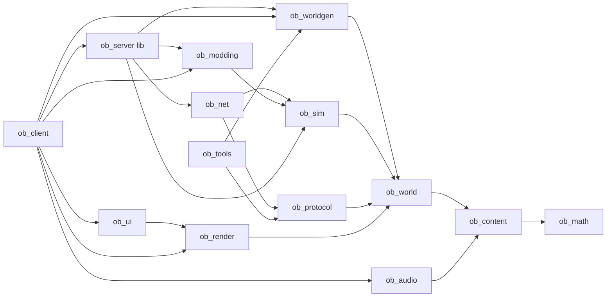
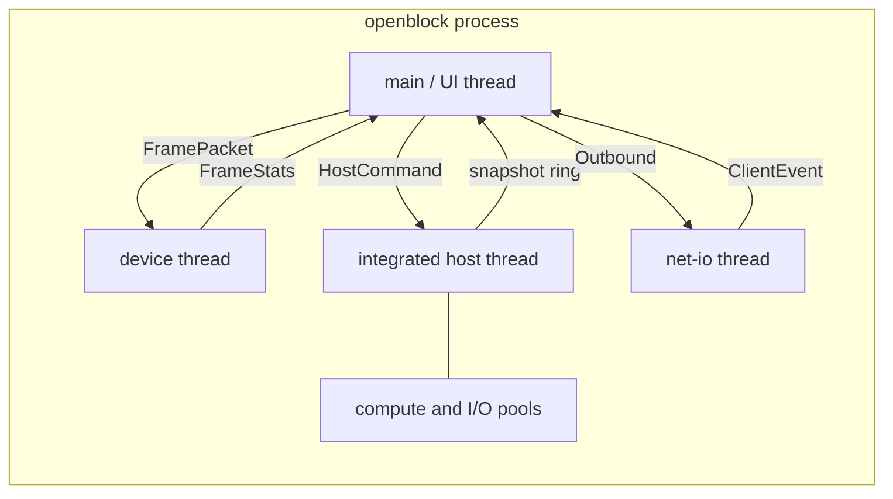
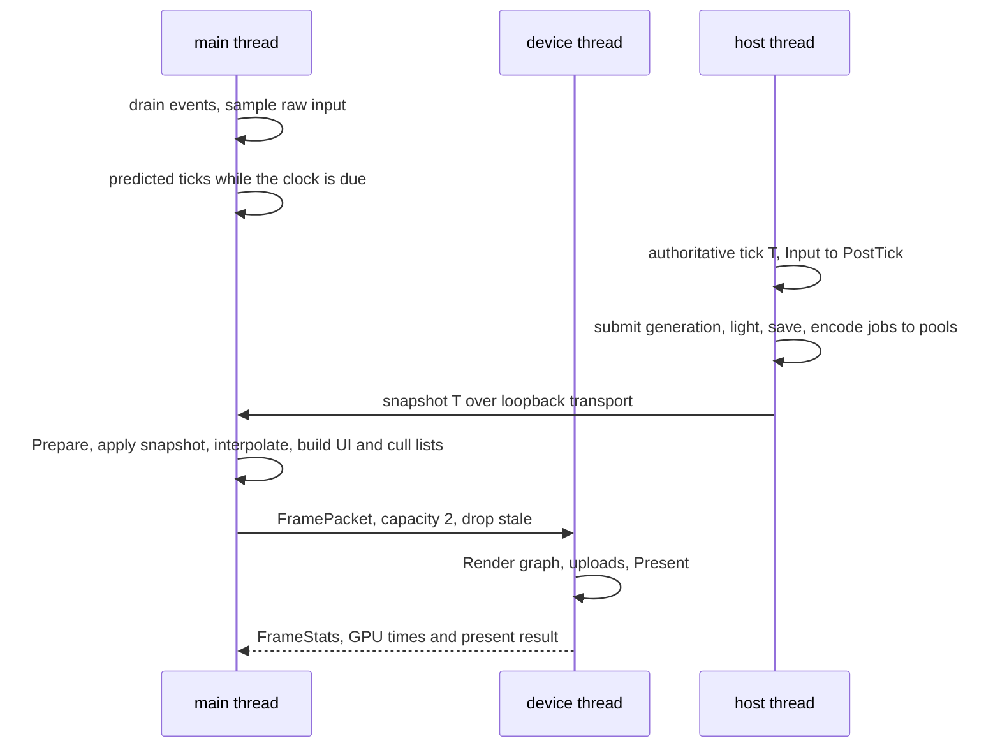
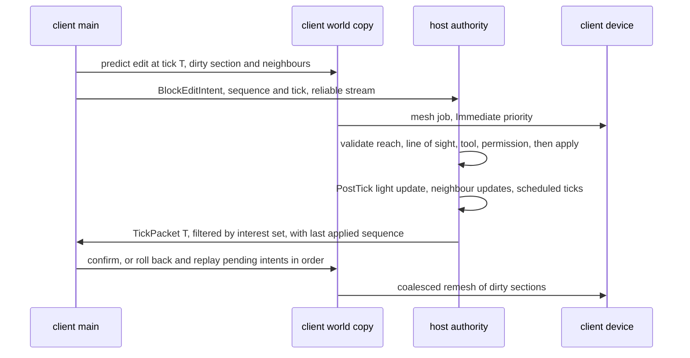

# 01 — Technical Architecture

> Status: normative - Last updated: 2026-11-24
> Depends on: [DEC-002](../decisions.md), [DEC-003](../decisions.md), [DEC-007](../decisions.md), [DEC-008](../decisions.md), [DEC-020](../decisions.md), [DEC-024](../decisions.md), [DEC-028](../decisions.md), [DEC-042](../decisions.md), [DEC-049](../decisions.md), [DEC-052](../decisions.md), [conventions](00-conventions.md)
> Implements: MS-00, MS-02, MS-03

## 1. Purpose and scope

This chapter is the architectural contract: the processes and what each links, the crate graph,
the threads and what they may touch, the data flow from input to pixels and from an edit to every
client, the service and plugin lifecycle, the cross-cutting policies, and the rules CI enforces.
Subsystem internals live in their own chapters; this chapter owns the boundaries, and a
disagreement is a documentation bug handled under
[conventions §9](00-conventions.md#9-ownership-and-change-control). Adding a crate, an internal
edge, a process or a thread role updates this chapter and the edge manifest in the same pull
request, and needs a `DEC-*` if it touches [DEC-003](../decisions.md).

## 2. Requirements

| ID | Requirement | Verified by |
| --- | --- | --- |
| REQ-ARCH-001 | The workspace MUST contain exactly the crates declared in `architecture.toml`, and every shipped (normal or build) internal dependency MUST appear in that crate's `allowed_deps`. | `.github/scripts/check-arch.sh` |
| REQ-ARCH-002 | The transitive closure of `ob_server` MUST NOT contain `wgpu`, `wgpu-*`, `winit`, `ash`, `cpal`, `naga`, `ob_render`, `ob_ui`, `ob_audio` or `ob_client`, on every supported target and with `--all-features`. | CI `arch-guard` |
| REQ-ARCH-003 | The client, integrated host and dedicated server MUST run the same `ob_sim` tick; a scripted 600-tick session MUST produce an identical state hash in all three. | `tests/session_parity.rs` |
| REQ-ARCH-004 | The integrated host MUST be `ob_server::Host`, differing only in transport construction, authentication and process supervision; a single-player branch in the host is forbidden. | review, `HostConfig` test |
| REQ-ARCH-005 | Every thread MUST be created through `ob_core::thread` with a unique name, role and pool class in the thread inventory; an unnamed thread is a test failure. | inventory test |
| REQ-ARCH-006 | Only the device thread MAY call `wgpu` device, queue or surface methods, enforced by a non-`Send` device token. | compile-fail test |
| REQ-ARCH-007 | A simulation tick MUST NOT block on the GPU, the device thread, disk, network, input, or a lock held by a presentation thread. | watchdog counters |
| REQ-ARCH-008 | Presentation MUST read immutable snapshots only, MUST NOT mutate simulation state, and MUST NOT change a state hash. | compile-fail and harness tests |
| REQ-ARCH-009 | Main-to-device handoff MUST use a bounded channel of capacity 2 with drop-stale; the main thread MUST NOT block on it. | stalled-device test |
| REQ-ARCH-010 | Every job MUST belong to exactly one of `worldgen`, `meshing`, `lighting`, `io`, `network`; compute threads (host tick plus the worldgen, meshing and lighting pools) MUST NOT exceed `available_parallelism()`, and pool threads alone MUST NOT exceed `max(1, available_parallelism() - 2)`. | start-up inventory, CI 2/4/8/16 vCPU |
| REQ-ARCH-011 | Every job MUST carry a cancellation token and deadline; cancelled, superseded or late results MUST be discarded by epoch check. | unit tests |
| REQ-ARCH-012 | The host MUST start and tick with no window system, GPU adapter, audio device or display server. | container CI, no `/dev/dri`, no `DISPLAY` |
| REQ-ARCH-013 | Services MUST have explicit lifecycle states and reverse-order shutdown with a 2 s per-service and 5 s global deadline; a required init failure MUST abort start-up, a non-critical runtime failure MUST degrade only its feature. | hanging-service, fault tests |
| REQ-ARCH-014 | Only engine plugins MAY add systems; content packs, WASM mods and native plugins MUST NOT alter ordering, timing or stage membership. | inspection, negative test |
| REQ-ARCH-015 | Configuration MUST resolve as defaults < file < environment < CLI; simulation-affecting settings MUST be world-scoped, host-validated and replicated; resolved config MUST be logged with secrets redacted. | config and protocol tests |
| REQ-ARCH-016 | Diagnostics MUST expose per-stage, per-system, per-queue and GPU pass cost; crash reports MUST be local-only with §4.5 fields; bundles MUST exclude world data, chat and identities unless opted in. | overlay, crash, bundle tests |
| REQ-ARCH-017 | Every crate MUST set `#![forbid(unsafe_code)]` except the modules in §3.6; each `unsafe` block MUST have a `SAFETY:` comment and test or Miri coverage. | unsafe scan |
| REQ-ARCH-018 | A lost GPU device MUST NOT terminate the client; recovery follows §6. | injected device-loss test |
| REQ-ARCH-019 | A failed or interrupted save MUST leave the previous save readable and the host running; a world directory MUST be opened by at most one host. | ENOSPC, `world.lock` tests |
| REQ-ARCH-020 | After a partition or rejoin, replicated client state MUST converge to the host hash with inventory totals conserved. | partition tests |
| REQ-ARCH-021 | A WASM trap or quota violation MUST discard that mod's uncommitted batch, disable the mod and keep the host alive. | malicious-mod corpus |
| REQ-ARCH-022 | A compile-time feature MUST NOT change the state hash, the save bytes or the wire bytes. | feature-matrix hash test |

## 3. Design

### 3.1 Processes

There are four processes, and "single-player" is not one of them.

| Process | Binary | Direct internal links | GPU/audio | Role |
| --- | --- | --- | --- | --- |
| Client | `openblock` | `ob_client`, `ob_render`, `ob_ui`, `ob_audio`, `ob_net`, `ob_sim`, `ob_server`, `ob_content`, `ob_world`, `ob_worldgen`, `ob_protocol`, `ob_modding`, `ob_core`, `ob_math` | yes | window, input, presentation, prediction, local hosting |
| Dedicated server | `openblock-server` | `ob_server`, `ob_net`, `ob_sim`, `ob_worldgen`, `ob_content`, `ob_modding`, `ob_world`, `ob_protocol`, `ob_core`, `ob_math` | none | authority, terrain generation, replication, persistence, administration |
| Tools | `openblock-tools` | `ob_tools`, `ob_content`, `ob_world`, `ob_worldgen`, `ob_protocol`, `ob_core`, `ob_math` | none by default | pack and asset compilation, validation, world inspection, schema generation |
| Developer tasks | `xtask` | whole workspace, dev-dependencies allowed | none | CI, benchmarks, architecture checks, replay harnesses |

The integrated host is a library and a thread. `ob_server` exposes `Host`, `HostConfig` and
`HostHandle`; the dedicated binary is a thin supervisor around `Host` plus console, metrics and
signals, and the client starts the same `Host` on a loopback transport. This is the structural
answer to the "single-player path rots" failure mode in [DEC-003](../decisions.md): host code
cannot know whether a socket or an in-memory channel carries its messages. Tools link the same
content loader and protocol encoders, so a pack that validates in tools behaves identically on a
host, but MUST NOT link presentation crates except behind a non-default thumbnail feature. A world
directory is owned by at most one host: `world.lock` is exclusive for hosts and shared for
read-only tools, and a second host fails with the holder's PID.

The dedicated server links `ob_worldgen` through `ob_server::Host`: a server that cannot generate
terrain cannot create or extend a world. The client lists the same generator because the integrated
host is linked into the client binary; client gameplay code MUST NOT call the generator directly
([DEC-008](../decisions.md)).

### 3.2 Crate topology

Arrows point from dependent to dependency; the diagram omits the `ob_math` and `ob_core` base edges
for readability, while the table below lists them explicitly.



`architecture.toml` groups crates into five descriptive layers: `foundation`
(`ob_math`, `ob_core`), `data` (`ob_content`, `ob_world`, `ob_worldgen`, `ob_sim`, `ob_protocol`,
`ob_net`, `ob_modding`), `presentation` (`ob_render`, `ob_ui`, `ob_audio`), `hosts` (`ob_server`,
`ob_client`) and `tooling` (`ob_tools`, `xtask`). `gpu_free = true` is the enforced headless set:
every foundation and data crate plus `ob_server`. `ob_tools` is headless by default but may gain an
optional thumbnail preview, so it is outside the enforced set; `xtask` is developer-only. Layers do
not grant edges: the per-crate `allowed_deps` list is the complete list, and a dependency not in it
is forbidden by omission.

| Crate | Layer | `gpu_free` | Allowed internal dependencies |
| --- | --- | --- | --- |
| `ob_math` | foundation | yes | none |
| `ob_core` | foundation | yes | `ob_math` |
| `ob_content` | data | yes | `ob_math`, `ob_core` |
| `ob_world` | data | yes | `ob_math`, `ob_core`, `ob_content` |
| `ob_worldgen` | data | yes | `ob_math`, `ob_core`, `ob_content`, `ob_world` |
| `ob_sim` | data | yes | `ob_math`, `ob_core`, `ob_content`, `ob_world` |
| `ob_protocol` | data | yes | `ob_math`, `ob_core`, `ob_content`, `ob_world` |
| `ob_net` | data | yes | `ob_math`, `ob_core`, `ob_content`, `ob_world`, `ob_protocol`, `ob_sim` |
| `ob_modding` | data | yes | `ob_math`, `ob_core`, `ob_content`, `ob_sim` |
| `ob_render` | presentation | no | `ob_math`, `ob_core`, `ob_content`, `ob_world` |
| `ob_ui` | presentation | no | `ob_math`, `ob_core`, `ob_content`, `ob_render` |
| `ob_audio` | presentation | no | `ob_math`, `ob_core`, `ob_content` |
| `ob_server` | hosts | yes | `ob_math`, `ob_core`, `ob_world`, `ob_worldgen`, `ob_content`, `ob_sim`, `ob_net`, `ob_protocol`, `ob_modding` |
| `ob_client` | hosts | no | `ob_math`, `ob_core`, `ob_world`, `ob_worldgen`, `ob_content`, `ob_sim`, `ob_net`, `ob_protocol`, `ob_modding`, `ob_server`, `ob_render`, `ob_ui`, `ob_audio` |
| `ob_tools` | tooling | no | `ob_math`, `ob_core`, `ob_content`, `ob_world`, `ob_worldgen`, `ob_protocol`, `ob_render`, `ob_ui` |
| `xtask` | tooling | no | all other workspace crates; developer-only, never shipped |

Edges not listed in `allowed_deps` are forbidden by omission. The table below records the rules
that are tempting or security-sensitive; it is not a second allow-list.

| Forbidden | Reason |
| --- | --- |
| `ob_server` to `ob_render`, `ob_ui`, `ob_audio`, `ob_client` | the headless server must not link presentation ([DEC-003](../decisions.md), [DEC-028](../decisions.md)) |
| `ob_render` to `ob_sim`, `ob_net` | the renderer consumes plain extract data, never game or wire types |
| `ob_ui` to `ob_sim`, `ob_net`, `ob_client`; `ob_audio` to `ob_render`, `ob_sim` | UI emits intents; audio must not need a GPU or game state |
| `ob_world` to `ob_protocol`, `ob_net`, `ob_render` | storage stays transport- and GPU-agnostic |
| `ob_protocol` to `ob_net`, `ob_sim`; `ob_content` to world, sim, render | protocol and registries are pure data |
| `ob_sim` to `ob_net`, `ob_modding`, presentation | dependency inversion: the simulation declares traits, implementations depend on it |
| `ob_worldgen` to `ob_sim`; `ob_modding` to `ob_net`, `ob_render`, `ob_client` | generation is a pure function; mods reach the network only through host capabilities |

`ob_client` lists `ob_worldgen` because the integrated host is linked into the client binary; client
gameplay code MUST NOT call the generator directly, and a visual-only LOD generator stays in
`ob_render` or needs a new decision ([DEC-008](../decisions.md), [DEC-018](../decisions.md)).
`ob_client` also lists `ob_modding` so the integrated host can run server-installed mods; the 1.0
client presentation tier executes no mod code ([DEC-049](../decisions.md)).

`check-arch.sh` parses `architecture.toml` with Python's `tomllib` and resolves `cargo metadata`
with `--all-features` for Linux, Windows and macOS, taking the union so a platform-only GPU edge
cannot hide behind a Linux runner. It verifies: (a) every workspace crate appears exactly once;
(b) each crate's resolved normal/build dependencies are in its `allowed_deps` (dev-dependencies are
outside the shipped graph); (c) no `gpu_free` crate reaches a package matching
`[forbidden_patterns].gpu_free`; and (d) `ob_server` reaches no presentation crate. An undeclared
edge fails; an allowed edge that is not used yet is permitted because crates gain dependencies
incrementally. Container image inspection remains a separate deployment check for X11, Wayland,
ALSA and PulseAudio.

### 3.3 Threading model

The **tick domain** is deterministic: fixed ticks, systems in a declared total order. The **frame
domain** is best-effort: once per presented frame, parallel where useful, authoritative nowhere.



| Thread | Client | Server | Owns | May block |
| --- | --- | --- | --- | --- |
| main / UI | 1 | 1 (console, supervisor) | event loop, window, input sampling, UI, pacing | on the event wait |
| device | 1 | 0 | `wgpu` device, queue, surface, graph, uploads, present | on acquire and present |
| host tick | 0 or 1 | 1 | world store, simulation state, save scheduling | no; a blocked tick is a defect |
| net I/O | 1 | 1–2 | QUIC endpoint, TLS, stream and datagram framing | in the reactor |
| compute pools | meshing, worldgen, lighting | worldgen, lighting | mesh, terrain, feature and light jobs | n/a |
| I/O and network pools | 1 each | 1–2 each | saves, loads, pack decode, compression | in syscalls and codecs |
| audio | 1 | 0 | mixer callback and device | by design |

Pool sizing is computed once from `N = available_parallelism()`. Pool slots are
`C = max(1, N - 2)`, reserving one for the usually blocked main and device threads and one for the
host tick. Each active class gets one slot (`meshing` on clients, `worldgen` and `lighting` whenever a
host runs here); remaining slots go 40% worldgen, 30% meshing, 20% lighting, 10% unassigned, with the
share of inactive classes redistributed proportionally. If `C` is below the active class count the
process enters **shared-pool mode**: one pool serves all classes with priority at admission, the
2-core laptop case, logged at start-up. A 4 vCPU server runs seven threads (host, two pools, io,
network, net-io, console); an 8-core hosting client runs thirteen. Compute threads never
oversubscribe; service threads may, because they block in kernel calls.

Priority is expressed twice. Across classes, by OS priority: meshing, lighting and network at
normal; worldgen and I/O below normal (`nice` +10, `THREAD_PRIORITY_BELOW_NORMAL`, utility QoS).
Within a class, by admission order: `Immediate` (edits at the camera), `Foreground` (visible
sections), `Background` (just outside the view), `Bulk` (generation, pregeneration, saves). Rayon
has no priority queue, so priority lives in our admission layer, not in worker starvation.

Four mechanisms carry data between threads, and only these four. The **snapshot ring** publishes an
immutable `Arc<SimSnapshot>` into three slots; readers take the newest and never block the writer,
while networking and persistence read authoritative state directly on the host thread. **Bounded
channels** are listed in §4.2; unbounded channels are forbidden. **Double-buffered GPU resources**
are touched only by the device thread. **Keyed job results** carry `(class, key, epoch)`; consumers
apply them in key order and drop anything stale, and continuation jobs form a shallow graph rooted
at the system that submitted them. Shared mutable state is limited to atomics and job queues; locks
are permitted only for cold state, and a lock on a hot path is an architecture defect.

The server has no render thread because it has no `wgpu` device, surface or frame clock
(REQ-ARCH-002), because presentation is not authoritative, and because a second scheduler competing
for the same cores would let frame pacing leak into tick latency. Server throughput work —
replication encoding, compression, save compression — is a job class, not a frame pipeline.

### 3.4 Data flow

`Input`, `PreTick`, `Tick` and `PostTick` belong to the tick domain; `Prepare`, `Render` and
`Present` to the frame domain. The client runs both, the server only the tick.



Per tick on the host: `Input` seals one sample per player, the newest with a sequence number above
the last applied one, or a repeat marked stale. Raw devices are sampled per frame, but the stage
runs per tick so the input log and the simulation agree on what "tick T's input" is. `PreTick`
applies validated commands, decides chunk load and unload and extracts the scheduled-tick queue;
nothing here waits on I/O. `Tick` runs simulation systems in schedule order; systems may
parallelise internally but not against each other in this domain (§3.7). `PostTick` flushes light
propagation, freezes the block-change list, builds per-client deltas, submits save batches and takes
optional hash checkpoints.

Per frame on the client: the platform layer drains events and accumulates input, which is raw
sampling rather than a stage. The tick clock decides how many predicted ticks are due, zero to
`max_catch_up`, each running the same systems as the host under the same input-sealing rule.
`Prepare` applies the newest authoritative snapshot, or keeps predicting when none has arrived,
interpolates remote entities at `alpha`, updates camera and retained UI, resolves culling inputs,
drains completed mesh and upload jobs, and fills a `FramePacket`. The packet is offered with
`try_send`; if the slot is full the oldest unsent packet is replaced, because a stale frame is never
worth a stall. `Render` executes the graph and `Present` presents.

A block edit exercises the whole chain:



| Step | Target |
| --- | --- |
| Predicted block state visible | next frame |
| Local remesh visible at the camera | ≤ 2 frames ([MS-03](../plan/01-milestones.md)) |
| Host validates and applies | ≤ 1 tick |
| Other clients in interest receive it | ≤ 1 tick plus RTT, budgets in [chapter 18](18-networking-multiplayer.md) |
| Rejected prediction rolled back | next frame after the tick packet |
| Change durable in a save | batched; at most 30 s lost on a crash ([DEC-033](../decisions.md)) |

A section edit dirties its 26 neighbours for face culling but only the edited section starts light
propagation; edits to one section within a tick coalesce into one mesh job, and predicted light is
replaced by the host's packed light when the delta arrives.

### 3.5 Services, plugins and lifecycle

| Surface | Unit | Adds systems? | Code? | Trust | Reload |
| --- | --- | --- | --- | --- | --- |
| Engine plugin | Rust crate compiled in | yes | yes | first-party, reviewed | no, rebuild |
| Content pack | data files and assets | no | no | untrusted data, schema-validated | hot |
| WASM mod | sandboxed module | no | yes, capability-gated | untrusted, quota-limited | hot in development |
| Native plugin | shared library | post-1.0 narrow API | yes, in-process | operator-trusted, opt-in | no |
| Shader pack | WGSL and manifests | no | yes, GPU only | untrusted visual | hot |

Only an engine plugin can put work into the scheduler. Content and mods influence the simulation
through content data and the host ABI's event and command surface; they cannot silently change tick
order, which would make replays and replication unsound ([DEC-020](../decisions.md); API in
[chapter 16](16-modding.md)).

| Plugin | Client | Server | Purpose |
| --- | --- | --- | --- |
| `CorePlugin` | yes | yes | clock, jobs, config, diagnostics |
| `WindowPlugin`, `InputPlugin`, `RenderPlugin`, `UiPlugin`, `AudioPlugin` | yes | no | window, input, device thread, retained UI, mixer |
| `ContentPlugin`, `WorldPlugin`, `SimPlugin` | yes | yes | packs, world store, tick pipeline |
| `WorldgenPlugin`, `HostPlugin` | hosting only | yes | generation, `ob_server::Host` |
| `NetPlugin`, `ModdingPlugin` | yes, host side only | yes | transport role; host-side WASM host; 1.0 clients execute no mod code ([DEC-049](../decisions.md)) |
| `ToolsPlugin` | no | no | `openblock-tools` entry points |

Client-side mod code is not part of 1.0 ([DEC-049](../decisions.md)). The client presentation tier
links no WASM runtime or native plugin loader; a mod may describe a screen and receive
server-computed data through the host UI binding, but the client executes only engine UI code and
validated pack data. In single-player the integrated host still runs server-installed mods in its
host role. A client code tier is post-1.0 and needs a new decision with a determinism and anti-cheat
review; `OPEN-006` is closed.

A plugin's lifecycle is `register`, `ready`, `start`, `stop`, `shutdown`. `register` is declarative
and may not touch services or the filesystem; `ready` resolves handles once every service exists;
`start` runs after the scheduler compiles; `stop` gets a deadline and is idempotent; `shutdown`
releases resources after all systems stopped. Plugins declare names they must follow; the builder
sorts topologically, breaks ties by registration order and rejects cycles with the full path.
Services run `Created → Initialising → Ready → Running → Draining → Stopped`, shutdown in reverse
initialisation order with the deadlines in REQ-ARCH-013; each mutable service has an owner thread and
publishes state as messages or immutable snapshots, never as shared mutable access.

### 3.6 Cross-cutting concerns

**Configuration.** Every setting has one owner crate, a default, a schema and a reload class.
Layers are compiled defaults, user file, world file, `OPENBLOCK_*` environment variables with `__`
for nesting, and CLI flags in increasing precedence. Unknown keys are errors, because a typo in
`server.toml` must not silently run with defaults; the mechanism belongs to
[chapter 02](02-engine-core.md).

**Logging.** All logging goes through `tracing` with compile-time targets (`ob::tick`, `ob::render`,
`ob::net`, `ob::mod`). Every stage and system opens a span with the tick or frame number, and jobs
inherit it. The server emits JSON lines; the client writes human-readable logs plus a filtered ring
buffer for the overlay and crash reports.

**Crash reports and diagnostics.** A panic, fatal signal or watchdog timeout writes a crash report
(§4.5) into the data directory. Reports are local files: nothing is uploaded automatically and
there is no telemetry endpoint. A diagnostics bundle adds the manifest, redacted config, thread
inventory, recent spans, metrics and GPU capabilities, excluding world data, chat and identities
unless the user opts in. Retention and export policy remain §8 item 2.

**Feature flags.** Features exist for platform backends, optional tool capabilities and developer
overlays. They MUST NOT change simulation semantics, save bytes or wire bytes (REQ-ARCH-022); CI
compares hashes across minimal server, full client and tools builds. Features that change content
availability are forbidden — that is what packs are for — and features that change rendering
quality are forbidden — that is what runtime presets are for.

**Errors and panics.** Fallible boundaries return typed `Result`: user input, configuration,
filesystem, network decode, content load, mod calls, GPU device and surface operations. A panic is
reserved for a proven invariant violation. Library crates deny `clippy::unwrap_used` and
`clippy::expect_used` outside tests, and untrusted-input crates also deny `clippy::indexing_slicing`
and `clippy::panic`. Client and distribution builds use `panic = "abort"`; a panicking job writes a
crash report and stops the process, because continuing a half-updated world is worse than
restarting. The dedicated server builds with `panic = "unwind"` (a dedicated `server` cargo profile)
so a poisoned job or WASM trap is contained and the host stays alive ([DEC-042](../decisions.md)).

**Unsafe.** Every crate root carries `#![forbid(unsafe_code)]` except these audited modules; the
list is closed, and adding one needs an architecture change and two maintainer reviews.

| Module | Why | Evidence |
| --- | --- | --- |
| `ob_core::platform::window` | raw window handle plumbing for surface creation | review, three-OS CI |
| `ob_world::palette` | unchecked word indexing after a proven length check | Miri, property tests, fuzz |
| `ob_math::simd` | target-feature intrinsics for pinned noise and hashing | per-target tests, scalar fallback |
| `ob_render::gpu` | `bytemuck` casts, `Send`/`Sync` for device-bound handles | validation layers, compile-fail tests |

### 3.7 Determinism boundaries

The simulation is deterministic; presentation is not. The boundary is the snapshot and it is
enforced rather than documented.

| Component | Deterministic | Enforcement |
| --- | --- | --- |
| World generation | bit-exact across platforms and between hosts | state hashes over golden seeds |
| Content freeze | registry order and IDs are a pure function of the packs | pack-hash test |
| Simulation tick | bit-exact given state, inputs and the tick index | replay hashes, checkpoints |
| Lighting | integer propagation, part of the state hash | hash and edit-replay tests |
| Physics | `f64` with pinned transcendentals ([DEC-021](../decisions.md), provisional) | cross-platform hash, OPEN-002 |
| Meshing; replication | deterministic per input; payload deterministic, timing not | mesh digests; convergence test |
| UI, audio, particles, camera | free to vary | none, by design |

`gpu_free` in §4.1 is a link-time and deployment boundary, not a determinism claim. A crate can be
GPU-free and still contain non-deterministic code (I/O, diagnostics), and a deterministic algorithm
can have a GPU implementation used only for presentation. The table above is the only authority for
what enters the state hash.

Simulation code MUST NOT read wall-clock time, thread identity, addresses, uninitialised memory or
hash-map iteration order; the tick count is the only clock. Parallelism inside a tick is allowed
only with an order-independent reduction or a defined gather order, owned by
[chapter 02](02-engine-core.md).

### 3.8 Deployment topologies

| Topology | Host | Transport | Identity and discovery | Persistence | Processes |
| --- | --- | --- | --- | --- | --- |
| Single player | integrated `Host` | loopback, same codec, no sockets | local player key in world data | local world directory | 1 |
| LAN | integrated `Host` plus QUIC listener | QUIC over UDP | mDNS, ticket with SPKI fingerprint | host's world directory | 1 host, N clients |
| Dedicated | `openblock-server` | QUIC over UDP | self-signed key, TOFU pinning, optional ACME | world directory and backups | 1 host, N clients |
| Container | the same binary, non-root | QUIC over UDP | environment and mounted config | `/data` volume, read-only root | 1 host, N clients |
| CI harness | `Host` with a simulated transport | in-memory, lossy and reordering | none | temporary directory | 1 |
| Future web | host plus a WebTransport front-end | WebTransport over HTTP/3 | as dedicated | as dedicated | 1 host, N browsers |

The loopback transport is not a shortcut: it runs the real encoder and decoder, hands `Arc<[u8]>`
payloads across without copying, and is the transport used by single-player tests. A bypass that
lets the client touch host memory would create exactly the two code paths
[DEC-003](../decisions.md) exists to prevent. `Transport` is object-safe and runtime-agnostic, so
loopback, simulated, QUIC and a later WebTransport front-end share one conformance suite.

### 3.9 Adding a subsystem

A subsystem is a coherent capability with state, a schedule slot and a failure story. The checklist
is mandatory and is copied into the PR description:

1. Decide authority: simulation-visible state belongs in `ob_sim`, must be deterministic and must
   appear in the state hash.
2. Add or update crate edges in `architecture.toml`; run `.github/scripts/check-arch.sh` locally and
   keep `arch-guard` green with `--all-features`.
3. Define cross-thread data (owner, type, cadence, capacity, overflow) in the §4.2 table, and the
   service, if any: owner thread, lifecycle, restart policy, degraded behaviour.
4. Define systems (stage, access set, ordering edges, parallelism) through a plugin, and workers
   (class, priority, duration, cancellation points, budget).
5. Define persistence and protocol impact (migration, version, content hash, unknown content),
   diagnostics, failure modes and user-visible degradation, with `REQ-*` identifiers and tests
   written with, or before, the code.
6. Update the owning chapter and this chapter's diagrams if a boundary moved; add a `DEC-*` if a
   settled decision is contradicted.

## 4. Data structures and formats

### 4.1 Crate edge manifest

`architecture.toml` is the single machine-readable source for the crate graph and the headless
boundary. It has two parts:

- `[[crates]]` entries, one per workspace crate, with `name`, `layer`
  (`foundation`, `data`, `presentation`, `hosts` or `tooling`), `gpu_free` and
  `allowed_deps`. `allowed_deps` is the complete list of internal crates that
  crate may depend on directly, including the `ob_math`/`ob_core` base edges.
- `[forbidden_patterns].gpu_free`, a list of regular expressions matched against every package in
  the transitive normal/build closure of a `gpu_free` crate.

Layer names are descriptive and grant no permission. `gpu_free = true` marks a crate that must build
and run without a GPU, window or audio stack, and puts its closure under the forbidden patterns.
Every workspace crate appears exactly once; a missing or duplicate `[[crates]]` entry, a name that is
not a workspace member, or a dependency outside its `allowed_deps` fails the guard.

```toml
version = 2

[forbidden_patterns]
gpu_free = [
  "^wgpu($|-)", "^naga($|-)", "^ash($|-)", "^raw-window-handle$",
  "^winit($|-)", "^cpal($|-)", "^kira$", "^gilrs$",
  "^rodio$", "^symphonia($|-)",
  "^ob_render$", "^ob_ui$", "^ob_audio$", "^ob_client$",
]

[[crates]]
name = "ob_server"
layer = "hosts"
gpu_free = true
allowed_deps = [
  "ob_math", "ob_core", "ob_world", "ob_worldgen", "ob_content",
  "ob_sim", "ob_net", "ob_protocol", "ob_modding",
]

[[crates]]
name = "ob_client"
layer = "hosts"
gpu_free = false
allowed_deps = [
  "ob_math", "ob_core", "ob_world", "ob_worldgen", "ob_content",
  "ob_sim", "ob_net", "ob_protocol", "ob_modding", "ob_server",
  "ob_render", "ob_ui", "ob_audio",
]
```

`.github/scripts/check-arch.sh` parses this file with Python's `tomllib` and resolves
`cargo metadata` with `--all-features` for the Linux, Windows and macOS targets, taking the union so
a target-specific edge cannot hide. It fails if any of the following is true:

1. a workspace crate is missing from `[[crates]]`, appears more than once, or a `[[crates]]` name
   is not a workspace member;
2. a resolved normal or build dependency of a workspace crate is not in that crate's
   `allowed_deps` (dev-dependencies are outside the shipped graph);
3. the closure of a `gpu_free = true` crate contains a package matching a
   `[forbidden_patterns].gpu_free` pattern;
4. the closure of `ob_server` contains a crate in the `presentation` layer or `ob_client`.

Unused `allowed_deps` entries are permitted: a crate may declare an edge before the first use
lands. The table in §3.2 is a view of this file, and a disagreement is a documentation bug. The
checker reads the resolved graph, so the manifest and the real graph cannot drift silently.

### 4.2 Thread inventory and channels

Every thread registers `ThreadRecord { name, role, pool, index, os_priority }` at creation, where
`role` is one of `Main, Device, Host, NetIo, Pool(JobClass), Audio, Console`; the overlay and crash
report print the table, and CI asserts no thread exists outside it.

| Channel | Message | Capacity | Overflow | Producer to consumer |
| --- | --- | --- | --- | --- |
| `frame` | `FramePacket` | 2 | drop oldest unsent | main to device |
| `frame_stats` | `FrameStats` | 8 | drop oldest | device to main |
| `snapshot` | `Arc<SimSnapshot>` | 3-slot ring | latest wins | host to main |
| `host_cmd` | `HostCommand` | 64 | backpressure | main to host |
| `client_event` | `ClientEvent` | 1024 | coalesce state, never drop control | net-io to main |
| `outbound` | `Outbound` | 1024 | backpressure at the transport | main to net-io |
| `mesh_result` | `MeshResult` | 512 | drop farthest pending | mesh pool to device |
| `gen_result`, `light_result` | results | 256, 1024 | backpressure | pools to host |
| `save_batch` | `SaveBatch` | 8 | backpressure, never drop | host to I/O pool |

### 4.3 Frame handoff types

```rust
pub struct FramePacket {
    pub frame: u64,
    pub tick: u64,
    pub alpha: f32,               // interpolation between tick-1 and tick
    pub view: RenderView,         // camera, projection, render distance in blocks
    pub sections: SmallVec<[MeshUpload; 64]>,
    pub instances: SmallVec<[InstanceRaw; 4096]>,
    pub ui: UiDrawList,
    pub particles: ParticleBatches,
    pub debug_flags: DebugFlags,
}
```

`FramePacket` holds owned or reference-counted data only and may not borrow simulation state.
`FrameStats` returns per-stage CPU times, per-pass GPU timestamps, the present result and queue
depths, and MUST NOT feed back into simulation.

### 4.4 Snapshot publication

```rust
pub struct SimSnapshot {
    pub epoch: u32,                       // bumps on world or dimension load
    pub tick: u64,
    pub players: Box<[PlayerView]>,
    pub entities: Box<[EntityView]>,      // sorted by NetId
    pub block_changes: Box<[SectionChange]>,
    pub rules: Arc<GameRules>,
}
```

The writer fills an unused slot and publishes its index with a `Release` store; readers use an
`Acquire` load and clone the `Arc`, so a reader two versions behind still sees a consistent
snapshot, and any result carrying another epoch is dropped. The ring is presentation-only; save and
replication read authoritative state on the host thread. Names are part of the diagnostic contract:
threads `ob.<role>[.<index>]`, channels `ob.<producer>.<consumer>`, spans `ob.<area>.<operation>`,
metrics `openblock_<area>_<name>_<unit>`; renaming one breaks dashboards and support scripts.

### 4.5 Crash report contents

| Field | Type | Notes |
| --- | --- | --- |
| `report_version` | integer | bumped when fields change |
| `app_version`, `sim_version`, `protocol_version` | string, integer, integer | build metadata |
| `os`, `arch`, `locale`, `gpu_adapter`, `gpu_driver`, `backend` | strings | no hostname or username |
| `panic` | object | message, location, thread, backtrace with paths redacted |
| `session` | object | world UUID, seed hash, dimension, tick, last stage and system |
| `hashes`, `config` | object | content and pack hashes, state hash; redacted config |
| `threads`, `memory`, `log_tail` | array, object, array | inventory, per-category bytes, last 200 records |
| `files` | object | paths relative to the data root, never absolute home paths |

## 5. Performance budgets

| ID | Budget | Measurement |
| --- | --- | --- |
| PERF-ARCH-001 | Client main-thread CPU ≤ 2.0 ms p95 at 512-block render distance, 1080p, reference machine | `flythrough` benchmark |
| PERF-ARCH-002 | Host tick ≤ 35 ms p99 with 2,000 chunks and 50 co-located players (shared chunk cache) on the 4 vCPU reference; the distributed-player row is separate | headless load harness |
| PERF-ARCH-003 | Snapshot publication ≤ 50 µs p99 at 2,000 entities and 32 players; ≤ 8 KiB allocated per tick in steady state | microbenchmark |
| PERF-ARCH-004 | Main-to-device handoff ≤ 100 µs p99 with zero allocations after warm-up | microbenchmark, stalled device |
| PERF-ARCH-005 | Job submit plus join overhead ≤ 20 µs p99 excluding the job body | `ob_core` bench |
| PERF-ARCH-006 | 95% of remesh jobs within 64 blocks are visible within two frames | scripted edit benchmark |
| PERF-ARCH-007 | Server resident memory ≤ 2 GiB plus 20 MiB per co-located player at 50 players | 24 h soak, RSS sampling |
| PERF-ARCH-008 | Graceful shutdown with a world flush ≤ 5 s p99 | 2,000 dirty chunk shutdown |

These are enforced by the gates in [chapter 25](25-performance-budgets.md); a regression beyond the
stated tolerance fails the PR ([DEC-035](../decisions.md)). Server capacity rows are co-located
(players share a loaded column cache) and use the 256-block default; the lower distributed-player
row and the published cost of the opt-in 512-block setting live in [chapter 19](19-server-administration.md)
and [chapter 25](25-performance-budgets.md) ([DEC-052](../decisions.md)).

## 6. Failure modes and edge cases

| Failure | Detection | Containment | User-visible | Recovery |
| --- | --- | --- | --- | --- |
| GPU device lost or reset | device-lost callback, present error | device thread stops; host keeps ticking and autosaves | frozen picture, notice | recreate up to three times in 60 s, drop quality first |
| Surface lost, outdated or resized; shader compile failure | `SurfaceError`, validation error | skip present or reject the pack and use built-ins | black frame or "pack disabled" with log | automatic |
| Save failure: full disk, permission, checksum | write or verify error | previous save untouched, retry with backoff, block shutdown to the deadline | "world not saved" banner | fix space or permissions, retry |
| Host crash (dedicated) | supervisor, systemd or container restart | last durable save is authoritative | players disconnect and rejoin | automatic restart, same ticket |
| Network partition | QUIC idle timeout, missing acknowledgements | host keeps the entity 30 s; client predicts 500 ms then freezes input | reconnecting overlay | reconnect and full resync |
| RTT spike or loss | acknowledgements, queue depth | interpolation window grows, corrections bounded | smoother remote motion | automatic |
| WASM trap or quota exhaustion | wasmtime trap, fuel and memory counters | discard the uncommitted batch, disable the mod, log its id | "mod disabled" in console | fix and reload in development |
| Content mismatch on join | handshake content hash | connection refused listing differing packs | actionable join error | install matching packs |
| Clock jump or suspend; job backlog | monotonic gap above 2 s; queue depth | reset the clock origin and drop ticks; shed background work | brief hitch or lower view distance | automatic |
| Audio device loss | backend error callback | mixer falls back to a null device | sound stops, game unaffected | device reset or user action |
| Out of memory | allocation failure, budget counters | mods refuse memory first, content load fails cleanly | error dialog, no corruption | restart smaller |

| Risk | Description | Mitigation | Owner |
| --- | --- | --- | --- |
| RISK-101 | the device-thread handoff adds a frame of input latency | sample input on the main thread, measure input-to-photon | MS-04 |
| RISK-102 | the dependency rule erodes through features | `arch-guard` on the union of targets and `--all-features` | MS-00 |
| RISK-103 | loopback becomes slower than a direct call | copy-free payload handoff, per-frame budget, CI benchmark | MS-03 |
| RISK-104 | snapshot and extract copying grows with entity count | copy-on-write sections, keyed arrays, 2,000-entity benchmark | MS-02 |
| RISK-105 | crash reports leak paths, chat or identities | redaction fixtures, opt-in only for extra data | MS-14 |
| RISK-106 | mods and queues exhaust server memory | quotas, bounded channels, backpressure before allocation | MS-09 |

## 7. Testing strategy

| Test | What it proves | Where |
| --- | --- | --- |
| `check-arch.sh` | every crate appears once; internal edges match `allowed_deps`; `gpu_free` and `ob_server` closures clean | CI, Linux/Windows/macOS, all features |
| Unsafe scan | no `unsafe` outside audited modules; `forbid` present | CI source scan |
| Thread inventory | every thread is named, classified and counted | start-up test in all three hosts |
| Session parity | client, integrated host and dedicated server produce one hash | `tests/session_parity.rs` |
| Transport conformance | loopback, simulated and QUIC transports share one suite | `ob_net` integration |
| Topology smoke | single player, LAN, dedicated and container start and tick | CI, nightly containers |
| Fault injection | device loss, save failure, partition, mod trap, clock jump | harnesses with injectable faults |
| Feature-matrix hash, soak | features do not change hashes or bytes; RSS slope, save integrity | CI matrix, nightly |

`arch-guard` is a required check and is never waived: adding an edge to the manifest and justifying
it in review is cheaper than discovering a GPU dependency in a server image after release.

## 8. Open questions

1. **Presentation pipeline depth.** Register item needed: presentation pipeline depth (two or three
   frames in flight) after the MS-04 measurement (owner MS-04). Two frames in flight with
   drop-stale is the current design. A three-deep pipeline would smooth pacing at the cost of
   input-to-photon latency; the answer depends on the MS-04 measurement of the 144 FPS mode.
2. **Crash-report and diagnostics policy.** Register item needed: crash-report retention, redaction
   and support-export policy (owner MS-14). Local-only reports with opt-in export match
   [vision P7](../vision.md), but retention, redaction rules and the support workflow need a
   decision before the first public alpha.
3. **Feature-flag and build matrix.** Register item needed: feature-flag and binary build-matrix
   policy (owner MS-00). Which features may exist and which binaries ship them is policy in §3.6,
   not a decision; the risk is a "minimal client" that silently changes behaviour.
4. **Shared job system in single-player.** Register item needed: whether single-player uses one
   shared job pool set or separate pools (owner MS-03). One pool set with class priorities is the
   current design; separate pools isolate latency better on 8+ cores but oversubscribe 4-core
   machines.

## 9. References

- Decisions: [DEC-002](../decisions.md), [DEC-003](../decisions.md), [DEC-007](../decisions.md),
  [DEC-008](../decisions.md), [DEC-020](../decisions.md), [DEC-024](../decisions.md),
  [DEC-028](../decisions.md), [DEC-033](../decisions.md), [DEC-035](../decisions.md),
  [DEC-042](../decisions.md), [DEC-049](../decisions.md), [DEC-052](../decisions.md); [conventions](00-conventions.md).
- Manifest: [architecture.toml](../../architecture.toml), checked by
  [check-arch.sh](../../.github/scripts/check-arch.sh).
- Chapters: [engine core](02-engine-core.md), [rendering](03-rendering.md),
  [world model](05-world-model.md), [modding](16-modding.md), [persistence](17-persistence.md),
  [networking](18-networking-multiplayer.md), [testing](24-testing-benchmarks.md),
  [performance budgets](25-performance-budgets.md); milestones
  [MS-00, MS-02, MS-03](../plan/01-milestones.md).
- Research: [Weft teardown](../research/01-weft-teardown.md) §3, §6, §9, §11;
  [engine and render stack](../research/02-engine-and-render-stack.md) §5–7.
- External: [wgpu 30 features](https://docs.rs/wgpu/30.0.2/wgpu/struct.Features.html),
  [winit 0.30](https://docs.rs/winit/0.30.13/winit/), [rayon](https://docs.rs/rayon/1.12.0/rayon/),
  [QUIC RFC 9000](https://www.rfc-editor.org/rfc/rfc9000.html).
