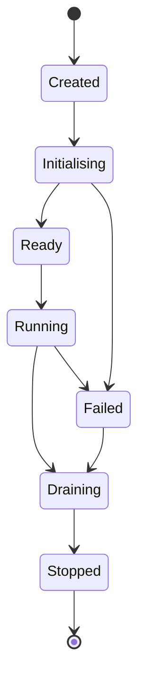

# 02 — Engine Core

> Status: normative - Last updated: 2026-11-24
> Depends on: [DEC-002](../decisions.md), [DEC-007](../decisions.md), [DEC-021](../decisions.md), [DEC-035](../decisions.md), [conventions](00-conventions.md), [technical architecture](01-technical-architecture.md)
> Implements: MS-02

## 1. Purpose and scope

`ob_core` is the reusable infrastructure every other crate builds on: application lifecycle,
deterministic scheduler, fixed-timestep clock, job system, platform layer, service registry, entity
store, configuration, diagnostics, determinism harness and error policy. It knows nothing about
blocks and must run on a headless server with no window, GPU or audio device. The world model
([chapter 05](05-world-model.md)), rendering ([chapter 03](03-rendering.md)), networking
([chapter 18](18-networking-multiplayer.md)) and gameplay rules
([chapter 08](08-gameplay-survival.md)) define what plugs in here; process, crate and thread
boundaries are owned by [chapter 01](01-technical-architecture.md) and are referenced, not restated.

## 2. Requirements

| ID | Requirement | Verified by |
| --- | --- | --- |
| REQ-CORE-001 | `ob_core` MUST depend only on `ob_math`, never on `ob_world`, `ob_content`, `ob_sim` or presentation crates. | `arch-guard` |
| REQ-CORE-002 | Phases MUST run build, init, ready, start, loop, stop, shutdown, and `Plugin::register` MUST NOT touch services, the window, the GPU or the filesystem. | spying-plugin lifecycle test |
| REQ-CORE-003 | Start-up validation MUST reject duplicate system keys, edges to unknown keys with near-miss suggestions, dependency cycles with the path, and parallel access conflicts naming both systems and the resource. | scheduler unit tests |
| REQ-CORE-004 | Simulation systems MUST execute in a total order; cross-system parallelism is allowed only in presentation stages, or for a system explicitly declared `ParallelSafe` with a documented order-independent reduction. | schedule dump, replay hashes |
| REQ-CORE-005 | The ordered simulation schedule MUST have a reviewed golden digest; an unreviewed reorder MUST fail CI. | `schedule.golden` test |
| REQ-CORE-006 | Every system MUST declare read and write access over registered resources; a parallel stage MUST reject conflicting systems without an ordering edge. | conflict test |
| REQ-CORE-007 | Simulation MUST advance only in integer ticks at 20 Hz by default or 30 Hz when the host selects it; the rate MUST be immutable for a session and replicated. | clock, protocol tests |
| REQ-CORE-008 | Tick arithmetic MUST be drift-free: the executed tick count MUST stay within one tick of wall clock over 24 h. | mock-clock test |
| REQ-CORE-009 | Catch-up MUST be capped at 5 ticks per frame; dropped ticks MUST be counted, logged and recorded for replay, never silently skipped. | clock unit test |
| REQ-CORE-010 | Pause and single-step MUST be refused when the host has remote peers; a server MUST NOT pause. | integration test |
| REQ-CORE-011 | Jobs MUST use the five classes and four priorities, and compute threads MUST respect REQ-ARCH-010. | start-up inventory |
| REQ-CORE-012 | Jobs MUST be cancellable at declared checkpoints, carry a deadline, and return epoch-tagged results that consumers validate. | job tests |
| REQ-CORE-013 | A job slice MUST finish within 500 µs p99; longer work MUST be split into continuation stages. | job benchmark |
| REQ-CORE-014 | Job submission from tick or main MUST NOT block; a full queue returns `Full` and the caller applies its class policy. | backpressure test |
| REQ-CORE-015 | Window, input, timer, path and process OS APIs MUST be used only inside `ob_core::platform`; higher crates consume traits, never `winit` types. | dependency and API tests |
| REQ-CORE-016 | Data, config, cache and log directories MUST follow §3.5, be overridable, and nothing may be written outside them without explicit user action. | path tests |
| REQ-CORE-017 | A second client instance for one data directory MUST forward its join request to the first and exit; `--multi-instance` opts out for tests. | two-process test |
| REQ-CORE-018 | DPI and scale-factor changes MUST apply without restart; layout in logical units, render targets in physical pixels. | scale 1.0/1.25/1.5/2.0 tests |
| REQ-CORE-019 | Suspend and resume MUST reset the clock, drop accumulated ticks and re-establish connections; no tick catch-up. | injected lifecycle test |
| REQ-CORE-020 | Services MUST follow §3.6, have one owner thread, and shut down in reverse order within REQ-ARCH-013 deadlines. | lifecycle tests |
| REQ-CORE-021 | The service registry MUST be frozen after init; a hot-path lock around service lookup is forbidden. | API test, review |
| REQ-CORE-022 | Entities MUST have a persistent, monotonic, never-reused `NetId`; a `hecs::Entity` MUST never be saved or sent. | save round-trip, protocol test |
| REQ-CORE-023 | Components MUST be fixed at spawn; adding or removing them during a tick and iterating archetypes for simulation output are forbidden. | review, replay hashes |
| REQ-CORE-024 | Simulation iteration MUST use a deterministic key order (`SimIndex` or sorted `NetId`), never raw query or hash-map order. | determinism harness |
| REQ-CORE-025 | Configuration MUST layer defaults < file < environment < CLI, validate against a generated schema and reject unknown keys with the offending path. | config tests |
| REQ-CORE-026 | Hot reload MUST apply only `Live` keys, keep the last good document on error and report rejected keys. | reload tests |
| REQ-CORE-027 | Diagnostics MUST provide §3.9 data within PERF-CORE-008. | overlay, benchmark |
| REQ-CORE-028 | The harness MUST replay an input log to a bit-identical hash on Linux, Windows and macOS, and MUST include the negative test that catches unordered iteration. | cross-platform CI |
| REQ-CORE-029 | The invariant fuzzer MUST fail on non-finite positions, tunnelling, item creation or destruction, out-of-bounds entities or panics. | nightly fuzz |
| REQ-CORE-030 | Fallible boundaries MUST return typed errors with context; panics only for proven invariant violations; library crates deny `unwrap_used` and `expect_used` outside tests. | clippy, review |
| REQ-CORE-031 | Exit codes MUST be 0 clean, 2 configuration, 65 data, 70 internal, 143 SIGTERM. | process tests |
| REQ-CORE-032 | The platform layer MUST be tested on Linux X11 and Wayland, Windows and macOS, including DPI, suspend, single-instance and paths. | CI matrix |

## 3. Design

### 3.1 Application lifecycle and plugins

```rust
pub struct App { /* services, schedule, clock, event source, plugins */ }

impl App {
    pub fn builder() -> AppBuilder;
    pub fn run(self, mode: RunMode) -> ExitCode;   // init, ready, start, loop, stop, shutdown
}

pub struct AppBuilder { /* plugins, systems, services, config schema, CLI */ }

impl AppBuilder {
    pub fn add_plugin<P: Plugin>(&mut self, plugin: P) -> &mut Self;
    pub fn add_service<S: Service>(&mut self, service: S) -> &mut Self;
    pub fn add_system<S: System>(&mut self, config: SystemConfig) -> &mut Self;
    pub fn add_config<T: ConfigSection>(&mut self) -> &mut Self;
    pub fn build(self) -> Result<App, AppError>;
}

pub trait Plugin: Send + 'static {
    fn name(&self) -> &'static str;
    fn after(&self) -> &'static [&'static str] { &[] }
    fn register(&self, app: &mut AppBuilder) -> Result<(), PluginError>;
    fn ready(&self, app: &mut App) -> Result<(), PluginError> { Ok(()) }
    fn start(&self, app: &mut App) -> Result<(), PluginError> { Ok(()) }
    fn stop(&self, app: &mut App, deadline: Instant) -> Result<(), PluginError> { Ok(()) }
    fn shutdown(&self, app: &mut App) { }
}
```

`build` performs all static validation before any side effect: plugin order and cycles, duplicate
names, service dependencies, config schema and CLI merge, system keys, edges, access conflicts and
stage membership. Failures name the offending identifiers and suggest a fix, and print without a
backtrace because they are developer or user mistakes, not crashes.

`run` executes the phases in order. *Init* constructs services in dependency order and calls
`Service::init`, which may open files, bind sockets or create devices; a required failure aborts with
exit 2 or 70. *Ready* resolves handles and lets plugins wire systems to services. *Start* compiles the
schedule, logs the thread inventory and emits the digest; the registry is then frozen. The *loop* is
platform-specific: the client drives winit's `ApplicationHandler`, the server a deadline-based loop
exiting on signal or console `stop`. *Stop* calls plugins in reverse start order with a deadline;
*shutdown* drains queues and stops services in reverse order. A service that misses its deadline is
logged and leaked rather than joined forever, because a hung shutdown must not trap the process.

### 3.2 Scheduler

```rust
pub enum Stage { Input, PreTick, Tick, PostTick, Prepare, Render, Present }

pub struct SystemConfig {
    pub key: SystemKey,          // &'static str, unique across the app
    pub stage: Stage,
    pub access: Access,          // reads and writes over registered resources
    pub order: Ordering,         // before/after keys or groups
    pub class: ExecutionClass,   // Simulation or Presentation
    pub on_error: OnError,       // Continue, Disable or Fatal
}

pub struct Access { reads: ResourceMask, writes: ResourceMask } // 256 slots, 4 x u64

pub trait System: Send + 'static {
    fn run(&mut self, ctx: &mut Ctx<'_>) -> Result<(), SystemError>;
}
```

Resources are named slots registered during `register`, such as `world.sections`,
`world.entities`, `events.block_changes`, `render.graph` or `host.replication`. Component access is
not modelled: hecs enforces dynamic borrows, and simulation systems are serial anyway
(REQ-CORE-004). Conflict detection compares masks — a conflict exists when one system writes what
another reads or writes. Presentation stages refuse to start on an unedged conflict; simulation
stages are ordered by construction, so a missing edge instead shows up in the golden digest.

| Stage | Domain | Execution | Budget | Contents |
| --- | --- | --- | --- | --- |
| `Input` | tick | serial, total order | 1% | seal the input sample |
| `PreTick` | tick | serial | 6% | commands, load and unload, scheduled ticks |
| `Tick` | tick | serial, intra-system parallel | 44% | physics, AI, gameplay, block updates |
| `PostTick` | tick | serial, parallel flushes allowed | 16% | light flush, deltas, saves, hashes |
| `Prepare` | frame | parallel by access set | 7% | snapshot apply, interpolation, UI, extract |
| `Render` | frame | device thread, serial | 3% | render graph and uploads |
| `Present` | frame | device thread, serial | remaining | present and stats |

Tick shares are fractions of the tick period and frame shares of the frame period; the two domains
do not add up. `Prepare` at 7% of a 6.94 ms frame is the 0.5 ms of PERF-CORE-004.

Ordering uses `after("physics")` and `before("replication")`, or named groups that expand to their
members sorted by key. The builder topologically sorts, breaks ties by registration index and
rejects cycles with the full path. The resulting order of the four tick stages is hashed into
`schedule.golden`: a reorder that changes simulation behaviour shows up as a one-line digest diff in
review, the cheapest defence against silent gameplay drift.

Parallel execution is deliberately conservative. `Prepare` runs every access-disjoint system at once
and merges results in key order. In simulation, a system may parallelise internally — over entities,
sections or regions — but must gather into a deterministic structure before the next system reads
it. That is what makes region-parallel ticking at MS-15 an explicit, testable change of semantics
rather than an accident.

### 3.3 Fixed-timestep clock

```rust
pub struct TickClock {
    rate: TickRate,              // 20 or 30 for sessions; tools may use others
    origin: Instant,
    paused_at: Option<Instant>,
    paused_total: Duration,
    last_tick: u64,
    max_catch_up: u32,           // 5
}

pub struct TickPlan { pub first: u64, pub count: u32, pub dropped: u32, pub alpha: f32 }
```

Elapsed time comes from a monotonic `Instant`, never a wall clock. The target tick is
`floor(elapsed_nanos * rate / 1e9)` in `u128`, and alpha is the fractional remainder over `1e9`. The
accumulator is implicit: a fixed origin plus elapsed time replaces the mutable remainder that
drifts in a conventional loop. No floating-point value decides a tick boundary. When the target is
more than `max_catch_up` ahead of `last_tick`, the plan drops the excess and reports it; the replay
records executed tick indices, so a replay reproduces the same ticks regardless of real-time drops.

Pause freezes the target; step runs exactly *n* ticks and re-pauses. Both are client-only and refused
when the host has remote peers, because pausing an authoritative server is not a local decision.
Debug time scaling does not exist: slow motion means executing fewer ticks per second, which
changes gameplay identically in a replay. Suspend and resume, detected from a monotonic gap above
2 s or a platform power event, reset the origin instead of catching up.

### 3.4 Job system

```rust
pub enum JobClass { Worldgen, Meshing, Lighting, Io, Network }
pub enum Priority { Immediate, Foreground, Background, Bulk }

pub struct JobPool { /* rayon pool, bounded priority queue, in-flight counter, budget */ }

impl JobPool {
    pub fn submit<J: Job>(&self, key: JobKey, prio: Priority, job: J)
        -> Result<JobHandle<J::Output>, SubmitError>;
    pub fn pump(&self, deadline: Instant) -> PumpStats;   // budgeted admission
    pub fn cancel(&self, token: &CancelToken);
}
```

Rayon supplies work-stealing threads but no priority queue, so each pool owns a bounded
`BinaryHeap` ordered by `(priority, key)` and admits jobs into rayon at a controlled rate. `key` is a
distance-squared or Morton code for spatial work and a sequence number for ordered work. Admission
enforces class budgets: the tick pump admits only `Immediate` and `Foreground` work once the frame
budget is spent, and background work waits. A stolen job may start in any order, so jobs must be
independent and consumers must apply results by key, never by completion order. Jobs capture only
`Send + Sync` data: window, input, UI and device handles are `!Send` markers, so touching a
main-thread resource from a worker is a compile error rather than a runtime race.

Cancellation is cooperative: a job gets a `CancelToken` and checks it at declared chunk boundaries,
which are also its yield points. Results carry the token epoch and the caller's generation, so a
result for a section that was unloaded or re-edited mid-job is discarded. Deadlines never kill a
running job, but an overdue job loses priority next time and its result is rejected if stale. Long
work is split into continuation stages: a worldgen column runs biome, terrain, carver, surface,
feature and structure stages; a mesh job covers one section or cluster. The 500 µs slice bound is
what keeps `Immediate` responsive during a join.

Backpressure is per class. `Worldgen` and `Lighting` block their producer with `Full`, and the host
defers the request to the next tick. `Meshing` drops the farthest pending request, because a section
the player walked away from no longer matters. `Io` never drops and never blocks the tick; the host
retries and queue depth raises a budget alarm. `Network` backpressures at the transport. No producer
spins or sleeps on a full queue inside a tick.

### 3.5 Platform layer

The platform layer is the only code that calls OS windowing, input, timer, path, thread and process
APIs directly. It exposes traits for them, and everything above compiles against those traits, which
is what makes the headless server and the test harness possible. Threads are created through
`platform::thread`, which assigns name, role, pool class and OS priority from the inventory and is
the only permitted spawn path (REQ-ARCH-005, REQ-ARCH-007).

| Purpose | Windows | macOS | Linux |
| --- | --- | --- | --- |
| Config | `%APPDATA%\OpenBlock\config.toml` | `~/Library/Application Support/OpenBlock/config.toml` | `$XDG_CONFIG_HOME/openblock/config.toml` |
| Data | `%APPDATA%\OpenBlock\data` | `~/Library/Application Support/OpenBlock/data` | `$XDG_DATA_HOME/openblock/data` |
| Cache | `%LOCALAPPDATA%\OpenBlock\cache` | `~/Library/Caches/OpenBlock` | `$XDG_CACHE_HOME/openblock/cache` |
| Logs | `<data>/logs` | `<data>/logs` | `<data>/logs` |

Paths come from the `directories` crate's project directories, are overridable with `--data-dir`,
`--config` and matching environment variables, and are resolved once into an immutable `Paths`.
Portable mode is triggered by an `openblock.portable` file next to the executable and keeps
everything under `./data`. Nothing writes outside these roots without an explicit action such as
exporting a world.

Windowing uses winit 0.30's `ApplicationHandler`: events are drained at the top of each frame, resize
and scale events are coalesced, a minimised window stops rendering and idles the frame clock, and a
close request takes the normal shutdown path rather than `process::exit`. The platform layer owns the
window and the raw-window-handle plumbing and exposes a `SurfaceTarget`; the device thread creates
the `wgpu::Surface` from it and owns it afterwards, which is how "GPU surface creation" in
[conventions §3.2](00-conventions.md#32-architecture) is split from the GPU calls of
[REQ-ARCH-006](01-technical-architecture.md). Input is captured raw (key codes, mouse motion, buttons,
wheels, gamepads through a backend chosen at MS-12) and mapped to `ActionId` values by a remappable
action map from configuration; `InputSnapshot` is the immutable per-tick result. Text input and IME
composition go to the UI layer, never to game actions.

Single instance uses an exclusive lock plus a local socket in the data directory: a second launch
forwards its arguments, including `openblock://join/<ticket>`, and exits 0. DPI changes swap the
physical render target and re-layout the UI without restarting. Suspend and resume use the platform
event where winit exposes one and the clock gap otherwise, and both call the same handler so the
harness can inject them.

### 3.6 Services and handles

```rust
pub trait Service: Send + 'static {
    const NAME: &'static str;
    fn init(&mut self, ctx: &mut ServiceContext<'_>) -> Result<(), ServiceError>;
    fn shutdown(&mut self, ctx: &mut ServiceContext<'_>, deadline: Instant);
    fn restart_policy(&self) -> RestartPolicy { RestartPolicy::Never }
}

pub struct ServiceHandle<T>(PhantomData<fn() -> T>);   // Copy, resolved after Ready
```

Services move through the states below. `init` receives only configuration, diagnostics and the
job system, not other services: a service locator during initialisation is how dependency cycles and
half-built objects appear.



The builder resolves declared dependencies and constructs in topological order. `ready` is the first
phase where handles resolve, and after `start` the registry is frozen — no insertion, no removal, no
lock on lookup.

Each mutable service has one owner thread, recorded in the inventory; immutable services such as the
resolved configuration may be read from any thread. Services other threads must observe publish
immutable snapshots or messages; interior locks on a hot path fail review. `RestartPolicy` decides
runtime failures: `Never` for the world store and host tick (a failure there is fatal), `Once` for
the audio device, `Backoff` for the renderer after device loss. Exhausting the policy disables the
feature and reports it; only the critical set exits the process.

### 3.7 Entity store

```rust
pub struct EntityStore {
    world: hecs::World,                 // high-level components and lifecycle
    net_ids: Vec<NetId>,                // indexed by SimIndex, dense
    slot_of: FxHashMap<NetId, SimIndex>,
    free: Vec<SimIndex>,
    next_net_id: u64,                   // persisted with the world
    despawn_queue: Vec<NetId>,
}

pub struct NetId(u64);                  // 0 invalid, monotonic, never reused
pub struct SimIndex(u32);               // dense index into hot SoA arrays

pub struct BodySet {                    // physics hot data, indexed by SimIndex
    pub pos: Vec<WorldPos>, pub vel: Vec<Vec3>, pub aabb: Vec<Aabb>, pub on_ground: Vec<bool>,
}
```

hecs stores the long tail: mob components, item data, AI state, ownership. The hot loop uses
`BodySet` and peers with `SimIndex` as the join key. Component sets are fixed at spawn; a mob that
changes behaviour changes an enum field, never its archetype, because archetype churn moves entities
between tables, invalidates cached queries and makes iteration order depend on history. Spawns and
despawns are deferred into a command buffer applied at the end of `PostTick` in registration order,
so the entity set is constant for the whole tick. `PreparedQuery` is cached per system and never
built per entity or per section.

`NetId` is allocated at spawn from `next_net_id` and persisted, while `hecs::Entity` is session-local
and never saved or sent. Ids are never reused, not even after despawn, which makes replication and
replay immune to alias bugs at the cost of 8 bytes per historical entity. Simulation systems that
produce ordered output sort by `NetId` or iterate `SimIndex` order; raw archetype order is forbidden
for anything simulation-visible. Block entities are not ECS entities: they live in a per-section
side table keyed by local index, as specified in [chapter 05](05-world-model.md).

### 3.8 Configuration

Configuration resolves five sources in increasing precedence: compiled defaults, the user file, the
world file where one exists, environment variables, and CLI flags. Environment variables use
`OPENBLOCK_` with `__` for nesting (`OPENBLOCK_RENDER__VIEW_DISTANCE_BLOCKS=384`); CLI flags are
generated from the same schema so the two cannot drift. Unknown keys are errors with the dotted path
and a suggestion, because a silently ignored `server.toml` typo is worse than a failed start.

The schema is derived with `serde` and `schemars`, emitted as `config.schema.json` during the build
and checked in, so editors and pack tools validate against the same definition the binary uses.
Validation covers ranges, enums and cross-field rules (`shadow_cascades` in 1..=4,
`simulation_distance <= render_distance` on a hosting client) and reports every failure at once.

Each key declares a reload class: `Live` (render quality, volume, UI scale, verbosity), `NextSession`
(simulation distance), `Restart` (graphics backend, allocator policy) and `Session` (tick rate, game
rules — host-owned and client-immutable). The watcher debounces 250 ms, applies transactionally and
keeps the last good document on any validation error. Secrets never reach logs: redaction covers
`*_key`, `*_token`, `*_secret` and absolute home paths.

### 3.9 Diagnostics

Every stage and system runs in a `tracing` span carrying the tick or frame number, thread name and,
for jobs, the parent span. Timings are also written to a 256-frame ring of nanoseconds, so the
overlay and crash report work even when the subscriber is a no-op. The overlay shows frame and tick
counters, CPU per stage, GPU per pass, queue depth per class, resident and per-category memory,
entity and section counts and the RTT estimate, each row labelled with the budget it is compared
against so a red row is actionable.

Memory is tracked by a thin allocator wrapper that tags allocations by category (`World`, `Mesh`,
`Render`, `Content`, `Net`, `Mod`, `Ui`, `Other`) from a thread-local category. Counters are relaxed
atomics sampled by the overlay, never read per allocation; the wrapper is always compiled in and its
cost is bounded by PERF-CORE-008. Crash reporting and the diagnostics bundle are owned here and
follow [chapter 01 §3.6](01-technical-architecture.md): the panic hook, report writer and bundle
exporter live in `ob_core`, and every report carries the thread inventory, config hash and last
state hash. Bundles are produced on demand from the pause menu or server console and never uploaded.

### 3.10 Determinism harness

The harness replays a recorded input log and compares state hashes at checkpoints. Its value comes
from the log being complete: anything that can influence simulation must be in the log, or the
replay is not a proof.

| Record | Fields |
| --- | --- |
| Header | magic `OBIL`, format version, tick rate, world seed, content and pack hashes, simulation version |
| Input | tick delta, input bits, look and move axes, actions with sequence numbers |
| Checkpoint | tick, 32-byte state hash, optional per-system hash table |
| Footer | record count, final tick, final hash |

The hash covers, in canonical order: dimension id and height; sections sorted by `(sx, sy, sz)` with
palette, packed indices and light; block entities by position; entities by `NetId` with kind,
quantised transform and state; players and inventories by key; scheduled ticks by time and position;
and the game rules. It excludes presentation state, addresses, timers and logs. The function is the
workspace hash (BLAKE3), never changed casually because it changes every golden file at once.

The harness runs `cargo xtask sim replay --log <file>` locally and `openblock-server --replay` in CI,
producing identical output on Linux x86_64, Windows x86_64 and macOS aarch64. A negative test
registers a deliberately non-deterministic system that iterates a hash map and asserts the harness
catches the divergence, so the proof is not vacuous. The invariant fuzzer drives thousands of random
input sequences and checks finite positions inside the dimension, no penetration of solid blocks
after resolution, no entity outside the border, conserved item totals, tick time within budget and no
panic. A failure prints seed, tick and log path — exactly what a replay needs.

### 3.11 Errors, panics and exit codes

| Boundary | Policy | Examples |
| --- | --- | --- |
| Input, config, CLI | typed `Result`, actionable message, exit 2 | unknown key, out-of-range value |
| Filesystem, save, load | typed `Result` with path and operation, retry or degrade | ENOSPC, permission, checksum |
| Network decode, content, mods | typed `Result`, reject the peer or mod, never the host | malformed packet, invalid pack |
| GPU device and surface | typed `Result`, restart policy, crash-free fallback | device lost, surface outdated |
| Simulation invariant | `debug_assert!` in tests; panic only for proven corruption | impossible state, palette mismatch |
| Exhaustive match | `unreachable!` with a message is permitted | new variant not handled |

`System::run` returns `Result<(), SystemError>` and the scheduler applies `OnError`: `Continue` logs
and counts, `Disable` stops scheduling for the session, `Fatal` is reserved for simulation
invariants where continuing would corrupt the world. A presentation system may be disabled and
restarted; a failing simulation system is a bug, and the process exits 70 after writing a crash
report. The client release profile uses `panic = "abort"`; whether the server should use
`panic = "unwind"` so a poisoned job or a WASM trap can be contained is open as DEC-042.

### 3.12 Platform testing strategy

The matrix is Linux X11 and Wayland, Windows and macOS for the client, and the same three for the
headless server. GPU-free CI runs `ob_core`, `ob_world`, `ob_sim` and `ob_net` everywhere; the
renderer gets a nightly real-GPU job plus a lavapipe smoke test at 320×180 to catch validation
errors. Everything the platform layer abstracts is injected in tests through a mock: clock jumps,
suspend and resume, DPI changes, resize and minimise, device loss, path overrides and a second
process for single-instance. Controller and IME behaviour are the only manual checklist items,
because they need hardware.

## 4. Data structures and formats

### 4.1 Input log layout

| Offset | Size | Field |
| --- | --- | --- |
| 0 | 4 | magic `OBIL` |
| 4 | 2 | format version, little-endian |
| 6 | 2 | flags: verbose checkpoints, per-system hashes |
| 8 | 4 | tick rate, Hz |
| 12 | 8 | world seed |
| 20 | 64 | content and pack hash digests |
| 84 | 4 | simulation version |
| 88 | varint | input records, each `tick_delta, bits, axes, actions` |
| … | 32 | checkpoint hash, repeated every 200 ticks |
| end | 8 + 32 | record count and final state hash |

Inputs are keyed by tick, not wall time, so a replay is independent of frame rate, dropped ticks and
machine speed. A zero tick delta repeats the previous input, compressing idle players without
changing semantics.

### 4.2 Job class table

| Class | Priorities | Concurrency | Queue cap | Max slice | Overflow |
| --- | --- | --- | --- | --- | --- |
| `Worldgen` | Background, Bulk | compute slots share | 1,024 | 500 µs | backpressure |
| `Meshing` | Immediate, Foreground, Background | 4 | 512 | 500 µs | drop farthest |
| `Lighting` | Foreground, Background | 2 | 1,024 | 500 µs | backpressure |
| `Io` | Foreground, Background | 2 | 8 batches | 2 ms | retry next tick |
| `Network` | Immediate, Foreground | 2 | 1,024 | 500 µs | backpressure |

## 5. Performance budgets

| ID | Budget | Measurement |
| --- | --- | --- |
| PERF-CORE-001 | Scheduler overhead ≤ 50 µs per tick with 150 systems, excluding system bodies | microbenchmark |
| PERF-CORE-002 | Start-up validation and schedule compile ≤ 50 ms with 500 systems | start-up benchmark |
| PERF-CORE-003 | `TickPlan` computation ≤ 1 µs with zero allocations | microbenchmark |
| PERF-CORE-004 | `Prepare` stage ≤ 0.5 ms p95 at 2,000 entities and 32 players | frame benchmark |
| PERF-CORE-005 | Job submit plus join ≤ 20 µs p99 excluding the body | `ob_core` bench |
| PERF-CORE-006 | 10,000 entities through the physics SoA in ≤ 1.5 ms on one core | `ob_sim` bench |
| PERF-CORE-007 | Config load and validate ≤ 20 ms cold; hot reload end to end ≤ 250 ms | config benchmark |
| PERF-CORE-008 | Diagnostics ≤ 2% CPU with overlay and info tracing, ≤ 0.3% with both off | A/B benchmark |
| PERF-CORE-009 | Crash report write ≤ 100 ms p99, excluding symbolisation | fault-injection benchmark |

Budgets are enforced by the gates in [chapter 25](25-performance-budgets.md); p95 and p99 are the
reported numbers, not the mean.

## 6. Failure modes and edge cases

| Failure | Detection | Containment | Recovery |
| --- | --- | --- | --- |
| Schedule conflict or cycle | builder validation | refuse to start, name both systems or the path | fix registration, retry |
| Service init failure | `ServiceError` | abort start-up, shut down earlier services | fix config or dependency |
| Hung shutdown | per-service deadline | log, leak the service, exit 70 if critical | restart |
| Job panic | panic hook, job boundary | crash report, exit under abort | restart; DEC-042 may contain it |
| Starved queue | depth, deadline counters | shed background work, keep `Immediate` | automatic |
| Clock gap after suspend | monotonic gap above 2 s | reset origin, drop ticks, no catch-up | automatic |
| Wall clock change | never read by simulation | no effect | none |
| Invalid hot reload | validation error | keep previous config, report keys | fix file |
| Unknown config key | schema validation | refuse to start, or keep previous on reload | fix typo |
| Duplicate system key | builder validation | refuse to start | rename |
| Despawn during iteration | command buffer | applied at end of `PostTick` | automatic |
| `NetId` exhaustion | counter check at spawn | refuse spawn with `EntityLimit` | new world or pruning |

| Risk | Description | Mitigation | Owner |
| --- | --- | --- | --- |
| RISK-111 | scheduler rules bypassed "just this once", eroding determinism | golden digest and replay hashes fail CI | MS-02 |
| RISK-112 | job priorities defeated by long slices | 500 µs slice benchmark, continuation stages | MS-02 |
| RISK-113 | archetype churn returns as entities gain states | fixed-at-spawn rule, replay diff | MS-10 |
| RISK-114 | hot reload applies a partially valid document | transactional apply, keep-last-good tests | MS-05 |
| RISK-115 | platform layer leaks winit types upward | trait boundary and dependency test | MS-13 |
| RISK-116 | crash reports grow unbounded or leak host data | retention cap, redaction fixtures | MS-14 |

## 7. Testing strategy

| Test | What it proves | Where |
| --- | --- | --- |
| Scheduler tests | ordering, conflicts, cycles, near-miss suggestions | `ob_core` |
| Golden schedule | simulation order unchanged or reviewed | `schedule.golden` |
| Clock properties | no drift, catch-up cap, pause and step, suspend | mock clock |
| Replay hash | identical state across platforms and runs | cross-platform CI |
| Negative determinism | unordered iteration is caught | harness test |
| Invariant fuzz | no NaN, tunnelling, duplication or out-of-bounds entity | nightly |
| Lifecycle tests | plugin order, service failure, shutdown deadlines | fault-injection harness |
| Platform tests | DPI, resize, single instance, path overrides, lifecycle | OS matrix |
| Config tests | layering, unknown keys, hot reload, redaction | `ob_core` |
| Benchmarks | every PERF-CORE budget | bench box, PR gate |

Unit and property tests run on every pull request; the cross-platform replay and the fuzzer run
nightly and before a release. A budget regression beyond tolerance blocks the merge, as required by
[DEC-035](../decisions.md).

## 8. Open questions

1. **Server panic policy (proposed DEC-042, owner MS-02).** The client keeps `panic = "abort"`. The
   server would benefit from `panic = "unwind"` so a poisoned job, malformed packet handler or WASM
   trap can be contained instead of ending every player's session. The cost is unwind tables, a
   larger binary and the risk of continuing with inconsistent state; decide with the MS-09
   containment tests before MS-07 ships.
2. **Job system substrate (proposed DEC-043, owner MS-02).** Rayon pools plus our admission layer is
   the current design. A custom work-stealing scheduler with per-class deques would give true
   priority and cheaper cancellation at the cost of a component to maintain and audit. Revisit only
   if PERF-CORE-005 or PERF-ARCH-006 is missed.
3. **Hot-reload scope (proposed DEC-044, owner MS-07).** Which server keys may reload live is a
   per-key property with no published list. Operators need a documented set, and the decision must
   confirm that a tick-rate change can never be live.
4. **Entity identity (proposed DEC-045, owner MS-02).** A monotonic `u64` per world never repeats but
   cannot merge two worlds and reveals entity counts if sent verbatim. A keyed or hashed id is
   mergeable but needs collision handling. Decide before the save format freezes.
5. **Simulation parallelism (proposed DEC-046, owner MS-15).** Cross-system parallelism stays
   forbidden in simulation until region ticking arrives. Region ticking changes update and redstone
   ordering, so it needs its own decision and a cross-region test suite, not an optimisation pass.

## 9. References

- Decisions: [DEC-002](../decisions.md), [DEC-007](../decisions.md), [DEC-021](../decisions.md),
  [DEC-035](../decisions.md); [conventions](00-conventions.md) §6;
  [technical architecture](01-technical-architecture.md).
- Chapters: [world model](05-world-model.md), [entities and AI](09-entities-ai.md),
  [UI and UX](13-ui-and-ux.md), [modding](16-modding.md),
  [networking](18-networking-multiplayer.md), [server administration](19-server-administration.md),
  [testing](24-testing-benchmarks.md), [performance budgets](25-performance-budgets.md).
- Research: [engine and render stack](../research/02-engine-and-render-stack.md) §5–7;
  [Weft teardown](../research/01-weft-teardown.md) §6.
- Milestone: [MS-02](../plan/01-milestones.md).
- External: [rayon](https://docs.rs/rayon/1.12.0/rayon/), [hecs](https://docs.rs/hecs/0.11.2/hecs/),
  [winit 0.30](https://docs.rs/winit/0.30.13/winit/),
  [tracing](https://docs.rs/tracing/0.1.44/tracing/).
