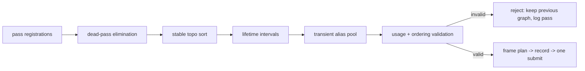
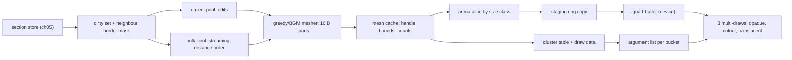

# 03 — Rendering: Device, Render Graph and the Voxel Geometry Pipeline

> Status: normative - Last updated: 2026-11-24
> Depends on: DEC-002, DEC-004, DEC-005, DEC-011, DEC-012, DEC-013, DEC-014, DEC-016, DEC-017, DEC-018, DEC-035, DEC-038, DEC-048; [conventions](00-conventions.md), [technical architecture](01-technical-architecture.md), [world model](05-world-model.md), [performance budgets](25-performance-budgets.md)
> Implements: MS-03, MS-04

## 1. Purpose and scope

This chapter specifies how voxel geometry reaches the GPU and how a frame is
organised: device admission, the render graph, CPU/GPU overlap, meshing output,
upload arenas, visibility, submission and the renderer's budgets. It is the contract
for `ob_render`, the only crate that may link `wgpu` (DEC-003). Shading behaviour is
[chapter 04](04-shaders-and-visuals.md); section storage and streaming are
[05](05-world-model.md); light propagation is [07](07-light-and-weather.md); chunk
transfer is [18](18-networking-multiplayer.md); UI layout is [13](13-ui-and-ux.md);
whole-frame budget authority is [25](25-performance-budgets.md).

Requirements marked **(provisional)** depend on provisional register entries — GPU-driven
visibility (DEC-013) — and ship behind a configuration switch and are re-baselined at
MS-04. The 32³ mesh cluster is not provisional: 2×2×2 sections is the default from MS-04
(DEC-048), while the 16³ section remains the storage, edit, light and network unit, and
the 1×1×1 per-section mesher is retained as a debug/fallback path. Render distance is
always stated as a **block radius**; 512 blocks = a 32-chunk radius = 65×65 = 4,225
chunk columns, never a 512-block diameter.

## 2. Requirements

| ID | Requirement | Verification |
| --- | --- | --- |
| REQ-RENDER-001 | One `wgpu::Device`, one `wgpu::Queue`, at most one `queue.submit` per frame; device recreation after loss is the only exception. | Submit counter per frame |
| REQ-RENDER-002 | Device creation requests the §3.1 table clamped to granted limits/features and records them in `GpuCapabilities`; no optional baseline feature is required and absence selects a documented fallback. | Device matrix: Vulkan, DX12, Metal, lavapipe |
| REQ-RENDER-003 | Mesh shaders, ray tracing, async-compute queues and multi-queue submission are not requested at 1.0. | Feature request snapshot test |
| REQ-RENDER-004 | The graph rejects cycles, reads of never-written resources and alias hazards before recording; a rejected graph leaves the previous one running. | Unit tests over invalid graphs |
| REQ-RENDER-005 | Transient aliasing only reuses a pooled object with an identical descriptor and a disjoint lifetime. | Graph validator test |
| REQ-RENDER-006 | Every pass declares a budget; debug builds log violations at 2× budget, once per second. | Log-fires test |
| REQ-RENDER-007 | Pass order hints, budgets and debug toggles reload without restart in development builds. | Edit-reload-render test |
| REQ-RENDER-008 | Frames in flight are 2 by default, 3 maximum; the CPU never waits on a fence before submitting the current frame. | Instrumented trace assertion |
| REQ-RENDER-009 | Mesh, draw-data and argument uploads use the staging ring; `Queue::write_buffer` is not used for them in the frame loop. | Debug counter assertion |
| REQ-RENDER-010 | No pipeline, layout, bind group, sampler or texture view is created inside a frame. | Creation counter between `Present` and `Begin` |
| REQ-RENDER-011 | A pipeline cache persists to disk and loads before the first frame; a warm start compiles nothing on the critical path. | Cold/warm compile counter |
| REQ-RENDER-012 | Voxel quads are exactly 16 B in the §4.1 layout; position, normal, UV, AO and corner light are derived, with no vertex attributes. | `size_of` test plus golden image |
| REQ-RENDER-013 | Three buckets (opaque, cutout, translucent); opaque and cutout are never sorted per frame, translucent is sorted per cluster back to front. | Image test plus sort unit test |
| REQ-RENDER-014 | Meshes are cached under (dimension, cluster position, content epoch, mesher version) and invalidated on edit, border change, content reload and eviction; a stale mesh is never drawn. | Cache test plus edit-latency test |
| REQ-RENDER-015 | At a 512-block radius: ≤ 12 geometry draws and ≤ 32 draws including shadow, post and UI per frame. | Frame statistics gate |
| REQ-RENDER-016 | No per-frame main-thread loop iterates over individual sections; visibility cost scales with region and 32³-cluster counts only. | 512-vs-1024-block-radius scaling benchmark |
| REQ-RENDER-017 | CPU region+cluster frustum culling is the MVP path; the Hi-Z compute culling with GPU compaction is **(provisional)** until MS-04; the zero-instance portable path selects the same visible set as the counted path. | A/B image diff across paths |
| REQ-RENDER-018 | 2×2×2 sections (32³) is the default mesh cluster from MS-04 (DEC-048); `mesh.cluster_sections = 1` remains a debug/fallback option. Both paths agree on face visibility and differ only in merge factor. | A/B diff plus quad-count report |
| REQ-RENDER-019 | Chunk buffers come from a size-classed arena with coalescing, bounded defragmentation and distance/LRU eviction; allocation failure degrades per §3.6 and never panics. | Arena unit tests plus soak |
| REQ-RENDER-020 | The §3.6 caps are enforced: ≤ 768 MB at a 512-block radius, ≤ 1.75 GB at a 1024-block radius (post-1.0, Report). | VRAM accounting on a 4 GiB adapter |
| REQ-RENDER-021 | Block and item textures are 2D arrays with offline mips; sampler state follows §3.7; the 1.0 path has no atlas. | Asset validator plus image test |
| REQ-RENDER-022 | At most four bind groups with the fixed §3.7 table for every voxel, entity, particle and post pipeline. | Pipeline layout inspection |
| REQ-RENDER-023 | Entities, items and particles are instanced or vertex-pulled from shared buffers; no per-entity uniform, bind group or pipeline switch in the frame loop. | Draw counter with 500 entities |
| REQ-RENDER-024 | The UI pass is last, in the swapchain format, `LoadOp::Load`, without world depth, and never influences culling. | Graph inspection |
| REQ-RENDER-025 | Shadow and post passes are declared in §3.9 and implemented by [chapter 04](04-shaders-and-visuals.md); adding or removing one updates both chapters' budgets. | Pass inventory diff |
| REQ-RENDER-026 | No LOD inside the render distance at 1.0; beyond-view terrain is visual-only (DEC-018). | Config inspection plus parity test |
| REQ-RENDER-027 | Present mode, limiter and vsync map to the §3.10 settings; default `Mailbox` else `Fifo`, vsync off. | Settings schema plus frame trace |
| REQ-RENDER-028 | Upload bytes, mesh jobs, defrag copies and sorts have hard per-frame caps; exceeding one defers work rather than extending the frame. | p99 gate during streaming |
| REQ-RENDER-029 | Presets are data (potato, low, medium, high, performance, ultra) mapping to §3.11 settings; `performance` is the 144 FPS mode, not a quality tier above `high`; no automatic preset changes state unreported in the UI. | Settings schema test |
| REQ-RENDER-030 | Profiling exposes per-pass timestamps, CPU scopes, per-pass markers and the §3.12 scenes with p50/p95/p99. | CI artifact check |
| REQ-RENDER-031 | Device loss, surface loss and OOM recover without a process restart; meshes rebuild from world state. | Fault-injection test |
| REQ-RENDER-032 | Golden-image and validation-layer gates pass on all three desktop backends; the performance envelope is gated on the reference machine, with macOS Metal a `Warn` tier until MS-13 proves it ([25 §3.1](25-performance-budgets.md#31-hardware-tiers)). | CI job |

## 3. Design

### 3.1 Device, queue and capabilities

The instance uses `VALIDATION` in debug and `GPU_BASED_VALIDATION` only in the
`dev-validation` profile. Adapter choice: explicit setting, else high-performance
surface-compatible, else any compatible; a software adapter is accepted only under
`render.allow_software` (CI golden images, §7). A dedicated server never reaches this
code (DEC-003). Tiers: **desktop-full** (`MULTI_DRAW_INDIRECT` +
`INDIRECT_FIRST_INSTANCE` + `PIPELINE_CACHE`), **desktop-portable**
(`MULTI_DRAW_INDIRECT` only, §3.5), **downlevel** (indirect execution only;
GLES/WebGPU, post-1.0).

wgpu 30 defaults are WebGPU-safe and too small here. Every fallback is a shipped path:

| Limit / feature | Default | Request | Fallback if absent | Backend notes |
| --- | ---: | ---: | --- | --- |
| `max_buffer_size` | 256 MiB | 1 GiB | 512 MiB with page splitting | Metal `maxBufferLength` is 256 MiB on some Intel iGPUs |
| `max_storage_buffer_binding_size` | 128 MiB | 256 MiB | 128 MiB, more pages | WebGPU caps at 128 MiB |
| `max_bind_groups` | 4 | 4 (not raised) | — | Deliberate WebGPU parity |
| `max_texture_array_layers` | 256 | 4096 desktop, 1024 mobile | clamp to the reported limit and reject over-budget content at validation, with an atlas compatibility path (DEC-017) | Apple Silicon 2048; older Intel 256 |
| `IMMEDIATES` / `max_immediate_size` | off / 0 | on / 64 B | Draw data via storage buffer | Native on Metal, DX12, Vulkan; absent on GLES/WebGPU |
| `INDIRECT_FIRST_INSTANCE` | off | on | One draw per cluster, `first_instance = 0` | Not on GLES/WebGL |
| `MULTI_DRAW_INDIRECT_COUNT` | off | on where present | Zero-instance arguments (§3.5) | Vulkan 1.2+/DX12 native; **no-op stub on Metal in wgpu 30** |
| `TIMESTAMP_QUERY` | off | on | CPU scopes only; profiler warns budgets are unchecked | WebGPU restricts timestamps to compute passes |
| `TIMESTAMP_QUERY_INSIDE_ENCODERS` | off | optional | Encoder-boundary brackets, marked approximate | Some Metal families |
| `PIPELINE_CACHE` | off | on | In-memory only; first-run stall admitted on the loading screen | All three backends |
| `TEXTURE_COMPRESSION_BC` | off | on desktop | Uncompressed sRGB at 4× memory; 512 MB texture cap | macOS emulates BC, prefers uncompressed or ASTC |
| `DEPTH_CLIP_CONTROL` | off | on | Clip in shader against `w` | Native on Vulkan/DX12 |
| `EXPERIMENTAL_MESH_SHADER`, `EXPERIMENTAL_RAY_QUERY` | off | **not requested** | — | Turing/RDNA2+ only; passthrough on non-Vulkan |

**One queue, no async compute, no mesh shaders** are constraints, not tuning options.
The Hi-Z dispatch must run in the same submit as the draws that read it, so a barrier
separates them and no second queue can hide the gap; compute and raster serialize, and
§5 budgets assume that; overlap comes from CPU workers while the GPU consumes the
previous frame, which is why 2 frames in flight matter; without mesh shaders culling can
only discard geometry, so the 16 B/quad format and 100k–200k visible quads are what make
the pipeline affordable; and one submit per frame means uploads land at the next frame's
start, the one-frame latency accounted for in §3.3.

### 3.2 Render graph

A pass declares `{ name, kind (Raster | Compute | Transfer | Present), reads, writes, colour
targets, depth target, budget_us, after }` over named resources.

Compilation: **eliminate** passes whose outputs reach no persistent resource or present
target (GTAO when the composite ignores it); **sort** topologically with Kahn over fixed
weights (`Transfer` < cull < shadow < scene < post < UI < `Present`), ties broken by
registration order so the plan is deterministic; **alias** transients — wgpu has no
placed-resource API, so aliasing reuses a pooled *object* with an identical descriptor and
disjoint intervals, buying fewer live textures and less allocator churn rather than a
smaller heap; **derive usage** and fail early where wgpu would fail late. wgpu inserts the
transitions implied by binding, so the graph's job is precise declaration and keeping
producer and consumer in one command buffer where a barrier would otherwise become a
submit boundary; it never emits raw pipeline barriers.



Two timestamp writes bracket each pass and resolve two frames later; debug builds push a
debug group named after the pass so captures read as the §3.9 table, and without
encoder-level timestamps the bracket covers a whole encoder and is marked approximate. In
development `assets/render/graph.ron` supplies order hints, budgets, resolution factors and
debug toggles: a candidate plan compiles, swaps at a frame boundary and keeps the old
resources one extra frame, while a rejected candidate logs the pass and leaves the running
graph alone. Release builds bake the same structure as constants.

### 3.3 Frame structure and CPU/GPU overlap

The renderer occupies `Prepare`/`Render` and `Present`
([conventions §3.2](00-conventions.md#32-architecture)). Simulation ticks at 20 Hz, fixed;
a server setting raises only the snapshot rate to 30 Hz (DEC-038), and the renderer
interpolates from an immutable snapshot.

| Phase | Work | Budget p95 (ms) |
| --- | --- | ---: |
| prepare | Snapshot interpolation, camera and frustum, sun/fog parameters, settings | 0.30 |
| visibility | Region cull, cluster cull or dispatch, argument write or compaction, sort | 0.30 |
| upload | Drain the ring: mesh blocks, draw data, uniforms, dynamic lights | 0.20 |
| encode | Record command buffers, timestamps, query resolves | 0.30 |
| submit | One submit, present, ring bookkeeping, conditional fence wait | 0.10 |
| **total** | | **1.20** |

The other 0.8 ms of the 2.0 ms CPU frame belongs to simulation, networking, UI and audio
([performance budgets](25-performance-budgets.md)). Two frame slots by default
(`desired_maximum_frame_latency = 2`), with a third available on high/ultra when VRAM
allows; each owns a 256 B-aligned uniform region, one 16 MiB ring slot, a draw-argument
buffer pair, a timestamp set with readback, a fence and a retired-generation counter for
defrag. The CPU submits frame *N* and starts *N+1* immediately, blocking only when *N−1*'s fence is
unsignalled — the definition of GPU-bound; two frames in flight cost about two frame
periods of latency, three cost three, so `render.frames_in_flight` is the main latency
lever after present mode.

Ring writes are `memcpy` from mesher output submitted as at most 64
`copy_buffer_to_buffer` runs after coalescing adjacent cluster blocks; `FrameUniforms` (§4)
travel through a dynamic offset, written once per frame. Bind groups are cached by
`(layout_id, epoch, sorted resource ids, rounded ranges)`, the epoch bumping on content
reload, resize and shadow reallocation, so steady state creates zero per frame
(REQ-RENDER-010). Pipelines compile on a background queue in a fixed order so the loading
screen shows true progress; a draw whose pipeline is not ready is skipped for up to 2 frames
and logged once. The disk cache key is `(adapter, driver, backend, descriptor hash, shader
hash)`, capped at 32 MiB, pruned oldest-first, deleted rather than trusted when corrupt.

### 3.4 The voxel geometry pipeline



The mesher reads the section plus a one-block border, so the dirty mask records which of
the 26 neighbours changed and a border change remeshes the owner even when its own blocks
are untouched ([world model](05-world-model.md)). Output depends on block states, the
packed light volume, the content epoch and the mesher version — all four in the cache key.
Two pools exist (urgent for edits, bulk ordered by distance); a job is capped at 1 ms and
split by y-band, and the bounded queue drops the farthest pending job under backpressure.
Quads land in one contiguous block per cluster and bucket, preceded by a 16 B header
(bounds, quad count, material mask) used for sorting and cascade assignment.

**No index buffer.** The vertex shader derives `quad = vertex_index >> 2` and
`corner = vertex_index & 3`, giving 4 invocations per quad instead of 6 for a two-triangle
indexed quad, and removes both the index buffer and 6 index fetches per quad:

```wgsl
let quad = ob_quads[vi >> 2u];                       // array<vec4<u32>>, 16 B
let corner = vi & 3u;                               // 0..3, CCW from outside
let dd = ob_draw_data[ii];                          // first_instance selects this
out.clip = ob_view_proj * vec4f(vec3f(dd.origin_rel) + ob_corner(quad, corner), 1.0);
```

`instance_index` is the draw-data index carried in `first_instance`, pointing at a 16 B
record holding the cluster origin *relative to the camera's block position* as `i32`, so a
30,000,000-block world loses no precision. That needs `INDIRECT_FIRST_INSTANCE`; the
portable tier issues one draw per cluster with an immediate carrying the index (§3.13).

| Bucket | Depth write | Blend | Order | Contents |
| --- | --- | --- | --- | --- |
| opaque | yes | none | cluster table order (front to back) | solid blocks, opaque models |
| cutout | yes | none, `discard` | after opaque | leaves, grass, fences, grates |
| translucent | no | premultiplied alpha | per cluster back to front; water sub-bucket last | water, glass, ice, stained glass |

Cutout is a bucket rather than a shader permutation because discarded fragments must not
write depth and sorting it is pointless; it shares the opaque argument layout.
`mesh.cluster_sections = 2` is the default from MS-04 (DEC-048) and meshes a 2×2×2 cluster
from a 34³ padded volume; `= 1` remains a debug/fallback that meshes each 16³ section. A
cluster owns quads whose origin lies inside its extent, so cross-seam faces vanish and flat
builds merge further, at up to 8× the section volume of remesh work per edit (still
100–300 µs estimated). Both paths must agree on visible faces and differ only where quads
merged; §7 tests exactly that. The MS-04 corner-edit benchmark tunes the cluster
implementation (latency, eviction, Metal fallback), not the default.

### 3.5 Visibility and submission

| Level | Extent | Count at 512-block radius | Tested by |
| --- | --- | --- | --- |
| Region | 8×4×8 sections = 128×64×128 blocks | 486 | CPU, every frame |
| Cluster | 32³ blocks (2×2×2 sections); 1×1×1 debug fallback | 12,675 (32³) | CPU at MVP, GPU at 1.0 |
| Quad | one face rectangle | 100k–200k visible | Backface culling in raster |

At a 512-block radius the field is 65×65 = 4,225 columns; at 384 blocks of height that is
24 sections per column and 101,400 sections. A 0.30 ms visibility budget allows about
3 ns per section — not credible on the main thread even with a job pool — so 32³ clusters
cut the tested count to 12,675, or roughly 24 ns per cluster (DEC-048). A region covers 8
chunks a side, giving 9×9 region columns (the edge cell is partial) and 6 vertical rows:
486 regions. Culling them is always affordable. Frustum planes are extracted from the
view-projection matrix in world space and normalised; AABBs live in packed `[f32; 6]`
structure-of-arrays form so a batch test is six dot products on eight lanes. Regions are
tested first and a culled region contributes no cluster work; cluster bounds are inflated
by one block so geometry reaching a boundary is not clipped by rounding.

**Hi-Z at 1.0 (provisional).** The cull pass builds a min-pyramid from the previous frame's
depth in reverse-Z convention (far = 0.0, so the conservative test reads the pyramid's
minimum value). Cluster AABBs are reprojected through the *previous* view-projection and
expanded by the camera's motion since that frame before testing against the mip covering
their screen-space box; one frame of lag is accepted, and the expansion removes the
disocclusion pop on fast turns. `render.hiz = off` disables the test without changing
anything else, because ghosting reports are otherwise unreproducible. Compaction writes one
argument per visible cluster via `atomicAdd`; the list is pre-cleared to zero-instance
arguments each frame (1 MiB `clear_buffer`, ~10 µs) so the portable path can submit the whole
capacity.

| Field | Type | Meaning |
| --- | --- | --- |
| `vertex_count` | `u32` | `4 × quad_count`; 0 for a culled record |
| `instance_count` | `u32` | 1 when visible; 0 on the zero-instance path |
| `first_vertex` | `u32` | `4 × quad_base` in the bucket's quad buffer |
| `first_instance` | `u32` | draw-data index; needs `INDIRECT_FIRST_INSTANCE` |

| Submission path | Gate | Draws per frame | Notes |
| --- | --- | --- | --- |
| counted | `MULTI_DRAW_INDIRECT_COUNT` | 1 `multi_draw_indirect_count` per bucket | Vulkan 1.2+/DX12; counts stay on the GPU |
| portable zero-instance | `MULTI_DRAW_INDIRECT` | 1 `multi_draw_indirect` per bucket over a lagged, clamped capacity; culled entries carry `instance_count = 0` | Metal, GLES/WebGPU. wgpu 30 **loops** MDI arguments on Metal, so capacity is the visible count read back two frames earlier plus 25%; at the 1024-block ceiling the 64³ escalation that would keep arguments under 2,000 is blocked by OPEN-009 until the 16 B quad record can encode 64³ merges, so 1024 is refused on this path until then |
| per-cluster | `INDIRECT_FIRST_INSTANCE` absent | one indirect draw per cluster | Portable tier only, not shipped at 1.0 |

The Metal constraint shapes the design: `indirect_count` is a no-op stub in wgpu 30's Metal
backend and `multi_draw_indirect` is emulated by looping sub-draws in `wgpu-hal`, so a fixed
65k-argument capacity would mean 65k driver calls per bucket. Opaque and cutout draw in
cluster-table order (ascending camera distance, updated when the camera crosses a block).
Translucent clusters are radix-sorted back to front when the camera moves one block or the
visible set changes: at most 4,096 keys, 0.05 ms, skipped when nothing changed. Quads are not
re-sorted inside a cluster — greedy quads in 32³ are small enough that intra-cluster errors
are sub-pixel for glass and invisible for water, and the water sub-bucket draws last so its
refraction input is complete.

| Render distance (block radius) | Columns | Sections | Clusters (32³) | Visible (≈25%) | Regions visible | Geometry draws | CPU cull |
| ---: | ---: | ---: | ---: | ---: | ---: | ---: | ---: |
| 256-block radius (16 chunks) | 1,089 | 26,136 | 3,267 | 817 | 37 of 150 | 3 | 0.08 ms |
| **512-block radius (32-chunk radius)** | **4,225** | **101,400** | **12,675** | **3,169** | **121 of 486** | **3** | **0.30 ms** |
| 1024-block radius (64 chunks) | 16,641 | 399,384 | 49,923 | 12,481 | 434 of 1,734 | 3 | 1.10 ms |

At a 1024-block radius the CPU cull alone exceeds the 0.30 ms visibility budget — the
quantitative reason DEC-013 moves culling to compute; per DEC-018 that row is a post-1.0
(MS-20) report, not a 1.0 gate. The 1×1×1 debug path multiplies the cluster count by 8
(101,400 at a 512-block radius) and the cull time to roughly 1.9 ms. The 32³ default does not
change the three bucket draws; it changes the argument count, from 12,675 clusters at a
512-block radius to about 3,169 visible.

### 3.6 Buffer arenas and GPU memory

One arena per bucket (opaque and cutout share) plus one for entity/model geometry; each is a
set of 64 MiB device-local pages. Allocations use size classes `1 … 256 KiB` (doubling); above
256 KiB takes whole pages (far-LOD tiles, post-1.0). Each class keeps an offset-sorted free
list, so coalescing is a neighbour check at free time; a 32³ cluster mesh is 8–48 KiB, making
the common path one class lookup and one list pop. `AllocHandle { page: u16, offset: u32,
class: u8, len: u32 }` is what the cache stores, and arguments hold byte offsets derived from
it, so compaction rewrites arguments without changing handles.

Fragmentation is `1 - largest_free_run / total_free` per class; above 0.20 the arena compacts
by copying live blocks upward into low free runs with `copy_buffer_to_buffer`, recorded after
the upload copies and before the draws. A block is compactable only when its last-used frame
is older than the oldest frame in flight; referenced blocks are skipped and retried. Budget:
4 MiB and 0.15 ms per frame, at most one page per second. Argument offsets are rewritten on
the CPU for the *next* frame, so copy and update are one frame apart and the hazard
disappears without a stall.

Eviction order when an allocation would exceed the cap: (1) meshes outside the frustum for
≥ 120 frames, (2) meshes beyond 1.25× the render distance, (3) farthest visible meshes until
it fits, (4) otherwise the request fails, the cluster is marked unmeshed, geometry is skipped
for it, the overlay shows the count, and the mesher requeues it at low priority. Eviction
bumps the cache epoch so a late mesher result cannot resurrect a stale handle.

| Category | 512-block radius | 1024-block radius | Notes |
| --- | ---: | ---: | --- |
| Quad arenas | 192 MB | 768 MB | includes entity/model arena; evicts at the cap |
| Staging ring + readback | 48 MB | 64 MB | 3 × 16 MiB plus timestamp/count readbacks |
| Textures (arrays, mips, BC7) | 192 MB | 192 MB | distance-independent; 4096 layers at 64² BC7 ≈ 128 MB |
| Shadow atlas | 48 MB | 48 MB | 3 × 2048² `Depth16Unorm` = 25 MB used |
| HDR + post targets | 72 MB | 96 MB | scales with output resolution |
| UI, glyph and item atlases | 32 MB | 32 MB | |
| Buffers (args, draw data, lights, clusters) | 16 MB | 48 MB | |
| **Subtotal** | **600 MB** | **1,248 MB** | |
| **Cap (REQ-RENDER-020)** | **768 MB** | **1,750 MB** | eviction triggers before the cap |

The 1024-block column is the post-1.0 (MS-20, DEC-018) extrapolation and is Report only; the
1.0 caps are the 512-block column.

On `DeviceLost` the renderer drops all GPU resources, recreates device, surface and cache
handle and re-requests meshes for loaded clusters. No CPU mesh copy is retained — 200 MB at a
512-block radius to serve a rare event is not worth it; the client's world data is the source of
truth and remeshing 12,675 clusters at ~40 µs on 8 threads is ~63 ms of worker time. A blocking
"graphics device lost, recovering" overlay explains the pause.

### 3.7 Textures, samplers and material binding

Textures are `texture_2d_array<f32>` per channel set: albedo (sRGB, BC7/ASTC), normal+roughness
(linear, BC5) and emissive (linear, BC7); items and entity skins form a second array in the
same layout. Layers are stable within a content epoch, and a reload that changes the layer
count reallocates, bumps the epoch and invalidates bind groups and meshes together. Mips are
generated offline into KTX2 ([tooling](21-tooling-and-pipelines.md)), never at runtime. Array
layers are disjoint in texture space, so filtering and mip generation cannot bleed between
textures — the reason DEC-017 chose arrays.

| Group | Binding | Resource | Cadence |
| --- | ---: | --- | --- |
| 0 frame | 0 | `FrameUniforms` (256 B aligned, dynamic offset) | per frame |
| 0 | 1 | `dynamic_lights` (storage) | per frame |
| 0 | 2 | shadow atlas + comparison sampler | per frame |
| 1 materials | 0..2 | albedo / normal / emissive arrays | content epoch |
| 1 | 3 | `MaterialTable` (storage, 16 B per layer) | content epoch |
| 1 | 4 | linear-repeat, linear-clamp, comparison samplers | once |
| 2 geometry | 0 | `quads` (`array<vec4<u32>>`) | per bucket |
| 2 | 1 | `draw_data` (16 B per cluster) | per frame |
| 2 | 2 | `cluster_table` (bounds, counts) | per frame |
| 3 pass | 0..n | AO inputs, post inputs, cloud noise, debug buffers | per pass |

Group 2 rebinds at most five times per frame (three buckets, shadow, entities); group 3 once
per post pass. Nothing rebinds per cluster.

| Surface | Filter | Address | Anisotropy | Mip bias |
| --- | --- | --- | ---: | ---: |
| block albedo | linear-mipmap-linear | repeat | 8× (16× ultra) | 0.0, +0.5 merged |
| block normal/emissive | linear-mipmap-linear | repeat | 4× | 0.0 |
| items, entities | linear-mipmap-linear | clamp | 4× | 0.0 |
| UI sprites, glyphs | nearest (pixel) / linear (vector) | clamp | 1× | 0.0 |
| shadow map | comparison, 2×2 hardware + 3×3 PCF | clamp | 1× | 0.0 |

Merged quads must sample with explicit gradients: `textureSample` derives them from the
interpolated tile UV, which jumps at a wrap and produces a mip seam at every block boundary,
so the shader uses `textureSampleGrad` with derivatives of the world position projected into
the face basis, continuous across a 32-block quad.

### 3.8 Entities, items, particles and overlays

- **Entities.** (part, mesh) pairs drawn instanced from a per-frame buffer of
  `{transform: [f32; 12], light: u32, anim: u32, flags: u32}` (64 B), vertex-pulled by
  `instance_index` and `vertex_index`. Limb animation is evaluated on the CPU into the
  instance transform (≤ 0.1 ms for 200 entities), so no bone palette is needed and animation
  is identical across backends. A dropped item is one instanced model; a chest, sign or banner
  is a model attached to a position and updated only when its state changes; the held item
  uses the same path with a hand matrix in a separate pass with a cleared depth range so it
  cannot clip into walls.
- **Particles.** CPU simulation, GPU instancing, one indirect draw per material, quads from
  `vertex_index` with a billboard basis. Cap 16,384; spawns above it are rejected, not queued.
  Collision and light sampling are budgeted at 0.2 ms for at most 2,048 simulated particles,
  the rest ballistic. No per-particle sort (OIT policy in [chapter 04](04-shaders-and-visuals.md)).
- **UI and overlays.** Last pass, swapchain format, `LoadOp::Load`, no world depth
  (REQ-RENDER-024). Inventory icons render through the entity pipeline into a small offscreen
  atlas cached by `(item, variant, scale)`, so the UI pass needs no depth. Nothing after the UI
  pass writes the swapchain except present.

### 3.9 Pass inventory

Passes marked *ch04* are shaded per [chapter 04](04-shaders-and-visuals.md); their budgets are
declared here.

| # | Pass | Kind | Reads | Writes | Budget (high, 1080p) |
| ---: | --- | --- | --- | --- | ---: |
| 1 | `upload-drain` | Transfer | staging ring | arenas, draw data | 0.05 ms |
| 2 | `hiz-build` | Compute | prev depth | hiz pyramid | 0.10 ms |
| 3 | `cull` | Compute | hiz, clusters, frustum | args, counts | 0.15 ms |
| 4 | `shadow` (ch04) | Raster ×3 | quads, args, draw data | shadow atlas | 0.90 ms |
| 5 | `depth-prepass` | Raster | quads, args | depth | 0.35 ms |
| 6 | `opaque` (ch04) | Raster | quads, materials, frame | HDR | 0.80 ms |
| 7 | `cutout` (ch04) | Raster | quads, materials | HDR + depth | 0.40 ms |
| 8 | `sky` (ch04) | Raster | LUTs, frame | HDR | 0.45 ms |
| 9 | `translucent` (ch04) | Raster | translucent quads | HDR | 0.70 ms |
| 10 | `particles` (ch04) | Raster | instances | HDR | 0.25 ms |
| 11 | `volumetric-fog` (ch04) | Compute | depth, LUTs | fog volume | 0.35 ms |
| 12 | `gtao` (ch04) | Compute | depth, normal | AO | 0.35 ms |
| 13 | `taa` (ch04) | Compute | HDR, velocity, history | resolved | 0.35 ms |
| 14 | `bloom` (ch04) | Compute | resolved | bloom mips | 0.15 ms |
| 15 | `tonemap-grade` (ch04) | Raster | resolved, bloom, LUT | swapchain | 0.10 ms |
| 16 | `ui` | Raster | UI atlas | swapchain | 0.20 ms |
| 17 | `present` | Present | swapchain | — | — |

The GPU rows sum to 5.65 ms against the 6.0 ms envelope at the 120 FPS gate; the rest is slack
for barriers and driver overhead, while the compositor reserve and present margin sit outside
this envelope ([25 §3.2](25-performance-budgets.md#32-the-frame-envelope)). A preset removes rows
and the graph re-derives barriers and aliasing.

### 3.10 LOD, frame pacing and latency

No LOD inside the render distance at 1.0: every cluster within the 512-block radius draws at
full detail (DEC-018). Beyond it the world ends in atmospheric fog and sky — no impostor tiles,
no heightfield rings, no GPU-generated far terrain. LOD becomes necessary at 128+ chunks, not
32, and client-side generation is an information leak. Post-1.0 (MS-20) adds visual-only tiles
allocated as whole pages and excluded from the shadow pass; they can never feed collision,
spawning, drops, ore knowledge or anti-cheat.

| Setting | Values | Mapping |
| --- | --- | --- |
| `render.present_mode` | `auto` (default), `mailbox`, `fifo`, `immediate` | `auto` picks `Mailbox` when supported, else `Fifo`; `immediate` is dev-only and warns |
| `render.vsync` | off (default), on | `on` forces `Fifo` |
| `render.fps_limit` | `display` (refresh − 3), `60`, `120`, `144`, `off` | Sleep-based limiter, 0.5 ms granularity, never busy-waits |
| `render.frames_in_flight` | 2 (default), 3 | §3.3 |
| `render.distance_blocks` | 128, 256, 384, 512 (default), 768; 1024 post-1.0 | Radius in blocks; the settings row also shows the 16-block chunk radius (8/16/24/32/48; 64 post-1.0) and the 65×65 column count at 512 |
| `render.preset` | `potato`, `low`, `medium`, `high` (default), `performance`, `ultra` | Selects the §3.11 column; `performance` is the 144 FPS mode, not a quality tier; a change is persisted and reported in the HUD |

The limiter targets `refresh − 3`: driving `Fifo` at exactly the refresh rate leaves a standing
queue and adds a frame of latency without improving smoothness. Adaptive vsync is not exposed
because wgpu does not provide it. Variable-refresh displays are treated as fixed at the reported
rate, with the limiter off when `Mailbox` works and the frame time is already below the refresh
period. Input-to-photon latency is measured, not assumed: an input timestamp from the `Input`
stage rides the frame's uniform data and is compared with the present time; target ≤ 3 frame
periods, with p50/p99 recorded at MS-04.

### 3.11 Quality presets

| Setting | potato | low | medium | high (default) | performance | ultra |
| --- | --- | --- | --- | --- | --- | --- |
| render distance (block radius) | 128 | 256 | 384 | **512** | **512** | 768 |
| render scale | 0.60 | 0.75 | 0.85 | 1.00 | **0.85** | 1.00 |
| shadows | off | 1 × 1024² | 2 × 2048² | 3 × 2048² | **1 × 1024²** | 3 × 4096² |
| shadow distance (blocks) | — | 48 | 64 | 96 | **48** | 128 |
| GTAO | off | off | off | half-res | **off** | full-res |
| SSR water | off | off | quarter | half | **off** | half + refine |
| volumetric fog / clouds | off | off | off | fog (half) | **off** | fog + clouds |
| TAA | off (FXAA) | on | on | on | **on** | on |
| particle budget | 1,024 | 4,096 | 8,192 | 16,384 | **8,192** | 16,384 (cap) |
| anisotropy | 1× | 4× | 8× | 8× | 8× | 16× |
| entity distance (blocks) | 48 | 64 | 80 | 96 | 96 | 128 |
| estimated GPU time | 1.9 ms | 2.2 ms | 3.4 ms | **5.7 ms** | **3.3 ms** | 7.6 ms |

`potato` is the integrated-GPU preset: it drops memory-bandwidth-bound effects and lowers render
scale, the cheapest lever on any GPU. `performance` is the 144 FPS mode: 512-block radius, 0.85
render scale, one 1024² cascade at 48 blocks, no GTAO/SSR/volumetric fog or clouds, an 8,192
particle cap and TAA on. It is a verified mode (`PERF-FRAME-003`), not a sixth quality tier, and
it does not replace the `high` default. `ultra` is not a 1.0 gate; it exists so quality can scale
past the reference machine.

### 3.12 Profiling workflow

Per-pass timestamps with budget assertions appear in the debug overlay as a sorted bar list and
export as JSON per run, alongside counters for draw calls, arguments written, bytes uploaded,
fragmentation and pipeline compiles; CPU scopes surround prepare, visibility, upload, encode and
submit. Captures use RenderDoc (Windows/Linux) and the Metal tools (macOS), legible without a
legend thanks to §3.2's markers. Five renderer scenes, each with fixed seed, camera path and input
log, no vsync, 10 s warm-up:

| Scene | Stresses | Duration | Gate |
| --- | --- | --- | --- |
| `flythrough` | streaming, upload, cull at speed, mesh churn | 120 s at 30 blocks/s | p95; no frame > 33 ms |
| `tnt` | simultaneous remeshes, light updates, particles | 30 s, 64 explosions | p99; queue drained |
| `water` | translucent sort, SSR, underwater fog | 30 s | p95; sort spike ≤ 0.05 ms |
| `cave` | occlusion, overdraw, block-light shading | 30 s | p95; Hi-Z rejection ≥ 40% |
| `megabuild` | cluster merge factor, large translucent surfaces | 60 s | p95; quad-count report |

The renderer scenes above are a subset of the single catalogue in `perf/scenes.toml`, which also
defines `empty` and the frame-based `ui_stress` scene. A budget row naming a scene absent from
that catalogue fails the manifest load ([25 §4.1](25-performance-budgets.md#41-budget-manifest)).
Every run stores the JSON report, current reference images and adapter/driver identity; a PR fails
on a > 10% p95 regression in any scene (DEC-035).

### 3.13 Fallbacks and degraded modes

| Condition | Behaviour |
| --- | --- |
| Integrated GPU, shared memory | `potato` offered at first run; arenas capped at 128 MB; shadows and GTAO off; render scale 0.6 |
| 4 GiB VRAM | 512-block radius allowed; 1024 refused in settings with an explanation (post-1.0 MS-20); eviction at 85% of cap |
| `mesh.cluster_sections = 1` | Debug/fallback per-section meshing only: 101,400 clusters at a 512-block radius (8×), selected for A/B and bisection, never the shipping default |
| No `MULTI_DRAW_INDIRECT_COUNT` | Zero-instance arguments over a lagged, clamped capacity (§3.5) |
| No `INDIRECT_FIRST_INSTANCE` | Per-cluster indirect draws at 32³; 1024 is refused on this path and the 64³ escalation stays blocked by OPEN-009 until the quad record can encode 64³ merges |
| No `TIMESTAMP_QUERY` | CPU scopes only; budgets unchecked with a warning; benchmark gate CPU-only |
| No BC compression | Uncompressed textures, 512 MB texture cap, `medium` forced |
| `max_texture_array_layers < 1024` | Layer budget clamped; content validation names textures that cannot load rather than substituting silently |
| Device lost / OOM | Recover per §3.6; OOM evicts, then drops to `low`, then fails the world load with a message |

## 4. Data structures and formats

### 4.1 Quad record (16 B)

| Word | Bits | Field | Meaning |
| ---: | --- | --- | --- |
| 0 | 0..5 | `x` | origin X, cluster-local blocks, 0..63 (32³ clusters use 0..31) |
| 0 | 6..11 | `y` | origin Y |
| 0 | 12..17 | `z` | origin Z |
| 0 | 18..22 | `w-1` | extent along the face's U axis minus 1 (1..32) |
| 0 | 23..27 | `h-1` | extent along V minus 1 |
| 0 | 28..30 | `face` | 0..5 = +X, −X, +Y, −Y, +Z, −Z |
| 0 | 31 | `edge` | quad reaches the cluster boundary (shadow fit, debug) |
| 1 | 0..15 | `layer` | texture array layer |
| 1 | 16..23 | `tint` | tint palette index, 0 = untinted |
| 1 | 24..31 | `ao` | 2 bits per corner, corners 0..3 |
| 2 | 0..15 / 16..31 | `c0`, `c1` | corner 0/1: sky4 << 12 \| r4 << 8 \| g4 << 4 \| b4 |
| 3 | 0..15 / 16..31 | `c2`, `c3` | corner 2/3, same packing |

Corners are counter-clockwise from outside: `(u0,v0), (u1,v0), (u1,v1), (u0,v1)`, so triangles are
`(0,1,2)` and `(0,2,3)`. A monochrome-light variant packs each corner into 8 bits (sky4 << 4 \|
block4) for 12 B; a lightless LOD variant drops words 2–3 for 8 B. Each bucket uses exactly one
layout, so no pipeline branches on it. The six-bit origins address a 64³ cluster, but the
five-bit extents cap one merged quad at 32 blocks; that is why OPEN-009 blocks the 64³ Metal
escalation without a wider record.

### 4.2 Draw records

```rust
#[repr(C)] pub struct Quad(pub [u32; 4]);            // 16 B, §4.1
#[repr(C)] pub struct DrawData {                     // 16 B, first_instance
    pub origin_rel: [i32; 3], pub flags: u32,        // cluster origin - camera block
}
#[repr(C)] pub struct DrawIndirect {                 // 16 B, wgpu::DrawIndirectArgs
    pub vertex_count: u32, pub instance_count: u32,
    pub first_vertex: u32, pub first_instance: u32,
}
pub struct ClusterDraw {                             // CPU side, ~80 B with bounds
    pub alloc: AllocHandle, pub quad_count: u32, pub bucket: Bucket,
    pub bounds: Aabb, pub last_visible_frame: u32, pub epoch: u32,
}
```

The cache is an `IndexMap<MeshKey, ClusterDraw>` keyed by (dimension, cluster position, content
epoch, mesher version), ordered for deterministic iteration and carrying an LRU list; it holds
metadata only, about 1 MB at a 512-block radius.

`FrameUniforms` is 256 B, matching dynamic-offset alignment on all three backends: the two
view-projection matrices, camera position (fractional and block-aligned `i32`), time and frame
index, sun and moon directions with intensities, fog colour/density/start/end, render distance,
exposure scale, screen size and shadow splits. Cascade matrices occupy a second 256 B block so
the first stays within one cache line per draw.

## 5. Performance budgets

p95 unless stated, `flythrough`, 1080p, 512-block radius, `high`, on the reference machine of
[vision §9](../vision.md#9-platforms-and-hardware). The whole-frame envelope is owned by
[performance budgets](25-performance-budgets.md).

| ID | Budget | Value |
| --- | --- | ---: |
| PERF-RENDER-001 | CPU renderer per frame | ≤ 1.20 ms |
| PERF-RENDER-002 | CPU visibility (cull, args, sort) | ≤ 0.30 ms |
| PERF-RENDER-003 | CPU encode + submit | ≤ 0.40 ms |
| PERF-RENDER-004 | Upload | ≤ 8 MiB and ≤ 0.20 ms/frame; 24 MiB burst for one frame after a teleport |
| PERF-RENDER-005 | Draw calls | ≤ 12 geometry, ≤ 32 total |
| PERF-RENDER-006 | GPU time, all passes | ≤ 6.0 ms (120 FPS gate), ≤ 4.0 ms (144 FPS performance mode) |
| PERF-RENDER-007 | p99 frame time, CPU-bound | ≤ 11.1 ms (the 90 FPS 1% low) |
| PERF-RENDER-008 | Hitch gate | no frame > 33 ms in `flythrough` |
| PERF-RENDER-009 | Edit-to-visible | ≤ 2 frames at the camera, ≤ 100 ms at a 256-block radius |
| PERF-RENDER-010 | Defrag copy | ≤ 4 MiB and ≤ 0.15 ms/frame, ≤ 64 MiB/s |
| PERF-RENDER-011 | Pipeline compile inside a frame | 0 ms |
| PERF-RENDER-012 | Warm-start pipeline cache | ≥ 90% hit, ≤ 300 ms load |
| PERF-RENDER-013 | GPU memory | ≤ 768 MB at a 512-block radius; ≤ 1.75 GB at a 1024-block radius (post-1.0, Report) |
| PERF-RENDER-014 | Arena fragmentation | < 20% per class |
| PERF-RENDER-015 | Mesh job duration | ≤ 1 ms |
| PERF-RENDER-016 | Translucent sort | ≤ 0.05 ms |
| PERF-RENDER-017 | Cull scaling 512 → 1024-block radius | ≤ 4× CPU time (linear in regions and clusters, not sections; 12,675 → 49,923 clusters) |
| PERF-RENDER-018 | Device-loss recovery | ≤ 2 s to the first recovered frame |

## 6. Failure modes, risks and edge cases

| Failure | Symptom | Mitigation |
| --- | --- | --- |
| Stale argument after eviction | Geometry at a wrong transform, flicker | Arguments rebuilt from the cluster table each frame; eviction clears the entry before freeing; epoch check drops late results |
| Fragmentation stall | Multi-millisecond hitch on a large allocation | Incremental compaction, then eviction, then "unmeshed" (§3.6) |
| Ring overrun | Meshes appear late | Backpressure before recording the copy; 3 × 16 MiB ring; budget checked first |
| First-draw pipeline compile | 10–400 ms freeze | Background queue, load pre-warm, ≤ 2 skipped frames, disk cache |
| Metal MDI blow-up | Frame collapse on macOS | Lagged count clamp (§3.5); the 64³ escalation is blocked by OPEN-009 |
| Hi-Z ghosting on fast turns | Geometry disappears for a frame | Swept-AABB expansion, debug switch, accepted one-frame lag |
| Reverse-Z sign error | Scene empty or fully occluded after the prepass | One depth convention in `View::proj`, near/far golden images, debug assertion |
| Aliased transient still referenced | Flicker on post targets | Aliasing requires disjoint lifetimes *and* retired fences |
| Zero-instance miscount | Geometry vanishes on Metal | Clamp to the lagged count + 25%; full capacity for one frame after a teleport |
| Camera far from origin | Jitter, z-fighting | `camera_block` relative origin; `f64` world positions outside the renderer |

| Risk | Description | Mitigation | Owner |
| --- | --- | --- | --- |
| RISK-201 | The Metal lagged-count clamp mispredicts the visible set, causing pop-in or a submission spike | Two-frame readback lag, +25% clamp, per-backend measurement | MS-04 |
| RISK-202 | Arena fragmentation and defrag copies cause hitches the frame budget cannot absorb | 4 MiB/frame cap, retired-generation test, per-region arenas as a fallback | MS-04 |
| RISK-203 | Draw-argument capacity is sized for the 1024-block ceiling (49,923 32³ clusters) while the default ships 12,675 | Capacity derived from the ceiling, never from settings; A/B test at 512 and 1024 and at both cluster sizes | MS-04 |
| RISK-204 | wgpu 30's Metal MDI emulation changes cost with a driver update | Per-adapter submit policy; the benchmark gate fails the PR | MS-04 / MS-13 |
| RISK-205 | Golden images become flaky across drivers and block unrelated PRs | Software-adapter references, ±1 LSB hardware tolerance, separate gates | MS-04 |

## 7. Testing strategy

**Unit.** Arena invariants under random workloads, graph compilation (cycles, dead passes,
alias legality), frustum and AABB maths against a reference, quad packing round-trip,
`DrawData` origin arithmetic at ±30,000,000 blocks, cache invalidation and sort stability.
Property tests use `proptest`, and every test names the requirement it verifies.

**Validation and golden images.** `VALIDATION` plus Vulkan backend layers run in CI, where any
validation error fails the run. Five scenes × every preset in §3.11 are compared with SSIM ≥ 0.99
and mean absolute error ≤ 2/255 against lavapipe references, with a hardware set tolerating ±1 LSB
of driver difference; coverage is day, night, underwater, cave, rain and a loaded shader pack.

**Gates and equivalence.** Each scene records p50/p95/p99 CPU and GPU times, draw calls, upload
bytes, peak allocation and fragmentation; a > 10% p95 regression fails the PR (DEC-035). Three
A/B checks are mandatory: cluster meshing on/off, Hi-Z on/off, and counted versus zero-instance
submission, which must be bit-identical on one backend.

**Stress.** Post-1.0 (MS-20) stress: a 1024-block radius on a 4 GiB card for 30 minutes with
continual teleports: no OOM, no frame > 50 ms after the first second, fragmentation < 25%. At
1.0 the same run at a 512-block radius is the Gate. `device.destroy()` mid-frame must recover
within 2 s, and cull time must track region and cluster count rather than section count.

## 8. Open questions

1. **Metal submission policy.** The lagged-count clamp is judgement, not measurement. The 64³
   escalation it needs at 1024 is blocked by OPEN-009 (the 16 B quad record cannot encode 64³
   merges), so 1024 is refused on that path until OPEN-009 closes; the open part is the macOS
   sub-draw measurement before MS-12 (owner MS-04).
2. **Frames in flight default.** Register item needed: default to 2 frames in flight and expose 3
   only under high/ultra (owner MS-04). Closed with MS-06 latency data.
3. **Behaviour above 768 MB.** Register item needed: render distances above 768 blocks require
   ≥ 4 GiB device-local memory and accept mesh eviction (owner MS-12).
4. **Render-distance gate.** OPEN-003 decides whether a 512-block radius at 144 FPS is a ship
   gate or a performance mode; a different answer re-baselines PERF-RENDER-006 and §3.11. Owner:
   MS-04.

## 9. References

Decisions: [DEC-002](../decisions.md), [DEC-003](../decisions.md), [DEC-004](../decisions.md),
[DEC-011](../decisions.md), [DEC-012](../decisions.md), [DEC-013](../decisions.md),
[DEC-014](../decisions.md), [DEC-016](../decisions.md), [DEC-017](../decisions.md),
[DEC-018](../decisions.md), [DEC-035](../decisions.md), [DEC-038](../decisions.md),
[DEC-048](../decisions.md).

Research: [voxel rendering state of the art](../research/03-voxel-rendering-sota.md) (meshing
costs, visibility, memory arithmetic), [Weft teardown](../research/01-weft-teardown.md) (GPU
culling, indirect counts, page allocators, pool structure), [engine and render stack](../research/02-engine-and-render-stack.md)
(wgpu limits, feature matrix, validation cost), [UI, audio and localization](../research/08-ui-audio-localization.md)
(UI pass boundaries, batching). Milestones: [MS-03, MS-04](../plan/01-milestones.md).

External:

- wgpu 30 API and feature definitions — <https://docs.rs/wgpu/30.0.2/wgpu/>
- wgpu-hal Metal command encoding (multi-draw emulation) — <https://github.com/gfx-rs/wgpu/tree/trunk/wgpu-hal/src/metal>
- Aaltonen, "GPU-Driven Rendering Pipelines", SIGGRAPH 2015 — <https://www.advances.realtimerendering.com/s2015/aaltonenhaar_siggraph2015_combined_final_footer_220dpi.pdf>
- Binary greedy meshing reference implementation — <https://github.com/cgerikj/binary-greedy-meshing>
- 0fps, "Meshing in a Minecraft Game" — <https://0fps.net/2012/06/30/meshing-in-a-minecraft-game/>
- Khronos KTX2 container specification — <https://github.com/KhronosGroup/KTX-Specification>
