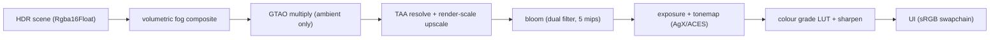

# 04 — Shaders and Visuals: Lighting, Shadows, Sky, Post and Shader Packs

> Status: normative - Last updated: 2026-11-24
> Depends on: DEC-005, DEC-011, DEC-014, DEC-015, DEC-016, DEC-017, DEC-022, DEC-029, DEC-032, DEC-045; [conventions](00-conventions.md), [rendering](03-rendering.md), [light and weather](07-light-and-weather.md), [performance budgets](25-performance-budgets.md)
> Implements: MS-04, MS-12

## 1. Purpose and scope

This chapter specifies what the pixels look like: how stored light becomes shading,
how the sun, sky, water, weather and particles are drawn, how shadows and the post
chain work, how materials and WGSL modules compose, and what the shader pack API may
and may not do. Geometry submission, the render graph, buffer and texture layouts and
the pass budgets live in [chapter 03](03-rendering.md); the *authoritative* light values
and their propagation live in [chapter 07](07-light-and-weather.md) and are never
computed on the GPU (DEC-015).

| Out of scope | Owner |
| --- | --- |
| Pass ordering, barriers, arenas, draw arguments, present | [03 — Rendering](03-rendering.md) |
| Light propagation, weather simulation, day/night clock | [07 — Light and weather](07-light-and-weather.md) |
| Sky-light storage format and palettes | [05 — World model](05-world-model.md) |
| Glyph atlases, widget styling, UI scale | [13 — UI and UX](13-ui-and-ux.md) |
| Texture authoring and KTX2 compilation | [21 — Tooling](21-tooling-and-pipelines.md) |
| Colour-blind palettes as an accessibility policy | [23 — Accessibility](23-accessibility-localization.md) |

The reference look is Minecraft Java 1.21.11 for *readability* (DEC-022), not for
fidelity: every deliberate divergence is listed in §3.11 with a replacement. Budgets
are stated at 1080p on the reference machine of [vision §9](../vision.md#9-platforms-and-hardware).

## 2. Requirements

| ID | Requirement | Verification |
| --- | --- | --- |
| REQ-VIS-001 | Sky and block light are decoded from the packed 4-bit channels with one shared decode function; level 0 is never pure black and level 15 is the per-dimension reference white. | Unit test on the decode table plus golden image |
| REQ-VIS-002 | Smooth lighting is the default: per-corner light and AO are interpolated across a quad, and the mesher only merges faces whose four corner values are equal (§3.1.3). | Mesher unit test plus A/B image |
| REQ-VIS-003 | Baked vertex AO is mandatory and never recomputed per frame; screen-space AO is additive and optional. | Image test with GTAO off |
| REQ-VIS-004 | Emissive blocks add emission and tint the block-light volume at light time; no per-frame relight exists for visuals. | Frame trace shows no light writes |
| REQ-VIS-005 | At most 256 dynamic lights are active, clustered forward+, with gameplay-independent selection and a documented fallback when the cap is hit. | Cluster-cap test plus debug view |
| REQ-VIS-006 | One sun and one moon directional light, driven by world time; a dimension may disable either through content. | Config test |
| REQ-VIS-007 | Sky and atmosphere use precomputed LUTs; no per-pixel atmosphere raymarch is permitted in the default path. | Shader inspection plus perf gate |
| REQ-VIS-008 | Fog is height- and distance-based, colour-matched to the sky in the view direction, and reaches ≥ 0.9 opacity at the render distance so no hard boundary is visible. | Golden image at 512 blocks |
| REQ-VIS-009 | Shadows are engine-owned cascaded shadow maps: 1 cascade at a 48-block shadow distance, 2 at 64, 3 beyond, 2048² (1024² on `low`, 4096² on `ultra`), 16-bit depth, 3×3 PCF, texel-stabilised. | Shadow unit tests plus image test |
| REQ-VIS-010 | The shadow distance is a setting (off, 48, 64, 96, 128 blocks; the `low` preset uses 48); the default is 96 blocks. | Settings schema test |
| REQ-VIS-011 | Shader packs receive a stable shadow contract (matrices, atlas, cascade selection, comparison sampler) and never a world-occupancy query. | API inspection plus negative test |
| REQ-VIS-012 | Water renders with animated normals, Fresnel, SSR with a sky fallback, refraction, intersection foam and an underwater volume with caustics. | Golden images above and below water |
| REQ-VIS-013 | World translucency is sorted per cluster; particles and translucent entities use weighted OIT; no global per-quad sort exists. | Sort-order test plus cost gate |
| REQ-VIS-014 | Particles are CPU-simulated and GPU-instanced, capped at 16,384 live, with per-material indirect batches and no per-particle draw call. | Draw counter plus cap test |
| REQ-VIS-015 | Weather visuals are driven by server weather state; client-side particle randomness is permitted ([conventions §6](00-conventions.md#6-determinism-rules), rule 5) and never affects simulation. | Replay comparison test |
| REQ-VIS-016 | The post chain order is fixed and declared; every stage is individually toggleable and its cost is measured and documented. | A/B benchmark report |
| REQ-VIS-017 | The pipeline is HDR (`Rgba16Float`) with histogram exposure, AgX default and ACES optional tone mapping, and a content-supplied 32³ colour LUT. | Unit test on exposure plus image |
| REQ-VIS-018 | TAA with render scale 0.5–1.0 is the default antialiasing path; a non-temporal mode (FXAA) exists; motion blur, grain and chromatic aberration are off by default. | Settings schema plus golden image |
| REQ-VIS-019 | At 1.0 the swapchain is 8-bit sRGB; HDR output (PQ/HLG) is a documented post-1.0 item, not a 1.0 deliverable. | Surface format test |
| REQ-VIS-020 | The material model is stylised-by-default with an optional PBR-lite layer (normal, roughness, metallic, emissive, flags) selected per texture layer. | Material table inspection |
| REQ-VIS-021 | WGSL composes from declared modules with pipeline-overridable constants; structural permutation is limited to the enumerated §3.7 keys and no free-form preprocessor exists. | Shader assembler test |
| REQ-VIS-022 | All pipeline variants are compiled at load or on the background queue; no shader compilation occurs inside a frame. | Compile counter during play |
| REQ-VIS-023 | Shader pack API v1 provides declared hooks, a capability manifest, naga validation, hot reload, a shipped sample pack and a documented versioning policy. | API conformance test suite |
| REQ-VIS-024 | Shader packs have no gameplay authority: they receive only presentation bindings, cannot write engine buffers, and cannot influence collision, reach, visibility results or anti-cheat. | Negative tests plus code audit |
| REQ-VIS-025 | Authoring conventions (bindings, immediates, alignment, precision, reverse-Z, branching, debug views) are documented and enforced by the validator and by CI. | Convention lint plus CI |
| REQ-VIS-026 | Every quality feature has a measured per-effect cost and appears in the preset table with a stated budget. | A/B benchmark artifact |
| REQ-VIS-027 | The visual parity checklist (§3.11) is maintained with the parity corpus and every divergence has a replacement or a reason. | Parity corpus report |
| REQ-VIS-028 | Readability and accessibility constraints hold: UI contrast ≥ 4.5:1, no flash above 3 Hz, colour-blind-safe palettes, brightness range 0.5–2.0, motion reduction. | Automated contrast and flash audit |
| REQ-VIS-029 | A failing or hanging shader pack is disabled with a precise error and leaves the previous visuals running; it can never crash or stall the frame. | Fault-injection test on packs |
| REQ-VIS-030 | Golden images, per-effect cost measurements and shader-compile budgets are enforced in CI. | CI job |

## 3. Design

### 3.1 The voxel lighting model

#### 3.1.1 Inputs

The fragment shader receives four corner samples of `(sky4, r4, g4, b4)`, four 2-bit AO
values, a face direction, a texture layer, a tint index and the material descriptor.
Nothing else about the world is readable from the voxel shader; there is no world
occupancy buffer, no block-state fetch and no per-block loop. This is the single most
important boundary in the chapter: the shader *cannot* ask what a block is.

#### 3.1.2 Decode

Sky light is visibility, not brightness: level 15 means "sees the sky", level 0 means
"enclosed". The decode split is

```wgsl
fn sky_vis(s: u32) -> f32 { return smoothstep(0.55, 1.0, f32(s) / 15.0); }
fn block_light(rgb: vec3<u32>) -> vec3<f32> {
  let chroma = pow(vec3f(rgb) / 15.0, vec3f(2.2));      // per-channel falloff
  return chroma * (0.35 + 0.65 * max(chroma.r, max(chroma.g, chroma.b)));
}
```

and the surface term combines three contributions:

```wgsl
let sun  = sun_color * sun_intensity * max(dot(n, sun_dir), 0.0) * shadow * sky_vis(sky);
let amb  = sky_ambient * mix(0.35, 1.0, sky_vis(sky)) * ao_factor;
let blk  = block_light(rgb) * block_gain;
let lit  = albedo * (sun + amb + blk + emission) + ambient_floor;
```

`ambient_floor` is 0.015 linear, per dimension, so caves are dark but navigable. The
curve is fixed by this chapter; changing it is a visual-review decision, not a shader
tweak, because it invalidates every golden image.

#### 3.1.3 Interpolation and the merge constraint

Per-corner light interpolates across a quad, which reproduces the genre's smooth
lighting for free. The cost is a *merge constraint* on greedy meshing: two faces may
merge only if their four corner values (sky, RGB and AO) are equal after quantisation.
A light discontinuity therefore splits a quad, and a large flat floor next to a torch
merges in fewer, larger pieces than one in uniform light. To bound the loss, the mesher
subdivides at `merge.max_light_span = 8` blocks even when corners agree, so the
interpolation error across a long quad cannot exceed one light step. Measured merge
factors on natural terrain are expected at 1.4–2.2× (estimate) and are recorded by the
MS-04 mesh benchmark; the mesher is specified in [chapter 03 §3.4](03-rendering.md#34-the-voxel-geometry-pipeline)
and its outputs are consumed here.

#### 3.1.4 Emissive and dynamic lights

An emissive block (lava, glowstone-like blocks, modded lamps) writes its colour into the
block-light volume during propagation (DEC-015) and sets the `emissive` material flag.
The fragment shader adds `emission * albedo * emissive_gain`; bloom picks it up because
it is above 1.0 in HDR. There is no second representation of the same light.

Dynamic lights — held torches, projectiles, explosions, lightning flashes, modded
emitters — are a separate, presentation-only list: at most 256 lights, each
`{pos_radius: vec4<f32>, color_intensity: vec4<f32>}` (32 B), assigned to screen tiles of
16×16 pixels by a compute pass, at most 8 per tile. Selection priority is (1) lights
attached to the player's own entity or held item, (2) lights within 16 blocks of the
camera, (3) by intensity × projected area. Lights beyond the cap are dropped, never
approximated, and the debug overlay counts drops per frame. Nothing in this list affects
simulation: mob spawning and crop growth read the authoritative light volume
([chapter 07](07-light-and-weather.md)).

### 3.2 Sky, atmosphere, clouds and fog

#### 3.2.1 LUTs

| LUT | Resolution | Format | Recompute |
| --- | --- | --- | --- |
| transmittance | 256 × 64 | `Rgba16Float` | on atmosphere parameter change (dimension load, weather preset) |
| multiple scattering | 32 × 32 | `Rgba16Float` | same |
| sky view | 192 × 108 | `Rgba16Float` | per frame when the sun moves > 0.25°, else reused |

The model is the standard precomputed-atmosphere family: Rayleigh and Mie
transmittance, a multiple-scattering approximation, and a sky-view LUT sampled by view
direction in the fragment shader. Cost is 0.05 ms amortised for the sky-view refresh and
0.20 ms for the sky pass; a per-pixel raymarch is forbidden by REQ-VIS-007 because it
costs 3–8× more for a difference invisible behind terrain.

#### 3.2.2 Sun, moon and stars

One directional light follows the celestial angle from the world clock; the moon is its
antipode with a separate colour and 1/8 of the intensity, and a dimension may disable
either. Both discs use a 0.27° angular radius, a limb-darkened sun and a phase-lit moon.
Stars are a hashed direction field with a magnitude distribution, rotated with the
celestial sphere and faded by sky luminance; they are a sky-pass-only effect and never
appear in reflections.

#### 3.2.3 Clouds

The default is a 2.5D layer at the dimension's cloud altitude (192 blocks in the
overworld): a 512² tiling noise texture scrolled by wind, sampled at the layer
intersection, shaded by sun visibility and fogged at distance. It casts no shadow and
occludes nothing. The `ultra` preset and MS-12 add a half-resolution volumetric mode
(32-step raymarch, temporal reprojection, 0.35 ms) with the same wind field; a pack may
select either but not add a third.

#### 3.2.4 Fog

Fog is computed from the sky-view LUT in the view direction so distant terrain dissolves
into the sky rather than into a grey wall:

```wgsl
let h = exp(-max(pos.y - fog_base, 0.0) / fog_height);
let d = max(length(pos - camera) - fog_start, 0.0) / max(fog_end - fog_start, 1.0);
let amount = 1.0 - exp(-fog_density * h * d * d);
color = mix(color, sky_color(dir) , amount);
```

`fog_end` is the render distance, and the curve is tuned so opacity is ≥ 0.9 there
(REQ-VIS-008). Underwater and lava override the parameters per fluid, with a Beer-Lambert
absorption on the water colour; blindness and darkness effects scale the exponent and are
driven by gameplay effect state, never by the shader.

### 3.3 Shadows

#### 3.3.1 Cascades

| Shadow distance | Cascades | Far splits (blocks, ratios 0.2 / 0.5 / 1.0) | Texel size |
| ---: | :---: | --- | --- |
| 48 (low) | 1 | 48 | 47 mm |
| 64 (medium) | 2 | 12.8, 64 | 6.3 mm / 31 mm |
| **96 (default)** | **3** | **19.2, 48, 96** | **9.4 mm / 23 mm / 47 mm** |
| 128 at 4096² (ultra) | 3 | 25.6, 64, 128 | 6.3 mm / 16 mm / 31 mm |

Split ratios are fixed (0.2 / 0.5 / 1.0 of the shadow distance) rather than derived from a
practical-split formula: with a first-person near plane of 0.1 m, the formula collapses
the near cascade into a few centimetres, which is useless for block-scale geometry.
Depth is `Depth16Unorm`; each cascade fits its orthographic projection tightly to the
slice's bounding sphere, so 96 m over 16 bits is ~1.5 mm of quantisation — an order of
magnitude finer than the texel footprint.

#### 3.3.2 Stabilisation

Cascade fitting uses a bounding sphere around the camera-frustum slice so the projection
does not change as the camera rotates. The light-space origin is then snapped to whole
texels, and the depth range is quantised to 1/64 of its extent. Without both steps the
shadow edges crawl and shimmer at walking speed, which is the most common visible CSM
defect.

#### 3.3.3 Filtering, bias and peter-panning

The shadow map is sampled with `textureSampleCompareLevel` in a 3×3 pattern (9 taps),
which resolves to 2×2 hardware bilinear per tap. Closed geometry is rendered with front
faces culled (back faces into the map), which removes most acne and introduces
peter-panning on thin geometry (leaves, fences, panes); the receiver then applies a
normal offset of `1.5 × texel_world` along its normal plus a slope-scaled depth bias of
`1.5 × texel_world × tan(acos(N·L))`, clamped to 4 texels. The residue is accepted: thin
geometry has no volume to shadow correctly at 96 m, and the alternative (front-face
rendering plus heavy bias) produces light leaks on the ground that are more visible.

#### 3.3.4 What casts shadows, and what comes later

Only opaque and cutout geometry casts; translucent geometry (water, glass) receives but
does not cast, because a shadow map cannot represent coloured transmission and a black
water shadow reads as a bug. The shadow pass reuses the opaque argument lists (§3.5 of
[chapter 03](03-rendering.md)), once per cascade.

Virtual shadow maps and voxel DDA ray-marched shadows are **not** in the 1.0 scope
(DEC-014). The 1.0+ optional quality tier may add a near-field DDA march (64–128 steps
over a 112³ occupancy neighbourhood) for contact shadows, and shader packs may implement
their own march inside the `shadow` hook — but the depth-map path stays the default, and
packs never receive an engine-maintained world occupancy buffer (REQ-VIS-011).

### 3.4 Water and translucency

#### 3.4.1 Water surface

Water is drawn in the translucent pass's last sub-bucket so the scene colour and depth
are complete:

1. **Normals** from two scrolling normal fields at different scales, blended by depth;
   the derivative-based tangent frame comes from the face basis, not from a stored
   tangent.
2. **Fresnel** with `F0 = 0.02`, Schlick approximation; at grazing angles the surface
   becomes a mirror.
3. **Reflection** from half-resolution SSR (48 steps, binary refinement, depth-thickness
   rejection) with the sky-view LUT as the miss fallback. A planar reflection is rejected:
   it doubles the terrain pass for one plane and breaks on non-horizontal water.
4. **Refraction** from the scene colour at a screen offset scaled by the normal and by
   depth, weighted so shallow water does not show a doubled edge; absorption is
   Beer-Lambert with per-biome colour and density.
5. **Foam** where `scene_depth - water_depth < 0.15 m`, animated by the same noise, faded
   by distance.
6. **Underwater**, when the camera is submerged, a full-screen volume tint, increased fog
   density, reduced sun, and procedural caustics projected on surfaces below the surface.

#### 3.4.2 Translucency policy

| Option | Cost at 1080p | Verdict |
| --- | ---: | --- |
| Per-cluster back-to-front sort (world geometry) | 0.05 ms CPU | **Chosen** for blocks; correct for glass and water at block scale |
| Weighted blended OIT (WBOIT) | 0.30 ms, 2 targets + resolve | **Chosen** for particles and translucent entities; order-independent, no refraction |
| Per-pixel linked lists | 0.8–1.5 ms, unbounded memory | Rejected: memory spikes and no fixed budget |
| Depth peeling | 2–3× geometry cost | Rejected: multiplies the expensive passes |
| Stochastic transparency | 0.2 ms + TAA denoise | Rejected: noise survives TAA on thin geometry |

World translucency is sorted because the sort is cheap and the geometry is sparse; OIT is
used where sorting is impossible (thousands of particles with per-particle depth). The two
compose in one pass: sorted blocks first, then the OIT accumulation, then the resolve.

### 3.5 Particles and weather visuals

Particles are simulated on the CPU and drawn as instanced billboards (§3.8 of
[chapter 03](03-rendering.md)). Lighting samples the light volume at the spawn position and
stores it in the instance record, so a particle does not pay for a volume fetch per
fragment; a particle that lives long enough to drift out of its light is not re-sampled
(presentation only, and cheaper than the alternative). Soft particles fade against the
depth buffer over 0.25 m. Rain and snow are a camera-following volume of 32×32×16 blocks
with motion-stretched billboards (8,192 instances), animated entirely on the GPU from a
time uniform; lightning is a short directional flash plus an exposure pulse, rate-limited to
3 flashes per second and never full-screen white (REQ-VIS-028). Weather *state* is replicated
from the host ([chapter 07](07-light-and-weather.md)); only its appearance is local.

### 3.6 The post-processing chain



| Stage | Format / resolution | Default cost | Notes |
| --- | --- | ---: | --- |
| volumetric fog | `Rgba16Float`, half-res | 0.35 ms | 32-step raymarch with temporal reprojection; off below `high` |
| GTAO | `R8Unorm`, half-res + denoise | 0.35 ms | horizon-based, 4 slices × 8 steps, applied to ambient only |
| TAA | `Rgba16Float`, output res | 0.35 ms | Halton (2,3) 8-sample jitter, YCoCg clamp, 0.9 history, velocity rejection |
| bloom | 5 mips, half-res | 0.15 ms | threshold 1.0, input clamped to 32 to kill fireflies |
| tonemap + grade | `Bgra8UnormSrgb` swapchain | 0.10 ms | AgX default, 32³ LUT, dither |
| sharpen | in the tonemap pass | included | adaptive sharpening, strength 0.2, disabled in the crisp mode |

Exposure is a 256-bin histogram over a 64×64 luminance downsample; the 5th and 95th
percentiles are averaged, adapted with separate up and down speeds (0.4 s and 1.0 s time
constants) and clamped to 0.5–4.0 EV or a manual value. The histogram excludes the UI and
any pixel above 64 (speculars and emissive lamps) so a torch cannot darken the world. TAA
uses the previous frame's view-projection for static geometry (exact) and a velocity
buffer for moving entities; voxel edges are long and axis-aligned, so ghosting is mild,
and the residual is bounded by the neighbourhood clamp test in §7.

Render scale is applied before TAA, which doubles as the upscaler: at 0.85 the internal
buffer is 1632×918 and the resolve is a Catmull-Rom filter to 1920×1080. Vendor upscalers
are not bundled (DEC-016); the hook for an externally installed one is the same
jitter/velocity/depth/exposure contract, documented in the API reference.

### 3.7 Materials, WGSL modules and pipeline variants

#### 3.7.1 Material descriptor

A 16 B record per texture layer, indexed by the quad's `layer`:

| Offset | Field | Meaning |
| ---: | --- | --- |
| 0 | `flags: u32` | bit 0 cutout, 1 emissive, 2 foliage (two-sided, wind), 3 translucent, 4 no-shadow-cast, 5..7 tint mode |
| 4 | `albedo_layer: u16` | array layer |
| 6 | `normal_layer: u16` | array layer, `0xffff` = none |
| 8 | `roughness: u8` | 0..255 mapped to 0.04–1.0 |
| 9 | `metallic: u8` | 0..255 |
| 10 | `emissive_strength: u8` | 0..255 mapped to 0–8 |
| 11 | `uv_rotation: u8` | quarter turns, 0..3 |
| 12 | `tint_palette: u16` | index for biome/foliage tint |
| 14 | `reserved: u16` | must be zero; validated |

The default look is stylised: albedo × light, with roughness and metallic used only for
the entity/item path and for content that opts in. That keeps the voxel look readable and
keeps the expensive BRDF out of the terrain shader, while giving modded models a modern
option.

#### 3.7.2 Module composition

The engine assembles one WGSL module per pipeline from a fixed order: `ob_bindings`
(generated from the layout in [chapter 03 §3.7](03-rendering.md#37-textures-samplers-and-material-binding)),
`ob_math`, `ob_lighting`, `ob_shadow`, `ob_fog`, then the material module, then pack hooks,
then entry points. There is no free-form preprocessor and no `#include` search path:
`import` lines name modules, the assembler resolves them once, and duplicate or cyclic
imports are errors. Numeric knobs are pipeline-overridable constants (`override`), which
cost nothing at runtime and let one module serve many presets; a compile-time permutation
exists only where control flow or the vertex layout differs.

#### 3.7.3 Permutations

| Key | Values | Variants |
| --- | --- | ---: |
| material family | terrain opaque, terrain cutout, terrain translucent, entity, particle, sky, water, UI, post | 9 |
| shadow mode | none, 2 cascades, 3 cascades | 3 |
| light mode | monochrome, RGB | 2 |
| debug view | off, albedo, normal, ao, light, shadow, overdraw | 7 (dev only) |
| OIT | off, accumulate, resolve | 3 (particle family only) |

The full cross product is not built: the assembler enumerates the reachable combinations for
the loaded content and the current preset, which is 34 variants for the base pack (measured
at MS-04) and is capped at 64 per family. Compilation runs on the background queue with
naga 30 validation before the device sees the module; measured cost is 20–80 ms per variant
uncompiled and 3–10 ms from the disk cache, so a cold start compiles the base set in
≤ 2 s on 8 threads behind the loading screen. A variant requested during play is a bug, not
a hitch (REQ-VIS-022): the compile counter in the debug overlay must stay at zero after
the first frame.

### 3.8 Shader pack API v1

#### 3.8.1 Contract

A shader pack is a content pack with `shaderpack.toml`, WGSL hook bodies and textures. It
declares hooks, not files: the engine's pass structure is never replaced, so two packs can
compose and a pack cannot break culling, shadows or the frame loop (DEC-011).

```toml
id = "example:toon"
api = 1                    # major version; 1.x keeps source compatibility
hooks = ["surface", "lighting", "water", "post:tint"]
visual_only = true         # mandatory, validated
[capabilities]
features = ["immediates"]
limits = { texture_array_layers = 1024 }
[[settings]]
name = "ink_strength"      # exposed in the settings UI
type = "float"
range = [0.0, 2.0]
default = 0.8

[[post]]
name = "tint"
after = "tonemap"
inputs = ["color"]
outputs = ["color"]
```

Hook signatures are generated by the engine and shipped as `ob_pack_api.wgsl`; a pack writes
`fn ob_surface(inout s: Surface)`, `fn ob_lighting(in l: Lighting, s: Surface) -> Lighting`,
`fn ob_sky(inout s: SkySample)`, `fn ob_water(inout w: WaterSample)`,
`fn ob_shadow_filter(in s: ShadowSample) -> f32`, and post stages with declared inputs. The
`Surface` struct carries albedo, normal, emission, roughness and a tint index; it never
carries a block state, a position-to-block query or a writable buffer.

#### 3.8.2 What packs cannot do

- No world queries. There is no `solid_at`, no occupancy cache and no block fetch: the
  rejected design in [the Weft teardown](../research/01-weft-teardown.md) proves that a
  duplicate world representation with a substring-detected hook cannot be a product
  contract.
- No writes to engine buffers, no atomics on engine bindings, no compute dispatch outside
  the declared post stages.
- No gameplay influence. Rendering never feeds simulation, so a pack cannot change reach,
  collision, drops, mob spawning or the server's anti-cheat decisions (DEC-029). Visual
  only also means a pack cannot hide a block from the *server*, because the server never
  renders.
- No network, filesystem or runtime shader generation beyond its own declared hooks; WGSL
  has no such facilities, and the host exposes none.
- No change to the bind-group layout, the shadow matrices or the culling results, though it
  may re-filter the shadow sample it is given.

#### 3.8.3 Validation and failure isolation

Every hook is assembled into the target module and validated with naga 30 against the
engine's reflected layout before any pipeline is created. Failures are reported with the
pack's file, line and column, mapping the assembled offsets back to source. Additional
checks: forbidden builtins (`atomic*` on engine bindings, `discard` outside cutout,
`textureStore`), stage misuse, undeclared texture or setting access, and immediates above
64 B. A pack that passes validation at load but produces a device error later is disabled
and the built-in visuals are restored for the next frame; the same happens on a shader
watchdog timeout of 2 s during load (REQ-VIS-029). Hot reload recompiles and swaps on
success and keeps the last good pack on failure, with the error in the overlay and in the
log.

#### 3.8.4 Versioning and the sample pack

The API is versioned by `api` major number, independent of the engine version. Within 1.x,
hook signatures and struct layouts are append-only; a removed field is a new major. Deprecated
hooks keep working for one minor release with a warning in the pack validator. The repository
ships `openblock:samples/stylised` — a two-hook pack (toon lighting, warm water tint) written
only against the public API and built in CI, which is the proof that the API is sufficient
(REQ-VIS-023).

### 3.9 Authoring conventions

| Rule | Reason |
| --- | --- |
| Use the provided bind groups and binding numbers; never declare your own group | The layout is fixed at four groups ([chapter 03 §3.7](03-rendering.md#37-textures-samplers-and-material-binding)) and validation rejects a mismatch |
| Immediates ≤ 64 B, 16 B aligned; provide the uniform-block fallback | `IMMEDIATES` is absent on some targets; the fallback path must compile from the same source |
| `vec3<f32>` is 16 B, array stride 16 B, `mat4x4<f32>` is 64 B with 16 B columns; never pack across a 16 B boundary | WGSL layout rules; the assembler emits `static_assert`-style checks at build time |
| Pack scalars into `u32` bitfields when a struct grows past a cache line | The quad format is the model: 16 B carries 4 corners and a face |
| `f32` everywhere; no reliance on reduced precision | WGSL has no precision qualifiers; mobile `f16` is a post-1.0 option |
| Depth is reverse-Z: near = 1.0, far = 0.0; use `ob_linearize_depth` | One convention, asserted in debug builds |
| Branch on uniforms and constants, not on per-pixel state; loops have constant bounds | Divergence is the main cost risk on the target GPUs; the validator rejects unbounded loops |
| Use `discard` only in the cutout family | Discard disables early-Z and must not leak into translucent or opaque terrain |
| Debug views are selected by an immediate, not by a separate shader | Keeps variants at 34 instead of dozens |

Debug views are shipped in release builds behind the overlay, because a player-reported
visual bug is otherwise untriageable. Every engine-provided symbol carries the `ob_`
prefix; pack symbols are namespaced by pack id, and a collision is a validation error.

### 3.10 Quality tiers and per-feature cost

Estimates at 1080p on the reference GPU; replaced by measured values at MS-12
(REQ-VIS-026).

| Feature | low | medium | high (default) | ultra |
| --- | ---: | ---: | ---: | ---: |
| shadow map (3×2048², PCF) | 0.35 (1×1024²) | 0.60 (2×2048²) | 0.90 | 1.40 (3×4096²) |
| depth prepass | 0.20 | 0.28 | 0.35 | 0.40 |
| opaque + cutout | 0.55 | 0.75 | 1.20 | 1.45 |
| sky + clouds | 0.20 | 0.30 | 0.45 | 0.80 (volumetric) |
| translucent + water + SSR | 0.15 | 0.35 | 0.70 | 0.95 |
| volumetric fog | 0 | 0 | 0.35 | 0.45 |
| GTAO | 0 | 0 | 0.35 | 0.55 |
| TAA + upscale | 0.15 (FXAA) | 0.30 | 0.35 | 0.35 |
| bloom + tonemap + grade | 0.10 | 0.20 | 0.25 | 0.30 |
| particles | 0.05 | 0.10 | 0.25 | 0.45 |
| UI | 0.15 | 0.18 | 0.20 | 0.20 |
| **Total** | **1.90** | **3.06** | **5.35** | **7.30** |

These are the shading and post stages only; adding the 0.30 ms of upload, Hi-Z build and cull
([chapter 03 §3.9](03-rendering.md#39-pass-inventory)) gives the preset totals in
[chapter 03 §3.11](03-rendering.md#311-quality-presets), and the two tables are updated together
(REQ-RENDER-025). Every row must be measurable by
toggling exactly that feature in the `flythrough` scene and recording the delta.

### 3.11 Visual parity and deliberate divergence

Parity items are verified by the parity corpus ([MS-14](../plan/01-milestones.md)); the
divergences are product decisions, not omissions.

| Baseline behaviour | OpenBlock | Class |
| --- | --- | --- |
| 16-level block light, monochrome block light | 15-level sky plus 4-bit RGB block light (OPEN-004) | better (coloured light) |
| Baked smooth lighting and vertex AO | Same, with a merge limit at light discontinuities | parity |
| No engine shadows; packs add them | Engine CSM by default (DEC-014) | better |
| Hard fog wall at render distance | Sky-matched fog reaching 0.9 opacity at the boundary | different (deliberate) |
| Water: flat blue surface, no reflection | Normals, Fresnel, SSR, refraction, foam, caustics | better |
| Item sprites and block models in the hand | Same pipeline as the world, with animated hold | parity |
| Block outline, break overlay with cracks, break particles | Same, with a higher-resolution crack atlas | parity |
| Sky gradient, sun, moon phases, stars, 2.5D clouds | LUT atmosphere, phase-lit moon, hashed stars, 2.5D clouds; volumetric clouds on ultra | better |
| Rain and snow as particle columns | GPU-animated camera-following volumes, motion-stretched | different (cheaper) |
| Mob shadow blob | Kept — readability beats physical correctness | parity |
| Shader packs replace whole files, substring-detected hooks | Declared hooks, capability manifest, validation, composition (DEC-011) | different (deliberate) |
| No antialiasing beyond optional FXAA | TAA with render scale by default | different |
| No colour grading, no exposure control | HDR, histogram exposure, AgX/ACES, content LUT | better |
| Motion blur, vignette, chromatic aberration in packs | Off by default, never forced; grain and CA are not shipped | different (readability) |
| Damage tint, portal distortion, nausea | Kept, with intensity and motion-reduction settings | parity with limits |

### 3.12 Colour, readability and accessibility

- **Contrast.** UI text and icons keep ≥ 4.5:1 against their background in every theme,
  including the HUD over bright sky; the tonemapper's highlight rolloff must not wash out
  white text (checked by an automated contrast audit on reference frames).
- **Flash safety.** No effect flashes above 3 Hz, and lightning is capped at 3 flashes per
  second at ≤ 30% full-frame luminance change (WCAG 2.3.1 guidance, REQ-VIS-028).
- **Colour-blindness.** Palettes for UI, team colours and waypoints are provided for
  deuteranopia, protanopia and tritanopia ([chapter 23](23-accessibility-localization.md)).
  Gameplay-critical block identification must not rely on hue alone: ore and flower
  textures differ in value and pattern as well as colour, which is a texture-pipeline
  acceptance criterion.
- **Brightness.** A brightness slider maps to the exposure bias in 0.5–2.0 with a separate
  gamma control; the cave `ambient_floor` is per dimension so a dark dimension stays
  navigable without washing out the overworld.
- **Motion.** Reduced-motion mode disables camera bob, screen shake, view-roll effects and
  motion blur; FOV is adjustable from 30° to 110° with a warning above 90° about distortion
  and motion sickness.

## 4. Data structures and formats

```rust
#[repr(C)] pub struct Surface {          // 48 B, pack-visible read/write
    pub albedo: [f32; 4],                // rgb + alpha
    pub normal: [f32; 4],                // world-space, xyz + unused
    pub emission: [f32; 4],              // rgb + strength
    pub roughness: f32, pub metallic: f32,
    pub tint_index: u32, pub flags: u32,
}

#[repr(C)] pub struct LightSample {      // 16 B per corner, from the quad record
    pub sky: u32, pub r: u32, pub g: u32, pub b: u32,
}

#[repr(C)] pub struct DynamicLight {     // 32 B, group 0 binding 1
    pub pos_radius: [f32; 4],
    pub color_intensity: [f32; 4],
}

#[repr(C)] pub struct Cascade {          // 96 B, CPU-side
    pub view_proj: [[f32; 4]; 4],
    pub texel_world: f32, pub depth_range: f32,
    pub split_near: f32, pub split_far: f32,
}

pub struct AtmosphereParams {            // per dimension, from content
    pub rayleigh: [f32; 3], pub mie: [f32; 3],
    pub ozone: [f32; 3], pub planet_radius: f32,
    pub atmosphere_height: f32, pub sun_angular_radius: f32,
}
```

Material descriptors, quad records and frame uniforms are defined in
[chapter 03 §4](03-rendering.md#4-data-structures-and-formats) and are not duplicated here.
The post chain is data: an ordered `Vec<PostStage>` with declared inputs/outputs, validated by
the render graph; adding a stage from a pack inserts into that list rather than editing the
shader.

## 5. Performance budgets

p95 at 1080p, `high` unless stated, matching the pass budgets in
[chapter 03 §3.9](03-rendering.md#39-pass-inventory). The whole-frame envelope is owned by
[performance budgets](25-performance-budgets.md).

| ID | Budget | Value |
| --- | --- | ---: |
| PERF-VIS-001 | Shadow pass, 3 cascades at 2048² | ≤ 0.90 ms |
| PERF-VIS-002 | Opaque + cutout shading | ≤ 1.20 ms |
| PERF-VIS-003 | Sky + clouds | ≤ 0.45 ms |
| PERF-VIS-004 | Water and translucency, including SSR | ≤ 0.70 ms |
| PERF-VIS-005 | Volumetric fog, half-res | ≤ 0.35 ms |
| PERF-VIS-006 | GTAO, half-res + denoise | ≤ 0.35 ms |
| PERF-VIS-007 | TAA + upscale | ≤ 0.35 ms |
| PERF-VIS-008 | Bloom + tonemap + grade | ≤ 0.25 ms |
| PERF-VIS-009 | Particles | ≤ 0.25 ms at 16,384 live |
| PERF-VIS-010 | Shading + post GPU, `high` preset | ≤ 5.35 ms (5.65 ms with upload, Hi-Z build and cull; 6.0 ms envelope) |
| PERF-VIS-011 | Shader compile, per variant | p95 ≤ 250 ms |
| PERF-VIS-012 | Base-pack warm-up on 8 threads | ≤ 2.0 s |
| PERF-VIS-013 | Shader compiles after the first frame | 0 |
| PERF-VIS-014 | Pipeline cache hit rate, warm start | ≥ 90% |
| PERF-VIS-015 | Shadow/LUT/atmosphere VRAM | ≤ 64 MB |
| PERF-VIS-016 | Pack validation on load | ≤ 400 ms per pack |
| PERF-VIS-017 | Pack hot reload | ≤ 1.5 s to first correct frame |
| PERF-VIS-018 | TAA temporal delta, static camera | ≤ 1% after 8 frames |

## 6. Failure modes, risks and edge cases

| Failure | Symptom | Mitigation |
| --- | --- | --- |
| Sun below the horizon with a degenerate direction | Black frame, NaN sky | Clamp the celestial elevation to ±0.5° at the light level and fade the direct term to zero before the horizon |
| Cascade shimmer while walking | Crawling shadow edges | Sphere-fit cascades, texel snap, depth quantisation (§3.3.2) |
| Shadow acne on flat ground | Dark moiré | Back-face rendering plus slope-scaled bias; the debug cascade view is the first triage step |
| Peter-panning on thin geometry | Leaves and fences lose contact shadows | Accepted; normal offset limited to 1.5 texels, no bias increase |
| Exposure pumping at a cave mouth | Slow brightness swing | Percentile histogram with hysteresis, separate adaptation speeds, manual override |
| Bloom fireflies | Single bright pixels bloom into discs | Input clamped to 32 before the filter, threshold 1.0 |
| TAA ghosting on fast motion | Smearing behind entities | Velocity reprojection, YCoCg clamp, disocclusion rejection, `taa = off` fallback |
| Pack compiles but binds the wrong layout | Validation error at pipeline creation | Reflected-layout check with source-mapped messages; the pack is disabled, not the game |
| Pack infinite loop | Frozen loading screen | Shader watchdog (2 s) during load, no pack code on the frame's critical path |
| Water renders black underwater | Refraction samples the water surface itself | Water sub-bucket draws last; the refraction offset is clamped to the depth-difference threshold |
| Translucent OIT resolve sees NaNs | Black or white blocks | Weight clamp, zero-weight early-out, and a debug view of accumulation |
| Colour LUT missing or wrong size | Washed-out or posterised colour | LUT validated at load (32³, 8-bit, `Rgba8Unorm`), identity substituted with a warning |
| HDR format unavailable | Clamped luminance, banded sky | Fall back to `Rgba8Unorm` plus dithering, and force `medium` |

| Risk | Description | Mitigation | Owner |
| --- | --- | --- | --- |
| RISK-301 | The coloured-light decode and CSM cost exceed the 0.9 ms shadow and 1.2 ms shading budgets at 512 blocks | Per-pass timestamps, the preset table as the tuning surface, and shadow cascades reduced before resolution | MS-04 |
| RISK-302 | Shader-pack hook surface grows until it becomes a shadow engine API with world access | Frozen hook list at API 1.0, negative tests for every forbidden access, register review of each addition | MS-12 |
| RISK-303 | Pipeline permutation count explodes with content and mods, blowing the compile and cache budget | Enumerated keys, 64-variant cap per family, background compile, measured variant count in CI | MS-04 |
| RISK-304 | TAA and sharpening blur the pixel-art look players expect | The crisp FXAA mode, a sharpening control, and a side-by-side review before the default is frozen (open question 5 in §8) | MS-12 |
| RISK-305 | Water and OIT cost spikes on integrated GPUs and the Steam Deck | Preset gating below `high`, half-resolution SSR, and a measured per-effect budget gate | MS-12 |

## 7. Testing strategy

**Golden images.** Five scenes × five presets, each in day, night, underwater and rain
where applicable: ~40 images compared with SSIM ≥ 0.99 and mean absolute error ≤ 2/255.
The per-preset images double as the visual contract for the preset table.

**Per-effect cost.** Every row of §3.10 is toggled independently in the `flythrough` and
`water` scenes; the delta is recorded in `benchmarks/visuals.md` and a regression above 10%
of the stated value fails the build ([25 §3.8](25-performance-budgets.md#38-enforcement-gates-and-the-change-process)).

**Shader budgets.** Compile time p95 ≤ 250 ms per variant, base-pack warm-up ≤ 2 s on 8
threads, zero compiles after the first frame, pipeline cache hit rate ≥ 90% on a warm start.

**Pack conformance.** A positive suite (the sample pack plus three test packs: toon lighting,
custom water, post-only grade) and a negative suite (bad binding, forbidden builtin, oversized
immediates, undeclared setting, `visual_only = false`, infinite loop) must produce exact errors
and leave the previous visuals running.

**Stability.** TAA ghosting is measured as the mean absolute temporal delta on a static camera
after 8 frames (≤ 1%), and on a 180°/s turn (≤ 3% with the neighbourhood clamp). Exposure
pumping is measured as the luminance integral over a light-switch transition (≤ 5% overshoot).

**Readability.** Automated contrast and flash-rate audits over reference frames, plus a manual
review of block and ore legibility at 720p with the lowest texture tier.

## 8. Open questions

1. **Shader pack authority boundary — settled by [DEC-045](../decisions.md).** Packs receive a
   read-only presentation snapshot (light volume sample, depth, scene colour) and may not
   receive block states or an occupancy buffer; any shadow technique must run on engine-provided
   inputs. The remaining work is enforcing the boundary in the API freeze at 1.0. Owner: MS-12.
2. **HDR output.** PQ/HLG swapchain output, OS-level HDR toggling and SDR UI over an HDR world
   are deferred by REQ-VIS-019. Register item needed: HDR output ships post-1.0 with a calibrated
   SDR fallback and no 1.0 platform requirement (owner MS-12/MS-13).
3. **Dynamic light policy.** The 256-light cap, the 8-per-tile limit and the "drop, never
   approximate" rule are a first guess at what players notice. Register item needed: dynamic
   lights are presentation-only with a 256-light cap and absolute priority for held and
   player-attached lights (owner MS-12). Closed with visual review.
4. **Coloured versus monochrome block light (OPEN-004).** The shader supports both under
   `light mode`, but the default preset depends on the memory decision (~100 MB at 512 blocks).
   Owner: MS-05 before 0.1; the shader decode table is final either way.
5. **Default antialiasing and sharpening.** TAA at 0.9 history with 0.2 sharpening is a
   judgement; the "crisp" FXAA mode exists as the alternative. Resolution needs a side-by-side
   visual review at 1080p and 1440p. Owner: MS-12; no new DEC unless the default changes to a
   non-temporal path.
6. **Visual parity delta process.** The parity checklist in §3.11 must keep pace with engine
   changes and with the pinned Minecraft baseline. Proposal: generate the checklist from the
   same corpus as the mechanical parity tests and review divergences each release. Owner: MS-14.

## 9. References

Decisions: [DEC-005](../decisions.md), [DEC-011](../decisions.md), [DEC-014](../decisions.md),
[DEC-015](../decisions.md), [DEC-016](../decisions.md), [DEC-017](../decisions.md),
[DEC-022](../decisions.md), [DEC-029](../decisions.md), [DEC-032](../decisions.md),
[DEC-045](../decisions.md).

Research: [voxel rendering state of the art](../research/03-voxel-rendering-sota.md) (lighting
costs, CSM, water and post technique comparison), [Weft teardown](../research/01-weft-teardown.md)
(shadows delegated to packs, shader layout generation, the `solid_at` counter-example),
[engine and render stack](../research/02-engine-and-render-stack.md) (WGSL tooling, naga,
KTX2), [UI, audio and localization](../research/08-ui-audio-localization.md) (UI pass, text
readability), [Minecraft feature inventory](../research/05-minecraft-feature-inventory.md)
(parity baseline and deliberate divergences).

Milestones: [MS-04, MS-12, MS-14](../plan/01-milestones.md) · [roadmap](../plan/00-roadmap.md).

External:

- Hillaire, "A Scalable and Production Ready Sky and Atmosphere Rendering Technique", EGSR 2020 — <https://sebh.github.io/publications/egsr2020.pdf>
- NVIDIA, cascaded shadow maps — <https://developer.download.nvidia.com/SDK/10.5/opengl/src/cascaded_shadow_maps/doc/cascaded_shadow_maps.pdf>
- McGuire and Bavoil, "Weighted Blended Order-Independent Transparency", JCGT 2013 — <https://jcgt.org/published/0002/02/09/>
- naga 30 shader validator — <https://docs.rs/naga/30.0.2/naga/>
- Khronos KTX2 container specification — <https://github.com/KhronosGroup/KTX-Specification>
- WCAG 2.1, success criteria 1.4.3 (contrast) and 2.3.1 (three flashes) — <https://www.w3.org/TR/WCAG21/>
