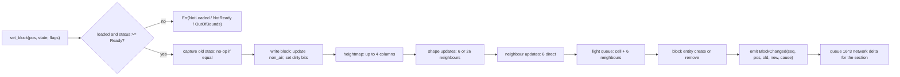
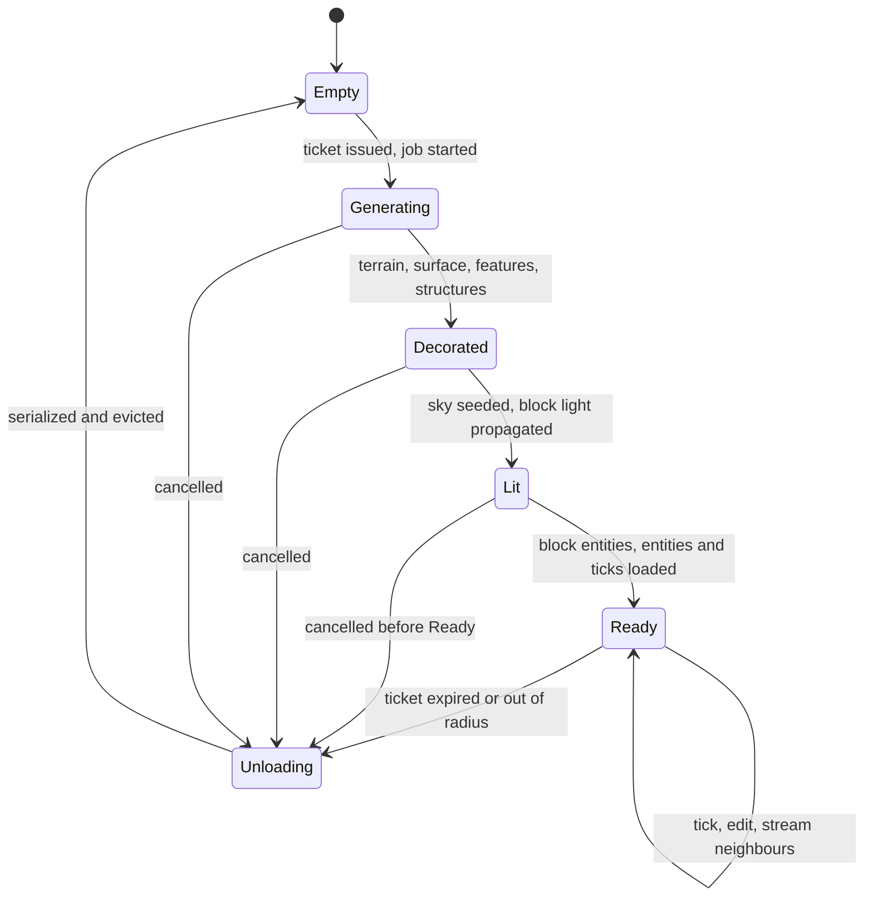

# 05 — World Model

> Status: normative · Last updated: 2026-11-24
> Depends on: [DEC-004](../decisions.md), [DEC-005](../decisions.md), [DEC-006](../decisions.md), [DEC-007](../decisions.md), [DEC-008](../decisions.md), [DEC-015](../decisions.md), [DEC-019](../decisions.md), [DEC-021](../decisions.md), [DEC-033](../decisions.md), [00-conventions](00-conventions.md)
> Implements: MS-01, MS-03

## 1. Purpose and scope

This chapter specifies the authoritative in-memory world: coordinate spaces, dimensions, chunk columns, sections, block states, block entities, the mutation API, scheduled ticks, chunk lifecycle and streaming, concurrency, queries and determinism. It is the contract between `ob_world`, `ob_worldgen`, `ob_sim`, `ob_render` and `ob_protocol`.

Out of scope: generation ([06](06-worldgen.md)), light, sky and weather ([07](07-light-and-weather.md)), on-disk framing and migrations ([17](17-persistence.md)), wire encoding ([18](18-networking-multiplayer.md)), entities ([09](09-entities-ai.md)), collision and fluid flow ([10](10-physics-and-collision.md)). Four principles drive every choice below. **The section is the atom**: storage, editing, lighting, meshing input and network deltas are all 16³-section granular ([DEC-004](../decisions.md)); a 32³ mesh cluster or a 32×32-chunk region file is a layer on top, never a second storage unit. **Reads dominate writes**: rendering, physics, AI and lighting read millions of blocks per second, so reads are O(1) and allocation-free while writes are budgeted. **Numeric content indices never persist** ([DEC-006](../decisions.md)). **Workers produce, the simulation thread integrates**, which is what keeps the hot path lock-free and the simulation deterministic.

## 2. Requirements

| ID | Requirement | Verification |
| --- | --- | --- |
| REQ-WORLD-001 | Public APIs that take world/block/chunk/section coordinates MUST use the coordinate newtypes; raw integer or float triples are forbidden, and all coordinates are validated against dimension bounds and the world border at construction. | Review, `clippy.toml` disallowed-type check, boundary unit test |
| REQ-WORLD-002 | World→block conversion MUST floor, never truncate; conversions round-trip for every coordinate inside the world border. | Property test over negative and positive ranges |
| REQ-WORLD-003 | A section contains exactly 4,096 blocks indexed `(y << 8) \| (z << 4) \| x`, x fastest. | Unit test + serialization round-trip |
| REQ-WORLD-004 | Storage mode is chosen from palette length: 1 → uniform, 2–16 → 4-bit, 17–256 → 8-bit, 257–65,536 → 16-bit. | Unit test at 1/2/16/17/256/257/65,536 |
| REQ-WORLD-005 | Packed indices never straddle a `u64` word; widths are exactly 4, 8 or 16 bits; the palette holds at most 65,536 entries. | Unit test + malformed-input fuzz target |
| REQ-WORLD-006 | Light lives in a container separate from block data, at 2 bytes per block, with a uniform fast path. | Layout inspection + memory benchmark |
| REQ-WORLD-007 | A block state is a block type plus at most 16 property bits, canonically ordered, assigned a dense global state ID at registry freeze. | Registry-freeze test + schema-validator test |
| REQ-WORLD-008 | State IDs are a pure function of the frozen registry and are never written to a save, a packet or a mod manifest. | Schema inspection; hash equality across restarts |
| REQ-WORLD-009 | Fluids and waterlogging are derived from block-state properties; no side table may exist for co-occupancy. | Schema inspection + fluid query test |
| REQ-WORLD-010 | A block entity is owned by the chunk column containing its position; multi-block partners store their partner positions in the payload. | Cross-chunk block-entity test |
| REQ-WORLD-011 | Block entities of unknown type are preserved byte-exactly across load, save and re-save. | Fixture save round-trip (MS-13) |
| REQ-WORLD-012 | Every mutation goes through the edit API, which returns the previous state and an outcome; direct field access is private to `ob_world`. | API review + compile-fail test |
| REQ-WORLD-013 | A single edit applies operations in the fixed order: write, heightmap, shape updates, neighbour updates, light, block entity, event, network delta. | Golden event-log test |
| REQ-WORLD-014 | Batch edits are applied in canonical sort order; duplicates collapse to the last write while the event log keeps the first old state. | Property test over random batches |
| REQ-WORLD-015 | A transaction records `(pos, old, new)` and rolls back in reverse order, emitting events with cause `Rollback`. | Unit test including nested transactions |
| REQ-WORLD-016 | Client prediction mutates only the prediction overlay and local player state; the base world changes only when a server message is applied. | Integration test with injected corrections |
| REQ-WORLD-017 | Scheduled ticks are keyed by `(due_tick, sequence)`, persisted with the chunk, and executed in key order. | Save/load test + ordering test |
| REQ-WORLD-018 | Random ticks derive their RNG from `(world seed, dimension, section key, tick, index)` and never from iteration order. | Replay hash test with shuffled worker scheduling |
| REQ-WORLD-019 | Chunks outside simulation distance execute no ticks; their due ticks and timers are retained with absolute times. | Simulation-distance test |
| REQ-WORLD-020 | Catch-up after a reload is bounded by a fixed window and rate, deterministic, and recorded in world metadata. | Catch-up test with a scripted clock |
| REQ-WORLD-021 | Chunk status advances `Empty → Generating → Decorated → Lit → Ready`; `Ready` implies `Lit`; only unload/reload may repeat a status. | Lifecycle state-machine test |
| REQ-WORLD-022 | Streaming uses distinct load and unload radii with at least one chunk of hysteresis and deterministic priority ordering. | Boundary-thrash test |
| REQ-WORLD-023 | Simulation distance is at most render distance; the opposite configuration is rejected at load. | Config validation test |
| REQ-WORLD-024 | Workers never take a mutable reference to a resident chunk; job results are integrated on the simulation thread in key order. | Type-level test + stress test |
| REQ-WORLD-025 | `get`, `set`, `raycast` and AABB queries take no global lock; at most one chunk lock is held at a time. | Lock instrumentation + loom test |
| REQ-WORLD-026 | Every query's documented complexity bound is enforced by a benchmark, and every simulation-visible iteration over chunks or sections is ordered by key. | Benchmark gate ([25](25-performance-budgets.md)) + replay determinism test |
| REQ-WORLD-027 | Chunks below `Lit` are never meshed, never sent to a client and never answer a gameplay query. | Debug assertion + network test |
| REQ-WORLD-028 | Per-section in-memory overhead is at most 128 B excluding payload; a uniform section is at most 16 B. | `size_of` assertions + allocation counter |

## 3. Design

### 3.1 Coordinate spaces and conversions

| Type | Representation | Range | Use |
| --- | --- | --- | --- |
| `WorldPos` | `{ x, y, z: f64 }`, metres | ±29,999,872 | Entities, physics, ray origins, camera |
| `BlockPos` | `{ x, y, z: i32 }` | XZ inside the border, Y inside the dimension | Voxel grid, edits, block entities |
| `ChunkPos` | `{ x, z: i32 }` | ±1,874,992 | Streaming, storage, interest management |
| `SectionPos` | `{ x, y, z: i32 }` | XZ as chunks, Y in `[-2048, 2047]` | Storage, lighting, meshing, deltas |
| `LocalPos` | `{ x, y, z: u8 }` | 0–15 each | In-section addressing |
| `LocalIndex` | `u16` | 0–4,095 | Array indexing inside a section |
| `RenderPos` | `{ x, y, z: f32 }` | camera-relative, ±4,096 | GPU submission only, never stored |

```rust
impl BlockPos {
    /// Floor semantics: WorldPos(-0.5, 63.9, -0.1).block() == BlockPos(-1, 63, -1).
    pub fn from_world(p: WorldPos) -> Self {
        Self { x: p.x.floor() as i32, y: p.y.floor() as i32, z: p.z.floor() as i32 }
    }
    pub fn chunk(self) -> ChunkPos { ChunkPos { x: self.x >> 4, z: self.z >> 4 } }
    pub fn section(self) -> SectionPos { SectionPos { x: self.x >> 4, y: self.y >> 4, z: self.z >> 4 } }
    pub fn local(self) -> LocalPos { LocalPos { x: (self.x & 15) as u8, y: (self.y & 15) as u8, z: (self.z & 15) as u8 } }
}
```

Arithmetic right shift is floor division for negatives, which is why the rule is "shift, never divide and truncate": `-1 >> 4 == -1` but `-1 / 16 == 0`. That difference is the single most common coordinate bug in voxel engines and is covered by the property test in §7.

**Precision.** `f64` has a ULP of 1.1 × 10⁻¹³ m at 512 m and 3.7 × 10⁻⁹ m at 30 Mm, which is exact enough for millimetre physics anywhere inside the border. `f32` has 6.1 × 10⁻⁵ m at 512 m but 2.0 m at 30 Mm, so **no `f32` world position is ever stored**: the renderer subtracts a per-frame, chunk-aligned origin in `f64` and converts the difference to `f32`; `RenderPos` values are never persisted, never compared across frames and never fed back into simulation ([03](03-rendering.md)).

**Keys.** The border is ±29,999,872 blocks, a multiple of 16. A section is addressed by a `u64` key with X in bits 38–63, Y biased by +2,048 in bits 26–37 and Z in bits 0–25; 26-bit X/Z covers ±536 M blocks and 12-bit Y covers the whole engine height, so a key can never alias.

### 3.2 Dimensions

A dimension is the unit of height model, sky rules, generator binding and coordinate scaling.

```rust
pub struct DimensionType {
    pub id: ResourceId,             // openblock:overworld
    pub min_y: i32,                // inclusive, multiple of 16
    pub max_y: i32,                // exclusive, multiple of 16
    pub generator: ResourceId,     // worldgen registry entry (06)
    pub has_sky: bool,             // seed sky light from above
    pub has_ceiling: bool,         // no open sky; fixed ambient instead
    pub ambient_light: u8,         // 0..=15, presentation only
    pub coordinate_scale: f64,     // portal distance ratio
    pub has_weather: bool,
    pub water_evaporates: bool,
    pub beds_work: bool,
    pub time_of_day: TimeMode,     // Synced | Fixed(u32) | Frozen
}
```

| Dimension | Height | Sections | Sky | Weather | Ambient | Scale |
| --- | --- | ---: | --- | --- | ---: | ---: |
| `openblock:overworld` | −64..320 | 24 | yes | yes | 0 | 1 |
| `openblock:nether` | 0..256 | 16 | no | no | 2 | 8 |
| `openblock:end` | 0..256 | 16 | no | no | 3 | 1 |
| content-defined | configurable | ≤ 64 | flag | flag | 0–15 | ≥ 0 |

At registry freeze: `min_y < max_y`, both multiples of 16, `min_y ≥ −2048`, `max_y ≤ 2048`, `max_y − min_y ≤ 1024` ([DEC-004](../decisions.md), ceiling confirmed by [OPEN-005](../decisions.md)). `ambient_light` enters only the presentation light query, never gameplay light: a dark nether must not spawn hostile mobs in a lit room because of a rendering constant. `coordinate_scale` is consumed by portal linking ([08](08-gameplay-survival.md)).

### 3.3 Chunk columns and sections

A chunk column owns an array of sections, the biome cells, the heightmaps, its block entities and its scheduled ticks. It is the streaming, storage and interest-management unit: 16×16 blocks in XZ and `(max_y − min_y)` blocks tall.

```rust
pub struct ChunkColumn {
    pub pos: ChunkPos,
    pub status: ChunkStatus,
    pub sections: Box<[Section]>,          // (max_y - min_y) / 16 entries
    pub biomes: Box<[BiomeId]>,           // 4x4x4 cells per section, 64 per section
    pub heightmaps: Heightmaps,            // 4 arrays: 3 public + light-blocking, see 3.11
    pub block_entities: BTreeMap<LocalIndex, BlockEntityId>,
    pub ticks: TickQueue,
    pub last_simulated: i64,
    pub tickets: SmallVec<[Ticket; 4]>,
    pub dirty: DirtyBits,                  // 2 bits per section: blocks, light
}

pub enum Section {
    Uniform { state: BlockStateId, light: LightWord }, // 8 B payload, 16 B with tag
    Packed(Box<PackedSection>),                        // 8 B
}

pub struct PackedSection {
    bits: u8,                        // 4 | 8 | 16
    palette: Box<[BlockStateId]>,    // sorted ascending, 2..=65_536 entries
    words: Box<[u64]>,               // ceil(4096 * bits / 64)
    light: LightData,                // Uniform(LightWord) | Full(Box<[LightWord; 4096]>)
    non_air: u16,                    // fast empty/solid test for queries
}
```

**Mode selection and promotion.** The palette is sorted by state ID, so bytes are deterministic and lookup is a predictable scan. Adding a state that does not fit the current width promotes the section: 4→8 at the 17th entry, 8→16 at the 257th. Promotion repacks all 4,096 indices, is the only operation that may move a section from inline to boxed, and is budgeted. **Demotion never happens during an edit**; a `compact()` pass at save and load may shrink a section to a narrower width or to `Uniform`. Because demotion changes bytes but not state IDs, the determinism hash (§3.12) is defined over canonical states, not storage bytes.

| Width | Indices per `u64` | Words/section | Payload | Palette cost | Typical use |
| ---: | ---: | ---: | ---: | ---: | --- |
| 0 (uniform) | — | 0 | 0 B | inline 4 B state | air, stone, deepslate |
| 4 | 16 | 256 | 2,048 B | 4 B/entry, ≤ 64 B | ≤ 16 states |
| 8 | 8 | 512 | 4,096 B | 4 B/entry, ≤ 1,024 B | caves, ores, builds |
| 16 | 4 | 1,024 | 8,192 B | 4 B/entry, ≤ 256 KiB | > 256 states (modded, rare) |

**Bit packing.** An index never straddles a word: index `i` lives in word `i / (64/bits)` at bit `(i % (64/bits)) × bits`. That removes the shift/mask special case and makes unpacking branch-free: one word load, one shift, one mask, one palette load. The 16-bit mode is a format escape hatch — a 16³ section can hold at most 4,096 distinct states, so 12 bits would suffice — but power-of-two widths keep unpacking branch-free and give the index ceiling a hard, testable value of 65,536. Reads validate `index < palette.len()`; both are fuzzed.

**Why light is separate.** Light is 2 bytes per block in its own container ([DEC-005](../decisions.md), layout in [07](07-light-and-weather.md)). Separate storage means a block edit never rewrites unaffected light words, the light uniform path hits more often (open sky is one value), and a network delta can carry changed light for a section without resending blocks. The light container is not a palette over block states and must never be indexed by palette index.

**Mesh clusters are not storage.** A 2×2×2 section cluster is a render-side grouping ([DEC-004](../decisions.md), [OPEN-001](../decisions.md)) with no save, protocol or content identity; the world never exposes it.

### 3.4 Block states

A block state is `BlockStateId(u32)`, a dense session-local index whose tables are built at registry freeze: `block_of[state] -> BlockTypeId(u16)` and `props_of[state] -> u16`. Air is state 0.

**Property schema.** Content declares properties per block; the validator enforces the budget.

| Kind | Encoding | Bits | Example |
| --- | --- | --- | --- |
| `bool` | 1 bit | 1 | `waterlogged`, `powered`, `lit` |
| `enum` | `ceil(log2(n))` bits, declaration order | 1–8 | `facing=north..west`, `axis=x..z` |
| `int` | `ceil(log2(max−min+1))` bits | 1–8 | `age=0..7`, `level=0..15` |
| derived | not stored | 0 | shape, connection mask, redstone power |

Properties are sorted by name (ASCII byte order) and packed little-endian at increasing bit offsets; unused high bits are zero. Total property bits per block type MUST be ≤ 16; a schema needing more is a content error at freeze, not a runtime fallback. Derived properties MUST NOT be stored, so they can never desynchronise from the world.

**State ID assignment.** The freeze walks block types in registry index order; for each it enumerates every *valid* property combination in canonical order (properties in packed-word order, values in declaration order), skipping combinations the schema rejects (for example `waterlogged=true` on a block that cannot hold water). IDs are assigned consecutively from 0. State IDs are therefore deterministic given the pack hash ([DEC-019](../decisions.md)), identical on client and server, and stable for the session — but meaningless outside it, which is why they are never serialised ([DEC-006](../decisions.md)).

**Waterlogging and fluids.** There is no second block layer and no "extras" side table; co-occupancy is a property. A fluid block's own state carries `level` (0–7, 8 = source) and `falling`, and the fluid kind comes from the block type. Any other block with `waterlogged=true` reports a full water source in addition to itself. Content that wants "snow on a slab" expresses a `snowy` boolean on the slab, not a stack of blocks. This keeps a block read to one array lookup and makes network deltas unambiguous.

### 3.5 Block entities

Block entities hold per-position data too large for a state: container contents, sign text, furnace progress, mod payloads.

```rust
pub struct BlockEntity {
    pub pos: BlockPos,
    pub kind: BlockEntityTypeId,     // dense index; resource ID on disk
    pub bytes: Vec<u8>,              // canonical versioned encoding
    pub decoded: Option<Box<dyn Any + Send + Sync>>, // lazy cache, cleared on save
    pub dirty: bool,
}
```

The canonical in-memory form is **encoded bytes**, the same versioned encoding used on disk ([17](17-persistence.md)). The world crate therefore stays content-agnostic, an unknown type from an uninstalled mod survives load→save byte-exactly ([DEC-033](../decisions.md), MS-13), and there is exactly one codec per type to fuzz. The ticking layer decodes on first access and caches the typed payload until the entity is marked dirty.

**Registry and lifecycle.** `openblock:chest`, `openblock:furnace`, … are content entries with a codec, a schema version, a migration function and an optional `tick` capability. The world creates and removes block entities as a consequence of state changes: a new state whose block type declares `block_entity` creates one; replacing it with a type that does not removes it and emits `BlockEntityRemoved { pos, kind, bytes }`. Contents handling is the game layer's business ([11](11-inventory-crafting-items.md)), which keeps `ob_world` free of item and loot semantics.

**Ownership across chunks and ticking.** The chunk containing the position owns the entity. Multi-block structures (double containers, beds, portals) store partner positions in the payload and nominate a controller position; a query needing a partner in an unloaded chunk returns `PartnerUnloaded` rather than silently reporting an empty half, and the controller skips the operation until both are resident. Entities are never migrated between chunks implicitly: moving a chest with a piston destroys and recreates it, and the game layer owns the contents. Only types declaring `tick` enter the column's `tickable` list, which is kept sorted by `LocalIndex`; the simulation walks it in order each tick under a bounded budget (PERF-WORLD-009), and entities outside simulation distance do not tick (§3.9).

### 3.6 The mutable-world API

Mutation is a pipeline, not a setter; its ordering is normative because neighbour and shape updates are where determinism is won or lost.

```rust
pub trait WorldEdit {
    fn set_block(&mut self, p: BlockPos, state: BlockStateId, flags: SetFlags)
        -> Result<SetOutcome, WorldError>;
    fn apply_batch(&mut self, batch: &BlockBatch) -> Result<BatchOutcome, WorldError>;
    fn flush(&mut self, budget: EditBudget) -> EditStats;   // drain neighbour/shape/light queues
}
// SetFlags: NOTIFY_NEIGHBOURS | NOTIFY_CLIENTS | SHAPE_UPDATE | UPDATE_LIGHT
//         | UPDATE_HEIGHTMAP | RECORD_UNDO | SUPPRESS_EVENTS (worldgen bulk writes)
```



- **Write rejection, not writing into the void.** A write below `Ready` returns `NotReady`; only a generation job holding a write ticket may write, using `SUPPRESS_EVENTS`.
- **No-op detection before side effects.** Setting a block to its current state returns `changed: false` and touches nothing.
- **Shape updates are separate from neighbour updates.** A neighbour update means "re-evaluate gameplay" (sand falls, redstone responds); a shape update means "recompute your collision/connection shape" (fences, stairs, panes). Different queues, consumers and budgets; conflating them is why placing a fence sometimes fails to connect until the block is right-clicked.
- **Canonical order.** The shape queue drains by `(section key, local index)`; events carry a monotonic sequence number and are delivered after the tick's edit phase in sequence order.

**Batches and transactions.** A `BlockBatch` is a `Vec<(BlockPos, BlockStateId)>` plus a `cause`. It is sorted by `(chunk, section, y, z, x)`, duplicates collapse to the last write, and the event log retains the *first* old state so a rollback restores the pre-batch world. An `EditTransaction` records `(pos, old, new)` with a capacity cap; `rollback()` applies the inverse in reverse order and emits `cause: Rollback`. It backs creative undo, the WASM action quota ([16](16-modding.md)) and client prediction; it is not a save-level construct.

**Client prediction.** The client keeps an authoritative base store and a `PredictionOverlay` (`BTreeMap<BlockPos, (BlockStateId, Seq)>`); block reads consult the overlay first. The overlay MAY contain block states the local player placed or broke, their speculative light (visual only, [07](07-light-and-weather.md)) and the local player's physics state. It MUST NOT contain container contents (those use the shadow-state model of [DEC-023](../decisions.md)), other entities' positions, weather, time, or anything a client-side gameplay rule could read. When an ack or authoritative change arrives, entries with `seq ≤ ack` are dropped: a confirmed edit becomes a no-op, a rejected one disappears in one frame with no world rollback.

### 3.7 Scheduled ticks

| Kind | Scheduled by | Typical delay | Ordering | Persistence |
| --- | --- | --- | --- | --- |
| Block tick | Repeater, sapling, gravity block, observer | 1–1,600 ticks | `(due, seq)` | Saved per chunk |
| Fluid tick | Flow, waterlogging updates | content-defined, 5–30 ticks | `(due, seq)`, separate queue | Saved per chunk |
| Random tick | Per-section random selection | immediate | derived RNG, stateless | Not saved |

`TickQueue` is a `BTreeMap<(due: i64, seq: u64), ScheduledTick>`; scheduling and cancellation are O(log n) with a side index by `(pos, kind)`. Ticks execute at the start of the `Tick` stage in key order, interleaved with redstone updates but never with entity movement ([12](12-redstone-and-logic.md) owns the cross-system order). A tick scheduled with delay 0 during the tick phase runs in the *next* tick; that rule prevents infinite same-tick loops and is what the loop detector relies on.

**Random ticks.** For every section in simulation distance with `random_ticks` enabled, the engine picks `random_tick_speed` local indices per tick (base-pack default 3) and dispatches a random tick to each. The RNG is `splitmix64(world_seed ^ dim_seed ^ section_key ^ tick ^ i)`: stateless, so no PRNG state is stored and a replayed tick makes identical choices. Only blocks opting into random ticking are affected, so an empty section costs one branch.

**Region awareness.** Ticks are owned by their chunk; chunks are grouped into 32×32-chunk regions (the same grouping as region files, [17](17-persistence.md)). With parallel region ticking — proposed, see Open questions — each region executes its ticks in key order on one worker, and a neighbour or shape update that would cross a region boundary is deferred to the next tick and ordered by destination region key. Cross-region redstone is therefore not simultaneous, and [12](12-redstone-and-logic.md) must state that contract rather than imply vanilla ordering.

**Unloaded chunks and catch-up.** A chunk outside simulation distance executes nothing; its queue is persisted with due times (the remaining delay against the saved world tick, [17](17-persistence.md)) and its `last_simulated` tick is stored. On promotion back to `Ready`:

```text
missed = clamp(now_tick - last_simulated, 0, CATCHUP_WINDOW)   // 1_200 ticks (60 s)
due ticks run in key order, at most CATCHUP_BURST = 64 per tick
ticks with due < now - CATCHUP_WINDOW run once and are dropped (compressed, not replayed)
```

Both constants are content-independent, recorded in world metadata so a change is detectable, and never retroactively grow a farm for a month of downtime. Random ticks are not replayed at all.

### 3.8 Chunk lifecycle and streaming



| Status | Block data | Light | Ticks | Meshed | Networked | Gameplay queries |
| --- | --- | --- | --- | --- | --- | --- |
| `Empty` | — | — | — | no | no | no |
| `Generating` | partial | — | — | no | no | no |
| `Decorated` | final | — | — | no | no | no |
| `Lit` | final | final | — | yes | yes | no |
| `Ready` | final | final | yes | yes | yes | yes |

Worldgen subdivides `Generating` into `Biomes → Shaped → Surfaced → Carved → Structured` ([06 §3.3](06-worldgen.md)); those are internal pipeline stages, and streaming, queries and networking observe only the coarse status. A stored chunk with valid light may skip from `Decorated` to `Ready` on load, but the status still passes through `Lit` so the state machine has no unaudited shortcut.

**Streaming policy.** The client keeps `load_radius_chunks = ceil(render_distance_blocks / 16) + 1` and unloads at `load_radius_chunks + 1`; the extra rings are the hysteresis that stops a player pacing on a chunk boundary from thrashing generate→save→evict. The server uses its own radius derived from simulation distance and keeps a column resident while any player's ticket covers it. Priorities are a total order, so the queue is deterministic: (1) chunks the player stands in or edits, (2) ascending radius rings, (3) the client's view cone before stable key order, (4) spawn and forced chunks, (5) everything else. A budget limits completions per frame or tick; cancellation is safe because results are integrated atomically.

**Simulation distance versus render distance.** They answer different questions and are configured separately.

| | Render distance | Simulation distance |
| --- | --- | --- |
| Question | "What do I draw?" | "What does the game simulate?" |
| Default | 512 blocks (32 chunks) ([OPEN-003](../decisions.md)) | 256 blocks (16 chunks) |
| Consumer | Client mesh and streaming | Server ticks, entities, random and block ticks |
| Cost when raised | Memory, meshes, draw work | Tick time, entity AI, bandwidth |
| Constraint | ≥ simulation distance | ≤ render distance (REQ-WORLD-023) |

A 512-block client may render chunks the server only simulates out to 256, which is how a 50-player server stays affordable ([DEC-025](../decisions.md), [MS-15](../plan/01-milestones.md)). Chunks between the radii are `Lit` and networked but not `Ready`; they are frozen as in §3.9.

### 3.9 Unloaded-chunk semantics

| Subsystem | Outside simulation distance | Rationale |
| --- | --- | --- |
| Entities | Frozen: position, velocity, health and AI state persist; no movement, damage or despawn | No away-from-keyboard mob farms; smaller saves |
| Redstone, fluids | Paused; pending neighbour updates into the chunk are discarded, scheduled ticks retained | Unbounded cross-chunk queues are a memory leak |
| Crops, saplings | Block ticks retained; catch-up bounded per §3.7 | Predictable, no free growth |
| Timed block entities | Paused unless the type opts into wall-clock progress (Open question) | Parity expects paused; opt-in serves modded machines |
| Scheduled ticks | Retained with due times; catch-up on load | Timers survive restarts |
| Portals | Crossing grants a destination ticket so the far side loads | Otherwise the player falls through unloaded space |
| Weather | Continues for the whole dimension, not per chunk | A storm is not a local phenomenon |
| Players | Never unloaded; a player keeps its chunk resident | Required |

A chunk loading ticket is an explicit, counted, time-limited request: `Player(uuid)`, `Portal(destination)`, `Command(timeout)`, `Spawn(permanent until disabled)`. Tickets are the only way to keep a chunk out of the eviction path, which makes leaks auditable (`/debug chunks` lists tickets by owner).

### 3.10 Concurrency

The world is single-writer, many-reader. Each resident column lives in a `ChunkCell { data: RwLock<ChunkColumn>, epoch: AtomicU64 }`. Readers take a read guard for the duration of a query; the write guard is taken only on the simulation thread; a thread never holds two chunk locks except in key order, which makes deadlock impossible by construction.

- **Snapshots.** `World::snapshot()` clones one `Arc` per resident column (4,225 pointer copies, PERF-WORLD-010) and publishes an epoch. Render and network workers read snapshots, never the live store; the renderer caches meshes against `(chunk, epoch)`.
- **Workers may read** block states, light words, heightmaps and biome IDs of chunks at `Lit` or above, the frozen registries and dimension types. They may **not** read block entities in a mutable container, entity components, or the edit and event queues.
- **Workers may write** nothing in a live chunk. A job owns its output (`GeneratedColumn`, `LightPatch`, `MeshBatch`) and returns it through a channel; the simulation thread validates, applies and bumps epochs. A panic is caught at the job boundary, the result is discarded, the column keeps its previous status and the error is logged; application is single-threaded, so a panic can never leave a partially applied edit.

### 3.11 World queries

| Query | Complexity | Notes |
| --- | --- | --- |
| `block(BlockPos)` | O(1) | Shift, arithmetic index, one palette load |
| `light(BlockPos)` | O(1) | 2-byte word; reads never propagate |
| `heightmap(ChunkPos, Variant)` | O(1) | Per-column array, three public variants |
| `biome(BlockPos)` | O(1) | 4×4×4 cell per section, `(x>>2, y>>2, z>>2)` lookup; no spatial blending at MVP |
| `raycast(origin, dir, max, filter)` | O(distance) | Voxel DDA, ~3 cell visits per traversed block |
| `aabb_query(aabb, filter)` | O(blocks in AABB) + O(sections) | Skips sections with `non_air == 0` |
| `nearest_entity(pos, radius, filter)` | O(cells) | 16-block spatial hash owned by [09](09-entities-ai.md) |
| `is_loaded`, `status`, `ticket_count` | O(1) | Epoch read plus map lookup |
| `for_each_chunk(f)` | O(loaded) | Ordered by `ChunkPos` |

**Raycast** returns `RayHit { block, face, point, distance, hit_fluid }`. Corner ties resolve to the axis with the smaller `tMax`, then X < Y < Z, so the result is a pure function of the input and therefore replayable. The ray stops at `max_distance` or at the first chunk below `Ready` when `stop_at_unloaded` is set, which is the gameplay default: a client cannot mine terrain it does not have. **AABB query** expands the box by the largest content-defined collision margin, iterates overlapping sections in key order, skips empty ones and yields collision boxes lazily; resolution is [10](10-physics-and-collision.md). **Heightmaps** are four `u16` arrays per column offset by `min_y`: the public `WORLD_SURFACE` (highest non-air), `MOTION_BLOCKING` (non-empty collision shape or fluid) and `OCEAN_FLOOR` (highest solid, ignoring fluids), plus an internal `LIGHT_BLOCKING` height for sky seeding ([07](07-light-and-weather.md)). The three public maps are serialized ([17](17-persistence.md)); `LIGHT_BLOCKING` never leaves the server and is recomputed from blocks on load.

### 3.12 Determinism

1. All chunk, section and tick iteration is by sorted key; `HashMap` iteration over world data is forbidden.
2. Edit events are numbered by a monotonic sequence and applied in that order.
3. Scheduled ticks execute in `(due, seq)` order; `seq` is assigned at schedule time.
4. Random ticks are stateless, keyed by `(seed, dimension, section, tick, index)`.
5. Palette promotion and demotion never change a state ID; hashes cover canonical states, light words, block-entity bytes and tick keys, never storage bytes.
6. Light is a fixed point of a monotone operator, so the tick-visible field does not depend on worker scheduling ([07](07-light-and-weather.md)).
7. No wall clock, thread ID, pointer value or allocation address enters world state, and floating-point world math uses the pinned transcendentals of `ob_math` ([DEC-021](../decisions.md)); the world module itself uses none.

The canonical hash is `blake3` over, per column in key order: status, unpacked block states, unpacked light words, heightmaps, sorted block-entity bytes and sorted tick keys. Two runs with different worker counts must produce the same hash at every tick boundary, and the replay harness asserts it.

## 4. Data structures and formats

### 4.1 Section image (logical)

This is the storage-neutral image; container framing, compression, checksums and region files belong to [17](17-persistence.md), the wire encoding to [18](18-networking-multiplayer.md).

| Field | Size | Notes |
| --- | --- | --- |
| `bits` | 1 B | 0 (uniform), 4, 8, 16 |
| `palette_len` | 2 B | 1–65,536; 1 for uniform |
| `palette[palette_len]` | 4 B each | `BlockStateId`, ascending, no duplicates |
| `words[]` | `8 × ceil(4096 × bits / 64)` | 0, 2,048, 4,096 or 8,192 B |
| `light_mode` | 1 B | uniform or full |
| `light` | 2 B or 8,192 B | one `LightWord` per block when full |
| `non_air` | 2 B | fast empty test |

The light word is identical in memory, save and network: `[sky:4][R:4][G:4][B:4]` from bit 15 down to bit 0, the same nibble order the renderer's vertex corner uses ([03 §4](03-rendering.md), [07](07-light-and-weather.md)), so a corner can be copied with one shift and a channel read is one shift and one mask. Edit events are a separate record: `BlockChanged { seq: u64, pos, old, new, cause }` is 32 bytes, drained once per tick, with `ChangeCause` = `Player | Entity | Fluid | Redstone | Worldgen | Command | Rollback | Mod(ResourceId)`. The network layer coalesces those records per section into a changed-index bitset plus new states ([18](18-networking-multiplayer.md)); the world never encodes packets itself.

### 4.2 Memory model

"Header" is the boxed container's own allocation (slice pointers, length fields, light discriminant); payload is the palette and word arrays.

| Section kind | Header | Payload | Light | Total |
| --- | ---: | ---: | ---: | ---: |
| Uniform | 0 | 0 | inline 2 B | **16 B** (inline `Section`) |
| Packed 4-bit, 16-state palette | 48 B | 2,048 + 64 B | 8,208 B | **10,368 B** |
| Packed 8-bit, 256-state palette | 48 B | 4,096 + 1,024 B | 8,208 B | **13,376 B** |
| Packed 16-bit | 48 B | 8,192 + ≤ 256 KiB palette | 8,208 B | **8,256 B + palette** |

Column metadata is separate: status 1 B, tickets 32 B, dirty bitset 8 B (2 bits × 24 sections), four height arrays 2,048 B, biome cells 3,072 B, chunk header ≈ 200 B, empty tick queue 24 B. The world memory model assumes the distribution MS-01 must measure: a 384-block overworld column has 24 sections, 18 uniform (air above, solid rock below), 5 at 4 bits and 1 at 8 bits.

| Component | Bytes/column | 256 blocks (1,089 col) | 512 blocks (4,225 col) | 1024 blocks (16,641 col) |
| --- | ---: | ---: | ---: | ---: |
| Block containers | 16,112 | 17.5 MB | 68.1 MB | 268.1 MB |
| Light containers | 49,392 | 53.8 MB | 208.7 MB | 821.9 MB |
| Column metadata | 5,385 | 5.9 MB | 22.8 MB | 89.6 MB |
| **Total** | **70,889** | **77.2 MB** | **299.5 MB** | **1,179.7 MB** |
| Bytes per block | 0.72 | | | |

MB = 10⁶ bytes. Meshes, GPU buffers, entities and block-entity payloads are excluded; block entities are ≤ 256 B typical and capped per column. The 512-block total leaves ~50 MB of headroom under the 350 MB MS-01 exit criterion for worlds with more non-uniform sections. Doubling render distance quadruples the total, which is why [DEC-018](../decisions.md) makes LOD visual-only rather than a way to hide a memory problem.

## 5. Performance budgets

| ID | Budget | Measurement |
| --- | --- | --- |
| PERF-WORLD-001 | `block` get ≤ 5 ns; `set_block` excluding light and queues ≤ 20 ns, single-threaded, warm cache | Criterion bench, 10⁷ random accesses |
| PERF-WORLD-002 | 4→8-bit promotion ≤ 15 µs; 8→16-bit ≤ 40 µs; full 16-bit repack ≤ 80 µs | Criterion bench |
| PERF-WORLD-003 | Deserialize a 24-section column (payload already decompressed) ≤ 1.5 ms p95 single core | Fixture-save benchmark |
| PERF-WORLD-004 | 512-block raycast ≤ 20 µs p99 with one non-full-cube shape test per 8 blocks | Obstacle-scene benchmark |
| PERF-WORLD-005 | AABB query ≤ 2 µs p99 for a player box, ≤ 80 µs p99 for a 16³ box | Criterion bench |
| PERF-WORLD-006 | 64-block batch edit end-to-end, excluding light cascade, ≤ 200 µs p95 | Mixed-terrain benchmark |
| PERF-WORLD-007 | World data ≤ 90 MB at 256 blocks, ≤ 350 MB at 512, ≤ 1.4 GB at 1024 | Allocation-counter integration bench |
| PERF-WORLD-008 | Uniform section ≤ 16 B; packed section header ≤ 64 B | `size_of` assertions in CI |
| PERF-WORLD-009 | 10,000 block-entity ticks ≤ 3 ms p99; overflow deferred, never unbounded | Tick benchmark |
| PERF-WORLD-010 | Snapshot of 4,225 resident columns ≤ 150 µs p95 | Criterion bench |
| PERF-WORLD-011 | Streaming integration ≤ 0.5 ms p95 per frame during a 30 blocks/s fly-through | Scripted scene, [MS-04](../plan/01-milestones.md) |

## 6. Failure modes and edge cases

| Failure | Detection | Behaviour |
| --- | --- | --- |
| Malformed palette (empty, index out of range, duplicate, bad width) | Load validation + fuzz | Substitute `Uniform(air)`, keep the chunk loadable, log region coordinates |
| Section Y outside the dimension, coordinate overflow | Construction validation | `Err(OutOfBounds)`; the generator clamps instead of writing |
| Edit to a chunk that unloads concurrently | Status re-check under the write guard | `Err(NotLoaded)`; the caller retries next tick, never a partial write |
| Block entity with an unloaded partner | Partner resolution | `PartnerUnloaded`; the controller skips the operation |
| Tick storm (a block rescheduling itself every tick) | Per-position schedule rate limit + loop detector ([12](12-redstone-and-logic.md)) | Excess ticks dropped with a diagnostic; simulation stays within budget |
| Neighbour update into an unloaded chunk | Ticket lookup | Discarded and counted in `/debug chunks` |
| Duplicate batch positions | Canonical sort + collapse | Last write wins, first old state retained |
| Prediction rejected by the server | Ack with rejection | Overlay entry dropped; base and light converge within two ticks |
| Worker panic mid-job | `catch_unwind` at job boundary | Result discarded, previous status kept, error logged |
| Chunk status regression without an unload | Assertion in `set_status` | Panic in debug, clamp and log in release |

## 7. Testing strategy

| Level | What it proves | Tooling |
| --- | --- | --- |
| Unit | Coordinate conversion and floor, packed index math, palette promotion at 1/2/16/17/256/257/4,096/65,536 | `cargo test`, table-driven boundaries |
| Property | `BlockPos ↔ (SectionPos, LocalPos)` round-trip over the border; get-after-set for random edit sequences; batch collapse; rollback restores the original | `proptest` |
| Golden | Edit event logs for a scripted build (fence, waterlog, break support, torch) are stable | `insta` snapshots |
| Lifecycle | Status transitions, rejection of illegal transitions, cancellation at every status | Model-based test |
| Concurrency | N readers + 1 writer under a snapshot; no torn reads, no deadlock; loom on epoch publication | `loom` + a stress binary |
| Determinism | The same edit/tick log under 1, 2 and 8 workers yields identical hashes at every tick | Replay harness ([02](02-engine-core.md)) |
| Fuzz | Section parser, chunk parser, batch API, block-entity codec: no panic, no out-of-bounds, no unbounded allocation | `cargo-fuzz`, 24 h nightly corpus |
| Memory + integration | `size_of::<Section>() ≤ 16`, header accounting and the 512-block allocation counter; save → quit → relaunch restores every block, light word, tick key and block entity; unload/reload returns the light hash | CI assertion, [MS-03](../plan/01-milestones.md) exit criteria, [MS-13](../plan/01-milestones.md) |

A test-only `SlowWorld` (`BTreeMap<BlockPos, BlockStateId>` plus recompute-from-scratch light) is the differential reference for fuzz tests and for [07](07-light-and-weather.md). It is never linked into a shipped binary.

## 8. Open questions

1. **Simulation-distance default and its coupling to render distance.** This chapter assumes 256 blocks, but the choice interacts with server capacity ([MS-15](../plan/01-milestones.md)) and prediction. Proposed **DEC-038**: "Simulation distance defaults to 256 blocks, is capped at render distance, and is a per-world setting; clients predict only within simulation distance." Owner: **MS-04** with MS-07.
2. **Block-state encoding freeze.** The 16-property-bit budget and canonical ordering become save-format-adjacent once content ships. Proposed **DEC-039**: "Block states are a dense registry-frozen ID over a canonical ≤ 16-bit property word, persisted as resource ID plus property map." Owner: **MS-13**, before the world format freezes.
3. **Parallel region ticking and cross-region ordering.** §3.7 defers cross-region updates by one tick, a gameplay-visible semantic that needs a decision, not an optimisation note. Proposed **DEC-040**: "Parallel region ticking ships at 1.0; cross-region block and redstone updates are deferred to the next tick and ordered by destination region key." Owner: **MS-15** with MS-11 and [12](12-redstone-and-logic.md).
4. **Timed block entities while unloaded.** Wall-clock progress rewards infrastructure players; paused matches the parity expectation and simplifies the save. Proposed **DEC-041**: "Block entities are paused while unloaded unless their content type opts into wall-clock progress, recorded in the payload." Owner: **MS-10**.
5. **Chunk ticket taxonomy.** The four ticket kinds in §3.9 are a proposal; spawn-chunk retention and command-forceload semantics need an owner and a cap. Owner: **MS-07**.

## 9. References

- Decisions: [DEC-004](../decisions.md) (section size), [DEC-005](../decisions.md) (palette and light storage), [DEC-006](../decisions.md) (numeric IDs), [DEC-007](../decisions.md) (fixed tick), [DEC-008](../decisions.md) (authority), [DEC-015](../decisions.md) (CPU flood-fill light), [DEC-019](../decisions.md) (content registries), [DEC-025](../decisions.md) (interest management), [DEC-033](../decisions.md) (save format).
- [Specification conventions](00-conventions.md); [world generation](06-worldgen.md); [light and weather](07-light-and-weather.md); [persistence](17-persistence.md); [networking](18-networking-multiplayer.md); [physics](10-physics-and-collision.md); [redstone](12-redstone-and-logic.md).
- [Weft teardown](../research/01-weft-teardown.md) §4 — paletted sections, uniform fast path, light as the dominant memory term, region-parallel ticking and timer catch-up.
- [Voxel rendering SOTA](../research/03-voxel-rendering-sota.md) §2 — 4/8/16-bit packing, promotion thresholds, 30-chunk memory budgets.
- [Performance budgets](25-performance-budgets.md) — the authoritative table that `PERF-WORLD-*` feeds; Minecraft Wiki, "Chunk format" — external reference for 16³ sections, 4-bit minimum palettes and 2,048-byte light arrays: <https://minecraft.wiki/w/Chunk_format>; Amanatides & Woo, "A Fast Voxel Traversal Algorithm for Ray Tracing" (1987) — the DDA used by `raycast`.
