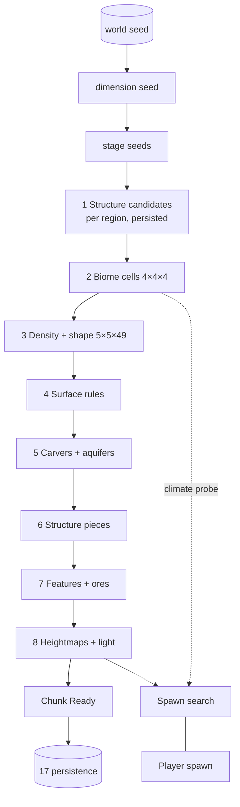

# 06 — World Generation

> Status: draft for review - Last updated: 2026-11-24
> Depends on: [DEC-004](../decisions.md), [DEC-007](../decisions.md), [DEC-008](../decisions.md), [DEC-018](../decisions.md), [DEC-019](../decisions.md), [DEC-020](../decisions.md), [DEC-033](../decisions.md), [00-conventions](00-conventions.md) §6
> Implements: MS-08; consumes MS-01 (`ob_world`, `ob_math`) and MS-05 (content packs)

## 1. Purpose and scope

This chapter specifies how OpenBlock turns a seed into blocks: seeds and streams,
the noise stack, the staged column pipeline, biomes, terrain, caves and aquifers,
ores, features, structures, dimensions, portals, the generator API and the
determinism and performance contracts. Generation produces light but does not
specify it ([07](07-light-and-weather.md)); storage is [05](05-world-model.md) and
[17](17-persistence.md). Generation runs **on the host only** (DEC-008): clients
receive sections, and the single client-side path is the visual-only LOD column of
§3.11, whose type cannot carry gameplay data. "Parity" means the kinds of terrain,
biome and structure in the reference game
([feature inventory](../research/05-minecraft-feature-inventory.md) §3.7–3.8),
never its tables, constants or seeds (DEC-009). Reading Minecraft worlds is out of
scope (vision §7.1).

## 2. Requirements

| ID | Requirement | Verification |
| --- | --- | --- |
| REQ-GEN-001 | Generating a chunk MUST be a pure function of `(world seed, dimension descriptor, generator fingerprint, chunk coordinates)`. It MUST NOT read wall-clock time, thread identity, allocation addresses, unordered iteration order or tick rate. | Hash equality under shuffled job order and `TICK_RATE` 20 vs 30 |
| REQ-GEN-002 | `ob_worldgen` MUST NOT use `f32`/`f64` on any path that produces world data; all arithmetic uses `ob_math::fx` fixed point. | `deny(clippy::float_arithmetic)` + source scan |
| REQ-GEN-003 | Noise, hashing, RNG and splines MUST come from `ob_math`; platform `libm`, float formatting and target SIMD MUST NOT influence results. | Inspection + golden vectors on three targets |
| REQ-GEN-004 | Every random stream MUST be derived from a discriminated tuple containing the stage, so adding a stage cannot shift another stream. | Unit test over the stage table and 2²⁰ derivations |
| REQ-GEN-005 | N-worker generation MUST be byte-identical to single-worker generation for every corpus seed. | Test at 1, 2, 8, 32 workers |
| REQ-GEN-006 | Output MUST be identical on Linux x86_64, Windows x86_64 and macOS aarch64, in debug and release, with and without target CPU features. | CI determinism job (§7) |
| REQ-GEN-007 | Gameplay world data MUST be generated on the host; clients receive sections over the protocol. | Dependency test on `ob_client` + protocol inspection |
| REQ-GEN-008 | LOD columns MUST be a distinct type that cannot carry ores, block entities, entities, ticks or loot, and MUST never become a chunk. | Type-level test + fuzz scan for ore IDs |
| REQ-GEN-009 | The pipeline MUST use the status ladder of §3.3 and every stage MUST declare the neighbour statuses it may consume. | Inspection; status table generated from code |
| REQ-GEN-010 | A stage's output MUST NOT depend on whether neighbour data was cached; neighbour reads are an optimisation. | Cold-vs-warm differential test |
| REQ-GEN-011 | Adding a biome MUST require content data only; the base pack MUST use the same path. | Template-pack acceptance test |
| REQ-GEN-012 | Biome parameters MUST be sampled on a 4×4×4 grid per section and stored per section. | Unit test on a synthetic two-biome world |
| REQ-GEN-013 | Surface height MUST be continuous across biome borders: no step > 1 block over 4 blocks, except at cliffs, water and `sharp_edge` biomes. | 10,000-seed statistical test + visual checklist |
| REQ-GEN-014 | Surface rules, carvers, features and structure placement MUST be content data, not engine code. | Inspection + template-pack test |
| REQ-GEN-015 | Structure grids MUST honour `spacing`, `separation`, `salt` and `spread`; no two starts of one set may be closer than `separation` in a 3×3 cell neighbourhood. | 10,000-seed corpus |
| REQ-GEN-016 | A structure piece MUST connect to terrain unless it declares `airborne: true` or `terrain_adaptation: none`. | Corpus: maximum gap is zero for adapted pieces |
| REQ-GEN-017 | Features and structures crossing a chunk boundary MUST be clipped deterministically, independent of generation order. | Neighbours generated in all orders |
| REQ-GEN-018 | Ore placement MUST NOT run on any client path, cache or LOD representation. | Inspection + LOD/network type scan |
| REQ-GEN-019 | Regenerating an unedited saved chunk MUST reproduce its saved payload bytes. | Round-trip on corpus seeds |
| REQ-GEN-020 | The generator fingerprint MUST be stored in world metadata; a content change MUST warn and MUST NOT silently mix generator versions. | Integration test with a changed pack |
| REQ-GEN-021 | `overworld`, `nether`, `end` and content dimensions MUST have independent seed derivation, height limits and generators. | Unit test; height and portal tests |
| REQ-GEN-022 | Portal linking MUST use the scale, search box, tie-breaking and clamping of §3.9. | Golden vectors including negatives |
| REQ-GEN-023 | Spawn search MUST be deterministic, bounded to 4,096 candidates and reject water, lava and structure interiors. | 10,000-seed test |
| REQ-GEN-024 | `pregen` MUST produce byte-identical columns to on-demand generation. | Differential test |
| REQ-GEN-025 | Generators MUST be replaceable, composable and wrappable through the public API only; the base pack uses that API. | Template test; no private hooks |
| REQ-GEN-026 | WASM mods MUST NOT supply per-block generation; they MAY register feature and structure kinds called in batches. | ABI inspection + quota test |
| REQ-GEN-027 | Tuned worldgen constants MUST live in content data; engine code keeps only structural limits and fixed-point scales. | Review checklist + pack diff |
| REQ-GEN-028 | Column and structure dumps MUST record seed, generator fingerprint and stage timings. | Dump-format test |
| REQ-GEN-029 | The nightly 10,000-seed corpus MUST pass every assertion of §7. | CI job, failures block merge |
| REQ-GEN-030 | The uncompressed chunk payload from generated columns MUST be ≤ 64 KiB at p99. | Benchmark |
| REQ-GEN-031 | Generation MUST NOT stall the tick thread for more than 2 ms in any tick. | Benchmark at 512 blocks with 8 workers |
| REQ-GEN-032 | Structure starts MUST be persisted before any block of that start is written. | Kill-mid-generation test |
| REQ-GEN-033 | Invalid generator, biome, feature or structure definitions MUST fail at world load with file and JSON-pointer context. | Negative fixture tests |
| REQ-GEN-034 | `/locate` MUST answer from persisted starts, not by regenerating terrain. | Test with pregenerated world and empty cache |
| REQ-GEN-035 | Generators MUST be `Send + Sync` and MUST NOT use mutable statics. | Lint + review |

## 3. Design

Goals, in priority order: deterministic on every platform and worker count;
parallel per column with no global stage barrier; data-driven so parity and mod
content share one path; no client/server divergence; no floating structures,
interrupted rivers or unplayable spawns; fast enough to stream a 512-block view at
walking and elytra speeds.

### 3.1 Seeds, streams and fixed point

```text
world_seed: u64                    // string seed = BLAKE3-256(UTF-8)[0..8], LE
dimension_seed = H(world_seed, "ob/worldgen/v1", dimension_id)        -> u64
stage_seed     = H(dimension_seed, "stage", stage_tag, discriminator) -> u64
sample         = mix64(stage_seed ^ hash_coord(x, y, z) ^ salt)
```

`H` is BLAKE3-256 at derivation time only. The hot primitive is `mix64`, a
splitmix64-style finaliser over three multiply-xor rounds, matching `ob_math` in
[MS-02](../plan/01-milestones.md). Streams are **counter-based and random-access**:
`Rng64::at(seed, i)` is pure, so columns share no state and worker count cannot
change a value; iteration over sorted slices fixes drawn-value order
(REQ-GEN-004/005). Coordinates use `Fx = i64` with 32 fractional bits and an `i128`
intermediate; `(x as i64) << 32` covers ±30,000,000 blocks inside `i64`.
Frequencies are powers of two, so the lattice step is a shift, never a division,
and noise output is `[-FX_ONE, FX_ONE]`.

**OPEN-002 does not apply here.** That question asks whether *simulation* math is
f64 or fixed point; world generation is integer-only either way, because
cross-platform generation is cheap to guarantee with integers, the client's LOD
re-derives coarse terrain from the same code, and no `libm`, FMA contraction or
`target-cpu` choice may change a chunk ([§8](#8-open-questions) item 1).

### 3.2 The noise stack

| Primitive | Domain | Range | Octaves | Used for |
| --- | --- | --- | --- | --- |
| `perlin` | 1–3D | `[-1, 1]` | dyadic FBM | climate, density, cave fields |
| `ridged` | 2–3D | `[0, 1]` | dyadic | mountains, rivers, noodle caves |
| `value` | 2–3D | `[-1, 1]` | dyadic | masks, warp offsets, dithering |
| `voronoi` | 2D | `(F1, F2, cell)` | none | biome jitter, geode sites, structure cells |

Gradient noise is Perlin-style with a 16-entry gradient table chosen by the
coordinate hash; no permutation table is copied and there is no simplex variant.
Gradients are normalised by `0x5A82_799A` (1/√2) so diagonal and axis gradients have
equal magnitude. **Dyadic FBM** uses power-of-two amplitudes, so persistence and
lacunarity are exactly 1/2 and 2 and no rounding occurs between octaves:
`fbm(p, n) = Σ_{i<n} noise(p << i, seed_i) << (n−1−i)`, normalised by `2^n − 1`; data
may give an explicit integer weight vector summing to 256 instead. **Domain warp**
applies to terrain, never to climate (warped climate fragments biome regions):
`p + amp · (value2(p >> s, s1), value2(p >> s, s2))`, with `amp` in `Fx` rounded
toward zero; the base pack uses 12 blocks at 1/128 and 3 blocks at 1/32.

**Splines** are sorted lists of ≤ 16 control points with monotone cubic Hermite
interpolation (Fritsch–Carlson tangents), which cannot overshoot — an overshooting
height spline punches holes in the surface. Coefficients are precomputed at
registry freeze into `a + b·t + c·t² + d·t³` with `t ∈ [0,1]`, so evaluation is a
binary search and three `fx_mul`s; values outside the range clamp.

| Spline | Input | Base-pack points (MS-08 tunes them) | Output |
| --- | --- | --- | --- |
| `base_offset` | continentalness | −1 → −56 blocks, −0.45 → −24, −0.2 → 2, 0.1 → 8, 1 → 14 | sea-relative offset |
| `height_factor` | erosion | −1 → 3.8, −0.35 → 1.6, 0.2 → 0.45, 1 → 0.15 | relief multiplier |
| `jaggedness` | weirdness | −1 → 0, −0.3 → 0.15, 0 → 0, 0.6 → 0.35, 1 → 0 | ridge multiplier |

### 3.3 The staged pipeline



| # | Stage | Reads | Neighbour requirement | Parallel unit | Output |
| --- | --- | --- | --- | --- | --- |
| 1 | Structure candidates | seed, biome probe | none (sidecar I/O) | region | start records (`.obs`) |
| 2 | Biome cells | climate noise | none | column | 4×4×4 biome indices |
| 3 | Density + shape | biomes, splines | none | column | solid mask, surface heights |
| 4 | Surface rules | density, biome | none | column | top layers, sea-level fluid |
| 5 | Carvers + aquifers | density in an 8-block margin | none | column | caves, ravines, fluid fill |
| 6 | Structure pieces | start records, terrain | start sidecars | column | blocks, block entities |
| 7 | Features + ores | carved column, biome | 3×3 origin sweep | column | trees, plants, ores, lakes |
| 8 | Heightmaps + light ([07](07-light-and-weather.md)) | blocks | 1-block border (light only) | 4×4 chunk batch | heightmaps, light |

Status ladder: `Empty → Biomes → Shaped → Surfaced → Carved → Structured →
Decorated → Lit → Ready`. A consumer requests a status and the scheduler runs every
missing stage. A stage may *hint* that a neighbour is wanted, but correctness never
depends on it (REQ-GEN-010). Three rules make that true:

1. **Self-sufficiency.** Carvers recompute density in an 8-block ring (~35% extra
   work), stage 7 sweeps the 3×3 origin neighbourhood, stage 6 reads only sidecars.
2. **Overlap-and-clip.** Placement and shape come from the *origin* column and its
   own stream; when applied to chunk C only blocks inside C are written. A tree at
   a chunk edge is identical when the neighbour asks, and the neighbour gets the
   leaves without the origin's blocks.
3. **Fixed order.** Writes apply in `(stage, origin cx, origin cz, instance)` order,
   so overlaps are deterministic whatever worker ran first.

**Spawn finding** is a separate query run once per world after lighting, not a stage
of every column. It scans chunk rings outward from `(0, 0)` and draws at most 4,096
candidate columns from the column stream. A candidate passes when its surface is
solid, dry, above sea level, inside the `openblock:spawnable` biome tag, has a slope
of at most 2 blocks over 5×5, four air blocks above it, lies outside every structure
bounding box and has sky light ≥ 7 at noon. The first passing candidate in ring
order wins; if the budget is exhausted, a 3×3 stone platform is placed at
`(0, sea+1)` with a warning. The result is stored in `level.json`, so a restart
never moves the spawn.

### 3.4 Biomes

Six parameters in `[-1, 1]` drive selection: `continentalness` (scale 1,024
blocks), `erosion` (256), `weirdness` (128), `temperature` (2,048), `humidity`
(1,024) and `depth` (y-derived bands). They are sampled on the 4×4×4 cell grid of
each section — 64 cells per section, 1,536 per 384-block column — and a block uses
its cell value, which is why borders are cell-aligned.

Each biome declares a climate point and an `offset` radius. Lookup is a weighted
nearest site with `d² = 1.00·ΔC² + 0.80·ΔE² + 0.50·ΔW² + 0.60·ΔT² + 0.60·ΔH² +
0.40·ΔD²`; ties break by ascending registry index, a pure function of pack load
order (DEC-019). Sites are bucketed at freeze into a 32×32 grid over `(C, E)`; each
bucket lists sites whose offset reaches it (≤ 16 for the base pack's 65 biomes), so
a lookup costs ~40 ns inside the 120 µs per-column budget.

**Blending.** A hard parameter step would put a cliff on every border. Instead
(a) the shape stage evaluates `base_offset` and `height_factor` from a 3×3 average
of neighbouring cells (12 blocks of smoothing) while `jaggedness` uses the centre
cell, and (b) a surface rule may declare `dither: p`, choosing its block by a hash
of `(x, z, salt)` within 2 blocks of a different biome. Identity still changes at a
cell edge; height does not jump. `sharp_edge: true` opts out for mesas and
underwater steps and is the only exception REQ-GEN-013 allows. A biome carries
terrain multipliers, surface rules, features, spawn lists, ambience, tags and the
`sharp_edge`/`airborne` flags — all content (§4); the engine names no biome.

### 3.5 Terrain shapes

```text
surface(x,z) = sea_level + base_offset(C) + height_factor(E)·ridge(x,z)
                          + jaggedness(W)·peaks(x,z)
density(x,y,z) = (surface(x,z) − y)/32 + 0.42·density3d(warp(x,y,z))
```

The density grid is sampled at 4×8×4 spacing — 5×5×49 = 1,225 samples per
384-block column — and trilinearly interpolated to 98,304 blocks. The 8-block
vertical step keeps density near 30% of a 4-block grid's cost while the 3D term
supplies overhangs.

| Shape | Recognition | Mechanism |
| --- | --- | --- |
| Ocean | `C < −0.45` | offset below sea level, shelf ramp to `C ≈ −0.2` |
| Coast / beach | `−0.45 ≤ C < −0.2` | short ramp; sand rule above sea level |
| Plains / hills | `C ≥ −0.2`, `E > 0.2` | low factor, gentle ridge |
| Mountains | `E < −0.35` | high factor, peaks above y=140 |
| Rivers | `ridged` band near 1.0, 24-block blend | valley 3–8 blocks down, water at sea level |
| Nether | dimension generator | 3D density, roof at y=124–127, lava sea at y=31 |
| End | dimension generator | central island (r ≈ 1,000) plus outer ring, void elsewhere |

Rivers are suppressed where `C < −0.2`, and their mask is evaluated *before*
structures; a structure's terrain adaptation fills any channel it spans.

### 3.6 Caves, aquifers, geodes, ores

Carvers run after surface rules and before structures, so neither ores nor
buildings are carved away.

| Carver | Field | Threshold | Y range | Notes |
| --- | --- | --- | --- | --- |
| Cheese | `perlin3`, 2 octaves, scale 64 | `density < −0.32` | 8..120 | chambers, cavern biomes |
| Spaghetti | two `ridged` 3D fields (96, 64) | `abs(f1) < 0.07 ∧ abs(f2) < 0.07` | 8..120 | long tunnels |
| Noodle | one 3D field, scale 32 | `abs(f) < 0.035` | 8..64 | thin, rare |
| Ravine | 2D ridge + vertical profile | width 4–12, depth 20–60 | surface−40..surface+2 | open to the sky |
| Canyon | 2D ridge + stepped profile | width 8–24, depth 15–35 | surface−35..surface | layered walls |

Each carver recomputes density in an 8-block ring and carves only its own 16×16
blocks (§3.3). **Aquifers** pick a fluid per 3D cell at scale 64: water below
0.40, lava above 0.78 when `y < 8`, air otherwise, with a barrier at
`abs(noise) < 0.02`; ocean columns force water from sea level down and the aquifer
never breaches the ocean floor. **Geodes** are features: a `voronoi` cell picks a
centre, requiring `depth > 16`, a solid shell and no water within 8 blocks; layers
outside-in are smooth basalt, basalt, amethyst, calcite, then a hollow with
clusters.

**Ores** are configured features with a height distribution, vein size, discard
chance and `replaceable` tag. The base pack ships the 11 parity ore families
([feature inventory](../research/05-minecraft-feature-inventory.md) §3.8); the
engine has no ore list. Example: coal 20 veins × 17 blocks, trapezoid −16..190;
copper 14 × 9, trapezoid −16..112 with 35% discard above y=48; iron 12 × 9,
trapezoid −24..72; diamond 7 × 8, triangle −64..16 peaking at −58.

### 3.7 Features and placement modifiers

A placed feature is a `kind` + `config` + an ordered modifier list. Modifiers run
in the order written, and the schema rejects a list that uses one category twice.

| Modifier | Effect |
| --- | --- |
| `count` | uniform instance count (min, max, per-biome extra) |
| `rarity` | deterministic 1/N filter |
| `height_range` | `uniform`, `trapezoid`, `triangle` or `constant` |
| `in_square`, `in_circle` | deterministic offset inside the origin chunk |
| `biome` | reject outside a biome tag |
| `surface` | require solid, water, air or any |
| `block_predicate`, `noise_threshold` | require a block below, or a noise band |
| `environment_scan` | move the origin to the first matching surface |

Base-pack kinds: `tree` (trunk placer + foliage placer + decorators), `patch`,
`lake`, `ore_vein`, `geode`, `dungeon`, `spring`, `fossil`, `boulder`,
`ice_spike`, `structure_void`. A content pack registers a new kind by name plus a
schema; the engine supplies primitives (`fill`, `outline`, `replace`,
`spawn_entity`, `set_block_entity`).

### 3.8 Structures

A **structure** is a shape (jigsaw graph or single template), a pipeline step, a
terrain-adaptation mode, spawn overrides and loot references. A **structure set** is
a placement grid plus a weighted list of structures.

```text
candidate(cx, cz, set) =
  cell = (floor_div(cx, spacing), floor_div(cz, spacing))
  r    = Rng64::at(set.salt, cell.index())            // two u32 draws
  (cell.x·spacing + r.0 mod (spacing − separation),
   cell.z·spacing + r.1 mod (spacing − separation))
```

`floor_div` is Euclidean: `−1 / 32 = −1`, not `0`; negative-coordinate rounding has
its own test vectors. A 3×3 separation check drops the lower-priority candidate
when two starts are closer than `separation`; priority is the candidate's own
stream value, so the loser is stable.

**Persistence and placement.** Candidates are computed per region (32×32 chunks) and
written to the region's structure sidecar before any block of that start is written
([17](17-persistence.md) §3.4). A chunk reads sidecars within the structure's
`clip_radius` (default 1 chunk, max 8), expands intersecting starts and writes only
its own blocks, so one chunk never needs a neighbourhood of terrain. Starts are
deterministic; persistence exists for `/locate`, spawn overrides and completion.

**Jigsaw expansion** is breadth-first under `max_depth`/`max_pieces`. Each open
connector draws a weighted template, rotates or mirrors it to the joint
(`aligned`/`fixed`), rejects it if the box intersects an existing piece, leaves the
Y range, crosses the world border or floats beyond the ±8-block connector
tolerance, then applies processors (replacement, rot/decay with integrity, gravity)
in data order. Blocks are written where the piece intersects the column;
`openblock:structure_void` is a placement no-op that never exists in the world.

**Loot** is generated on first open: a chest block entity stores `loot_table` and
`loot_seed`, generates contents and sets `loot_generated`; changing the table later
never re-rolls an opened chest. **Mob spawns** read the start's `spawn_overrides`
while a player is inside the bounding box ([09](09-entities-ai.md)).

| Adaptation | Behaviour | Used by |
| --- | --- | --- |
| `none` | placed as-is; may float or be buried | end cities, sky islands (`airborne: true`) |
| `beard_thin` | foundation from the piece floor to the first solid block, ≤ 64 blocks; connectors needing more stay open | villages, ruins, waystones |
| `beard_box` | as thin over the whole box, plus clearing air above | dungeons, strongholds |
| `bury` | fill solid from the piece's range to the surface | buried treasure, ancient cities |

### 3.9 Dimensions and portals

| Dimension | Y range | Sea | Generator | Notes |
| --- | --- | --- | --- | --- |
| `openblock:overworld` | −64..320, 24 sections | 63 | multi-noise (DEC-004) | sky light, weather |
| `openblock:nether` | 0..256, 16 sections | lava 31 | 3D density + roof | no sky light |
| `openblock:end` | 0..256, 16 sections | void | island mask | central island + ring |
| content-defined | data, ≤ 1,024 | data | any registered kind | own seed derivation |

The dimension seed includes the dimension's resource ID, so adding a dimension cannot
shift existing terrain. Only overworld↔nether links scale; end portals are fixed
([08](08-gameplay-survival.md)). With `scale = 8` and Euclidean division,
`target = (floor_div(x, 8), clamp(y, min_y+8, max_y−8), floor_div(z, 8))`. The search
box is `target ± 128` in X/Z and `± 16` in Y, and portal blocks match in
`(distance², y, x, z)` order. With no match, a 4-block spiral out to 128 blocks
accepts the first column with a 3×3 solid floor, four air blocks above and no lava
or water in the frame footprint; the build is a 4×5 obsidian frame with a 2×3
interior facing X. Coordinates clamp to ±29,999,984 and a border portal shifts
inward. The link is stored in `level.json` so re-entry is stable; entities get a
300-tick cooldown (ticks, not seconds, DEC-007).

### 3.10 Generator API for mods

```rust
pub trait ChunkGenerator: Send + Sync + 'static {
    fn descriptor(&self) -> GeneratorDescriptor;   // id, fingerprint, height, sea level
    fn biomes(&self) -> &dyn BiomeSource;
    fn shape(&self, ctx: ColumnCtx<'_>, out: &mut ShapeBuf);
    fn surface(&self, ctx: ColumnCtx<'_>, col: &mut ColumnBuf);
    fn carve(&self, ctx: ColumnCtx<'_>, col: &mut ColumnBuf);
    fn structures(&self, ctx: ColumnCtx<'_>, out: &mut StructureBuf);
    fn decorate(&self, ctx: ColumnCtx<'_>, col: &mut ColumnBuf, out: &mut EntityBuf);
    fn spawn_column(&self, ctx: SpawnCtx<'_>) -> Option<BlockPos>;
}
```

| Mode | Mechanism | Who |
| --- | --- | --- |
| **Replace** | a `generator` entry names a kind and config; the dimension uses it | content packs |
| **Compose** | add biomes, features, sets, carvers, noise settings read by the kind | content packs |
| **Wrap** | `layers` of `WrapOp`: `ReplaceBiome`, `AddFeature`, `SetSurfaceRule`, `ForceSpawn`, `HeightOverride`, `Clamp` | content packs; native plugins |
| **Implement** | a Rust `ChunkGenerator` | native plugins (DEC-020) |

`ColumnCtx` exposes the registry snapshot, the column seed and stream, the stage and
a read-only neighbour cache; never a mutable world. WASM mods cannot implement
`ChunkGenerator` — a per-block host call cannot meet the budget and would make output
depend on guest scheduling — but they may register feature and structure *kinds*
called once per instance with a batched argument under the quotas of
[16](16-modding.md). Every wrap changes
`fingerprint = BLAKE3(descriptor, layers, referenced content ids)`.

### 3.11 Pregeneration and LOD columns

`openblock-server pregen --world <dir> --radius 1000 --threads 8 [--verify]` (the
radius is in blocks, so this covers 2,000×2,000) runs the same pipeline with no
simulation, streams columns through the normal save path and sets status `Ready`;
`--verify` re-generates a 1% sample and compares payload hashes (DEC-028).

LOD columns are the only client-side generation and serve the post-1.0 far renderer
(DEC-018, [03](03-rendering.md) §5). A `LodColumn` holds four 256-entry arrays —
surface height relative to `min_y`, a visual surface block id, a biome for tint and
fog, and a water depth — and nothing else. There is no ore, entity, block-entity or
tick field and no conversion to a chunk (REQ-GEN-008). The client renders LOD beyond
the loaded ring only when the server advertises `visual_far_terrain`; inside
simulation distance the authoritative chunk always wins, so a mismatch is a seam,
never a gameplay difference.

## 4. Data structures and formats

```rust
pub struct ColumnCtx<'a> {
    pub seed: u64, pub stage_seed: u64,
    pub pos: ChunkPos, pub stage: Stage,
    pub registry: &'a RegistrySnapshot,
    pub neighbours: &'a NeighbourCache,   // hint only; may be empty
}
pub struct ShapeBuf {
    pub surface: [i16; 256],      // per-column top solid y
    pub density: Box<[Fx]>,      // 5 x 49 x 5 grid, ((z*49)+y)*5+x
    pub biomes: [u16; 64],       // 4x4x4 per section, section-major
    pub flags: ShapeFlags,
}
```

Biome definition (JSON5; canonical JSON is the stored and hashed form, per
[15](15-content-system.md) and [research/06](../research/06-modding-and-content-system.md) §4.2):

```json5
{
  id: "openblock:temperate_highlands",
  climate: { continentalness: 0.30, erosion: -0.42, weirdness: 0.05,
             temperature: 0.18, humidity: 0.05, depth: 0.0, offset: 0.06 },
  terrain: { base_height: 96, height_variation: 38, roughness: 0.55 },
  surface: { rules: [
    { if: { above: { y: 132 } }, then: [ { block: "openblock:stone", depth: 3 },
        { block: "openblock:snow_layer", depth: 1, only_if: { sky_exposed: true } } ] },
    { then: [ { block: "openblock:grass_block", depth: 1, dither: 0.5 },
              { block: "openblock:dirt", depth: 3 },
              { block: "openblock:stone", depth: -1 } ] } ] },   // -1 = to min_y
  features: [ { feature: "openblock:trees/spruce_tall", count: [0, 3] },
              { feature: "openblock:ore/copper_small", count: 6 } ],
  spawns: { monster: ["openblock:stalker:1"], creature: ["openblock:grazer:4"] },
  ambience: { foliage: "#6a9b3f", fog: "#c8d8ff", music: "openblock:music/calm" },
  tags: ["openblock:is_overworld", "openblock:spawnable"]
}
```

Feature definition:

```json5
{
  id: "openblock:ore/copper_small", kind: "openblock:ore_vein",
  config: { state: "openblock:copper_ore", size: 9, shape: "blob",
            discard_chance: 0.35, replaceable: "#openblock:stone_replaceable" },
  placement: [
    { type: "openblock:count", count: 14 },
    { type: "openblock:height_range", distribution: "trapezoid",
      min: -16, max: 112, plateau: [-16, 48] },
    { type: "openblock:in_square" },
    { type: "openblock:biome", tag: "openblock:has_copper" } ]
}
```

Structure and structure set:

```json5
[
  { id: "openblock:waystone_ruin", kind: "openblock:jigsaw",
    step: "surface_structures", terrain_adaptation: "beard_thin", airborne: false,
    start_pool: "openblock:waystone_ruin/start", size: 3,
    max_depth: 5, max_pieces: 48, clip_radius: 1,
    loot: { chest: "openblock:chests/waystone_ruin" },
    spawn_overrides: { monster: ["openblock:stalker:1"] } },
  { id: "openblock:waystone_set", kind: "openblock:structure_set",
    structures: [{ structure: "openblock:waystone_ruin", weight: 10 }],
    placement: { spacing: 24, separation: 8, salt: 1428571, spread: "linear" },
    biomes: "#openblock:has_waystone_ruin" }
]
```

A template (`.obstruct`, shared with import/export in [17](17-persistence.md) §3.8)
holds a palette of resource IDs, a dense block array, jigsaw connectors `(pos, name,
target_pool, target_name, joint)`, block-entity records and processor references.
Registry kinds added here: `biome`, `generator`, `noise`, `carver`, `feature`,
`structure`, `structure_set`, `template_pool`. Parity targets are 65 biomes, 21
structure families and ~85 structure sets
([feature inventory](../research/05-minecraft-feature-inventory.md) §3.7–3.8), owned
by MS-14 content work, not by this chapter's exit criteria.

## 5. Performance budgets

Per-column figures are single-core worker time on the reference machine (8 cores,
NVMe; vision §9); throughput is end to end.

| ID | Metric | Budget | Measured by |
| --- | --- | --- | --- |
| PERF-GEN-001 | Full pipeline throughput, 8 workers, 60 s | ≥ 250 columns/s (gate); target 1,000 | `gen_bench`, 2,000×2,000 region |
| PERF-GEN-002 | Single-core time per column | ≤ 2,400 µs mean, ≤ 6,000 µs p99 | worker histogram |
| PERF-GEN-003 | Biome stage | ≤ 120 µs/column | stage timer |
| PERF-GEN-004 | Density + surface | ≤ 900 µs/column | stage timer |
| PERF-GEN-005 | Carvers + aquifers | ≤ 500 µs/column | stage timer |
| PERF-GEN-006 | Structures (amortised) | ≤ 300 µs/column | stage timer |
| PERF-GEN-007 | Features + ores | ≤ 600 µs/column | stage timer |
| PERF-GEN-008 | Peak transient memory per worker | ≤ 50 MB | allocator high-water mark |
| PERF-GEN-009 | Uncompressed chunk payload | ≤ 24 KiB mean, ≤ 64 KiB p99 | serializer counter |
| PERF-GEN-010 | Spawn search | ≤ 50 ms, ≤ 4,096 candidates | `spawn_bench` |
| PERF-GEN-011 | Pregenerate 2,000×2,000 blocks | ≤ 10 min at 8 threads | `pregen --verify` |
| PERF-GEN-012 | First visible ring (8 chunks) after request | ≤ 250 ms p99 | streaming bench |
| PERF-GEN-013 | LOD column | ≤ 50 µs, ≤ 1,100 bytes | `lod_bench` |
| PERF-GEN-014 | Tick-thread stall from generation | ≤ 2 ms p99 | tick profiler |

The stage budgets sum to 2,420 µs, matching PERF-GEN-002. At 2,400 µs per column and
8 workers the raw ceiling is ~3,300 columns/s; 30–40% scheduling loss leaves ~1,000,
four times the gate. Each stage emits a `tracing` span with `columns`, `µs`, `bytes`
and `retries`; `--gen-profile` writes a Chrome trace for one region; the server
exports `openblock_worldgen_columns_total`, `..._seconds` and `..._queue_depth`
([19](19-server-administration.md)). CI fails a PR that regresses `gen_bench` p95 by
more than 10% (DEC-035).

## 6. Failure modes and edge cases

| Failure | Cause | Response |
| --- | --- | --- |
| Step at a biome border | parameters not smoothed | fix the rule; only `sharp_edge` is exempt (REQ-GEN-013) |
| Floating structure | adaptation capped or skipped | reject the start at placement; never patch at runtime |
| Structure cut by a river | river mask evaluated after structures | evaluate first; adaptation fills the channel |
| Duplicate loot | chest re-rolled after reload | `loot_seed` + `loot_generated` in the block entity |
| Chunk depends on worker count | shared RNG or unordered iteration | counter-based streams; sorted iteration only |
| Content change shifts terrain | edit changes the fingerprint | warn, keep old chunks, never silently regenerate; `--regen-chunks` is explicit |
| Biome overflow | more than 65,535 biomes | cap at 4,096 and fail at freeze |
| Orphan terrain islands | density interpolation at cell corners | accepted; counted in the corpus, not "cleaned" (cleanup would be non-local) |
| Spawn in ocean or lava | search too small | 4,096 candidates, then a platform at `(0, sea+1)` with a warning |
| Portal into solid rock | site search exhausted | next ring, then platform; log once |
| Integer overflow at the border | coordinate multiplication | `Fx`/`i64` ranges; overflow checks on in CI |
| Negative rounding | missing Euclidean division | `floor_div` helper; signed `/` banned in generation |

## 7. Testing strategy

**Unit and property tests** cover noise golden vectors (1,000 coordinates per
primitive, checked in), spline monotonicity over 10⁶ random control sets,
structure-grid spacing over 10⁶ cells including negatives, 1,000 portal vectors, and
palette/biome-index round-trips.

**Determinism corpus** (`tests/worldgen/corpus.toml`):

| Case | Seed | Window | Purpose |
| --- | --- | --- | --- |
| `zero` | `0` | 16×16 chunks at origin | baseline |
| `negative` | `−1` | chunks −8..8 | rounding, negative modulo |
| `limits` | `i64::MAX`, `i64::MIN` | origin | hashing edge values |
| `string` | `"openblock"` | origin | string-seed parsing |
| `ocean`, `mountain` | pinned by search | 512² blocks | no-land fallback, relief |
| `structures` | pinned by search | 512² blocks | every structure family |
| `border` | `i64::MAX` | ±29,999,984 | clamping, overflow |

Each window is generated with 1 and 8 workers, on three targets, in debug and
release, and compared by BLAKE3 over canonical column payloads; a mismatch prints the
first differing block, stage and stream.

**Nightly corpus (10,000 seeds)** asserts: no non-airborne piece floats; no structure
spans a river channel unadapted; spawn is solid and dry; ore histograms within ±25%
of the declared distribution; biome area within ±30% of declared weights; ≥60% of
cave volume reachable from the surface; no column over the payload budget.

**Debug tools.** `/obgen map <radius> <scale>` (biome and height map), `/obgen slice
<axis> <pos>` (density and carver slice), `/obgen locate <structure>` (from persisted
starts), `/obgen dump <cx> <cz> <path>` (blocks, biomes, stages, fingerprint) and
`/obgen ores <radius>` (histogram). MS-08's visual checklist covers transitions,
cliffs, rivers and structures; a failing checklist item becomes a corpus assertion
wherever it can be mechanised.

## 8. Open questions

| # | Question | Proposal | Owner |
| --- | --- | --- | --- |
| 1 | Worldgen is integer-only regardless of OPEN-002, but this is not in the register. | **DEC-038**: worldgen uses `Fx` fixed point and pinned `ob_math` noise; OPEN-002 does not apply to it. | MS-08 |
| 2 | What happens to already-generated chunks when the generator fingerprint changes? | **DEC-039**: never regenerate silently; warn, keep old chunks, offer explicit `--regen-chunks`; starts keep their recorded content hash. | MS-08 / MS-13 |
| 3 | Structure starts in a per-region sidecar or in `level.json`? | Sidecar (17 §3.4); a level-wide index is a derived `/locate` cache. Confirm at the MS-13 freeze. | MS-13 |
| 4 | Is `depth` plus 3D noise enough for cave-biome selection? | Start there; revisit if lush/dripstone caves look wrong in the MS-08 review. | MS-08 |
| 5 | Maximum biomes per registry: 65,535 is a `u16` limit, not a design goal. | Cap at 4,096 and error above; measure lookup cost first. | MS-08 |
| 6 | Base-pack terrain constants will be tuned; does that break the fingerprint promise? | Treat tuning as a content change: new worlds get it, old worlds warn once and keep their chunks. | MS-14 |

## 9. References

- Decisions: [DEC-004](../decisions.md) (sections, height), [DEC-007](../decisions.md)
  (ticks), [DEC-008](../decisions.md) (server authority), [DEC-018](../decisions.md)
  (LOD visual-only), [DEC-019](../decisions.md) (packs), [DEC-020](../decisions.md)
  (mod tiers), [DEC-033](../decisions.md) (save format).
- Spec: [00-conventions](00-conventions.md) §4, §6; [05-world-model](05-world-model.md);
  [07-light-and-weather](07-light-and-weather.md); [09-entities-ai](09-entities-ai.md);
  [17-persistence](17-persistence.md); [24-testing-benchmarks](24-testing-benchmarks.md);
  [25-performance-budgets](25-performance-budgets.md).
- Research: [Weft teardown](../research/01-weft-teardown.md) §4.3, §5.6, §13 questions
  1, 2 and 12; [voxel rendering SOTA](../research/03-voxel-rendering-sota.md) §2.1–2.3;
  [feature inventory](../research/05-minecraft-feature-inventory.md) §3.7–3.8;
  [modding and content](../research/06-modding-and-content-system.md) §4.2.
- Milestones: [MS-08](../plan/01-milestones.md#ms-08--worldgen),
  [MS-13](../plan/01-milestones.md#ms-13--persistence-maturity-030beta-with-ms-08ms-10).
- External: Perlin, *An Image Synthesizer*, SIGGRAPH 1985
  <https://doi.org/10.1145/325165.325247>; Fritsch & Carlson, *Monotone Piecewise
  Cubic Interpolation*, SIAM J. Numer. Anal. 1980 <https://doi.org/10.1137/0717021>;
  Steele et al., *Fast Splittable Pseudorandom Number Generators*, OOPSLA 2014
  <https://doi.org/10.1145/2714064.2660195>; BLAKE3
  <https://github.com/BLAKE3-team/BLAKE3>; Quilez, *Domain warping*
  <https://iquilezles.org/articles/warp/>; Red Blob Games, *Making maps with noise
  functions* <https://www.redblobgames.com/maps/terrain-from-noise/>; Minecraft Wiki,
  *Custom world generation* (prior-art concept only)
  <https://minecraft.wiki/w/Custom_world_generation>.
