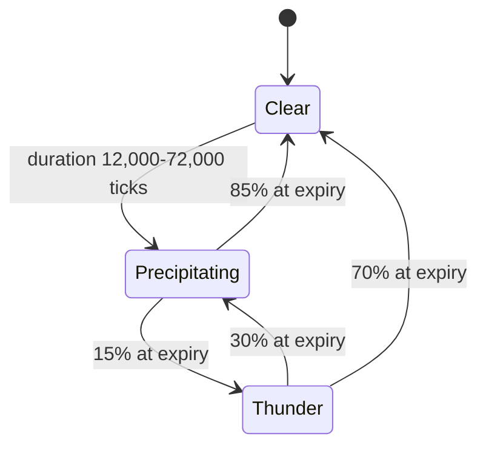

# 07 — Light and Weather

> Status: draft for review · Last updated: 2026-11-24
> Depends on: [DEC-005](../decisions.md), [DEC-007](../decisions.md), [DEC-008](../decisions.md), [DEC-015](../decisions.md), [DEC-019](../decisions.md), [DEC-021](../decisions.md), [DEC-027](../decisions.md), [DEC-044](../decisions.md), [00-conventions](00-conventions.md)
> Implements: MS-05, MS-10, MS-12

## 1. Purpose and scope

This chapter specifies how light is represented, computed and consumed, and how time, sky and weather work. Light is gameplay-visible and must be identical on a headless server, in a save and on every client; weather and sky are server-authoritative state with presentation-only rendering.

Out of scope: the section and light *container* types ([05](05-world-model.md)), meshing and the vertex light encoding ([03](03-rendering.md)), the shading model, shadows, fog and cloud rendering ([04](04-shaders-and-visuals.md)), biome definitions and temperature fields ([06](06-worldgen.md)), spawn rules ([09](09-entities-ai.md)), crop and fluid mechanics ([08](08-gameplay-survival.md), [10](10-physics-and-collision.md)), save and wire framing of light data ([17](17-persistence.md), [18](18-networking-multiplayer.md)).

The status is **draft for review** for one reason: [OPEN-004](../decisions.md) has not yet chosen between colored and monochrome block light. Everything in §3.1–§3.9 holds for both; §3.10 quantifies the tradeoff and must be resolved before `0.1.0-alpha`.

## 2. Requirements

| ID | Requirement | Verification |
| --- | --- | --- |
| REQ-LIGHT-001 | Sky light is a scalar 0–15 and block light is three independent 0–15 channels (R, G, B), packed as `[sky:4][R:4][G:4][B:4]` in one `u16` per block. | Layout test + save/network round-trip |
| REQ-LIGHT-002 | Emission, per-channel attenuation and sky attenuation are block-state properties declared by content and validated to 0–15 at registry freeze. | Schema validator test |
| REQ-LIGHT-003 | Column seeding subtracts a cell's own `sky_attenuation` from a running level that starts at 15, so an opaque cell zeroes the column and every cell below it stays 0; lateral propagation loses `max(1, attenuation)` per step, so a step into a `sky_attenuation == 0` cell still costs 1 and can never restore a column to 15. | Table-driven seeding and propagation fixtures |
| REQ-LIGHT-004 | The increment algorithm is a 16-bucket queue processed high level first; a cell is written only when the new level exceeds the stored level. | Unit test + invariant assertion |
| REQ-LIGHT-005 | The decrement algorithm is a removal BFS that clears dependent cells and collects frontier cells for re-addition; it MUST handle the straight-down sky dependency (`level == 15` below a removed cell). | Removal fixtures + differential fuzz |
| REQ-LIGHT-006 | A single edit relights a bounded volume: at most a 31³ box per channel around a level-15 change, never a whole-section relight. | Instrumented cell-write counter |
| REQ-LIGHT-007 | Edits at a section or chunk border enqueue propagation into resident neighbours; light never propagates into a chunk below `Lit`. | Cross-border fixture + unload/load test |
| REQ-LIGHT-008 | A heightmap change recomputes only the affected columns and only the Y range between the old and new light-blocking heights. | Instrumented test |
| REQ-LIGHT-009 | Dirty light volumes are merged into connected components (26-adjacency over sections) and one job is created per component; components in a batch share no border. | Job-graph test |
| REQ-LIGHT-010 | The light field is the unique fixed point of the monotone operator and the tick-visible result is independent of job completion order. | Determinism test with 1/2/8 workers |
| REQ-LIGHT-011 | Light is computed on the CPU and never on the GPU on any host; GPU lighting is presentation-only and may not write stored light ([DEC-015](../decisions.md)). | Dependency inspection + headless-server test |
| REQ-LIGHT-012 | The gameplay query is `max(floor(sky × day_factor × weather_factor), max(R,G,B))`; the render query additionally adds dimension ambient light. | Query unit test |
| REQ-LIGHT-013 | Gameplay thresholds (spawning, growth, sensors, melt) are content data with values 0–15, never code constants. | Content-schema test + rule-table fixture |
| REQ-LIGHT-014 | Client speculative light is visual-only, tagged per section, and replaced by authoritative light within two ticks of acknowledgement. | Prediction integration test |
| REQ-LIGHT-015 | A dimension with `has_sky == false` seeds sky light 0 everywhere, and sky light never appears in it. | Dimension fixture |
| REQ-LIGHT-016 | Weather, ambient light and time affect light only at query time; they never mutate stored light words. | Hash-before/after weather-change test |
| REQ-LIGHT-017 | Save and network framing carry the packed container unchanged; no host recomputes light on load before it is compared or used. | Round-trip test with light hash |
| REQ-LIGHT-018 | Monochrome mode is an explicit per-world format flag; a save never mixes monochrome and colored sections without declaring the mode. | Format-header test |
| REQ-WX-001 | Simulation time is integer ticks; day length defaults to 24,000 ticks and is configurable within 1,000–240,000; no wall clock enters sim state. | Determinism replay + config validation |
| REQ-WX-002 | Sun and moon directions derive from the specified altitude/azimuth formula using pinned trigonometry. | Angle fixtures at fixed times + cross-platform hash |
| REQ-WX-003 | Sky colour is interpolated from content keyframes over sun altitude, in linear RGB. | Gradient fixture + visual review |
| REQ-WX-004 | Moon phase cycles through 8 phases per day; illumination multipliers are content data. | Phase test over 32 days |
| REQ-WX-005 | Each weather-enabled dimension runs one deterministic state machine over `Clear`, `Precipitating` and `Thunder`, with data-defined durations and probabilities. | 10⁶-tick determinism test |
| REQ-WX-006 | Precipitation type is resolved per position from biome temperature at the surface: snow at ≤ 0 °C, rain above, none in biomes with zero downfall. | Biome temperature matrix test |
| REQ-WX-007 | Lightning rate scales with thunder intensity; strikes occur only in resident, precipitating columns with sky access. | Seeded rate test |
| REQ-WX-008 | Lightning damage, ignition, entity transformation and redstone pulse are data-driven and respect `do_fire_tick` and difficulty. | Rule-table test + gamerule test |
| REQ-WX-009 | Time and weather are server-authoritative and replicated in the tick packet; clients interpolate but never decide. | Two-client sync test |
| REQ-WX-010 | Weather phase, intensity, epoch and world time persist across save/load and replay identically. | Save/load determinism test |
| REQ-WX-011 | Weather rendering, particles, ambience and sky are presentation-only and may be disabled without changing simulation outcomes. | Headless-vs-client hash comparison |
| REQ-WX-012 | A dimension with `has_weather == false` never precipitates, thunders or strikes lightning. | Dimension fixture |
| REQ-WX-013 | Night skipping by sleeping is an explicit, server-validated rule: all dimension players asleep, target time computed from the next sunrise. | Sleep scenario test |
| REQ-WX-014 | Fixed or frozen time per dimension affects the gameplay light query consistently for every player in that dimension. | Per-dimension time test |

## 3. Design

### 3.1 Light semantics

Light answers two different questions and the engine keeps them apart. **Sky light** is a scalar: 15 means "this cell sees open sky", 0 means "no sky reaches here". **Block light** is three independent channels because content may emit or tint light per channel: a white emitter sets R = G = B, a torch-like emitter sets all three, stained glass attenuates one channel more than the others, and a modded lamp may be blue only. Levels are 0–15 in both cases; 15 is the maximum and 0 is darkness.

Stored values are *potential*, not appearance. Gameplay consumes:

```text
sky_gameplay   = floor(sky_light × day_factor × weather_factor)     // 0..15
block_level    = max(R, G, B)                                        // 0..15
gameplay_light = max(sky_gameplay, block_level)                     // 0..15
```

`day_factor` comes from the celestial model (§3.11): 1.0 in full day, 0.0 at night, a smooth ramp through twilight. `weather_factor` is the data-defined precipitation penalty (0.8 for rain, 0.6 for thunder in the base pack). Rendering does not use `gameplay_light`; it interpolates the four corner values of a face for smooth lighting and computes a per-channel radiance in the shader:

```text
radiance(c) = block[c] × block_tint[c]
            + sky × sky_tint[c] × daylight_factor
            + dimension_ambient[c]
```

That separation is why a lit room in the underworld is safe, why a thunderstorm darkens the sky without turning off lamps, and why a client with a different sky shader still spawns the same mobs as the server.

### 3.2 Opacity, emission and attenuation as content properties

Every block type declares light behaviour; there is no hard-coded `if block == torch` anywhere.

| Property | Range | Meaning | Examples |
| --- | --- | --- | --- |
| `emission[r,g,b]` | 0–15 each | Light level seeded into the block's own cell, per channel | lamp `[15,15,15]`, ember block `[9,3,1]` |
| `attenuation[r,g,b]` | 0–15 each | Level lost when block light crosses this cell, per channel | air `[0,0,0]`, water `[1,1,1]`, stained glass `[1,0,3]` |
| `sky_attenuation` | 0–15 | Level lost when sky light crosses this cell | air/glass `0`, water `1`, leaves `1`, stone `15` |

The step rule is uniform: crossing a cell costs `max(1, attenuation)`, so no material is perfectly free except one that declares 0, and attenuation 15 is opaque for that channel. Emission seeds the cell's own value; it does not bypass attenuation on the way out, which is why an emitter inside a solid block lights nothing until the block is removed. The validator rejects emission or attenuation above 15 and rejects emissive blocks with all three channels zero, because the latter is always a content bug.

### 3.3 Storage layout

Light is stored per section in the container defined in [05 §3.3](05-world-model.md#33-chunk-columns-and-sections): either `Uniform(LightWord)` (2 bytes for a section whose cells all share one word, the common case for open sky and deep rock) or `Full(Box<[LightWord; 4096]>)` at 2 bytes per block. The word layout is fixed across memory, save and network:

```text
bit  15  14  13  12 | 11  10   9   8 | 7   6   5   4 | 3   2   1   0
     [    sky     ] [      R      ] [      G      ] [      B      ]
```

The layout is deliberately identical everywhere so that a light delta can be a memcpy of words, and so that a save/load round-trip is byte-identical without a codec. Memory cost is quantified in [05 §4.2](05-world-model.md#42-memory-model) and in §3.10 below.

### 3.4 Propagation: seeding and increment

Sky light is seeded per column from the top down; block light is seeded from emitters. Both then propagate with the same flood fill.

```rust
fn seed_sky_column(col: &mut Column, x: usize, z: usize) {
    let mut level = 15u8;                          // open sky above the column
    for y in (col.min_y..col.max_y).rev() {
        let att = col.sky_attenuation(x, y, z);    // 0..=15; 15 = opaque
        level = level.saturating_sub(att);         // an opaque cell zeroes everything below it
        col.set_sky(x, y, z, level);               // transparent cells below stay 0
    }
}
```

The seed is a **running subtraction, not a per-cell reset**. `att == 0` leaves the
running level untouched, so a clear shaft carries 15 from the sky to the bottom;
`att == 15` drives it to 0 and every transparent cell beneath the opaque cell stays 0,
which is what makes a sealed room dark. `max(1, attenuation)` belongs to *lateral*
propagation only (the `add` loop of §3.4, and REQ-LIGHT-003), because a sideways step must always
cost at least one; applying it to the vertical seed would resurrect the 15 below an
opaque cell and light every cave and player-built room from above after each load.

After seeding, every cell that has a neighbour with a lower value is pushed into the add queue; cells with no lower neighbour cannot propagate and are skipped. Block light is seeded by scanning the section's non-air list rather than all 4,096 cells, because emitters are rare (the generator records emitter positions when it writes a block).

```rust
fn add(seed: impl Iterator<Item = (LightPos, ChannelLevels)>, world: &mut LightWrite) {
    let mut q = BucketQueue::new();                     // 16 buckets, popped 15 -> 0
    for (p, lv) in seed {
        if lv.any_above(world.light(p)) { world.set_max(p, lv); q.push(lv.max(), p); }
    }
    while let Some((lv, p)) = q.pop() {
        for n in neighbours6(p) {
            let cost = world.attenuation(n).at_least_one();   // max(1, attenuation) per channel
            let next = lv.saturating_sub(cost);
            if next.any_above(world.light(n)) { world.set_max(n, next); q.push(next.max(), n); }
        }
    }
}
```

`ChannelLevels` is `[u8; 4]` (sky, R, G, B). A cell may be written more than once when a later, brighter path reaches it; the field still converges because values only increase and are bounded by 15, and the fixed point is unique. The common case — an emitter whose three channels and attenuations are equal, such as a white lamp in air — is collapsed into a single "mono" pass with a channel mask, which cuts the work by roughly 3× and is why the torch budget in §5 is achievable.

### 3.5 Propagation: removal

Removal is the hard part and the source of most light bugs. The algorithm clears the cells that depended on the old level, then re-adds light from the frontier that did not.

```rust
/// Run once per active channel group (mono mask, or a single RGB channel).
fn remove(p: LightPos, old: u8, ch: Channel, world: &mut LightWrite) {
    let mut clear = vec![(p, old)];          // cells to unlight
    let mut readd = Vec::new();             // frontier that keeps its light
    world.set_level(p, ch, 0);
    while let Some((q, qlv)) = clear.pop() {
        for n in neighbours6(q) {
            let nlv = world.level(n, ch);
            if nlv == 0 { continue; }
            let dependent = nlv < qlv                              // ordinary dependency
                || (ch == Channel::Sky && qlv == 15 && is_below(n, q)   // straight-down sky
                    && world.sky_attenuation(n) == 0 && nlv == 15);
            if dependent { world.set_level(n, ch, 0); clear.push((n, nlv)); }
            else { readd.push(n); }
        }
    }
    // Re-addition runs the joint four-channel pass from the surviving frontier.
    add(readd.into_iter().map(|n| (n, world.light(n))), world);
}
```

The straight-down clause is not optional. Sky light travelling down a clear shaft keeps level 15, so a cell below a removed cell has the *same* level rather than a lower one and the ordinary strictly-lower dependency test would fail to clear it, leaving a floating column of daylight under a sealed roof. The fixture in §7 exists specifically for this case.

### 3.6 Borders, sky columns and chunk lifecycle

**Cross-section and cross-chunk.** Propagation is oblivious to section boundaries: `neighbours6` may cross into another section of the same chunk or into a neighbouring chunk, and the write goes through the same accessor. An edit at a border therefore marks border cells in the resident neighbour for propagation; the light queue stores absolute positions, so the boundary is never a special case. Light never propagates into a chunk below `Lit`: the accessor returns an opaque sentinel, which is correct for the interior of the loaded chunk because unloaded space is not queried.

When a chunk becomes `Lit` or is reloaded, its 1-block border with each resident neighbour is marked dirty and reconciled. A chunk that unloads may leave its neighbours' border light temporarily darker than the true fixed point; the reconciliation on reload restores it, and light queries into the unloaded chunk are refused anyway. The test in §7 asserts that unload→reload returns the world light hash to its previous value.

**Sky columns.** A heightmap change is the only trigger for a column recompute. Building a roof at Y = 120 over a column whose old light-blocking height was 119 changes exactly the range `[119, 120)`: sky becomes 0 at the new roof and the cells below it lose direct sky, which the removal BFS then spreads. Digging a hole does the reverse and seeds new sky at 15, which the add BFS spreads sideways. The implementation recomputes only between the old and new `LIGHT_BLOCKING` heights; a change that does not move either height (a block replaced by an equally opaque one) does no sky work at all.

Seeding is also the load path, not only the first-generation path: a column restored from a save is seeded with the same running subtraction, because a loader that re-seeds 15 below an opaque roof would make every sealed cave and player-built room sky-lit after every restart. The sealed-room fixture in §7 runs across a save/load cycle for exactly that reason.

### 3.7 Batching, workers, merge and latency

Relighting is a latency problem, not a throughput problem: a visible edit must not stutter, and a new chunk must be lit before it is meshed. The pipeline is:

1. **Collect.** The edit pipeline ([05 §3.6](05-world-model.md#36-the-mutable-world-api)) enqueues the changed cells and their six neighbours into a per-tick `LightDirtySet` of section keys, one set per channel group.
2. **Merge.** Dirty sections are merged by 26-adjacency into connected components. Components are independent by construction: no two jobs in one batch share a border, so no job needs another's output.
3. **Split.** A component larger than `MAX_JOB_SECTIONS = 512` is split into horizontal slabs with a sequential dependency; the simulation thread applies slabs in order. This bounds job latency without introducing cross-job reads.
4. **Propagate.** Each job runs the add and remove algorithms against its own component plus a read-only view of committed neighbouring light. It produces a `LightPatch`: a list of `(section, changed indices, words)`.
5. **Merge and apply.** The simulation thread applies patches in component key order at the tick boundary, bumps the section's light epoch, marks the mesh dirty and queues the network delta.
6. **Remesh.** Meshing reads the applied light, never a patch in flight.

Workers parallelise across components only. That is the whole determinism argument: a component's result depends on its own inputs and on committed neighbour light, never on another job's partial output, so completion order cannot change the tick-visible field.

**Catch-up caps.** A roof or wall removal can cascade across dozens of sections. The server spends at most `LIGHT_BUDGET_SERVER = 2 ms` per tick on relighting and defers the rest to the next tick, in component key order; the client spends at most `LIGHT_BUDGET_CLIENT = 0.5 ms` per frame on speculative relighting. A deferred cascade is visible as slower darkening, never as a dropped tick. A full relight of a freshly generated column (24 sections, terrain) is a background job; a column is not `Lit` until it completes, and its mesh is not built before that.

### 3.8 Light-based gameplay rules

Light drives spawning, growth, sensors and melting. Every rule is a content table entry keyed by a stable rule ID; the engine exposes the query and the rule table, and no gameplay crate hard-codes a threshold.

| Rule ID | Predicate (base pack) | Consumer |
| --- | --- | --- |
| `openblock:hostile_spawn` | `gameplay_light ≤ 7` and solid floor and spawn surface rules | [09](09-entities-ai.md) |
| `openblock:crop_growth` | `gameplay_light ≥ 9` on a random tick, plus hydration | [08](08-gameplay-survival.md) |
| `openblock:sapling_growth` | `gameplay_light ≥ 9` on a random tick | [08](08-gameplay-survival.md) |
| `openblock:grass_spread` | `gameplay_light ≥ 4` and a dirt target | [08](08-gameplay-survival.md) |
| `openblock:mushroom_placement` | `block_level ≤ 12` | [08](08-gameplay-survival.md) |
| `openblock:snow_ice_melt` | `block_level ≥ 12` or `temperature > 0 °C` | §3.15, [10](10-physics-and-collision.md) |
| `openblock:daylight_sensor` | output = `sky_gameplay`, inverted variant = `15 − sky_gameplay` | [12](12-redstone-and-logic.md) |
| `openblock:plant_sky_access` | `sky_light ≥ 1` (direct sky at the plant's cell) | [08](08-gameplay-survival.md) |

Thresholds are validated to 0–15 and the rule table is part of the content hash, so a mod that changes spawning light changes it consistently on client and server and fails the handshake if the change is not installed everywhere ([DEC-019](../decisions.md), [DEC-027](../decisions.md), [DEC-050](../decisions.md)).

### 3.9 Client prediction of light

A client that places a block predicts the visual result immediately, including light, or the edit feels delayed. Speculative light is computed by the same engine, on a small budget, from the client's overlay world ([05 §3.6](05-world-model.md#36-the-mutable-world-api)), and tagged `speculative` per section. The renderer accepts speculative sections; gameplay systems on the client never read them, because the client does not decide spawning or growth.

Convergence: when the authoritative block change and light patch arrive, the affected sections are replaced wholesale and the speculative tag is cleared. A rejected edit drops its overlay entry and the speculative sections are recomputed from the authoritative base. The visible worst case is a light flash for one to two ticks on a rejected edit at high latency; that is accepted, documented and invisible at normal latency. Speculative light is never serialised, never sent to another peer and never used in a checksum.

### 3.10 Colored versus monochrome light (OPEN-004)

Colored light costs memory and buys tinted glass, colored lamps and per-channel attenuation. The numbers at 25 % non-uniform sections (6 of 24 per column) are:

| Mode | Bytes/block | 16³ section | 256 blocks (1,089 col) | 512 blocks (4,225 col) | 1024 blocks (16,641 col) |
| --- | ---: | ---: | ---: | ---: | ---: |
| Monochrome (`sky4 + block4`) | 1 | 4,096 B | 26.8 MB | 103.8 MB | 409.0 MB |
| **Colored (`sky4 + RGB4`)** | **2** | **8,192 B** | **53.5 MB** | **207.7 MB** | **817.9 MB** |
| Colored, 8-bit channels | 4 | 16,384 B | 107.1 MB | 415.3 MB | 1,635.9 MB |
| Sparse colored (1 B + RGB overlay) | ≈ 1.18 | ≈ 4,832 B | ≈ 31.6 MB | ≈ 122.5 MB | ≈ 482.6 MB |

The delta between monochrome and the settled colored format ([DEC-005](../decisions.md)) is ~104 MB at 512 blocks and ~409 MB at 1024. Sparse colored would recover most of that, but it needs a second container kind, promotion/demotion rules and a protocol flag, and it still pays for any section containing a colored emitter. Banding is the visual cost of 4 bits per channel: 16 levels per channel, mitigated by dithering and smooth lighting in the shader, and invisible on the base pack's emitters.

Recommendation to the decision: keep colored light as the default because tinted light is a differentiator that monochrome cannot express, and expose monochrome as a world-format flag for memory-constrained servers and quality presets. [OPEN-004](../decisions.md) closes after the MS-05 visual review.

### 3.11 Time and the celestial model

Time is an integer tick count. `total_ticks` is monotonic and drives weather, growth and scheduled ticks; `day_time = total_ticks mod day_length` drives the sky. The default day length is **24,000 ticks** (20 minutes at 20 Hz), configurable from 1,000 to 240,000 ticks; the value is stored with the world because it changes the meaning of every scheduled tick, and changing it at runtime rescales `day_time` to preserve the time-of-day fraction. `total_ticks`, `day_time`, `day_length` and the per-dimension weather state are the `world_state` block of `level.json` ([17 §3.4](17-persistence.md#34-sidecar-files)); a save that omits them cannot rebase scheduled ticks or reproduce the sky.

With `t = day_time / day_length` (0 at sunrise, 0.25 at noon, 0.5 at sunset, 0.75 at midnight) and `ALT_MAX = π/3` rad (60°):

```text
alt     = ALT_MAX × sin(2π t)                    // radians, ranges over -ALT_MAX .. +ALT_MAX
sin_alt = sin(alt)                               // the value the sky tables interpolate on
az      = 90° + 360° × t                         // clockwise from north
sun_dir = ( sin(az) × cos(alt), sin(alt), -cos(az) × cos(alt) )   // +X east, +Y up, +Z south
moon_dir = -sun_dir
```

The azimuth convention is what keeps the sun rising in the east (+X) and crossing the southern sky (+Z): at `t = 0.25`, `az = 180°` and `sun_dir` has `z = +cos(alt)`. The moon is antipodal, so it is up at night by construction. Trigonometry comes from the pinned implementation in `ob_math`, not the platform `libm`, so the angles are bit-identical across Linux, Windows and macOS ([DEC-021](../decisions.md)).

| `t` | Clock | `sin_alt` | Event |
| ---: | --- | ---: | --- |
| 0.00 | 06:00 | 0 | Sunrise, `day_factor` starts rising |
| 0.25 | 12:00 | +sin 60° | Solar noon |
| 0.50 | 18:00 | 0 | Sunset |
| 0.75 | 00:00 | −sin 60° | Midnight |

`day_factor = smoothstep(−0.10, 0.10, sin_alt)`: 0 when the sun is more than ~6° below the horizon, 1 when it is more than ~6° above, linear in between. With `do_daylight_cycle` false, `day_time` is frozen and the sky is static while the tick counter keeps advancing for scheduled ticks. Moon phase is `floor(total_ticks / day_length) mod 8` with illumination `[1.00, 0.75, 0.50, 0.25, 0.00, 0.25, 0.50, 0.75]`; moonlight intensity is `0.15 × illumination × (1 − day_factor)`, so a new moon is genuinely dark and a full moon is navigable but never daylight. Whether night sky light should retain a small non-zero floor — Minecraft keeps a residual level — is Open question 2.

**Sleeping.** If the fraction of players in the dimension who are asleep reaches `players_sleeping_percentage` (default 100) and the time is night, the server fast-forwards `day_time` to the next sunrise (the next `t = 0` boundary) over `SLEEP_FAST_FORWARD_TICKS = 100` ticks so clients can animate the sky, clears precipitation with probability 0.5, and wakes the players. The skip is validated server-side; a client cannot request it.

### 3.12 Sky colour, atmosphere and stars

Sky appearance is content data, not shader constants. A dimension references a `SkyGradient` of keyframes over `sin_alt`, each with a zenith colour, a horizon colour, a sun colour and a star opacity; the client interpolates in linear RGB (never sRGB) and hands the result to the atmosphere pass ([04](04-shaders-and-visuals.md)).

| `sin_alt` | Zenith | Horizon | Stars |
| ---: | --- | --- | ---: |
| ≤ −0.50 | `#05070F` | `#0A0F1E` | 1.0 |
| −0.10 | `#0B1430` | `#24305A` | 0.9 |
| 0.00 | `#2B3E70` | `#E08A4C` | 0.3 |
| 0.20 | `#3E76C8` | `#A8CCEC` | 0.0 |
| ≥ 0.60 | `#4A86D8` | `#C6DDF2` | 0.0 |

These stops are base-pack defaults (our estimate, reviewed visually), not measurements. The sun and moon are billboard quads on the sky sphere, scaled by the gradient's angular size; stars are a fixed catalogue rotated about the celestial axis by `2π t` with opacity from the table. A thunderstorm multiplies horizon luminance by 0.55 and raises fog density, but those are rendering multipliers derived from the replicated weather state, never stored state.

### 3.13 The weather state machine

Each weather-enabled dimension owns one machine. It is deterministic: every duration and transition is drawn from `splitmix64(world_seed ^ dimension_seed ^ WEATHER_STREAM ^ epoch)`, where `epoch` increments on every transition and is persisted per dimension in the `world_state` block of `level.json` ([17 §3.4](17-persistence.md#34-sidecar-files)), along with phase, intensity and remaining duration.



| Phase | Duration (ticks) | Intensity target | Notes |
| --- | --- | ---: | --- |
| `Clear` | 12,000–72,000 | 0.0 | Sky is clear; no precipitation |
| `Precipitating` | 3,000–12,000 | 0.65–1.0 | Rain or snow, resolved per biome |
| `Thunder` | 3,600–12,000 | 0.85–1.0 | Precipitation plus lightning |

Intensity ramps toward its target at `1/200` per tick, so a storm builds and clears over 10 seconds and the rendering and light transitions have something continuous to follow. Phase and intensity are independent of `day_time`: a storm can start at noon or midnight, and sleeping does not cancel it. `do_weather_cycle` false freezes the machine in its current phase, with intensity held at its target; `do_weather_cycle` is host-only ([08](08-gameplay-survival.md)).

**Precipitation type** is resolved per column from the biome at the surface and its temperature: no downfall → no precipitation; `temperature ≤ 0 °C` → snow; otherwise rain. Because biomes vary in XZ, a single storm can rain on a plains and snow on a mountain two chunks away; that is correct behaviour, not a seam bug, and it is tested at biome borders. Snow accumulates on exposed surfaces, ice forms on exposed water, and both melt by the `snow_ice_melt` rule ([§3.8](#38-light-based-gameplay-rules)).

### 3.14 Lightning

While the phase is `Thunder`, a strike occurs with probability `thunder_intensity / 2,400` per tick per dimension, so a full-intensity storm strikes about once every two minutes somewhere in the dimension. A strike is placed at a uniformly chosen resident chunk inside simulation distance whose surface precipitation is non-zero, then at a uniformly chosen column with sky access; the impact point is the `MOTION_BLOCKING` height plus one. No strike is placed in an unloaded chunk, under a roof, or in a dry biome.

Effects are events, not hard-coded behaviour, so content decides what lightning does:

| Effect | Default | Owner |
| --- | --- | --- |
| Damage entities within 3 blocks | data-defined damage type and amount, scaled by difficulty | [08](08-gameplay-survival.md) |
| Ignite the hit block | only if `do_fire_tick` is true and the block is flammable | [10](10-physics-and-collision.md) |
| Transform entities | `lightning_transforms` table in content: entity type in → entity type out | [09](09-entities-ai.md) |
| Redstone pulse | lightning rods and tagged blocks emit a 1-tick pulse | [12](12-redstone-and-logic.md) |
| Visual flash and thunder sound | presentation only, one flash and one delayed sound per strike | [04](04-shaders-and-visuals.md), [14](14-audio.md) |

The strike event is replicated to clients within the same tick packet so the flash and the damage agree. Eight simultaneous strikes cost at most 1 ms of server tick time (PERF-WX-003): effects are applied through the same batched event queue as block changes.

### 3.15 Weather effects on gameplay and rendering

| Area | Effect | Where implemented |
| --- | --- | --- |
| Light query | `weather_factor` 0.8 (rain) / 0.6 (thunder), applied at query time | §3.1, [09](09-entities-ai.md) |
| Fire | Rain extinguishes exposed fire; lightning ignites it | [10](10-physics-and-collision.md) |
| Farmland | Rain hydrates farmland within the precipitation column | [08](08-gameplay-survival.md) |
| Cauldrons | Slow fill during precipitation | [11](11-inventory-crafting-items.md) |
| Snow and ice | Accumulate, melt, refreeze by temperature and light | §3.8, [10](10-physics-and-collision.md) |
| Crops | Growth is gated by `gameplay_light`, which rain lowers but does not remove | [08](08-gameplay-survival.md) |
| Presentation | Rain/snow particles, wet roughness, darker clouds, denser fog, lightning flash, rain loop, thunder, biome ambience | [04](04-shaders-and-visuals.md), [14](14-audio.md) |

No gameplay effect reads a rendering value, and no rendering pass writes a simulation value. A headless server computes exactly the same weather sequence, light query results and lightning events with none of the visual layers compiled in ([DEC-003](../decisions.md)).

### 3.16 Ambient and environment data in content packs

A dimension and a biome each reference an `EnvironmentDef`, evaluated on the client:

```ron
EnvironmentDef(
  sky: "openblock:overworld_sky",          // SkyGradient keyframes
  fog: (near: 64.0, far: 512.0, density: 0.0015, weather_multiplier: 2.0),
  ambient_scale: 0.0,                     // presentation multiplier, 0.0..=1.0
  cloud_height: 192.0,
  water_fog: (colour: [0.05, 0.18, 0.28], density: 0.08),
  ambience: ["openblock:forest_birds", "openblock:wind_leaves"],
  music: ["openblock:calm_1"],
  particles: ["openblock:pollen"],
)
```

Resolution order is biome over dimension over pack default. Unknown IDs are a pack validation error, not a silent fallback. `EnvironmentDef` is client-only: it is included in the view hash, not the content hash, because it cannot affect gameplay; a client with a different environment pack still joins and sees its own sky, fog and ambience, while the simulation state hash never includes it ([DEC-019](../decisions.md), [DEC-027](../decisions.md), [DEC-050](../decisions.md)). A dedicated server parses and validates it and never evaluates it.

### 3.17 Server–client synchronisation of time and weather

`total_ticks`, `day_time` and weather are server-authoritative ([DEC-008](../decisions.md)) and travel in the tick packet ([18](18-networking-multiplayer.md)):

| Field | Size | Cadence |
| --- | --- | --- |
| `total_ticks` | 8 B | On join and every 200 ticks (keyframe) |
| `day_time` | 3 B (24-bit delta) | Every tick, or an absolute 4 B after a snap |
| `weather.phase` + flags | 1 B | On change |
| `weather.intensity`, `thunder` | 2 B | On change, then every 200 ticks |
| Moon phase | 0 B | Derived from `total_ticks` and `day_length` |

A steady-state tick writes 3 bytes for time; a quiet tick with no weather change writes nothing beyond the delta. The client advances `day_time` locally every tick and reconciles: a difference above 20 ticks snaps, otherwise it slews by one tick per tick so the sky never visibly jumps. Weather intensity is interpolated toward the replicated target at `1/200` per tick. `day_length` is sent once at join and on change, so a client can compute moon phase without a field of its own.

### 3.18 1.2 implementation status (Light & Home)

The 1.2 vertical slice implements the CPU field described in §3.1–§3.7 for the
shipping 2 B/block container. The save format stays **v4**; the wire format is
owned by the 1.2 protocol slice and is not changed by this engine.

**Content properties.** `BlockType` now carries `emission: [u8;3]`,
`attenuation: [u8;3]`, `sky_attenuation: u8` and `shape`. The base pack uses
air `0/0/0`, opaque blocks `15/15/15`, water and leaves `1/1/1` (block and sky),
wheat `0/0/0`, beds block `1/1/1` and sky `1`, and the torch `14/14/14`
emission, `0` attenuation and `0` sky attenuation. The JSON pack schema accepts
the same fields plus `shape: "cube" | "cross"`; values outside 0–15 fail with
`PackError::InvalidLight`. Omitted light fields derive from the material class
(opaque → 15, fluid → 1, otherwise 0) so every 1.1 pack loads unchanged.

**Seeding and propagation.** `ChunkColumn::finalise` seeds each XZ column
top-down with a running level, so an opaque cell zeroes the column below; it
then runs a local 16-bucket sky BFS for overhangs and shafts and seeds block
emitters through the same per-channel `max(1, attenuation)` BFS. Uniform
sections stay `Light::Uniform`: fully opaque rock is cleared as a whole section,
air sections already holding the running level are skipped, and only a column
that actually needs a different value is written. A transparent section is
never collapsed from a single column, because that erased a shaft written by an
earlier column in the same section. After insertion, `World::insert_chunk`
compares the four chunk borders section by section: a pair of equal uniform
sections costs one word comparison, and only genuinely different border cells
are seeded into a bounded BFS. There is therefore no seam for sky or block light
in resident chunks.

**Edits.** `World::set_block` relights a 31³ box around the changed block. It
distinguishes sky from block-light property changes:

* sky changes rebuild the 31³ box and, when its bottom plane changed, the
  31×31 column volume below it. A sealed shaft therefore darkens a cave farther
  below the box as well as the column directly under it, and a removed roof
  restores it;
* block-light changes clear and re-seed only the RGB channels, with sources
  found by palette, not by scanning every air cell;
* a sky-opacity change under an opaque roof with no stored sky in the edited
  cell or its six neighbours skips the column pass entirely;
* a dark box with no emitters and no lit border skips the block pass entirely.

The box is bounded and deterministic. Measured on the development reference
(`ob_world` release-optimised dev profile): torch place/remove p50 0.14 ms,
p99 0.15 ms; dark-room stone edit p50 0.09 ms; open-sky roof edit p50 0.83 ms,
p99 0.92 ms. All ordinary edits are inside the 1 ms target. A sky-opacity edit
whose 31³ box bottom changes additionally rebuilds the column volume below it;
the deliberately deep 8×8 cave fixture measures p50 1.83 ms, p99 1.90 ms. That
is the known worst case and is accepted for rare shaft/roof edits pending a
removal-BFS or lazy-tail optimisation. A per-tick batching queue is not needed
for 1.2; the server may call `World::set_block` directly. If a future edit mixes
several channels and exceeds the budget, the same `relight_edit` entry point can
be wrapped in the §3.7 component queue without changing stored formats.

`World::set_block` also marks every section whose light changed dirty, so a
mesh worker using `World::take_dirty_sections` remeshes the neighbour section
that reads light through the snapshot border. `relight_around(pos)` and
`relight_all()` expose the same paths to tools and the migration loader.

**Gameplay query.** The server-facing signature is:

```rust
impl World {
    pub fn light_sample(&self, pos: BlockPos) -> LightSample; // sky, r, g, b
    pub fn sky_light(&self, pos: BlockPos) -> u8;             // 0..=15
    pub fn block_light(&self, pos: BlockPos) -> u8;           // max(r,g,b)
    pub fn gameplay_light(&self, pos: BlockPos, day_factor: f32, weather_factor: f32) -> u8;
}
```

`gameplay_light` evaluates `max(floor(sky × day_factor × weather_factor),
max(R,G,B))` without mutating stored light, exactly as §3.1 requires. The host
already owns the clock and weather phase; spawning, crop growth and future fire
checks should pass the current values (`weather_factor` 1.0 clear, 0.8 rain,
0.6 thunder). The base thresholds live in the 1.2 server slice
(hostile spawn ≤ 7, crop growth ≥ 9), not in the world crate.

**Persistence, version and migration.** `world.obs` remains v4 and carries the
packed words unchanged. A new additive sidecar, `world_meta.txt`, contains:

```text
# OpenBlock world metadata (additive; safe to delete to force a light relight)
light_version=2
```

Unknown lines are preserved. `ob_world::load_world_dir` / `save_world_dir` are
the directory-level entry points: a missing marker or `light_version < 2`
relights every resident column once, rewrites `world.obs` (still v4) with the
corrected words and writes `light_version=2`; a second load trusts the marker
and does not relight. A raw `from_bytes` caller cannot see the sidecar, so it
reports `World::light_version() == 1` and must call `World::relight_all()` or use
the directory loader. A world saved through `save_world_dir` writes
`light_version=2` immediately. `World::light_hash()` is a cached deterministic
checksum over the canonical per-cell words (representation-independent,
invalidated by any light write) so save/load and migration tests can assert
light equality without hashing every section on every call.

**Host integration is not in this slice.** `Host::open` still loads with
`read_save_file` + `from_bytes` (`crates/server/src/lib.rs:390-391`) and the save
path still calls `to_bytes_checked`/`commit` directly, so an existing 1.0/1.1
world opened by the shipping game keeps its fake light and no `world_meta.txt`
is written. This is a release gate, not an optional follow-up:

1. Replace the `Host::open` load with
   `ob_world::load_world_dir_with_report(registry, &world_dir)`, log the
   `LightMigration` result, and keep raw `from_bytes` only for network chunk
   payloads.
2. After the world save commits, call `ob_world::write_world_meta` with
   `WorldMeta { light_version: LIGHT_VERSION, .. }` (or use `save_world_dir` for
   the synchronous path). The async path must write the marker only after the
   `world.obs` rename.
3. Add `self.world.light_hash()` to `Host::state_hash` when the release fixtures
   are regenerated; the current seed-42 smoke hash `eba0c42219691190` is
   unchanged because light is not hashed there yet.

The same server slice must call `World::gameplay_light` for hostile spawn
(`≤ 7`) and crop growth (`≥ 9`), and the client slice must consume the dirty
sections produced by light changes. No protocol message is added by this engine.

**Known limits in this slice.** Client speculative light (§3.9), worker
components/batching (§3.7), and asynchronous light jobs are not implemented;
all propagation is synchronous. Unloading a chunk does not run a removal BFS in
its surviving neighbours, so light from a torch in an unloaded column can remain
visible in a still-resident neighbour until that column reloads and reconciles;
ordinary resident streaming, edits and save/load are seam-free. The deep
sky-tail edit above is the only measured path above the 1 ms budget. The
renderer collapses RGB to the brightest channel in its 8-bit block-light vertex
byte (coloured emitters are 1.3+); the gameplay query keeps all three channels.
A dimension with no sky is not exposed by 1.2 content yet, so the
`has_sky == false` rule remains specified but unexercised.

## 4. Data structures and formats

```rust
/// One packed light cell: sky in bits 12..16, R 8..12, G 4..8, B 0..4.
#[derive(Clone, Copy, PartialEq, Eq)]
pub struct LightWord(pub u16);

pub enum LightData { Uniform(LightWord), Full(Box<[LightWord; 4096]>) }
pub struct BlockLightDef {
    pub emission: [u8; 3],        // R, G, B, each 0..=15
    pub attenuation: [u8; 3],    // R, G, B, each 0..=15; 15 = opaque
    pub sky_attenuation: u8,     // 0..=15; 0 = sky-transparent
}
/// Propagation work item; 16 B with padding, 24 B budgeted.
#[derive(Clone, Copy)]
pub struct LightPos { pub section: SectionKey, pub index: u16 }
pub struct LightEngine {
    add: [Vec<LightPos>; 16],       // bucket queue, level 15 first
    readd: Vec<LightPos>,          // removal frontier
    dirty: BTreeSet<SectionKey>,   // components built per tick
    budget_ms: f32,                // 2.0 server, 0.5 client speculative
}
pub struct Weather {
    pub phase: WeatherPhase,       // Clear | Precipitating | Thunder
    pub intensity: f32,            // 0.0..=1.0, ramped
    pub thunder: f32,              // 0.0..=1.0
    pub remaining: u32,            // ticks until the next transition
    pub epoch: u64,                // persisted RNG counter
}
```

The light engine holds no light data itself: it reads and writes through the world accessor, which is what lets a job run against a snapshot plus a private patch. Queue entries are absolute positions, so a component can span chunks without a coordinate conversion.

## 5. Performance budgets

| ID | Budget | Measurement |
| --- | --- | --- |
| PERF-LIGHT-001 | Torch-sized relight (≤ 8,000 cell writes, one channel group) median ≤ 150 µs, p99 ≤ 600 µs | Criterion bench on a cave scene |
| PERF-LIGHT-002 | Sky cascade capped at 2 ms per server tick and 0.5 ms per client frame; overflow deferred in component key order | Instrumented roof-removal stress |
| PERF-LIGHT-003 | Fresh 24-section column ≤ 1.2 ms p95 on one core; ≥ 4,000 columns/s on 8 workers | Worldgen-integrated benchmark |
| PERF-LIGHT-004 | Light memory ≤ 2 B/block for non-uniform sections (8 KiB per 16³ section); ≤ 210 MB at 512 blocks (≈ 208 MB at the assumed 25 % non-uniform distribution), ≤ 840 MB at 1024 (colored mode) | Allocation counter |
| PERF-LIGHT-005 | Gameplay light query ≤ 10 ns; render fetch ≤ 20 ns | Criterion bench |
| PERF-LIGHT-006 | Propagation queue ≤ 2 MB steady state, ≤ 24 B per entry, hard cap of 1 M entries with deferred overflow | Instrumented stress |
| PERF-LIGHT-007 | Full relight of a resident 512-block world ≤ 1.5 s on 8 workers (debug and tooling path) | `cargo xtask bench --scene relight` |
| PERF-WX-001 | Weather tick ≤ 20 µs p99 per dimension, including the strike draw | Criterion bench |
| PERF-WX-002 | Time/weather sync ≤ 16 B per client per tick when changing, 0 B when unchanged | Protocol encoder test |
| PERF-WX-003 | Eight simultaneous lightning strikes ≤ 1 ms of server tick, including effect dispatch | Scripted storm test |

## 6. Failure modes and edge cases

| Failure | Detection | Behaviour |
| --- | --- | --- |
| Removal misses a straight-down sky column | Sky-shaft fixture, differential fuzz | Cells below a roof stay lit; caught by the fixture before release, never by a player |
| Seeding restores sky light below an opaque roof | Sealed-room fixture across load/save + differential fuzz | Column seed subtracts attenuation from the running level; the fixture fails if an interior cell reads 15 instead of 0 |
| Removal cascade larger than the per-tick budget | Budget counter | Remaining components deferred to the next tick, applied in key order, logged once per second |
| Light at a chunk border after unload/reload | Border hash test | Border cells reconciled on promotion; the interior hash must match the pre-unload value |
| Edit or emitter removal in a chunk that unloads | Status check at apply time; retained scheduled tick | Patch discarded, chunk reloads from the save with stored light, removal runs on reload |
| Colored channel divergence | Per-channel differential test against `SlowLight` | Reported as a bug; the fixed point is per-channel independent so divergence means an indexing error |
| Light level above 15 from stacked emission | Clamp in `set_max` | Saturated at 15; assertion in debug builds |
| Weather RNG differs after save/load | Save/load determinism test | `epoch` persisted; a mismatch fails CI |
| Clock drift between client and server | Sync test at 200 ms RTT and 5 % loss | Snap above 20 ticks, slew below; sky never jumps more than one frame |
| Lightning in an unloaded or dry column | Seeded rate test | No strike; the draw is rejected and redrawn within the same tick up to 4 attempts |
| Rain on one side of a biome border, snow on the other | Border fixture | Correct behaviour; the renderer blends precipitation across the boundary over 4 blocks |
| Monochrome save opened with colored content | Format header validation | Refuse to load with a message naming the world format and the expected mode |

## 7. Testing strategy

| Level | What it proves | Tooling |
| --- | --- | --- |
| Fixtures | Hand-computed fields for a sealed room and a sky shaft: with an opaque roof at y=120, sky is 15 only above the roof and exactly 0 in every interior cell, including transparent ones, after generation and after a save/load; down a 1-block shaft sky is 15 to the bottom and 0 in the cells beside it that only lateral light could reach; plus water column attenuation, stained-glass RGB, glass roof and corner emitter | Golden arrays, table-driven `cargo test` |
| Differential fuzz | After each of 10⁵ random edits in a 3×3-chunk world, the full light field equals `SlowLight` recomputed from scratch; 10⁷ edits nightly | `proptest` + a seeded edit generator |
| Borders | Sources on both sides of a section and chunk border; unload/reload restores the world light hash; propagation across a 4-chunk corner | Integration test |
| Determinism | Same edit log under 1, 2 and 8 workers with shuffled completion order yields identical per-tick light hashes | Replay harness ([02](02-engine-core.md)) |
| Gameplay rules | `hostile_spawn`, `crop_growth`, `daylight_sensor`, `snow_ice_melt` at levels 0/7/8/9/12/15, and with rain and thunder applied | Rule-table fixture |
| Time | Sun and moon directions at `t = 0/0.25/0.5/0.75`, day-length variants, moon phase over 32 days, sleep fast-forward | Angle fixtures + pinned-trig hash |
| Weather | 10⁶-tick sequence is reproducible from the seed; save/load mid-thunder; intensity ramp; per-biome snow line; lightning rate within tolerance | Seeded simulation test |
| Performance | Every `PERF-LIGHT-*` and `PERF-WX-*` budget as a CI benchmark with a regression tolerance | Criterion + bench box ([DEC-035](../decisions.md)) |
| Visual | Sky gradient keyframes and thunder darkening compared as golden images in the renderer suite | [24](24-testing-benchmarks.md) |

`SlowLight` is the same reference used by [05 §7](05-world-model.md#7-testing-strategy): a `BTreeMap` world plus a from-scratch BFS over every channel. It is deliberately O(world) per comparison, runs only in tests, and is the arbiter for every incremental-update claim in this chapter.

## 8. Open questions

1. **Colored versus monochrome block light** — tracked as [OPEN-004](../decisions.md), owner **MS-05**, deadline before `0.1`. §3.10 gives the memory numbers; the decision needs the visual review, not more data.
2. **Night sky-light floor.** This chapter sets `day_factor = 0` at night, so an unlit surface is light level 0 and mobs spawn. Minecraft retains a residual sky light, which makes surface nights slightly safer and changes spawn pressure. Register item needed: whether night sky light contributes a non-zero floor to gameplay light (owner **MS-05** with MS-10). The working position is that it contributes 0 and the base pack compensates with moon-phase ambient light in the render query only.
3. **Weather authority scope.** Per-dimension weather, the query-time light penalty and the persistence of `epoch` are specified here but not registered as a decision. Register item needed: weather authority scope (a deterministic, per-dimension, server-authoritative state machine whose light penalty is applied at query time and never mutates stored light) (owner **MS-10**).
4. **Light palette compression.** Near-uniform sections could store a palette of `LightWord` values with 4-bit indices, roughly halving light memory for cave and sky sections at the cost of a second container kind. Deferred until the 512-block memory benchmark is measured. Owner: **MS-13**, revisit at the format freeze.
5. **Sleep and weather-clearing rules.** The 0.5 clear probability, the 100-tick fast-forward and the default `players_sleeping_percentage` of 100 are base-pack data rather than engine law. Owner: **MS-10**.

## 9. References

- Decisions: [DEC-005](../decisions.md) (packed light, 2 B/block, sky4 + RGB4), [DEC-007](../decisions.md) (fixed tick), [DEC-008](../decisions.md) (server authority), [DEC-015](../decisions.md) (CPU flood fill), [DEC-019](../decisions.md) (content data), [DEC-027](../decisions.md) (protocol), [DEC-044](../decisions.md) (snake_case rule IDs), [DEC-050](../decisions.md) (content and view hash).
- [Specification conventions](00-conventions.md); [world model](05-world-model.md); [rendering](03-rendering.md); [shaders and visuals](04-shaders-and-visuals.md); [world generation](06-worldgen.md); [entities and AI](09-entities-ai.md); [networking multiplayer](18-networking-multiplayer.md); [performance budgets](25-performance-budgets.md).
- [Weft teardown](../research/01-weft-teardown.md) §4.2 — flood fill with per-channel absorption, sky-down shortcut, prelight compared against a reference implementation; [voxel rendering SOTA](../research/03-voxel-rendering-sota.md) §6 — light storage tradeoffs (1/2/4 B per block), 50–300 µs edit relight, 1–3 ms per new column, Starlight-class batching as a latency optimisation.
- [Minecraft feature inventory](../research/05-minecraft-feature-inventory.md) §3.9 — 0–15 sky/block light, per-dimension skylight, light-aware spawning, 24,000-tick day, biome-dependent snow, reduced sky light during weather.
- Minecraft Wiki, "Light" — external reference for 0–15 levels and sky-versus-block light semantics: <https://minecraft.wiki/w/Light>
- Minecraft Wiki, "Daylight cycle" — external reference for the 20-minute day and celestial timing: <https://minecraft.wiki/w/Daylight_cycle>
- PaperMC Starlight — evidence that light propagation can be batched to ~50× faster without changing the model: <https://github.com/PaperMC/Starlight>
- Hillaire, "A Scalable and Production Ready Sky and Atmosphere Rendering Technique" (EGSR 2020) — the sky/atmosphere model referenced by [04](04-shaders-and-visuals.md): <https://sebh.github.io/publications/egsr2020.pdf>
