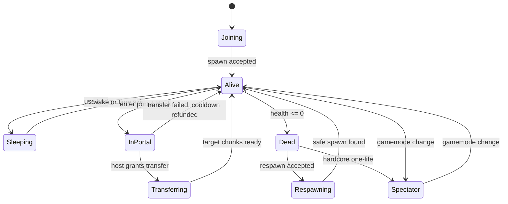
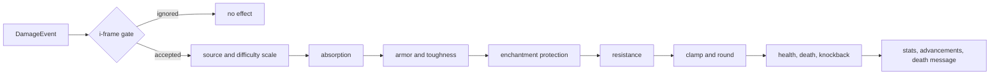
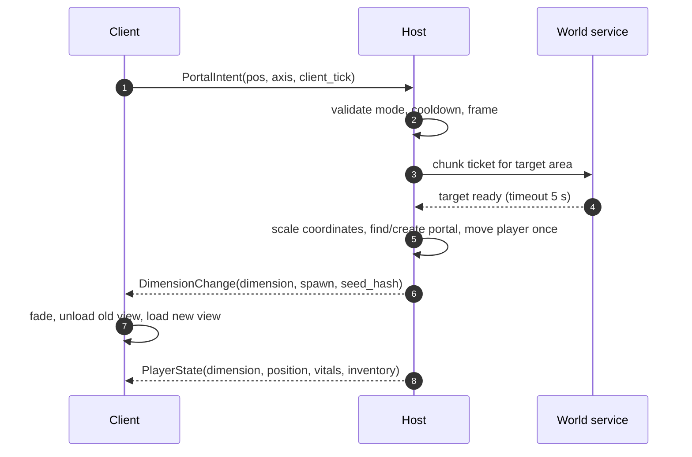

# 08 — Survival Gameplay

> Status: normative - Last updated: 2026-11-24
> Depends on: [DEC-004](../decisions.md), [DEC-007](../decisions.md), [DEC-008](../decisions.md), [DEC-019](../decisions.md), [DEC-020](../decisions.md), [DEC-021](../decisions.md), [DEC-022](../decisions.md), [DEC-027](../decisions.md), [DEC-029](../decisions.md), [DEC-037](../decisions.md); [world model](05-world-model.md), [light and weather](07-light-and-weather.md), [physics](10-physics-and-collision.md), [networking](18-networking-multiplayer.md), [anti-cheat](20-security-and-anti-cheat.md)
> Implements: MS-10 (core loop), MS-11 (depth), MS-14 (parity corpus)

## 1. Purpose and scope

This chapter defines the survival loop: game modes, the player state machine, health, hunger, experience, combat, movement abilities, progression, dimensions, time and sleep, spawning, death, difficulty, commands, statistics and onboarding. The numbers in §3 are the **OpenBlock canonical values**: parity-shaped defaults in the `openblock:base` balance profile (§3.13), not constants compiled into `ob_sim`, arbitrated by the parity corpus at MS-14. A rule marked *divergence* follows the Tier-4 list in [the feature inventory](../research/05-minecraft-feature-inventory.md#4-tier-4-quirks-we-should-not-copy).

Out of scope: entity bodies, AI and spawning tables ([09](09-entities-ai.md)); the collision/velocity solver and raycasts ([10](10-physics-and-collision.md)); item stacks, containers and recipes ([11](11-inventory-crafting-items.md)); redstone ([12](12-redstone-and-logic.md)); HUD and screens ([13](13-ui-and-ux.md)); persistence ([17](17-persistence.md)); packet encoding ([18](18-networking-multiplayer.md)); enforcement policy and replay evidence ([20](20-security-and-anti-cheat.md)).

Two rules apply everywhere. The host is the only writer of player state (DEC-008); clients send inputs and intents. Durations are expressed in **canonical ticks** (ct) at 20 ct/s (DEC-007); how a 30 Hz server maps them is an open decision (proposed DEC-038, §8), so every number in this chapter is defined at 20 ct/s.

## 2. Requirements

| ID | Requirement | Verification | Milestone |
| --- | --- | --- | --- |
| REQ-GAME-001 | Modes are registry entries with capability flags; the host rejects every action whose flag is false, including predicted actions. | Unit: mode matrix | MS-10 |
| REQ-GAME-002 | Player transitions follow §3.2; illegal transitions are rejected and logged. | Property: transition table | MS-10 |
| REQ-GAME-003 | Replicated fields are host-written; a client converges within 2 ticks of a correction. | Two-client replay | MS-06 |
| REQ-GAME-004 | Vitals and damage use fixed-point integers (1 HP = 1,024 units); no float enters health, hunger, XP or combat. | Inspection + hash test | MS-10 |
| REQ-GAME-005 | Damage applies §3.3 phases in order with round-half-up and matches the golden vectors. | Unit: `damage::golden` | MS-10 |
| REQ-GAME-006 | Every damage type declares armor, protection, i-frame, knockback and message fields; a missing field fails content validation. | Content validation | MS-10 |
| REQ-GAME-007 | Absorption is spent before health, never self-regenerates, and caps at 20 HP. | Unit + scenario | MS-10 |
| REQ-GAME-008 | Invulnerability lasts 10 ct with the bypass and larger-hit rules of §3.3. | Unit: i-frame matrix | MS-10 |
| REQ-GAME-009 | Hunger, saturation and exhaustion obey §3.4 and are numerically visible in the debug overlay. | Unit + UI inspection | MS-10 |
| REQ-GAME-010 | Eating uses the item's use time, is interruptible, and cannot start at food 20 unless `always_eatable`. | Unit + input replay | MS-10 |
| REQ-GAME-011 | Regeneration and starvation follow §3.4; starvation respects the difficulty floor. | Unit + 10-minute replay | MS-10 |
| REQ-GAME-012 | XP follows §3.5; the curve is monotonic and cumulative XP to level 30 is 1,395 points. | Unit: golden curve | MS-10 |
| REQ-GAME-013 | Death drops inventory, equipment, cursor and XP per §3.11 and is crash-safe. | Integration + kill -9 | MS-10 |
| REQ-GAME-014 | Cooldown, charge, critical hits and sweep follow §3.6. | Unit: `combat::charge` | MS-10 |
| REQ-GAME-015 | Shields block by facing, lose durability, and are disabled by an axe for 100 ct. | Unit + scenario | MS-11 |
| REQ-GAME-016 | Knockback follows §3.6 and is applied as a velocity change through physics. | Unit + replay hash | MS-10 |
| REQ-GAME-017 | Melee hits are host-validated for reach, line of sight, cooldown, liveness and dimension. | Cheater corpus | MS-10 |
| REQ-GAME-018 | Hit rewind is at most 200 ms and never accepts a hit through current solid geometry. | 0/80/150 ms RTT test | MS-06 |
| REQ-GAME-019 | Projectiles are host-simulated; client tracers never decide hits. | Integration + inspection | MS-10 |
| REQ-GAME-020 | Movement abilities use §3.7; fall damage uses server-tracked fall distance. | Unit + replay | MS-10 |
| REQ-GAME-021 | Vehicles and elytra expose the §3.7 interfaces and remain host-authoritative. | Boat/minecart ride test | MS-11 |
| REQ-GAME-022 | Tool tiers, mining time and durability follow §3.8; an under-tier tool yields no drop. | Unit: mining table | MS-10 |
| REQ-GAME-023 | Dimension travel uses 8:1 linking, the §3.9 search box and tie-breaks, a persisted link and a 300 ct cooldown. | Golden portal cases | MS-08 |
| REQ-GAME-024 | A dimension change moves the player exactly once; failure leaves no state loss. | Fault injection | MS-08 |
| REQ-GAME-025 | End portals, gateways, beds and anchors follow §3.9, including wrong-dimension explosions. | Scenario suite | MS-11 |
| REQ-GAME-026 | A day defaults to 24,000 ct and is configurable per [07](07-light-and-weather.md); sleeping follows §3.10 and only skips time when its condition is met. | Unit + multiplayer scenario | MS-10 |
| REQ-GAME-027 | World and player spawn are deterministic functions of seed, world state and rules. | Golden seed test | MS-10 |
| REQ-GAME-028 | Difficulty and game rules apply host-side; clients cannot change them without permission. | Permission tests | MS-10 |
| REQ-GAME-029 | Commands are permission-gated, rate-limited and capped in edit volume and selector count. | Abuse corpus | MS-07 |
| REQ-GAME-030 | Statistics and advancements are registry-keyed, host-awarded, persisted and owner-only on the wire. | Save round-trip | MS-11 |
| REQ-GAME-031 | Balance comes from a validated profile; the client displays the same numbers the host enforces. | Content validation + inspection | MS-10 |
| REQ-GAME-032 | Every action in §3.14 is host-validated; each row names its anti-cheat rule. | Cheater corpus | MS-15 |

## 3. Design

### 3.1 Game modes as data

A mode is a `GameModeDef` of capability flags plus a respawn policy. The four base modes ship in `openblock:base`; packs may add modes, but a mode never grants a server permission level (§3.12). The host evaluates flags at intent time *and* commit time, so a queued mode change cannot authorise an action started under the old mode.

| Flag | survival | creative | adventure | spectator |
| --- | --- | --- | --- | --- |
| `break_blocks` / `place_blocks` | yes / yes | yes / yes | item predicates only | no / no |
| `attack_entities` / `take_damage` | yes / yes | yes / void only | yes / yes | no / no |
| `hunger` / `fly` | yes / no | no / yes | yes / no | no / yes, noclip |
| `infinite_items` / `instant_break` | no / no | yes / yes | no / no | no / no |
| `interact` / `open_containers` | yes / yes | yes / yes | yes / yes | no / view only |
| `collide`, `pick_up`, `be_targeted` | yes | yes | yes | no |
| `sleep` / `use_portals` | yes / yes | yes / yes | yes / yes | no / teleport UI |

`hardcore` is a world modifier, not a mode: it forces and locks `hard`, sets `one_life`, and moves the dead player to spectator.

### 3.2 Player state machine and replication



Orthogonal sub-states are a `PlayerFlags` bitset: `sneaking`, `sprinting`, `swimming`, `climbing`, `gliding`, `blocking`, `using_item`, `riding`, `invulnerable`, `creative_flying`, `in_water`, `on_ground`. One player advances per tick in this order: input → effects → movement intent → item use → combat → hunger/regen → damage/death → stats/advancements; every transition is an intent the host performs, then replicates.

The host replicates, per player: position and look (self predicted, others interpolated over 100 ms), pose flags and mode (16 + 8 bits), dimension (8 bits), full health and absorption to self (15 + 15 bits) but only a hurt animation to others, food/saturation/exhaustion to self (5 + 15 + 16 bits), XP level to others and level plus progress to self (15 + 10 bits, progress in per-mille), air and fire ticks (9 + 10 bits), equipment and visible effects to everyone, the full inventory and cursor only to their owner ([11](11-inventory-crafting-items.md)), and spawn, statistics and advancements only to their owner. Remote clients never learn another player's hunger or exact health: it is private and removes regeneration timing as an information leak.

### 3.3 Health, damage and death



Each step is a named value-chain node (`BASE`, `ADD`, `MULTIPLY`, `CAP`, `FINAL`), so `/ob damage explain` prints the arithmetic and mods hook declared phases (DEC-020) without changing evaluation order.

**Armor, protection, absorption.** Units are 1/1,024 HP. With armor points `A` (0–20), toughness `T` (0–12), incoming damage `D` in HP and reduction points `R`:

```text
R    = min(20, max(A / 5, A - 4D / (8 + T)))
D'   = D * (25 - R) / 25
D''  = D' * (100 - min(80, 4 * EPF)) / 100
D''' = D'' * (100 - 20 * resistance_level) / 100
```

Divisions round half-up to 1/1,024 HP. EPF is 1 per level for generic protection and 2 for a specific protection, capped at 20; the reduction caps at 80%, so armor plus enchantments never grant immunity. Absorption is a separate pool spent before armor and never heals. Resistance applies last and reaches 0 damage at level 5, which still counts as a hit for stats. Golden vectors: 10 HP against 15 armor and 8 toughness gives 5.00; against 20 armor and 8 toughness 3.00; adding EPF 4 gives 2.52; EPF 20 gives 0.60.

**Damage types.** `DamageTypeDef` is content data: family, default amount, armor flag, protection flag, i-frame bypass, knockback rule, death-message key. Tier 2 requires every damage type in the parity manifest classified (51 in the latest registry at the time of writing), even when several map to one row.

| Type / family | Default | Armor | Protection | I-frames | Knockback |
| --- | --- | --- | --- | --- | --- |
| `player_attack` / `mob_attack` | item or entity damage | yes | yes | 10 ct | yes |
| `arrow`, `trident`, `thrown` | projectile | yes | yes | 10 ct | yes |
| `explosion` | exposure ray | yes | blast | 10 ct | yes |
| `in_fire`, `on_fire`, `lava`, `magma` | 1 HP / 10 ct | partial | fire | 10 ct | no |
| `drown` / `starve` | 1 HP / 20 or 80 ct | no | no | 10 ct | no |
| `fall` / `freeze` | `ceil(distance-3)` / 1 HP per 40 ct | yes | feather / yes | 10 ct | no |
| `cactus`, `berry`, `stalagmite` | 1–2 HP | yes | yes | 10 ct | no |
| `thorns` | 1–4 HP, depth ≤ 4 | no | no | 10 ct | no |
| `magic`, `wither`, `dragon_breath`, `sonic_boom` | effect def | partial | yes | 10 ct | varies |
| `void`, `out_of_world`, `generic_kill` | lethal | no | no | bypass | no |

**Invulnerability and knockback.** An accepted hit grants 10 ct of invulnerability. Inside that window a hit is ignored unless it bypasses i-frames or its raw damage is strictly greater than the stored hit; then the full new amount applies and the timer restarts (3 HP then 4 HP deals 4, not 1). Knockback is 4.0 m/s horizontal and 4.2 m/s vertical for a critical hit, `+1.5 m/s` when sprinting, `+1.5 m/s` per Knockback level, multiplied by `1 - min(0.4, armor_kb_resistance)`; a raised shield multiplies it by 0.2. Physics converts these to velocities ([10](10-physics-and-collision.md)); gameplay never writes positions.

### 3.4 Hunger, saturation and exhaustion

| Constant | Value |
| --- | --- |
| `food_max` / `saturation_max` | 20 points / 20,000 milli-points, clamped to `food * 1000` |
| `exhaustion_threshold` / `exhaustion_max` | 4,000 / 40,000 milli-points |
| Sprint / walk / swim | +100 / +10 / +10 milli per metre |
| Jump / sprint-jump | +50 / +200 milli per jump |
| Attack / take damage / mine block | +100 / +100 / +5 milli per event |
| Regenerate 1 HP | +6,000 milli |
| Sprint minimum food / eating time | food > 6 / item `use_ticks`, default 32 ct |

Food is integer points; saturation and exhaustion are milli-points, so one jump never rounds to zero. Every tick actions add exhaustion; hunger processing runs while `exhaustion >= 4000`:

```text
while exhaustion >= 4000:
    exhaustion -= 4000
    if saturation > 0: saturation -= 1000
    else if food > 0:  food -= 1
    else:              starvation_ticks += 1
```

**Eating.** Eating starts when a food item is used, food < 20 (or the item is `always_eatable`) and the player is not a spectator. It completes after `use_ticks` of uninterrupted use; damage, release, item switch or sprint cancels it. Completion consumes one item and applies nutrition and effects. Nutrition `N` with saturation modifier `S` (per-mille) adds `N*1000` food and `N*S*2` milli-saturation. Creative players may eat for effects; food does not change. The debug overlay shows all three values, exposing the hidden math the Tier-4 list requires ([13](13-ui-and-ux.md)).

**Regeneration and starvation.** Peaceful heals 1 HP / 20 ct with food held at 20 and no exhaustion. Otherwise food = 20 and saturation > 0 heals 1 HP / 10 ct; food ≥ 18 heals 1 HP / 80 ct; both cost 6,000 exhaustion. Food = 0 deals 1 HP / 80 ct starvation down to the difficulty floor, gaining no exhaustion; the starvation timer resets whenever food rises above 0. Timers are stored as ct-until-event so save/load needs no recomputation.

### 3.5 Experience

XP is integer points. Advancing from level `L` costs `7+2L` for `0<=L<=15`, `37+5(L-15)` for `16<=L<=30`, and `107+9(L-30)` above 30. Cumulative XP to level 30 is 1,395 points (1,507 to 31). Orbs carry 1, 3, 7, 17, 37, 73, 149, 307, 617, 1,237 or 2,477 points, merge within 0.5 m up to 2,477, attract from 8 m and are picked up from 1.0 m ([09](09-entities-ai.md)). Sources: ore mining (coal/copper/gold/quartz 1–4; iron/lapis/redstone 1–5; diamond/emerald/debris 3–7), smelting (`experience` 0.1–1.0), breeding 1–7, mob kills (`xp_reward`), trading 3–6, bottle o' enchanting 3–11 and advancement rewards. Death loses all points and drops orbs worth `min(points, 100)`; `keep_inventory` keeps inventory and XP; Mending consumes 2 durability per point and nothing the item does not need. Enchanting and anvils spend **levels**; lapis and level costs are specified in [11](11-inventory-crafting-items.md).

### 3.6 Combat

Each item declares `attack_cooldown_ct`. With `e` = ct since the last attack:

```text
c      = min(1000, e * 1000 / attack_cooldown_ct)
scale  = 200 + 800 * c * c / 1_000_000
damage = base_damage * scale / 1000
```

A hit may start at `c >= 900`; the host tolerates 1 ct of earliness for latency and logs anything earlier. Critical hits need `c >= 900`, positive fall distance, and not sprinting, climbing or swimming: damage ×1.5 and crit knockback. Sweep applies to swords with `c >= 900`, on the ground and not sprinting: entities within 1.0 m in a 120° frontal arc take `max(1 HP, base/2)` plus 25% of base per Sweeping Edge level and 0.4 m/s knockback.

A raised shield blocks melee and arrows from within ±90° of the authoritative look (15° tolerance), dealing 0; explosions deal 50%. Blocking costs 1 durability plus `damage/4`; an axe disables the shield for 100 ct. Bows, crossbows and tridents are host-simulated: the client sends a use intent, the host spawns and integrates the projectile and resolves the first AABB or block hit ([10](10-physics-and-collision.md)); client tracers and sparks are presentation.

**Hit registration.** The client sends `AttackIntent { target, client_tick, look, charge }` on the reliable ordered stream, never damage. The host checks target liveness and damageability, same dimension, distance ≤ 3.0 m (5.0 m creative), line of sight against current solid blocks, cooldown and mode flags. It retains 500 ms of position history and tests the target box rewound to `server_tick - clamp(RTT/2, 0, 4 ct)`, accepting only if the rewound box is within reach and the *current* geometry still sees the target. Rewind is therefore capped at 200 ms: a 300 ms link gains no advantage, a normal link feels local. Rejections feed the replay bundle ([20](20-security-and-anti-cheat.md)).

### 3.7 Movement abilities

| Ability | Value | Gate |
| --- | --- | --- |
| Walk / sprint / sneak | 4.317 / 5.612 / 1.295 m/s | sprint: forward, food > 6, not sneaking/using/blocking/climbing |
| Swim / crawl / climb | 2.2 / 1.295 / 2.35 m/s | water, 1-block gap, ladder/vine/scaffolding |
| Creative fly | 10.9 m/s, 21.8 sprinting | mode has `fly`; double-tap jump |
| Elytra glide | 30 m/s base; fireworks add thrust | elytra in chest slot, gliding |
| Jump | 8.4 m/s initial vertical | on ground or in water; Jump Boost +0.4 m/s per level |
| Step height / terminal velocity | 0.6 m / 78.4 m/s | [10](10-physics-and-collision.md) |

Sprinting is a request: the host clears it when food ≤ 6, on wall collision, item use, shield raise, sneak, climb or water entry. Fall distance is tracked by physics and reset on landing, climbing, swimming, teleport, dimension change and mounting. Fall damage is `max(0, ceil(distance - 3))` HP, reduced 12% per Feather Falling level (cap 80%) and multiplied by the landing surface's `fall_damage_multiplier` (water 0, cobweb 0, hay 0.2, honey 0.2, bed 0.5, powder snow 0). Vehicles expose `Mountable` (seats, dismount point, passenger input) and `VehicleController` (throttle, steering, brake, rail state); the host integrates them from control intents. A mounted player takes fall damage only if the vehicle lands on a damaging surface.

### 3.8 Progression and pacing

| Tier | Tool material | Durability | Mining speed | Sword (HP) | Harvest level | Target time |
| --- | --- | --- | --- | --- | --- | --- |
| 0 | wood | 59 | 2.0 | 4 | 0 | 0–4 min |
| 1 | stone | 131 | 4.0 | 5 | 1 | 4–10 min |
| 1 | copper | 190 | 5.0 | 5 | 1 | 10–25 min |
| 2 | iron | 250 | 6.0 | 6 | 2 | 25–60 min |
| 2 | gold | 32 | 12.0 | 4 | 2 | optional |
| 3 | diamond | 1,561 | 8.0 | 7 | 3 | 60–180 min |
| 4 | embersteel | 2,031 | 9.0 | 8 | 4 | 180–400 min |

Embersteel is the netherite-equivalent tier; the name is provisional pending [DEC-037](../decisions.md) and the parity mapping is fixed. Mining time is `hardness * (harvestable ? 1.5 : 5.0) / speed` seconds, rounded up to the next ct; a block above the tool's harvest level yields no drop but still breaks. Tools lose 1 durability per block and per attack; armor loses 1 per 4 HP absorbed. "Target time" is measured by the scripted playthrough (§7), not promised.

### 3.9 Dimensions and travel

| Property | overworld | nether | end |
| --- | --- | --- | --- |
| Height (`min_y..max_y`) | −64..320 | 0..256 | 0..256 |
| Horizontal link scale | 1 | 8 | 1 |
| Sky light / weather | yes | no | no |
| Bed / respawn anchor | sleep / explodes | explodes / sets spawn | explodes / explodes |
| Arrival frame | obsidian 4×5 | obsidian 4×5 | 12-eye stronghold portal |

The ideal link target is `(floor_div(x,8), clamp(y, min_y+8, max_y-8), floor_div(z,8))` from overworld to nether and the inverse `(x*8, y, z*8)` back, clamped to the target border; only overworld↔nether links scale. The host searches `target ± 128` in X/Z and `± 16` in Y, matches portal blocks in `(distance², y, x, z)` order, and stores the link in `level.json` so re-entry is stable ([06 §3.9](06-worldgen.md#39-dimensions-and-portals)). If none exists, a 4-block spiral out to 128 blocks accepts the first column with a 3×3 solid floor, four air blocks above and no lava or water in the frame footprint, and builds a 4×5 obsidian frame with a 2×3 interior facing X. Search and creation run on a worker with a 5 ms budget; the player waits in `Transferring`, outside the tick.



The change is one host transaction: the entity is moved, never copied; inventory and vitals are not serialized twice; the source ticket is released only after the destination acknowledges. Timeout or validation failure leaves the player in place and refunds the cooldown; arrival grants 100 ct of fall immunity. Cooldown is 300 ct in every mode. Stronghold portals take 12 eyes; the dragon fight is owned by [09](09-entities-ai.md); the first kill opens the exit portal and 20 gateways that teleport 1,000 blocks outward on a deterministic ring. Beds and anchors explode with power 4 and fire in dimensions that forbid them.

### 3.10 Time, sleep and spawning

A day defaults to 24,000 ct (20 minutes at 20 ct/s) and is configurable per [07](07-light-and-weather.md); time 0 is sunrise. Day 0–12,000 has full sky light, sunset 12,000–13,000 ramps it down, night 13,000–23,000 is the hostile spawning window, and sunrise 23,000–24,000 ramps it up.

Sleep requires a bed, an unobstructed bed, and time in `12,500..=23,500` or an active thunderstorm (a base-profile extension); the first use sets the spawn point regardless of time. In multiplayer, when the fraction of non-spectator players sleeping in that dimension reaches `players_sleeping_percentage` (default 100), the host fast-forwards `day_time` to the next sunrise over 100 ct, clears precipitation with the base profile's 0.5 probability ([07](07-light-and-weather.md)), and wakes the players; otherwise the sleeper wakes after 100 ct with no skip. Damage wakes a sleeper. Beds in the nether or end explode; anchors take 0–4 glowstone charges, set spawn, consume one and explode elsewhere.

World spawn is selected once by the worldgen spawn search ([06 §3.3](06-worldgen.md#33-the-staged-pipeline)): a deterministic scan of chunk rings from `(0,0)` with at most 4,096 candidate columns, accepting the first column whose surface is solid, dry, above sea level, inside the `openblock:spawnable` biome tag, has slope ≤ 2 over 5×5, four air blocks above, lies outside every structure bounding box and has sky light ≥ 7 at noon; the result is stored in `level.json`. Player spawn and respawn spiral around that point up to 16 blocks and 128 candidates, requiring two air blocks, a solid non-damaging floor, no fluid, no cactus or fire, and non-damaging light. If none exists the host places a 3×3 platform of the dimension's surface block and logs the event.

### 3.11 Difficulty, game rules and death

| Difficulty | Damage taken | Starvation floor | Regen | Hostile mobs |
| --- | --- | --- | --- | --- |
| peaceful | 0 (void excepted) | n/a | fast | none |
| easy | 50% | 10 HP | slow | reduced |
| normal | 100% | 1 HP | slow | normal |
| hard | 150% | lethal | slow | increased |
| hardcore | hard | lethal | slow | one life, locked |

The damage scalar applies after `BASE` and before absorption, so armor scales consistently. Game rules are typed world settings with host-only writers, named in snake_case to match the save and config schema: `do_daylight_cycle`, `do_weather_cycle`, `keep_inventory`, `natural_regeneration`, `do_immediate_respawn`, `players_sleeping_percentage`, `spawn_radius`, `do_mob_spawning`, `mob_griefing`, `do_fire_tick`, `random_tick_speed` (3), `show_death_messages`, `fall_damage`/`fire_damage`/`drowning_damage`/`freeze_damage`, `disable_elytra_movement_check` (logged), `command_block_output`, `send_command_feedback` and `max_command_chain_length` (65,536). Commands accept rule IDs case-insensitively and display the snake_case ID as canonical.

On death the host writes the player snapshot (inventory, cursor, XP, stats), spawns drops with a 10 ct pickup delay and 6,000 ct despawn, drops `min(points, 100)` XP, broadcasts the message and sets `Dead`. `keep_inventory` skips item and XP drops; Vanishing Curse items are destroyed; hardcore moves the player to spectator. The death screen shows the damage message, killer, score and respawn button as UI state ([13](13-ui-and-ux.md)). Respawn runs the safe-spawn search around the personal spawn, falling back to world spawn with a message.

### 3.12 Commands, permissions, statistics and onboarding

Permission levels are server policy, checked before state-changing arguments are parsed: level 0 (all players) `help`, `list`, `msg`, `trigger`; level 1 `spawnpoint`, self `clear`; level 2 `gamemode`, `tp`, `give`, `time`, `weather`, `summon`, `setblock`, `fill`, `clone`, `gamerule`, `effect`, `enchant`, `xp`, and command blocks/functions; level 3 `kick`, `ban`, `whitelist`, `op`, `save`, `difficulty`; level 4 `stop`, `save-off`, `reload`, `mods` (console, RCON, owner). World edits cap at 32,768 blocks, selectors at 1,024 entities, function recursion at 64 and chains at `max_command_chain_length`; commands are rate-limited to 20/s per player, execute in `PostTick`, and batch their edits into one tick's change set. Server configuration keys that affect this chapter (`difficulty`, `gamemode`, `force-gamemode`, `pvp`, `allow-flight`, `spawn-protection`, `op-permission-level`, `function-permission-level`, `enable-command-block`, `rcon`) and console/RCON behavior live in [19](19-server-administration.md); policy enforcement lives in [20](20-security-and-anti-cheat.md).

Statistics are registry IDs `openblock:stat/<kind>/<target>` (`mined`, `crafted`, `used`, `killed`, `killed_by`, `custom`) plus scalars for distance, play time, damage dealt/taken, deaths and jumps, stored as a sorted `(StatId, u64)` map, accumulated host-side and replicated only as owner deltas. Advancements are content data: typed criteria, an AND/OR requirement tree, rewards (XP, loot, recipes), display and parent. The host awards each once, unlocks recipes from the same trigger, and sends a toast. Onboarding is a data-driven chain of advancement-like hints ("you are hungry", "night is coming"), a first-night checklist and an optional tutorial world; hints are suppressible and default off on servers. Completion is measured locally by the harness, with no telemetry.

### 3.13 Balancing framework

All §3 numbers are defaults in a balance profile content entry (`openblock:balance/parity`), never compiled constants. A profile declares difficulty damage scalars, hunger rates, XP coefficients, regen cadence, cooldowns, armor coefficients, fall multipliers, portal ratio and cooldown, sleep window, spawn weights and progression tables. Values are integers or per-mille integers; the loader rejects impossible ranges and non-finite encodings. The host selects exactly one profile per world, hashes it into the content handshake and sends the hash to clients, so tooltips show the enforced numbers. Mods may add profiles; an operator chooses one ([15](15-content-system.md), [16](16-modding.md)).

### 3.14 Authority and anti-cheat boundaries

| Mechanic | Client predicts | Host validates | Rule |
| --- | --- | --- | --- |
| Movement | position, camera | speed, acceleration, collision, noclip, fly | AC-MOVE-01 |
| Block break | progress, particles | tool, tier, hardness, reach, line of sight | AC-BREAK-02 |
| Block place | ghost block | adjacency, collision, reach, protection, mode | AC-PLACE-03 |
| Inventory | window shadow | revision and conservation ([11](11-inventory-crafting-items.md)) | AC-INV-04 |
| Melee | swing animation | reach, LoS, cooldown, i-frames, dimension | AC-COMBAT-05 |
| Projectile | tracer | spawn intent, trajectory, first hit | AC-PROJ-06 |
| Eat/drink | animation | use time, interruption, count | AC-USE-07 |
| Sleep / portal | pose, fade | bed validity, frame, cooldown, destination | AC-SLEEP-08, AC-PORTAL-09 |
| Command | suggestions | permission, rate, volume | AC-CMD-10 |
| Stats/advancements | display | all awards | AC-META-11 |
| Spawn/respawn | screen | safe-spawn search | AC-SPAWN-12 |

Enforcement (log → rubber-band → kick), evidence bundles and false-positive budgets belong to [20](20-security-and-anti-cheat.md); this chapter defines only what is authoritative.

### 3.15 Risks

| Risk | Impact | Mitigation |
| --- | --- | --- |
| RISK-041 Combat numbers feel wrong despite matching formulas | Identity damage | Parity corpus plus a tuning harness; values in a profile |
| RISK-042 30 Hz distorts real-time pacing | Regen and night length vary | Canonical-tick scaling with golden tests (proposed DEC-038) |
| RISK-043 Death or portal transfer duplicates/loses items | Economy and trust | One host transaction, save-before-drop, duplication fuzz |
| RISK-044 Portal linking is exploited | Fair play | Persisted link, deterministic search, locked transfer, no roof gap |
| RISK-045 Balance data sprawls into incompatible profiles | Mod breakage | Schema validation, one profile, hash in the handshake |

## 4. Data structures and formats

```rust
pub const HP_ONE: i32 = 1024;

pub struct Vitals {
    pub health: i32,       // 0..=20_480
    pub absorption: i32,   // 0..=20_480
    pub food: u8,          // 0..=20
    pub saturation: u32,   // milli-points, 0..=20_000
    pub exhaustion: u32,   // milli-points, 0..=40_000
    pub air: u16,          // ct, 0..=300
    pub fire_ticks: u16,
}

pub struct DamageEvent {
    pub kind: DamageTypeId,
    pub raw: i32,                 // HP_ONE units
    pub source: Option<EntityId>,
    pub position: Option<BlockPos>,
    pub tick: Tick,
    pub bypass_iframes: bool,
    pub knockback: Knockback,    // None | Fixed { x, z, y }
    pub chain_depth: u8,          // thorns recursion guard
}

pub struct PlayerState {
    pub mode: GameModeId,
    pub pose: Pose,
    pub flags: PlayerFlags,       // u32 bitflags
    pub vitals: Vitals,
    pub xp_level: u16,
    pub xp_points: u32,          // points earned into the current level
    pub spawn: SpawnPoint,        // dimension + BlockPos + angle
    pub portal_cooldown: u16,
    pub regen_timer: u16,
    pub starve_timer: u16,
    pub last_hit: Option<HitMemory>,
}

pub struct HitMemory { pub raw: i32, pub tick: Tick, pub kind: DamageTypeId }

pub struct AdvancementProgress {
    pub criteria: BitSet,          // one bit per frozen criterion
    pub completed_tick: Option<Tick>,
    pub rewarded: bool,
}

pub struct StatBlock { pub values: BTreeMap<StatId, u64> }
```

The self-state delta carries health and absorption (15 + 15 bits) on change, food/saturation/exhaustion (5 + 15 + 16), air/fire (9 + 10), XP level/progress (15 + 10, progress in per-mille), flags and pose (32 + 4) every tick, and regen/starve/portal timers quantised to 4 ct; steady state is ≤ 24 B/tick on the reliable stream ([18](18-networking-multiplayer.md)). Player data is a versioned struct keyed by resource IDs, with unknown fields preserved ([17](17-persistence.md)). Advancement progress is a bitset over the frozen registry plus a completion tick per criterion; statistics are a sorted map. Balance profiles and game rules are content entries; the save stores the selected profile ID and rule values.

## 5. Performance budgets

| ID | Budget | Measurement |
| --- | --- | --- |
| PERF-GAME-001 | Full player tick ≤ 6 µs p99; 50 players ≤ 0.3 ms/tick | `bench_player_tick` |
| PERF-GAME-002 | Damage resolution ≤ 2 µs p99; 200 events/tick ≤ 0.4 ms | `bench_damage` |
| PERF-GAME-003 | Melee validation including LoS ≤ 15 µs p99 | `bench_hit_validation` |
| PERF-GAME-004 | Portal search/creation ≤ 5 ms p99 off-tick; no stall > 1 ms | `bench_portal` |
| PERF-GAME-005 | Advancement/stat evaluation ≤ 3 µs per event | `bench_meta` |
| PERF-GAME-006 | Self-state delta ≤ 24 B/tick steady state | protocol test |
| PERF-GAME-007 | World-spawn search ≤ 50 ms at creation (owned by [06](06-worldgen.md), PERF-GEN-010); player safe-spawn search ≤ 1 ms p99 | `bench_world_spawn`, `bench_safe_spawn` |
| PERF-GAME-008 | Command parse, validate and schedule ≤ 1 ms p99; the batched edit is charged to the block-change budget and capped at 32,768 blocks per command | `bench_command` |

## 6. Failure modes and edge cases

- **Lethal damage during a transfer.** The host completes a committed transfer first; damage queued for the old dimension lands on arrival and cannot kill twice. Death before the destination is committed cancels the transfer.
- **Double death.** Once `Dead`, damage is recorded for stats but cannot drop items again; the drop flag belongs to the death transaction.
- **Absorption plus lethal damage.** Absorption is spent first; the remainder kills; the message names the original type.
- **Cursor stack.** On death it drops at the feet; on close it returns to the inventory or drops if full; on disconnect it is persisted. It is never deleted.
- **Eating at food 20** with `always_eatable` applies effects without changing food; the item is consumed.
- **Bed obstructed or destroyed** while sleeping: the player wakes, no spawn change, no time skip. Sleepers who are dead or transferring are excluded from the denominator; spectators always are.
- **Portal frame destroyed mid-transfer:** abort and refund the cooldown. **Unsafe destination:** build the platform; if that fails, fall back to the target dimension's world spawn and log it.
- **Time changed by a command:** timers are durations, not absolute deadlines, so they are unaffected.
- **30 Hz rounding:** rational scaling, and a positive 20 Hz delay never becomes zero. Health, absorption and exhaustion clamp before use; XP saturates at `u64::MAX`; level caps at 30,000.
- **Missing damage type or balance field:** content validation fails; a runtime lookup miss falls back to `generic_kill` and logs an error.

## 7. Testing strategy

| Layer | What is tested | Tooling |
| --- | --- | --- |
| Formula units | armor, EPF, i-frames, hunger cadence, XP curve, mining time | nextest with §3 golden vectors |
| State machines | player, sleep, portal, death/respawn | `proptest` model of §3.2/§3.9 |
| Determinism | damage/hunger/XP replay hashes across OSes | MS-02 replay harness |
| Network | hit validation at 0/80/150/300 ms; corrections converge | in-process simulator (MS-06) |
| Playthrough | wood → tools → shelter → iron → night → bed | headless bot with input script; asserts pacing |
| Parity | every Tier-1/2 row in §3.3–§3.11 | generated manifest + assertions (MS-14) |
| Abuse | speed, fly, reach, noclip, hunger/cooldown spoof | cheater bot corpus (MS-15) |
| Persistence | vitals, spawn, advancements, statistics | fixture worlds (MS-13) |

Every requirement in §2 names its layer. The playthrough harness fails if the first-night path needs more than 20 in-game minutes or if iron is unreachable within 90 minutes of scripted play; each parity row links a requirement ID to a manifest entry and a test name, so an unimplemented mechanic cannot be mistaken for a tested one.

## 8. Open questions

Proposed DEC numbers are placeholders: sibling chapters in this writing batch propose the same range, and the register owner assigns final IDs on acceptance.

1. **Canonical-tick scaling at 30 Hz (proposed DEC-038).** Scale delays by `tick_rate/20` for real-time fidelity, or reinterpret them as ticks for simulation parity? Owner: MS-10, before 0.3 beta.
2. **Fixed-point vitals (proposed DEC-039).** This chapter fixes health, hunger, XP and combat to integers. Confirm scope: all player-adjacent gameplay values, or networked state only? Owner: MS-02/MS-10.
3. **Combat rewind window (proposed DEC-040).** Is 200 ms permanent, or may competitive servers configure 0–250 ms? Owner: MS-06/MS-15.
4. **Sleep denominator (proposed DEC-041).** Keep 100% of non-spectator players by default, or scale with server population? Owner: MS-10.
5. **Portal creation policy.** May the host carve blocks to place a return portal, and is the nether roof permanently excluded? Owner: MS-08/MS-10.
6. **Embersteel naming and tier count.** Final netherite-equivalent name, and whether copper is a tier or an iron side-grade (DEC-037, DEC-022). Owner: MS-16 content lock.
7. **Hardcore on servers.** One life per player or per world, and does the spectator state survive reconnect? Owner: MS-11.

## 9. References

- Decisions: [DEC-004](../decisions.md), [DEC-007](../decisions.md), [DEC-008](../decisions.md), [DEC-019](../decisions.md), [DEC-020](../decisions.md), [DEC-021](../decisions.md), [DEC-022](../decisions.md), [DEC-027](../decisions.md), [DEC-029](../decisions.md), [DEC-037](../decisions.md).
- Research: [feature inventory](../research/05-minecraft-feature-inventory.md), [networking SOTA](../research/04-networking-sota.md), [modding and content](../research/06-modding-and-content-system.md).
- Chapters: [05](05-world-model.md), [07](07-light-and-weather.md), [09](09-entities-ai.md), [10](10-physics-and-collision.md), [11](11-inventory-crafting-items.md), [12](12-redstone-and-logic.md), [13](13-ui-and-ux.md), [17](17-persistence.md), [18](18-networking-multiplayer.md), [20](20-security-and-anti-cheat.md), [25](25-performance-budgets.md).
- External facts checked against the parity baseline: [Health](https://minecraft.wiki/w/Health), [Hunger](https://minecraft.wiki/w/Hunger), [Damage](https://minecraft.wiki/w/Damage), [Experience](https://minecraft.wiki/w/Experience), [Combat](https://minecraft.wiki/w/Combat), [Portal](https://minecraft.wiki/w/Portal), [Bed](https://minecraft.wiki/w/Bed), [Spawn](https://minecraft.wiki/w/Spawn), [Game rule](https://minecraft.wiki/w/Game_rule).
