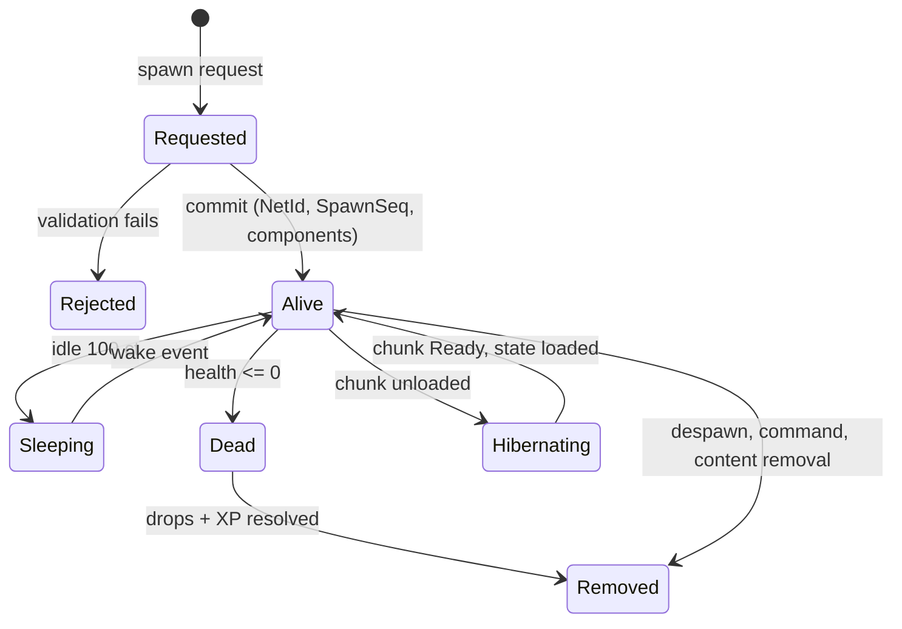

# 09 — Entities and AI

> Status: normative - Last updated: 2026-11-24
> Depends on: [DEC-003](../decisions.md), [DEC-007](../decisions.md), [DEC-008](../decisions.md), [DEC-019](../decisions.md), [DEC-020](../decisions.md), [DEC-021](../decisions.md), [DEC-022](../decisions.md), [DEC-025](../decisions.md), [DEC-037](../decisions.md), [DEC-038](../decisions.md), [DEC-039](../decisions.md), [DEC-040](../decisions.md), [DEC-043](../decisions.md), [DEC-044](../decisions.md); [conventions](00-conventions.md), [engine core](02-engine-core.md), [world model](05-world-model.md), [survival](08-gameplay-survival.md), [physics](10-physics-and-collision.md), [items](11-inventory-crafting-items.md), [content system](15-content-system.md), [persistence](17-persistence.md)
> Implements: MS-11 (entity framework, mobs, villagers, bosses, projectiles, vehicles), MS-10 (item-entity and projectile interfaces), MS-14 (parity corpus)

## 1. Purpose and scope

This chapter specifies everything that moves, thinks, breeds, trades or fights: the entity taxonomy, definitions as content, the spawn-to-removal lifecycle, identity, ticking and sleeping, storage and deterministic iteration, the movement interface to physics, pathfinding, goals, sensors, spawning and despawn, breeding/taming/leashing, villagers, bosses, projectiles, mounts, effects, death and drops, naming, and the replication contract that [18](18-networking-multiplayer.md) encodes.

Out of scope: block entities ([05](05-world-model.md) owns them; they are not entities), the collision solver and raycasts ([10](10-physics-and-collision.md)), damage arithmetic, health and hunger ([08](08-gameplay-survival.md)), stacks, loot resolution, trades and effect definitions ([11](11-inventory-crafting-items.md)), redstone-driven vehicle movement such as rails ([12](12-redstone-and-logic.md)), save framing ([17](17-persistence.md)), and wire encoding ([18](18-networking-multiplayer.md)).

Four rules frame the design. **The host decides.** Entity state is written only by the authoritative simulation; clients send inputs and intents ([DEC-008](../decisions.md)). **Definitions are content.** A mob is a registry entry plus registered goal kinds, never a Rust enum variant a pack cannot reach ([DEC-019](../decisions.md)). **Order is data.** Every simulation-visible iteration is by a persisted spawn sequence, never by a hash map, an archetype or a NetId that changes on reload ([DEC-007](../decisions.md), [DEC-043](../decisions.md)). **AI proposes, physics disposes.** Goals emit movement intents; only [10](10-physics-and-collision.md) turns an intent into a position. All durations are 20 Hz ticks (ct); 30 Hz is a replication rate and never an AI rate ([DEC-038](../decisions.md)).

## 2. Requirements

| ID | Requirement | Verification |
| --- | --- | --- |
| REQ-ENTITY-001 | Every entity has exactly one `EntityKind` and one `EntityDef`; block entities are not entities; players, mobs, projectiles, item entities, vehicles, falling blocks, primed TNT and display entities are. | Registry-freeze test + taxonomy inspection |
| REQ-ENTITY-002 | Behaviour is selected by typed facets and registered goal/sensor kinds, never by entity ID; a spawnable kind without a definition is a content error at freeze. | Content validator + template-pack test |
| REQ-ENTITY-003 | A `NetId` is nonzero, monotonic within a session, never reused, never saved and never used for cross-session references; a persistent UUID is assigned per §3.3, is saved, and is the only cross-session key. | Save round-trip + protocol inspection ([DEC-043](../decisions.md)) |
| REQ-ENTITY-004 | All spawns pass through one pipeline; a rejected request returns a typed reason and creates no partial entity, component or replication entry. | Spawn fault-injection suite |
| REQ-ENTITY-005 | Components are fixed at spawn; state changes occur in enum or bitfield fields, never by adding or removing components; iteration is by ascending `spawn_seq` and is identical after save/load. | Compile review + reload replay hash |
| REQ-ENTITY-006 | Every random choice uses a stream derived from the persisted `spawn_seq` and `(world seed, dimension, tick, purpose salt)`; no NetId, UUID, wall clock, thread identity or allocation address enters it. | Replay hash with shuffled workers |
| REQ-ENTITY-007 | Sleeping and reduced AI tiers are behaviour-preserving: a differential test against always-awake entities matches positions within 0.01 m, health and AI node at every 20-tick checkpoint. | Differential fixture (§7) |
| REQ-ENTITY-008 | Entities outside simulation distance are frozen: no movement, AI, damage, effects, ageing or despawn; timers and positions survive save/load. | Simulation-distance test + fixture save |
| REQ-ENTITY-009 | AI writes movement intents only. Position writes exist solely in physics, teleport commands and dimension transfer; every teleport is validated for loaded destination, collision-free box and border. | API review + teleport fault test |
| REQ-ENTITY-010 | Pathfinding is 3D A* over a block grid with the cost table of §3.7, a hard expansion budget, deterministic tie-break, cooperative slicing and stale-result rejection. | Path conformance corpus + budget bench |
| REQ-ENTITY-011 | Path following, jump execution, stuck detection and repath limits follow §3.7; a mob cannot spin, tunnel or replan every tick. | Navigation scenario tests |
| REQ-ENTITY-012 | Goals have priorities, typed interrupts and mutually exclusive flags; scheduling is by `(priority, declaration index)` and is a pure function of state and tick. | Golden goal traces |
| REQ-ENTITY-013 | Sensors are deterministic, staggered by `spawn_seq`, bounded in candidates and memory, and use the world raycast for line of sight. | Sensor fixtures + cap tests |
| REQ-ENTITY-014 | Natural spawning reads biome/structure spawn data, the light rule table of [07](07-light-and-weather.md#38-light-based-gameplay-rules), height, floor, fluid and distance rules; no threshold is a code constant. | Spawn statistics + pack override test |
| REQ-ENTITY-015 | Mob caps, despawn distances, persistence classes and per-player attribution follow §3.10; persistent entities never despawn. | Cap scenario + soak test |
| REQ-ENTITY-016 | Breeding, taming, leashing and mounting state follows §3.11, persists exactly and releases or transfers ownership exactly once. | State-machine + save test |
| REQ-ENTITY-017 | Villager professions, levels, offers, workstation binding and restock timers are content data and persist; trades use the transaction protocol of [11](11-inventory-crafting-items.md). | Villager scenario + duplication test |
| REQ-ENTITY-018 | Bosses use the phase framework of §3.13: health-threshold phases, per-phase goals and defences, boss-bar events and persisted phase state. | Boss fight replay + save test |
| REQ-ENTITY-019 | Projectiles are spawned and resolved on the host; a client tracer never decides a hit; owner immunity, pierce, stuck state and despawn follow §3.14. | Two-client hit test + cheater corpus |
| REQ-ENTITY-020 | Mounts expose seats, control intents and dismount points; the host integrates controls through [10](10-physics-and-collision.md); a passenger never writes vehicle state. | Boat/minecart scenario |
| REQ-ENTITY-021 | Status effects use integer remaining ticks and `u8` amplifiers, tick at their declared interval, expire exactly once, and replicate only visible effects to non-owners. | Effect clock matrix |
| REQ-ENTITY-022 | Damage, death, loot and XP go through the §3.15 interface; loot resolves exactly once per death, including across save/reload, and drops spawn with the pickup delay of [11](11-inventory-crafting-items.md). | Death/reload duplication test |
| REQ-ENTITY-023 | Names are typed text, sanitised, length-capped, stored as a component and replicated with a visibility flag; no control characters or executable markup are accepted. | Fuzz + UI inspection |
| REQ-ENTITY-024 | Replication sends only entities in the client's interest set, with the dirty masks, priority and byte budget of §3.17; spawn and despawn are reliable, deltas are lossy. | Network benchmark + lossy simulator |
| REQ-ENTITY-025 | Entity save/load is exact: UUID, `spawn_seq`, motion, vitals, AI node, memory, effects, seats and unknown typed components round-trip; no NetId is written. | Fixture round-trip + hash |
| REQ-ENTITY-026 | Entity definitions are validated at freeze; hot reload applies between ticks, existing entities keep a compatible definition, and entities whose definition disappeared are removed with a logged reason and no drops. | Reload test + negative fixtures |
| REQ-ENTITY-027 | Mod spawn requests, queries and component writes pass the same validation, capability checks and per-mod quotas as engine calls; a mod cannot write components directly. | Malicious-mod corpus |
| REQ-ENTITY-028 | Clients never send entity position, health, target, AI state or loot claims; server-side validation rejects them as protocol errors. | Protocol fuzz + inspection |
| REQ-ENTITY-029 | Every base entity type has a parity-manifest row; the Tier-2 set (157 entity types, 89 mobs at the pinned baseline) is classified and tested or documented as a divergence. | Generated manifest diff (MS-14) |
| REQ-ENTITY-030 | `/debug entities` and metrics expose counts by category and state, sleeping count, AI tier histogram, path queue depth, spawn failures by reason and per-entity AI cost; resource limits are typed errors, never panics. | Overlay, metrics and limit-injection tests |
| REQ-ENTITY-031 | The state hash covers entities sorted by `spawn_seq`, with quantised transform, health, AI node, target key, effect map, seats and UUID when assigned; two runs and a reload continue identically. | Determinism harness ([02](02-engine-core.md)) |

## 3. Design

### 3.1 Taxonomy

| Kind | Examples (base-pack names provisional, [DEC-037](../decisions.md)) | Owns | Cross-reference |
| --- | --- | --- | --- |
| `player` | local and remote players | connection, input history | Vitals and combat [08](08-gameplay-survival.md) |
| `mob` | grazer, stalker, blaster, villager | brain, navigation, breeding, equipment | Damage [08](08-gameplay-survival.md) |
| `projectile` | arrow, thrown potion, fireball | flight, stuck state | Hit rules §3.14, motion [10](10-physics-and-collision.md) |
| `item` | dropped stack | `ItemStack` | Merge, pickup, despawn [11 §3.6](11-inventory-crafting-items.md#36-item-entities) |
| `vehicle` | boat, minecart | seats, control state | Constrained motion [10](10-physics-and-collision.md) |
| `falling_block` | sand, gravel, anvil | block state being moved | Landing transaction §3.14 |
| `tnt` | primed TNT | fuse, power | Explosion [10](10-physics-and-collision.md), ignition [12](12-redstone-and-logic.md) |
| `display` | item frame, banner stand | displayed stack, rotation | View-only rendering [03](03-rendering.md) |

Block entities are **not** entities: they are per-position data owned by the chunk column ([05 §3.5](05-world-model.md#35-block-entities)), and a chest neither moves nor paths. A content type that needs both (a moving chest, a piston-held block) is an entity that references block-entity payload bytes.

### 3.2 Entity definitions as content

`EntityDef` is a registry entry with typed components. The engine names no mob; the base pack uses the same fields a mod uses. Validation is at freeze, not on the tick.

| Field | Type | Validation |
| --- | --- | --- |
| `id`, `kind` | `ResourceId`, `EntityKind` | unique, one of §3.1 |
| `hitbox` | `{ width, height, eye_height, mass }` | 0.05–16 m, eye inside box, multiples of 1/16 m; mass 0.1–1,000 kg |
| `health`, `armor`, `toughness` | `i32` each | 0..=20,480 HP units, 0..=20 armor, 0..=12 toughness |
| `knockback_resistance` | `u16` per-mille | 0..=1,000 |
| `movement` | `MovementDef` | speed 0–64 m/s, step ≤ 1.0 m, gravity 0–64 m/s², medium overrides |
| `ai` | `AiGraphDef` | ≤ 256 nodes, one entry, explicit edges acyclic, budget class, every goal kind registered |
| `spawn` | `SpawnDef` | category, weight 1–10,000, biomes/tags, light rule, height, floor, pack size |
| `loot`, `xp_reward` | `LootTableId`, `u16` | table exists and resolves once; XP 0..=32,767 |
| `sounds`, `model` | `SoundSet`, view ref | sound events resolve; model is view-only and never loaded by a host |
| `tags`, `tracking_range` | sorted IDs, `u16` metres | ≤ 64 tags, no cycles; 16..=512 m, multiple of 16 |
| `persistence`, `name_key` | `PersistenceClass`, Fluent key | `Never`/`OnSave`/`Always` (§3.3); display key exists |
| `properties` | typed component map | schema-validated, canonical encoding, ≤ 8 KiB |

```json5
// openblock:base/entities/stalker.json5 (shortened)
{ id: "openblock:stalker", kind: "mob",
  hitbox: { width: 0.6, height: 1.95, eye_height: 1.74, mass: 80 },
  health: 20480, movement: { speed: 4.317, step: 0.6, gravity: 32.0, can_open_doors: true },
  ai: { entry: "idle", budget_class: "normal", nodes: {
    idle: { goals: [ "openblock:goal/wander:5", "openblock:goal/look_around:8" ],
            on: { target_seen: "hunt" } },
    hunt: { goals: [ "openblock:goal/melee_attack:1", "openblock:goal/follow_target:2" ],
            on: { target_lost: "return", daylight: "flee" } },
    flee: { goals: [ "openblock:goal/flee_from_sun:1" ], on_complete: "return" } } },
  spawn: { category: "monster", weight: 100, light: "openblock:hostile_spawn",
           height: { relative: [ -64, 0 ] }, floor: "#openblock:spawnable_floor",
           pack: [ 1, 3 ], biomes: "#openblock:spawns_stalker" },
  loot: "openblock:entities/stalker", xp_reward: 5, tracking_range: 96,
  persistence: "OnSave", name_key: "entity.openblock.stalker" }
```

Hitbox dimensions must be multiples of 1/16 m so collision boxes are representable in the integer shape space of [10](10-physics-and-collision.md). A `spawn` category must exist in the cap table and a `light` field must name a rule in the light rule table; a hard-coded numeric light level fails validation. An AI graph has exactly one entry, at most 256 goal-set/decorator nodes, a declared `budget_class` and no explicit cycle; every trigger and goal kind must be registered, and every node must be reachable from the entry. Hot reload applies between ticks: existing entities keep `def_version`, tuning fields update in place, and an entity whose definition or current node disappeared is removed with `ContentRemoved`, no loot, no XP and a warning naming the pack.

### 3.3 Identity and lifecycle

```rust
pub struct NetId(u64);           // 0 invalid; session-local; never reused
pub struct EntityUuid([u8; 16]); // RFC 9562 version 8
pub struct SpawnSeq(u64);        // persisted, monotonic; iteration and RNG key
```

`NetId` is allocated at the spawn commit point, not at request time, so a rejected or reordered request cannot consume an id. `SpawnSeq` comes from a persisted world counter and is the canonical order key for iteration, RNG derivation, pair resolution and save encoding.

**UUID policy.** Assigning 16 bytes to every arrow buys nothing. `PersistenceClass` is definition data:

| Class | UUID assigned | Used for |
| --- | --- | --- |
| `Never` | never | transient effect-only helpers that hold no gameplay state |
| `OnSave` | at first serialisation, in `spawn_seq` order | ordinary mobs, item entities, projectiles, vehicles, falling blocks, primed TNT |
| `Always` | at spawn | players (profile UUID), named or leashed mobs, tamed pets, villagers with trades, bosses, item frames and paintings referenced by commands or maps |

The UUID is `[BLAKE3(world_uuid || "entity-uuid")[0..8] || counter_u64]` with RFC 9562 version/variant bits; the counter is persisted and never reused. This is deterministic in a replay, collision-free in a world and distinct across different worlds. A save record always carries a UUID ([17 §3.3](17-persistence.md#33-chunk-payload)), so an `OnSave` entity receives one no later than its first save and keeps it; the UUID counter and `next_spawn_seq` are additive `level.json` fields that older builds preserve as unknown metadata ([17 §3.4](17-persistence.md#34-sidecar-files)).



**Spawn pipeline.** Requests are buffered and applied at the end of `PostTick`, sorted by `request_seq`, then by cause priority (`Load`, `Command`, `Mod`, `Breeding`, `SpawnEgg`, `Projectile`, `BlockDrop`, `Structure`, `Natural`). Validation checks: definition and kind exist; destination chunk is loaded and `Ready` ([05 §3.8](05-world-model.md#38-chunk-lifecycle-and-streaming)); Y inside the dimension; XZ inside the border; AABB collision-free unless `spawn_in_solid`; per-chunk, category and global caps admit it; permission and game-mode rights; mod action quota. Natural spawns additionally evaluate §3.10. Commit allocates `NetId` and `SpawnSeq`, inserts the fixed component set, assigns an `Always` UUID, links the entity to its owning chunk and enqueues a reliable spawn event. Validation and insertion are one host transaction, so `Spawned` callbacks never see a partial entity.

**Ownership and transfer.** An entity belongs to the chunk containing its position. Crossing a boundary enqueues `EntityTransfer { net_id, from, to, at_tick }`, applied in `spawn_seq` order at the end of `PostTick`. A destination that is not `Ready` freezes the entity at the boundary with its velocity and retries next tick. If the source unloads first, the entity is serialised into the source chunk, marked `Hibernating` and removed from memory; loading it restores the same UUID and `SpawnSeq`. One remove plus one insert in the same tick means no entity exists twice. Removal is queued with `RemovalCause` (`Despawn`, `Death`, `Command`, `DimensionTransfer`, `ChunkUnload`, `ContentRemoved`, `Merge`); `NetId` and UUID are never reused, and a stale queued event resolves to `Removed`, not to a different entity.

### 3.4 Ticking, activation and sleeping

Entity systems run in the `Tick` stage after scheduled block and fluid ticks and before the block-change flush; the order is part of the golden schedule ([02 §3.2](02-engine-core.md#32-scheduler)).

| # | System | Work |
| ---: | --- | --- |
| 1 | `entity_effects` | decrement timers, apply interval effects through [08](08-gameplay-survival.md) |
| 2 | `entity_sensors` | sense at tier cadence, update target and memory |
| 3 | `entity_brain` | evaluate graph edges, advance goals, emit intents |
| 4 | `entity_navigation` | request, slice and follow paths; emit jump/climb intents |
| 5 | `entity_motion` | hand intents to [10](10-physics-and-collision.md), apply results |
| 6 | `entity_lifecycle` | ageing, item-merge hook, despawn, transfers, removal queue |
| 7 | `entity_spawn_apply` | commit the spawn queue at the `PostTick` boundary |

Distance is measured to the nearest player in the same dimension; an entity in a chunk outside simulation distance is `Frozen` (REQ-ENTITY-008).

| Tier | Distance | Brain | Sensors | Navigation |
| --- | --- | --- | --- | --- |
| `Full` | ≤ 48 m | every tick | every tick | full A*, step every tick |
| `Reduced` | 48–96 m | every 4 ct | every 10 ct | A* every 20 ct, follow every tick |
| `Minimal` | 96 m–simulation edge | every 20 ct | every 20 ct | no new path; follow an existing one |
| `Frozen` | outside simulation distance | none | none | none |

Tiers are recomputed every 10 ticks per player neighbourhood, not per entity per tick; a mob farm 100 m away therefore still runs at `Minimal`. **Sleeping** starts after 100 ct with no target, zero velocity, no path and no active goal. It skips systems 2–5; effects still tick at 20 ct and lifecycle still runs. Wake events are damage, an acquired target, a block change within 8 m, a player within 16 m, or `wake_tick`. Sleeping is an optimisation with an equivalence obligation, covered by the differential fixture in §7. Entities never replay a missed interval: an unloaded entity resumes at the current tick with stored timers, which is the same rule as [05 §3.9](05-world-model.md#39-unloaded-chunk-semantics) and keeps away-from-keyboard farms bounded.

### 3.5 Storage, iteration and queries

hecs holds the long tail (def, brain, memory, equipment, villager and boss state); hot data lives in SoA arrays indexed by `SimIndex`, joined on the same index ([02 §3.7](02-engine-core.md#37-entity-store)).

```rust
pub struct EntityStore {
    world: hecs::World,
    order: Vec<SimIndex>,        // live indices, ascending spawn_seq, dead skipped
    spawn_seq: Vec<SpawnSeq>,    // indexed by SimIndex
    body: BodySet,               // pos, vel, aabb, flags, on_ground, medium
    brain: BrainSet, path: PathSet, meta: MetaSet,
    slots: FxHashMap<NetId, SimIndex>, free: Vec<SimIndex>,
    next_net_id: u64,            // session only (DEC-043); next_spawn_seq: persisted
}
```

`SimIndex` is storage, `order` is truth. New spawns have larger `SpawnSeq` and append; on load, entities insert in ascending `SpawnSeq` and rebuild the same order. Free slots are reused for storage only, `order` is compacted at save, and a stale `SimIndex` is detected by its `spawn_seq` and never dereferenced. A 3D hash of 16 m cells (`EntityGrid`) maps cell keys to `SmallVec<[SimIndex; 8]>` and updates when an AABB crosses a cell. `nearest_entity`, `entities_in`, tag queries and player-view queries all return `(distance², spawn_seq)` order; candidate visits are capped at 2,048, after which the best candidate is returned and a saturation counter increments.

### 3.6 Movement interface

AI never writes a position; it emits an intent and [10](10-physics-and-collision.md) returns a result. The interface is small so a mod body cannot bypass collision or anti-cheat.

```rust
pub struct MoveIntent { pub forward: f64, pub strafe: f64, pub jump: bool,
    pub sneak: bool, pub sprint: bool, pub climb: bool, pub glide: bool, pub look: Look }

pub struct MoveResult { pub pos: WorldPos, pub vel: Vec3, pub flags: MotionFlags,
    pub contacts: SmallVec<[Contact; 4]>, pub fall_distance: f64 }

pub trait EntityMotion {
    fn step(&mut self, id: NetId, intent: MoveIntent, tick: Tick) -> MoveResult;
    fn teleport(&mut self, id: NetId, to: WorldPos, cause: TeleportCause) -> Result<(), MoveError>;
}
```

The AI converts a goal direction into local forward/strafe using the entity yaw and sets jump, climb or glide per goal. Physics owns acceleration, friction, buoyancy, step-up and fall distance; a mob's speed is its `MovementDef.speed` applied by physics, not a distance added by AI, and a jump is a request physics may refuse. Teleports exist for commands, portals, taming and ender-like content; they check a loaded, collision-free destination and otherwise return `NoSpace` without touching the entity. No goal teleports by default; `teleport_when_stuck` is opt-in content and still validated by the host.

### 3.7 Pathfinding and navigation

A node is the block at the entity's feet. It is walkable when the block below has a collision top, the cells above have empty collision at the entity's height, and the node is not lava or fire. Flying mobs use an empty-collision grid with a ground-clearance preference. Costs are integers in 1/16-block units so A* never compares floats.

| Move | Cost | Condition |
| --- | ---: | --- |
| Orthogonal / diagonal walk | 16 / 23 | flat or ±0; both adjacent cells walkable (no corner cutting) |
| Jump up one | 24 | headroom and solid landing |
| Drop one to three | 20 | landing walkable; fall damage ignored for cost |
| Water swim / scaffold climb | 32 | `can_swim` / `can_climb` |
| Door or gate | 24 | `can_open_doors`, door closed |
| Hazard (cactus, berry, magma) | 96 | `avoid_hazards` |
| Lava, fire, void | ∞ | forbidden |

The heuristic is octile, `h = 16·max(dx,dy,dz) + 7·(sum of the other two)`, admissible for these costs. The open set is a binary heap keyed `(f, h, node_key)`; `node_key = ((y + 2_048) << 24) | (z << 12) | x` breaks ties. The closed set is a pooled bitset over a 64×64×64 local volume. A search is capped at **8,192 expansions**, **2,000 per slice**, and **24 m** of path for ground mobs or **64 m** for flyers; an unreachable goal returns `Unreachable` at the cap.

**Cooperative execution.** Path searches are simulation-visible, so they run inside `entity_navigation` in a bounded scoped batch, gathered in `spawn_seq` order. They do not use the `JobPool`: [01 §3.3](01-technical-architecture.md#33-threading-model) defines five job classes and none is AI, and a late result must be rejected, not applied out of order. Each search carries continuation state and yields after 2,000 expansions. Per tick the system admits at most **16 new searches** and **32,768 expansions**; a mob may request one search per 20 ticks. A result carries `(net_id, spawn_seq, goal_seq, def_version, world_epoch, path_seq)` and is dropped on any mismatch.

**Following and stuck detection.** A follower targets the next waypoint with 2-node lookahead, slows within 1.5 m, jumps when the next node is one higher with a ≤ 1.0 m gap, climbs ladders, and opens doors if allowed. It stops when the goal target moves more than 2 m, a block change invalidates its next four nodes, or it is pushed more than 1.5 m off-path. Less than 0.25 m of progress over a 20-tick window triggers one jump, then one repath, then `Stuck` for 100 ticks with a deterministic look and no movement. `teleport_when_stuck` content may teleport up to 16 m to a validated free spot, once per 200 ticks.

### 3.8 Goals, interrupts and the AI graph

A goal is registered code with a content instance: `GoalDef { kind, priority, flags, interrupt, cooldown, params }`. Base kinds cover the Tier-2 set: `wander`, `look_around`, `look_at`, `follow_target`, `melee_attack`, `ranged_attack`, `flee`, `avoid_sun`, `return_home`, `eat_grass`, `breed`, `follow_owner`, `sit`, `tempt`, `trade`, `work`, `sleep`, `panic`, `patrol`, `boss_phase`, `use_block`, `pick_up_item`.

| Property | Semantics |
| --- | --- |
| `priority` | 0 is highest; a lower goal runs only when no higher runnable goal holds a conflicting flag |
| `flags` | `MOVE`, `LOOK`, `TARGET`, `JUMP`, `INTERACT`; two running goals may not share a flag |
| `interrupt` | `Never`, `OnDamage`, `OnTarget`, `OnDamagedByTarget`, `Any`; checked before `can_continue` |
| `cooldown` | `(min, max)` ct drawn once per start from the entity RNG; a finished goal waits it out |
| `tick` | at most one `MoveIntent` and one interaction per tick |

**The AI graph.** `AiGraphDef` is a DAG of goal-set and decorator nodes with exactly one entry, as required by [15 §3.4](15-content-system.md#34-registry-catalogue): at most 256 nodes, a declared `budget_class` (`trivial`, `normal`, `heavy`) and typed triggers (`target_seen`, `target_lost`, `hurt`, `health_below(p)`, `daylight`, `night`, `in_water`, `phase_threshold(p)`, `timer(ct)`, `owner_near`, `trade_open`). It is evaluated once per brain tick after sensors and before goals, taking at most one explicit edge per tick in declaration order. Runtime loops are expressed by `return`, a control action that re-enters the entry node; it is not a graph edge, so the static graph stays acyclic while a mob can alternate between hunting, fleeing and idling. The current node, cooldowns and target persist, so a reload resumes the same behaviour rather than restarting at `idle`. Goal instances are a `Vec` sorted by `(priority, declaration index)` at freeze; target ties break by `(distance², spawn_seq)`; random draws use `mix64(rng_key ^ tick ^ purpose)`, so there is no mutable PRNG state to save.

### 3.9 Sensors, perception and memory

| Sensor | Parameters | Notes |
| --- | --- | --- |
| `sight` | range 4–64 m, FOV 30–360°, `requires_los` | candidates from the spatial hash, sorted, ≤ 16 tested |
| `hearing` | radius 4–32 m, event kinds | combat, footsteps, explosions, block breaks |
| `proximity` | radius, tag filter | players, items, owners |
| `block` | forward offsets, tag filter | workstation, door, bed, crop, light |
| `owner`, `damage` | radius; always on | tamed pets; retaliate against the last attacker |

Line of sight uses `raycast_shape` from eye to candidate eye and body centre; a nearer hit blocks it. A sight check costs at most 2 rays and runs on the sensor cadence, so 500 `Full` mobs cost ≤ 1,000 rays per tick. Memory is a ring of 16 `MemoryEntry { subject, last_position, last_seen_tick, confidence }`, where `subject` is `Entity(Uuid)` for persisted entities, `Entity(NetId)` only for `Never` entities, or `Block(pos)`. Entries decay after 600 ticks, are replaced by a newer sighting and are invalidated when the subject is removed. Only UUID subjects are persisted. Sensors run when `(tick + rng_key mod interval) == 0`; using `NetId` would change their phase after a reload.

### 3.10 Natural spawning, caps and despawn

```
for each player in ascending UUID order, every tick:
    if not do_mob_spawning or difficulty == peaceful: skip hostile categories
    repeat SPAWN_ATTEMPTS_PER_TICK (4):
        chunk = random chunk within spawn_radius_chunks (8) and >= 24 m from player
        if chunk lacks a Ready section or is in a structure exclusion: continue
        y = heightmap(WORLD_SURFACE) + 1; rule = weighted pick from biome list
        skip unless rule.height contains y - surface_y, rule.floor tags match block below,
          rule.light evaluates true at (x, y, z), and y..y+height is fluid- and collision-free
        structure spawn override replaces rule where one exists
        skip if the category or global cap is full
        spawn uniform(rule.pack[0], rule.pack[1]) mobs of the rule definition
```

`SPAWN_ATTEMPTS_PER_TICK` and `spawn_radius_chunks` are server settings; each attempt draws from `mix64(world_seed ^ dimension ^ player_uuid ^ tick ^ attempt)` and indexes a sorted chunk ring, never a hash map. `height.relative` is feet Y minus surface Y, so 0 means standing on the surface. The light check calls the rule named by the definition (`openblock:hostile_spawn` is `gameplay_light ≤ 7` in the base pack, [07 §3.8](07-light-and-weather.md#38-light-based-gameplay-rules)); no engine code compares a numeric level. Structure overrides come from the structure start record ([06 §3.8](06-worldgen.md#38-structures)) and are read only when its sidecar is resident.

| Category | Per player | Global | Persistence and despawn |
| --- | ---: | ---: | --- |
| `monster` | 70 | — | `OnSave`; despawns beyond 128 m for 600 ct |
| `creature` | 10 | — | `OnSave`; never despawns |
| `ambient`, `water_creature`, `water_ambient` | 15 / 5 / 20 | — | `OnSave`; despawn at 128 m |
| all entities | — | 4,000 | hard cap, typed `GlobalCap` |
| AI-ticking entities | — | 1,200 | excess use `Minimal` or sleep |

Counts are attributed to the nearest player at spawn and re-attributed every 20 ticks; an entity with no player within simulation distance is frozen and contributes to no per-player cap. `spawn_egg`, command, breeding and mod spawns bypass natural *attempt* rules but not the global cap, the per-chunk cap (64 per chunk column) or permission checks. A hostile, ambient or water mob despawns after 600 ct farther than 128 m from every player unless it is persistent, named, leashed, tamed, a boss, or inside a `keep_mobs` structure. Despawn is a removal with no drops and no event; `persistent` comes from naming, leashing, taming, a boss def, a persistent spawn egg or the `Persistence` component. Persistent mobs are bounded by the global cap, so a hoard eventually refuses new spawns with a metric instead of degrading the tick.

### 3.11 Breeding, taming, leashing and mounts

| Behaviour | State | Rules |
| --- | --- | --- |
| Breeding | `BreedingState { love_ct, cooldown_ct, child_growth_ct, parents }` | feeding two adults sets 600 ct love; a child after 60 ct inherits the species and a 50/50 component mix drawn from a stream keyed by both parents' `spawn_seq`; 600 ct parent cooldown; growth 24,000 ct; XP 1–7 ([08 §3.5](08-gameplay-survival.md#35-experience)) |
| Taming | `TameState { owner: Uuid, sitting: bool }` | content chance per feed (base 1/3); success sets owner and `Always` persistence; a standing pet follows and teleports to a validated safe spot within 12 m |
| Leashing | `LeashState { holder: NetId, knot: Option<BlockPos> }` | lead attaches to a fence knot within 6 m, max 4 leads per knot; beyond 12 m without a path the mob teleports; release drops the lead ([11](11-inventory-crafting-items.md)) |
| Mounting | `Mountable { seats, dismount_offset }`, `VehicleController` | host applies control intents through [10](10-physics-and-collision.md); dismount requires free 2-block space or is refused |

A full `creature` cap refuses the birth and keeps the parents in cooldown for 100 ct rather than consuming the food; a child counts toward the cap.

### 3.12 Villagers and trading

```rust
pub struct VillagerData {
    pub profession: Option<ProfessionId>, pub level: u8, pub xp: u32,
    pub offers: Box<[OfferId]>, pub restocks_today: u8,
    pub workstation: Option<BlockPos>, pub home: Option<BlockPos>,
    pub schedule: ScheduleState, // Work { until }, Rest { until }, Meet { until }
}
```

An unemployed adult claims the nearest unclaimed workstation of a matching type within 16 m on its next brain tick; the claim is a chunk-owned POI record persisted with the villager. Breaking the workstation unassigns the profession at the next brain tick but keeps level and XP; a nitwit never claims. Schedule offsets (work 2,000 ct, rest 2,000 ct, meet 500 ct) are base-profile data and gate restocking: a villager restocks at its workstation at most twice per day, resetting offer uses and lowering demand by 1 per restock ([11 §3.11](11-inventory-crafting-items.md#311-trading) owns prices). A villager without a workstation does not restock, which replaces the lectern-reroll quirk of the Tier-4 list ([research 05](../research/05-minecraft-feature-inventory.md#4-tier-4-quirks-we-should-not-copy)). Trades open a 3-slot window through [11 §3.4](11-inventory-crafting-items.md#34-the-inventory-transaction-protocol); the host checks offer index, remaining uses, exact inputs, and that the villager is alive, in the same dimension, within 6 m and not sleeping.

### 3.13 Boss framework

| Piece | Contract |
| --- | --- |
| `BossDef.phases` | ordered `BossPhaseDef { health_at_or_below, goals, invulnerable, flight, arena_radius, on_enter, on_exit }`, evaluated top to bottom |
| Transition | at most one per tick on a health threshold; clears goal cooldowns, applies `invulnerable` for its duration, emits `BossPhase` |
| Boss bar | `BossBarDef { colour, style, title_key, priority }`; created on spawn, updated on phase or health change at most once per tick, removed on death; sent to players in the dimension whose interest set contains the arena chunk |
| Music, persistence, drops | content events on spawn and phase; phase, timer, arena anchor and summons saved; loot plus scripted first-kill reward exactly once per UUID |

The two Tier-2 bosses are the dragon-equivalent and the wither-equivalent; their names are base-pack content under [DEC-037](../decisions.md). Boss damage uses [08](08-gameplay-survival.md) unchanged: immunity is an `invulnerable` phase flag, not a special damage path. Summoned minions are ordinary entities with boss ownership, capped at 16 and removed when the death phase starts.

### 3.14 Projectiles, vehicles and falling blocks

**Projectiles.** `ProjectileState { def, owner: Option<NetId>, owner_uuid, damage, power, pierce, stuck, age_ct, ignore_owner_ct }`. A use action or dispenser requests a spawn; the host sets velocity from look and content spread, integrates through [10](10-physics-and-collision.md), and resolves block hit (continuous voxel DDA) before entity hit (swept AABB). A hit on the owner is ignored for 10 ct; a piercing projectile decrements `pierce`, the rest become `stuck` for 600 ct and despawn at 1,200 ct. Projectile definitions are `OnSave`, so a stuck arrow keeps its remaining age across a save. Ties at equal `t` break by `(spawn_seq, entity index)`. Client tracers, trails and impact particles are presentation; no client hit message exists.

**Vehicles.** A boat or minecart is a `vehicle` with `Mountable` and `VehicleController`; [10](10-physics-and-collision.md) owns buoyancy, paddle thrust, rail-graph motion and powered-rail acceleration, while this chapter owns seats, passenger authority, dismount validation and the item form. A passenger's position is the seat transform, not its own movement; look and use actions remain the player's. A destroyed vehicle ejects passengers to a validated free spot and drops its item through [11](11-inventory-crafting-items.md); a chest/hopper/TNT minecart stores a block-entity or entity payload reference owned by [05 §3.5](05-world-model.md#35-block-entities) and [12](12-redstone-and-logic.md).

**Falling blocks.** A gravity block that loses support becomes a `falling_block` carrying the block state; the block is removed in the same world transaction that creates the entity, so a crash between the two cannot duplicate it. It integrates with gravity through [10](10-physics-and-collision.md). On landing, if the destination is loaded, `Ready` and replaceable, the host places the block and removes the entity in one transaction; otherwise it becomes an item entity of the block's item form. An unloaded chunk saves the entity and resumes it on load, and a falling block never spawns inside a piston move because the piston transaction completes first ([12](12-redstone-and-logic.md)).

### 3.15 Effects, damage, death and drops

An entity holds ≤ 32 `ActiveEffect { id, amplifier: u8, remaining_ct: u32, visible: bool, source }`. Definitions, stacking and application live in [11 §3.10](11-inventory-crafting-items.md#310-potions-effects-and-brewing); this chapter owns the clock: interval ticks, instant effects on insert, exactly one removal on expiry, remaining ct stored (not an absolute deadline) so a frozen entity resumes correctly, and visible effects replicated to observers while hidden ones go only to the owner.

```rust
pub trait Damageable {
    fn apply_damage(&mut self, ev: &DamageEvent) -> DamageOutcome; // Applied, Immune, Dead
    fn death_context(&self, ev: &DamageEvent) -> DeathContext;
}
pub struct DeathContext { pub victim: NetId, pub victim_uuid: Option<EntityUuid>,
    pub killer: Option<NetId>, pub killer_uuid: Option<EntityUuid>,
    pub damage_type: DamageTypeId, pub looting: u8, pub player_kill: bool,
    pub position: WorldPos }
```

[08](08-gameplay-survival.md) owns damage arithmetic. A death is one transaction: resolve the entity loot table into a `DeathTransaction` ([11 §3.12](11-inventory-crafting-items.md#312-loot-tables)), then apply the `Dead` state, the drops with a 10 ct pickup delay, the XP award, the `EntityDeath` event and the `death_processed` flag in one entity/world batch. A retry either redoes the whole batch or observes it complete, so loot is neither duplicated nor lost; removal is queued 20 ct later. `keep_inventory` and player death rules are [08 §3.11](08-gameplay-survival.md#311-difficulty-game-rules-and-death). A despawn is not a death: no loot, no XP, no event. Looting, fire, player-kill and boss first-kill conditions are applied exactly once.

### 3.16 Naming, leashing and display entities

A name is a typed `custom_name` component: a Fluent key plus arguments for localised names, or a literal capped at 128 Unicode scalar values, stripped of control characters and bidi overrides and rendered as plain text; markup, colour codes and unregistered translation keys are rejected. A named entity is `Always` persistent, shows its name when `custom_name_visible`, and keeps it through save, reload and dimension transfer; a name tag is consumed and cannot target a player or a `name_locked` boss. A leash is not an entity: the renderer draws the rope from replicated `LeashState`, and the pull is a bounded impulse in [10](10-physics-and-collision.md) so a mob cannot be dragged through a wall. Display entities (item frames, paintings, banner stands) have no brain or physics, are `Always` persistent when holding an item, and return their item and contents exactly once through the removal transaction, with stacks validated by [11 §3.2](11-inventory-crafting-items.md#32-stacks-and-components).

### 3.17 Replication

[18](18-networking-multiplayer.md) owns transport, encoding and prediction; this section owns what changes, when it is worth sending and what may never be sent.

| State | Sent when | Encoding owner |
| --- | --- | --- |
| position, velocity, yaw/pitch | dirty and moving; quantised per §4.3 | 18 |
| flags and pose (on_ground, in_water, sneaking, gliding, sitting) | dirty-mask bit | 18 |
| health | bosses and players only ([08 §3.2](08-gameplay-survival.md#32-player-state-machine-and-replication)) | 18 |
| variant, profession, level, collar colour | spawn and change | 18 |
| equipment and held item | change; stack via [11](11-inventory-crafting-items.md) | 18 |
| visible effects, custom name, leash holder, seat index | change | 18 |
| boss phase and bar | change, at most once per tick | 18 |
| spawn and despawn | reliable ordered stream | 18 |
| UUID | never on the tick path; save and admin tooling only | [17](17-persistence.md) |

An entity is replicated when its chunk is in the client's interest set and it is within `tracking_range` (16–512 m) plus one chunk of hysteresis; deltas are ordered by descending priority and ascending NetId ([18 §3.4](18-networking-multiplayer.md)). Priority bands are 0 boss, 1 entity targeting the client, 2 moving mob within 32 m, 3 other mobs, 4 projectiles and items, 5 ambient and display. The entity budget is **1,024 bytes per tick per client** (20 KB/s at 20 Hz); bands 4–5 defer when it is exhausted, and the spawn/despawn stream is never deferred behind deltas. An entity with zero velocity, no state change and no player within 32 m sends a keepalive every 20 ticks; at most 30% of 200 visible entities move on a typical tick, giving 60 × 15 B + 7 × 3 B ≈ 921 B/tick in the MS-11 benchmark. Interpolation and correction are [18](18-networking-multiplayer.md); hidden effects and other players' exact health are never sent.

## 4. Data structures and formats

### 4.1 Runtime structures

```rust
pub struct EntityMeta { pub def: EntityDefId, pub def_version: u32, pub spawn_seq: SpawnSeq,
    pub uuid: Option<EntityUuid>, pub chunk: ChunkPos, pub persistence: PersistenceClass,
    pub health: i32, pub age_ct: u32, pub remove_at: Option<Tick>,
    pub removal: Option<RemovalCause>, pub death_processed: bool }

pub struct Brain { pub node: AiNodeId, pub tier: AiTier, pub target: Option<SubjectRef>,
    pub goals: SmallVec<[GoalInstance; 8]>, pub memory: SmallVec<[MemoryEntry; 16]>,
    pub cooldowns: SmallVec<[(GoalId, u16); 8]>, pub goal_seq: u32, pub sleep_since: Option<Tick> }

pub struct PathState { pub request: Option<PathRequest>, pub follower: Option<PathFollower>,
    pub last_progress: (WorldPos, Tick), pub failures: u8, pub stuck_until: Option<Tick> }

pub enum SubjectRef { Entity(EntityUuid), SessionEntity(NetId), Block(BlockPos) }
```

### 4.2 Save record

Entities are written by the owning chunk in the `entities` component of the chunk payload ([17 §3.3](17-persistence.md#33-chunk-payload)), sorted by UUID; the outer record supplies the UUID, the payload below is the typed state, and unknown components are preserved ([17 §3.7](17-persistence.md#37-versioning-and-migrations)).

| Field | Size | Notes |
| --- | ---: | --- |
| `schema` | 2 B | entity payload schema; the outer record supplies the definition dictionary id |
| `def_version` | u32 | diagnostic and hot-reload check |
| `spawn_seq` | varint | world-scoped order and RNG base |
| `flags` | u32 | kind, tier, persistence, death, sitting, gliding |
| `position`, `velocity` | 24 B each | three `f64` little-endian, bit-exact; finite check on load |
| `yaw`, `pitch` | 16 B | two `f64` radians |
| `health` | 4 B | 1/1024 HP, clamped on load |
| `ai_node` | varint | 0 for non-mobs |
| `target`, `memory` | optional 16 B; varint count | UUID only; session targets are dropped on save |
| `effects` | varint count | effect dict id, amplifier, remaining ct, visible, source |
| `components` | varint | typed TLV sorted by key; unknown bytes preserved |
| `seats`, `leash` | varint | references by UUID; NetId never stored |

A typical saved mob is 96–160 B before compression; 2,000 entities are ≈ 250 KiB uncompressed, inside the chunk payload cap. A missing definition loads as opaque `openblock:unknown_entity`: no tick, payload preserved, removal only by explicit operator action, mirroring the block placeholder rule ([17 §4](17-persistence.md#4-data-structures-and-formats)).

### 4.3 Wire delta

| Field | Bits | Notes |
| --- | ---: | --- |
| `net_id` | 8–24 | ZigZag varint delta from the previous NetId; never 0 |
| `mask` | 16 | dirty and pose bits; one bit per optional field |
| position delta | 48 | three `i16` at 1/16 block relative to the receiver, ±2,048 blocks |
| velocity | 24 | three `i8` at 1/32 block/tick; only when the mask bit is set |
| yaw / pitch | 8 / 8 | 1/256 turn; pitch clamped ±90° |
| pose bits | in mask | on_ground, in_water, sneaking, gliding, sitting |
| variant, profession, boss phase | 0–16 | dictionary index |
| health | 0–15 | bosses and players only |
| effect delta | 0–64 | add, remove or refresh entries |

A typical moving mob is 2 B NetId + 2 B mask + 6 B position + 1 B yaw + 1 B pitch = **12 B**; adding velocity makes 15 B, and [18 §3.4](18-networking-multiplayer.md) reports 13 B as the typical mixed value. A static keepalive is 3 B. A spawn event is 24–64 B and reliable; a despawn is a `net_id` plus a cause. Content dictionaries are negotiated per connection and never persisted ([DEC-040](../decisions.md)).

## 5. Performance budgets

Measured on the reference machine at 20 Hz (50 ms tick), p99 unless stated; these feed [25](25-performance-budgets.md).

| ID | Budget | Measurement |
| --- | --- | --- |
| PERF-ENTITY-001 | 500 mobs with full AI ≤ 10.0 ms/tick p99 ([PERF-TICK-002](25-performance-budgets.md), 20% of tick); 200 mobs ≤ 4.0 ms | `bench_mob_ai_500` |
| PERF-ENTITY-002 | 2,000 non-AI entities through lifecycle, effects and transfers ≤ 1.0 ms p99 (inside the 10 ms entity band) | `bench_entity_tick_2000` |
| PERF-ENTITY-003 | 16 new searches + 32,768 expansions ≤ 1.2 ms p99 aggregate; one 8,192-expansion search ≤ 400 µs | `bench_pathfinding` |
| PERF-ENTITY-004 | 500-mob sensor pass ≤ 1.5 ms p99 including ≤ 1,000 sight rays | `bench_sensors_500` |
| PERF-ENTITY-005 | Natural spawn cycle for 50 players ≤ 0.3 ms/tick p99 | `bench_spawn_cycle` |
| PERF-ENTITY-006 | Entity replication ≤ 1,024 B/tick/player with 200 visible entities; ≤ 20 KB/s sustained | network benchmark ([MS-11](../plan/01-milestones.md)) |
| PERF-ENTITY-007 | Save encode for 2,000 entities ≤ 5 ms p99 on a worker; load decode ≤ 8 ms | `bench_entity_save` |
| PERF-ENTITY-008 | 500-entity spawn burst ≤ 5 ms p99 including replication enqueue | `bench_spawn_burst` |
| PERF-ENTITY-009 | Boss + 40 projectiles + 16 summons ≤ 1.0 ms/tick p99 | `bench_boss` |
| PERF-ENTITY-010 | `nearest_entity` within 64 m in a 500-entity area ≤ 2 µs p99 | `bench_entity_query` |
| PERF-ENTITY-011 | AI memory and brain data ≤ 512 KiB for 500 mobs; entity SoA ≤ 1.5 KiB average per mob | allocator counter |
| PERF-ENTITY-012 | Sleep and tier maintenance for 4,000 entities ≤ 100 µs/tick p99 | `bench_entity_activation` |

## 6. Failure modes and risks

| Failure | Detection | Behaviour |
| --- | --- | --- |
| Pathfinding death spiral | request rate, budget saturation metric | per-mob 20-tick cooldown, 16 searches/tick, stale-drop, alarm at 80% |
| Mob pushed into a wall or out of the world | post-move overlap test | snap to last valid position, zero the axis, count `physics_correction`; never teleport silently |
| Duplicate spawn from a retried command or mod action | idempotency key + unique `spawn_seq` | second request returns the existing NetId; audit entry |
| Entity in an unloaded destination chunk | transfer status check | freeze at the boundary with velocity, retry next tick; source keeps ownership until insert |
| Save during a transfer | transfer queue drained before the save snapshot | entity written exactly once by its current owner |
| Boss phase or bar lost on reload | save round-trip fixture | phase, timer, bar persisted; missing phase falls back to first and logs |
| Villager claims two workstations | POI claim is a host transaction keyed by villager UUID | second claim refused; older claim wins |
| Tamed pet teleports into a wall or lava | destination validation | ring search up to 8 m, then stay and retry in 100 ct |
| Leash pulls a mob through a wall | bounded impulse + swept post-check | mob stops at the wall; holder is not moved |
| Effect reapplication duplicates a modifier | effect map keyed by effect id | one entry per effect; stacking matrix test |
| Interrupted death transaction | transaction id and `death_processed` in the same batch | retry completes the whole batch or observes it complete; no second loot and no lost loot |
| Entity definition removed by reload | lookup failure at reload | `ContentRemoved`, no drops, bytes preserved until next save |
| NetId exhaustion / mod spawn flood | allocation check + per-mod quota | typed `EntityLimit` or quota rejection, never wrap, host stays alive |

| Risk | Impact | Mitigation |
| --- | --- | --- |
| RISK-051 AI cost scales with mob count and kills the tick | server unplayable at night | 10 ms/500-mob budget, tiers, sleeping, admission, CI stress test |
| RISK-052 Path results arrive out of order | non-deterministic behaviour | spawn-seq gather order, request stamps, stale rejection |
| RISK-053 UUID/NetId confusion leaks session ids into saves | corrupt cross-session references | type-level distinction, save schema review, fixture round-trip |
| RISK-054 Spawn rules become engine constants | mods cannot change spawning | content rule table, pack-hash coverage, override test |
| RISK-055 Villager economy exploited by restock rerolls | economy damage | workstation-bound restock twice per day, transaction validation |
| RISK-056 Boss scripting becomes a private path | mod bosses impossible | shared phase framework, base pack uses public defs |
| RISK-057 Entity data growth makes saves unbounded | slow saves, memory pressure | component caps, per-chunk cap, 2,000-entity benchmark |

## 7. Testing strategy

| Level | What it proves | Tooling |
| --- | --- | --- |
| Unit | cost table, heuristic admissibility, goal mutex, UUID policy, caps, effect clock | nextest with golden tables |
| AI fixtures | 10-mob scripted scene over 2,000 ticks: positions, targets, AI nodes, effects | deterministic replay hash, one fixture per goal kind |
| Path conformance | 24 hand-built maps (flat, 1–3 jump, diagonal, water, door, hazard, 3D cave, unreachable) plus 200 random maps vs Dijkstra | `proptest` + reference solver |
| Navigation | follow, jump, stuck, repath, door opening, teleport fallback | scenario traces |
| Spawn distribution | 1,000 seeds × 30 simulated minutes: biome, height, light, pack, cap; zero spawns in water/lava/solid | statistical harness |
| Replication | 200 visible, 30% moving, ≤ 20 KB/s; loss/reorder convergence; reliable spawn/despawn | `ob_net` simulator ([MS-06](../plan/01-milestones.md)) |
| Persistence | 2,000 entities round-trip; 1,000 ticks after reload match a no-reload run | fixture save + hash |
| Stress and fuzz | 500 mobs ≤ 10 ms; 4,000 entities activation; random spawn/despawn/transfer/damage/effect sequences: no panic, no duplicate UUID, no entity in two chunks | benches, `cargo-fuzz`, 24 h nightly |
| Parity and abuse | every base entity has a manifest row; fake hits, entity-state messages and spawn floods rejected | generated diff (MS-14), cheater corpus (MS-15) |

The AI fixture is the central artefact: fixed seed, 10 mobs, a scripted player path and 2,000 ticks. It fails on any change in position, health, target or AI node, which makes an "innocent" goal-order change visible in review. The path corpus is generated once and checked in, so optimality and tie-break changes are caught without running a search at test time.

## 8. Open questions

1. **Register item needed: an `Ai` job class, or scoped intra-tick path batches?** Pathfinding is simulation-visible and the five classes of [01](01-technical-architecture.md) do not include AI; the current design uses scoped batches inside `entity_navigation`. Adding a class needs an architecture change and a determinism story; the 48 m / 96 m tier distances are also first estimates. Owner: **MS-11** with MS-02.
2. **Register item needed: mob-cap policy for 50-player servers.** Per-player caps of 70 hostiles and a 4,000 global cap are a first estimate; farms, spawn chunks, named-mob hoarding and nearest-player versus chunk-ownership attribution need a decision before MS-15. Owner: **MS-11** with MS-15.
3. **Register item needed: the UUID assignment point for `OnSave` entities.** [DEC-043](../decisions.md) says entities that must survive restarts carry a UUID; this chapter assigns one at first save for ordinary mobs. Confirm that save-time assignment satisfies the decision. Owner: **MS-02** with MS-13.
4. **Chapter 02 reconciliation (editorial, no DEC).** [02 §3.7](02-engine-core.md#37-entity-store) persists `next_net_id`, and [02 §3.10](02-engine-core.md#310-determinism-harness) hashes entities by NetId; [DEC-043](../decisions.md) says NetIds are never persisted and the order key here is `spawn_seq`. The register wins; chapter 02 needs a wording fix. Owner: **MS-02**.
5. **Boss-bar routing and multi-boss arbitration.** One bar per boss plus a priority field is proposed; whether a client shows two bars and how [18](18-networking-multiplayer.md) encodes the event is open. Owner: **MS-06**.
6. **Villager schedule and gossip depth.** Work/rest/meet and restocking are Tier 2; gossip, curing and raids may be Tier 3. Confirm the cut line. Owner: **MS-14**.
7. **Hot-reload semantics for live entities.** Keeping a compatible definition is proposed; despawning and respawning is the player-visible alternative. Owner: **MS-09** with MS-11.
8. **Projectile persistence across chunk unload and save.** `OnSave` stuck arrows are parity-shaped but cost save bytes and load work. Owner: **MS-13** with MS-11.
9. **Entity parity scope.** 157 types and 89 mobs at the pinned baseline ([DEC-022](../decisions.md)); the cut line for unused or spawn-only variants belongs to the manifest. Owner: **MS-14**.

## 9. References

- Decisions: [DEC-003](../decisions.md), [DEC-007](../decisions.md), [DEC-008](../decisions.md), [DEC-019](../decisions.md), [DEC-020](../decisions.md), [DEC-021](../decisions.md), [DEC-022](../decisions.md), [DEC-025](../decisions.md), [DEC-037](../decisions.md), [DEC-038](../decisions.md), [DEC-039](../decisions.md), [DEC-040](../decisions.md), [DEC-043](../decisions.md), [DEC-044](../decisions.md).
- Chapters: [00](00-conventions.md), [01](01-technical-architecture.md), [02](02-engine-core.md), [05](05-world-model.md), [06](06-worldgen.md), [07](07-light-and-weather.md), [08](08-gameplay-survival.md), [10](10-physics-and-collision.md), [11](11-inventory-crafting-items.md), [12](12-redstone-and-logic.md), [15](15-content-system.md), [17](17-persistence.md), [18](18-networking-multiplayer.md), [25](25-performance-budgets.md).
- Research: [Minecraft feature inventory](../research/05-minecraft-feature-inventory.md) §3.4–§3.5 (entity/mob counts, villager and boss scope, AI LOD and the 1–2 ms/200-mob suggestion); [Weft teardown](../research/01-weft-teardown.md) §8 and §10 lesson 4 (entry/component registries, no privileged base content).
- External: Hart, Nilsson & Raphael, "A Formal Basis for the Heuristic Determination of Minimum Cost Paths", *IEEE Transactions on Systems Science and Cybernetics* 4(2), 1968 — <https://doi.org/10.1109/TSSC.1968.300136>; Amit Patel, "A* Pathfinding" — <https://theory.stanford.edu/~amitp/GameProgramming/>; RFC 9562, "Universally Unique IDentifiers (UUIDs)" — <https://www.rfc-editor.org/rfc/rfc9562>; Minecraft Wiki, "Spawn" and "Mob AI" — external parity facts for caps, spawn rules and despawn distances: <https://minecraft.wiki/w/Spawn>, <https://minecraft.wiki/w/Mob_AI>.
