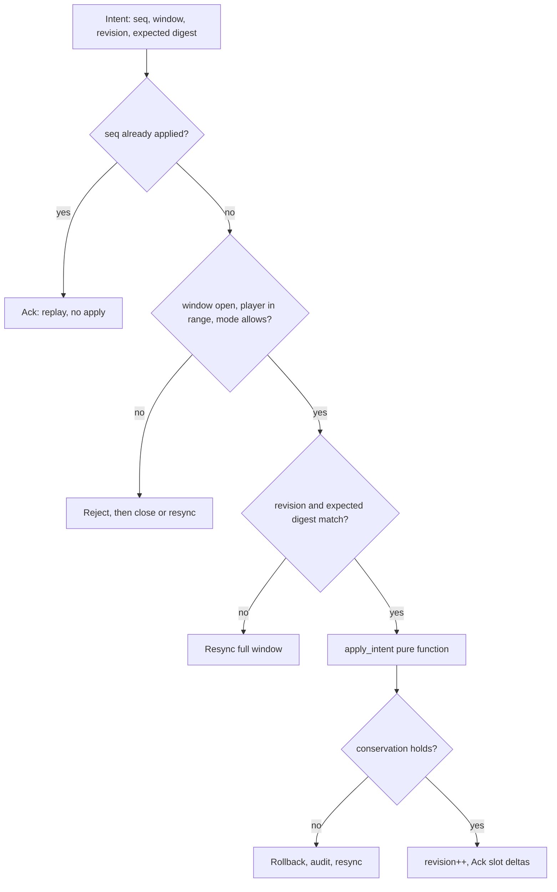

# 11 — Items, Inventory and Crafting

> Status: normative - Last updated: 2026-11-24
> Depends on: [DEC-006](../decisions.md), [DEC-007](../decisions.md), [DEC-008](../decisions.md), [DEC-017](../decisions.md), [DEC-019](../decisions.md), [DEC-020](../decisions.md), [DEC-022](../decisions.md), [DEC-023](../decisions.md), [DEC-027](../decisions.md), [DEC-029](../decisions.md), [DEC-038](../decisions.md), [DEC-040](../decisions.md), [DEC-041](../decisions.md); [content system](15-content-system.md), [persistence](17-persistence.md), [networking](18-networking-multiplayer.md), [redstone](12-redstone-and-logic.md)
> Implements: MS-10 (stacks, containers, crafting, stations), MS-11 (enchanting, brewing, trading, loot), MS-14 (parity corpus)

## 1. Purpose and scope

This chapter defines what an item *is*, how a stack carries data, how inventories are addressed, and how every move of an item is authorised, validated and persisted. It specifies the inventory transaction protocol that DEC-023 fixes at the transport level, the container and station layouts, crafting and processing, enchanting, brewing, trading, loot generation, automation, durability, and the hooks presentation and content packs use.

Out of scope: the block/item registry pipeline and pack layering ([15](15-content-system.md)); the save file container and migrations ([17](17-persistence.md)); message encoding and the reliable stream ([18](18-networking-multiplayer.md)); hopper *power* semantics ([12](12-redstone-and-logic.md)); inventory screens and drag rendering ([13](13-ui-and-ux.md)); WASM capability enforcement ([16](16-modding.md), [20](20-security-and-anti-cheat.md)); item model shaders ([03](03-rendering.md)).

Two invariants frame everything. First, item state is a **typed component map**, not a free-form tree: there is no untyped NBT escape hatch in the public API (DEC-019, DEC-041). Second, the host owns every stack (DEC-008): clients send intents, never slot contents, and the host answers with authoritative deltas (DEC-023). Durations are canonical ticks (ct) at 20 ct/s (DEC-007, DEC-038); the simulation runs at 20 Hz and a 30 Hz setting raises only the snapshot/replication rate, never a duration or a gameplay value.

## 2. Requirements

| ID | Requirement | Verification | Milestone |
| --- | --- | --- | --- |
| REQ-ITEM-001 | A stack is `(item id, count, typed components)`; no untyped tree or executable payload is accepted. | Schema + inspection | MS-10 |
| REQ-ITEM-002 | Every component has a type, bounds and validation; an invalid value is rejected at load or at write, never clamped silently. | Fuzz + content validation | MS-10 |
| REQ-ITEM-003 | Stack invariants hold: count > 0, count ≤ max stack, sorted unique components, no default-valued entries stored. | Property: canonicalisation | MS-10 |
| REQ-ITEM-004 | The canonical encoding is deterministic and hashes identically on Linux, Windows and macOS. | Golden hash vectors | MS-10 |
| REQ-ITEM-005 | Item definitions are content data covering stack size, durability, tool, armor, food, fuel, block duality, actions, tags and model. | Content validation | MS-10 |
| REQ-ITEM-006 | Block items place their block through the block's own placement rules; drops come from block loot, not a hardcoded item table. | Integration test | MS-10 |
| REQ-ITEM-007 | Slot addressing is stable across processes and versions; no wire message uses a registry index without a connection dictionary. | Protocol test | MS-06 |
| REQ-ITEM-008 | Inventories and windows have hard slot caps and bounded nesting; exceeding a cap fails the pack or the placement. | Fuzz + validation | MS-10 |
| REQ-ITEM-009 | Inventory interaction is a host-validated transaction on the reliable ordered stream, per DEC-023. | Integration: loss/latency | MS-05 |
| REQ-ITEM-010 | Click, shift-click, drag, gather, swap, drop and creative clone intents have the semantics of §3.4 and are shared by client prediction and host validation. | Model-based test | MS-10 |
| REQ-ITEM-011 | An intent carries its target revision and a keyed BLAKE3-128 expected-state digest over every touched slot plus the cursor; the host recomputes and compares it at apply time, and a mismatch produces a resync, never a partial apply. CRC32C is only an accidental-corruption check. | Property: stale and forged intents | MS-10 |
| REQ-ITEM-012 | Transactions are idempotent: replaying a sequence number returns the original acknowledgement without applying twice. | Network simulator | MS-06 |
| REQ-ITEM-013 | The client rolls back to confirmed state on correction and replays only still-valid pending intents. | Model-based test | MS-06 |
| REQ-ITEM-014 | Conservation holds for every transaction; a violation rolls back, audits and resyncs. | Duplication fuzz (100k) | MS-10 |
| REQ-ITEM-015 | Container kinds and slot layouts match §3.5; a window exposes at most 256 container slots and 512 total. | Layout test | MS-10 |
| REQ-ITEM-016 | Item entities merge, despawn and are picked up per §3.6, with exact component equality. | Scenario + replay | MS-10 |
| REQ-ITEM-017 | All recipe kinds in §3.7 are supported and validated; ambiguous matches resolve by lowest recipe ID. | Golden recipe tests | MS-10 |
| REQ-ITEM-018 | Recipe lookup is indexed; matching is ≤ 5 µs p99 with the base pack plus 10,000 mod recipes. | `bench_recipe_match` | MS-10 |
| REQ-ITEM-019 | The recipe book unlocks from acquisition triggers, is owner-only, and never bypasses material checks. | Integration test | MS-10 |
| REQ-ITEM-020 | Fuel burn, cook progress and XP follow §3.8 and persist across save/load. | Unit + fixture save | MS-10 |
| REQ-ITEM-021 | Enchanting power, offer generation, seed derivation and application follow §3.9. | Golden seed vectors | MS-11 |
| REQ-ITEM-022 | Anvil combine/repair/rename and grindstone stripping follow §3.9 with the divergence in repair cost. | Unit + scenario | MS-11 |
| REQ-ITEM-023 | Potions, effects and brewing follow §3.10; effect stacking is deterministic. | Unit: stacking matrix | MS-11 |
| REQ-ITEM-024 | Trade offers, price adjustment and restocking follow §3.11 and use the transaction protocol. | Scenario + duplication test | MS-11 |
| REQ-ITEM-025 | Loot tables use seeded, order-canonical RNG and resolve exactly once per container. | Golden loot vectors | MS-11 |
| REQ-ITEM-026 | Hoppers and droppers follow §3.13, are gated by redstone state, and persist partial transfers. | Hopper clock + save test | MS-11 |
| REQ-ITEM-027 | Durability, Unbreaking, Mending and repair follow §3.14; a broken item disappears with no drop. | Unit + replay | MS-10 |
| REQ-ITEM-028 | Presentation reads view-only item models; the host never loads models, and missing models fall back. | Inspection + content test | MS-10 |
| REQ-ITEM-029 | Item behaviour is data plus capability-gated server hooks; clients receive no mod code and no item behaviour can run client-authoritative. | Integration: modded item | MS-09 |
| REQ-ITEM-030 | Stacks save and load with unknown items and components preserved as opaque, restorable placeholders. | Save round-trip | MS-13 |
| REQ-ITEM-031 | Every shipped base-pack item has a hand-authored parity-checklist row with a test or a documented divergence. | Hand-authored checklist diff (MS-14) | MS-14 |

## 3. Design

### 3.1 Item definitions as data

`ItemDef` is a registry entry. Behaviour comes from declared facets; the engine switches on typed facets, never on item IDs. A pack can add a material, a food or a tool tier without engine changes.

| Field | Type | Default | Notes |
| --- | --- | --- | --- |
| `max_stack` | u16 | 64 | 1 for damageable and potion items |
| `max_damage` | u32 | 0 | 0 means not damageable |
| `tool` | facet | none | class, tier, speed, attack damage, cooldown, harvest level |
| `armor` | facet | none | slot, points, toughness, knockback resistance, enchantability |
| `food` | facet | none | nutrition, saturation modifier (per-mille), use ct, `always_eatable`, effects |
| `fuel_ticks` | u32 | 0 | burn time when used as fuel |
| `block` | BlockId | none | block/item duality: placement and drops |
| `use_action` | enum | none | eat, drink, place, ignite, bucket, throw, bow, shield, elytra, spawn egg, record, hoe, axe strip, shovel path, dye, bone meal, custom handler |
| `attack_action` | enum | melee | melee, sweep, projectile, custom |
| `tags` | sorted IDs | empty | `#c:ingots`, `#mineable/pickaxe`, `#repairs/iron` |
| `repair` | facet | none | unit item or tag, repair ratio |
| `enchantability` | u8 | 0 | weights enchanting offers |
| `components` | defaults | empty | initial component values |
| `model` | view ref | required | GUI icon and held/ground model, view hash only |

Validation rejects an item with `max_stack > 1` and `max_damage > 0` unless the pack opts into stackable damageable items, a food without a use time, a tool without a tier, an armor piece without a slot, a block reference to a missing block, a fuel value on a non-burnable tag, or a tag cycle.

Block/item duality is one direction only: the item references a block, the block's loot table yields the item. Placing calls the block's placement rules (adjacency, collision, support, waterlogging); breaking calls the block's loot table with the tool context, so Silk Touch, Fortune and tier gating are defined once in [15](15-content-system.md), not in item code.

### 3.2 Stacks and components

```rust
pub struct ItemStack {
    pub item: ItemId,          // u16, session registry index
    pub count: u16,            // 1..=max_stack
    pub components: ComponentMap,
}

pub struct ComponentMap { entries: SmallVec<[(ComponentKey, ComponentValue); 4]> }

pub enum ComponentValue {
    Bool(bool), I32(i32), U32(u32), I64(i64),
    Text(TextId), Id(ResourceId),
    List(Box<[ComponentValue]>), Map(Box<[(ResourceId, ComponentValue)]>),
    Bytes(Arc<[u8]>),
}
```

Floats are forbidden in components: simulation values are integers or per-mille fixed-point. Defaults declared by `ItemDef` are *not* stored; only deviations appear, so a plain stone stack has no component bytes at all. The accessor `get_or_default(key)` makes elision invisible to behaviour code.

| Component | Value | Bounds and meaning |
| --- | --- | --- |
| `durability` | U32 damage | ≤ `max_damage`; item breaks at equality |
| `enchantments` | sorted map EnchantId → u8 | level 1..=max, item category must accept it |
| `stored_enchantments` | same map | enchanted books only |
| `custom_name`, `lore` | TextId / TextId list | 128 / 1,024 characters, Fluent keys and args |
| `custom_data` | map ResourceId → value | ≤ 8 KiB, schema declared by the item, never behaviour |
| `container` | list of stacks | ≤ 256 slots, nesting depth 1, no shulker inside a shulker |
| `bundle_contents` | list of stacks | total weight ≤ 64, no recursion |
| `attribute_modifiers` | list | ≤ 16 entries, validated attribute IDs and operations |
| `can_destroy`, `can_place_on` | sorted IDs/tags | ≤ 64 entries, adventure mode only |
| `unbreakable` | bool | disables durability loss, not break events |
| `repair_cost` | U32 | 0..=39, linear anvil cost (§3.9) |
| `potion`, `effects` | potion ID, effect map | brew results and custom effects |
| `charged_projectiles`, `banner_patterns`, `trim`, `map_id`, `written_book`, `firework`, `lock` | typed | per-kind validation |

**Why components, not NBT.** A free-form tree is unvalidated (ambiguous numeric widths, unbounded depth, duplicate keys), so it is an anti-cheat and memory-safety liability; it cannot be canonicalised cheaply, so identical stacks hash differently; its string keys are repeated on every network update; and it is an executable-payload habit that invites hidden behaviour. Typed components give schema validation with actionable errors, hard size bounds, default elision, cheap structural equality, a stable hash for audit and duplication evidence, and a versioned migration path (DEC-041). Unknown components from a newer pack are kept as opaque bytes for round-trip only and are never interpreted; a server with a different content hash refuses the join before such a stack can matter (DEC-006, DEC-027).

**Canonical encoding.** Two encodings share one canonical form. The *canonical* form (disk, hash, audit) resolves every ID to its resource-ID string and sorts components by ID:

| Field | Encoding |
| --- | --- |
| format version | u16 little-endian |
| flags | u8: bit 0 empty, bit 1 components, bit 2 custom name |
| item | u16 length + UTF-8 resource ID (canonical) or varint dictionary index (wire) |
| count | varint |
| component count | varint |
| each component | u16 key length + key, u8 type tag, canonical value |

`StackHash = BLAKE3-256(canonical bytes)`; the empty stack hashes `BLAKE3([0x00])`. Lists keep semantic order, maps and component sets are sorted before encoding, integers are little-endian, text is UTF-8 with a declared length, and `-0`/NaN cannot occur because floats do not exist here. The *wire* form substitutes per-connection dictionary indices established from sorted resource IDs at handshake, so no registry index crosses a process boundary (DEC-006); a plain stack is 3–5 B, a damaged enchanted tool 12–24 B, and a loaded shulker is bounded by its 256 slots and the packet size cap.

**Invariants.** `Option<ItemStack>` is the only empty representation; `count == 0` is invalid. A stack never exceeds `max_stack`, never nests a container deeper than one, never stores a component equal to its default, and never carries a level above the enchantment's maximum. Every mutation goes through `Stack::validate(&ItemDefs)`, which is also the last line of defence against a malicious client payload.

### 3.3 Inventories and slot addressing

```rust
pub struct Inventory {
    pub kind: InventoryKind,
    pub slots: Box<[Option<ItemStack>]>,
    pub revision: u32,
}

pub enum SlotRef {
    Player(u8),          // 0..=35; indices 36-40 are Armor/Offhand below
    Armor(ArmorSlot),    // head, chest, legs, feet
    Offhand,
    Craft(u8),           // 0..=3 player 2x2
    CraftResult,
    Container(u16),      // window-relative, 0..=255
    Trade(u8),           // 0..=2
    Result,              // station output
    Cursor,              // never inside an Inventory
}
```

The player inventory is 41 slots: hotbar 0–8, main 9–35, armor 36–39, offhand 40. The cursor is separate state owned by the open-window state, not a player slot. A window maps its container slots first, then the player's main inventory (27), then the hotbar (9), so the same `SlotRef` space serves UI, protocol and automation. The mapping is a table generated from `InventoryKind`, never ad hoc arithmetic.

| Window | Container slots | Layout (container order) | Total |
| --- | --- | --- | --- |
| player | 5 | 2×2 craft + result | 46 |
| chest / barrel / shulker | 27 | 3×9; double chest uses two inventories of 27 | 63 |
| hopper | 5 | one row | 41 |
| dropper / dispenser | 9 | 3×3 | 45 |
| furnace family | 3 | input, fuel, output | 39 |
| brewing stand | 5 | 3 bottles, ingredient, fuel | 41 |
| anvil | 3 | input A, input B, output | 39 |
| enchanting table | 2 | item, lapis | 38 |
| stonecutter | 1 | input; result is virtual | 37 |
| smithing table | 4 | template, base, addition, output | 40 |
| villager / trade | 3 | input A, input B, result | 39 |
| grindstone | 3 | input A, input B, result | 39 |
| beacon | 1 | payment | 37 |

Caps: an `Inventory` holds at most 256 slots; a window exposes at most 512 slots including the player; nesting depth is 1; the base pack uses at most 54 container slots. A pack declaring more fails validation. Each inventory revision increments on every mutation; the window's revision is a composite counter that increments whenever any inventory visible in that window mutates, so a transaction touching both the container and the player carries one revision number.

### 3.4 The inventory transaction protocol

DEC-023 fixes the transport: a reliable ordered QUIC stream, click intents referencing slots and cursor, and host-authoritative replies. This section fixes the state machine.



The client keeps a *confirmed* snapshot at revision `R` and a queue of pending intents. It predicts by running the same pure `apply_intent` function the host runs, then renders confirmed state plus predictions. The host processes intents in sequence order; a correction replaces the affected slots and cursor, and the client rolls back and replays pending intents whose expected state still matches, dropping the rest and requesting a resync. The host never partially applies an intent: it either commits the complete delta or rejects it.

| Intent | Semantics | Host checks |
| --- | --- | --- |
| `PickUp` (left) | empty cursor takes the whole stack; matching cursor merges to max | slot range, stack valid |
| `PickHalf` (right) | empty cursor takes `ceil(count/2)`; matching cursor places one | stack valid |
| `PlaceAll` (left) | cursor stack into an empty or matching slot up to max | resulting count ≤ max |
| `PlaceOne` (right) | one item from cursor | resulting count ≤ max |
| `ShiftClick` | quick-move to the other section in documented slot order | target space, no partial weirdness |
| `Gather` (double) | pull matching stacks from the inventory to the cursor | cursor compatibility |
| `Swap` | swap slot with hotbar index 0–8 | index range |
| `Drop` | one item or the whole stack into the world | not spectator; cursor or slot |
| `Drag` | left drag splits equally, right drag places one per visited slot | order preserved, total conserved |
| `Clone` (middle) | creative only: clone the full stack | mode has `infinite_items`; logged |
| `RecipeFill`, `RecipeCraft` | fill the grid from a recipe, craft up to N | ingredients present, recipe unlocked |
| `Close` | return cursor to inventory or drop it | window id matches |

Shift-click order is explicit, not "whatever feels right": container → main → hotbar for moves out of the container, hotbar → main → container for moves into it; within a section, lowest index first, filling matching stacks before empty slots. Drag preserves the client's visited order and distributes `floor(total/n)` per slot with the remainder to the first `total % n` slots; right-drag places one per slot and stops when the cursor empties.

Expected-state validation is by revision *and* a keyed expected-state digest, not a checksum. The host publishes `expected = BLAKE3-128(k, canonical encoding of every touched slot plus the cursor)` in the snapshot or acknowledgement the client predicts from, where `k` is the per-world transaction key used in BLAKE3's keyed mode; the intent echoes that 16-byte value, and the host recomputes the digest from authoritative state at apply time and compares the full 128 bits. A keyed digest is required because CRC32C is linear and client-controlled: a malicious client can adjust slot values while preserving a stale checksum, defeating the very check that protects against a lost update. An intent touching at most four slots MAY instead carry the exact expected `(slot, stack hash, count)` tuples and have the host compare slot values exactly; the digest is the compact default, not the only legal form. Either way this catches the case where a revision changed for an unrelated slot, which a revision-only check would reject unnecessarily, and the case where two players mutate the same container between revision reads. A mismatch yields `Resync { window, revision, slots, cursor }` (≤ 2.5 KiB for a 63-slot chest window and ≤ 3.5 KiB for a 90-slot double chest, with ordinary stacks), which clears the pending queue. CRC32C survives only as an accidental-corruption check over the canonical bytes: a frame that fails it is dropped before apply and retransmitted, and it never authorises a state match. Sequence numbers are per window and per player, with a 128-entry dedupe ring; replaying an old sequence returns the original acknowledgement, so a retransmitted intent after reconnect cannot duplicate an item.

Host checks before applying: window open; player alive, not spectator, same dimension, within 6 m of the container block; slot exists in the window layout; mode allows container interaction; transaction rate below 40/s sustained with a 60 burst; stack and component limits; and, after applying, total item count conserved across every touched inventory plus the cursor, with the only permitted deltas being recipe, station and trade consumption/production, fuel burn, and logged creative clones. A conservation failure rolls back the transaction, emits a structured audit event with the pre-state hashes, resyncs the player and increments an anti-cheat counter ([20](20-security-and-anti-cheat.md)). Transactions are serialized per player and per inventory, so two viewers of one chest cannot interleave into a lost update.

### 3.5 Containers

Container kinds are registry data: slot count, layout order, accepted-slot predicates, tick behaviour, comparator output and redstone gating. The base kinds are those in §3.3 plus the crafter (9 slots, disabled-slot mask). Opening a container loads its block entity and adds a chunk ticket; closing by distance, dimension change or destruction returns the cursor to the inventory (dropping what does not fit), while closing by death adds the cursor to the death drops, and every close releases the ticket. A container broken while open closes first and spawns its drops from the saved inventory, never from the open window copy.

| Kind | Tick | Notes |
| --- | --- | --- |
| chest, barrel, shulker | none | shulker keeps contents when broken; no nesting |
| hopper | 8 ct | pull above, push below/side (§3.13) |
| dropper, dispenser | 8 ct | dropper inserts, dispenser runs its data-defined behaviour |
| furnace family | burn/cook | §3.8; lit state is a block state for light and redstone |
| brewing stand | 400 ct | §3.10; blaze powder fuel |
| anvil, grindstone, stonecutter, smithing | none | transform on take (§3.9) |
| enchanting table | none | offers on open (§3.9) |
| villager | none | offer book and restock (§3.11) |
| beacon | none | payment slot only; effects are [09](09-entities-ai.md) |

### 3.6 Item entities

An item entity is `{stack, position, velocity, age, pickup_delay, despawn_age, thrower}`. It despawns at 6,000 ct, cannot be picked up for 10 ct after spawn, and is destroyed by lava, fire, cactus and the void. Pickup checks each tick: player AABB expanded by 1.0 m, pickup delay expired, not a spectator, inventory has room for at least one item. A partial pickup leaves the remainder; at most 8 entities are picked up per player per tick to bound cost. Merging runs on spawn and every 20 ct: entities within 0.5 m with *exactly* equal item and canonical components merge up to `max_stack`; the survivor is the lower entity ID, keeps its position, takes the summed count, the minimum age, the maximum pickup delay and the minimum remaining despawn time. Different `custom_name`, enchantments or durability never merge, even when they look identical in the UI.

**Interim v0.0.x implementation.** The host spawns one entity per break drop at
the broken block's centre with a deterministic hash-derived impulse (no RNG
state), a 10 ct pickup delay and a 6,000 ct despawn, matching the values above.
The pickup volume is the player AABB expanded by 0.35 m on every axis (1.3 m
wide, narrower than the 1.0 m above), and there is no per-tick pickup cap, no
merging and no lava/fire/cactus destruction. Items sink in water rather than
floating. Entities are server-authoritative and persist in `items.txt`
([17](17-persistence.md)).

### 3.7 Crafting

A recipe is content data: id, kind, ingredients (item ID or tag), pattern, result stack (components allowed), group, category, experience and time. The base pack ships the parity set; mods add more through the same schema.

| Kind | Input | Matching |
| --- | --- | --- |
| shaped | 1×1 to 3×3 grid | normalised pattern, optional mirror, tag-aware cells |
| shapeless | grid | multiset of ingredients, order-independent |
| smelting / blasting / smoking / campfire | one item | input predicate, station-specific time |
| stonecutting | one item | input predicate, chosen output |
| smithing transform / trim | template, base, addition | exact predicates, keeps components |
| brewing | bottle + ingredient | base potion plus ingredient (§3.10) |
| special | station-specific | engine handler id: repair, banner copy/add, book copy, firework, map zoom, tipped arrow, shulker colour, leather dye |

Matching is deterministic and indexed at registry freeze. Shaped recipes index by `(width, height)` and by a pivot ingredient (the least frequent cell); shapeless recipes index by their rarest ingredient; smelting and stonecutting index by input item/tag; special handlers are a short ordered list tried only when no normal recipe matches. A lookup collects candidates from the rarest cell or ingredient, tests cells against compiled tag bitsets, and returns the lowest recipe ID among matches, so ambiguity resolves identically on client and host. A 256-entry cache keyed by the grid signature makes repeated shift-click crafting O(1). Cost: ≤ 5 µs p99 per lookup, ≤ 80 ms to validate and index 10,000 recipes, ≤ 4 MB of index.

The recipe book stores a per-player bitset over the frozen recipe registry, unlocked by typed triggers (first acquisition of an item or block tag, explicit advancement reward, `unlocked_by` lists) and sent in full at join (≤ 256 B for 2,048 recipes) with owner-only deltas. Clicking a recipe sends `RecipeFill` with the recipe ID; the host verifies the ingredients are present and unlocked and fills the grid, and shift-click sends `RecipeCraft` with a count, capped by available materials and grid space. The book never fabricates items: a ghost recipe is a UI hint, not a grant. Creative unlocks all recipes. Load validation rejects missing tags or items, duplicate IDs, empty results, outputs above `max_stack`, and shaped patterns with more cells than the declared size.

### 3.8 Processing stations

A furnace family block entity stores `input`, `fuel`, `output`, `burn_remaining`, `burn_total`, `cook_progress`, `cook_total`, `xp_milli` and `recipe_id`. Each tick: if `burn_remaining > 0` decrement it; if it reaches 0 and fuel is present consume one fuel item and add `fuel_ticks`; if the input has a recipe and the output can accept the result, advance `cook_progress` by 1, else hold progress; at `cook_total` produce one output, add recipe experience and reset progress. Lit state, comparator output and hopper gating are block states consumed by [12](12-redstone-and-logic.md).

| Fuel | Ticks | Fuel | Ticks |
| --- | --- | --- | --- |
| coal, charcoal | 1,600 | coal block | 16,000 |
| planks, logs | 300 | stick | 100 |
| blaze rod | 2,400 | dried kelp block | 4,000 |
| lava bucket | 20,000 | bamboo | 50 |

Cook time is 200 ct in a furnace, 100 in a blast furnace or smoker, and 600 on a campfire; campfires need no fuel and stop in rain ([07](07-light-and-weather.md)). Experience is stored in milli-points (`0.1` = 100) and awarded when a player takes the output. Divergence: if automation empties the output, the stored experience drops as orbs at the furnace instead of being voided, so a farm cannot silently destroy progression.

### 3.9 Enchanting, anvil and grindstone

**Enchanting table.** Bookshelf power is the number of valid shelves (two blocks away, one air gap, 0–2 blocks high, capped at 15). For slot `s` in `{0,1,2}`:

```text
base(s) = 1 + rng(0..=7) + shelves / 2 + rng(0..=shelves)
cost(s) = max(1, base(s) * (s + 1) / 3)     // required level
spend(s) = s + 1                            // levels and lapis consumed
```

The player must have at least `cost(s)` levels and `spend(s)` lapis; the host deducts `spend(s)` levels and lapis, then applies a weighted selection from applicable enchantments respecting `min_power`, `max_power`, category tags, maximum levels and incompatibilities. The seed is derived from `(world seed, player UUID, table position, shelf count, enchant count)` and refreshes when the shelf count changes or after a successful enchant, so reopening the table cannot reroll offers. Divergence: the UI shows the top three possible enchantments as a *preview* while the roll stays random, replacing the opaque slot machine in the Tier-4 list. Enchantment definitions are content data: id, max level, weight, power range, applicable tags, incompatibilities, curse flag and effect list (attribute modifiers, protection EPF, damage bonuses, durability-save chance, special hooks such as Silk Touch, Fortune and Mending).

**Anvil.** Combining two items repairs durability, merges enchantments, or renames. Repair uses the item's `repair` unit (material or tag): each unit restores 25% of maximum durability; combining two damaged items adds their durability plus 12%. Enchantment merge keeps the higher level, adds one when equal and below maximum, and resolves conflicts deterministically by keeping the higher level then the lower enchantment ID, logging the discarded one. Cost is linear, not exponential (Tier-4 divergence): `1 + material_units + sum(resulting enchantment levels) + rename(1) + min(repair_cost, 5)`; `repair_cost` increments by 1 per prior anvil use, and a cost above 39 is capped rather than refused. Each use has a 12% chance to damage the anvil one stage. The output is a preview; taking it commits the cost and inputs atomically through the transaction protocol, so no duplication is possible on a rejected take.

**Grindstone.** Combining two items sums durability plus 5%, removes all non-curse enchantments and clears `repair_cost`; it returns `min(10, total removed levels)` XP to the player on take. Curse removal is not allowed. Loom, cartography table and smithing trim follow the same "preview, then atomic take" model with their own data-defined transforms.

### 3.10 Potions, effects and brewing

An effect definition declares id, category (beneficial, harmful, neutral), default duration, maximum amplifier, tick interval, instant flag, attribute modifiers, immunity tags and particle/icon. Stacking is deterministic: a higher amplifier replaces a lower one; at equal amplifier the longer remaining duration wins; instant effects apply immediately and never stack; milk and honey clear the effect set according to their data. Effects tick on the host at their declared interval and are replicated as visible-effect state.

A brewing stand holds three bottle slots, one ingredient slot and one fuel slot. Blaze powder fuels 20 operations; a brew takes 400 ct and consumes one ingredient, transforming all three matching bottles. Recipes map (base potion, ingredient) to a result; water is the base, awkward is the neutral base, and gunpowder upgrades a potion to splash while dragon breath upgrades splash to lingering. Tipped arrows combine eight arrows with a lingering potion. Potion items have `max_stack = 1` unless a pack overrides it. Recipe validation ensures every potion result has a bottle form and every effect ID exists.

### 3.11 Trading

A villager offer is `{inputs, output, max_uses, uses, xp, price_multiplier, demand, restock_delay}`. Offers unlock by trade level 1–5 as villager XP crosses thresholds; each profession's pool and weights are data. Price is `base * (1 + demand * 5%)`, rounded down, clamped to `[1, base * 2]`; each completed trade raises demand by 1 and lowers it by 1 per restock, with `uses` reset when the villager restocks at its workstation (up to twice per day, ticked by [09](09-entities-ai.md)). Divergence: the trade pool is visible before committing and rerolling has a priced action rather than a lectern-break exploit. Trades use a 3-slot window and the transaction protocol; the output is computed from the offer on take, never stored as a free-floating stack, and the server checks offer index, remaining uses and exact inputs.

### 3.12 Loot tables

A loot table is content data with pools, entries, conditions and functions. Each pool has a rolls expression (constant or uniform), optional bonus rolls, weighted entries (item or nested table) and entry-level functions; tables may be nested to depth 8 with ≤ 64 pools, ≤ 1,024 entries and ≤ 4,096 generated items per container. Conditions include random chance, chance with luck, entity properties, block state, tool, killed-by-player, explosion survival, weather, time and AND/OR/NOT; functions include set count, set damage, set components, enchant randomly, enchant with levels, looting bonus, furnace smelt, apply bonus, limit count, set name/lore, explosion decay and copy components.

```json5
// openblock:base / loot / chest / ruined_tower
{ pools: [
  { rolls: { uniform: [2, 4] }, entries: [
    { weight: 10, item: "openblock:iron_ingot", functions: [{ set_count: { uniform: [1, 3] } }] },
    { weight: 4, item: "openblock:golden_apple", conditions: [{ chance_permille: 200 }] },
    { weight: 2, table: "openblock:chests/supply" } ] } ] }
```

Rolls consume one deterministic stream in canonical order: pool, then entry selection by cumulative integer weight, then condition, then function, then nested table. The seed is `LootSeed = H(world_seed, dimension, source_kind, position, entity_or_container_id, salt)` using the same per-subsystem derivation as [00 §6](00-conventions.md#6-determinism-rules); `luck` shifts weights and bonus rolls with saturating integer math, and every rejection loop is bounded. Containers store `loot_table`, `loot_seed` and `state = unresolved | resolved | empty`; generation happens exactly once, on first open, break or hopper extraction, so save/load and multiplayer cannot reroll a chest. Each roll picks a uniformly random empty slot; a roll with no empty slot increments a discarded counter and is dropped deterministically. A missing table logs and resolves empty; a missing item is skipped with an audit entry, never spawned as a placeholder in a live container.

### 3.13 Automation

A hopper ticks every 8 ct when not powered: it first tries to pull one item from the container above (or from item entities in the space above), then pushes one item into the container below or, failing that, sideways in a fixed order; slots are visited in ascending index and matching stacks are filled before empty slots. Its cooldown, enabled state, transfer direction and comparator output are block-entity/block-state data; the redstone chapter owns power computation and update ordering ([12](12-redstone-and-logic.md)). Droppers and dispensers activate on a rising redstone edge under that same power model, so a pulse, a lever or a comparator all reach them through one code path. A hopper with nothing to move sleeps until a neighbour changes, a watched inventory mutates or an item entity appears, an optimisation that must be behaviour-preserving and is covered by a differential test against the naive tick. Partial transfers and cooldowns persist across save/load and chunk unload. Droppers insert one item into the facing container; dispensers run a data-defined behaviour (arrow, firework, bucket, boat, bone meal, egg, potion, TNT, shulker placement) and consume one item per activation.

### 3.14 Durability and repair

Tools lose 1 durability per block broken and per attack; armor loses 1 per 4 HP absorbed (minimum 1); bows, crossbows and tridents lose 1 per shot; elytra lose 1 per second of flight; some use actions declare a cost. Unbreaking gives a `1/(level+1)` chance to skip a loss, evaluated with the host RNG. Mending repairs 2 durability per XP point from picked-up orbs and never consumes XP the item cannot use. At `damage == max_damage` the stack is removed, a break sound/event fires, and no item drops; the hotbar slot clears. Repair paths are: crafting two damaged items of the same kind (sum + 5%), anvil material units (25% each), and grindstone combination. `unbreakable` prevents loss but not a scripted break event.

### 3.15 Presentation hooks

Item presentation is view-only. `ItemModelDef` declares a parent, textures, elements, display transforms for GUI, ground, hand and head, optional tint source (grass, foliage, potion, leather), enchantment glint and GUI overlay layers. Block items render through the block model; other items are baked at pack compile into a GUI icon array (DEC-017), with durability bar, count text, cooldown sweep, cooldown overlay and glint drawn as instanced overlays. The host never loads models, textures or transforms; a client with a missing model shows a placeholder and logs a view warning, and model data enters the view hash, not the content hash. Dynamic item appearance (potion colour, banner pattern, written book) is derived from components on the client at draw time and never sent as pixels.

### 3.16 Content behaviour and mod hooks

Item behaviour is data first: facets cover food, fuel, tools, armor, placement, projectiles and most use actions. The remainder is a `UseHandler` selected by a registered ID, executed **on the host only**. A WASM mod registers a handler through the host ABI ([16](16-modding.md)) with the `world.write` capability; the host validates the action queue at the tick commit point, applies the same budgets as any mod callback (1 ms hard cap, 4,096 actions/tick) and attributes cost per mod. Clients receive a declarative prediction descriptor (use time, cooldown, shape, whether the action changes the world) inside the content hash, so they can animate and predict the common case; complex behaviour is server-authoritative and may correct. No item hook can run on a client, read files, open sockets or bypass the inventory transaction rules.

### 3.17 Risks

| Risk | Impact | Mitigation |
| --- | --- | --- |
| RISK-046 A transaction edge case permits duplication | Economy and server trust | Pure shared `apply_intent`, conservation assertion, 100k-sequence fuzz, audit and resync |
| RISK-047 Recipe matching degrades with modded recipe counts | Crafting lag | Indexed lookup, pivot selection, cache, budget gate in CI |
| RISK-048 Component schema sprawls across packs | Mod incompatibility | One schema, versioned registry, strict validation, generated JSON Schema |
| RISK-049 Hopper and item-entity load at scale | Tick overrun | Budgets, sleeping hoppers, merge caps, differential test |
| RISK-050 Predicted inventory ghosts on a bad link | Player trust | Confirmed-plus-pending model, rollback, full resync, no prediction for complex windows |

## 4. Data structures and formats

Beyond `ItemStack`, `ComponentMap`, `Inventory` and `SlotRef` in §3, the host holds one `WindowState` per open window and one registry index per world generation:

```rust
pub struct WindowState {
    pub id: WindowId,             // u8, per player
    pub kind: InventoryKind,
    pub container: InventoryHandle,
    pub cursor: Option<ItemStack>,
    pub revision: u32,
    pub last_seq: u32,
    pub seen: RingBuffer<(u32, Ack), 128>,
}

pub struct RecipeIndex {
    pub shaped: HashMap<(u8, u8), Vec<RecipeId>>,
    pub by_pivot: HashMap<ItemId, Vec<RecipeId>>,
    pub smelt: HashMap<ItemOrTag, RecipeId>,
    pub stonecut: HashMap<ItemOrTag, Vec<RecipeId>>,
    pub special: Vec<SpecialHandlerId>,
    pub cache: Lru<GridSignature, RecipeId, 256>,
}

pub struct LootEntry { pub weight: u32, pub quality: i32, pub item: LootItem, pub conditions: Vec<Condition>, pub functions: Vec<Function> }
```

| Wire message | Payload | Typical size |
| --- | --- | --- |
| `OpenWindow` | window id, kind, container id, slot layout hash, revision | 12 B |
| `Intent` | window, seq, revision, kind, args, expected BLAKE3-128 digest | 21–33 B |
| `Ack` | window, seq, revision, slot deltas, cursor | 6–40 B |
| `Resync` | window, revision, all window slots, cursor | ≤ 3.5 KiB for 90 slots |
| `Close` | window, reason | 2 B |

Slot deltas encode a varint slot index plus a wire stack (or a single zero byte for empty). Item and component IDs are per-connection dictionary indices built from sorted resource IDs at handshake, so a session never depends on registry order. Recipe and container indexes are built in sorted order and are lookup-only; no simulation system iterates a `HashMap` during a tick ([00 §6](00-conventions.md#6-determinism-rules)). Saving stores resource IDs and component values in the schema of [17](17-persistence.md) (which may dictionary-compress them); the canonical binary encoding above is the hash, audit and duplication-evidence form. An unknown item ID is preserved as `openblock:unknown` with its original ID string and opaque component bytes.

## 5. Performance budgets

| ID | Budget | Measurement |
| --- | --- | --- |
| PERF-ITEM-001 | Host transaction processing ≤ 20 µs p99 including validation and delta encoding | `bench_transaction` |
| PERF-ITEM-002 | Inventory sync ≤ 40 B/s idle, ≤ 1.5 KB/s with a window open, ≤ 8 KB burst | protocol benchmark |
| PERF-ITEM-003 | Recipe match ≤ 5 µs p99; 10,000 recipes load and index ≤ 80 ms; index ≤ 4 MB | `bench_recipe_match` |
| PERF-ITEM-004 | 2,000 active hoppers ≤ 1.0 ms/tick p99; an idle container costs 0 | `bench_hopper` |
| PERF-ITEM-005 | Loot roll for a 27-slot container ≤ 20 µs p99; 1,000 containers ≤ 20 ms | `bench_loot` |
| PERF-ITEM-006 | 2,000 item entities ≤ 1.5 ms/tick p99 | `bench_item_entities` |
| PERF-ITEM-007 | GUI icon atlas ≤ 64 MB GPU; build ≤ 250 ms for 1,500 items | `bench_item_icons` |
| PERF-ITEM-008 | Full player inventory serialisation ≤ 64 KiB; per-save delta ≤ 4 KiB | save benchmark |

## 6. Failure modes and edge cases

- **Retransmitted intent.** The sequence is in the dedupe ring: return the stored acknowledgement, apply nothing.
- **Stale revision or expected digest.** Send a full resync; never apply a guessed delta. A CRC32C failure is a corrupt frame and is dropped before this check.
- **Two players in one chest.** Transactions serialize per inventory; the later one gets a fresh revision and either succeeds against it or resyncs.
- **Window closed by death, distance, dimension change or block destruction.** On death the cursor joins the death drops; on any other close it returns to the inventory, then drops what does not fit. The window closes before any drop is generated.
- **Container destroyed while open.** Close first, then drop the saved inventory once; the open window copy cannot be taken again.
- **Full inventory on pickup, craft or trade.** Partial pickups leave the remainder; crafting and trading refuse rather than voiding inputs.
- **Count overflow or invalid stack from a client.** Rejected before apply and logged; the host never clamps a client stack into validity.
- **Unknown item or component on load.** An unknown item ID becomes `openblock:unknown`, a reserved base-pack item that cannot be obtained, placed or crafted, with the original ID string; an unknown component on a known item is preserved as opaque bytes. Neither is interpreted.
- **Missing recipe output item or tag after a pack change.** Recipe validation fails the pack; a live reload quarantines the affected recipes and the recipe book drops them.
- **Loot table nested too deeply or missing.** Validation fails or the container resolves empty with a log; no partial generation is saved.
- **Hopper chunk unload mid-transfer.** Cooldown, source and destination indices persist; the transfer resumes or completes on load without duplication.
- **Anvil or trade taken twice in one tick.** Atomic take with revision check; the second take sees changed inputs and is rejected.
- **Potion effect reapplication order.** Amplifier, then duration, then instant effects, fixed by §3.10 and covered by a stacking matrix test.
- **Item entity merge with unequal components.** No merge; the UI must show the difference (name, durability, enchantment) so the player understands why.

## 7. Testing strategy

| Layer | What is tested | Tooling |
| --- | --- | --- |
| Stack model | invariants, canonicalisation, hash stability, component bounds | property tests and golden vectors |
| Transactions | click/shift/drag/gather/swap/drop/clone state machine, stale revision, forged or replayed expected digest | model-based `proptest` with a shadow client and a malicious client |
| Network | 30% loss, 150 ms RTT, reconnect, duplicate intent, corrupt frame (CRC32C) | in-process simulator (MS-05/MS-06) |
| Duplication | 100k randomized transaction/container/hopper sequences | conservation assertion and audit log diff |
| Recipes | matching versus a naive reference matcher; ambiguity order; tags; mirrors | differential test over the base pack plus generated recipes |
| Loot | same seed and context produce identical items; save/load; missing table | golden fixtures and distribution checks |
| Stations | fuel, cook time, XP, anvil cost, enchanting seed, brewing, trading restock | unit scenarios with fixed seeds |
| Automation | hopper clock and conservation across chunks and redstone gating | differential test against a naive hopper, save/load |
| Content | schema, caps, unknown components, view hash separation | pack validator and fuzz corpus |
| Parity | every shipped base-pack item, recipe kind and station has a hand-authored checklist row | hand-authored checklist diff (MS-14) |

The duplication fuzz is the release gate from the MS-10 exit criteria: 100k randomized container, hopper, crafting and network sequences must produce zero duplications and zero item loss, including deaths, disconnects, dimension changes and container destruction. Recipe and transaction tests compare against reference implementations rather than hand-written expectations, so a new recipe kind or intent cannot silently diverge between client and host. Every requirement names its layer; the hand-authored parity checklist maps each shipped base-item behaviour to a test or a documented divergence, with a citation per row rather than a copied registry dump ([DEC-009](../decisions.md), [DEC-051](../decisions.md)).

## 8. Open questions

The register settles the decisions this chapter depends on. Items that are still open are listed below; where a former placeholder now has a canonical decision, the item records the mapping rather than asking again.

1. **Typed component schema — settled by DEC-041.** Item data is a typed component map with canonical sorted encoding and a keyed BLAKE3-128 transaction digest; this chapter implements that decision and no further register entry is needed. Owner: MS-05/MS-10.
2. **Transaction wire details beyond DEC-023.** DEC-023 fixes the transport and authority; the revision-plus-digest check, sequence idempotency and the resync message are still chapter-level. **Register item needed: inventory transactions carry a window revision plus a keyed BLAKE3-128 expected-state digest over the touched slots and cursor, are idempotent by sequence, and a mismatch triggers a full window resync (owner MS-06).**
3. **Cursor persistence.** Should a cursor stack survive disconnect, or be returned to the inventory on close? This chapter persists it; confirm. Owner: MS-10.
4. **Unknown components.** Preserve opaque bytes (recommended for forward compatibility) or reject the stack when the content hash matches but the component is unknown? Owner: MS-13/MS-09.
5. **Automated furnace XP.** Drop stored XP as orbs when automation empties the output, or void it? Dropping rewards farms but avoids silent loss. Owner: MS-10.
6. **Container caps for mods.** Is 256 slots per inventory and depth 1 permanent, or may a trusted pack raise them with a server opt-in? Owner: MS-09.
7. **Enchant offer preview.** Tier 4 says show possible enchantments; confirm the "top three candidates, random result" presentation and whether it is a register decision. Owner: MS-11/MS-14.
8. **Per-connection ID dictionaries — settled by DEC-040.** DEC-006 keeps numeric indices out of saves and persistent references; DEC-040 permits a connection-local, hash-verified dictionary derived from `content_hash` and ends it with the connection. This chapter's wire plan implements that decision; no further entry is needed. Owner: MS-06.

## 9. References

- Decisions: [DEC-006](../decisions.md), [DEC-007](../decisions.md), [DEC-008](../decisions.md), [DEC-017](../decisions.md), [DEC-019](../decisions.md), [DEC-020](../decisions.md), [DEC-022](../decisions.md), [DEC-023](../decisions.md), [DEC-027](../decisions.md), [DEC-029](../decisions.md), [DEC-038](../decisions.md), [DEC-040](../decisions.md), [DEC-041](../decisions.md), [DEC-051](../decisions.md) (parity gate).
- Research: [feature inventory](../research/05-minecraft-feature-inventory.md) (item, recipe and station scope), [modding and content](../research/06-modding-and-content-system.md) (typed components, canonicalisation, host ABI), [networking SOTA](../research/04-networking-sota.md).
- Chapters: [03](03-rendering.md), [09](09-entities-ai.md), [12](12-redstone-and-logic.md), [13](13-ui-and-ux.md), [15](15-content-system.md), [16](16-modding.md), [17](17-persistence.md), [18](18-networking-multiplayer.md), [20](20-security-and-anti-cheat.md), [25](25-performance-budgets.md).
- External facts checked against the parity baseline: [Item components](https://minecraft.wiki/w/Data_component_format), [Crafting](https://minecraft.wiki/w/Crafting), [Recipe](https://minecraft.wiki/w/Recipe), [Smelting](https://minecraft.wiki/w/Smelting), [Enchanting](https://minecraft.wiki/w/Enchanting), [Anvil](https://minecraft.wiki/w/Anvil), [Brewing](https://minecraft.wiki/w/Brewing), [Trading](https://minecraft.wiki/w/Trading), [Loot table](https://minecraft.wiki/w/Loot_table), [Hopper](https://minecraft.wiki/w/Hopper).
