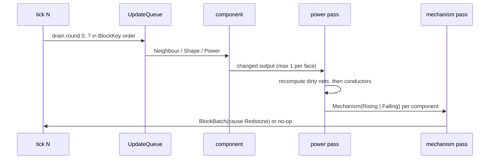

# 12 — Redstone and Logic

> Status: normative · Last updated: 2026-11-24
> Depends on: [DEC-005](../decisions.md), [DEC-006](../decisions.md), [DEC-007](../decisions.md), [DEC-008](../decisions.md), [DEC-015](../decisions.md), [DEC-019](../decisions.md), [DEC-020](../decisions.md), [DEC-022](../decisions.md), [DEC-029](../decisions.md), [DEC-033](../decisions.md), [DEC-035](../decisions.md), [DEC-038](../decisions.md), [DEC-039](../decisions.md), [DEC-040](../decisions.md), [DEC-044](../decisions.md), [00-conventions](00-conventions.md), [05](05-world-model.md), [07](07-light-and-weather.md), [10](10-physics-and-collision.md), [11](11-inventory-crafting-items.md), [17](17-persistence.md)
> Implements: MS-11 (component set, update ordering, determinism), MS-14 (parity corpus), MS-15 (cross-region scale)

## 1. Purpose and scope

This chapter specifies the logic subsystem: how power is represented, how the engine derives it, which components exist and how each behaves, in what order updates execute, how the system stays deterministic across chunks, regions and save/load, and what happens when a machine is pathological. It is the contract between `ob_world`, `ob_sim::logic`, `ob_content` and every block that reacts to power.

Out of scope: block states and the edit pipeline ([05](05-world-model.md)), scheduled-tick storage and persistence ([05 §3.7](05-world-model.md), [17](17-persistence.md)), item movement inside hoppers and dispensers ([11 §3.13](11-inventory-crafting-items.md)), collision and the carry of entities on a moving block ([10](10-physics-and-collision.md)), lamp and bulb light values and their propagation ([07](07-light-and-weather.md)), TNT explosion geometry and entity exposure ([10 §3.8](10-physics-and-collision.md)) and explosion damage ([08 §3.3](08-gameplay-survival.md)) — explosion block destruction is this chapter's §3.5.5 — commands and command blocks ([08 §3.12](08-gameplay-survival.md)), wire encoding of block changes ([18](18-networking-multiplayer.md)), and mod capability enforcement ([16](16-modding.md), [20](20-security-and-anti-cheat.md)).

Three rules shape everything below. **Power is derived, never stored**: only declared block-state properties (`powered`, `lit`, `extended`, `delay`, `mode`, `locked`, `note`) persist; the level on a wire is a function of the world, recomputed after load, so a save can never freeze an inconsistent signal ([05 §3.4](05-world-model.md)). **One documented ruleset**: we implement signal strength, delays and observable component behaviour — not update-order accidents ([DEC-022](../decisions.md)). **The engine is a scheduler, not a scan**: nothing walks every placed component per tick; work exists only because an edit, a scheduled tick or a mechanism enqueued it.

All durations are integer game ticks at 20 Hz ([DEC-038](../decisions.md)). A 30 Hz server raises only the replication rate; no value in this chapter changes. "Redstone tick" appears only where it is a content-facing unit, always with its game-tick mapping stated.

## 2. Requirements

| ID | Requirement | Verification | MS |
| --- | --- | --- | --- |
| REQ-RED-001 | Signal strength is an integer `0..=15`. No floating-point value participates in power, timing or component state. | Type inspection + fuzz | MS-11 |
| REQ-RED-002 | Power levels are derived state. A load rebuilds every cache from block states, scheduled ticks and block entity payloads and produces identical observable behaviour to the pre-save world. | Save/load-at-every-tick golden test | MS-11 |
| REQ-RED-003 | Weak and strong delivery follow §3.2; only a strong delivery raises a conductor's level, and only a conductor's level powers dust through a block. | Truth-table tests per source | MS-11 |
| REQ-RED-004 | Dust level is `max(input − graph_distance)` over the network; the fixed point is unique and independent of evaluation order. | Differential test against a reference solver | MS-11 |
| REQ-RED-005 | Dust connections are horizontal neighbours and single vertical steps as defined in §3.3.2; the connection mask is derived and never stored. | Connection-mask fixtures | MS-11 |
| REQ-RED-006 | A component's `powered` predicate uses exactly the three sources of §3.2.4. No component reads power from a non-adjacent cell. | Inspection + per-component test | MS-11 |
| REQ-RED-007 | Every component in §3.5 has normative behaviour, a timing entry in §3.6, and a hand-authored parity-checklist row with a test or a documented divergence. | Hand-authored checklist diff | MS-14 |
| REQ-RED-008 | Updates are drained in rounds: canonical position order within a round, at most 8 rounds per tick, remainder deferred to the next tick and never dropped. | Ordering golden trace + queue test | MS-11 |
| REQ-RED-009 | Scheduled ticks execute in `(due_tick, packed block key, kind)` order per [05 §3.7](05-world-model.md#37-scheduled-ticks); no sequence number is persisted, and a delay-0 schedule inside the logic phase runs in the next tick, so no component can produce a same-tick pulse. | Unit test + loop test | MS-11 |
| REQ-RED-010 | Repeater delay is the property `delay ∈ 1..=4` mapping to `2 × delay` game ticks. A locked repeater holds its output and resumes with a full delay. | Timing trace | MS-11 |
| REQ-RED-011 | Comparator compare/subtract modes, side-input locking and the container fill formula of §3.5.1 are exact integer arithmetic; the full 16×16 input matrix passes. | Exhaustive truth table | MS-11 |
| REQ-RED-012 | Piston movement is all-or-nothing: reserve, validate, then commit one batch. A rejected move leaves no block, block entity or entity changed. | Injected-conflict test | MS-11 |
| REQ-RED-013 | Pistons move at most 12 blocks per push, pull exactly 1 block when sticky, and never move a block that carries a block entity. | Boundary + content-matrix test | MS-11 |
| REQ-RED-014 | When two mechanisms contend for the same destination in one tick, the lower `BlockKey` wins; the loser aborts without partial state and is re-evaluated next tick. | Tie-break scenario test | MS-11 |
| REQ-RED-015 | An entity standing on or against a moved block is carried or displaced in the same tick, deterministically, and never ends inside a solid block. | Physics integration + replay | MS-11 |
| REQ-RED-016 | Hoppers are enabled iff unpowered, run on the 8-tick cadence of [11 §3.13](11-inventory-crafting-items.md), and wake only from the four sources of §3.5.4. | Differential test vs naive hopper | MS-11 |
| REQ-RED-017 | Dispensers and droppers fire once per rising edge with an 8-tick cooldown, consuming exactly one item per activation. | Pulse-train test + conservation | MS-11 |
| REQ-RED-018 | Observers detect a change of the observed cell's state within an update round, emit a 2-tick pulse and never pulse because of a load. | Observer fixture + load test | MS-11 |
| REQ-RED-019 | Daylight sensors read the gameplay sky light of [07 §3.8](07-light-and-weather.md), sampled every 20 ticks and on change, with the inverted variant defined as `15 − level`. | Light-matrix test | MS-11 |
| REQ-RED-020 | Redstone lamps and copper bulbs set `lit` exactly on their state transition and request the light update in the same tick. | Integration: block state ↔ light | MS-11 |
| REQ-RED-021 | Components are content types with typed properties and a behaviour facet; the engine dispatches on behaviour IDs, never on block resource IDs, and a pack can add a component. | Modded-component test | MS-09 |
| REQ-RED-022 | Updates and scheduled ticks addressed to chunks outside simulation distance are discarded, counted and visible in `/debug logic` ([05 §3.9](05-world-model.md)). | Simulation-distance test | MS-11 |
| REQ-RED-023 | Cross-region updates are deferred by one tick and ordered by destination region key in every configuration, including a single worker, so a circuit crossing a region boundary has a defined, repeatable latency. | Cross-region suite | MS-11 |
| REQ-RED-024 | The client never evaluates gameplay logic. Its only derived logic value is dust brightness, computed for the mesher from replicated block states and readable by no gameplay system, prediction path or anti-cheat claim. | Inspection + client-hash test | MS-06 |
| REQ-RED-025 | Update storms are bounded by a per-position cap, a per-tick budget and a queue cap with a deterministic recovery pass; an overrun is logged and measured, never silently dropped. | Storm scene + diagnostics test | MS-11 |
| REQ-RED-026 | The logic engine is deterministic: the same world and inputs produce the same state hash at every tick with 1, 2 or 8 workers and with region ticking on or off, because the region partition and its one-tick deferral exist in both configurations. | Replay harness | MS-11 |
| REQ-RED-027 | Every identifier in this chapter (component kinds, behaviour IDs, vibration kinds) is a resource ID; numeric indices are session caches only ([DEC-006](../decisions.md), [DEC-040](../decisions.md)). | Schema inspection | MS-11 |
| REQ-RED-028 | Logic-relevant game rules (`random_tick_speed`, `do_fire_tick`, `mob_griefing`) are host-authoritative and never alter timing constants of this chapter. | Rule-table test | MS-10 |

## 3. Design

### 3.1 Where logic runs

```mermaid
flowchart LR
  E["edit / scheduled tick / player action"] --> Q["UpdateQueue (rounds)"]
  Q --> D["deliver: 6 neighbours + shape updates"]
  D --> C["component callback: recompute own output"]
  C --> P["power pass: dust nets, conductor levels"]
  P --> M["mechanism pass: pistons, dispensers, hoppers, lamps"]
  M --> B["BlockBatch commit: cause Redstone"]
  B --> W["world events, light, section delta"]
```



`ob_sim::logic` owns the engine. It touches the world only through `WorldEdit` ([05 §3.6](05-world-model.md)) and never reads a chunk directly, so every effect is a normal edit with a `ChangeCause::Redstone` event and a normal network delta. The engine is registered as four systems with declared edges:

| System | Edge | Why |
| --- | --- | --- |
| `logic.block_ticks` | `after("gameplay.commands")`, `before("logic.updates")` | Due scheduled ticks must be visible to the update pass in the same tick. |
| `logic.updates` | `before("logic.mechanisms")` | A repeater that fires changes a piston's input in the same tick. |
| `logic.mechanisms` | `before("physics.integrate")`, `before("ai.tick")` | A moved block and a lit lamp are visible to collision, AI and the snapshot in the tick they change. |
| `logic.settle` | `after("ai.tick")`, `before("world.light_flush")` | Late changes from AI (a mob stepping on a plate, a projectile hitting a target) settle once, and light is flushed in the same tick. |

The schedule order is part of the golden digest ([02 §3.2](02-engine-core.md)), so moving any of these edges is a reviewed change. The four systems are serial within a region; regions run in parallel only when region ticking is enabled, and in every configuration only the deferred, unconditional cross-region queue of §3.8.3 crosses a boundary. `logic.settle` is a second, single-round pass under the same caps, not a loop: a late trigger is honoured in the tick that produced it, and there is no third pass, so the tick's cost stays bounded by §3.4.3 rather than by how many systems touched a block.

Clients do not run the engine. Dust brightness is the one derived value a player must see, and the client derives it for itself from the replicated block states, in the same pass that computes the connection mask for the model ([03](03-rendering.md)). That derivation is presentation: it runs in `Prepare`, its only consumer is the mesher, a disagreement with the host can change nothing but the brightness of a wire for a frame, and it never feeds prediction, collision, a UI value or an anti-cheat claim ([REQ-RED-024](#2-requirements)). Repeater lock, comparator mode, piston extension and lamp state are ordinary block-state properties and need no derivation at all.

### 3.2 The signal model

`Power` is a `u8` with the invariant `0 <= p <= 15`. Fifteen means "full strength"; zero means "no signal". A source produces a level; a delivery carries a level to one cell; a conductor holds the maximum strong level delivered into it.

```rust
#[repr(transparent)]
pub struct Power(u8);                       // invariant: <= 15

pub enum Delivery { Weak, Strong }
```

**3.2.1 Delivery.** A delivery is directional: `(source cell, source face) -> target cell`. Its kind is what the source declares for that face:

- **Strong** deliveries set the target conductor's level and reach the target's own faces. This is what "powers through a block".
- **Weak** deliveries activate a mechanism at the target and feed dust at the target, but never raise a conductor's level.

**3.2.2 Conductor.** A block conducts if its type declares `conducts_power = true`. The base pack sets it on full opaque cubes and on nothing else; slabs, stairs, glass and leaves do not conduct. A conductor's level is `cond(b) = max(strong deliveries into b)`, clamped to 0..15. Weak deliveries to a conductor are recorded for diagnostics only and have no effect.

**3.2.3 Dust input.** A dust cell receives inputs from non-dust neighbours that deliver into it, from the conductor directly below it, and from every conductor the wire visually points into. `points_into(d)` is the set of full-cube cells covered by the wire's derived connection mask (dust cells are handled by the network graph, not by `points_into`):

```text
feed(d) = max( weak(d), strong(d),
               cond(below(d)),
               max over b in points_into(d) of cond(b) )
level(d) = max over dust cells e reachable from d of clamp(feed(e) − dist(e, d), 0, 15)
```

A conductor below or pointed into by dust contributes `cond`, not `cond − 1`: arriving at a strongly powered block leaves a wire at full strength, which is the behaviour players build with. Decay happens only dust-to-dust.

**3.2.4 What "powered" means for a mechanism.** A non-conductor block `p` is powered iff any of:

1. `weak(p) > 0` — a component or wire delivers into `p` from an adjacent cell;
2. `strong(p) > 0` — a component delivers strongly into `p` (repeater, comparator, observer, redstone block);
3. some face-adjacent `n` has `cond(n) > 0` — `p` touches a strongly powered conductor.

There is no fourth source. In particular, power never arrives from a cell that is not face-adjacent to `p` (§3.7.1).

**3.2.5 Delivery table.** Levels are the source's output; "all faces" means the six face-adjacent cells.

| Source | Level | Strong to | Weak to |
| --- | --- | --- | --- |
| `redstone_block` | 15 | all six faces | — |
| `lever` (on) | 15 | attached block | other five faces |
| `button` (pressed) | 15 | attached block | other five faces |
| `pressure_plate`, `weighted_plate` | 1–15 | block below | five faces above and sideways |
| `tripwire_hook` (triggered) | 15 | attached block | other five faces |
| `redstone_torch` (lit) | 15 | block above | four horizontal faces; not the attached block |
| `repeater` (on) | 15 | front face | — |
| `comparator` (on) | `out` 0–15 | front face | — |
| `observer` (pulse) | 15 | front face | other five faces |
| `daylight_sensor` | 0–15 | block below | five faces above and sideways |
| `target` | 1–15 | block below | five faces above and sideways |
| `detector_rail` (occupied) | 15 | block below | five faces above and sideways |
| `sculk_sensor`, `calibrated_sculk_sensor` | 1–15 | block below | five faces above and sideways |
| `lightning_rod` (struck) | 15 | all six faces, 1 tick | — |
| `redstone_wire` | `level` | — | cells it points into and the block below |

The last row is the only one whose level is itself derived; §3.3 defines it.

### 3.3 Dust networks and propagation

**3.3.1 Networks.** A `DustNet` is a connected component of dust cells under the connection rule below, with a stable `NetKey` equal to the smallest `BlockKey` in the set. Networks are rebuilt on any edit inside the net's bounding box expanded by one cell, and on chunk load. A net stores its cells sorted by `BlockKey`, its input cells with their feed levels, and the resulting level per cell.

**3.3.2 Connection rule.** Two dust cells `a` and `b` are connected iff:

1. they are horizontally adjacent (share a face) and neither cell is obstructed; or
2. one is exactly one block above the other, the lower cell rests on a conductor (or on a block whose top face is solid), and the intervening space is passable (`!is_solid`).

Dust never connects diagonally, never connects through a solid block, and never connects to dust that is enclosed on the connecting side by a full cube. A dust cell that rests on nothing (`below` is air) is `floating` and connects only horizontally. The connection mask is derived and recomputed from shape updates, never stored ([REQ-RED-005](#2-requirements)); the renderer receives the mask through the block's model state ([03](03-rendering.md)).

**3.3.3 Evaluation.** Levels are computed with a 16-bucket max-BFS from all input cells: bucket 15 holds cells whose feed is 15, then bucket `k−1` receives neighbours of bucket `k`. The result is the unique fixed point of a monotone max operator, so evaluation order cannot change it; the canonical cell order exists only to make profiling and event traces stable. A net is fully recomputed on any change in or around it — decreases are as cheap as increases — and the recompute is budgeted (§3.4.3).

**3.3.4 Oversized networks.** A net larger than `NET_RECOMPUTE_CELLS = 65_536` cells is recomputed in one pass regardless of budget and counted in diagnostics; a net whose recompute exceeds the per-tick budget keeps its previous levels and is marked dirty, finishing next tick. During that window the wire renders and behaves at its old level — a documented one-tick lag for machines above the size threshold, never a crash.

### 3.4 Update model, ordering and budget

**3.4.1 Events.** Everything the engine does is a response to one of four events:

```rust
pub enum UpdateEvent {
    Neighbour { pos: BlockPos, cause: UpdateCause },  // re-evaluate gameplay
    Shape     { pos: BlockPos },                      // recompute shape/connection
    Power     { pos: BlockPos, from: Power, to: Power },
    Mechanism { pos: BlockPos, edge: Edge },          // Rising | Falling
}
pub enum UpdateCause { Player, Entity, Redstone, Fluid, Worldgen, Command, Mod }
```

`Neighbour` and `Shape` are produced by the world edit pipeline ([05 §3.6](05-world-model.md)); the engine produces `Power` and `Mechanism` from its own evaluation and must not loop them back as world edits until the mechanism pass.

**3.4.2 Rounds.** The queue drains in rounds. In each round every position is visited once, in ascending `BlockKey` order; events enqueued by the round go to the next round. A component that schedules a block tick does not also emit `Neighbour` for the same cell. Eight rounds run per tick (`MAX_UPDATE_ROUNDS = 8`); the remainder carries into the next tick with its round index preserved, so a 20-stage chain settles in three ticks and always in the same number of ticks. Within a round, a component may emit at most one `Power` event per face and one `Mechanism` event.



**3.4.3 Caps.** Three counters bound the work; all three are reported by `/debug logic` and by the tick profiler:

| Cap | Value | On exceed |
| --- | --- | --- |
| `MAX_UPDATES_PER_POSITION_PER_TICK` | 16 | Further events for that position this tick are coalesced into one re-evaluation and counted; its net is quarantined for the tick |
| `MAX_UPDATE_EVENTS_PER_TICK` | 65_536 | Remaining rounds are deferred to the next tick in order; overrun is logged once per second with the top five positions |
| `MAX_QUEUE_DEPTH` | 262_144 | The queue is cleared and a recovery pass rebuilds every resident net and re-evaluates every mechanism from its block state on the next tick |

The recovery pass is deterministic, bounded by resident net count, and produces the same state as an unbounded drain would have — it is slower, not different. It exists so a malicious or accidental machine cannot turn an overrun into permanent divergence.

**3.4.4 Distances.** "Update distance" is never a tuned global constant; each relation below is part of the model, and a component that would need a longer reach declares it in content.

| Relation | Distance | Note |
| --- | --- | --- |
| Neighbour update | 1 block, six faces | Produced by the edit pipeline ([05 §3.6](05-world-model.md)) |
| Shape update | 1 or 2 blocks | Content `shape_radius`; fences, walls and panes read diagonals at 2 |
| Dust hop | 1 cell, level − 1 | A signal cannot travel more than 15 hops from an input |
| Conductor relay | Through exactly one block | Strong deliveries only (§3.2.2) |
| Observer watch | 1 block, the face it looks at | §3.5.3 |
| Piston push | Up to 12 blocks plus the head | §3.5.2 |
| Tripwire line | 40 blocks between two hooks | Content cap; longer lines do not link |
| Region deferral | Any distance, one tick | §3.8.3 |
| Cross-chunk into an unloaded chunk | Dropped | [05 §3.9](05-world-model.md) |

**3.4.5 Loop detection.** A loop is not an error: a clock is a loop. The engine detects only *non-progressing* loops. If a position exceeds its per-tick cap, or a net exceeds 16 settle iterations in a tick, the net is quarantined: its remaining events for this tick are dropped from the queue (not from the world), one diagnostic per second names the net key, cell count and a five-position sample, and the net resumes next tick with a full budget. Quarantine never disables a component and never rewrites state. A persistent 200-tick quarantine escalates the log level and adds the machine's bounding box to the diagnostics bundle ([02 §3.9](02-engine-core.md)).

### 3.5 Component catalogue

"Behaviour facet" is the content-side implementation selector; the engine matches on it, not on the block ID. Every row below is a base-pack type but any pack may register another.

| Component | Behaviour facet | Stored state | Role |
| --- | --- | --- | --- |
| `redstone_wire` | `wire` | none — level, connection mask and model state are all derived | Transmission, 0–15 decay |
| `redstone_torch` | `torch` | `lit`, `attached_face` | Inverter, strong source |
| `repeater` | `repeater` | `delay 1..4`, `locked`, `powered`, `facing` | Diode, delay, lock |
| `comparator` | `comparator` | `mode`, `powered`, `facing` | Compare/subtract, container read |
| `observer` | `observer` | `powered`, `facing`, `observed` (cache) | Edge detector |
| `piston`, `sticky_piston` | `piston` | `extended`, `facing` | Block movement |
| `dispenser`, `dropper` | `dispenser` | `facing`, `triggered` | Item ejection/insertion |
| `hopper` | `hopper` | `enabled`, `facing` | Item transfer ([11 §3.13](11-inventory-crafting-items.md)) |
| `crafter` | `crafter` | `crafting`, `triggered`, `disabled_slots` | Crafting on rising edge ([11 §3.7](11-inventory-crafting-items.md)) |
| `note_block` | `note` | `note 0..24`, `instrument` (derived) | Sound event only, no power output |
| `redstone_lamp` | `lamp` | `lit` | Light-emitting consumer |
| `copper_bulb`, waxed variants | `bulb` | `lit`, `oxidation 0..3`, `waxed` | Edge-toggled light |
| `lever` | `lever` | `powered`, `face` | Manual switch, toggle |
| `button` (wood, stone, …) | `button` | `powered`, `face` | Timed pulse; length is content data |
| `pressure_plate` (wood, stone, …) | `plate` | `powered` | Entity/items presence |
| `weighted_plate` (light, heavy) | `weighted_plate` | `powered`, `power` | Count-proportional output |
| `tripwire`, `tripwire_hook` | `tripwire` | `powered`, `attached`, `disarmed` | Line sensor, ≤ 40 blocks |
| `target` | `target` | `power`, `age` | Projectile hit level, 20-tick hold |
| `daylight_sensor`, inverted | `daylight` | `power`, `inverted` | Sky light reader |
| `sculk_sensor`, calibrated | `vibration` | `power`, `frequency` | Vibration event consumer |
| `detector_rail` | `rail_detector` | `powered`, `shape` (derived) | Minecart presence |
| `powered_rail` | `rail_powered` | `powered`, `shape` | Minecart boost/brake ([10](10-physics-and-collision.md)) |
| `activator_rail` | `rail_activator` | `powered`, `shape` | Minecart TNT/hopper priming |
| `rail` | `rail` | `shape` (derived) | Passive; shape only |
| `lightning_rod` | `rod` | `powered` | Weather pulse ([07 §3.14](07-light-and-weather.md)) |
| doors, trapdoors, fence gates, TNT, bells, redstone-triggered lamps | `powered_block` | `powered`/`open`/`primed` | Consumer only; block detail belongs to [08](08-gameplay-survival.md), [10](10-physics-and-collision.md) |

Command blocks, structure blocks and jigsaw blocks are out of scope for this chapter; they are command/permission surfaces ([08 §3.12](08-gameplay-survival.md)) and never participate in the power graph.

**3.5.1 Comparator.** Input A is the level of the block directly behind the comparator (the cell opposite its `facing`); if that block declares a `signal_reader` facet, the comparator reads `read_signal` instead of `cond`. Input B is the maximum of the two side cells, using the same rule. Output is:

```text
compare:   out = if A >= B then A else 0
subtract:  out = max(A - B, 0)
locked:    out = previous out (frozen while the side input is a powered comparator or repeater)
```

A `signal_reader` returns `0..=15` as integer fixed point with scale 1,024 per "slot unit":

```text
units  = sum over slots of floor(count * 1024 / max_stack_of_item)
fill   = if units == 0 then 0 else
         clamp(1 + (units * 14) / (slot_count * 1024), 1, 15)
```

The result is cached per container revision and recomputed on mutation, so a comparator pointing at a full double chest is an O(1) read ([PERF-RED-004](#5-performance-budgets)). Readers exist for the container family, the daylight sensor, the target, the detector rail, the sculk sensor and the jukebox; a pack adds one by registering the facet. The comparator changes output on both edges after 2 game ticks; a comparator whose input changes while locked keeps its frozen output and applies the new value on unlock after a full delay.

**3.5.2 Pistons.** A piston acts on the `Rising` edge of its powered state and retracts one tick after `Falling`. Extension resolves as one transaction:

1. **Reserve.** Compute the destination set: the head cell plus up to 12 block cells in front of it for a push (13 cells maximum), or the head cell and the single block cell in front of it for a sticky pull. Reject if the destination set leaves the dimension or the world border.
2. **Classify.** For each source cell read `push_reaction` from the block type: `Move`, `Break` (dust, torches, rails, plants, buttons, levers, tripwire), or `Never` (obsidian, bedrock, portal frames, reinforced blocks, anything carrying a block entity). A `Break` block is destroyed in place with its declared drops; a `Never` block anywhere in the chain aborts the whole move.
3. **Validate.** No destination cell may be occupied by a `Never` block or by a moving-block reservation from another piston in this tick. Reservations are ordered by `BlockKey`; the first claimant wins ([REQ-RED-014](#2-requirements)).
4. **Commit.** Emit one `BlockBatch` with `cause: Redstone` that clears the sources, writes the destinations and writes the head state. The batch is sorted and collapsed by [05 §3.6](05-world-model.md), so the commit is atomic with respect to observers, light and the network.
5. **Carry.** Entities whose AABB intersects a moved cell are translated by the same offset during the physics step that follows this system ([REQ-RED-015](#2-requirements)); an entity that would be crushed is pushed to the first free face in this exact order: `-Y`, `-X`, `+X`, `-Z`, `+Z`, `+Y`. This list is the single source: [10 §3.8](10-physics-and-collision.md#38-falling-blocks-tnt-and-pistons) cites it for `plan_displace_entities`, and a two-free-face fixture asserts the destination.

If the head cell is empty the piston extends into it regardless of what lies beyond. If the head cell holds a block that the transaction cannot move, the piston does not extend at all. `MovingBlock` records exist only for presentation ([03](03-rendering.md)); the simulation has no intermediate "half moved" state, which is what makes save/load mid-push a no-op.

**3.5.3 Edge detectors: observer, target, plates.** The observer compares the observed cell's state ID against its cached `observed` value when it receives a `Neighbour`/`Shape` event for that cell and once at the end of each round via a pending latch. A change sets the latch, schedules `on` after 1 tick and `off` 2 ticks later, then re-arms after 1 further tick. A state that changes and reverts within the same update round is not observed, because the comparison happens at round end; this is deterministic and testable. On load the cache is initialised from the world without pulsing, so a save never fabricates an edge ([REQ-RED-018](#2-requirements)).

The target stores the level computed at impact, `clamp(15 − (14 · offset) / half_width, 1, 15)` with all-integer arithmetic, holds it for 20 ticks and then decays to zero; repeated hits refresh the hold. Weighted plates report `clamp(entity_count, 1, 15)` for the light variant and `clamp(ceil(entity_count / 10), 1, 15)` for the heavy variant; wooden plates ignore non-item entities, stone plates do not.

**3.5.4 Automation and wake-ups.** The hopper, dispenser, dropper and crafter behaviours are owned by [11 §3.13](11-inventory-crafting-items.md); this chapter owns only power gating and the wake rules. A hopper is enabled iff `!powered`. Its sleeping state is woken by exactly four events: a neighbour or shape update at its own cell or the cell it pulls from or pushes to; a revision bump on a watched inventory; an item entity entering the cell above; or its own scheduled tick. A dispenser or dropper consumes one rising edge and one item per activation, with an 8-tick cooldown; a crafter consumes one rising edge, matches its enabled slots against the recipe index and ejects the result. All three go through the container transaction API of [11 §3.4](11-inventory-crafting-items.md), so no logic path can duplicate or destroy an item.

**3.5.5 Gravity blocks, TNT and rails.** A gravity block (sand, gravel, an anvil) that loses support detects it in its own neighbour update, schedules a tick at `GRAVITY_DELAY = 2` ticks and converts itself into a `falling_block` entity through the transaction of [10 §3.8](10-physics-and-collision.md); if support returns before the tick, the tick is cancelled and counted, and no entity is created. TNT ignites on a rising edge of its powered state, on fire, or from an explosion chain using the delay owned by [10 §3.8](10-physics-and-collision.md); ignition removes the block and spawns the `tnt` entity in one batch, and the resulting `ExplosionResult` break list is applied as a single sorted `BlockBatch` with `cause: Entity`, after which the affected positions emit neighbour updates in `BlockKey` order. Rails derive their shape (two straight axes, four curves, ascending variants) from the neighbouring rails and their own slope on shape updates; a junction takes the branch selected by the cart's incoming direction with ties to the lowest `(x, z)` branch, matching [10 §3.7](10-physics-and-collision.md). A powered rail accelerates a cart in its direction of travel and brakes it when unpowered, a detector rail asserts 15 while a cart occupies it, and an activator rail primes TNT or a hopper minecart.

### 3.6 Timing table

All values are game ticks at 20 Hz. "Content" means the value is a typed property of the block or a per-type content field.

| Component | Assert delay | Release delay | Notes |
| --- | --- | --- | --- |
| Lever, tripwire hook | 1 | 1 | Toggle on use for the lever; hook follows its wire |
| Button | 1 | content `pulse_ticks` (wood 30, stone 20) | Releasing early does nothing |
| Plates, target, daylight sensor, detector rail | 1 | 1 | Level-driven, sampled on change |
| Torch | 1 | 2 | Inverter; the 2-tick release is what makes torches oscillate |
| Repeater | `2 × delay` | `2 × delay` | Lock freezes both edges |
| Comparator | 2 | 2 | Both edges, both modes |
| Observer | 1 | 2 (pulse), +1 re-arm | Pulse width is exactly 2 ticks |
| Piston | 0 (same tick) | 1 | Extension commits inside the mechanism pass |
| Sticky piston pull | — | 1 | Pull lands on retraction |
| Lamp | 1 | 4 | Light requested in the same tick |
| Copper bulb | 1 | 1 | Toggles on each rising edge, not level-driven |
| Note block | 1 | — | One sound event per rising edge |
| Dispenser, dropper | 1 | 1 | 8-tick cooldown between activations |
| Hopper, crafter | 1 | 1 | 8-tick cadence from [11](11-inventory-crafting-items.md) |
| Sculk sensor | 1 | 1 | 2-tick coalescing window, 8-tick refractory |
| Daylight sensor sampling | — | — | Every 20 ticks, plus on sky-light change |

A player-visible consequence worth stating: lever to repeater (delay 1) to piston is 1 + 2 + 0 = 3 ticks from the lever click to the block moving, and that number is a golden-test assertion, not an emergent property.

### 3.7 Quasi-connectivity and pulse policy

**3.7.1 No quasi-connectivity.** A component is powered only by the three sources of §3.2.4, all face-adjacent. We deliberately do not implement the historical behaviour where a piston, dispenser or dropper is also activated by a power source one block above its own cell. Rationale: the rule is an artifact of a neighbour-update implementation, not a design; it makes a block's output depend on a non-adjacent cell, which breaks the locality that region ticking, save/load and replay all rely on; and emulating it taxes every future block and every test. This is a Tier-4 divergence recorded in the hand-authored parity checklist ([DEC-022](../decisions.md), [DEC-051](../decisions.md), [feature inventory](../research/05-minecraft-feature-inventory.md) §4).

The engine still represents power delivery as a relation, not as per-component special cases, so a compatibility mode is an *edge policy* — an additive rule that lets a source one cell above deliver into a piston-family block — rather than new code in each component. Whether to ship such a mode is an open question (§8), not a 1.0 commitment.

**3.7.2 No zero-tick pulses.** A scheduled tick with delay 0 is promoted to the next tick ([REQ-RED-009](#2-requirements)), a repeater can never be configured below 2 game ticks, and a mechanism may change state at most once per tick. Update suppression (breaking a block to cancel queued updates) is impossible because the queue is not addressable by content. Circuits that depend on sub-tick ordering therefore do not exist; circuits that depend on a documented 2-tick granularity do.

**3.7.3 What we keep.** Signal strength and decay, weak versus strong power, repeater and comparator delays, comparator container reading, observer pulse width, piston push limits, hopper cadence, torch inversion, and the fact that a strongly powered block powers dust on its far side. Those are the rules players reason about; §3.7.1 and §3.7.2 are the accidents we drop.

### 3.8 Scheduled ticks, save/load and region boundaries

**3.8.1 Scheduled ticks.** Repeaters, torches, observers, buttons, pulses and mechanism cooldowns all use the chunk's `TickQueue` ([05 §3.7](05-world-model.md#37-scheduled-ticks)); this chapter adds no second timer. Persistence is therefore already defined: the payload stores packed position, component-kind dictionary id and remaining delay ([17 §3.3](17-persistence.md#33-chunk-payload)). No sequence number exists. The canonical order is `(due_tick, packed position, kind)`; because the payload stores ticks sorted that way and the queue is keyed the same way, execution order after load is identical to the order before save. Two ticks that fall due on the same tick therefore have a canonical, save-stable order, and content must not depend on the schedule-time order *between* such ticks. The save/load test of §7 covers every reference circuit at every tick of its period, and the equal-due fixture asserts the tie order explicitly.

**3.8.2 Save and load.** A save may land anywhere in a pulse. On load, after `world_state` is restored ([17 §3.4](17-persistence.md#34-sidecar-files)), in this order: block states are applied, block entities are decoded, scheduled ticks are restored with their remaining delays and rebased against the chunk's `saved_tick` (the world clock itself comes from `world_state`), then the logic engine is initialised lazily. Nothing evaluates during load. The first tick after load rebuilds dirty nets from their cells (bounded by the same budget), initialises observer caches from the world, invalidates every container-fill cache to the current revision, and then drains due ticks in key order. Because power is derived and caches are rebuilt, the observable state after load equals the state before save at the same world tick; the golden test in §7 asserts this at *every* tick of a circuit's period, not just at a convenient boundary.

**3.8.3 Region boundaries.** Chunks are partitioned into 32×32-chunk regions in every configuration. Region ticking decides how many workers process regions in parallel; it never decides whether the partition exists. With one worker, regions are still simulated one at a time in region key order, and the same inbox and deferral apply. A `Neighbour`, `Shape` or `Power` event whose target lies in another region is not delivered inline; it is placed in the destination region's inbox and delivered at the start of the next tick, ordered by `(destination region key, BlockKey)`. The contract, which a circuit can observe:

| Situation | Latency |
| --- | --- |
| Source and target in the same region | same tick, same round |
| Target in another region, both resident | +1 tick |
| Target chunk below `Ready` | dropped and counted ([05 §3.9](05-world-model.md)) |
| Reader and writer region ticked by the same worker | still +1 tick, because deferral is a rule, not a race |

The one-tick deferral is unconditional in the strongest sense: it does not depend on worker assignment, on whether region ticking is enabled, or on the target region being processed by a different thread. That is what lets REQ-RED-026 require identical hashes with region ticking on and off; a deferral that disappeared with one worker would make a machine's behaviour depend on thread pool size, which is exactly what §6 of [00](00-conventions.md) forbids. The cost is that a redstone line crossing a region boundary runs one tick slower than the same line inside a region; §7 tests both and the hand-authored parity checklist records it. A register entry for parallel region ticking is still needed (§8), but the deferral itself is fixed here and must not be revisited as an optimisation.

### 3.9 Beyond 1.0: energy, kinetic and fluid networks

Redstone is a 1-bit-per-face, 15-level, adjacency-relational system. Energy (rotational or electric), heat and pressurised fluid networks are a different shape: many producers and consumers, per-tick balance, storage buffers and loss terms. They are a post-1.0 platform feature (vision pillar P5) and **no 1.0 block participates in such a network**. The seams reserved now are that `NetworkId` is a key space separate from `NetKey` and never shares storage with power; that the round scheduler is generic over an `UpdateClass`, so a future network cannot introduce a second, unordered update path; and that a network tick must be a pure function of its members' state at tick start and must publish a delta, so determinism and replay work unchanged. This chapter deliberately does not specify those semantics; inventing them here would pre-commit a platform we have not benchmarked.

## 4. Data structures and formats

`BlockKey` is the canonical ordering key used by every queue, batch and diagnostic in this chapter. It packs block coordinates into a `u64`; the world border is ±29,999,872 blocks, which fits in 26 bits, and a dimension height of at most 1,024 blocks fits in the remaining 12 bits once shifted by −1,024.

```rust
#[repr(transparent)]
pub struct BlockKey(u64);
// bits  0..=25  x + 2^25
// bits 26..=51  z + 2^25
// bits 52..=63  y + 1024     (requires min_y >= -1024 and max_y <= 1023)
```

```rust
pub struct LogicNode {
    pub key: BlockKey,
    pub behaviour: BehaviourId,     // registry index; resource ID on disk
    pub out: Power,                 // cached output level, rebuilt on load
    pub net: Option<NetKey>,        // dust network membership, if any
    pub flags: NodeFlags,           // POWERED | LOCKED | PENDING | QUARANTINED
    pub last_change: i64,           // world tick, diagnostics only
}

pub struct DustNet {
    pub key: BlockKey,              // smallest member key
    pub cells: Vec<(BlockKey, Power)>,   // sorted; level per cell
    pub inputs: Vec<(u32, Power)>,       // (index into cells, feed level)
    pub dirty: bool,
    pub generation: u32,            // bumped on rebuild, for mesh/presentation deltas
}

pub struct UpdateQueue {
    rounds: [Vec<UpdateEvent>; 2],   // current and next; swapped per round
    carried: u8,                    // rounds already consumed this tick
    per_position: BTreeMap<BlockKey, u8>,  // ordered: read by quarantine and diagnostics
    depth: u32,
}
```

**4.1 What is persisted.** Nothing owned by this chapter beyond block-state properties and the chunk tick queue. The table makes the split explicit, because "is power saved?" is a recurring source of bugs:

| Data | Lives in | Persisted |
| --- | --- | --- |
| Signal levels, conductor levels, dust levels | `LogicEngine` caches | No — rebuilt on load |
| Dust network membership and connection masks | Caches, recomputed | No |
| `powered`, `lit`, `extended`, `delay`, `mode`, `locked`, `note`, `power`, `oxidation`, `waxed` | Block state properties ([05 §3.4](05-world-model.md)) | Yes, as state |
| Repeater/observer/torch due ticks, cooldowns | Chunk `TickQueue` | Yes ([17 §3.3](17-persistence.md)) |
| Hopper cooldown, crafter slots, comparator caches | Block entity payload / revision cache | Payload: yes ([11](11-inventory-crafting-items.md)); caches: no |
| Observer `observed` cache | Engine cache | No — initialised without pulsing |
| Dust level for brightening a wire | Client-side derivation for the mesher | No |

**4.2 Content schema.** A component type declares its properties and one behaviour facet; both are validated at registry freeze.

```ron
// data/blocks/repeater.ron — the `logic` block is the only part this chapter owns
BlockDef(
  id: "openblock:repeater",
  properties: {
    "delay":   (kind: int, min: 1, max: 4, default: 1),
    "facing":  (kind: enum, values: ["north", "east", "south", "west"], default: "north"),
    "locked":  (kind: bool, default: false),
    "powered": (kind: bool, default: false),
  },
  logic: (
    facet: "openblock:repeater",
    outputs: [(face: "front", level: 15, strength: strong)],
    shape_radius: 1,
    update_sensitive: true,
  ),
  // shape, material, rendering, sounds and loot are [15 §4](15-content-system.md)'s
)
```

`logic` is an optional field on the `BlockDef` of [15 §4](15-content-system.md), compiled and validated by the same pack compiler; this chapter owns its semantics and the registry of facet IDs. The schema is the extension point: a pack adds a component by declaring properties and a registered facet ID. A WASM mod registers a facet through a host call gated by `world.write` ([16 §3.3](16-modding.md)); it runs under the same 1 ms per-callback epoch deadline, 4,096-action-per-tick quota and 64 MiB guest ceiling as any other mod, has no direct world write, and returns requested edits to the action queue, which the host validates as any other edit. A mod facet that traps is disabled for the session and its components behave as `powered_block` readers (§6).

## 5. Performance budgets

The reference scene, `redstone_stress`, is the reference-circuits scene of [25 §5](25-performance-budgets.md): 64 clocks of period 4–40 ticks, 4,096 dust cells in 256 nets, 512 repeaters, 256 comparators reading full chests, 128 pistons cycling a 12-block push, 2,000 hoppers in 40 chains (at most 64 transferring in any tick; transfer cost is PERF-ITEM-004), 20 players, 400 loaded chunks, no mobs. It runs for 10 minutes with p50/p95/p99/max reported, against a content-locked fixture ([24 §3.7](24-testing-benchmarks.md)).

| ID | Budget | Measurement |
| --- | --- | --- |
| PERF-RED-001 | Idle cost ≤ 20 µs/tick p99 with 8,192 placed components and an empty queue | `bench_logic_idle` |
| PERF-RED-002 | Full dust-net recompute: 1,024 cells ≤ 60 µs p99; 4,096 cells ≤ 250 µs p99, single core | `bench_dust_net` |
| PERF-RED-003 | 4,096 delivered update events ≤ 1.2 ms p99 end to end, including mechanism pass | `bench_logic_updates` |
| PERF-RED-004 | Comparator read ≤ 200 ns p99 (cached fill); fill recompute on container mutation ≤ 2 µs for 54 slots | `bench_comparator` |
| PERF-RED-005 | Piston 12-block push ≤ 30 µs p99 including reservation, validation, batch commit and entity scan | `bench_piston` |
| PERF-RED-006 | Hopper power gating, wake and scheduling ≤ 0.2 ms p99 for 2,000 hoppers; transfer cost is PERF-ITEM-004 | `bench_hopper_gate` |
| PERF-RED-007 | Whole redstone and block-update tick in `redstone_stress` ≤ 2.0 ms p99, the same gate as PERF-TICK-003 of [25 §5](25-performance-budgets.md); ≤ 1.2 ms p95 | tick profiler |
| PERF-RED-008 | A quarantine or recovery pass costs ≤ 10 ms p99, extends at most one tick, and is reported separately from PERF-RED-007 rather than folded into it | injected-storm test |
| PERF-RED-009 | ≤ 96 B per cached logic node; `redstone_stress` logic memory ≤ 6 MiB | allocation counter |
| PERF-RED-010 | Zero heap allocations per tick once queues reach their high-water mark | allocation counter in CI |

Budgets are enforced as regression gates with a tolerance, per [DEC-035](../decisions.md); the authoritative table is [25](25-performance-budgets.md), which may tighten but not loosen these values without a new decision.

## 6. Failure modes and edge cases

| Failure | Detection | Behaviour |
| --- | --- | --- |
| Non-progressing update loop (e.g. two torches in a 1-tick race) | Per-position cap, net settle cap, queue growth rate | Quarantine the net for the tick, drop queued events only, log once per second, resume next tick |
| Update storm from a machine built to exhaust the queue | `MAX_UPDATE_EVENTS_PER_TICK`, `MAX_QUEUE_DEPTH` | Defer in order; at the hard cap, clear and run the deterministic recovery pass |
| Dust net larger than the recompute budget | Net size and elapsed time | Old levels retained for one tick, `dirty` flag, finish next tick, count in `/debug logic` |
| Cross-chunk update into an unloaded chunk | Ticket and status lookup | Discard and count; scheduled ticks stay in the payload |
| Cross-region update storm at a boundary | Per-region inbox depth | Deferred in order; inbox capped per tick, excess carried, never reordered |
| Save/load mid-pulse, including next to an observer | Load-time tick restore and cache initialisation | Remaining delay restored, pulse completes on schedule; `observed` is seeded from the world and no pulse is emitted by loading |
| Piston push into a block another piston reserved | Reservation table | Lower `BlockKey` wins; loser aborts with no state change and re-evaluates next tick |
| Piston pushes a block carrying a block entity | `push_reaction = Never` forced by the engine | Move aborts; contents never split from their block |
| Entity inside the destination of a moving block | AABB scan during commit | Pushed out along the fixed face order of §3.5.2; if no face is free the move aborts |
| Comparator reads a container destroyed this tick | Revision invalidated by the removal | Output falls to the block-behind value on the next evaluation; no stale level is held |
| Scheduled tick for a block that no longer exists | Kind re-check at execution | Tick is discarded and counted; the block's replacement gets its own updates from the edit |
| Hopper chunk unloads between pull and push | Transaction is per-transfer, not per-tick | Partial transfer persists in the payload ([REQ-RED-016](#2-requirements)); no item is in flight |
| Mod facet traps or exceeds its quota | Invocation timer, trap boundary | Facet disabled for the session, components behave as passive readers, session logged, no rollback of already-committed edits |
| Malformed component schema | Registry freeze validation | Pack fails to load with the property, node path and expected range; no partial registry |
| Two mechanisms toggle the same block in one tick | Mechanism pass is one pass per position per round | Only the first event per position per round is applied; the second is merged and counted |

## 7. Testing strategy

The redstone test surface is mostly *behavioural replay*: a circuit plus a tick-by-tick trace of power levels, block states and events. Every circuit below is a content-locked structure in the `redstone/<circuit>` fixture class of [24 §3.7](24-testing-benchmarks.md) (≤ 64 KiB, generated by an `xtask` command, BLAKE3-recorded in `tests/fixtures.toml`), and its trace is regenerated rather than hand-edited.

| Level | What it proves | Tooling |
| --- | --- | --- |
| Unit | `Power` invariants, `BlockKey` packing, delivery table per source, comparator fill arithmetic over all counts 0–64 and 1–54 slots, dust connection masks | `cargo test`, exhaustive tables |
| Truth table | Comparator compare/subtract over all 16×16 A/B pairs, with and without side locking, in both modes | generated fixture |
| Golden trace | Every reference circuit below, asserted tick by tick for a full period, including block states and event order | `insta` snapshots |
| Save/load | The same circuit saved at every tick of its period, reloaded, and compared for the remaining period, including equal-due ticks that must keep their `(due, position, kind)` order with no persisted sequence | fixture matrix |
| Cross-region | The same circuit built wholly inside one region and straddling a boundary; asserts the one-tick offset of §3.8.3 in both configurations and identical hashes with region ticking on and off | two-world fixture |
| Determinism | `redstone_stress` run with 1, 2, 8 workers and region ticking on/off: identical hashes at every tick boundary, because the partition and its deferral are unconditional | replay harness ([02 §3.10](02-engine-core.md)) |
| Differential | Random component graphs compared against a slow, non-incremental reference evaluator (recompute everything from scratch) | `proptest` + reference solver |
| Fuzz | Random placements, breaks and pulses in a bounded 8³ box for 1,000 ticks; invariants: no panic, queue bounded, no state change after quiescence, fixed point reached | `cargo-fuzz` |
| Scale | `redstone_stress` on the reference server at 20 TPS with 20 players; budgets from §5 | bench box |
| Mod | A pack-registered component and a WASM facet: behaviour, quota, trap containment, determinism | integration test |

The reference circuits are part of the repository and of the parity corpus; each names the requirements it covers.

| Circuit | Asserts | Covers |
| --- | --- | --- |
| `door_2x2` | Lever → dust → two sticky pistons; open in 1 tick, close in 2 (the extra tick is the sticky retraction) | REQ-RED-003, 012, 014 |
| `clock_5hz` | Single-repeater loop with feedback, period exactly 4 ticks (2 on, 2 off); stable over 10,000 ticks | REQ-RED-008, 009, 025 |
| `equal_due` | Two repeaters whose outputs fall due on the same tick, saved and reloaded at every tick: the `(due, position, kind)` order and the resulting pulse order are identical before and after | REQ-RED-009 |
| `extender_3` | Three-piston extender and retractor, ordered correctly, no entity loss | REQ-RED-012, 013, 015 |
| `comparator_logic` | Compare and subtract against a fixed input matrix, including locked and container-fed cases | REQ-RED-011 |
| `item_sorter` | 41-item filter in a hopper chain sorts exactly one item type; comparator reads the filter level | REQ-RED-016, 011 |
| `observer_farm` | Observer clock harvests a crop row; pulse width and re-arm | REQ-RED-018 |
| `cross_region_line` | 200-block dust line straddling a region boundary; latency table of §3.8.3 | REQ-RED-023 |
| `pulse_train` | Dispenser fires exactly once per rising edge; item count conserved | REQ-RED-017 |
| `lamp_array` | 64 lamps switch with the timing table; light hash matches the block-state hash the same tick | REQ-RED-020 |
| `quarantine` | A deliberately oscillating net is quarantined, logged once, and recovers without state drift | REQ-RED-025, 008 |

## 8. Open questions

1. **Parallel region ticking needs a register entry.** §3.8.3 fixes a one-tick, unconditional deferral ordered by destination region key, and the region partition exists even with one worker, so region ticking on and off hash identically. The decision register still has no entry for *parallel region ticking* itself. **Register item needed: parallel region ticking at 1.0 (one worker per 32×32-chunk region; cross-region block and logic updates deferred by one tick and ordered by destination region key).** Owner: MS-15 with MS-11.
2. **Client cost of deriving dust brightness.** §3.1 has the client derive dust levels from replicated block states, which keeps the `SectionDelta` catalog of [18](18-networking-multiplayer.md) unchanged. If that derivation shows up in the client meshing budget at a 512-block render distance, the fallback is a presentation-only nibble in `SectionDelta`, which is a change to a message owned by MS-06. Measure on the `redstone_stress` fixture before deciding. Owner: MS-04 with MS-06.
3. **No-QC and no-0-tick as an engine policy.** §3.7 records the divergence; whether the project wants a formal "one canonical ruleset, compatibility modes as data" decision rather than a per-chapter statement is for the Lead. Owner: MS-14.
4. **Classic power-rule compatibility mode.** An additive edge policy could restore quasi-connectivity for servers that want it (§3.7.1). Cost: a second conformance suite and a second set of golden traces. Owner: MS-14, post-1.0.
5. **Redstone-tick unit in content data.** Whether `delay` is stored as 1–4 "redstone ticks" or as 2–8 game ticks is settled here as 1–4 plus a documented ×2; content authors may prefer the raw unit. Owner: MS-11 before the base pack freezes.
6. **Block entities on pistons.** §3.5.2 forbids moving any block that carries a block entity. A future block-entity move transaction (contents move atomically with the block) would let mods build moving containers. Owner: MS-09 with MS-11, post-1.0.
7. **Sustained-overrun policy.** §3.4.3 defers and finally resets. An operator-visible budget setting would let a server trade latency for throughput; settings keys are canonical in [08](08-gameplay-survival.md) and adding one needs that chapter's owner. Owner: MS-11 with MS-10.
8. **Sculk vibration event bus shape and cost.** The vibration facet consumes a world event stream that [09](09-entities-ai.md) also feeds; its coalescing window and per-tick budget need to be agreed with the entity chapter. Owner: MS-11.

## 9. References

- Decisions: [DEC-005](../decisions.md) (light storage), [DEC-007](../decisions.md) and [DEC-038](../decisions.md) (fixed 20 Hz tick), [DEC-008](../decisions.md) (host authority), [DEC-015](../decisions.md) (CPU light), [DEC-019](../decisions.md) (content registries), [DEC-020](../decisions.md) (mod tiers), [DEC-022](../decisions.md) (parity baseline and Tier-4 divergences), [DEC-033](../decisions.md) (scheduled ticks in the save), [DEC-035](../decisions.md) (budgets in CI), [DEC-039](../decisions.md) (integer discrete state), [DEC-044](../decisions.md) (snake_case rule IDs), [DEC-051](../decisions.md) (hand-authored parity checklist).
- Chapters: [00](00-conventions.md), [02](02-engine-core.md) (schedule and determinism harness), [05](05-world-model.md) (edits, shape updates, scheduled ticks, region awareness), [07](07-light-and-weather.md) (daylight sensor rule, light from lamps), [10](10-physics-and-collision.md) (carry and collision of moving blocks), [11](11-inventory-crafting-items.md) (hoppers, dispensers, containers), [16](16-modding.md) (capabilities and limits), [17](17-persistence.md) (tick queue encoding), [24](24-testing-benchmarks.md) (fixtures and golden tolerance), [25](25-performance-budgets.md).
- [Minecraft feature inventory](../research/05-minecraft-feature-inventory.md) §3.10 (component inventory and scheduling model) and §4 (quirks we do not copy); [Weft teardown](../research/01-weft-teardown.md) §4 (region-parallel ticking and timer catch-up as design evidence, not as a source of behaviour).
- External facts cited: Minecraft Wiki, "Redstone dust" and "Redstone circuit" — signal strength 0–15, decay of one per block, and the weak/strong power distinction that motivates §3.2: <https://minecraft.wiki/w/Redstone_dust>. We adopt the vocabulary, not the implementation, and diverge where §3.7 says so.
