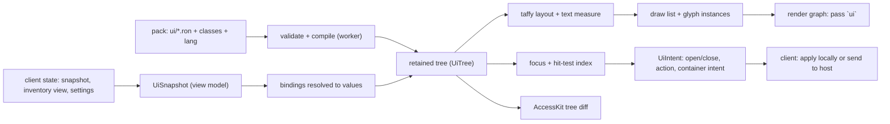

# 13 — UI and UX

> Status: draft for review · Last updated: 2026-11-24
> Depends on: [DEC-003](../decisions.md), [DEC-008](../decisions.md), [DEC-011](../decisions.md), [DEC-017](../decisions.md), [DEC-019](../decisions.md), [DEC-020](../decisions.md), [DEC-023](../decisions.md), [DEC-026](../decisions.md), [DEC-030](../decisions.md), [DEC-032](../decisions.md), [DEC-034](../decisions.md), [DEC-035](../decisions.md), [DEC-041](../decisions.md), [DEC-044](../decisions.md), [00-conventions](00-conventions.md), [02](02-engine-core.md), [03](03-rendering.md), [11](11-inventory-crafting-items.md), [17](17-persistence.md)
> Implements: MS-05 (framework, screens, HUD, inventory interaction, localization scaffolding), MS-12 (visual polish, toasts, motion settings), MS-14 (parity polish)

## 1. Purpose and scope

This chapter specifies the client's user interface: the retained widget tree and its data format, layout and text, the single UI pass in the render graph, focus, hit testing and the accessibility tree, the screen and HUD inventory, the interaction model for inventories, input mapping, theming, animation, and the UX rules that keep first launch, joining a server and recovering from errors from becoming dead ends.

Out of scope: item stack semantics, slot addressing and the authoritative transaction state machine ([11](11-inventory-crafting-items.md)); the accessibility feature set and localization pipeline in depth ([23](23-accessibility-localization.md)); audio rendering and UI sound mixing ([14](14-audio.md)); the render graph, device and frame structure ([03](03-rendering.md)); the scheduler and the `Prepare` stage ([02](02-engine-core.md)); settings persistence and config schema ([17](17-persistence.md), [19](19-server-administration.md)); network transport, tickets and content handshakes ([18](18-networking-multiplayer.md)); pack validation and layering ([15](15-content-system.md)).

The status is **draft for review** for one reason: the text layout engine is still open (§8.1, a parley spike may replace cosmic-text). Everything outside §3.4 holds either way, and the `TextLayout` façade is the migration seam.

The governing decisions are already made: screens are **retained and data-defined**, with no shipping UI framework dependency ([DEC-030](../decisions.md)); all text is localized from day one ([DEC-032](../decisions.md)); and every item move is a host-validated transaction on a reliable ordered stream ([DEC-023](../decisions.md)). This chapter is where those three meet, and the hard part is not pixels — it is making a data-defined UI that cannot lie to the player about their inventory.

## 2. Requirements

| ID | Requirement | Verification | MS |
| --- | --- | --- | --- |
| REQ-UI-001 | Screens are retained trees described by data; no shipping code path builds a game screen imperatively outside `ob_ui`'s screen loader. Developer tools may use another toolkit. | Code inspection + `arch-guard` | MS-05 |
| REQ-UI-002 | `ob_ui` depends on `ob_render` and `ob_content` only. It consumes a read-only `UiSnapshot` and emits `UiIntent`; it never links `ob_sim`, `ob_net` or `ob_client`. | `arch-guard` per [01 §3.2](01-technical-architecture.md) | MS-05 |
| REQ-UI-003 | Every widget has a stable namespaced ID. Focus, scroll offset, tab selection, drag source and text composition survive rebuild, hot reload and resolution change, keyed by ID. | Focus/scroll restore test | MS-05 |
| REQ-UI-004 | Screen documents validate against `openblock.ui/v1` and its hard caps (2,048 nodes, depth 32, 64 KiB text, 256 glyphs per label). Rejection names the screen, node path and reason and never panics. | Validator + fuzz | MS-05 |
| REQ-UI-005 | Layout happens in UI pixels and snaps to whole physical pixels at draw-list build. At every supported scale and DPI, edges land within 1 device pixel of the layout rectangle. | Pixel-probe test at all scales | MS-05 |
| REQ-UI-006 | UI scale supports integer ratios 1–8 and `auto` using the formula of §3.3, presented as 50–400% of the automatic value; a change relayouts in the same frame and preserves focus and scroll by ID. | Scale-matrix screenshot test | MS-05 |
| REQ-UI-007 | Every user-facing string is a Fluent message key resolved through the localization layer; no literal string exists in code, screen data or theme data. | String lint in CI | MS-05 |
| REQ-UI-008 | Text supports bidi reordering, per-character fallback, colour emoji and inline item/key objects. An unrenderable codepoint draws a visible fallback box and is logged once per run, never silently dropped. | Corpus + font-gap test | MS-05 |
| REQ-UI-009 | The whole UI renders in one render-graph pass with at most 64 draw calls and no per-widget bind groups or uniform writes. | RenderDoc capture + frame stats | MS-05 |
| REQ-UI-010 | Hit testing walks the flattened draw list in reverse, respects clip rectangles, and costs ≤20 µs for 1,000 nodes. Pointer capture keeps a drag alive outside the widget and outside the window until release or cancel. | Hit-test bench + capture scenario | MS-05 |
| REQ-UI-011 | Focus is a graph reachable with Tab, arrow keys and a gamepad; modals trap focus and restore it on close; a focus ring of at least 2 UI pixels is always drawn for the focused node. | Keyboard/gamepad navigation suite | MS-05 |
| REQ-UI-012 | The accessibility tree is generated after layout, diffed per frame, and exposes role, name, value and actions for every focusable node. | AccessKit tree snapshot + screen-reader run | MS-05, MS-14 |
| REQ-UI-013 | Every HUD element of §3.8 exists, is anchored as specified, scales with `ui_scale`, and passes input through unless it is interactive. | HUD scene snapshots | MS-05 |
| REQ-UI-014 | Every screen of §3.7 exists with the listed function by its milestone, or the omission is recorded in the parity manifest with a reason. | Manifest diff | MS-14 |
| REQ-UI-015 | Container interaction is intent-based per [DEC-023](../decisions.md) and §3.9. The UI never sends slot contents, never mutates authoritative slots, and renders confirmed plus pending state only. | Model-based transaction test | MS-05 |
| REQ-UI-016 | The gesture-to-intent mapping is exactly the table of §3.9. One gesture produces one intent; a drag produces start, one add per newly entered slot, and end. | Interaction table test | MS-05 |
| REQ-UI-017 | The cursor stack draws above every other UI element, follows the pointer with a 2-UI-pixel offset, is never clipped by a scrolling panel, and on close or disconnect returns to the inventory or drops per [11 §3.5](11-inventory-crafting-items.md). | Scenario: close with cursor full | MS-05 |
| REQ-UI-018 | A tooltip appears after 400 ms of hover, shows the item name, count and typed components, and adds a comparison panel when a comparable item is equipped or on the cursor. | Tooltip golden + comparison matrix | MS-05 |
| REQ-UI-019 | Key hints resolve from the active binding and the current device glyph set; an unbound action hides its hint instead of showing a blank key. | Binding-change test | MS-05 |
| REQ-UI-020 | Input is dispatched through an action map with contexts; the top context consumes. No gameplay code checks a physical key directly. | Inspection + context tests | MS-05 |
| REQ-UI-021 | Remapping supports several bindings per action, conflict detection, per-context scope, reset, import/export, and the physical-versus-logical key distinction. | Remap suite | MS-05 |
| REQ-UI-022 | Keyboard-only, gamepad-only and touch-only operation reaches every interactive element. Touch targets are ≥48 dp inside safe-area insets, and no action is hover-only. | Automated navigation + touch audit | MS-05, MS-14 |
| REQ-UI-023 | Per-screen UI state (selection, scroll, tab, draft text) persists in the client config keyed by screen ID and is never replicated. | Restart test | MS-05 |
| REQ-UI-024 | Hot reload validates on a worker, swaps at a frame boundary, preserves state by ID, defers while a drag or IME composition is active, and rolls back with a visible error on failure. | Reload-while-dragging test | MS-05 |
| REQ-UI-025 | Pack screens cannot execute code, issue draw commands, open files or sockets, or imitate trusted chrome. They render inside a frame that names the owning pack. | Capability test + spoof fixtures | MS-09 |
| REQ-UI-026 | Mod-supplied values refresh at ≤10 Hz and are applied atomically per screen revision; mod actions are rate-limited and attributed per mod. | Quota test | MS-09 |
| REQ-UI-027 | Themes are token tables with per-class states; contrast is validated at pack compile (4.5:1 normal text, 3:1 large text) and a failing pair rejects the theme with both colours named. | Theme compiler + contrast test | MS-05 |
| REQ-UI-028 | Animation is declarative, disabled by the reduced-motion preset, capped at 16 animated nodes per screen, and never changes gameplay or focus order. | Motion-off snapshot equality | MS-05 |
| REQ-UI-029 | The join flow shows named phases, determinate progress where the server provides it, and a cancel action in every phase; it never blocks the window or the frame loop. | Scripted join with injected stalls | MS-06 |
| REQ-UI-030 | Every error is a dialog with at most three actions, an escape path, copyable details and a path to the log; no error is a modal dead end. | Error-injection scenarios | MS-05 |
| REQ-UI-031 | Settings are one searchable list with live application, per-row default, tooltip, restart badge and read-only server-enforced rows. | Settings matrix test | MS-05 |
| REQ-UI-032 | The UI remains interactive while the game is paused; pausing stops ticks, never frames or input. | Pause scenario | MS-05 |
| REQ-UI-033 | The UI meets the budgets of §5 in CI scenes at 1080p and 4K, on the reference machine and on a low-end GPU profile. | Perf scenes + bench box | MS-05 |

## 3. Design

### 3.1 Layering and ownership



`ob_ui` owns the tree, layout, text, draw list, focus, input routing and the accessibility tree. The client (`ob_client`) owns the view model: it reads the latest snapshot and the confirmed-plus-pending inventory view ([11 §3.4](11-inventory-crafting-items.md)), builds a `UiSnapshot` in `Prepare`, calls `ob_ui::update`, and forwards the resulting `UiIntent`s — to the host for container and gameplay actions, locally for screen navigation and settings. The UI never reads simulation memory, which is both the crate rule ([REQ-UI-002](#2-requirements)) and the reason a mod screen cannot inspect the world.

UI work runs in the `Prepare` stage ([02 §3.2](02-engine-core.md)) and is charged to that stage's budget: apply input events, advance animations, refresh dirty bindings, relayout dirty subtrees, rebuild the draw list if dirty, rebuild the accessibility diff. The draw list and glyph instances travel in the `FramePacket` and are consumed by pass 16 of [03 §3.9](03-rendering.md) — one pass, `LoadOp::Load`, no depth, sRGB target, after `tonemap-grade`.

### 3.2 The retained tree and screen definitions

A screen document is RON with a schema version, a namespaced ID, a class table and a widget tree. It is deliberately not a programming language: structure, classes, bindings and typed actions only.

```ron
(
  schema: "openblock.ui/v1",
  id: "openblock:inventory",
  classes: { "root": (layout: (direction: "row", gap: 8, padding: 7, align: "start")) },
  root: (kind: "panel", class: ["root"], children: [
    (kind: "slot_grid", id: "craft", group: "crafting", cols: 2),
    (kind: "slot", id: "result", group: "result", quick_move: "inventory"),
    (kind: "player_inventory", id: "inv"),
    (kind: "label", id: "hint", text: (key: "openblock.inventory.hint")),
  ]),
  on_open: (action: "openblock:inventory/focus", args: { node: "inv" }),
)
```

The runtime tree is an arena; IDs are interned `UiNodeId(u32)` values derived from the document path plus the screen ID, so a node keeps its identity across rebuilds. Node state is split into three dirty bits — **layout**, **paint** and **text** — and each pass only touches dirty subtrees, which is what keeps a 46-slot inventory at a few microseconds of maintenance per frame.

| Field | Type | Meaning |
| --- | --- | --- |
| `kind` | `WidgetKind` | Closed set of widget types (§4.1); new kinds require a schema version bump |
| `id` | `Option<WidgetId>` | Namespaced path segment, unique within the screen |
| `class` | `SmallVec<ClassId>` | Style selectors resolved against the theme |
| `layout` | `LayoutSpec` | Flex/grid properties, translated to taffy |
| `text` | `Option<TextSpec>` | `{ key, args }`; never a literal |
| `bind` | `Option<Binding>` | Read-only view-model path or formatted message |
| `when` | `Option<Condition>` | Typed comparison controlling visibility and enabled state |
| `actions` | `ActionMap` | `activate`, `adjust`, `context`, `drop`, `hover_start` |
| `flags` | `NodeFlags` | `focusable`, `modal`, `clip`, `hit_test`, `scroll`, `monospace` |

Limits are enforced at validation, not clamped at runtime: 2,048 nodes, depth 32, 64 KiB of text per screen, 256 glyphs per label, 16 inline objects per line, 256 widgets per scroll container. A document that exceeds a limit fails with `openblock.ui: <screen> at <node path>: <limit> exceeded (<actual> > <max>)`, which is the message a pack author sees.

### 3.3 Layout, scale and DPI

Layout uses taffy's flex and grid algorithms with a text-measure closure. All content values are **UI pixels (uipx)**: at `ui_scale = 1`, one uipx is one logical pixel, and the layout is designed against a minimum viewport of 320×240 uipx. The pipeline is:

```text
layout rects (f32 uipx)
  -> device_px = round(uipx * ui_scale * dpi_scale)
  -> glyph size = max(8, round(base_glyph_px * ui_scale * dpi_scale))
  -> draw list with integer device-pixel edges
```

`ui_scale` is an integer ratio 1–8 or `auto`. The automatic value follows the genre convention of a 320×240 minimum viewport, cited in [research/08](../research/08-ui-audio-localization.md) §4.2, and the settings row presents the manual choice as 50–400% of that automatic value ([23 §3.11](23-accessibility-localization.md)):

```text
auto = clamp(min(floor(width_px / 320), floor(height_px / 240)), 1, 8)
```

Rules that make this testable:

1. Layout is computed in `f32`, but the draw list contains only integer device-pixel rectangles. No rectangle edge is ever fractional.
2. When `ui_scale × dpi_scale` is not an integer, edges still snap individually; adjacent elements may therefore differ by one device pixel. The pixel-probe test allows exactly one and reports the distribution.
3. Vector glyphs are rasterised at the device size, never scaled from a bitmap. The default pixel font is a bitmap atlas and is drawn only at integer multiples of its design size; when the effective scale is fractional, body text uses the vector face and HUD numerals use the nearest integer multiple, so the pixel look survives on non-integer DPI.
4. The root is inset by the safe-area rectangle (notches, rounded corners, TV overscan) plus 8 uipx; no interactive widget may be clipped by it.
5. Resolution and DPI changes are applied at a frame boundary: relayout the whole tree, rebuild the glyph cache, keep focus, scroll and selection by ID, and re-run contrast validation only if the theme changed (it does not).
6. A minimum viewport of 320×240 uipx is enforced. Below it the UI scales down rather than clipping, and logs one warning. A percentage request that does not round to an integer ratio is rounded, and the settings row says which ratio is in effect.

### 3.4 Text, fonts and the glyph atlas

Text is behind a narrow façade so the engine can change without touching a single widget:

```rust
pub trait TextLayout {
    fn measure(&mut self, spec: &TextSpec, width: Option<f32>) -> TextMetrics;
    fn shape(&mut self, spec: &TextSpec, width: Option<f32>, out: &mut GlyphSink);
    fn inline_objects(&mut self, spec: &TextSpec) -> SmallVec<[InlineObject; 8]>;
}
```

The baseline implementation is cosmic-text for shaping, bidi and fallback, with glyphon for atlas packing and drawing. Inline objects (item icons, key glyphs, images) are U+FFFC placeholders resolved by the UI layer, never glyphs. The font stack is: a bitmap pixel atlas for the default UI face, bundled vector faces for Latin/Greek/Cyrillic and language-pack faces for CJK, Arabic, Hebrew and Devanagari, and an explicitly styled fallback box for anything unresolved.

| Resource | Size | Contents |
| --- | --- | --- |
| Bitmap face | 1024×1024 R8 = 1 MiB | 16×16 cells, 64 columns, 4,096 glyphs; nearest sampling; 1 px shadow drawn as an offset instance |
| Vector glyph pages | 2,048² R8 = 4 MiB per page; 2–4 pages, LRU; ≤ 12 MiB total | Rasterised at device size, subpixel-bin keyed |
| Widget atlas | 2,048² RGBA8 = 16 MiB on desktop, 1,024² on mobile | 9-slice sprites, icons, slot backgrounds, focus ring |
| Text memory ceiling | 16 MiB | Bitmap page plus vector pages; the widget atlas is budgeted separately in §5 |

Caches are keyed by content, not by widget: layout by `(key, locale, args_hash, width_class, style_hash)`, glyphs by `(face, device_px, subpixel_bin)`. A label that changes every frame (coordinates, boss-bar health) is a formatting job on a cached layout, not a re-shape. Text is laid out once per hover for tooltips, once per message for chat, and never for a hidden screen.

### 3.5 Draw list, batching and the UI pass

The retained tree flattens into a draw list only when a paint bit is set. The draw list is a vector of commands in paint order; the renderer turns it into one instance buffer and one indirect draw per batch.

```rust
pub enum DrawCmd {
    Rect   { rect: PixelRect, colour: Rgba8, clip: ClipId },
    Nine   { rect: PixelRect, sprite: SpriteId, border: u16, tint: Rgba8, clip: ClipId },
    Glyph  { rect: PixelRect, page: u8, uv: [u16; 4], colour: Rgba8, clip: ClipId },
    Icon   { rect: PixelRect, sprite: SpriteId, tint: Rgba8, clip: ClipId, count: Option<u16> },
}
```

Batching sorts by `(layer, pipeline, atlas page)` and preserves painter's order within a layer. Clipping is a scissor rectangle per command, so clips are rectangular; rounded corners and irregular masks come from sprite alpha, not from stencil. Nine-slice is a shader mode driven by the `border` value, not nine quads per widget. There are no per-widget bind groups, no per-widget uniforms and no per-widget vertex buffers; the instance record is 32 bytes:

| Offset | Size | Field |
| ---: | ---: | --- |
| 0 | 16 | `rect` as `x, y, w, h` in f32 device pixels |
| 16 | 4 | `uv` origin and size packed as four `u16` |
| 24 | 4 | `colour` as `Rgba8` |
| 28 | 2 | `clip` index into the scissor table |
| 30 | 1 | `kind` and flags (nine-slice, glyph, icon) |
| 31 | 1 | atlas page |

The pass targets the swapchain image with `LoadOp::Load`, blending premultiplied alpha, no depth attachment, and the pipeline state cached per `(blend, atlas)` pair. UI is drawn after tone mapping so text keeps its authored contrast instead of being graded.

### 3.6 Focus, hit testing and the accessibility tree

Hit testing walks the flattened draw list backwards, intersects the pointer with each command's rectangle after clip, and stops at the first entry with `hit_test = true`. Pointer capture begins on press: the captured node receives move and release events even when the pointer leaves the widget, leaves the window, or is over another screen. Escape cancels a container drag and returns the cursor stack; a second Escape closes the screen.

| Interaction constant | Value | Note |
| --- | --- | --- |
| Click versus drag threshold | 4 uipx | Below it, a press-and-release is a click |
| Double-click window | 250 ms | Only on the same node |
| Tooltip delay | 400 ms | 0 ms while the pointer stays in the same slot grid |
| Scroll step | 24 uipx per notch | Smooth-scroll duration 120 ms, disabled by reduced motion |
| Focus ring | 2 uipx, 4.5:1 against both neighbours (the floor is 3:1, [23](23-accessibility-localization.md)) | Never suppressed, even with `:focus-visible` heuristics |
| Gamepad repeat | 250 ms delay, 60 ms interval | Stick deadzone 0.15, trigger threshold 0.30 |

Focus is a graph over focusable nodes in document order, overridable by `tab_index`, with spatial navigation inside grids and lists. A modal pushes a trap; closing restores the previously focused node if it still exists, otherwise the nearest surviving ancestor. Focus and accessibility focus are the same thing: there is one current node, and the accessibility tree's `FOCUSED` flag follows it.

The accessibility tree is built after layout from the same node set, with role, name (the same localized message the widget draws), value (slider position, toggle state, slot contents), and the actions the node exposes plus a custom `quick_move` action for slots. It is diffed and published per frame; rebuilding the whole tree each frame is forbidden because it breaks screen readers. The narrator queue reads the same names, so a screen is never described twice with different words.

### 3.7 Screen inventory

Every screen is a document in the `openblock:base` pack (`ui/<name>.ron`), opened by ID. "Chrome" means the frame is engine-owned and the pack may style it but not replace its controls.

| Screen | Key | Contents and notes | MS |
| --- | --- | --- | --- |
| Boot | `openblock:boot` | Static logo, progress for pack load and registry freeze; no buttons until the app is responsive | MS-03 |
| Main menu | `openblock:main_menu` | Single player, multiplayer, settings, quit; version, build hash, account-free identity; background is a pre-rendered panorama, never a live world | MS-05 |
| World select | `openblock:world_list` | Sorted list with last-played time, game mode, version badge, search, rename/copy/delete/backup, open-folder; one click to play | MS-05 |
| Create world | `openblock:world_create` | Name, seed, game mode, difficulty, world type, generator options, cheats, data-pack selection; advanced tabs collapsed by default | MS-05 |
| Join progress | `openblock:join` | Phases of §3.13.2 with byte-level progress where provided, cancel, log link | MS-06 |
| Settings | `openblock:settings` | One searchable list of sections: video, audio, controls, language, accessibility, chat, packs, mods (§3.13.4) | MS-05 |
| Pause | `openblock:pause` | Resume, settings, open to LAN, disconnect, quit; single-player pause also shows the seed and the world name. Pause availability and the "the world keeps running" banner follow [23 §3.15](23-accessibility-localization.md) | MS-05 |
| HUD | `openblock:hud` | §3.8; not modal, never captures focus, hidden in spectator except the hotbar rule of §3.8 | MS-05 |
| Inventory | `openblock:inventory` | Survival 2×2 crafting plus 36 slots; creative adds the item palette, search, tabs and delete-slot | MS-05 |
| Crafting table | `openblock:crafting` | 3×3 grid, result slot, recipe book toggle | MS-10 |
| Recipe book | `openblock:recipe_book` | Recipe search, category tabs, craftable-only filter, ghost placement; owner-only unlocks ([11 §3.7](11-inventory-crafting-items.md)) | MS-10 |
| Chest family | `openblock:chest` | 27-slot chest/barrel/shulker, 5-slot hopper, 9-slot dropper/dispenser, 9-slot crafter with disabled-slot mask | MS-10 |
| Furnace family | `openblock:furnace` | Input, fuel, output, progress, burn indicator; lit state comes from the block, never from the UI | MS-10 |
| Station family | `openblock:station` | Anvil, grindstone, stonecutter, smithing table, cartography table, loom; result slot appears only when the inputs match | MS-11 |
| Enchanting | `openblock:enchanting` | Three offers with level costs, lapis slot, enchantment hints, seed-driven reroll display | MS-11 |
| Brewing | `openblock:brewing` | Three bottles, ingredient, fuel, progress bar | MS-11 |
| Trading | `openblock:trading` | Two input slots, result, offer list with prices, restock timer, trade cycling | MS-11 |
| Beacon | `openblock:beacon` | Payment slot, effect choice, confirmation | MS-11 |
| Text editor | `openblock:text_editor` | Sign and book editing: grapheme-aware caret, selection, clipboard, IME; books page left/right | MS-10 |
| Chat and commands | `openblock:chat` | Scrollback, tab completion of commands and names, message history, rate-limit feedback | MS-06 |
| Death | `openblock:death` | Cause message, score summary, respawn and title screen; never blocks the world behind it | MS-05 |
| Advancements | `openblock:advancements` | Tabs, tree view with pan and zoom, per-node progress; same document pattern as statistics | MS-11 |
| Statistics | `openblock:statistics` | General, blocks, items, mobs, per-world totals | MS-11 |
| Social | `openblock:social` | Player list with ping and mute, op actions gated by permission, no client-side reporting path | MS-06 |
| Multiplayer | `openblock:multiplayer` | Server list with status ping, favourites, add/edit/direct connect/ticket paste, LAN discovery | MS-06 |
| Pack manager | `openblock:packs` | Installed packs, order, enable/disable, dependency errors, open folder, apply-and-reload | MS-05 |
| Mod content | `openblock:mods` | Server-provided content list, verification status, restart-required badge; install flows are a browser handoff, never an in-game downloader | MS-09 |
| Error dialog | `openblock:error` | §3.13.3; chrome-owned, at most three actions | MS-05 |
| Confirm dialog | `openblock:confirm` | Chrome-owned; destructive actions require an explicit typed or held confirmation | MS-05 |
| Onboarding | `openblock:onboarding` | Dismissible cards: move, mine, place, craft, open inventory; skippable in one click and never shown twice | MS-05 |
| Credits and licences | `openblock:credits` | Attribution for OFL fonts, CC BY assets, dependencies; scrollable text from the build metadata | MS-05 |
| Debug overlay | `openblock:debug` | Toggleable multi-page diagnostics overlay; developer surface, no gameplay paths | MS-02 |
| Disconnected | `openblock:disconnected` | Reason, reconnect, copy details; reuses the join screen for a retry | MS-06 |

### 3.8 HUD

The HUD is one screen drawn above the world and below any modal screen. Widgets bind to view-model paths refreshed per tick, interpolate where the value is continuous, and never allocate in steady state.

| Element | Anchor | Binding and behaviour |
| --- | --- | --- |
| Crosshair | centre | Hidden by the `hide_hud` binding (F1 by default); changes shape when a block is targeted |
| Hotbar | bottom centre | 9 slots, selection driven by the scroll wheel or number keys; offhand slot left of it |
| Health and absorption | bottom left, above hunger | 10 hearts of 2 HP; flashes on damage; absorption as a second row |
| Food | bottom right | 10 hunger icons; shake when exhausted; hidden in peaceful difficulty, where hunger does not apply |
| Armor | above health | Shown only when any armor slot is occupied |
| Air | above hunger | Bubbles while submerged, blinking below 3 bubbles |
| Experience | bottom centre, above the hotbar | Green bar with level number; level and progress in per-mille from the snapshot ([08 §2](08-gameplay-survival.md)) |
| Attack indicator | below crosshair | Cooldown sweep, or a crosshair dot, per setting |
| Item cooldown | over the slot | Radial sweep from the item's cooldown component |
| Boss bar | top centre | One bar per boss, stacked; name, colour, segment count |
| Action bar | above the hotbar | Transient text with a 60-tick lifetime, replaced not queued |
| Title and subtitle | centre third | Timed sequence from content; reduced-motion variant fades instead of sliding |
| Chat | bottom left | Last 10 lines visible, scrollback to 100; fades after 200 ticks unless pinned |
| Scoreboard | right | Sidebar with objective name and up to 15 lines, ordered by score then name |
| Tab list | top, on hold | Player names and ping; header and footer from the server |
| Toasts | top right | Achievement, recipe, system; stacked to 5, each 100 ticks, click to open context |
| Effect icons | top right | Status effects with duration; hidden when the inventory is open |
| Subtitles | bottom centre, above the hotbar | Direction arrows and captions from the audio layer ([14](14-audio.md)) |
| Debug overlay | left | FPS, frame and tick percentiles, position, chunk, light, logic counters, network stats |

The HUD takes no focus and no pointer capture. Interactive HUD elements (toasts, chat when a key is held) temporarily push a focus scope, and releasing the key returns focus to gameplay without moving the camera. In spectator mode the HUD reduces to the action bar, chat, toasts and the spectator menu: the hotbar, health, hunger and experience are hidden because they describe an inventory the player no longer has.

### 3.9 Interaction model and containers

Input arrives as actions from §3.11; the UI translates pointer and keyboard gestures into container **intents**. The host resolves each intent against the authoritative inventory and answers with a delta or a full snapshot ([11 §3.4](11-inventory-crafting-items.md), [DEC-023](../decisions.md)). The client predicts with the same pure function and renders confirmed plus pending state; it never sends slot contents, and it never mutates a confirmed slot.

| Gesture | Intent | Host resolution |
| --- | --- | --- |
| Left click a slot | `Click { Left, slot }` | Swap cursor and slot; merge when the same item type and stackable |
| Right click a slot | `Click { Right, slot }` | Place one, or take half when the cursor is empty |
| Shift + left click | `QuickMove { slot }` | Merge into the counterpart region: container → main → hotbar when moving out, hotbar → main → container when moving in; matching stacks first, then empty slots, lowest index first |
| Double left click | `Gather { slot }` | Collect matching items from the player inventory into the cursor |
| `1`–`9` on a slot | `SwapHotbar { slot, hotbar }` | Swap the slot with that hotbar slot |
| `Q` / `Ctrl+Q` | `Drop { slot, all }` | Drop one item, or the whole stack, at the player's feet |
| Left drag | `DragStart { Left }`, `DragAdd { slot }`…, `DragEnd` | Distribute `floor(total/n)` per visited slot in visit order, remainder to the earliest slots (`n` = distinct visited slots) |
| Right drag | `DragStart { Right }`, `DragAdd { slot }`…, `DragEnd` | One item per visited slot |
| Middle drag (creative) | `DragStart { Clone }`, `DragAdd`, `DragEnd` | Clone the source stack into visited slots |
| Click outside the window | `Drop { cursor, all: true }` | Drop the cursor stack into the world |
| Escape or close | `Close` | Return the cursor to the inventory, drop what does not fit ([11 §3.5](11-inventory-crafting-items.md)) |

These `Intent` names are UI operations, not a second wire vocabulary: each maps onto the canonical intent set and state machine of [11 §3.4](11-inventory-crafting-items.md) — `QuickMove` is `ShiftClick`, `SwapHotbar` is `Swap`, `Click` selects the `PickUp`/`PlaceAll`/`PickHalf`/`PlaceOne` intent from button and cursor state, and `Drag`, `Gather`, `Clone`, `Drop` and `Close` use the intents of the same names. The UI never defines its own slot-contents message; the transaction, its sequence idempotency, revision-plus-fingerprint check and resync are owned by [11 §3.4](11-inventory-crafting-items.md) under DEC-023.

Additional rules:

1. A drag emits `DragAdd` at most once per slot per drag, in visit order; re-entering a slot does not re-add. Releasing outside the window ends the drag and drops the cursor, exactly like a click outside.
2. The client sends at most 20 container intents per second; the UI coalesces drag events and never sends a duplicate of an unacknowledged intent.
3. The cursor stack is drawn in a final layer with no clip, at the pointer plus 2 uipx, with the item icon, count and durability bar. It is the only UI element allowed to draw outside its parent.
4. On a revision mismatch the UI applies the full snapshot and clears pending intents; the only visible change is the corrected slot, with no flash animation, because a flash on every correction reads as a bug.
5. Creative-mode delete and clone are separate intents gated by permission ([08 §3.1](08-gameplay-survival.md)); a survival client never sends them, and the host rejects them if it does.
6. While a container screen is open, gameplay input is suppressed except the inventory key, Escape and chat; the camera does not rotate.

### 3.10 Data-driven UI for content packs and mods

A pack may add screens, classes, styles, icons and translations. It may not add behaviour. The extension points are:

| Extension | Mechanism | Limits |
| --- | --- | --- |
| New screen | A `ui/<name>.ron` document with a namespaced ID and `openblock.ui/v1` | Same caps as base screens; must not be named `openblock:*` |
| New widget arrangement | Any composition of the closed widget set | Depth 32; no recursion; no includes that resolve at runtime |
| New values | `bind` to a path the client publishes for packs: player state, inventory view, scoreboard, time, world name, mod values | Paths are enumerated in the schema; unknown paths fail validation |
| New actions | Typed action IDs registered by the pack or by a mod; the UI emits them, the client or host validates them | Action registry is namespaced; unknown actions fail validation |
| New theme | Token overrides per class and state, with pack layering per [DEC-019](../decisions.md) | Contrast validation; no shader or draw-call access |
| Mod values | WASM `ui_values(screen, revision)` at ≤10 Hz, `ui_action(screen, action, args)` | 1 ms per call, 64 MiB, kill-and-disable on trap ([16](16-modding.md)) |

Validation runs on the whole resolved pack set at load and on hot reload: schema, caps, class references, binding paths, action IDs, message keys, icon references, contrast. Errors are collected per document, not fail-fast, because a mod author needs the whole list.

Pack screens render inside an engine-owned frame that shows the pack name and a "close" affordance. A pack screen cannot draw over the frame, cannot request a system confirmation, cannot pre-fill a text field with a password-like value, and cannot open itself without a user action or an accepted server request. That is the anti-spoofing rule: trusted chrome is never composable from content ([REQ-UI-025](#2-requirements)).

Hot reload watches `ui/`, `lang/` and pack roots with a 100 ms debounce, parses and validates on a worker, and swaps at a frame boundary. State is preserved by node ID; if a focused node disappears, focus moves to its nearest surviving ancestor. A reload during a container drag or an IME composition is deferred until the gesture ends. A failed reload leaves the previous tree in place and shows a toast that opens the validation report.

### 3.11 Input mapping and remapping

```rust
pub enum Binding {
    Key      { physical: bool, code: KeyCode },
    Mouse    { button: MouseButton },
    Pad      { button: PadButton },
    PadAxis  { axis: PadAxis, sign: i8 },
    Touch    { gesture: TouchGesture },
}

pub struct ActionDef {
    pub id: ActionId,              // snake_case ASCII, e.g. "inventory", "move_forward"
    pub contexts: ContextMask,     // GAMEPLAY | MENU | CONTAINER | CHAT | DEV
    pub bindings: SmallVec<[Binding; 4]>,
    pub hold: HoldMode,            // Held | Toggled | Repeat
}
```

Contexts stack (`Dev` over `Menu` over `Gameplay`); the top context receives the action and decides whether to consume it. Text fields consume keys only while focused. Gameplay movement binds to **physical** key positions so WASD stays WASD on AZERTY; shortcuts bind to **logical** keys so Ctrl+Z is Ctrl+Z everywhere. The remap screen shows both when they differ, detects conflicts per context, refuses to leave an action unbound without an explicit confirmation, and imports/exports the whole map as RON.

Gamepad support is focus-based, never pointer-based: the left stick drives focus traversal, A activates, B goes back, shoulder buttons switch tabs, and the triggers page lists. The glyph shown in hints comes from the controller family the platform reports, with a Nintendo face-button swap option. Disconnecting the last gamepad pauses the game in single-player and shows a non-modal hint in multiplayer.

Touch is designed now even though Android ships later ([DEC-034](../decisions.md)): a virtual stick on the left, a look region on the right, action buttons with 48 dp targets inside safe-area insets, long-press as a contextual action rather than a hidden primary one, and the platform back gesture closing the top modal.

### 3.12 Theming, animation and UI sound

A theme is a token table plus class states. Tokens are colours (sRGB and linear), 9-slice sprites, font faces, a spacing scale, corner radii, and sound event IDs for hover, click and error. Classes resolve `normal`, `hover`, `pressed`, `disabled`, `focus`, `selected` and `invalid`, so a pack can restyle a button once and every screen inherits it.

Contrast is validated at pack compile against the WCAG 2.1 AA thresholds used by the accessibility chapter — 4.5:1 for normal text, 3:1 for large text and non-text indicators — and a failing pair rejects the theme with both colours and the class named. Colour is never the only channel: focus, selection, error and disabled states each carry a shape or icon difference as well.

Animation is declarative and presentation-only. A transition names a property (`opacity`, `offset`, `scale`, `colour`, `scroll`), a duration in milliseconds, an easing curve from a closed set, and an optional delay. Rules: nothing animates on first layout; at most 16 nodes animate concurrently per screen; a transition never reorders nodes, changes focus, or delays an action; the reduced-motion preset sets every duration to zero and swaps sliding for fading; the test clock is injected so golden screenshots are frame-exact. UI sounds are emitted as sound events from the same class state machine ([14](14-audio.md)) and are muted by the UI volume channel, independently of the master volume.

### 3.13 UX principles and flows

**3.13.1 Low-friction first launch.** No account, no login, no launcher. First run probes the device (GPU tier, display size, RAM, input devices), picks a preset, and lands on the main menu with "Create world" focused and a name already suggested. Onboarding cards appear only in the first world and are dismissible forever with one click. Render distance is expressed in blocks: 512 blocks (32 chunks of 16) by default, and 128 blocks (8 chunks) on the minimum spec, with the settings row showing both the block value and the chunk count.

**3.13.2 Joining a server.** A ticket is `host:port#fingerprint` or an `openblock://` link ([DEC-026](../decisions.md)). The join flow has named phases, each cancellable:

| Phase | What the player sees | Failure action |
| --- | --- | --- |
| Resolve | "Looking up the server" | Retry, edit address |
| Secure | Fingerprint words with a first-connection warning (TOFU) | Cancel, copy fingerprint |
| Handshake | Protocol and content verification | "Update the game" or "Content mismatch: open pack manager" |
| Transfer packs | Determinate download progress where provided | Retry, cancel |
| Receive world | Spawn ring progress, then "Ready" | Cancel returns to the server list |
| Play | World fades in; chat says who joined | — |

The window never freezes: the join runs on the network and job pools, and the UI renders at full frame rate with an animated, cancellable progress state. A content-hash mismatch shows a difference summary — missing packs, extra packs, version mismatches — and never a bare error code.

**3.13.3 Error recovery.** Every error is a dialog with a title in plain language, a one-sentence body, at most three actions (primary first), a collapsed details view with a copy button, and a path to the log file. Escape always closes it. Errors that occur while a screen is open restore focus to the previously focused node. Fatal errors of the abort class ([DEC-042](../decisions.md)) show a crash screen with the report path and a restart action; the UI never tries to continue rendering a corrupt world.

**3.13.4 Settings.** One searchable list; sections for video, audio, controls, language, accessibility, chat, packs and mods ([DEC-044](../decisions.md) snake_case keys, canonical list in [08](08-gameplay-survival.md)). Each row shows a localized label, the control, its default, a tooltip, an optional "restart required" badge, and a searchable keyword set. Changes apply live unless the row says otherwise; a server-enforced row is read-only with an explanation. Reset applies per section or globally with confirmation. Invalid values are rejected inline with the accepted range, never silently clamped.

**3.13.5 No modal dead ends.** A modal must have an escape action, a focus trap and a visible way back. Screens that can be reached from gameplay keep the pause path available. Loading states over one second show what is happening and offer cancel; states over ten seconds show a "still working" note. Nothing in the UI blocks the frame loop, and no screen is a terminal state without at least one action.

## 4. Data structures and formats

```rust
pub struct UiTree {
    pub screen: ScreenId,
    pub revision: u32,
    pub nodes: SlotMap<UiNodeId, WidgetNode>,
    pub root: UiNodeId,
    pub focus: FocusState,
    pub drag: Option<DragState>,
    pub layout_dirty: DirtySet,
}

pub struct FocusState { pub current: Option<UiNodeId>, pub ring_visible: bool, pub trap: Option<UiNodeId>, pub stack: Vec<UiNodeId> }

pub struct UiSnapshot {                  // built by the client, read-only in ob_ui
    pub screen: ScreenId,
    pub revision: u32,
    pub values: ValueStore,              // interned paths -> typed values
    pub inventory: InventoryView,        // confirmed + pending, per 11 §3.4
    pub locale: LocaleId,
    pub device: DeviceCaps,
}

pub enum UiIntent {
    Open(ScreenId), Close, Back,
    Action { id: ActionId, args: ActionArgs },
    Container(ContainerIntent),          // exactly the intents of 11 §3.4
    SetSetting { key: SettingKey, value: SettingValue },
    Copy(String), OpenUrl(String),
}
```

| Record | Size | Notes |
| --- | ---: | --- |
| `WidgetNode` | ≤ 192 B | Includes class list, text spec, binding and action map inline; large payloads are interned |
| `DrawCmd` | 24 B | 4 commands per cache line for a typical screen |
| `UiInstance` | 32 B | GPU instance, §3.5 byte table |
| Glyph instance | 24 B | position, uv, colour, page and flags |
| Screen document | ≤ 64 KiB text | Validated cap; typical base screen is 2–6 KiB |
| Per-node accessibility record | ≤ 96 B | Role, name key, value slot, action bits |

**4.1 Widget set.** The closed set is: `panel`, `grid`, `row`, `column`, `spacer`, `scroll`, `tabs`, `label`, `rich_text`, `button`, `toggle`, `slider`, `text_input`, `dropdown`, `list`, `slot`, `slot_grid`, `item_icon`, `progress`, `image`, `nine_slice`, `key_hint`, `badge`, `tooltip`, `modal`, `toast_host`, `player_inventory`, `recipe_grid`. A pack cannot add a widget kind; a new kind is a schema version bump, because every kind carries layout, focus and accessibility behaviour that a data-only extension cannot provide.

**4.2 Persistence.** UI state is client-local: the last screen per world, per-screen scroll and selection, the action map, `ui_scale`, theme, language and accessibility toggles live in the client config and are never sent to a server. Server-enforced settings are copied into the view model as read-only values, not persisted. Nothing in this chapter is written to a world save.

## 5. Performance budgets

The `ui_stress` scene is a 46-slot inventory with a full cursor, a 1,000-widget settings page with search open, 100 chat lines, a tooltip visible, 5 toasts and a HUD, measured at 1080p with `ui_scale = auto` and at 4K with `ui_scale = 2` (a 200 % effective scale).

| ID | Budget | Measurement |
| --- | --- | --- |
| PERF-UI-001 | UI CPU ≤ 0.15 ms p95 in a gameplay frame (the PERF-CPU-004 attribution of [25 §5](25-performance-budgets.md)), and ≤ 0.5 ms p99 for a full-screen 1,000-widget menu measured alone | `bench_ui_cpu`, GPU timestamps off |
| PERF-UI-002 | UI GPU ≤ 0.20 ms p99 at 1080p high preset, ≤ 0.30 ms absolute ceiling at 4K | pass 16 timestamps |
| PERF-UI-003 | ≤ 64 draw calls and ≤ 200,000 vertices for any base screen plus the HUD | RenderDoc + frame stats |
| PERF-UI-004 | Zero heap allocations per frame in steady state (after warm-up) in the UI thread | allocation counter in CI |
| PERF-UI-005 | Layout ≤ 0.5 ms for 1,000 nodes; incremental relayout of a 46-slot inventory ≤ 50 µs | `bench_ui_layout` |
| PERF-UI-006 | Hit test ≤ 20 µs for 1,000 nodes | `bench_ui_hit` |
| PERF-UI-007 | Text layout ≤ 50 µs for an uncached 80-character line; ≤ 2 µs for a cached label refresh | `bench_ui_text` |
| PERF-UI-008 | Widget atlas ≤ 16 MiB GPU; glyph pages ≤ 16 MiB; UI CPU memory ≤ 8 MiB | allocation counter + size assertions |
| PERF-UI-009 | Screen open to interactive ≤ 16.7 ms for a 500-node document, including validation and first layout | scripted open test |
| PERF-UI-010 | Hot reload validation ≤ 250 ms for the base pack, and ≤ 1 s for a 20-pack set | reload benchmark |
| PERF-UI-011 | Container round trip: the local optimistic change is visible in ≤ 16 ms; the confirmed state converges within one RTT | network simulator |

PERF-UI-001 has two measurements and they must not be added. The gameplay attribution is PERF-CPU-004 (0.15 ms p95 at 200 visible widgets, 4K, UI scale 200 %) in [25 §5](25-performance-budgets.md), where the HUD is the only UI; the 0.5 ms ceiling applies to full-screen menus and container screens, where the world contributes a camera and a background rather than a simulation. Both obey the 2.0 ms CPU main-thread frame target of [vision §8](../vision.md).

Budgets are gates, not goals ([DEC-035](../decisions.md)); the authoritative table is [25](25-performance-budgets.md), which may tighten but not loosen them without a new decision.

## 6. Failure modes and edge cases

| Failure | Detection | Behaviour |
| --- | --- | --- |
| Resolution or DPI change while dragging | Window event | Finish the drag against the old layout, relayout at the frame boundary, keep focus and scroll; the cursor stack is repositioned from the new pointer mapping |
| Scale change makes the screen smaller than the 320×240 minimum | Scale clamp | Clamp to the minimum, log once, allow scrolling; never clip actionable content |
| Missing glyph (font gap, unusual script) | Shaping result | Draw the fallback box with the codepoint in the tooltip, log once per run, keep the rest of the line readable |
| Missing font file or corrupt atlas | Load validation | Substitute the bundled fallback face, show a non-blocking warning with the pack name; a base-pack failure is an install error with a repair action |
| RTL text inside an LTR screen | Bidi resolution | Bidi reorders the run and the layout mirrors through start/end properties per [23 §3.7](23-accessibility-localization.md); coordinates, key names, numbers and maps are isolated and stay LTR |
| Pseudolocale expansion overflows a label | Layout overflow | Widget declares clip, ellipsis or wrap-and-grow; overflow without a policy is a validation error, not a rendering surprise |
| Inventory larger than the window cap | Pack validation / host check | Reject the window layout at load ([11 §3.3](11-inventory-crafting-items.md)); never paginate silently |
| Mod screen steals focus or opens itself | Intent validation | Only user actions and accepted server requests may open a screen; focus changes from a mod are ignored and attributed |
| Mod screen layout bomb (2,048 nodes of nested grids) | Caps + time budget | Rejected at validation; if a valid screen still costs too much, the UI degrades to a static "screen disabled" panel |
| Mod action spam | Rate limit | Actions above 20/s are dropped and counted; the mod is warned, then disabled on repeat |
| Mod impersonates trusted chrome | Frame containment | Pack screens cannot draw outside their frame; system dialogs are engine-owned |
| Server forces a screen or setting | Intent validation | Server may request a registered screen by ID and force setting values; it cannot supply content, code or draw commands (§8.3) |
| Container revision mismatch | Server delta | Apply the full snapshot, clear pending intents, no visual flash |
| Cursor stack on disconnect or world unload | Close path | Return to the inventory if it fits, otherwise drop at the player's last position; a disconnect without a body drops into the void inventory and is logged, never deleted silently |
| Hot reload during IME composition | Reload scheduler | Deferred until composition commits or cancels |
| Input device disconnect mid-drag | Device event | Cancel the drag, return the cursor stack, keep focus |
| Screenshot or recording capture | Platform hook | HUD may be hidden for the capture; the capture never blocks input handling |

## 7. Testing strategy

| Level | What it proves | Tooling |
| --- | --- | --- |
| Screenshot golden | Every screen at the three resolutions and two scales required by REQ-TEST-021 in [24](24-testing-benchmarks.md), plus 4K, with `en-US` and `en-XA` | GPU runner against a recorded reference adapter, SSIM ≥ 0.99 and MAE ≤ 2/255 per [24 §3.8](24-testing-benchmarks.md), animated regions masked |
| Navigation | Keyboard-only and gamepad-only scripts reach every focusable node, every modal traps and restores focus, Escape always exits | scripted navigator over the accessibility tree |
| Layout fuzz | Random viewport sizes, scales, locales and content lengths: no panic, no negative or zero area, no overlap of required elements, every interactive node hit-testable | `proptest` + invariant checks |
| Localization | Pseudolocale `en-XA` for truncation, Arabic and Hebrew for bidi, German and Finnish for compounds, plural categories for Russian and Arabic | snapshot suite |
| Interaction model | Random gesture sequences through the shared intent function with a simulated host at 50–200 ms RTT and 5 % loss: conservation, no duplication, convergence | model-based test shared with [11 §7](11-inventory-crafting-items.md) |
| Accessibility | Tree snapshot diffs, role coverage for every widget, narration strings for slots and sliders, focus sync | AccessKit inspector + assertion suite |
| Performance | `ui_stress` on the reference machine and a low-end profile, reporting p50/p95/p99 and allocation count | bench box, CI gate |
| Hot reload | Invalid document rolls back and preserves state; reload mid-drag defers; 20-pack reload within budget | reload harness |
| Robustness | Fuzzed RON documents (nesting, huge strings, cycles via class references), missing icons, missing message keys, theme with failing contrast | `cargo-fuzz`, negative fixtures |
| Server flow | Join with a valid ticket, a wrong fingerprint, a content mismatch, a stall at each phase, and a cancel at each phase | scripted server harness ([18](18-networking-multiplayer.md)) |

Screenshot tests run against a deterministic clock and a fixed random seed, with particles, video playback and live world rendering disabled behind the screen, so a diff means a layout or style change and nothing else. Every golden image has a named owner and a one-line reason in its header comment.

## 8. Open questions

1. **Text engine.** cosmic-text + glyphon is the baseline (§3.4). A one-week parley spike at the inventory milestone decides on inline-object correctness, bidi line breaking and layout p99; the `TextLayout` façade is the migration seam. Owner: MS-05.
2. **RTL review corpus.** [23 §3.7](23-accessibility-localization.md) requires start/end mirroring and data-flagged directional icons. What is open is coverage: which screens and how many directional icons must be reviewed by an RTL reader before 0.1, and who owns the art fix when a mirrored icon reads wrong. Owner: MS-14 with MS-05.
3. **Server-forced screens.** §3.13.2 and §6 allow a server to request a registered screen and force setting values. **Register item needed: a server may request screens by ID and force settings, but may never supply screen content, code or draw commands.** Owner: MS-07 with MS-05.
4. **Mod-screen trust rules.** §3.10 frames pack screens and forbids impersonating system chrome. **Register item needed: content-pack screens are sandboxed to a pack-framed container and cannot render trusted chrome or receive gameplay input out of context.** Owner: MS-09.
5. **Installer size and CJK fonts.** Bundling a CJK face costs 16–25 MiB; language packs change first-run and offline behaviour. Owner: MS-13 with MS-05.
6. **Hot reload in release builds.** Dev-only is simpler and safer; shipping it needs signed pack validation and a rollback UX. Owner: MS-05 before MS-14.
7. **Full-screen blur behind menus.** Attractive, but costly on integrated GPUs and the Steam Deck; §3.7 uses a pre-rendered panorama by default. An opt-in blur needs its own measured budget. Owner: MS-12.
8. **Accessibility metadata for pack screens.** §3.6 derives a node's accessible name from the message it draws, which works for base screens; an icon-only button in a pack screen has no such message unless the schema requires one. Whether `openblock.ui/v1` must carry an explicit name and role per interactive node, and whether a screen without them is rejected at load or rendered with a generic name, is open. Owner: MS-14 with MS-09.

## 9. References

- Decisions: [DEC-003](../decisions.md) (GPU-free server), [DEC-008](../decisions.md) (host authority), [DEC-011](../decisions.md) (render graph passes), [DEC-017](../decisions.md) (texture arrays and atlases), [DEC-019](../decisions.md) (pack layering), [DEC-020](../decisions.md) (mod tiers and capabilities), [DEC-023](../decisions.md) (inventory transactions), [DEC-026](../decisions.md) (server identity and tickets), [DEC-030](../decisions.md) (retained data-driven UI), [DEC-032](../decisions.md) (localization and accessibility from day one), [DEC-034](../decisions.md) (platforms and touch), [DEC-035](../decisions.md) (budgets as gates), [DEC-041](../decisions.md) (typed item components), [DEC-044](../decisions.md) (snake_case setting keys).
- Chapters: [00](00-conventions.md), [01](01-technical-architecture.md) (crate edges), [02](02-engine-core.md) (`Prepare` stage and diagnostics), [03](03-rendering.md) (render graph and pass 16), [11](11-inventory-crafting-items.md) (slot model and transactions), [14](14-audio.md) (UI sound events), [23](23-accessibility-localization.md) (accessibility and localization), [24](24-testing-benchmarks.md) (golden images and the UI test matrix), [25](25-performance-budgets.md).
- [UI, audio and localization research](../research/08-ui-audio-localization.md) §3–4 (retained UI, layout, text, atlas maths) and §7 (input and accessibility), [feature inventory](../research/05-minecraft-feature-inventory.md) §3.16 (screen and HUD parity list).
- External facts cited through the research documents: taffy flex/grid layout engine <https://crates.io/crates/taffy>; cosmic-text shaping, bidi and fallback <https://crates.io/crates/cosmic-text>; glyphon wgpu text rendering <https://crates.io/crates/glyphon>; AccessKit accessibility semantics <https://accesskit.dev/>; WCAG 2.1 AA contrast thresholds <https://www.w3.org/TR/WCAG21/#contrast-minimum>.
