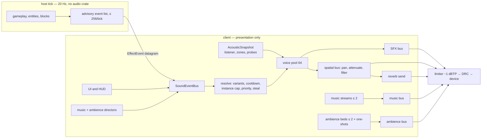

# 14 — Audio: Events, Mixing, Music, Ambience and Voice

> Status: normative - Last updated: 2026-11-24
> Depends on: [DEC-003](../decisions.md), [DEC-019](../decisions.md), [DEC-031](../decisions.md), [DEC-032](../decisions.md), [DEC-040](../decisions.md), [DEC-044](../decisions.md), [DEC-049](../decisions.md), [DEC-050](../decisions.md), [DEC-053](../decisions.md), [conventions](00-conventions.md), [technical architecture](01-technical-architecture.md), [UI, audio and localization research](../research/08-ui-audio-localization.md)
> Implements: MS-05 (event bus, placeholder bank, volume settings), MS-12 (full mix, music, ambience, occlusion, captions)

## 1. Purpose and scope

This chapter specifies how the game makes sound: the event model gameplay and UI use to request
audio, the content-defined bank those events resolve against, the mixer, the music and ambience
directors, the loudness and limiter policy, the caption data that makes sound accessible, and the
post-1.0 voice-chat module. Device enumeration, slider widgets and other UI mechanics belong to
[13](13-ui-and-ux.md); caption presentation to [23](23-accessibility-localization.md); the
`SoundDef` schema to [15](15-content-system.md); voice framing to
[18](18-networking-multiplayer.md); asset compilation to [21](21-tooling-and-pipelines.md).

The headless server does not link audio at all: `ob_server`'s dependency closure excludes `ob_audio`,
`cpal` and every ALSA/PipeWire/X11 library, enforced by `arch-guard` ([DEC-003](../decisions.md),
REQ-ARCH-002). The host *produces* advisory sound events; nothing in the simulation waits for, reads,
or depends on a mixer, and a server with no audio stack runs identically ([DEC-028](../decisions.md)).

| Out of scope | Owner |
| --- | --- |
| Device picker, volume sliders, settings layout | [13 — UI and UX](13-ui-and-ux.md) |
| Caption typography, direction glyphs, subtitle scaling | [23 — Accessibility and localization](23-accessibility-localization.md) |
| `SoundDef` registry validation and pack layering | [15 — Content system](15-content-system.md) |
| Voice packet framing, relay identity, QUIC streams | [18 — Networking](18-networking-multiplayer.md) |
| Ogg normalisation, loudness measurement, and the frame, tick and memory envelopes | [21 — Tooling](21-tooling-and-pipelines.md), [25 — Performance budgets](25-performance-budgets.md) |

## 2. Requirements

| ID | Requirement | Verified by | Milestone |
| --- | --- | --- | --- |
| REQ-AUDIO-001 | `ob_audio` MUST depend only on `ob_content` (plus `ob_math`/`ob_core`); it MUST NOT link `wgpu`, `winit`, `ob_sim`, `ob_render` or `ob_world`, and `openblock-server` MUST NOT link it. | `arch-guard`, `cargo tree -p ob_server` | MS-05 |
| REQ-AUDIO-002 | Game, UI and mod code MUST emit sound events; no non-audio code MAY open a device, call a mixer method or name an audio file path. | API scan plus lint rule | MS-05 |
| REQ-AUDIO-003 | An event carries a registry `SoundId` and quantised parameters only; it NEVER carries a file path, sample data or a free-form string. | Type inspection, protocol test | MS-05 |
| REQ-AUDIO-004 | Every `SoundDef` is validated at pack load: clips resolve, the category, attenuation profile and priority exist, loops declare loop points, captions declare an existing key, and `max_instances`/`cooldown_ms` are bounded (§3.3). | Pack validator, negative fixtures | MS-05 |
| REQ-AUDIO-005 | Event parameters are clamped to the §3.2 ranges at the API boundary and at decode; a peer cannot request an unbounded gain, a sub-audible pitch or an unlimited lifetime. | Fuzz plus boundary tests | MS-05 |
| REQ-AUDIO-006 | Event dispatch is bounded to 256 accepted events per tick locally and 8 per emitter; at most 8 `EffectEvent` datagrams per tick leave the host per client, one sound each and ≤ 64 B; identical `(id, 16-block cell)` events coalesce and excess is dropped by priority under the §6 storm policy. | Storm test (§7), protocol test | MS-12 |
| REQ-AUDIO-007 | The mixer exposes 64 logical voices and 4 streams by default, partitioned per §3.5; the caps are settings and are replicated in the diagnostics overlay. | Config test, overlay inspection | MS-05 |
| REQ-AUDIO-008 | Voice stealing follows §3.5: never a critical, exclusive, music or voice-chat voice; the stolen voice fades out over 5 ms. | Fixture table, discontinuity detector | MS-12 |
| REQ-AUDIO-009 | Music, ambience beds and voice chat MAY NOT be stolen by gameplay voices and are mixed on their own buses. | Mixer unit tests | MS-12 |
| REQ-AUDIO-010 | The audio callback MUST NOT allocate, lock, log, perform I/O or call the platform layer, and exactly one `Audio`-role thread (created through `ob_core::thread`) may run it; the main thread never blocks on it and uses a bounded, drop-stale command ring (§3.4). | Allocation and lock detectors, thread inventory, stalled-callback test | MS-05 |
| REQ-AUDIO-011 | Clips of ≤ 2 s are decoded to PCM and cached; music and ambience beds stream with ≥ 2 s read-ahead; nothing in the frame loop decodes. | Codec instrumentation | MS-12 |
| REQ-AUDIO-012 | Assets are normalised to 48 kHz; the mixer runs at the device's native rate and resamples once at load with a band-limited resampler, caching per rate (§3.6). | Audio quality fixtures, rate matrix | MS-12 |
| REQ-AUDIO-013 | The default spatialisation is constant-power panning plus distance attenuation, air absorption and occlusion; HRTF-lite is opt-in and capped at 16 sources. | Settings inspection, cost benchmark | MS-12 |
| REQ-AUDIO-014 | Attenuation follows the definition's named profile; voices are culled beyond `max(range, 48 m)` and never mixed outside it. | Attenuation golden table | MS-12 |
| REQ-AUDIO-015 | Occlusion and environment come from an `AcousticSnapshot` produced by the client presentation layer at ≤ 10 Hz; the mixer MUST NOT query world state. | Dependency test, snapshot inspection | MS-12 |
| REQ-AUDIO-016 | Reverb zones and the underwater filter are content-defined, apply with ≥ 250 ms crossfades and 1.5 m hysteresis, and never switch per sample. | Zone-crossing fixtures | MS-12 |
| REQ-AUDIO-017 | Categories map one-to-one onto the §3.8 table, keys are snake_case ASCII ([DEC-044](../decisions.md)), and volume, mute, device and caption settings are `Live` keys ([02 §3.8](02-engine-core.md#38-configuration)) that apply within one frame without a restart. | Settings schema, hot-reload test | MS-05 |
| REQ-AUDIO-018 | The master chain is category buses → lookahead limiter (−1 dBTP, 5 ms) → optional dynamic-range compression → device; no other path reaches the device. | Graph inspection, limiter fixtures | MS-12 |
| REQ-AUDIO-019 | Banks are loudness-normalised offline to the §3.8 targets; the mixer MUST NOT measure loudness at runtime. | Manifest check per clip | MS-12 |
| REQ-AUDIO-020 | Music selection is a data-driven context machine with priority, hysteresis, minimum dwell, per-track cooldown and no immediate repeat (§3.9). | Context fixture matrix | MS-12 |
| REQ-AUDIO-021 | Playlists, tracks, stingers, ambience beds and reverb zones are content data; no track or zone path appears in first-party code. | Content scan, pack override test | MS-12 |
| REQ-AUDIO-022 | Ambience is derived from the client's `EnvironmentDef`, weather state and local acoustics; presentation randomness is permitted ([00 §6.5](00-conventions.md#6-determinism-rules)). | Determinism boundary test | MS-12 |
| REQ-AUDIO-023 | Captions are generated from events, not voices, so a culled or missing-asset sound still captions; the §3.11 contract is the only interface [23](23-accessibility-localization.md) consumes. | Culled-voice caption test | MS-12 |
| REQ-AUDIO-024 | Voice chat is a non-default Cargo feature, disabled unless the host enables it, never compiled into the server or the 1.0 client; it uses Opus over the QUIC relay, per-speaker mute and volume, push-to-talk, no recording by default and no voice bytes in logs, crash reports or saves. | Feature matrix build, privacy review | post-1.0 |
| REQ-AUDIO-025 | Audio MUST NOT influence any simulation value: a recorded input log replayed with audio enabled and disabled produces the same state hash. | Replay hash A/B | MS-12 |
| REQ-AUDIO-026 | Device loss or hotplug MUST NOT terminate or stall the client: the mixer falls back to a null device, retries, and recovers within 2 s of a usable device appearing. | Injected device-loss test | MS-12 |
| REQ-AUDIO-027 | A missing, unreadable or undecodable clip produces a silent placeholder, one log line per ID and a preserved caption; it never panics or blocks the tick. | Corrupt-asset fixtures | MS-05 |
| REQ-AUDIO-028 | Reduced-motion mode disables Doppler, screen-linked pitch effects and any audio-driven camera shake coupling (§3.7). | Settings trace | MS-14 |

## 3. Design

### 3.1 Placement, ownership and data flow

`ob_audio` owns one `AudioService` (lifecycle `Created → Initialising → Ready → Running →
Draining → Stopped`, [01 §3.5](01-technical-architecture.md#35-services-plugins-and-lifecycle)) and one
OS thread. The service receives `AudioCommand` values from the main thread and renders through a
`cpal` output stream; `kira` supplies tracks, effects, tweens, clocks and streaming; `symphonia`
decodes Vorbis/FLAC/WAV. The server has no counterpart to any of this.



Three rules follow from the boundary. Events cross the process boundary as *data*, inside the
unreliable `EffectEvent` datagram of [18 §3.4](18-networking-multiplayer.md#34-protocol-versioning-and-message-catalog)
and bounded by REQ-AUDIO-006; they are advisory, individually unacknowledged, never retransmitted, and
a lost datagram changes nothing but what the player hears. The mixer never reaches back: the listener
transform, acoustic probes and local fluid state arrive in a `FrameAudioInput` produced during
`Prepare` from the client's own world copy, a presentation read that cannot mutate simulation state
([01 §3.7](01-technical-architecture.md#37-determinism-boundaries)). And a client that predicts a sound
locally suppresses the matching host event for 100 ms by `(sound_id, position cell, tick)`.

There is no client-code path in audio. A mod cannot run on a client ([DEC-049](../decisions.md)), so
mod-authored sound reaches a player only as a server-side `EffectEvent` that the client's mixer
resolves against its content bank, exactly like a gameplay event. Nothing in this chapter loads a
module, and `ob_audio` stays outside the client's mod surface.

### 3.2 The event model

An event is a small, fully quantised value. Everything a definition needs beyond this — clips,
pitch spread, caption text, attenuation shape — is content.

```rust
pub struct SoundEvent {
    pub id: SoundId,             // frozen registry index, dictionary-negotiated on the wire (DEC-040)
    pub source: EventSource,     // World { pos: WorldPos } | Entity { net_id: NetId, follow: bool }
    pub volume: u8,              // 0..=255 → gain 0.0..=2.0 (gain = v / 128)
    pub pitch: u8,               // 0..=255 → 0.5..=2.0, exponential
    pub seed: u16,               // deterministic variant and pitch selection
    pub category: SoundCategory, // 10 slots, §3.8
    pub range: u8,               // metres; 0 = definition default
    pub flags: SoundFlags,       // LOOPING | EXCLUSIVE | FOLLOW | CAPTION_CRITICAL | LISTENER_RELATIVE
}
```

`seed` is the only field a peer can use to change *which* variant plays, and variants of one
definition are authored to be interchangeable. Definitions may declare pitch variation and multi-clip
weights; both resolve as `hash(event.seed, event.id)`, so an event sounds the same on every client.
Ranges are clamped at the API boundary and again at decode: volume `0.0..=2.0`, pitch `0.5..=2.0`
(then multiplied by a 1.0 ± 10% Doppler factor), range `0..=255 m` and at most the definition's cap,
and a world-position loop lifetime of at most 300 s. An event without a caption key cannot set
`CAPTION_CRITICAL`.

### 3.3 Definitions as content

```ron
(
  id: "openblock:block.stone.break",
  clips: [(path: "sounds/block/stone_break_1.ogg", weight: 3),
          (path: "sounds/block/stone_break_2.ogg", weight: 1)],
  category: "blocks", volume: 1.0, pitch: (0.94, 1.06), attenuation: "openblock:block",
  range: 16.0, priority: "normal", max_instances: 4, cooldown_ms: 30,
  caption: "openblock.caption.block_break", caption_priority: "info",
  doppler: false, hrtf_eligible: false, exclusive: None, loop: None,
)
```

Validation at load enforces: `1 ≤ clips ≤ 8`; weights `1..=64`; `volume` in `0.0..=2.0`; `pitch` in
`0.5..=2.0` with `min ≤ max`; `range` in `1.0..=255.0`; `max_instances` in `1..=32`; `cooldown_ms` in
`0..=5,000`; the attenuation profile, caption message and placeholder set resolve; an optional
`exclusive` group is unique and shared by at most 32 events. Loops declare `(start_ms, end_ms,
crossfade_ms)` plus explicit `doppler`/`hrtf_eligible`, so no sound inherits an effect by accident, and
the decoder applies the loop points so a seam never clicks.

### 3.4 Mixer architecture and the command ring

The main thread sends commands; the audio thread owns all mixer state. Two bounded channels exist:
`control` (capacity 64; state-setting commands coalesce, so 100 listener updates in one frame collapse
to the newest) and `event` (capacity 1,024; a full ring returns `Full` and the caller drops its
lowest-priority event). The callback drains, renders one quantum, writes metering atomics and returns.

```rust
pub enum AudioCommand {
    Listener(ListenerState), Acoustic(AcousticSnapshot),   // coalesced, ≤ 1/frame; ≤ 10 Hz
    Play(SoundEvent), Stop(VoiceId), StopGroup(ExclusiveGroup),
    SetCategory { category: SoundCategory, gain: f32, muted: bool },
    Music(MusicCommand), Ambience(AmbienceCommand), Pause(bool),
    LoadBank(BankId), UnloadBank(BankId), SetDevice(Option<DeviceId>),
}

pub struct MixerConfig { pub sample_rate: u32, pub quantum_frames: u32,   // native rate; 256 = 5.33 ms
                         pub voices: u16, pub streams: u8, pub hrtf_sources: u8 }  // 64 / 4 / 0
```

The `kira` buffer is two quanta (512 frames, 10.7 ms), so a late callback does not glitch. The thread
runs at the OS real-time class where one exists, never above normal on macOS, and is never joined on
the frame path: shutdown drains, waits for REQ-ARCH-013's 2 s deadline, then leaks the thread rather
than hanging the process.

### 3.5 Voices, priorities and stealing

| Class | Voices | Streams | Spatialised | May be stolen by |
| --- | ---: | ---: | --- | --- |
| Positional gameplay (blocks, mobs, projectiles, players) | 28 | 0 | yes | higher-priority positional |
| Non-positional gameplay (own footsteps, eating, UI-adjacent effects) | 12 | 0 | no | higher-priority gameplay |
| UI | 8 | 0 | never | nothing (UI events coalesce instead) |
| Music | 2 | 2 | no | nothing |
| Ambience beds + one-shots | 6 | 2 | beds no, one-shots yes | one-shots only |
| Voice chat (post-1.0, reserved) | 8 | 8 | yes | nothing |

At 1.0 the four streams are the two music and two ambience streams; the voice row exists only in the
feature-gated build. A request is admitted when a free slot exists or a voice of equal-or-lower priority
exists in the same class. The victim is chosen by lowest priority, then greatest distance, then oldest
start; it fades to silence over 5 ms while the new voice starts at full gain, so the swap is inaudible.
Critical events (`CAPTION_CRITICAL`, boss stings, player damage) and exclusive groups are never stolen —
an exclusive group restarts its single member instead. `max_instances` and `cooldown_ms` are enforced
*before* admission, so a machine-gun emitter costs a counter, not a mix decision.

### 3.6 Decoding, residency and streaming

The pack compiler ([21](21-tooling-and-pipelines.md)) normalises every clip to Vorbis in an Ogg
container, 48 kHz, mono for SFX and stereo for music/ambience, and records per-clip `frames`,
`loop points`, `lufs_i` and `true_peak` in the bank manifest. At runtime:

| Stage | Thread | Policy |
| --- | --- | --- |
| Bank index parse | I/O pool | once per bank, ≤ 4 MiB, validated against the content hash |
| Short-clip decode | I/O pool | clips ≤ 2 s decoded to `i16` PCM at the device rate; hot set (≤ 16 MiB) resident, LRU beyond |
| Music/ambience open | I/O pool | streamed; decoder keeps ≥ 2 s decoded at all times |
| Resample | I/O pool | band-limited resampler at load; cache keyed `(clip, rate)`; at most two rates resident |
| Mix | audio thread | reads immutable PCM slices and stream rings only |

A 2 s mono clip at 48 kHz costs 192 KiB decoded, so the 16 MiB hot set holds about 85 clips; the rest
decode on first use with a category prefetch, and an LRU eviction costs one decode before the next
play. Streams cost 384 KiB of ring each at 2 s stereo, 1.5 MiB for four. A device at another rate takes
the resampled cache path; a device change drops both caches, rebuilds the hot set (≤ 1.5 s) and resumes
music at its previous position.

### 3.7 Space: listener, attenuation, occlusion and zones

The listener is a position, forward and up vector and a velocity, taken from the interpolated camera
at frame rate. `WorldPos` (`f64`) becomes listener-relative `f32` metres once per update; all mixer
math is `f32` ([DEC-039](../decisions.md)).

| Profile | Gain `g(d)` | Typical use |
| --- | --- | --- |
| `linear` | `clamp(1 − d/range, 0, 1)` | block break/place, item pickup, short UI-adjacent effects |
| `inverse` | `r0 / (r0 + max(0, d − r1))`, zero at `range` | mobs, players, projectiles |
| `exponential` | `exp(−k·d)`, zero at `range` | weather, explosions, ambient one-shots |

`r0` (1 m), `r1` (2 m) and `k` come from the named profile in the pack. Beyond
`max(range, 48 m)` the voice is culled. Air absorption is a one-pole low-pass whose cutoff falls from
20 kHz at 0 m to 700 Hz at 96 m; occlusion multiplies gain and cutoff by the probe's factor:

| Probe class | Gain × | Cutoff × | Meaning |
| --- | ---: | ---: | --- |
| clear | 1.00 | 1.00 | line of sight |
| partial | 0.70 | 0.60 | one corner or a fence in the way |
| heavy | 0.35 | 0.35 | a wall |
| sealed | 0.10 | 0.15 | fully enclosed |

The client builds these probes in `Prepare` at 10 Hz for at most 32 audible emitters, one segment test
each against the client's collision snapshot ([05](05-world-model.md), [10](10-physics-and-collision.md));
an emitter beyond the cap keeps its previous class. The higher-fidelity tier in
[the research](../research/08-ui-audio-localization.md) §5.3 (fourteen directions, 24 m, 100 ms, 24
reflections) is a post-1.0 acoustics budget, not a 1.0 feature.

Default panning is constant-power azimuth panning (−3 dB at centre); elevation becomes a 0–3 dB
high-band attenuation rather than a pan. HRTF-lite replaces panning for at most 16 sources with a
parametric head model: interaural time difference from the spherical-head formula (≈ 0.65 ms maximum
at a 0.0875 m radius and 343 m/s), a one-pole head-shadow low-pass per ear (1.5–8 kHz by azimuth) and
a four-tap pinna notch swept by elevation. That is about 10 multiply-accumulates per sample per source
(0.5 M/s at 48 kHz) against 12.3 M/s for a 128-tap two-ear FIR ([research](../research/08-ui-audio-localization.md)
§5.3), which is why HRTF is a quality tier and not the default.

Doppler applies only where the definition sets `doppler: true` (arrows, boats, minecarts, elytra,
sprinting players), from radial velocity as `f' = f·c/(c + v_r)` clamped to ±10%; block, UI and ambient
sounds never pitch-shift. Speed-of-sound delay exists only for distant explosions, capped at 40 ms,
because at 48 m the true 140 ms reads as lag.

Reverb zones are content `ReverbZoneDef { id, aabb, preset, wet, damping }`. The listener is inside at
most one; entering or leaving crossfades wet/dry over 250 ms with 1.5 m hysteresis, so a doorway does
not flutter. The underwater filter (listener eye in a fluid, from the client's own fluid query)
applies a 700 Hz low-pass, gain ×0.8 and the `underwater` preset over 300 ms.

### 3.8 Categories, loudness and dynamic range

Every bus below feeds `master` (`master_volume`).

| Bus | Settings key | Includes | Loudness target (LUFS-I) |
| --- | --- | --- | --- |
| `music` | `music_volume` | music tracks, stingers | −16 |
| `ambient` | `ambient_volume` | beds, weather loop, one-shots | −24 |
| `blocks` | `sfx_volume` | break/place/step/container | −18 |
| `hostile`, `neutral`, `player` | `sfx_volume` | mob and player voices | −18 |
| `weather` | `sfx_volume` | rain, thunder, wind | −20 |
| `ui` | `ui_volume` | clicks, toasts, inventory | −18 |
| `voice` | `voice_volume` | voice chat (post-1.0) | −18 |

The slider is `0..=100`; `0` mutes, and above it amplitude is `(p/100)²` shown in dB from −60 to 0. A
per-category trim in `audio.toml` adjusts the five `sfx_volume` children without adding sliders, and
every clip is normalised offline against the manifest covered by the content hash. The master chain is
a 5 ms-lookahead limiter at −1 dBTP, then an optional dynamic-range stage (`dynamic_range = full |
reduced`, 3:1 above −28 dBFS, 10 ms attack, 200 ms release, +6 dB makeup) for players in noisy rooms
or with hearing loss.

### 3.9 Music

Music is a context machine over data. A context declares a priority, one or more weighted,
non-repeating track pools, a crossfade (default 3 s, allowed 0.5–5 s) and predicates over the
snapshot: dimension, biome tag, in-game time, depth, weather, enclosure, boss presence and player
state.

| Context | Priority | Predicates (all must hold) |
| --- | ---: | --- |
| `menu` | 90 | no world loaded, or pause menu in single-player |
| `boss` | 80 | a boss entity is within 64 blocks |
| `death`, `credits` | 70 | the local player is `Dead`, or the credits screen is open |
| `underwater` | 50 | listener eye in a fluid |
| `cave` | 40 | enclosure ≥ 0.6 and depth below the dimension's surface band |
| `underworld`, `terminus` | 40 | dimension match (`openblock:underworld`, `openblock:terminus`; [DEC-053](../decisions.md)) |
| `night`, `day`, `calm` | 20 / 10 | overworld and `day_time` band; `calm` is the fallback when nothing else applies |

Selection runs at 1 Hz on the main thread: score every eligible context, keep the current one unless a
higher-priority context has held for 10 s (hysteresis) and the current has played its minimum dwell of
120 s. A track does not repeat until the pool is exhausted, and a global cooldown of 8–20 min (default
12) separates plays of the same track. Transitions crossfade; the outgoing track is never cut. Stingers
are short, exclusive, non-spatial cues (advancement, raid horn, dragon phase) that duck music by 6 dB
for 2 s, as do dialogue and voice chat.

### 3.10 Ambience

Ambience has two layers. **Beds** are looping, listener-relative streams from the resolved
`EnvironmentDef.ambience` list ([07 §3.16](07-light-and-weather.md#316-ambient-and-environment-data-in-content-packs))
plus a weather bed; weights are smoothed over 2 s and only the two highest are audible, with lower
beds faded out rather than stopped and unresolvable IDs logging once. **One-shots** are random
non-looping events (bird calls, cave drips, distant thunder) from a Poisson process per biome tag at
0.03–0.2 events/s, 8–32 m from the listener inside loaded space. The client's presentation RNG seeds
them; they are deliberately not deterministic ([00 §6.5](00-conventions.md#6-determinism-rules)) and
never enter the state hash.

### 3.11 Captions

Captions are produced from the event, before admission to the voice pool, so a culled, stolen or
missing-asset sound is still announced. The contract handed to [23](23-accessibility-localization.md)
is a `CaptionRecord`:

| Field | Type | Source |
| --- | --- | --- |
| `key` | message ID | `SoundDef.caption`, resolved in the current locale |
| `category`, `priority` | `SoundCategory`, `critical`/`info`/`ambient` | the event and `SoundDef.caption_priority`; drives filters and line order |
| `sector` | 0–7 (front, front-left, left, back-left, back, back-right, right, front-right) | listener-relative azimuth, ±22.5°; listener-relative events report `front` |
| `dedupe` | `(key, sector)` | repeats within 1.5 s increment a count instead of adding a line |

Rendering, merge limits, font and scale are owned by [23](23-accessibility-localization.md), and
captions use the same FTL catalog as visible text, so they are never derived from a filename or an
English string. Caption keys are view content: translating or rewording one moves `view_hash` only,
never `content_hash`, so a locale difference is advisory at join and does not block a connection
([DEC-050](../decisions.md)).

### 3.12 Voice chat (post-1.0, gated)

Voice is a module behind a non-default Cargo feature and a host setting (`voice_chat`, default
`false`), never present in the server closure (REQ-AUDIO-024). It uses Opus at 48 kHz mono, 20 ms
frames, 32 kbit/s variable bitrate with in-band FEC and discontinuous transmission, in QUIC datagrams
with a 4 B header (voice slot, 16-bit sequence, flags). The server relays selectively by distance
(48 m), team and per-player mute lists rather than mixing; ten simultaneous speakers cost about
320 kbit/s down per client, one datagram per frame.

Receivers spatialise each speaker from the server-synced player position ([18](18-networking-multiplayer.md))
through the same attenuation and occlusion path as other positional voices, so no per-packet position
is needed. Voice has reserved voices and its own bus, is never captioned (privacy) and instead shows a
"speaking" HUD indicator with the speaker's name. Moderation is server-side: per-player mute, deafen,
volume and a global disable. A relay sees media, so end-to-end encryption is explicitly not offered;
nothing is recorded by default, voice never reaches logs, crash reports or saves, and the operator must
enable the feature before any client offers it.

### 3.13 The presentation boundary

Audio is the clearest case of [00 §6.6](00-conventions.md#6-determinism-rules): a system that cannot be
deterministic must not affect simulation-visible state, and the simulation knows nothing about the
mixer. Events derive from authoritative host state changes, queue as advisory data and are dropped
rather than delayed when the outgoing queue is full. The client may play a sound before the host
confirms it; a rollback does not un-play it, which is why gameplay-bearing sounds (a mob hurt, a door,
an approach) also carry a caption and, where relevant, a HUD cue.

### 3.14 Offline rendering and tooling

`ob_audio::offline` drives the same `Mixer` with a virtual clock, a fixed rate and a synthetic
`AcousticSnapshot`, writing interleaved `f32` PCM; it backs the §7 goldens, exposes
`cargo xtask audio render --events <file> --out <wav>` for content authors, and cannot open a device,
so it runs on CI runners with no sound card.

## 4. Data structures and formats

### 4.1 Sound event on the wire

A sound event occupies one `EffectEvent` datagram ([18 §3.4](18-networking-multiplayer.md#34-protocol-versioning-and-message-catalog),
`0xA0`, ≤ 64 B) after a 2 B effect header that also carries optional particles, screen and animation
fields.

| Offset | Size | Field | Encoding |
| --- | ---: | --- | --- |
| 0 | 2 | `event_id` | u16 connection dictionary index ([DEC-040](../decisions.md)); `0xFFFF` = unknown |
| 2 | 4 | `source` | 0 = world position, else `NetId + 1` |
| 6 | 12 | `position` | three `i32` at 1/16 block; the attach point for entity sources |
| 18 | 4 | `volume`, `pitch`, `category`, `range` | u8 each: `gain = v/128`; `pitch = 0.5 · 2^(v/128)`; category 4 bits; range in metres, 0 = default |
| 22 | 2 | `seed` | u16 |
| 24 | 2 | `flags`, reserved | u8 each |

That is 26 B per event, so a datagram carrying only a sound stays well under the 64 B MTU-safe
budget. The host coalesces identical `(event_id, 16-block cell)` events within a tick and drops
`ambient` first, then `normal`, never `critical`, once REQ-AUDIO-006's datagram budget is spent.

### 4.2 Runtime state

```rust
pub struct ListenerState { pub pos: [f32; 3], pub forward: [f32; 3], pub up: [f32; 3], pub velocity: [f32; 3] }

pub struct AcousticSnapshot {                  // built in Prepare, ≤ 10 Hz
    pub listener: ListenerState, pub underwater: bool, pub zone: Option<ReverbZoneId>,
    pub enclosure: f32,                         // 0 open .. 1 sealed
    pub probes: SmallVec<[OcclusionProbe; 32]>, // (NetId, class, age_ms)
}

pub struct VoiceState {
    pub def: SoundId, pub category: SoundCategory, pub priority: Priority, pub source: Option<NetId>,
    pub gain: f32, pub target_gain: f32, pub pan: f32, pub cutoff_hz: f32,
    pub started_ms: u32, pub fade_out_ms: Option<u16>,
}

pub struct MixerStats { pub active: u16, pub stolen: u32, pub dropped: u32, pub storm_ticks: u32,
                        pub callback_us_p99: u32, pub underruns: u32 }   // relaxed atomics
```

## 5. Performance budgets

p95 unless stated, reference machine ([vision §9](../vision.md#9-platforms-and-hardware)), 48 kHz with
64 voices and 4 streams; the whole-frame envelope is owned by [chapter 25](25-performance-budgets.md).

| ID | Budget | Value |
| --- | --- | ---: |
| PERF-AUDIO-001 | Main-thread dispatch, 256 events | ≤ 0.10 ms p99, zero allocations after warm-up (the PERF-CPU-005/006 band) |
| PERF-AUDIO-002 | Mixer callback, 64 voices + 4 streams | ≤ 1.6 ms p99 and ≤ 3.2 ms max per 5.33 ms quantum |
| PERF-AUDIO-003 | Processor share, full mix; idle | ≤ 5% of one 3 GHz core; ≤ 0.2% when silent |
| PERF-AUDIO-004 | Resident memory (PERF-MEM-008) | ≤ 24 MiB: 16 decoded, 4 streams, 4 mixer |
| PERF-AUDIO-005 | Event to first sample | ≤ 30 ms p99 |
| PERF-AUDIO-006 | Admission/steal decision | ≤ 1 µs p99 per event |
| PERF-AUDIO-007 | Bank load: index + hot set | ≤ 1.5 s on 8 threads; first sound ≤ 200 ms after spawn |
| PERF-AUDIO-008 | Acoustic snapshot build, 32 probes | ≤ 0.15 ms p99 at 10 Hz |
| PERF-AUDIO-009 | Fade boundaries | no step > −60 dBFS; 10,000 random start/stop/steal scenes clean |
| PERF-AUDIO-010 | Offline golden render | max sample error ≤ 1 LSB at 16 bit against the reference |
| PERF-AUDIO-011 | Device open; recovery after hotplug | ≤ 250 ms; ≤ 2 s |
| PERF-AUDIO-012 | Event to caption | ≤ 100 ms p99 (shared with [23](23-accessibility-localization.md)) |
| PERF-AUDIO-013 | Event bandwidth | ≤ 26 B/event, ≤ 8 datagrams/tick, ≤ 2 KiB/s p95, ≤ 10 KiB/s burst |

## 6. Failure modes and edge cases

| Failure | Detection | Containment | User-visible |
| --- | --- | --- | --- |
| No output device at start | `cpal` enumeration empty | null device, `AudioAvailable::No`, events dropped cheaply | settings show "no output device"; game unaffected |
| Device removed, hotplug or format change | backend error callback | stop streams, null device, retry every 2 s up to 30 s | sound stops; reconnects when a device returns |
| Sample rate mismatch (44.1/96 kHz) or loop points past the clip end | device config; manifest validation | resample cache keyed by rate (≤ 2 resident); clip rejected and falls back to a one-shot | inaudible; loop plays once |
| Missing, corrupt or truncated clip | decode error, manifest mismatch | silent placeholder, caption kept, one log line per ID | caption appears, no sound |
| Sound storm (10,000 events/s) or caption spam | dispatch and caption counters | cooldown, instance cap, drop order ambient → normal, merge captions per `(key, sector)` at 8 lines/s | some sounds missing, no stutter |
| Voice cap reached by critical sounds | admission counter | steal only same-or-lower priority; music untouched | least important sound yields |
| Callback overrun; occlusion probe starved; pack reload drops a playing ID | quantum and underrun counters, probe age, bank generation | two-quantum buffer and shed ambience first; keep the last probe class; fade out over 250 ms | one muted frame; slightly stale filtering; brief fade |
| Voice relay saturated or HRTF over-subscribed | per-speaker bitrate; `hrtf_sources` cap | drop the quietest speaker; best 16 by priority, rest panned | one voice drops; subtle difference |

| Risk | Description | Mitigation | Owner |
| --- | --- | --- | --- |
| RISK-141 | Mixer work migrates onto the main thread, or occlusion probes become a per-frame raycast storm | callback only on the audio thread, REQ-AUDIO-010 detectors, PERF-AUDIO-008 probe budget | MS-12 |
| RISK-142 | Content authors ship unnormalised clips, so the limiter pumps | manifest loudness required, build rejects a clip without LUFS data | MS-21 |
| RISK-143 | Voice chat scope grows into a 1.0 feature and drags moderation, privacy and bandwidth work | feature gate, host setting, post-1.0 milestone, review at MS-14 | MS-14 |
| RISK-144 | Platform backends (ALSA, WASAPI, CoreAudio) behave differently under device churn | null-device fallback, device matrix in §7, no game coupling | MS-13 |

## 7. Testing strategy

| Layer | What is proven | Tooling |
| --- | --- | --- |
| Event → voice fixtures | admission, `max_instances`, cooldown, stealing order, exclusive restart | table-driven `audio/dispatch` fixtures over the offline mixer |
| Mix goldens and loudness | gain, pan, attenuation, filtering and limiter match the reference PCM; each bus hits its LUFS target and stays under −1 dBTP | `offline::render`, tolerance PERF-AUDIO-010, 40 scenes, EBU R128 analysis |
| Boundary continuity | no clicks at start, stop, steal, crossfade, zone change or pause | discontinuity detector over 10,000 randomised scenes |
| Music and ambience | context matrix, hysteresis, cooldown, no repeat, bed weights, storm behaviour | fixture snapshots with a virtual clock |
| Captions | every critical definition has a key; culled voices still caption; sectors are correct | shared contract test with [23](23-accessibility-localization.md) |
| Determinism | audio on/off produces the same replay hash | MS-02 harness, audio feature toggled |
| Device matrix and stress | null, ALSA/PulseAudio/PipeWire, WASAPI, CoreAudio; 44.1/48/96 kHz; hotplug; one hour at 64 voices, 10k-event storms, rapid teleports | CI runners, manual checklist, soak with leak and underrun counters |
| Privacy (voice) | no voice bytes in logs, crash reports or saves | feature test, review |

## 8. Open questions

1. **Music production model.** Commissioned score, CC0 library, or community tracks under CC BY 4.0
   ([DEC-009](../decisions.md))? It sets the loudness workflow and the credits requirements. Owner: MS-16.
2. **Default caption scope.** Every audible sound, or only `caption_priority ≥ info` with ambience
   opt-in? It sets the caption key bank and how noisy the feed is. Owner: MS-14, with [23](23-accessibility-localization.md).
3. **HRTF-lite default tier.** On at `high`, or off with a documented A/B? Needs the MS-12 listening
   test with 16 sources on headphones and speakers. Owner: MS-12.
4. **Voice relay in the official server image.** [DEC-031](../decisions.md) fixes post-1.0, Opus and
   the QUIC relay; whether `openblock-server` ships it, and its consent policy, is open. Owner: MS-15.
5. **Register item needed:** "The default audio budget is 64 simultaneous voices and 4 streams, with
   8 reserved for voice chat, and `ob_audio` may use at most 5% of one core." Owner: MS-12.
6. **Register item needed:** "Sound events are advisory, may be dropped, and are never part of the
   simulation state hash or a save." Owner: MS-06, before the protocol freeze.

## 9. References

- Decisions: [DEC-003](../decisions.md), [DEC-019](../decisions.md), [DEC-031](../decisions.md),
  [DEC-032](../decisions.md), [DEC-035](../decisions.md), [DEC-039](../decisions.md),
  [DEC-040](../decisions.md), [DEC-044](../decisions.md), [DEC-049](../decisions.md),
  [DEC-050](../decisions.md), [DEC-053](../decisions.md).
- Chapters: [conventions](00-conventions.md), [architecture](01-technical-architecture.md),
  [engine core](02-engine-core.md), [world model](05-world-model.md), [light and weather](07-light-and-weather.md),
  [UI and UX](13-ui-and-ux.md), [content](15-content-system.md), [networking](18-networking-multiplayer.md),
  [tooling](21-tooling-and-pipelines.md), [accessibility](23-accessibility-localization.md),
  [performance budgets](25-performance-budgets.md).
- Research: [UI, audio, localization](../research/08-ui-audio-localization.md) §5 — stack choice,
  voice budget, mixing, occlusion, HRTF arithmetic and voice-chat options; Weft's acoustics constants
  are cited there as a read-only budget reference, not copied.
- Milestones: [MS-05, MS-12, MS-14](../plan/01-milestones.md).
- External: [kira](https://docs.rs/kira/latest/kira/), [cpal](https://github.com/RustAudio/cpal),
  [symphonia](https://github.com/pdeljanov/Symphonia), [RFC 6716 (Opus)](https://www.rfc-editor.org/rfc/rfc6716),
  [ITU-R BS.1770](https://www.itu.int/rec/R-REC-BS.1770/en), [EBU R 128](https://tech.ebu.ch/publications/r128),
  [WCAG 1.2.2](https://www.w3.org/WAI/WCAG22/Understanding/captions-prerecorded.html),
  [spherical-head ITD model](https://asa.scitation.org/doi/10.1121/1.1918405).
