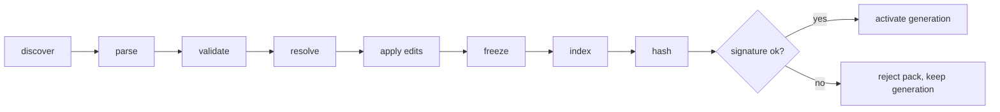

# 15 — Content System

> Status: normative - Last updated: 2026-11-24
> Depends on: [DEC-006](../decisions.md), [DEC-010](../decisions.md), [DEC-019](../decisions.md), [DEC-020](../decisions.md), [DEC-022](../decisions.md), [DEC-027](../decisions.md), [DEC-030](../decisions.md), [DEC-032](../decisions.md), [DEC-033](../decisions.md), [DEC-039](../decisions.md), [DEC-040](../decisions.md), [DEC-041](../decisions.md), [DEC-044](../decisions.md), [DEC-045](../decisions.md), [DEC-046](../decisions.md), [DEC-047](../decisions.md), [DEC-050](../decisions.md), [conventions](00-conventions.md), [architecture](01-technical-architecture.md)
> Implements: MS-05, MS-09

## 1. Purpose and scope

This chapter is the contract for everything that is *data* in OpenBlock: the registry model, the pack
format, the pipeline from directory to frozen registry, canonical hashing, diagnostics, hot reload
and pack distribution. It owns `ob_content` (loader, registries, validator, hasher) and the
pack-related surface of `openblock-tools`. It does not own the gameplay meaning of an entry — mining
in [05](05-world-model.md), recipes and loot in [11](11-inventory-crafting-items.md), biomes and
structures in [06](06-worldgen.md), screens in [13](13-ui-and-ux.md), shader hooks in
[04](04-shaders-and-visuals.md) — nor code execution ([16](16-modding.md)).

Three invariants drive every requirement below:

1. **Content is data.** The first-party game is the `openblock:base` pack, loaded by the same path
   with no private hooks (DEC-019, DEC-010). If a base-game feature cannot be data, the schema is
   incomplete, not the pack.
2. **One pipeline.** Discovery, parsing, validation, dependency resolution, edit application,
   freeze, indexing and hashing run in that order, once per generation, for every pack (§3.3).
   There is no in-code registry and no runtime mutation of a frozen one.
3. **Freeze is a pure function of the pack set.** Order, dense indices, block states and the content
   hash depend on pack bytes and `content_format` — never on wall clock, filesystem order, locale,
   username, path or iteration order (DEC-006, DEC-040).

## 2. Requirements

| ID | Requirement | Verified by |
| --- | --- | --- |
| REQ-CONTENT-001 | A registry entry MUST be `(kind, resource ID, typed components)`; free-form trees, untyped blobs and executable payloads are rejected and every component is schema-validated (DEC-041). | Schema suite, inspection |
| REQ-CONTENT-002 | Registry order and dense indices MUST be a pure function of the resolved pack set and `content_format`; no wall clock, path, locale, hash-map order or directory order may influence them. | Three-OS hash test, shuffled paths |
| REQ-CONTENT-003 | Numeric registry indices MUST NOT be written to a save, log, manifest or packet, except a connection dictionary established by a hash-verified handshake (DEC-006, DEC-040). | Save/protocol scan |
| REQ-CONTENT-004 | Layers MUST execute in the fixed order `base → official → server → mod → view`, and `openblock:base` MUST be pack #0 through the identical pipeline. | Base-pack-as-pack, deletion test |
| REQ-CONTENT-005 | Every pack MUST ship `pack.toml` with `id`, `version`, `schema_version`, `side`, `content_format`, `api`, `license`, `description` and `icon`, plus its declared asset roots; unknown keys are errors naming the dotted path. | Manifest schema tests |
| REQ-CONTENT-006 | `EDIT` MUST require an existing target; `REPLACE` MUST appear in `replaces`; `REMOVE` MUST appear in `removes` and MUST tombstone the ID. An undeclared destructive operation fails the pack. | Operation fixtures |
| REQ-CONTENT-007 | Two packs in one layer mutating the same entry field without an explicit ordering edge MUST be a conflict error naming both packs, the entry and the field; byte-identical duplicate contributions collapse with a warning. | Conflict fixtures |
| REQ-CONTENT-008 | `requires` MUST resolve semver ranges; a missing or unsatisfiable dependency is an error listing candidates, and a cycle is an error printing the full path. | Resolution fixtures |
| REQ-CONTENT-009 | `load_after`/`load_before` MUST order packs without implying dependency, MUST NOT override layer order, and MUST warn when a soft target is absent. | Order fixtures |
| REQ-CONTENT-010 | Optional dependencies MUST surface as `#openblock:present/<namespace>` tags; behaviour MUST NOT branch on pack presence through a runtime string lookup. | Tag fixtures, inspection |
| REQ-CONTENT-011 | Each layer MUST run `register → edit → remove`, followed by one global `resolve → freeze`; no phase may be skipped, merged or reordered. | Pipeline event-log golden |
| REQ-CONTENT-012 | Tags MUST be sorted sets with nested expansion, cycle detection and `?` optional entries; a missing required member or tag fails, a missing optional member warns. | Tag fixtures |
| REQ-CONTENT-013 | Block states MUST be enumerated at freeze from declared properties, with ≤ 16 property bits and ≤ 4,096 states per block type; derived properties MUST NOT be stored. | Enumeration test, validator |
| REQ-CONTENT-014 | A block MUST declare shape (collision, outline, occlusion), material (hardness, tool class and tier, harvest level), light (emission, attenuation), model, sounds and a loot table; a missing field fails validation. | Schema suite |
| REQ-CONTENT-015 | Item definitions MUST conform to [11](11-inventory-crafting-items.md) §3.1, resolve their block reference, and store no component equal to its declared default. | Schema suite, canonicalisation test |
| REQ-CONTENT-016 | Item components MUST declare key, value type, bounds, default, persistence class and codec version; an out-of-bounds value is an error, never a silent clamp (DEC-041). | Component fixtures, fuzz |
| REQ-CONTENT-017 | Recipes MUST support every kind in [11](11-inventory-crafting-items.md) §3.7 and MUST be validated for missing items or tags, duplicate IDs, empty results, oversized outputs and pattern overflow before indexing. | Recipe fixtures, lookup bench |
| REQ-CONTENT-018 | Loot tables MUST be bounded to depth 8, 64 pools, 1,024 entries and 4,096 generated items, with typed conditions and functions; an unknown kind is an error. | Limit fixtures, fuzz |
| REQ-CONTENT-019 | An entity MUST declare its `hitbox` as `{ width, height, eye_height, mass }` (the `EntityDef` fields of [09 §3.2](09-entities-ai.md)), plus attributes, AI graph, spawn rules, loot, model and sounds; an AI graph MUST be a DAG of at most 256 nodes with a declared budget class. | Schema suite, graph validator |
| REQ-CONTENT-020 | Worldgen kinds (biome, feature, structure, structure set, template pool, carver, noise, generator) MUST be content entries read through the frozen registry; generation stays integer-only and the generator fingerprint covers every referenced ID (DEC-046). | Fingerprint test, pack-change test |
| REQ-CONTENT-021 | A dimension MUST declare generator, `min_y..max_y` (multiple of 16, ≤ 1024), `has_sky`, environment, portal rules and coordinate scale; a missing generator fails validation. | Dimension fixtures |
| REQ-CONTENT-022 | View kinds (model, texture, sound, screen, translation, particle, environment, shader pack) MUST validate at load, MUST contribute only to `view_hash`, and MUST NOT be evaluated by a host (DEC-045). | Hash-class test, headless run |
| REQ-CONTENT-023 | A shader pack MUST declare `api`, `hooks`, `visual_only = true` and capabilities; a pack failing validation is disabled while the previous visuals keep running ([04](04-shaders-and-visuals.md) §3.8). | Pack fault-injection test |
| REQ-CONTENT-024 | Screens MUST be retained widget trees with stable IDs, Fluent keys and declared bindings and actions; unknown widget, binding or action kinds fail validation (DEC-030, DEC-032). | Screen schema fixtures |
| REQ-CONTENT-025 | Translations MUST be Fluent catalogs keyed by BCP-47, one merged `lang/<bcp47>.ftl` per locale; resolution is per message (exact tag → parent tags → `en-US` → a visible marker) and is reported, and a hard-coded user-visible string fails the content lint ([23](23-accessibility-localization.md) §3.2). | Lint, pseudo-locale run |
| REQ-CONTENT-026 | Game-rule, command and setting IDs MUST be snake_case ASCII and unique per registry; camelCase or duplicate identifiers fail validation (DEC-044). | Identifier fixtures |
| REQ-CONTENT-027 | Advancements and statistics MUST use typed triggers and registry keys, and every reward MUST reference a registered entry. | Schema suite, reference check |
| REQ-CONTENT-028 | Damage types, effects, enchantments and particle types MUST carry the required fields of §3.4; a missing field fails validation. | Schema suite |
| REQ-CONTENT-029 | Every pack MUST declare `content_format`; the engine MUST read the current and previous major, migrate with built-in Rust code, never execute pack-supplied code, and leave the source pack immutable. | Migration fixtures |
| REQ-CONTENT-030 | Unknown fields MUST be errors; namespaced extensions live under `extensions` (`x-<namespace>`) and are schema-checked; an unknown kind is an error naming the closest known kind. | Negative fixtures |
| REQ-CONTENT-031 | Diagnostics MUST carry a `PACK-NNNN` code, severity, message naming expected and found, pack, path, line and column where textual, JSON Pointer, hint and a docs anchor; `--format=json` MUST be stable and data errors MUST exit 65 (REQ-CORE-031). | Golden diagnostic JSON |
| REQ-CONTENT-032 | Archives MUST be validated before extraction: no absolute paths, `..`, symlinks, case collisions or duplicate names; limits are ≤ 64 MiB compressed, ≤ 256 MiB expanded, ≤ 20,000 entries, expansion ratio ≤ 200:1 and JSON nesting depth ≤ 64. | Hostile-archive corpus |
| REQ-CONTENT-033 | Hashing MUST be a Merkle tree with one leaf per entry sorted by `(kind, ID)`; `content_hash`, `view_hash` and `behaviour_hash` are separate roots, and the handshake `pack_hash` binds protocol version to the content and view roots. `content_hash` is join-critical and strict; `view_hash` is advisory unless the server opts into strict view matching (DEC-027, DEC-050). | Hash golden vectors, three OSes |
| REQ-CONTENT-034 | A manifest signature MUST be Ed25519 over the root with a declared signer; it identifies origin only, and the loader MUST record signer and verification result in the session manifest. | Signature fixtures |
| REQ-CONTENT-035 | A content-hash mismatch at join MUST be refused with a machine-readable Merkle diff naming differing leaves; the client MAY fetch missing leaves from the server and retry exactly once. | Two-client mismatch test |
| REQ-CONTENT-036 | Hot reload MUST build a generation off-thread, swap at a tick or frame boundary, retain the old generation until the new one validates, remap indices by resource ID, and never expose a half-applied registry. | Reload-under-load test |
| REQ-CONTENT-037 | A content change altering `content_hash` on a live server MUST wait until every client has the new content or the operator restarts; single-player and development sessions apply at the next boundary. | Multiplayer reload test |
| REQ-CONTENT-038 | Content work MUST NOT block the tick for more than 2 ms; discovery, parsing, validation, hashing and asset indexing run on job-pool workers with epoch-tagged results (REQ-ARCH-011). | Tick-stall instrumentation |
| REQ-CONTENT-039 | `openblock-tools pack validate --strict --deny-warnings` MUST gate `base` and every first-party pack in CI, exiting non-zero on any error or warning. | CI job on all packs |
| REQ-CONTENT-040 | Removing or corrupting the base pack MUST fail start-up with an actionable error; `base` supplies the reserved namespaces and the fallbacks `openblock:air` and `openblock:unknown`. | Deletion/corruption fixtures |

## 3. Design

### 3.1 The content model and its contract with the register

Kind, entry, component, pack and generation are defined in [00 §3.3](00-conventions.md#33-content-and-modding).
The model adds only mechanism, and each mechanism exists because a decision requires it:

| Decision | Obligation in this chapter |
| --- | --- |
| [DEC-019](../decisions.md) | Registries, tags, `EDIT`/`REPLACE`/`REMOVE`, deterministic phase-ordered layers, `base` is pack #0 (§3.2–3.3). |
| [DEC-006](../decisions.md), [DEC-040](../decisions.md) | Resource IDs are the persistent name; dense indices are session- and connection-local (§3.5, §3.7). |
| [DEC-041](../decisions.md) | Components are declared and bounded; no untyped NBT-equivalent (§3.4, *Items and components*). |
| [DEC-039](../decisions.md), [DEC-046](../decisions.md) | Content numbers are integers or fixed-point at a declared scale; worldgen data is integer-only and fingerprinted (§4.2). |
| [DEC-030](../decisions.md), [DEC-032](../decisions.md), [DEC-045](../decisions.md) | Screens are data, strings are Fluent keys, shader packs are visual-only and never query the world (§3.4, *View kinds and the hash split*). |
| [DEC-022](../decisions.md) | The base pack is a parity artefact: 1,166 block IDs, 1,505 item IDs, 157 entity types and 65 biomes at the pinned baseline, all reachable through this schema. |
| [DEC-033](../decisions.md), [DEC-035](../decisions.md) | `ids.json` tombstone semantics (§3.5) and the budgets in §5 are normative and gated in CI. |

### 3.2 Layers, operations and dependencies

**Layers** are the declared precedence order; membership comes from installation and is cross-checked
against `pack.toml`'s `layer` field.

| Layer | Priority | Installed by | May contain | Notes |
| --- | --- | --- | --- | --- |
| `base` | −1000 | the game | everything | exactly one pack, `openblock:base`; cannot be removed |
| `official` | −500 | the game, opt-in | everything | first-party showcase packs, versioned with the game |
| `server` | 0 | server operator | everything but `base` itself | authoritative on a dedicated server; content may be offered to clients after consent |
| `mod` | 100 | operator/user | data, assets, view kinds, optional `scripts/mod.wasm` | the third-party layer |
| `view` | 1000 | user | view kinds only | a content entry here is an error |

**Operations.** A pack registers its own namespace and mutates other packs through operations declared
in `pack.toml` and written under `patches/`:

| Op | Precondition | Declared in | Effect | Effect on references and saves |
| --- | --- | --- | --- | --- |
| `register` | ID absent from the layer | `data/` | adds the entry | — |
| `EDIT` | target exists and is visible | `patches/`, `edits` (recommended) | merges declared components | references stay valid; hash changes |
| `REPLACE` | target exists; listed in `replaces` | `replaces` | discards the old entry, registers a new body under the same ID | references stay valid, semantics may change |
| `REMOVE` | target exists; listed in `removes` | `removes` | tombstones the ID for the world lifetime | referring entries fail; saved data becomes `openblock:unknown` ([17](17-persistence.md) §3.4) |

An `EDIT` may not delete a required component (setting `null` is an error), retype a property, or add
block-state properties to a block that already has states — the last is a `REPLACE`, because it
invalidates palette indices in existing chunks.

```toml
load_after = ["ironworks:energy"]    # ordering only; absent target warns
load_before = ["openblock:showcase"]

[requires]                          # hard, version-ranged
"openblock:base" = "1"
"ironworks:energy" = "^2.1"

[optional]                          # presence becomes a tag, never a string branch
"ironworks:machines" = ">=0.4"
```

Resolution is a topological sort over `requires` plus ordering edges, with layer order as an outer
key and the tie-break `(priority, id, version, content_hash)` — four independent keys, so a tie
requires identical packs, which the duplicate check rejects first. It is an iterative heap sort, not
a recursion, so a 200-pack graph cannot overflow the stack. Failures are fatal to the *plan*, not the
process: missing dependency, unsatisfiable version (candidates listed), cycle (`a → b → c → a`),
duplicate pack id, self-dependency, each reported with a `PACK-4xxx` code (§3.8).

**Conflict rules.** Layering is consent to override; ordering inside a layer is not.

1. Across layers the later layer wins deterministically — that is the documented override.
2. Inside one layer, two packs mutating one entry field without an ordering edge is an **error**;
   with an edge the later pack wins and both are named in the load report.
3. Two `REPLACE`s of one ID are always an error, even with ordering.
4. `REMOVE` plus any other mutation of the same ID is an error.
5. Byte-identical duplicate contributions collapse with a warning, so a vendored copy of `base`
   cannot hard-fail a server.
6. Tags are sets: adding and removing the same member in one layer is an error, not a race.

Each layer runs `register → edit → remove`; then one global `resolve → freeze → index → hash` runs.
No phase may be skipped, and the phase of every operation is recorded in the load report.

### 3.3 The pipeline

| Stage | Input | Output | Parallelism | Failure class |
| --- | --- | --- | --- | --- |
| discover | pack roots, archives, lockfile | candidate set + metadata | per root | plan |
| parse | file bytes | typed values + source spans | per file | entry |
| validate | typed values | schema-clean values | per entry | entry |
| resolve dependencies | manifests | ordered pack list | single-threaded | plan |
| apply edits | ordered packs + patches | resolved entry set | per layer, sequential | plan |
| freeze | resolved entries | indices, state table, tag bitsets | per kind, ordered merge | plan |
| index | frozen entries | lookup structures | per kind | internal |
| hash | frozen entries + view manifests | content, view and pack roots | tree-parallel | internal |



Each stage is a function over an immutable input, so a failure returns `Err(diagnostics)` and the
previous generation keeps serving. Filesystem stages run as `io` jobs with deadlines and epoch tags;
the `freeze` merge is the only sequential part and is covered by PERF-CONTENT-003. Discovery never
follows a symlink or reads outside the pack root, and sorts candidates by `(layer, id, version)`
before any work, so a directory listing is never an ordering input.

### 3.4 Registry catalogue

| Kind | Files | Required fields | Hash class | Semantics |
| --- | --- | --- | --- | --- |
| `block` | `data/blocks/` | `properties`, `shape`, `material`, `light`, `rendering`, `sounds`, `loot` | content + view | [05](05-world-model.md) §3.4 |
| `block_state` | derived | enumerated from `properties` | content | [05](05-world-model.md) §3.4 |
| `item` | `data/items/` | `max_stack`, `model`; facets optional | content + view | [11](11-inventory-crafting-items.md) §3.1 |
| `item_component` | `data/components/` | `key`, `value_type`, `bounds`, `default`, `persistence`, `codec_version` | content | [11](11-inventory-crafting-items.md) §3.2 |
| `block_entity` | `data/block_entities/` | `payload_schema`, `codec_version`, `tick` | content | [05](05-world-model.md) §3.5 |
| `entity` | `data/entities/` | `hitbox`, `attributes`, `ai`, `spawn`, `loot`, `model`, `sounds` | content + view | [09](09-entities-ai.md) §3.2 |
| `ai_graph` | `data/ai/` | `entry`, `nodes`, `budget_class` | content | [09](09-entities-ai.md) §3.8 |
| `recipe` | `data/recipes/` | `kind`, `ingredients`, `result`, `time_ct` | content | [11](11-inventory-crafting-items.md) §3.7 |
| `loot_table` | `data/loot/` | `pools` with `rolls`, `entries`, `conditions`, `functions` | content | [11](11-inventory-crafting-items.md) §3.12 |
| `tag` | `data/tags/<kind>/` | `values` | content | §3.2, [05](05-world-model.md) |
| `biome` | `data/biomes/` | `climate`, `terrain`, `surface`, `features`, `spawns`, `ambience`, `tags` | content + view | [06](06-worldgen.md) §3.4 |
| `feature`, `structure`, `structure_set`, `template_pool`, `carver`, `noise`, `generator` | `data/worldgen/` | `kind` plus kind config and placement | content | [06](06-worldgen.md) §3.7–3.10 |
| `dimension` | `data/dimensions/` | `generator`, `height`, `has_sky`, `environment`, `portals`, `scale` | content + view | [06](06-worldgen.md) §3.9 |
| `sound` | `data/sounds/` | `clips`, `category`, `volume`, `pitch`, `attenuation`, `caption` | view | [14](14-audio.md) §3.3 |
| `model`, `texture` | `assets/models/`, `assets/textures/` | `parent`, `elements`, `textures`, `display`; `source`, `layer` | view | [03](03-rendering.md) §3.6 |
| `ui_screen` | `ui/screens/` | `schema`, `id`, `root`; optional `classes`, `on_open` | view | [13](13-ui-and-ux.md) §3.2 |
| `translation` | `lang/<bcp47>.ftl` | Fluent message catalog; per-domain sources merged by the pack compiler ([21](21-tooling-and-pipelines.md)) | view | [23](23-accessibility-localization.md) §3.2 |
| `advancement`, `statistic` | `data/advancements/`, `data/statistics/` | `criteria`/`trigger`, `requirements`, `rewards` | content + view | [08](08-gameplay-survival.md) §3.12 |
| `game_rule` | `data/rules/` | `id`, `type`, `default`, `range`, `scope` | content | [08](08-gameplay-survival.md) §3.11 |
| `balance_profile` | `data/profiles/` | `rules`, `numbers`, `difficulty_scaling` | content | [08](08-gameplay-survival.md) §3.13 |
| `damage_type` | `data/damage_types/` | `message_key`, `armor`, `iframes`, `knockback`, `scaling` | content | [08](08-gameplay-survival.md) §3.3 |
| `effect` | `data/effects/` | `category`, `duration`, `max_amplifier`, `interval`, `modifiers` | content + view | [11](11-inventory-crafting-items.md) §3.10 |
| `enchantment` | `data/enchantments/` | `max_level`, `weight`, `power_range`, `applicable`, `incompatible`, `effects` | content | [11](11-inventory-crafting-items.md) §3.9 |
| `particle_type` | `data/particles/` | `sprite`, `lifetime`, `velocity`, `emissive` | view | [03](03-rendering.md) §3.9 |
| `shader_pack` | `shaders/<pack>/shaderpack.toml` | `api`, `hooks`, `visual_only`, `capabilities` | view | [04](04-shaders-and-visuals.md) §3.8 |

**Blocks and states.** `properties` is the only source of block states. Freeze enumerates valid
combinations in packed-word order — skipping a combination only where a declared enum domain or an
explicit `invalid_states` entry excludes it — and assigns global state IDs consecutively. A block
that cannot hold water simply does not declare the `waterlogged` property. Fluid level and redstone
power are properties or derived values, never a side table (REQ-WORLD-009). The practical caps are 4,096 states per block and 1,000,000 global states; more
combinatorial state belongs in a block entity or a component. A block or entity MAY declare a
`prediction` descriptor (shape, velocity field, friction, use and cooldown times) so clients can
predict modded behaviour without mod code; it is validated here and is part of `content_hash`
([16](16-modding.md) §3.7).

**Items and components.** Behaviour is typed facets (tool, armor, food, fuel, placement, use and
attack actions, repair), never an item-ID switch. Components are registered declarations — type,
bounds, default, persistence class, codec version — and every stack is validated against them
(DEC-041). Defaults are not stored, so an undamaged stone stack has no component bytes. Unknown
components from a newer pack are preserved opaquely for round-trip and never interpreted.

**Entities and AI.** An entity declares its `hitbox` as `{ width, height, eye_height, mass }` (the
`EntityDef` field names of [09 §3.2](09-entities-ai.md)), bounded attributes, spawn rules (light,
biome tag, height band, group size, weight), loot, model and sounds. Its `ai` references an
`ai_graph`: a DAG of ≤ 256 typed goal and decorator nodes, exactly one entry node, cycles rejected,
and a `budget_class` (`trivial`, `normal`, `heavy`) that bounds scheduler work. WASM mods drive
entity behaviour through events and queued actions ([16](16-modding.md) §3.5); the graph itself is
immutable once frozen.

**Worldgen and dimensions.** Biome, feature, structure, structure set, template pool, carver, noise
and generator entries follow [06](06-worldgen.md) §4. Numbers that feed generation are fixed-point:
`climate.temperature: 0.18` becomes exactly `180` per-mille at freeze and hashes as an integer
(DEC-039, DEC-046). The generator fingerprint is `BLAKE3(descriptor, wrap layers, referenced content
IDs, content_format)`, stored per dimension in world metadata; a mismatch warns and never
regenerates saved chunks (DEC-047).

**View kinds and the hash split.** Models, textures, sounds, screens, translations, particles,
environments and shader packs validate at load and enter `view_hash` only. Translation and caption
catalogues are view leaves, so a locale difference never reaches `content_hash` and never blocks a join
unless the server opts into strict view matching (DEC-050). A dedicated server parses and validates
them, then never evaluates them (DEC-045). A screen binds through its declared
`bind` paths and typed `actions` ([13](13-ui-and-ux.md) §3.2), which the host validates; it may not
declare code, a path or a network call.

### 3.5 Identifiers, schema versions and migrations

Resource IDs are `namespace:path` per [00 §5](00-conventions.md#5-identifier-conventions): ASCII,
lowercase, namespace `[a-z0-9_.-]{1,64}`, path `[a-z0-9_.-/]{1,128}`. `openblock` and `minecraft` are
reserved; a pack registers only inside its own namespace. `#` prefixes a tag reference and `?` an
optional tag member; both are syntax, not part of the ID.

| Version | Where | Meaning | Rule |
| --- | --- | --- | --- |
| `version` | `pack.toml` | the pack's semver | matched by `requires` ranges; never drives engine behaviour |
| `schema_version` | `pack.toml` | manifest schema generation (`1`) | bump only for a manifest format change; older manifests migrate in the tool |
| `content_format` | `pack.toml` | entry-schema generation | engine reads current and previous major; migrations are built-in Rust |
| `api` | `pack.toml` | host ABI major the pack was authored against; only meaningful with `scripts/` | unknown major rejected ([16](16-modding.md) §3.12) |
| `side` | `pack.toml` | `both`, `client` or `server` | a `client` pack contributes view kinds only; a `server` pack is never pushed to clients |

A kind's schema may gain optional fields in a minor `content_format` bump; removing or retyping a
field is a major bump and needs a migration. Migrations run on a read-only copy and write a cache
keyed by `(pack hash, content_format, engine build)`; the pack directory is never modified, and a
pack cannot ship migration code (REQ-CONTENT-029).

`REMOVE` tombstones an ID for the world lifetime ([17](17-persistence.md) REQ-SAVE-008). Re-adding it
later is legal and warns: the ID gets a new world dictionary id, so old chunks keep their opaque
placeholder instead of being reinterpreted. Unknown fields are errors with a near-miss suggestion;
forward-compatible data lives under `extensions` as `x-<namespace>` and is still depth-, size- and
type-checked, because "opaque" must not mean "unbounded".

### 3.6 Pack layout, archive form, hashing and signatures

```text
kiln/                            # directory form; identical tree inside .obpack
  pack.toml  icon.png  LICENSE  README.md
  data/  blocks/ items/ entities/ ai/ recipes/ loot/ tags/ biomes/ worldgen/
         dimensions/ components/ rules/ damage_types/ effects/ enchantments/
  patches/                       # operations on other packs, same kind tree
  assets/ models/ textures/ fonts/
  ui/screens/  lang/*.ftl  shaders/<pack>/shaderpack.toml + *.wgsl
  scripts/                       # empty or absent in a content pack; mod.wasm for a mod
```

The roots are build outputs, not pack contents: `xtask pack build` writes them to the build report
and `pack sign` writes a detached `pack.sig` beside the archive ([21](21-tooling-and-pipelines.md)
§4.3), so a pack cannot self-declare its hash.

A pack is a **directory** (development, servers, `--pack-dir`) or an **archive**
`<namespace>-<name>-<version>.obpack`: a zip with sorted names, stored or deflated entries, fixed
1980-01-01 timestamps, no extra fields, no data descriptors, no encryption, no symlinks. Both forms
yield the same tree and therefore the same root; directory mtimes are never hashed.

Limits, enforced from the central directory before extraction: ≤ 64 MiB compressed, ≤ 256 MiB
expanded, ≤ 20,000 entries, expansion ratio ≤ 200:1 (the expanded cap is the effective bomb guard),
path ≤ 255 bytes, at most 8 directory levels and JSON nesting depth ≤ 64. A path is rejected if absolute, containing `.`/`..`, a backslash, a control character
or a leading dash, or colliding with another path under NFC plus case folding. `data/` and
`patches/` paths are ASCII by construction because they mirror resource IDs.

| Node | Definition |
| --- | --- |
| content leaf | `BLAKE3(0x00 ‖ kind_tag ‖ id_len ‖ id ‖ canonical_entry)`, where `canonical_entry` is the byte string defined once in §4.4 |
| view leaf | `BLAKE3(0x01 ‖ kind_tag ‖ id_len ‖ id ‖ canonical_view_entry)`, same encoding, view components only |
| internal | `BLAKE3(0x02 ‖ left ‖ right)`, odd node promoted unchanged |
| root | `BLAKE3(0x03 ‖ content_format ‖ api_major ‖ leaf_count ‖ root)` |
| pack (handshake) | `BLAKE3(0x04 ‖ protocol_version ‖ content_hash ‖ view_hash)` |

One encoding, not three: `canonical_entry` is the canonical **binary TLV** of §4.4 with the varint and
type-tag table defined there. In the leaf preimage, `kind_tag` is a `u16` little-endian registry-kind
tag and `id_len` is the ID byte length as that same varint. RON and JSON5 are source syntaxes (§4.2);
canonical RON is the authoring and diff form. Neither source text nor canonical RON is ever hashed, so
a formatting difference cannot move a root.

**Handshake fields.** The content handshake of [18](18-networking-multiplayer.md) carries exactly this
set: `protocol_version`, which is also bound into `pack_hash`; `pack_hash`; `content_hash` and
`view_hash`, carried so a mismatch can produce the Merkle leaf diff; `balance_profile_hash`; the
`mod_manifest`; and the `dictionary_digest` derived from `content_hash`. The pass/fail decision is
equality of `protocol_version`, `content_hash`, `balance_profile_hash` and `mod_manifest`. A view-only
difference is **advisory by default**: `view_hash` is reported in the join screen and produces a leaf
diff on request, but it does not refuse the join, because translations and textures cannot change the
simulation. A server MAY opt into strict view matching, in which case `view_hash` (and therefore
`pack_hash`) must also be equal ([19 §3.2](19-server-administration.md#32-configuration-surface));
`pack_hash` remains carried as the single identifier that binds both roots for audits, tickets and
logs. Translations are view leaves exclusively ([23](23-accessibility-localization.md) REQ-I18N-013),
so two clients with different locale packs always agree on `content_hash`.
`balance_profile_hash` is the root
of the one `balance_profile` entry the world selected ([08](08-gameplay-survival.md) §3.13): the
profile is a content entry and therefore already inside `content_hash`, but its hash is carried
explicitly because clients display its enforced numbers. `mod_manifest` is compared as a hash over
the sorted `(id, version, module_hash)` list of loaded WASM mods ([16](16-modding.md) §4.1, §4.5); it never
enters `content_hash` or `view_hash`, and the code it names is never sent to a client. The connection
dictionary is derived from `content_hash` on both peers, so a locale pack cannot perturb it, and it
dies with the connection (DEC-040).
[18](18-networking-multiplayer.md) owns message encoding and field order; this chapter owns the root
definitions and this comparison list.

Leaves are sorted by `(kind order, ID byte order)`. Every root excludes pack order, path,
installation time, author, URL, license, icon, README, the build report and signatures, and includes every
ID and semantic byte of the *resolved* entry — so two packs that resolve an entry identically hash
identically regardless of how they wrote it.

`pack.sig` is a detached Ed25519 signature over the manifest root plus `id`, `version` and
`content_format`, carrying a `key_id` ([21](21-tooling-and-pipelines.md) §4.3). Verification is
recorded, never inferred: `signer = none | key_id`, `verified = true | false`. A signature proves a key holder produced these bytes; it says nothing
about safety and must not be presented as a security verdict (REQ-CONTENT-034).

### 3.7 Load order and override worked examples

Five installed packs: `openblock:base` (base), `openblock:showcase` (official), `acme:hardcore`
(server), `kiln` (mod; `requires openblock:base = "1"`, `load_after = ["acme:hardcore"]`) and
`kiln:recolour` (view).

| # | Pack | Layer | Declares | Effective result |
| --- | --- | --- | --- | --- |
| 1 | `openblock:base` | base | 1,166 blocks, 1,505 items | the floor every other pack edits |
| 2 | `openblock:showcase` | official | a dimension, 40 blocks | `openblock`-namespaced, no edits |
| 3 | `acme:hardcore` | server | `edits = ["openblock:stone"]`, a rule profile | `hardness_milli` becomes 7500 |
| 4 | `kiln` | mod | 22 blocks, a recipe edit, `scripts/mod.wasm` | sees hardened stone; a second edit of it is refused |
| 5 | `kiln:recolour` | view | textures only | `view_hash` changes, `content_hash` does not |

Two failures, both `error` with a code: (a) `kiln` and `acme:hardcore` both edit
`openblock:stone.material.hardness_milli` with no ordering edge → `PACK-2003` naming both packs, the
entry and the field; adding `load_after` makes the intent explicit and the later edit wins. (b) `kiln`
removes `openblock:furnace` while `openblock:showcase` registers a recipe using it → `PACK-2004` with
the recipe, the file and the JSON Pointer of the ingredient.

Operations appear only inside the patch envelope, which is why patching is auditable:

```ron
// patches/blocks/stone.ron — acme:hardcore
Operation(
  op: Edit,
  target: "openblock:stone",
  body: (material: (hardness_milli: 7500, blast_resistance_milli: 9000)),
)
```

### 3.8 Validation error model

Every diagnostic is one struct, serialised identically for the console, the log file and CI. The
field names are shared with the pack compiler ([21](21-tooling-and-pipelines.md) §4.5) so one parser
reads both tools' output:

```rust
pub struct Diagnostic {
    pub code: &'static str,      // "PACK-2003"; ranges owned by [21](21-tooling-and-pipelines.md) §3.7
    pub severity: Severity,      // Error | Warning | Note
    pub message: String,         // one line naming expected and found; pack bytes escaped
    pub pack: PackRef,           // id, version, layer (multi-pack reports name both)
    pub path: Utf8PathBuf,       // relative to the pack root
    pub span: Option<Span>,      // 1-based line and column plus byte offsets; None if archive-level
    pub pointer: Option<String>, // RFC 6901 JSON Pointer into the canonical form
    pub hint: Option<String>,    // the suggested fix, never applied automatically
    pub docs: &'static str,      // spec anchor derived from the code range
}
```

| Code | Meaning | Example |
| --- | --- | --- |
| `PACK-1001` | unknown or misspelled manifest key | `requires` written as a list |
| `PACK-1002` | required field absent | block without `loot` |
| `PACK-1003` | type or range mismatch | `max_stack: "64"` |
| `PACK-1004` | unknown entry kind | `data/blockz/` |
| `PACK-1101` | a declared limit is exceeded | 5,000 block states |
| `PACK-2001` | a referenced ID does not exist | item references a missing model |
| `PACK-2002` | operation target absent | patch for an uninstalled pack |
| `PACK-2003` | competing mutation without an edge | §3.7 (a) |
| `PACK-2004` | survivor references a removed ID | §3.7 (b) |
| `PACK-2005` | nested tag cycle | `#a` ⊃ `#b` ⊃ `#a` |
| `PACK-4001` | required pack absent (including `base`) | `openblock:base` deleted |
| `PACK-4002` | dependency or ordering cycle | `a → b → a` |
| `PACK-4003` | version range unsatisfiable | needs `^3`, only `2.4` installed |
| `PACK-5001` | `content_format` newer than the engine | pack targets format 3 |
| `PACK-6003` | archive path traversal, symlink or case collision | `../server.toml` |
| `PACK-6004` | leaf or root differs from the recorded hash | tampered archive |
| `PACK-6005` | signature missing, malformed or from an untrusted key | signature policy enabled |

The text form is one `error[code]: message` line, an `--> path:line:column`, and at most two `=` rows
(`hint`, `docs`), so an editor or CI annotator can parse either form. CLI:
`--format=text|json`, `--deny-warnings`, `--max-diagnostics <n>` (default 200, sorted by path then
span), `--explain <code>`. Exit codes follow REQ-CORE-031: `0` clean, `2` invocation, `65` content
error, `70` internal. Pack-controlled bytes are escaped before they reach a log line, so a pack
cannot forge diagnostics.

### 3.9 Hot reload semantics

| Trigger | Applied at | Scope |
| --- | --- | --- |
| file watcher (250 ms debounce, `--watch`) | next tick (host) or frame (client) boundary | changed packs |
| console `reload content` | next tick boundary, after the open save batch closes | all packs |
| client content install | next frame boundary, before the next input frame is sent | installed packs |

Reload builds generation *N+1* off-thread while *N* serves, validates fully, computes the new roots
and only then swaps at a boundary. Systems read the current generation through a `Generation`
handle, so a job holding *N* completes and is discarded by epoch check rather than applied to
*N+1*. *N* is retained until *N+1* has served one full tick without an error, which makes rollback a
pointer swap. Block states are re-enumerated, so live entities, block entities, scheduled ticks and
item stacks are remapped by resource ID and property map — never by index. Meshes are marked stale
and rebuilt lazily; view resources are held until their replacements are uploaded.

A reload that fails validation changes nothing: diagnostics are logged and the old generation keeps
serving. What cannot hot reload: a `content_format` major change, a change to the reserved
namespaces or to `openblock:air`/`openblock:unknown` (restart), and on a live multiplayer session any
change to `content_hash` while clients are connected (REQ-CONTENT-037). That last case marks the
session content-dirty, stops new joins for the generation and applies when every client acknowledged
the new root, or on restart; a development or single-player session applies immediately.

### 3.10 Distribution and trust

The catalog is a signed index of projects, not a delivery path that bypasses the loader. A version
entry carries `project`, `version`, `content_format`, `api`, `game`, `requires`, `optional`,
`content_hash`, `view_hash`, `archive_hash`, `size`, `signer`, `review`
(`unreviewed | reviewed | deprecated`) and content-addressed download URLs.

| Control | Default | Effect |
| --- | --- | --- |
| `content.require_signatures` | `false`; dedicated servers SHOULD set `true` | unsigned packs refused; the operator-facing switch lives in [19](19-server-administration.md) §5 |
| `content.allow` / `content.deny` | allow locally installed | allowlist by ID, version range and hash |
| `content.lockfile` | `pack.lock` when present ([21](21-tooling-and-pipelines.md) §3.7); the world's `mods.lock.json` is a diagnostic snapshot ([17](17-persistence.md) §3.4) | pins `(id, version, content_hash, signer)`; a mismatch is a plan error |
| `content.allow_unsigned` | `true` for `--pack-dir`, `false` for the catalog | development convenience |
| `content.allow_server_pack_delivery` | `true` ([19](19-server-administration.md) §5); the client still prompts and verifies every leaf | server may offer packs after consent, never code |

Enforcement is server-side: the handshake compares the field set of §3.6. A content difference
produces a Merkle diff and, if unresolved, a kick naming the differing packs; a view-only difference
produces the diff and an advisory notice, and kicks only when the server enables strict view
matching. The client may fetch missing content and
view leaves from the server's content-addressed endpoint (hash in the path, body verified against
the leaf), install them into the runtime pack cache owned by [17](17-persistence.md) §3.9 keyed by
the pack hash, reload and retry once. Code is never part of that exchange: `scripts/` is excluded from the client-facing tree, a
client refuses a pack containing it, and `behaviour_hash` travels only as an opaque audit identifier
([16](16-modding.md) §3.6).

### 3.11 Determinism of content

1. Map keys sorted by UTF-8 bytes; arrays keep semantic order; tag member lists sorted.
2. Canonical bytes are the TLV of §4.4, not source text; whitespace, comments and trailing commas never
   reach a hash, so source syntax cannot change one.
3. Integers or fixed-point at a declared scale; view-only floats normalised to the shortest round-trip
   `f32` with `-0.0` normalised and NaN/∞ rejected, then encoded as type tag `9` (DEC-039).
4. UTF-8, NFC, explicit lengths; no locale-dependent casing or collation.
5. IDs are strings in canonical form, never indices; ordering by ID, never by first appearance.
6. Timestamps, paths, usernames, hostnames and download metadata excluded.
7. The tree is rebuilt on every freeze; an incremental update is allowed only when a differential
   fixture proves it equals a rebuild.

A behaviour-changing edit changes `content_hash`, which is recorded in the replay header
([02 §3.10](02-engine-core.md#310-determinism-harness)); replaying a log against different content is
a detected mismatch, not a silent divergence.

## 4. Data structures and formats

### 4.1 Core types

```rust
pub struct ResourceId { ns: Arc<str>, path: Arc<str> }     // interned, ≤ 193 bytes
pub struct RegistryKey { kind: RegistryKind, id: ResourceId }

pub struct ContentEntry {
    pub key: RegistryKey,
    pub components: ComponentStore,   // sorted by key, typed, validated
    pub view: Option<ViewEntry>,      // presentation-only projection
    pub source: SourceRef,            // pack, file, span; never hashed
    pub origin: Origin,               // Registered | Edited { by } | Replaced { by }
}

pub struct PackManifest {
    pub id: ResourceId, pub version: Version, pub layer: Layer, pub side: Side,
    pub schema_version: u16, pub content_format: u16, pub api: u16, pub license: String,
    pub requires: BTreeMap<ResourceId, VersionReq>,
    pub optional: BTreeMap<ResourceId, VersionReq>,
    pub load_after: Vec<ResourceId>, pub load_before: Vec<ResourceId>,
    pub edits: Vec<RegistryKey>, pub replaces: Vec<RegistryKey>, pub removes: Vec<RegistryKey>,
    pub signature: Option<SignatureRef>,
}

pub enum Operation {
    Edit    { target: RegistryKey, body: Value },
    Replace { target: RegistryKey, body: Value },
    Remove  { target: RegistryKey },
}

pub struct FrozenRegistry {
    pub generation: Generation,                  // session-local, never persisted
    pub kinds: EnumMap<RegistryKind, KindTable>, // dense u16/u32 indices, sorted by ID
    pub states: BlockStateTable,                 // state -> (block, props); block -> state range
    pub tags: TagTables,                         // resolved bitsets, nested expansion
    pub hashes: ContentHashes,                   // content, view, pack
}
```

`KindTable` holds `by_id: SortedVec<(ResourceId, u16)>`, `entries: Box<[ContentEntry]>`,
`by_index: Box<[ResourceId]>` and kind-specific side tables (recipe, loot, model indices). Lookup is
a binary search or a direct index, never a hash map on the tick path (PERF-CONTENT-009).

### 4.2 Authoring syntax and canonical form

Two source syntaxes produce one typed value tree: **RON** (reference syntax for first-party packs,
templates and the examples below) and **JSON5** (accepted for authors and tooling from the JavaScript
ecosystem, and already used by [06](06-worldgen.md) §4 and [11](11-inventory-crafting-items.md)
§3.12). Validation and hashing see only the typed value, so a formatting difference cannot change a
hash; `openblock-tools pack fmt` rewrites either into canonical RON.

| Authored | Canonical | Rule |
| --- | --- | --- |
| `hardness: 7.5` | `hardness_milli: 7500` | field declares a scale; round half away from zero; out of range is an error |
| `0.18` in worldgen | `180` per-mille | fixed-point, integer-only generation (DEC-046) |
| `0.8` in a view field | type tag `9`, four `f32` bytes | shortest round-trip `f32` after normalising `-0.0`; NaN and ∞ rejected; view leaves only |
| `"#c:ingots"`, `"?mymod:x"` | tag, optional member | `#` and `?` are syntax, not part of an ID |
| comments, trailing commas | absent | canonical RON is authoring form only; the hashed TLV carries no whitespace |

Facet fields that [11](11-inventory-crafting-items.md) names without a suffix carry their scale in
their name here (`speed_milli`, `attack_damage_milli`, `cooldown_ct`, `hardness_milli`); a decimal in
the source is sugar for that integer, and a float in canonical content bytes is a validation error.

### 4.3 Worked definitions

```ron
// data/blocks/crucible.ron
BlockDef(
  id: "kiln:crucible",
  properties: {
    "lit": (kind: bool, default: false),
    "facing": (kind: enum, values: ["north", "east", "south", "west"], default: "north"),
    "waterlogged": (kind: bool, default: false),
  },
  shape: (collision: [(0, 0, 0, 16, 14, 16)], outline: [(0, 0, 0, 16, 14, 16)],
          occlusion: partial),                       // 1/16 block units, integers
  material: (hardness_milli: 3500, blast_resistance_milli: 6000,
             tool: (class: "pickaxe", tier: "stone", harvest_level: 1),
             flammable: false, replaceable: false),
  light: (emission: (r: 0, g: 0, b: 0), attenuation: 15, sky_attenuation: 0),
  rendering: (model: "kiln:block/crucible", tint: none, layer: cutout, ambient_occlusion: true),
  sounds: (break: "kiln:block/ceramic_break", place: "kiln:block/ceramic_place",
           step: "kiln:block/ceramic_step", hit: "kiln:block/ceramic_hit"),
  loot: "kiln:blocks/crucible",
  block_entity: Some("kiln:crucible"),
  tags: ["#openblock:mineable/pickaxe", "#kiln:heat_containers"],
)
```

```ron
// data/items/copper_pickaxe.ron
ItemDef(
  id: "openblock:copper_pickaxe",
  max_stack: 1, max_damage: 190,                     // copper tier, 08 §3.8
  tool: (class: "pickaxe", tier: "copper", speed_milli: 5000,
         attack_damage_milli: 3000, cooldown_ct: 12, harvest_level: 1),
  repair: (unit: "#openblock:copper_ingots", ratio_permille: 250),
  enchantability: 14,                               // no `durability` component: its default is 0
  model: "openblock:item/copper_pickaxe",
  tags: ["#c:tools", "#c:pickaxes"],
)
```

```ron
// data/recipes/copper_pickaxe.ron
RecipeDef(
  id: "openblock:copper_pickaxe", kind: shaped,
  pattern: ["###", " | ", " | "],
  key: { "#": "openblock:copper_ingot", "|": "openblock:stick" },
  result: (item: "openblock:copper_pickaxe", count: 1),
  group: "pickaxe", category: "equipment",
  experience_milli: 0, time_ct: 0,                 // crafting is instant; stations use time_ct
)
```

```ron
// data/tags/block/mineable/pickaxe.ron
TagDef(
  id: "openblock:mineable/pickaxe",
  values: [
    "openblock:stone",
    "kiln:crucible",
    "#openblock:copper_ores",     // nested tag
    "?mymod:custom_block",        // optional: absent is a warning, not an error
  ],
)
```

```ron
// ui/screens/kiln.ron — the document shape of [13](13-ui-and-ux.md) §3.2
(
  schema: "openblock.ui/v1",
  id: "kiln:screen/crucible",
  classes: { "root": (layout: (direction: "column", gap: 6, padding: 8)) },
  root: (kind: "panel", class: ["root"], children: [
    (kind: "label", id: "title", text: (key: "kiln.ui.crucible.title")),
    (kind: "slot_grid", id: "input", group: "input", cols: 2),
    (kind: "slot", id: "output", group: "output"),
    (kind: "label", id: "status", bind: "crucible.progress_permille"),
    (kind: "player_inventory", id: "inv"),
  ]),
  on_open: (action: "kiln:crucible/focus", args: { node: "input" }),
)
```

### 4.4 Leaf encoding and build outputs

**One normative encoding.** A leaf payload is the canonical binary TLV below, and this paragraph is its
only definition: RON, JSON5 and canonical RON are source or review forms and are never hashed (§3.6).

```text
entry       := component_count varint ‖ component*        # this is `canonical_entry` of §3.6
component   := key_len varint ‖ key ‖ typed_value
typed_value := type_tag u8 ‖ value
value       := bool u8 | i32 i32le | u32 u32le | i64 i64le | text (len varint ‖ bytes)
             | id (len varint ‖ bytes) | list (count varint ‖ typed_value*)
             | map (count varint ‖ (key_len varint ‖ key ‖ typed_value)*)
             | bytes (len varint ‖ bytes) | f32 f32le
```

- **Varint** is unsigned LEB128 over `u64`: seven payload bits per byte, low group first, high bit set
  on every byte but the last; at most 10 bytes; the minimal encoding is required, so an overlong form
  (`0x80 0x00` for zero) is an error, as is a length above `u32::MAX`. Lengths and counts are
  `u32`-bounded. This is the only varint in the leaf encoding.
- **Type tags** are `0 bool, 1 i32, 2 u32, 3 i64, 4 text, 5 id, 6 list, 7 map, 8 bytes, 9 f32`.
  Every value carries its tag, including a list element and a map value, so the encoding is
  self-describing. Integers are little-endian two's complement at their stated width. `text`, `id` and
  `bytes` are length-prefixed; `list` and `map` are count-prefixed, and a map's keys are sorted by
  UTF-8 bytes.
  `f32` is the only float tag: it is normalised to the shortest round-trip `f32`, `-0.0` becomes
  `+0.0`, NaN and infinity are rejected, and it is legal **only in a view leaf** — a float in a
  content leaf is a validation error (DEC-039). There is no `f64` and no implicit numeric coercion.
- Components are sorted by key, keys are unique, and an absent optional component is omitted rather
  than encoded as null; the default is not stored (§3.4, DEC-041).
- The encoding carries explicit lengths and no pointers, so a decoder can validate every length
  against its remaining input before allocating, which is what makes the hash path fuzzable.

The build report is a versioned text document — `format`, `leaf_count`, `content_root`, `view_root`,
`archive_hash`, `signer`, `signature` — never machine-endian binary, so it reviews in a diff and a
third-party tool can verify it with a BLAKE3 implementation alone. `openblock-tools pack hash
--explain` prints the TLV of a leaf as annotated hex, so a mismatch can be diagnosed without the
engine.

## 5. Performance budgets

| ID | Budget | Measurement |
| --- | --- | --- |
| PERF-CONTENT-001 | Cold load of `base` (≈3,000 entries, ≈6,000 files): parse + validate + freeze ≤ 750 ms p95 on one core; warm cache ≤ 150 ms | `bench_content_load`, cold vs warm |
| PERF-CONTENT-002 | Hot reload of `base` ≤ 2 s; one changed third-party pack ≤ 250 ms p95 ([MS-05](../plan/01-milestones.md)) | watcher-to-swap timing |
| PERF-CONTENT-003 | Freeze of 50,000 entries including state enumeration and index build ≤ 1.5 s p99 | `bench_content_freeze` |
| PERF-CONTENT-004 | State enumeration ≤ 250 ms for 65,536 states, ≤ 2 µs per state including validation | enumeration bench |
| PERF-CONTENT-005 | Parse + validate ≥ 8 MiB/s per core (RON); canonicalise + hash ≥ 32 MiB/s per core | 64 MiB corpus |
| PERF-CONTENT-006 | Merkle root over 50,000 leaves ≤ 120 ms single core; re-hash after one leaf ≤ 1 ms | hash bench |
| PERF-CONTENT-007 | Registry memory ≤ 64 MiB for `base` + 20 packs excluding assets; ≤ 512 B per entry, ≤ 40 B per index entry | allocator category `Content` |
| PERF-CONTENT-008 | Dependency resolution ≤ 50 ms for 200 packs; conflict detection ≤ 10 ms | synthetic graph bench |
| PERF-CONTENT-009 | Content query on the tick path: no lock, no hash, one array index ≤ 2 ns; lookup by ID ≤ 40 ns | in-tick microbenchmark |
| PERF-CONTENT-010 | Content work never blocks the tick > 2 ms (REQ-CONTENT-038); frame integration ≤ 0.5 ms p99 | tick-stall instrumentation |

PERF-CONTENT-001 and [21](21-tooling-and-pipelines.md) PERF-TOOL-001 measure different scopes:
this row is the full in-engine cold load (discover, parse, validate, freeze and index), while the
400 ms `pack validate` gate covers parsing and validation of one pack without the in-engine freeze,
state enumeration or index build. Neither number replaces the other.

## 6. Failure modes and edge cases

| Failure | Symptom without the rule | Required behaviour |
| --- | --- | --- |
| Malicious archive | writes outside the pack root, allocates unbounded | rejected from the central directory, `PACK-6003`, process unaffected |
| Circular dependency | loader loops or overflows the stack | iterative sort reports the cycle path; plan fails; previous generation serves |
| Registry explosion | freeze takes minutes and memory grows | per-kind limits checked at validation, pack rejected before enumeration |
| Schema drift | half the fields misparse | unsupported `content_format` rejected with the required version and migration path |
| Duplicate pack | nondeterministic winner | plan error naming both paths; the operator decides, never the loader |
| Conflicting operations | silent last-writer-wins | `PACK-2003` with both packs, entry and field |
| Missing optional tag member | crash in a tag consumer | warning, member skipped, pack loads; strict mode fails CI |
| Reload during a save batch | save writer reads a torn registry | reload waits for the batch to close; swap never inside a write transaction |
| Hash mismatch at join | client renders wrong blocks | refuse with a Merkle diff, fetch and retry once, then kick naming packs |
| Unknown content in a save | load failure or data loss | entry becomes `openblock:unknown`, bytes preserved ([17](17-persistence.md) §3.4) |
| Non-deterministic ordering | hosts hash differently | byte-wise ID sorting; locale, filesystem and NFC differences covered by the three-OS test |
| Case-insensitive filesystem | one entry overwrites another on Windows/macOS | rejected on every platform, not only where the collision bites |
| View asset missing at runtime | checkerboard or panic | placeholder substituted, warning once per asset, `view_hash` records the placeholder |
| State removed but present in a chunk | palette index points at a neighbour state | remap by `(block ID, property map)`; unmapped becomes `openblock:unknown` |

## 7. Testing strategy

1. **Schema conformance suite.** One valid and two invalid fixtures per kind, generated from the same
   `schemars` definitions the engine uses, plus a table mapping each `REQ-CONTENT` requirement to a
   fixture.
   A kind without fixtures fails the build, which is what keeps §3.4 honest.
2. **Golden pack fixtures.** `tests/content/packs/` with `mini/` (one entry per kind), `conflict/`,
   `cycle/`, `hostile/`, each carrying expected canonical bytes, roots and diagnostics. The golden
   file prints the root, so an unintended schema change is a visible diff.
3. **Hash stability and golden vectors.** The fixtures are hashed on Linux x86_64, Windows x86_64 and
   macOS aarch64, in debug and release, at 1 and 8 workers, at three directory paths, with filesystem
   names shuffled; all roots must match (REQ-CONTENT-002, REQ-CONTENT-033). In addition,
   `tests/content/golden/hashes.txt` pins the byte-for-byte TLV preimage and the leaf, content and pack
   hashes for one hand-authored entry per kind, including the edge cases: empty component set,
   multi-byte varint, non-ASCII key order, an `f32` view value and a rejected content float. Changing
   the varint, the tag table or the encoding changes these vectors and requires a deliberate
   `content_format` bump, which is the point.
4. **Malformed-pack fuzzing.** RON and JSON5 parsers, canonicaliser, archive reader and Merkle
   builder are `cargo-fuzz` targets with depth, size, entry-count, duplicate-name and traversal
   corpora: 1 h per PR, 24 h in the [MS-15](../plan/01-milestones.md) soak, no panic, OOM or hang.
5. **Base pack is pack #0.** Delete `base` → start-up fails with `PACK-4001`; load
   `base` alone → expected kind counts and the DEC-022 parity counts are reachable; grep the engine
   for base content IDs → zero hits.
6. **Load-order fixtures.** The five-pack example of §3.7 plus a synthetic 200-pack graph installed in
   randomized order; resolved order, conflicts and diagnostics identical on every run and platform.
7. **Migration fixtures.** Packs and saves at `content_format` *n* load under *n+1* through the cache;
   the source directory is byte-identical afterwards; the cache invalidates on pack-hash or build
   change.
8. **Error-model conformance.** Every code in §3.8 has a golden diagnostic in text and JSON, a
   documented exit code and a resolving spec anchor; `--explain` output is checked.
9. **Hot reload integration.** Reload during a scripted 30 blocks/s fly-through and during a save
   batch: no torn read, at most two live generations, flat RSS over 100 reloads.
10. **Performance gates.** Each `PERF-CONTENT-*` row has a criterion bench in CI with the
    [DEC-035](../decisions.md) tolerance; a >10% regression fails the PR.

## 8. Open questions

1. **Register item needed: dual authoring syntax.** Accepting RON and JSON5 doubles parser fuzzing
   and documentation, but JSON5 is what datapack authors and JavaScript tooling already write, and
   [06](06-worldgen.md) and [11](11-inventory-crafting-items.md) already contain JSON5 examples.
   Confirm the dual surface, or make JSON5 import-only in `openblock-tools`. Owner: **MS-05**.
2. **Canonical stored form (settled).** §4.4 defines the one normative encoding: canonical binary TLV
   with an explicit varint and a single `f32` tag. Canonical RON stays the authoring and diff form;
   canonical JSON is not hashed. Remaining open: whether `pack fmt` should also emit the TLV as an
   opt-in debug sidecar for authors. Owner: **MS-05** with MS-13.
3. **Register item needed: server-pushed content defaults.** May a server push content packs to a
   joining client after a size and licence prompt (recommended), and what is the default cap — 32,
   128 or operator-configured MiB? Owner: **MS-09** with MS-07.
4. **`content_format` support window.** Current plus previous major is assumed; a three-major window
   costs migration code but keeps long-lived servers current. Owner: **MS-13**.
5. **State caps.** 4,096 states per block and 1,000,000 global states are engineering limits, not
   gameplay ones; confirm they hold for Workshop-class content
   ([research/10](../research/10-custom-content-and-differentiation.md) §7) before modders build on
   them. Owner: **MS-05**.
6. **Replacing `base` entries.** Should `REPLACE` of a `base` entry require an operator lockfile
   entry by default, or is a manifest declaration enough? Owner: **MS-07**.
7. **`view_hash` mismatch policy (settled by DEC-050).** Content hash is strict; a view-only difference
   is advisory by default and blocks a join only when the server sets `server.strict_view`. What
   remains open is the client-facing wording of the advisory: a join-screen line, a toast, or both.
   Owner: **MS-06**.
8. **Schema ownership at the seam.** [13](13-ui-and-ux.md) §3.2 owns the screen document and
   [09](09-entities-ai.md) §3.8 owns `AiGraphDef`; this chapter owns only the registry wrapper
   (kind, ID, hash class) and the validation order. Confirm that split so the three chapters cannot
   drift, or move the wrapper schemas into their owning chapters. Owner: **MS-05** with MS-09.
9. **Catalog governance.** Own index, federated mirrors, or catalog-as-a-git-repository? Who holds the
   signing keys, how are they rotated, and what is the appeal path for a removed listing? Owner:
   **MS-16**.
10. **Translation precedence.** When a server pack and a client locale pack define the same key,
    which wins by default — server content or player preference? Owner: **MS-14**.

## 9. References

- Decisions: [DEC-006](../decisions.md), [DEC-010](../decisions.md), [DEC-019](../decisions.md),
  [DEC-020](../decisions.md), [DEC-022](../decisions.md), [DEC-027](../decisions.md), [DEC-030](../decisions.md),
  [DEC-032](../decisions.md), [DEC-033](../decisions.md), [DEC-035](../decisions.md),
  [DEC-039](../decisions.md), [DEC-040](../decisions.md), [DEC-041](../decisions.md),
  [DEC-044](../decisions.md), [DEC-045](../decisions.md), [DEC-046](../decisions.md),
  [DEC-047](../decisions.md), [DEC-050](../decisions.md).
- Chapters: [00](00-conventions.md), [01](01-technical-architecture.md), [02](02-engine-core.md),
  [03](03-rendering.md), [04](04-shaders-and-visuals.md), [05](05-world-model.md),
  [06](06-worldgen.md), [08](08-gameplay-survival.md), [09](09-entities-ai.md),
  [11](11-inventory-crafting-items.md), [13](13-ui-and-ux.md), [14](14-audio.md),
  [16](16-modding.md), [17](17-persistence.md), [18](18-networking-multiplayer.md),
  [21](21-tooling-and-pipelines.md), [23](23-accessibility-localization.md),
  [25](25-performance-budgets.md).
- Research: [modding and content system](../research/06-modding-and-content-system.md) §3–4
  (entry/component/tag model, explicit operations, canonicalisation, Merkle hashing, package limits);
  [custom content and differentiation](../research/10-custom-content-and-differentiation.md) §7
  (what must be first-class and what must stay content).
- External: JSON5 — <https://json5.org/>; RON — <https://docs.rs/ron/latest/ron/>; BLAKE3 —
  <https://github.com/BLAKE3-team/BLAKE3-specs/blob/master/blake3.pdf>; Ed25519 —
  [RFC 8032](https://www.rfc-editor.org/rfc/rfc8032); JSON Pointer —
  [RFC 6901](https://www.rfc-editor.org/rfc/rfc6901); Semantic Versioning 2.0.0 —
  <https://semver.org/>; Fluent — <https://projectfluent.org/>; ZIP APPNOTE —
  <https://pkware.cachefly.net/webdocs/casestudies/APPNOTE.TXT>.
- Milestones: [MS-05, MS-09](../plan/01-milestones.md); [roadmap](../plan/00-roadmap.md).
