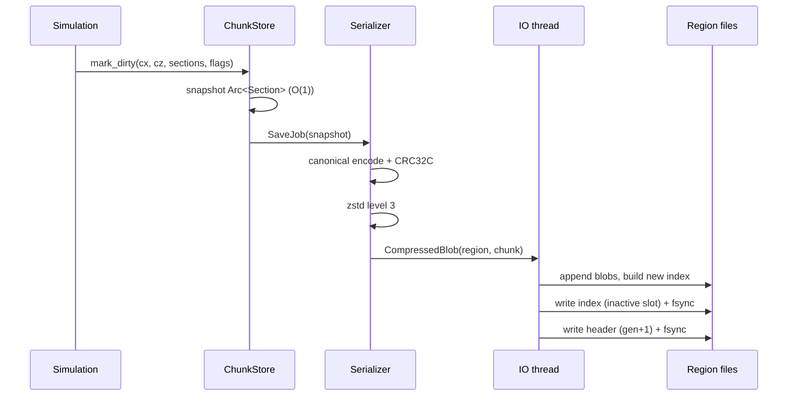
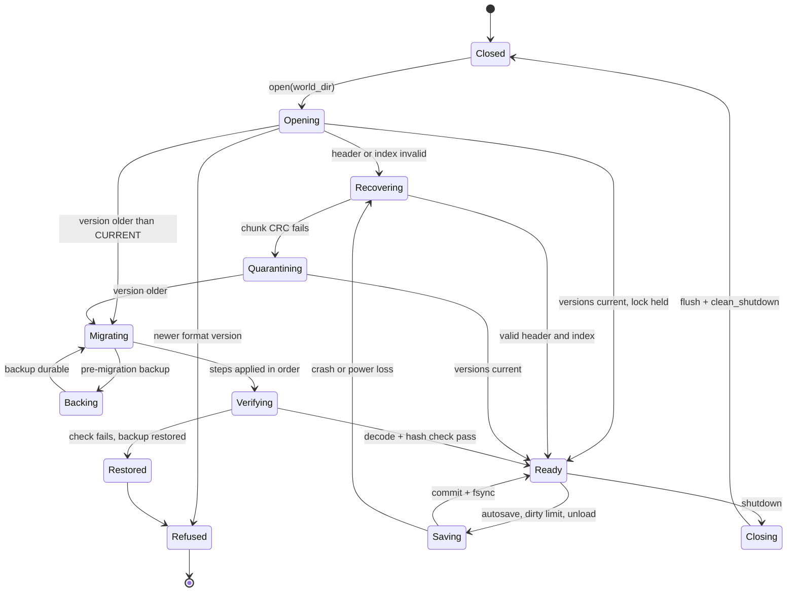

# 17 — Persistence

> Status: draft for review - Last updated: 2026-11-24
> Depends on: [DEC-004](../decisions.md), [DEC-005](../decisions.md), [DEC-006](../decisions.md), [DEC-007](../decisions.md), [DEC-033](../decisions.md), [DEC-035](../decisions.md), [DEC-046](../decisions.md), [DEC-047](../decisions.md), [05-world-model](05-world-model.md), [06-worldgen](06-worldgen.md)
> Implements: MS-13; consumed by MS-03 (first saves), MS-07 (server backups), MS-16 (1.0 format freeze)

> Note: `docs/research/09-persistence-assets-packaging.md` did not exist when this
> chapter was written. The persistence evidence comes from
> [research/01](../research/01-weft-teardown.md) §4.4 and the decision register;
> asset-cache and packaging details are derived here and must be cross-checked
> when research 09 lands.

## 1. Purpose and scope

This chapter specifies the on-disk world: the region file format v1, the chunk
payload, sidecar metadata, the write and read paths, crash recovery, migrations,
backups, import/export, the asset cache, and the security and performance
contracts. The format is a **promise**: a world is the player's most valuable
asset, so the design optimises for never losing or silently corrupting data, and
only then for size and speed (DEC-033).

In scope: `ob_world` storage, the `openblock-server` world manager, and the
`ob save` tooling. Out of scope: network chunk encoding
([18](18-networking-multiplayer.md)), the content registry itself
([15](15-content-system.md)), and reading Minecraft worlds (vision §7.1).

## 2. Requirements

| ID | Requirement | Verification |
| --- | --- | --- |
| REQ-SAVE-001 | After a power loss or `kill -9`, the world MUST open and MUST lose at most the last save cycle. | Fault-injection suite, 1,000 iterations (§7.1) |
| REQ-SAVE-002 | A committed chunk blob MUST never be overwritten: every commit appends new data and publishes a new index and header generation. The region file itself is mutable after commit, which is why backups copy or reflink whole files (§3.8). | Code inspection + torn-write test |
| REQ-SAVE-003 | Every chunk blob MUST carry a CRC32C over its compressed bytes and one over its uncompressed payload; the reader MUST verify both. | Unit test with a flipped bit at every offset class |
| REQ-SAVE-004 | A chunk failing validation MUST be quarantined, never dropped and never silently regenerated over edited data. | Corruption fixtures |
| REQ-SAVE-005 | A world written by any released version MUST migrate forward automatically, with a durable pre-migration backup. | Fixture saves for every release (§7.2) |
| REQ-SAVE-006 | Opening a world written by a newer format MUST fail with an actionable message naming the required version; it MUST NOT attempt a downgrade. | Negative test |
| REQ-SAVE-007 | Canonical chunk payloads MUST be deterministic: load → save without edits MUST reproduce identical raw bytes and CRCs. | Round-trip test at 1 and 8 workers |
| REQ-SAVE-008 | Numeric content indices MUST NOT be persisted. Chunk data references world-scoped dictionary ids that resolve through `ids.json` to resource IDs — and, for a block state, to `(block resource id, canonical property word)`; dictionary ids are never reused. | Inspection + `ids.json` growth test |
| REQ-SAVE-009 | Unknown content MUST round-trip as an opaque placeholder: remove a pack, load, save, re-add, load — data is intact, including every state of a multi-state block. | Integration test |
| REQ-SAVE-010 | The region format v1 layout of §3.2–§3.3 is frozen at MS-13; changes require a format_version bump and a migration. | Format-freeze review |
| REQ-SAVE-011 | All world writes MUST go through the region store; no subsystem may create ad-hoc files in the world directory. | Path allowlist test |
| REQ-SAVE-012 | Block edits MUST NOT trigger `fsync`. Commits are batched, with at most two `fsync` per dirty region per cycle and one journal `fsync` per metadata transaction. | Syscall-counter test |
| REQ-SAVE-013 | Graceful shutdown MUST flush all dirty state within 2 s for up to 256 MiB and set the clean-shutdown marker. | Shutdown benchmark |
| REQ-SAVE-014 | `level.json` MUST be canonical JSON with an explicit `format_version` and `data_version`; unknown fields MUST be preserved on rewrite. | Round-trip test with an extra key |
| REQ-SAVE-015 | Player data MUST be saved on logout, on death, on dimension change and at every autosave, keyed by stable player UUID. | Session script test |
| REQ-SAVE-016 | Block entities, entities, scheduled ticks (with their delays rebased on load), heightmaps, light and the `world_state` clock and weather MUST round-trip exactly, including mod-defined fields. | Property test over random worlds |
| REQ-SAVE-017 | Structure starts MUST be persisted before any block of that start is written (REQ-GEN-032). | Kill-mid-generation test |
| REQ-SAVE-018 | Each dimension MUST have an independent directory; dimension IDs are resource IDs; copying a world directory MUST preserve the world UUID and all links. | Portability test |
| REQ-SAVE-019 | Backups MUST be automatic before migration and on a schedule, and each MUST be a full copy, a reflink or an OS directory snapshot of the region files — never a hard link; retention MUST be bounded by count and age from config. | Backup/restore test |
| REQ-SAVE-020 | Import/export MUST validate structure files and world archives before writing anything, and MUST reject traversal, absolute paths, symlinks, duplicate and case-colliding names. | Hostile-archive corpus |
| REQ-SAVE-021 | Decompression MUST be bounded before allocation: a declared raw length above the cap or a stream exceeding it aborts the load. | Zip-bomb fixtures |
| REQ-SAVE-022 | A world directory is untrusted input: no code, generator, shader or path from it may be loaded or executed. | Inspection + fuzz corpus |
| REQ-SAVE-023 | Decode limits (payload, sections, palette, entities, ticks, components) MUST be enforced before allocation, with an actionable error. | Negative fixtures |
| REQ-SAVE-024 | Incremental save MUST meet the pause and throughput budgets of §5. | Save benchmark |
| REQ-SAVE-025 | The asset cache MUST be content-addressed, verified on load, safe to delete, and MUST never be required to open a world. | Cache-deletion test |
| REQ-SAVE-026 | Thumbnails MUST be generated off the simulation thread and MUST never block a save. | Profiler assertion |
| REQ-SAVE-027 | A migration MUST run on a verified backup copy and MUST be dry-runnable (`save migrate --dry-run --verify`). | Tool test |
| REQ-SAVE-028 | Only one process may write a world; a second writer MUST refuse and offer a diagnostic. | Two-process test |
| REQ-SAVE-029 | The format MUST be documented well enough for third-party tools; a reference reader ships in `ob_tools`. | Tool round-trip test |
| REQ-SAVE-030 | Save files MUST record the generator fingerprint and content hash for diagnostics. | Inspection |
| REQ-SAVE-031 | Region files MUST be portable across platforms: little-endian, fixed field widths, zero padding, no pointer-sized fields. | Cross-platform fixture comparison |
| REQ-SAVE-032 | Every write path MUST be idempotent: replaying the journal or re-running a commit MUST NOT duplicate or corrupt data. | Journal replay test |
| REQ-SAVE-033 | Autosave interval MUST be configurable (10–3,600 s) and default to 60 s. | Config test |
| REQ-SAVE-034 | A quarantined chunk MUST retain its bytes for forensics under `<world>/quarantine/`. | Quarantine test |
| REQ-SAVE-035 | While the interim v0.x snapshot format stores dense block ids, it MUST record a content-registry fingerprint and MUST refuse to load when the current registry differs, naming both fingerprints; it MUST NOT silently reinterpret block ids. A v1-v3 snapshot written before a documented append-only block addition MAY load with a warning, because every earlier id is unchanged; v4+ keeps the strict check. | Mismatch fixture + pack test |

## 3. Design

### 3.1 World directory layout

```text
saves/<world_uuid>/
  level.json                 canonical JSON, world metadata (§3.4)
  ids.json                   resource-ID <-> dictionary-id table (§3.4)
  journal.obm                metadata transaction journal (§3.5)
  world.lock                 single-writer lock (pid + boot id + hostname)
  players/<uuid>.json        per-player state, atomic replace
  dimensions/openblock/overworld/region/r.<rx>.<rz>.obr
  dimensions/openblock/overworld/region/r.<rx>.<rz>.obs   structure starts
  dimensions/openblock/underworld/...                     same shape
  dimensions/<namespace>/<path>/...                       content dimensions
  quarantine/<region>/<cx>.<cz>.obc                        failed payloads
  backups/<utc-stamp>/                                    snapshots (§3.8)
  cache/                     thumbs and resolved assets; deletable (§3.9)
```

The world UUID is created once and never changes; it is copied into every region
header so a region cannot be silently grafted into another world. Dimension
directories are independent so a dimension can be moved or deleted on its own.
Region files are named by region coordinates `(rx, rz)` — a 32×32-chunk group.

### 3.2 Region file v1

A region file is a sequence of **512-byte sectors**. All integers are
little-endian; padding bytes are zero. The fixed prefix is 136 sectors:

| Byte offset | Size | Contents |
| ---: | ---: | --- |
| 0 | 512 | header slot A |
| 512 | 512 | header slot B |
| 1,024 | 3,072 | free-extent list (CRC + up to 383 extents) |
| 4,096 | 32,768 | index slot A: 1,024 × 32-byte entries |
| 36,864 | 32,768 | index slot B |
| 69,632 | … | payload area, sector-aligned chunk blobs |

Header slot (512 bytes, written twice, alternating):

| Off | Size | Field | Notes |
| ---: | ---: | --- | --- |
| 0 | 4 | magic | `OBR1` |
| 4 | 2 | `format_version` | 1 |
| 6 | 2 | `header_size` | 512 |
| 8 | 4 | `region_x` | `i32` |
| 12 | 4 | `region_z` | `i32` |
| 16 | 16 | `world_uuid` | copied from `level.json` |
| 32 | 8 | `generation` | incremented on every successful commit |
| 40 | 8 | `index_a_off` | 4,096 |
| 48 | 8 | `index_b_off` | 36,864 |
| 56 | 8 | `append_off` | next free payload byte, sector-aligned |
| 64 | 8 | `live_bytes` | sum of live blob lengths |
| 72 | 8 | `dead_bytes` | payload bytes not referenced by the index |
| 80 | 8 | `free_list_off` | 1,024 |
| 88 | 4 | `free_list_len` | bytes, `4 + 8n` |
| 92 | 4 | `free_list_count` | `n` |
| 96 | 4 | `chunk_count` | present chunks |
| 100 | 1 | `index_slot` | 0 = A active, 1 = B active |
| 101 | 1 | `default_codec` | see below |
| 102 | 2 | `flags` | bit0 compact requested, bit1 clean shutdown, bit2 structure sidecar present, bit3 free list valid |
| 104 | 2 | `schema_version` | highest chunk payload schema present |
| 106 | 2 | reserved | zero |
| 108 | 4 | `header_crc32c` | over bytes 0..108 |
| 112 | 400 | reserved | zero |

Codecs: `0` stored, `1` zstd level 3 (interactive), `2` zstd level 9 (pregen and
backup), `3` reserved. Compression is an implementation detail of the container,
not of the data: the deterministic unit is the uncompressed canonical payload.

Index entry (32 bytes, one per chunk in 32×32 raster order, `index = (cz & 31) *
32 + (cx & 31)`):

| Off | Size | Field | Notes |
| ---: | ---: | --- | --- |
| 0 | 4 | `blob_sector` | 0 = absent |
| 4 | 4 | `blob_len` | bytes including the 16-byte blob header, excluding padding |
| 8 | 4 | `raw_len` | decompressed payload bytes |
| 12 | 4 | `payload_crc32c` | over the compressed bytes |
| 16 | 4 | `timestamp` | Unix seconds, clamped to `u32` |
| 20 | 2 | `status` | 0 absent, 1 generated, 2 populated, 3 full, 4 quarantined |
| 22 | 1 | `codec` | overrides `default_codec` |
| 23 | 1 | `flags` | bit0 edited, bit1 entities, bit2 ticks, bit3 light, bit4 structure refs, bit5 partial |
| 24 | 2 | `schema` | chunk payload schema for this chunk |
| 26 | 2 | `section_count` | sections present |
| 28 | 4 | reserved | zero |

Blob header, at `blob_sector × 512`, immediately before the compressed bytes:

| Off | Size | Field |
| ---: | ---: | --- |
| 0 | 4 | magic `OBZ1` |
| 4 | 1 | `codec` |
| 5 | 1 | `blob_format` = 1 |
| 6 | 2 | `schema` |
| 8 | 4 | `raw_len` |
| 12 | 4 | `raw_crc32c` |

**Atomicity.** DEC-033 permits a "journal/double-buffer guard" alongside
temp-file-plus-rename. Chunk commits use the double buffer: new data is appended,
the inactive index is written and `fsync`ed, then the inactive header publishes it.
Whole-file writes — sidecars, compaction output, exports — use temp file + `fsync` +
`rename` + directory `fsync`, because a rename is not durable without the latter.
Rewriting a whole region per save instead would make every edit O(region) and
multiply fsyncs; see open question 6.

**Why two index slots and two header slots.** A commit writes the new index into
the inactive slot, `fsync`s, then writes the inactive header slot with
`generation + 1` and `fsync`s. A reader always takes the valid header with the
highest generation; a torn header write leaves the previous generation intact. If
the active index fails its CRC, the other slot is tried. The `OBZ1` magic makes a
payload-area scan possible when both copies are lost.

**Compaction and free space.** Writes append. Replacing a chunk leaves its old
blob unreachable and counted in `dead_bytes`. Compaction rewrites the live blobs
into a temporary file, writes a fresh index and header, `fsync`s, renames over the
original and `fsync`s the directory (a rename is not durable without it). Trigger:
`dead_bytes > max(live_bytes / 2, 1 MiB)`, or `dead_bytes > live_bytes / 4` at
close, or the `compact_requested` flag after recovery. Allocation inside a region
is best-fit over the free-extent list, but only when the extent exceeds the blob
by at most 4×; otherwise the write appends, so a region never fragments into
unusable slivers. Adjacent free extents are coalesced on every commit; if the free
list CRC fails it is rebuilt by scanning the index (a hole is any payload range the
index does not reference).

### 3.3 Chunk payload

Payloads are a fixed header plus length-prefixed TLV components, so a reader can
skip what it does not understand and a writer can preserve what it never decoded.

| Off | Size | Field |
| ---: | ---: | --- |
| 0 | 4 | magic `OBC1` |
| 4 | 2 | `schema` |
| 6 | 2 | `flags` (bit0 partial, bit1 unknown components preserved) |
| 8 | 4 | `cx` |
| 12 | 4 | `cz` |
| 16 | 8 | `generator_fingerprint` (REQ-SAVE-030) |
| 24 | 2 | `component_count` |
| 26 | 2 | `section_count` |
| 28 | 4 | `body_len` |
| 32 | 8 | `saved_tick` — base tick for this payload's delays: the chunk's `last_simulated` at write time |

Each component is `u16 id | u32 len | len bytes`. Known ids:

| Id | Component | Encoding |
| ---: | --- | --- |
| 1 | biomes | varint palette length, palette of dictionary ids, `bits` (0/4/8/16), packed 4×4×4 indices per section, section-major |
| 2 | sections | per section: `y i16`, mode `u8` (0 uniform, 1 packed), `bits u8`, palette length `u16`, `data_len u32`, then palette of block-state dictionary ids (each resolving to `(block resource id, canonical property word)`) and packed `u64` words in YZX order |
| 3 | block entities | count, then `packed_pos u32`, type dictionary id (varint), payload length (varint), payload |
| 4 | entities | count, then UUID (`16 B`), type dictionary id, payload |
| 5 | scheduled ticks | count, then `packed_pos u32`, kind dictionary id (varint), `delay u32` ticks (remaining, against this payload's `saved_tick`); no sequence number |
| 6 | heightmaps | three 16×16 maps at 9 bits per entry, packed (288 bytes each): surface, motion-blocking, ocean floor |
| 7 | light | per section: `y i16`, mode (0 uniform, 1 packed), one `u16` for uniform or 4,096 × `u16` (sky4 + R4 + G4 + B4) |
| 8 | structure refs | count, then `start_id u64`, structure dictionary id, `piece_mask u64` |
| ≥ 0x8000 | mod components | allocated through `ids.json`; preserved verbatim when the providing pack is absent |

`packed_pos` is `x(4) | z(4) | y(12)` biased by `min_y`, valid for heights up to
1,024 and any 16×16 column. Section records are sorted by `y`; block entities by
position, entities by UUID and ticks by `(delay, packed_pos, kind)` — which is the
canonical `(due_tick, position, kind)` order of [05 §3.7](05-world-model.md#37-scheduled-ticks),
because every delay in a payload is relative to that payload's single `saved_tick`. This sorting is
what makes payload bytes canonical (REQ-SAVE-007). Palettes are sorted by
dictionary id and indices remapped on encode, so an edit history cannot change the
bytes of the same logical content.

**Block-state identity.** A block state is not a resource ID: it is a block type plus a
property word ([05 §3.4](05-world-model.md#34-block-states)). Every `block_state`
dictionary entry is therefore the pair `(block resource id, canonical property word)`,
where the word sorts properties by name and packs them little-endian at increasing bit
offsets, so it is independent of registry order and of whichever pack is installed. The
canonical state key `namespace:path[prop=value,…]` (properties sorted by name, every
property listed) is written next to the entry in `ids.json`; it is what `/debug ids`, the
pack validator and a human diff show, while the pair is what a palette id resolves to. A
modded block with sixteen states therefore keeps sixteen dictionary entries and
round-trips as sixteen states, not as one opaque blob.

A palette id whose pack is absent decodes to `PaletteEntry::Opaque`: `original_id` is the
block's resource ID taken from the dictionary entry, and `payload` is the two-byte
canonical property word — nothing else, because a block entity carries its own component
and item contents. Re-adding the pack resolves the key back to a frozen state ID. If the
word is not valid for the returned pack's schema, the entry stays opaque and a warning
names the pack and state key; the loader never substitutes a different state.

### 3.4 Sidecar files

**`level.json`** (canonical JSON, unknown keys preserved):

```jsonc
{
  "format_version": 1, "data_version": 1, "world_uuid": "…",
  "name": "Highlands", "seed": "-4278190080",
  "created_at": "2026-11-24T15:31:27Z", "last_played": "2026-11-24T18:02:11Z",
  "game_mode": "survival", "difficulty": "normal", "tick_rate": 20,
  "spawn": { "dimension": "openblock:overworld", "x": 128, "y": 71, "z": -42 },
  "game_rules": { "keep_inventory": false, "do_daylight_cycle": true },
  "dimensions": ["openblock:overworld", "openblock:underworld", "openblock:terminus"],
  "world_state": {
    "total_ticks": 1830000, "day_time": 6000, "day_length": 24000,
    "dimensions": {
      "openblock:overworld": { "weather": { "phase": "precipitating", "intensity": 0.65,
                                            "thunder": 0.0, "remaining": 4200, "epoch": 17 } },
      "openblock:underworld": { "weather": null },
      "openblock:terminus": { "weather": null }
    }
  },
  "generators": { "openblock:overworld": { "fingerprint": "0x9a3f…", "generator_version": 1 } },
  "content_hash": "blake3:…", "ids_generation": 42,
  "world_border": 29999984, "clean_shutdown": true
}
```

**`world_state` is the clock the whole save depends on.** `total_ticks` is the monotonic
tick count; `day_time` and `day_length` are the celestial state of
[07 §3.11](07-light-and-weather.md#311-time-and-the-celestial-model). A dimension whose
`TimeMode` is `Fixed`/`Frozen` derives its sky from the frozen value and does not need a
separate field. Each weather-enabled dimension stores its machine's phase, intensity,
thunder, remaining duration and RNG `epoch` ([07 §3.13](07-light-and-weather.md#313-the-weather-state-machine));
non-weather dimensions store `null`, not a zeroed machine.

**Tick-delay rebasing.** Scheduled ticks are stored as a remaining `delay`, never as an
absolute `due_tick` (§3.3 component 5), and every payload carries the tick its delays are
relative to — the chunk's `last_simulated`, written as `saved_tick`. On load the order is:
restore `world_state` first, then apply block states, block entities and chunk payloads,
then convert each chunk's delays with `due_tick = saved_tick + delay`. Because the base is
per chunk, the conversion is symmetric: a chunk last simulated at tick `T` and reloaded at
`T + 5,000` keeps its pending ticks at their original due times, and the loader reports
`missed = clamp(total_ticks − saved_tick, 0, CATCHUP_WINDOW)` so the bounded catch-up of
[05 §3.7](05-world-model.md#37-scheduled-ticks) can run them; a world merely restarted at
the same tick runs them exactly as before. Writing a chunk (save or unload) recomputes
`delay = max(0, due_tick − saved_tick)` from its current `last_simulated`, so repeating
save/load leaves the schedule unchanged and nothing ages against the wall clock. An
already-due tick therefore becomes `delay = 0`, never dropped: on load it rebases to
`saved_tick`, which is in the past, and the catch-up pass runs it once. This is what makes
REQ-SAVE-016's "round-trip exactly" meaningful for ticks and what
[05 §3.7](05-world-model.md#37-scheduled-ticks) assumes for catch-up.

`world_state` participates in the canonical world hash recorded in the save manifest used
by backup and export verification (§3.8), and in the expected `world_state` recorded by the
migration fixtures (§3.7): the manifest hash is BLAKE3 over the canonical `level.json`
bytes with the diagnostic `last_played` field excluded (including `world_state`),
`ids.json` and the ordered per-chunk payload hashes. A loader that forgets the clock or
re-seeds weather therefore fails a save test instead of drifting silently.

A pre-`world_state` fixture migrates with `total_ticks = 0`, `day_time = 0`,
`day_length = 24000`, `phase = "clear"`, `intensity = 0`, `epoch = 0`; the migration step is
recorded in the journal like any other and is covered by the fixture in §7.2.

`ids.json` maps dictionary ids to resource IDs — or, for a block state, to a resource ID
plus property word — per registry kind, with a `generation` counter, a tombstone list and
a `next` allocator per kind:

```jsonc
{ "format": 1, "generation": 42,
  "kinds": {
    "block": { "next": 1180, "ids": { "openblock:stone": 0, "openblock:dirt": 1 },
               "tombstones": ["mymod:removed_block"] },
    "block_state": { "next": 1204,
      "entries": {
        "openblock:oak_stairs[facing=east,half=bottom,shape=straight,waterlogged=false]":
          { "id": 1203, "block": "openblock:oak_stairs", "props": 4131 },
        "mymod:pipe[axis=y,flow=3]":
          { "id": 1202, "block": "mymod:pipe", "props": 26 } },
      "tombstones": [] },
    "entity": { "next": 41, "ids": { "openblock:grazer": 0 }, "tombstones": [] },
    "biome": { "next": 65, "ids": { "openblock:plains": 0 }, "tombstones": [] } } }
```

`block_state` is the one kind that cannot be a plain string map, because a state has no
resource ID of its own. Its key is the canonical state key and its value carries the
dictionary id plus the `(block, props)` pair, where `props` is the 16-bit canonical
property word of [05 §3.4](05-world-model.md#34-block-states), written in decimal. A
removed pack leaves its entries in place: while the pack is absent, palette ids decode to
`PaletteEntry::Opaque` with that pair, and when the pack returns the key resolves to the
frozen state ID. A 16-state modded block therefore adds 16 entries and round-trips as 16
states; it is never collapsed into a single opaque placeholder.

Dictionary ids are world-scoped, monotonic and never reused for a different key. An
entry that is retired because content was explicitly deleted leaves a tombstone for the
world's lifetime, while a pack that is merely absent leaves its entries in place.
`block_state` entries are retained while their block's pack is merely absent, because an
opaque palette id must still resolve to a `(block, props)` pair; explicit deletion of a
block retires its state entries with tombstones like any other kind. Re-adding an absent
pack therefore reuses the existing keys and dictionary ids, and a 16-state block keeps
all 16. Kinds covered: block state, item, entity, block entity, biome, feature, structure,
particle, sound, damage type.

Other sidecars: `players/<uuid>.json` (position, health, inventory, effects,
advancements, personal storage; atomic replace), `dimensions/<id>/structures.obs`
(structure starts: `start_id`, structure ID, origin chunk, bounding box, piece
count, seed, loot seed, status — written before any of its blocks, REQ-SAVE-017),
`journal.obm` (metadata transaction and migration journal, §3.5 and §3.7), and a
`mods.lock.json` snapshot written for diagnostics only — the authoritative mod list
is the one the session loads.

**Interim v0.0.x sidecars.** The code-defined host writes flat text sidecars next
to `world.obs`, each atomically replaced; a missing file loads as empty. In
addition to `player.txt`, `inventory.txt` and `items.txt`, this slice adds:

`block_entities.txt` — one record per furnace/chest, all furnaces first and then
all chests, each group in ascending `(x, y, z)` order:

```text
furnace <x> <y> <z> <burn_remaining> <burn_total> <cook_progress> <input> <fuel> <output>
chest <x> <y> <z> [<slot>:<stack> ...]
```

A `<stack>` is `-` when empty, otherwise `item,count` or `item,count,durability`;
chest records list only non-empty slots in ascending slot order. Empty
furnaces/chests are written (their record must survive a reload). Duplicate
positions keep the first record, malformed furnace lines are skipped, a
malformed chest slot token skips only that slot, and unknown items are dropped
with a warning. On load and before each save, a record in a *loaded* chunk whose
block is no longer the expected furnace/chest is removed with a warning; records
in unloaded chunks are kept because the block cannot be inspected yet.

`equipment.txt` — one `<slot> <item> <durability>` line per equipped armor
piece, in helmet/chestplate/leggings/boots order; missing durability defaults to
full and mismatched slots/items are skipped with a warning.

`spawn.txt` — the persisted world-spawn point, three whitespace-separated
coordinates. It is written on every save and preferred on the next open so a
restart, reconnect and respawn use the same safe column; an older world without
the file resolves a spawn once and persists it on the next save. A malformed,
non-finite or out-of-range line is ignored with a warning.

The host state hash covers player state, inventory, item entities sorted by id,
the persisted world spawn, furnaces and chests sorted by position (all slots,
empty markers included), equipment in slot order and world blocks; save/reload
must therefore reproduce the hash exactly.

### 3.5 Write path



1. **Dirty tracking.** `mark_dirty` sets a per-section bit and a flag
   (blocks / light / entities / ticks / heightmaps / structures) in a
   `BTreeMap<RegionPos, RegionDirty>`. Ordering is deterministic, so a save cycle
   always processes regions in the same order.
2. **Snapshot.** Sections are `Arc<Section>`; a job clones the arcs and copies the
   small block-entity, entity and tick vectors under a short lock. The tick thread
   never waits for serialization — the pause it pays is the copy and the queue
   push.
3. **Serialize and compress** on 2–4 workers. Compression and CRC are per chunk, so
   the work is embarrassingly parallel and independent of worker count.
4. **Commit per region.** Blobs are appended, the new index is written to the
   inactive slot, `fsync`, then the inactive header slot is written with
   `generation + 1`, `fsync`. Nothing else is needed: an uncommitted append is
   unreachable because the old index is still active, so recovery never has to
   reason about partially written chunk data.

The region file is therefore **not immutable** after a commit: it keeps the same
inode while its payload grows and its inactive index and header are rewritten. Backups
must copy or reflink the file (§3.8); a hard link would follow those writes into the
backup and silently change it.

**Metadata transactions.** `level.json`, `ids.json` and player files cannot use an
in-file double buffer, and a multi-file update must not land half-applied. They are
written as a journal transaction: write `name.tmp` files, `fsync`, append a `COMMIT`
record to `journal.obm`, `fsync` it once, rename each file, then append a
`CHECKPOINT`. On recovery, a `COMMIT` without a `CHECKPOINT` re-applies the renames
(idempotent), and temp files without a `COMMIT` are discarded. This is the
"journal" half of the DEC-033 guard; it runs on world open/close, ID allocation and
migrations, not on the save cycle, so it never adds an fsync to normal play.

**Batching and fsync cadence.** One cycle per autosave interval (default 60 s,
REQ-SAVE-033), or early when dirty bytes exceed 64 MiB, or when a chunk with edits
is unloaded. Fsyncs per cycle are `2 × dirty_regions`, which is why block edits
never fsync (REQ-SAVE-012): an edit only sets a bit. Servers may raise the interval
to reduce IO; the cost is a larger worst-case loss window, which the config
documentation states explicitly.

**Graceful shutdown.** Stop accepting edits, flush the dirty set, run one final
commit, set `clean_shutdown` in `level.json` and in every touched header, `fsync`,
release the lock. Budget 2 s for 256 MiB dirty (REQ-SAVE-013); after that the
server logs remaining dirty bytes and exits, relying on recovery.

### 3.6 Read path and recovery

Loads are lazy by status: the index entry is read first, and the payload is
decoded only when a caller requests a status the stored chunk can satisfy. A chunk
stored at `generated` is not decoded for rendering; a chunk absent from the index
is `NotGenerated` and the generator is asked for it.

Validation order, cheapest first: header magic and CRC, then `format_version`
(§3.7), then index CRC, then per entry bounds (`blob_sector × 512` inside the
payload area, `blob_len` inside the file, `raw_len ≤ 8 MiB`), then the blob magic,
codec and compressed CRC, then decompression against `raw_len`, then the raw CRC,
then the payload header and component limits. Any failure quarantines the chunk:
its bytes are copied to `quarantine/<region>/<cx>.<cz>.obc`, the index entry gets
status `quarantined`, the world keeps loading, and a warning names the file. An
edited chunk is never regenerated automatically; an unedited one may be, if
`repair.regenerate_unedited` is enabled. That repair path covers missing or unreadable payloads
only: a chunk whose stored generator fingerprint differs from the active generator is not corrupt,
so it loads as saved and is reported, and regeneration remains the explicit operator action of
[DEC-047](../decisions.md).

Recovery on open:

1. Read both header slots; validate magic, size and CRC. If both are invalid, scan
   the payload for `OBZ1` blobs and rebuild an index from the magic, `cx`/`cz` and
   the checksums (slow path, bounded by file size).
2. Take the valid header with the highest `generation`, then validate that index
   slot; fall back to the other slot on CRC failure.
3. Replay `journal.obm` from the last `CHECKPOINT`: re-apply committed metadata
   renames and delete orphaned `*.tmp` files. Regions are verified independently
   from their own headers, so a missing checkpoint never invalidates committed
   chunk data.
4. Verify the free list and rebuild it from the index if needed, then recompute
   `dead_bytes` and request compaction if the threshold is exceeded.

### 3.7 Versioning and migrations

Two version numbers: `format_version` describes the container (header, index,
blob framing) and `data_version` the chunk payload schema. Both are stored in
`level.json` and mirrored per region (`format_version` in the header, `schema` per
chunk). A region may legally contain chunks at two adjacent schemas if a
migration was interrupted between regions.



Migrations are ordered steps `v(n) → v(n+1)`, each a pure function over a
validated world, applied in memory and committed in one pass. They are engine
code, never content or mod code. A step records itself in the journal before
commit and is idempotent (REQ-SAVE-032). `world_state` is migrated like any other
field: the step that introduces it fills the defaults of §3.4, and later steps preserve
unknown weather fields verbatim. Fixture saves for every released version
live in `tests/fixtures/saves/<release>/` with a manifest of expected per-chunk
hashes and the expected `world_state` (total ticks, day time, day length and
per-dimension weather); one fixture deliberately predates `world_state` so the
defaulting step is exercised. `cargo xtask save fixture` regenerates them from a
scripted world, and they are at most 2 MiB each.

`openblock-server save migrate --dry-run --verify <world>` runs the whole chain on
a temporary copy, compares per-chunk CRCs before and after, and prints the plan;
without `--dry-run` it takes the backup first. **Downgrade refusal:** if
`format_version > CURRENT_FORMAT` or `data_version > CURRENT_DATA`, opening for
write fails with the required version and the world left untouched; there is no
read-only mode, because an older decoder cannot be trusted with a newer payload.

**Interim snapshot format (v0.0.x).** Until the region store of §3.2 lands at
MS-13, the reference implementation writes a whole-world snapshot: magic, a
container version, seed, a content-registry fingerprint (REQ-SAVE-035), a
compression flag (stored or zstd level 3), uncompressed/compressed payload
lengths, the payload, and a CRC32C over everything before it. Snapshot v1
(stored, dense light), v2 (zstd, compact light) and v3 (registry fingerprint)
remain readable and are upgraded on the next save; v4 is the current format and
keeps the strict fingerprint check. Registry block ids in the interim format are
session-local dense indices and are append-only by policy: the crafting slice
appends `planks`, `cobblestone` and `crafting_table` without moving any earlier
id. Consequently a v3 snapshot whose fingerprint predates that append is
accepted with a warning naming both fingerprints and its ids are interpreted
unchanged; v1 and v2 carry no fingerprint and load ids unchanged by
construction. Reordering or removing blocks still fails (an out-of-range id is
`UnknownBlock`, and v4 rejects any fingerprint change). This format is explicitly not the frozen region
format and makes no compatibility promise beyond the migration chain above.

**Forward-compatibility promise.** A world written by any `1.x` build opens in any
later `1.x` build through the migration chain. A newer world never opens in an
older build. Within one `data_version`, unknown components and unknown fields in
typed payloads are preserved verbatim, so a world that visited a modded server
does not lose that mod's data when opened without the mod (REQ-SAVE-009); this is
the mechanism behind the opaque-placeholder round-trip.

**Interim sidecars.** Next to the `world.obs` snapshot the v0.0.x host writes
header-free text sidecars with the same temp-file + rename atomic replacement:
`player.txt` (ten whitespace-separated fields), `inventory.txt` (one
`slot item_resource_id count [durability]` line per non-empty hotbar slot) and
`items.txt` (one line per live dropped item, sorted by entity id:
`id x y z vx vy vz item_resource_id count durability age`). Floats use Rust's
shortest round-trip `Debug` form; `durability` is `-` when the stack has none.
The files are rewritten atomically with the world in `Host::save`. A missing
`items.txt` (or `inventory.txt`) means empty; malformed lines and unknown item
names are skipped with a warning, counts and positions are clamped on load, and
entity ids are preserved so the next id is `max(id) + 1`. Dropped items are
authoritative simulation state, so they are included in the state hash in id
order with positions, velocities and age quantised to `1e-4`. Pickup preserves
the exact stack: the durability component is retained, so a damaged tool loaded
from `items.txt` is never repaired by entering the hotbar, and the same
stack-preserving path serves single-player and network-player pickup.

### 3.8 Backups, restore, import and export

**Backups.** A backup is a directory `backups/<utc-stamp>/` containing
`level.json`, `ids.json` and a full copy of every region file, or a reflink
(copy-on-write clone) where the filesystem supports it (APFS, btrfs, XFS with
reflink). Hard links are **not** supported: a region file is not immutable once
committed — a commit appends blobs and rewrites the inactive index and header in
the same file (§3.2) — so a hard-linked backup would silently change with the live
world. The supported modes are `copy` (portable, one full copy of the world per
backup), `reflink` (only when the filesystem reports support, falling back to copy
otherwise), and `auto` (the default: reflink when supported, else copy); `backups.mode`
selects them and the backup UI states the space cost.

*Consistency and RPO.* The backup copies each region file whole. With `copy`, each file
is copied under that region's read lock, so a commit to the same region waits for one file
copy while the rest of the simulation keeps running; with `reflink` each clone is O(1) and
atomic per file; where the OS offers a directory snapshot, it replaces both. No commit can
interleave with a file's copy, so every file in the backup is one committed generation and
never a mix of two. A commit that lands after its region was copied is simply not in that
backup. The RPO is the backup interval plus the autosave interval (default 60 s,
REQ-SAVE-033): everything committed before the copy started is in the backup, and at most
the in-flight autosave cycle is not.

Retention is `keep N` by count and age from config (default: 24 hourly, 7 daily, 4
weekly), pruning oldest first and never deleting the pre-migration backup of the
running version. Restore is a file-level operation on a stopped world, or a
copy-then-swap under the lock.

**Import/export.** Structure files (`.obstruct`) are a single versioned,
zstd-compressed blob: palette of resource IDs, dense block array, connector list,
block entities and processor references; import validates the palette, the array
length against its declared dimensions and the 32×32×32 default size cap.
World export (`.obworld`) is a zip with `manifest.json` (format, world UUID, seed,
content hash, dimension list, file list with sizes and BLAKE3 hashes),
`level.json`, `ids.json` and `dimensions/**`; player data is excluded unless
requested. Import validates the manifest, extracts into a temporary directory,
verifies every hash, then renames into place — never partially into `saves/`.
Asset caches and backups are not exported. Reading Minecraft worlds is explicitly
not supported (vision §7.1).

### 3.9 Asset cache and thumbnails

The asset cache lives under `<world>/cache/assets/<kind>/<aa>/<blake3>` where the
hash is over the canonical pack tree for that asset; `cache/index.json` maps pack
hashes to resolved roots. The cache is verified on load and is safe to delete
(REQ-SAVE-025); it is never required to open a world, never exported, and never
trusted as a source of content — the packs are. Thumbnails are
`cache/thumbs/<world_uuid>.webp` at 320×180, rendered from the spawn-area
heightmap and biome colours on a worker thread, regenerated when stale, and
written atomically (REQ-SAVE-026).

### 3.10 Security and untrusted input

A world directory, a `.obworld`, a `.obstruct` and a server-provided pack are all
hostile input (REQ-SAVE-022).

| Threat | Control |
| --- | --- |
| Path traversal (`../`, absolute, `C:\`, UNC, NUL, `:`) | every world-relative path must be one normal component; canonicalised path must stay under the world root |
| Symlink escape | do not follow symlinks when opening world files (`openat` + `O_NOFOLLOW` on Unix, reparse-point flag on Windows) |
| Zip bomb | compressed and uncompressed caps before extraction, entry-count cap, ratio cap (200:1), streaming with a hard limit and abort |
| Duplicate or case-colliding names | reject on import; compare case-folded and Unicode-normalised names |
| Allocation blow-up | decode limits (REQ-SAVE-023): payload 8 MiB, 64 sections, 65,536 palette entries, 4,096 entities, 65,536 ticks, 256 components, nesting depth 4 |
| Decompression bomb in a chunk | declared `raw_len` checked against the cap before allocation; the decoder aborts if the stream exceeds it |
| Executable content in a world | nothing in a world directory is loaded as code, generator, shader or pack |
| Lock bypass | `world.lock` with pid, boot id and host; a second writer refuses |

Error messages never echo attacker-controlled paths into logs unescaped, and a
failed import leaves no partial world behind.

## 4. Data structures and formats

```rust
/// 512 bytes, little-endian; compile-time size check.
#[repr(C)]
pub struct RegionHeader {
    pub magic: [u8; 4], pub format_version: u16, pub header_size: u16,
    pub region_x: i32, pub region_z: i32, pub world_uuid: [u8; 16],
    pub generation: u64, pub index_a_off: u64, pub index_b_off: u64,
    pub append_off: u64, pub live_bytes: u64, pub dead_bytes: u64,
    pub free_list_off: u64, pub free_list_len: u32, pub free_list_count: u32,
    pub chunk_count: u32, pub index_slot: u8, pub default_codec: u8,
    pub flags: u16, pub schema_version: u16, pub reserved0: u16,
    pub header_crc32c: u32, pub reserved1: [u8; 400],
}
const _: () = assert!(size_of::<RegionHeader>() == 512);

/// 32 bytes; 1,024 entries per index slot.
#[repr(C)]
pub struct IndexEntry {
    pub blob_sector: u32, pub blob_len: u32, pub raw_len: u32,
    pub payload_crc32c: u32, pub timestamp: u32,
    pub status: u16, pub codec: u8, pub flags: u8,
    pub schema: u16, pub section_count: u16, pub reserved: u32,
}
const _: () = assert!(size_of::<IndexEntry>() == 32);

pub struct ChunkPayload {
    pub header: PayloadHeader,            // 40 bytes, §3.3
    pub components: Vec<Component>,        // ascending id; unknown ids kept as bytes
}
pub struct Component { pub id: u16, pub bytes: Box<[u8]> }

pub enum PaletteEntry {
    Known(BlockStateId),
    /// Unknown pack: `original_id` is the block resource ID from `ids.json`,
    /// `payload` is the 2-byte little-endian canonical property word.
    Opaque { dict_id: u32, original_id: Box<str>, payload: Box<[u8]> },
}
```

Status and flags are stored as small integers, never as Rust enum discriminants, so
the layout is stable across compiler versions and platforms (REQ-SAVE-031).
`PaletteEntry::Opaque` renders as a checkerboard, collides as a solid block, blocks
light, drops nothing, and re-encodes to the original block resource ID and property
word unchanged, which is what makes the remove-pack/add-pack round trip exact. Because
the entry is a `(block, property word)` pair rather than a bare dictionary id, a modded
block with several states keeps them distinct: the remove-pack/load/save/re-add fixture in
§7.4 places three states of one 16-state block, and each returns to its own state.

## 5. Performance budgets

Measured on the reference machine (8 cores, NVMe; vision §9) with a 512-block
world, 32 chunks radius.

| ID | Metric | Budget | Measured by |
| --- | --- | --- | --- |
| PERF-SAVE-001 | Simulation-thread pause per save cycle | ≤ 5 ms p99 (snapshot), ≤ 30 ms p99 total tick impact | tick profiler |
| PERF-SAVE-002 | Serialize + compress throughput, 4 workers | ≥ 150 MiB/s | save benchmark |
| PERF-SAVE-003 | Chunk load (read, decompress, decode, 16 KiB payload) | ≤ 1.5 ms p99 | load benchmark |
| PERF-SAVE-004 | Region open + index validation | ≤ 0.2 ms; cold scan of 4,096 regions ≤ 2 s | `fs_bench` |
| PERF-SAVE-005 | Fsyncs per save cycle | ≤ 2 × dirty regions (journal only on metadata transactions) | syscall counter |
| PERF-SAVE-006 | Fresh 512-block world on disk | ≤ 120 MiB (estimate: ~22 KiB per column) | world-size test |
| PERF-SAVE-007 | Built 512-block world on disk | ≤ 1.5 GiB (MS-13 gate) | world-size test |
| PERF-SAVE-008 | Fresh/built 1,024-block world | ≤ 500 MiB / ≤ 6 GiB (estimate ×3.9) | world-size test |
| PERF-SAVE-009 | Persistence memory | ≤ 8 MiB/worker, ≤ 2 MiB index cache (64 regions) | allocator counter |
| PERF-SAVE-010 | Graceful shutdown flush, 256 MiB dirty | ≤ 2 s | shutdown benchmark |
| PERF-SAVE-011 | Migration throughput | ≥ 50 MiB/s, zero data loss | fixture benchmark |
| PERF-SAVE-012 | Thumbnail render | ≤ 20 ms, off the sim thread | profiler assertion |

**Incremental save.** Only dirty chunks are serialized; a chunk that has not
changed since its last commit is never touched. A full-region rewrite happens only
at compaction, which runs on a background thread against a snapshot and publishes
with the same two-fsync protocol, so it is not a pause.

## 6. Failure modes and edge cases

| Failure | Cause | Response |
| --- | --- | --- |
| World unreadable after power loss | torn header or index | second header/index slot wins; ≤ 1 cycle lost (REQ-SAVE-001) |
| Chunk CRC mismatch | bit rot, truncated append | quarantine, keep bytes, regenerate only if unedited |
| Both index slots corrupt | partial overwrite of the prefix | payload scan rebuilds an index; unrecoverable chunks quarantine |
| Disk full mid-append | `ENOSPC` | append is abandoned, old index still valid, commit fails cleanly, server pauses saving and logs |
| Crash during compaction | kill between rename and dir fsync | temp file discarded; original region still valid |
| Migration interrupted | kill between regions | migrated regions detected by schema; journal replays metadata transactions |
| Player file torn | crash during replace | atomic rename leaves the previous file; the journal replays the rename |
| Duplicate world UUID | copied directory | open refuses and asks for a clone operation that mints a new UUID |
| Two servers on one world | missing lock check | lock refuses the second writer |
| Unknown block state after mod removal | dictionary id has no live pack | opaque placeholder carrying the block resource ID and property word; exact round-trip on return, multi-state preserved |
| Backup changes with the live world | hard link to an appended region file | unsupported: copy or reflink only (§3.8); restore verifies header and index generations |
| Clock skew | timestamps in the future | timestamps are diagnostics only and must never drive logic |
| Very large chunk | modded content | decode limit rejects with the chunk and field named |

## 7. Testing strategy

### 7.1 Power-loss and fault injection

A test filesystem shim wraps the region writer and can (a) drop writes after the
N-th call, (b) reorder writes within a cycle, (c) tear the last 512-byte sector,
and (d) lose everything not `fsync`ed. The suite runs 1,000 random schedules over a
scripted world that saves continuously, then asserts: the world opens; every chunk
is either the last or the previous committed version; no chunk is a mix of two
versions; `quarantine/` is empty unless the schedule tore a sector that the
redundancy cannot cover. A second run kills the process during compaction and
during a migration.

### 7.2 Migration fixtures and round-trip

Every released version contributes a fixture save with a manifest of expected
per-chunk CRCs; CI migrates each to `CURRENT`, compares CRCs, then loads and
re-saves and requires identical canonical payloads (REQ-SAVE-007, MS-13 exit
criterion). The manifest also carries the expected `world_state` — total ticks, day
time, day length and per-dimension weather — so a migration that drops the clock or
re-seeds the weather fails even when every chunk CRC matches. A deliberately newer
fixture must be refused with the version message.

### 7.3 Fuzzing and negative tests

`cargo-fuzz` targets cover the region header, the index, a blob, a chunk payload, a
component stream, `level.json`, `ids.json`, the `.obs` sidecar, an `.obstruct` and
an `.obworld` archive. Invariants: no panic, no allocation above the cap, no read
outside the buffer, no path outside the root. A hostile-archive corpus adds
traversal names, symlinks, case collisions, zip bombs and truncated archives.

### 7.4 Integration and syscall tests

Round-trip of a generated 512-block world (generate → save → load → compare block
hashes), the multi-state remove-pack/add-pack test (one 16-state modded block placed in
three states: remove pack → load → save → re-add → load, comparing all three canonical
state keys and positions), the `world_state` round-trip at a non-zero tick and
mid-thunder, the two-process lock test, and a syscall
counter that fails if an edit issues `fsync` or if a cycle exceeds the fsync budget
(REQ-SAVE-012). A 24-hour soak with autosave asserts bounded RSS and no region
growth beyond the compaction threshold.

## 8. Open questions

| # | Question | Proposal | Owner |
| --- | --- | --- | --- |
| 1 | What exactly does the 1.0 forward-compatibility promise cover — read forever, or migrate forever? | Register item needed: forward-compatibility scope for 1.x worlds (owner MS-16). Working position: every 1.x write is readable by every later 1.x through migrations, the chain is supported indefinitely, and a skipped-version migration is tested. | MS-16 |
| 2 | How does a world report saved chunks whose generator fingerprint no longer matches the active generator? | The chunks load as saved and are never regenerated silently ([DEC-046](../decisions.md), [DEC-047](../decisions.md)); regeneration stays the explicit `world regen_chunks` action. The comparison covers `generator_version` as well as the 8-byte fingerprint, so a code-only terrain fix is reported too. Reporting cadence and whether `world list` flags the mismatch are unregistered. Register item needed: fingerprint-mismatch reporting policy (owner MS-13). | MS-13 |
| 3 | Structure starts in a per-region `.obs` sidecar or in a level-wide index? | §3.4 keeps the per-dimension `.obs` sidecar and treats a level-wide index as a derived `/locate` cache; confirm at the MS-13 format freeze ([06 §8](06-worldgen.md#8-open-questions)). Register item needed: structure-start index placement (owner MS-13). | MS-13 |
| 4 | Backup mode default where reflinks are available: reflink or copy? Hard links are settled as unsupported (§3.8), because a committed region file is still appended to and its inactive index/header rewritten. | Default `backups.mode = auto` (reflink when the filesystem reports support, else copy); `copy` and `reflink` force a mode; the UI states the space cost. | MS-13 |
| 5 | Default retention (24 hourly / 7 daily / 4 weekly) and whether backups count against the world-size budget. | Keep the default, exclude `backups/` from the budget, surface both numbers in the UI. | MS-13 / MS-16 |
| 6 | Do we need a read-only "inspect" mode for a newer world without migrating? | Not in v1: refusing is safer than a partial decode; reconsider if tooling needs it. | MS-13 |
| 7 | What is the exact atomic-publish contract for chunk commits versus whole-file writes? | [DEC-033](../decisions.md) fixes the split: chunk commits swap the in-file double-buffered index/header, while whole files and sidecars use temp + fsync + rename. Register item needed: formalise the two mechanisms and their fsync barriers in the save-format decision (owner MS-13 / MS-16). | MS-13 / MS-16 |

## 9. References

- Decisions: [DEC-004](../decisions.md) (sections), [DEC-005](../decisions.md)
  (palettes and light), [DEC-006](../decisions.md) (resource IDs), [DEC-007](../decisions.md)
  (ticks), [DEC-033](../decisions.md) (save format), [DEC-035](../decisions.md)
  (performance gates), [DEC-046](../decisions.md) (integer-only generation),
  [DEC-047](../decisions.md) (no silent regeneration), [DEC-053](../decisions.md)
  (base-pack dimension names).
- Spec: [00-conventions](00-conventions.md) §5–§6; [05-world-model](05-world-model.md);
  [06-worldgen](06-worldgen.md) §3.8 and §4 (structure starts, template format);
  [07-light-and-weather](07-light-and-weather.md) §3.11 and §3.13 (`world_state` clock
  and weather); [15-content-system](15-content-system.md) (`ids.json`, pack hashes);
  [18-networking-multiplayer](18-networking-multiplayer.md)
  (chunk streaming, not this format); [19-server-administration](19-server-administration.md)
  (backups, shutdown); [20-security-and-anti-cheat](20-security-and-anti-cheat.md);
  [21-tooling-and-pipelines](21-tooling-and-pipelines.md) (`ob save`, import/export);
  [24-testing-benchmarks](24-testing-benchmarks.md).
- Research: [Weft teardown](../research/01-weft-teardown.md) §4.4 (append-only
  region files, `ids.txt`, format gate without migrations);
  [feature inventory](../research/05-minecraft-feature-inventory.md) §3.12
  (Anvil as prior art only, explicitly not imported); research 09 was not present
  at the time of writing (see the note above).
- Milestones: [MS-13](../plan/01-milestones.md#ms-13--persistence-maturity-030beta-with-ms-08ms-10),
  [MS-03](../plan/01-milestones.md#ms-03--first-playable-0001),
  [MS-16](../plan/01-milestones.md) (format freeze).
- External: RFC 8878 (Zstandard) <https://www.rfc-editor.org/rfc/rfc8878>; RFC 3720
  §12.1 (CRC32C) <https://www.rfc-editor.org/rfc/rfc3720>; BLAKE3
  <https://github.com/BLAKE3-team/BLAKE3>; POSIX `rename(2)` and `fsync(2)`
  <https://pubs.opengroup.org/onlinepubs/9699919799/>; Pillai et al., *All File
  Systems Are Not Created Equal*, OSDI 2014
  <https://www.usenix.org/conference/osdi14/technical-sessions/presentation/pillai>;
  Luu, *Files are hard* <https://danluu.com/file-consistency/>; PKWARE ZIP
  APPNOTE <https://pkware.cachefly.net/webdocs/casestudies/APPNOTE.TXT>.
