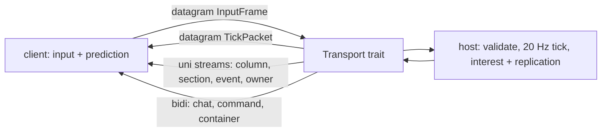
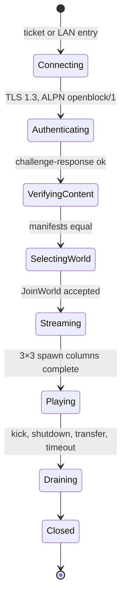

# 18 — Networking and Multiplayer

> Status: normative - Last updated: 2026-11-24
> Depends on: [DEC-004](../decisions.md), [DEC-006](../decisions.md), [DEC-007](../decisions.md), [DEC-008](../decisions.md), [DEC-023](../decisions.md), [DEC-024](../decisions.md), [DEC-025](../decisions.md), [DEC-026](../decisions.md), [DEC-027](../decisions.md), [DEC-029](../decisions.md), [DEC-038](../decisions.md), [DEC-040](../decisions.md), [DEC-043](../decisions.md), [DEC-044](../decisions.md), [DEC-046](../decisions.md); [architecture](01-technical-architecture.md), [engine core](02-engine-core.md), [world model](05-world-model.md), [light](07-light-and-weather.md), [gameplay](08-gameplay-survival.md), [items](11-inventory-crafting-items.md), [persistence](17-persistence.md), [server admin](19-server-administration.md), [security](20-security-and-anti-cheat.md); [research 04](../research/04-networking-sota.md)
> Implements: MS-06, MS-07, MS-15

## 1. Purpose and scope

This chapter defines how two OpenBlock processes talk: topology and authority, the `Transport`
boundary and its QUIC implementation, the versioned wire protocol and codecs, the connection
lifecycle, interest-managed streaming and replication, prediction and reconciliation, session and
dimension transfer, LAN discovery, chat and commands, the bandwidth and latency model, and the
simulator used to test all of it.

The host is authoritative ([DEC-008](../decisions.md)); this chapter is where that becomes bytes.
Every client message is an **intent** — a movement command, a block-edit intent, a container click, a
chat line — never an outcome. Durations are canonical ticks at 20 ct/s; the simulation tick is fixed
at 20 Hz and a 30 Hz setting raises only the snapshot rate ([DEC-038](../decisions.md)). Out of
scope: light and weather *values* ([07](07-light-and-weather.md)); inventory transaction semantics
([11](11-inventory-crafting-items.md)); the save container ([17](17-persistence.md)); validation and
enforcement ([20](20-security-and-anti-cheat.md)); the server's configuration surface and operations
([19](19-server-administration.md)).

## 2. Requirements

| ID | Requirement | Verified by | Milestone |
| --- | --- | --- | --- |
| REQ-NET-001 | Every session MUST have exactly one authoritative host; a client MUST NOT become authoritative for world, entity, inventory or combat state. | Role test at join, review | MS-06 |
| REQ-NET-002 | All messages MUST cross the `Transport` trait; loopback and simulated transports MUST run the production encoder and decoder. | Conformance suite, four transports | MS-06 |
| REQ-NET-003 | Inputs and tick packets MUST use QUIC datagrams; chunks, block events and owner state MUST use independent uni streams; chat, commands and containers MUST use ordered bidi streams ([DEC-023](../decisions.md), [DEC-024](../decisions.md)). | Channel-matrix test | MS-06 |
| REQ-NET-004 | Every datagram MUST be sized from the connection's current maximum datagram size with a 1,200-byte floor; larger payloads MUST be split into numbered application fragments, never IP fragments. | MTU matrix at 1,200/1,280/1,400/1,450 | MS-06 |
| REQ-NET-005 | Transport MUST be TLS 1.3 only; the default identity MUST be a self-signed Ed25519 key pinned by SPKI; a key change MUST require explicit user re-pin. | Pin-change and ticket tests | MS-07 |
| REQ-NET-006 | Player identity MUST be a keypair with challenge-response; whitelists and bans MUST be keyed on the public key, never on IP alone. | Two-key auth, ban tests | MS-07 |
| REQ-NET-007 | QUIC 0-RTT MUST carry only a resume request; any other early message MUST be rejected with `replay_rejected` ([DEC-026](../decisions.md)). | Early-data replay corpus | MS-06 |
| REQ-NET-008 | The handshake MUST compare protocol version, `pack_hash` (content and view roots), the balance-profile hash and the mod manifest; a mismatch MUST close with an actionable kick naming the differing packs. | Mismatch fixtures per field | MS-06 |
| REQ-NET-009 | Message IDs MUST be stable and never reused; an unknown ID MUST be a protocol error; a lower minor peer MUST simply not receive newer messages. | Golden catalog digest, negotiation test | MS-06 |
| REQ-NET-010 | The message catalog MUST generate encoder, decoder, size table and Markdown documentation; documentation drift MUST fail CI. | `cargo xtask gen-protocol --check` | MS-06 |
| REQ-NET-011 | Hot-path messages MUST be hand-written bit-packed codecs; every decoder MUST enforce its maximum size before allocating. | Size-table test, fuzz | MS-06 |
| REQ-NET-012 | Connections MUST follow the §3.6 state machine with declared timeouts and MUST reject application messages in the wrong state. | State-machine property test | MS-06 |
| REQ-NET-013 | Every refusal MUST carry a machine-readable reason code, a localised message and a bounded detail string. | Kick-reason fixtures | MS-06 |
| REQ-NET-014 | Reconnect MUST use a short-lived resume token plus TLS resumption; punitive kicks MUST NOT be auto-retried. | Reconnect matrix | MS-06 |
| REQ-NET-015 | The host MUST replicate only each player's interest set, recomputed at least every 4 ticks with 2-chunk hysteresis ([DEC-025](../decisions.md)). | Interest unit and thrash tests | MS-07 |
| REQ-NET-016 | Entity updates MUST be deltas against the last fully acknowledged snapshot, with a full refresh after at most 2 s or 40 ticks. | Loss/reorder convergence test | MS-06 |
| REQ-NET-017 | Block edits MUST be reliable, ordered and per-section-versioned; versions MUST be monotonic `u32`, the host MUST retain four of them, and a skipped edit MUST be repaired by a delta or full resend, never tolerated. | Dropped-event, gap and version-ring tests | MS-06 |
| REQ-NET-018 | Chunk columns MUST use one stream per column, follow the §3.7 priority order, cancel on interest loss and be served from the precompressed cache when unchanged. | Stream-count and cancellation tests | MS-07 |
| REQ-NET-019 | Join MUST be progressive: 3×3 spawn columns first, rings outward, progress at least every 250 ms ([DEC-025](../decisions.md)). | Join benchmark at 10 Mbit/s | MS-06 |
| REQ-NET-020 | Per-player bandwidth and entity caps MUST be host-enforced; a client view distance MUST NOT raise a cap. | Cap-bypass test | MS-07 |
| REQ-NET-021 | Transforms MUST ride datagram snapshots; spawn, despawn and attach MUST be reliable events; a client MUST NOT invent an entity. | Spawn/despawn under loss | MS-06 |
| REQ-NET-022 | Wire entity references MUST be session `NetId`s; persistent UUIDs MUST appear only where restart survival is required ([DEC-043](../decisions.md)). | Wire inspection, save round-trip | MS-06 |
| REQ-NET-023 | Inputs MUST be sequenced, sent redundantly, applied once, buffered and replayed after correction; replay MUST be idempotent by sequence. | Duplicate-replay test | MS-06 |
| REQ-NET-024 | Sub-threshold corrections MUST decay as a render offset; larger ones MUST snap and replay; an epoch or dimension change MUST always snap. | Scripted correction scenarios | MS-06 |
| REQ-NET-025 | Only presentation effects MAY be predicted; damage, loot, durability, block permanence and inventory results MUST NOT be. | Predicted-action matrix | MS-06 |
| REQ-NET-026 | Remote entities MUST render at `now − interp_delay`, adapted from jitter in 50–250 ms, with extrapolation capped at 250 ms; the host tick offset MUST come from snapshot arrivals, never from wall-clock reads in simulation. | Jitter matrix, clock-skew tests | MS-06 |
| REQ-NET-027 | Combat rewind MUST clamp at 200 ms and MUST NOT hit through current solid geometry or resurrect a dead entity ([REQ-GAME-018](08-gameplay-survival.md)). | Rewind corpus at 0/80/150 ms | MS-06 |
| REQ-NET-028 | At 1.0 no mod code MUST run on a client; prediction MUST come from content-hash-covered descriptors, and a later both-sides code tier MUST be deterministic and disable itself above a 0.1% correction rate. | Descriptor and desync tests | MS-09 |
| REQ-NET-029 | Dimension transfer MUST be atomic: removed from the source and spawned in the destination exactly once, with no item loss or duplication. | Fault-injected transfer | MS-08 |
| REQ-NET-030 | Spectators MUST receive chunks and entities but no owner state, container stream or edit intents; ignored intents MUST be counted. | Spectator corpus | MS-11 |
| REQ-NET-031 | Chat and commands MUST use the ordered control stream, be rate-limited, permission-checked before argument parsing, and rendered as plain text. | Rate, permission, injection tests | MS-07 |
| REQ-NET-032 | LAN discovery MUST be opt-in, advertise no world data beyond name, counts, mode and fingerprint, and MUST NOT bypass pinning. | mDNS capture test | MS-06 |
| REQ-NET-033 | The simulator MUST model latency, jitter, loss, reorder, duplication, bandwidth and blackholes while driving the real client and host code. | Scenario suite in CI | MS-06 |
| REQ-NET-034 | Outbound queues MUST be bounded; a slow peer MUST degrade by shedding background work and MUST NEVER stall the tick. | Blocked-reader test | MS-06 |
| REQ-NET-035 | Column payloads MUST be compressed and cached precompressed; per-tick datagrams MUST NOT be compressed; networking MUST expose the §3.12 metrics and capture format. | Inspection, CPU benchmark, metrics contract | MS-06 |
| REQ-NET-036 | Per-connection, per-IP and per-player rate limits MUST be enforced before payload decode where possible. | Rate-limit tests | MS-15 |
| REQ-NET-037 | Replication MUST NOT change simulation state; encoding the same state and inputs twice MUST produce identical bytes. | Replay hash and byte equality | MS-06 |
| REQ-NET-038 | IPv4 and IPv6 MUST both work, including single-family hosts, without client configuration. | Dual-stack CI | MS-07 |

## 3. Design

### 3.1 Roles and topology

| Process | Role | Transport | Authority | Notes |
| --- | --- | --- | --- | --- |
| `openblock-server` | dedicated host | QUIC/UDP | full | no GPU or audio ([DEC-028](../decisions.md)) |
| integrated host | host inside the client | loopback | full | single-player, "open to LAN" |
| client | input and presentation | QUIC or loopback | none | predicts, never decides |
| P2P host (post-1.0) | host on a player machine | iroh QUIC, relay fallback | full, host-owned world | no authority migration |
| web client (later) | browser client | WebTransport | none | needs a publicly trusted certificate ([OPEN-008](../decisions.md)) |

The host is the same `Host` in every row ([01](01-technical-architecture.md) §3.1); only transport
construction, authentication and process supervision differ. A session owns one active world: the
join names its UUID, and a client presenting cached state for another UUID discards it.



### 3.2 Authority and replicated state classes

Every value belongs to one class; the class fixes channel, cadence and loss policy. A message that
does not fit is a design error, not a new channel.

| Class | Direction | Channel | Cadence | Loss policy |
| --- | --- | --- | --- | --- |
| Input commands | C→S | datagram | 20 Hz, last 3 redundant | repeat; hold after 5 missing |
| Tick packet: player transform, entity deltas, world clock | S→C | datagram | 20 or 30 Hz | superseded by the next snapshot |
| Block edit events | S→C | reliable uni | per tick batch | retransmit; version gap → resend |
| Section resends | S→C | uni, one per section | on request | retransmit |
| Chunk columns | S→C | uni, one per column | join and streaming | retransmit or cancel |
| Entity spawn/despawn/attach | S→C | reliable uni | on change | retransmit |
| Owner state: vitals, XP, air, timers | S→C | reliable uni | 20 Hz | retransmit |
| Container traffic | both | reliable bidi | on intent | retransmit ([11](11-inventory-crafting-items.md)) |
| Chat and commands | both | reliable bidi | on input | retransmit |
| Presentation effects | S→C | datagram or reliable | on event | cosmetic, may drop |
| Session control: join, kick, transfer | both | reliable bidi | on change | retransmit |

A client never receives another client's inventory, owner state or command feedback. Public entity
metadata (name, pose, equipment) is a reliable event on change; anything private stays on the owner
stream. At `snapshot_rate_hz = 30` the host emits entity snapshots by sampling its two most recent
tick states and interpolating between them at the snapshot instant; simulation state, tick numbering
and the state hash are unchanged ([DEC-038](../decisions.md)). Block events and owner state stay
tick-cadenced.

### 3.3 Transport layer

The protocol is defined against a trait, not against `quinn` types ([DEC-024](../decisions.md)). It is
object-safe, runtime-agnostic and reports capabilities, so a transport without datagrams cannot be
selected for gameplay.

```rust
pub trait Transport: Send {
    fn capabilities(&self) -> TransportCaps;
    fn connect(&mut self, target: &ConnectTarget, cfg: &TransportConfig) -> Result<PeerId, NetError>;
    fn poll(&mut self, now: Instant, out: &mut dyn TransportEvents, budget: Duration) -> Result<(), NetError>;
    fn send_datagram(&mut self, peer: PeerId, bytes: &[u8]) -> Result<SendOutcome, NetError>;
    fn open_stream(&mut self, peer: PeerId, kind: StreamKind, meta: StreamMeta) -> Result<StreamWriter, NetError>;
    fn accept_stream(&mut self, peer: PeerId) -> Result<Option<InboundStream>, NetError>;
    fn close(&mut self, peer: PeerId, code: CloseCode, reason: &str);
}

pub struct TransportCaps {
    pub datagrams: bool,
    pub max_datagram_size: usize,   // current path estimate, never a constant
    pub max_uni_streams: u8,
    pub migration: bool,
    pub reliable_ordered: bool,
}
```

`SendOutcome` is `Sent | WouldBlock | TooLarge`; `TooLarge` is a caller bug and is counted.
`TransportEvents` yields peer connected/closed, datagrams, stream open/chunk/finish and path change.
The QUIC backend is one quinn endpoint polled by the net-io thread; the simulated backend runs the
same codec on a virtual clock; loopback hands `Arc<[u8]>` across without copying.

| QUIC setting | Value | Why |
| --- | --- | --- |
| `initial_mtu` / `min_mtu` | 1,200 | QUIC's mandatory floor; avoids black holes |
| `mtu_max` | 1,400 | VPN and PPPoE paths; DPLPMTUD stays enabled |
| application datagram cap | `max_datagram_size() − 40` | header + AEAD headroom, recomputed on path change |
| `max_idle_timeout` | 30 s | a paused client is not a dead client; snapshots keep live peers warm |
| keepalive | 10 s | keeps NAT bindings without extra state |
| `initial_rtt` | 100 ms | the 333 ms RFC default makes first loss recovery sluggish |
| congestion control | CUBIC (quinn default) | app-limited flows; no BBR before measurement |
| stream receive window | 48 KiB per stream | 8 streams plus datagram buffers ≈ 512 KiB per peer ([PERF-NET-009](25-performance-budgets.md)) |
| datagram send/receive buffers | 32 KiB each | quinn's 1 MB defaults waste memory per peer |
| max uni streams | 8 per peer | 4 columns in flight plus events, owner state and section resends |
| handshake timeout | 5 s | a half-open handshake is a resource leak |
| Retry | above 70% of the connection budget, or above the endpoint handshake admission rate (`network.handshake_rate_per_second`, default 20/s, [19](19-server-administration.md) §3.2) | stateless address validation under load; excess handshakes get a challenge, not an accept |

**Framing.** One datagram carries one message: `u8 message_id` then the body. A stream begins with
`[kind u8][flags u8][version u8][reserved u8]`, then stream-specific records whose lengths are varints
bounded by the decoder maximum. Datagram fragments carry index and count in the tick-packet header
and are never re-fragmented; IP fragmentation is never used.

| Abuse limit | Default | Scope |
| --- | --- | --- |
| concurrent peers | 256 | endpoint |
| connections per source IP | 4 | endpoint |
| handshakes per source IP | 5 per 10 s | endpoint, token bucket |
| datagrams per second per peer | 120 | connection |
| inbound bytes per peer | 8 KiB/s sustained, 32 KiB burst | connection |
| outbound bytes per peer | 64 KiB/s steady, 2 MiB/s join burst | player ([DEC-025](../decisions.md)) |
| queued outbound bytes per peer | 4 MiB | connection; background work is dropped first |

Application-level per-opcode limits are owned by [20 §3.9.1](20-security-and-anti-cheat.md): input and
ack opcodes get 25/s with a 12-frame burst, container intents 40/s and chat 5 per 10 s, all checked
after authentication and before the validator.

**Identity.** Three modes, default first ([DEC-026](../decisions.md)): `self_signed` (Ed25519 key made
on first run, self-signed certificate, SPKI pinned on first use; a changed key demands an explicit
re-pin), `acme` (TLS-ALPN-01 or DNS-01, publicly trusted, for servers with a domain and UDP 443) and
`provided` (operator key and chain). The fingerprint is BLAKE3-128 of the SPKI DER as 26 base32
characters in groups of four. The ticket is the URI the client already accepts on the command line
and from the single-instance forwarder ([02](02-engine-core.md) §3.5):
`openblock://join/<host>:<port>#fp=<fingerprint>&v=1`, QR-encoded when shared. The fingerprint is a
hint for the user, not a reason to skip verification.

Player identity is separate: the client generates an Ed25519 keypair, the host issues a 32-byte
nonce, and the client signs `("openblock.auth/1", server_fingerprint, nonce, player_key)`. The host
stores the public key on first join (TOFU) unless a one-time join code is configured; bans,
whitelists, ops and permissions are keyed on it, with IP or subnet only as additional evidence. OIDC
is optional (`online_mode = "oidc"`): the host validates a device-code ID token and maps the subject
to a local player record, and a server with OIDC still accepts local keys unless
`allow_local_keys = false`. ACME authenticates the transport, not the operator, so public servers
SHOULD still show their fingerprint.

**0-RTT.** Early data carries exactly one message, `ResumeRequest` with a resume token; the host
answers `ResumeAccepted` or falls back to a full handshake. Any other early message closes with
`replay_rejected` ([DEC-026](../decisions.md)). Edits, chat, commands, container intents, input frames
and join streaming are never sent in 0-RTT; camera state is client-local at that point, so nothing
useful is lost by the restriction.

**Migration and congestion.** Connection IDs allow an address change without a new handshake; server
path validation is always on and client-initiated migration is behind `allow_migration`, verified by
a NAT-rebind test before any Wi-Fi→LTE claim. One congestion controller per connection means a chunk
burst can delay a snapshot, so chunk streams are offered at most 75% of the estimated bandwidth while
snapshots are in flight.

### 3.4 Protocol versioning and message catalog

`PROTOCOL_MAJOR = 1`, `PROTOCOL_MINOR = 0` at MS-06. A major change breaks the wire; a minor change
adds messages or fields. Rules: IDs are permanent and never reused; an unknown core ID is a protocol
error, never skipped; additive fields go at the end or into a tagged extension; a host accepts
`[min_client_protocol_minor, PROTOCOL_MINOR]` and names the range in the kick; connection content
dictionaries are derived from `content_hash` on both sides and never transmitted
([DEC-040](../decisions.md)), so a dictionary-digest mismatch is a content mismatch.

| ID | Message | Dir | Channel | Cadence | Budget | Encoding |
| --- | --- | --- | --- | --- | --- | --- |
| `0x01` | `ClientHello`: version, pack hashes, mod manifest, player key | C→S | control | once | 16 KiB | postcard |
| `0x02` | `ServerHello`: version, session, identity mode | S→C | control | once | 1 KiB | postcard |
| `0x03` | `AuthChallenge` / `AuthResponse` | both | control | 1 | 256 B | fixed |
| `0x04` | `ResumeRequest` / `ResumeResult` | both | control | 1 | 128 B | fixed |
| `0x10` | `ContentManifest`: packs, `content_hash`, `view_hash`, `pack_hash`, `balance_profile_hash`, dictionary digest (field list per [15 §3.6](15-content-system.md)) | S→C | control | 1 | 64 KiB | postcard |
| `0x11` | `ContentMismatch`: differing packs | S→C | control | 1 | 2 KiB | postcard |
| `0x12` | `PackOffer` / `PackChunk` | S→C | stream | on demand | 64 KiB | postcard + bytes |
| `0x20` | `JoinWorld`: world UUID, dimensions, rules hash, spawn | S→C | control | 1 | 4 KiB | postcard |
| `0x21` | `JoinProgress`: stage, ready/total columns | S→C | control | 4 Hz | 16 B | fixed |
| `0x30` | `InputFrame`: 1–3 input commands | C→S | datagram | 20 Hz | 48 B | bit-packed |
| `0x31` | `TickAck`: tick, fragment bitmap, input sequence | C→S | datagram | 20 Hz | 16 B | bit-packed |
| `0x40` | `TickPacket`: fragment 0–3 | S→C | datagram | 20/30 Hz | 1,160 B | bit-packed |
| `0x50` | `SectionDelta`: section, version, indices + states | S→C | reliable uni | per tick | 16 KiB | bit-packed |
| `0x51` | `SectionRequest`: chunk, sy, known version | C→S | control | on gap | 24 B | bit-packed |
| `0x52` | `SectionResend`: full section | S→C | uni | on request | 16 KiB | bit-packed |
| `0x53` | `ChunkColumn`: header, sections, heightmaps, light | S→C | uni | streaming | 256 KiB | bit-packed + zstd |
| `0x60` | `EntitySpawn`: NetId, type, transform, public metadata | S→C | reliable uni | on change | 64 B | bit-packed |
| `0x61` | `EntityDespawn`: NetId, reason | S→C | reliable uni | on change | 8 B | bit-packed |
| `0x62` | `EntityAttach`: passenger, vehicle, seat | S→C | reliable uni | on change | 12 B | bit-packed |
| `0x70` | `OwnerState`: vitals, XP, air, timers | S→C | reliable uni | 20 Hz | 24 B | bit-packed |
| `0x80`–`0x83` | `ContainerOpen` / `Intent` / `Ack` / `Resync` | both | reliable bidi | on intent | 3.5 KiB | bit-packed ([11](11-inventory-crafting-items.md) §4) |
| `0x90` | `ChatSend` / `ChatBroadcast` | both | reliable bidi | on input | 1 KiB | postcard |
| `0x91` | `Command` / `CommandFeedback` | both | reliable bidi | on input | 4/8 KiB | postcard |
| `0xA0` | `EffectEvent`: sound, particles, screen, animation | S→C | datagram | on event | 64 B | bit-packed |
| `0xB0` | `PlayerList`: add, remove, update | S→C | reliable uni | on change | 8 KiB | postcard |
| `0xC0` | `Kick`: reason, detail, retry-after | S→C | control | 1 | 512 B | postcard |
| `0xC1` | `Transfer`: dimension or server, spawn, epoch | S→C | control | on change | 256 B | postcard |
| `0xC2` | `TransferReady`: epoch, loaded columns | C→S | control | after `Transfer` | 16 B | fixed |
| `0xD0` | `ModMessage`: namespace, schema hash, body | both | control | negotiated | 16 KiB | postcard + bytes |
| `0xE0` | `Ping` / `Pong`: nonce, host tick | both | control | 1 Hz | 24 B | fixed |

The catalog is declared once with `ob_protocol::catalog!`; the macro generates dispatch, the size
table used by tests, and `docs/protocol/wire.md`. `openblock-tools wire decode` reads the same catalog,
so a third party can decode a capture without the engine.

Combat has no separate message: `AttackIntent` is the validator-facing name of the use/attack command
carried in `InputFrame` (`0x30`), decoded and checked as `AC-COMBAT-05`
([20 §3.5](20-security-and-anti-cheat.md#35-validation-matrix)). The sentence in
[08 §3.6](08-gameplay-survival.md#36-combat) that sends `AttackIntent` on a reliable ordered stream is
superseded by this catalog. Combat results travel on the authoritative owner-state and event paths of
§3.2, never on the input datagram.

Close codes are `0x4F42_0000 | reason`, distinguishing an OpenBlock close from a transport error.
The last column is authoritative: a close marked `no` is final, clears the cached session and is
never retried; a close with a hint or a backoff may be retried only as described.

| Code | Reason | Detail | Auto-retry |
| --- | --- | --- | --- |
| `0x00` | `protocol_error` | message ID and offset | no |
| `0x01` | `version_mismatch` | supported client range | no |
| `0x02` | `content_mismatch` | pack IDs and hashes | no |
| `0x03` | `auth_failed` | generic; never reveals whether a key exists | no |
| `0x04` | `banned` | expiry and appeal text | no |
| `0x05` | `not_whitelisted` | none | no |
| `0x06` | `server_full` | retry-after seconds | after hint |
| `0x07` | `rate_limited` | which limit | with backoff |
| `0x08` | `timeout` | last state | once |
| `0x09` | `invalid_state` | state and message | no |
| `0x0A` | `mod_rejected` | mod ID and hash | no |
| `0x0B` | `server_shutdown` | restart ETA | after hint |
| `0x0C` | `world_mismatch` | world UUID | no; refresh entry |
| `0x0D` | `replay_rejected` | none | retry without 0-RTT |
| `0x0E` | `join_stalled` | last completed column | once |
| `0x0F` | `kicked_by_admin` | operator text | no |
| `0x10` | `transport_error` | stack close code | with backoff |

### 3.5 Encoding

Hot-path messages are bit-packed LSB-first, little-endian for multi-byte fields, no padding. A
decoder reads from a bounded cursor, checks every length against the message maximum before
allocating, and returns `Truncated`, `Overflow` or `InvalidValue` rather than panicking. Control
messages use postcard with versioned structs and a 64 KiB cap; nothing in the hot path uses Serde
([DEC-027](../decisions.md)).

**Input command** (14 B; three per frame, the older two with a `u16` sequence delta):

| Field | Bits | Encoding |
| --- | --- | --- |
| `seq` | 32 | per-connection command sequence |
| `move`, `strafe` | 8 + 8 | quantised −1.0…1.0, 0x80 = 0 |
| `yaw`, `pitch` | 16 + 16 | 1/65,536 turn, 0 = north (−Z); pitch clamped ±90° |
| `buttons` | 16 | jump, sneak, sprint, use/attack, break, offhand |
| `actions` | 8 | edge events: break start/stop, place, use, drop, swap, inventory |
| `flags` | 8 | stale repeat, spectator, reserved |

**Tick packet.** Header 16 B: message ID, flags (`full_state`, snapshot rate), fragment index/count,
`tick u32`, `baseline_tick u32`, `ack_seq u32`. Fragment 0 adds the world clock (day time `u32`,
weather `u8`, flags `u8`) and the local player's authoritative transform (position 3×`i32` at 1/32
block, velocity 3×`i16` at 1/256 block/tick, yaw/pitch, flags = 24 B), then entity deltas by descending
priority and ascending NetId. Every fragment repeats the header and is independently applicable
because every delta is relative to the baseline, so a lost fragment costs one snapshot of those
entities, not correctness.

**Entity delta** (13 B typical, 13–16 B): NetId as a ZigZag varint delta from the previous NetId (1–3 B), flags,
position 3×`i16` at 1/16 block relative to the receiver (6 B, ±2,048 blocks), velocity 3×`i8` at
1/32 block/tick (3 B), yaw and pitch `u8` each. Full-state mode uses absolute `i32` positions.
Anything that must not be lost is a reliable event, never a datagram delta.

**Block edit batch.** Stream record header 16 B (`cx i32`, `cz i32`, `sy u8`, `version u32`, count
varint), then 3.5 B per edit (12-bit local index + 16-bit connection-dictionary state ID). Batches are
capped at 4,096 edits and applied in version order; larger tick batches split into several records.

**Chunk column.** 24-byte header (`cx`, `cz`, `generation u32`, `section_mask u64`, biome palette
length, flags), then sections ascending `sy` with a flags byte (uniform, has light), a palette of
dictionary indices, packed 4/8/16-bit indices in `x + 16*(z + 16*y)` order, 8,192 B of packed light
when present, and three 16-bit heightmaps. The payload is zstd level 1 and capped at 256 KiB. This is
a **wire** encoding, not the save layout ([17](17-persistence.md)); the host caches it keyed by
`(chunk, generation, content_epoch)` and most columns never need re-encoding.

**Control messages** carry `schema_version`, `#[serde(default)]` fields and a declared maximum.
`ModMessage` carries `(namespace, message_id, schema_hash, bytes)`; a message whose namespace or schema
hash was not negotiated in `ClientHello` is rejected, and a mod never defines a core ID.

### 3.6 Connection lifecycle



| Phase | Timeout | On timeout |
| --- | --- | --- |
| TLS handshake | 5 s | close `timeout`, count a failed handshake |
| Authentication | 5 s | close `auth_failed` |
| Content verification | 30 s | close `content_mismatch`, naming the last verified pack |
| Join streaming | no global limit; 10 s with no completed column warns, 30 s closes | `join_stalled` |
| Playing | idle 30 s, keepalive 10 s | entity persists 120 s for resume |
| Draining | 5 s | force close |

The client renders a localised reason plus the server's detail, never a raw transport error.
Auto-reconnect follows the §3.4 table with backoff 1, 2, 4, 8, 16 s capped at 30 s and five attempts;
`banned`, `kicked_by_admin`, `content_mismatch` and `version_mismatch` clear the session and never
retry. Resume uses the TLS session ticket plus an HMAC resume token (5-minute TTL, bound to the player
key and server fingerprint); the host restores the player entity, inventory and position, and the
client drops prediction history and starts from a full snapshot.

### 3.7 World streaming and replication

**Interest set.** Recomputed every 4 ticks and when the player crosses a chunk boundary. *Columns:*
all chunks within `min(client_view_distance, server_view_distance)`, with a 2-chunk unload ring; the
player's chunk and its 3×3 neighbours are always included, even under a rate cap. *Entities:* those
whose expanded AABB intersects the replication radius (`min(simulation_distance, view_distance)`),
with 1 s visibility hysteresis, plus attachments and dimension bosses. *Events:* block edits,
block-entity changes and effects inside the column set, while weather, time, chat and the player list
are always sent. Interest is a `BTreeSet`, so the diff yields `Add`/`Remove` work and the scheduler
never rescans the world per player.

| Queue | Contents | Share of the per-tick byte budget | May exceed the cap |
| --- | --- | --- | --- |
| `Safety` | player column + 3×3, section resends, owner/container state | first, unlimited | up to 2× |
| `Near` | columns within 2 chunks, entities within 64 blocks | 40% | no |
| `Prefetch` | columns in the velocity cone 1–2 s ahead | 30% | no |
| `Background` | the rest, farthest first | 30% | no |
| `Warm` | precompressed cache fills for future chunks | leftover | no |

Per tick the host may send `chunk_send_budget_kib_per_tick` (default 24 KiB) of column bytes per
player, rising to 96 KiB when the client is starved and the queue is empty, scheduled deficit
round-robin so `Safety` cannot starve. Compression runs on the I/O pool; a full queue drops
`Background`, never blocks the tick.

**Snapshot and delta.** Entity state is replicated against the last tick whose fragments the client
fully acknowledged; `TickAck` carries the tick and a 4-bit fragment bitmap. The host keeps per-entity
dirty bits for that baseline, encodes only dirty entities, and promotes a full state when the baseline
is older than 40 ticks (2 s) or the client reconnects. The per-player byte budget, not the four-fragment
wire maximum, decides how much a snapshot carries: deltas that do not fit are deferred to the next
snapshot and marked `not_updated`. The local player's transform is always sent in full because the
client predicts it.

**Block edits** are reliable events applied in per-section version order: a batch applies only when
`version == known + 1`, otherwise the client sends `SectionRequest` and the host answers with a delta
from the four-version ring or a full `SectionResend`. Versions are `u32`, monotonic, and reset only
when the world is replaced.

**Progressive join.** The host sends the 3×3 spawn columns (≤ 1 MB), then expanding rings; the client
spawns when the centre is complete and loads on behind the player, with progress at 4 Hz. Unchanged
columns come from the precompressed cache and are re-encoded only after an edit or content-epoch
change. For very large worlds, spectators and migrations the server MAY advertise an HTTP(S) range
endpoint for a content-addressed `.obworld` archive ([17](17-persistence.md) §3.8); the client may use
it and then still joins through the handshake. It is a bandwidth optimisation, not a second protocol.

**Entities.** Spawn, despawn and attach are reliable events with NetId, dictionary type ID, initial
transform and public metadata; transforms then ride datagrams. A tick packet carries at most
`entities_per_snapshot` (default 256) deltas: nearest, recently changed, then ascending NetId.
Entities beyond the cap update on alternate ticks and are marked `not_updated`; the client
extrapolates them for at most 250 ms and then holds. The host caps tracked entities per client
(default 512) and never sends another dimension's entities.

**Save interaction.** Join and streaming read the precompressed cache and the immutable
`Arc<ChunkColumn>` snapshots published by the world store, never a lock the save thread holds. When
the save queue exceeds budget the host sheds `Background`, then `Prefetch`, and never delays `Safety`,
the tick or a save ([17](17-persistence.md) §3.5).

### 3.8 Prediction and reconciliation

The client runs the same `ob_sim` player systems for the local player: movement, collision, look,
break progress and placement preview. It sends one command per simulated tick with the previous two
repeated; the host de-duplicates by `seq` over a 64-entry ring, applies in order, and marks a tick
`stale_inputs` when it repeats the last command, and drops any command older than 1 s relative to its
own tick estimate. After five stale ticks the player is held, not extrapolated, so a paused client
cannot slide through a wall.

```text
authoritative = packet.player_state
error_pos = |authoritative.pos - predicted_at(tick)|
error_rot = angle(authoritative.yaw - predicted.yaw)
if epoch changed or error_pos > 4 m or error_rot > 20°: snap, drop visual offset
elif error_pos > 0.1 m or error_rot > 2°: rewind to authoritative, replay seq > ack_seq
else: keep prediction, add the delta to a render-only offset decaying with tau = 100 ms
```

The unacked ring holds 256 commands (12.8 s). Replay is pure and must reproduce the host's state hash
for the same commands; a mismatch is a determinism bug and is reported as one. A client never
predicts another player's movement, entity health, drops, container contents, XP or durability.

**Interpolation.** Remote entities render at `now − interp_delay` with
`interp_delay = clamp(2 × snapshot_interval + 2 × jitter, 50 ms, 250 ms)`, where jitter is the
RFC 3550 running variance of snapshot arrivals. A dry buffer extrapolates for at most 250 ms from the
last two transforms and then freezes; teleports, dimension changes and deaths are never extrapolated.

**Clock sync.** Each tick packet carries the host tick and a sample fraction (0–255 of a tick). The
client filters `host_time − client_time` over the last 20 samples with a minimum-RTT estimator,
tracks offset and drift, and uses the estimate only for presentation. A jump above 500 ms resets the
estimator and clears the interpolation buffer; the simulation never reads a wall clock.

**Lag compensation.** The host keeps 24 ticks (1.2 s) of player AABBs and poses. A melee or projectile
hit rewinds targets by `client_interp_delay + RTT/2`, clamped to 200 ms ([REQ-GAME-018](08-gameplay-survival.md)),
validates reach and line of sight against the rewound boxes and the *current* solid geometry, then
applies damage to the current entity; a dead entity is never resurrected. Discrepancies feed
anti-cheat scoring ([20](20-security-and-anti-cheat.md)).

**Local effects.** Predicted: camera, animations, particles, sounds, break progress, the translucent
placement ghost and the inventory window shadow. A ghost never enters collision, light or a gameplay
query before confirmation.

| Predicted locally | Confirmed by the host before it is real |
| --- | --- |
| local player transform and camera | every block state change |
| swing, use, break animation, particles, sound | item use result, damage, death |
| placement ghost, break progress | block drops, XP, durability loss |
| inventory window shadow ([DEC-023](../decisions.md)) | inventory contents and counts |
| spectator camera | dimension and server transfer |

**Modded prediction.** At 1.0 no mod code runs on a client ([16](16-modding.md) REQ-MOD-026).
Content may ship **prediction descriptors** — content-hash-covered data describing a custom shape,
belt velocity, friction and use timing — and the client simulates movement over them with the
engine's own controller, reconciling exactly like vanilla movement. Anything a descriptor cannot
express stays host-authoritative and may correct; that is the price of not shipping mod code. A later
both-sides code tier is gated on [OPEN-006](../decisions.md), must be deterministic with an RNG
derived from `(tick, action_seq, mod_id)`, and is disabled for the session above a 0.1% correction
rate over 1,000 actions.

### 3.9 Session and player lifecycle

| Player state | May send | Receives | Notes |
| --- | --- | --- | --- |
| `Connecting` | handshake only | handshake only | tight limits, no compression |
| `Joining` | ping, ack | chunks, world clock | cannot act or chat |
| `Playing` | inputs, chat, commands, containers, edit intents | interest-set state | full validation |
| `Spectator` | camera inputs | chunks, entities, effects | no owner state, containers or edits |
| `Transferring` | ping | transfer progress | invulnerable, no actions, 10 s cap |
| `Disconnected` | — | — | entity retained 120 s for resume |

A session has an ID, one active world, a player limit, a dimension list and a game-rule hash.
`JoinWorld` carries the world UUID, dimensions, rule hash, spawn and replication rate. A dimension
change is `Transfer { dimension, position, epoch }`: the host removes the player from the source,
flushes its pending edits, assigns the epoch, streams the destination (which the client may already
have cached) and spawns the player once on `TransferReady`. Failure at any step leaves the player in
the source dimension with a message ([REQ-GAME-024](08-gameplay-survival.md)). Server-to-server
transfer is the same message with a ticket instead of a dimension, reserved for the MS-21 proxy.

### 3.10 LAN, loopback and alternate transports

When a host opens to LAN it advertises `_openblock._udp.local` over mDNS with TXT `v=1`,
`w=<world name>`, `p=<players>`, `m=<max>`, `g=<mode>`, `fp=<fingerprint>`, `req=<content hash prefix>`.
No seed, player names or extra addresses; discovery is opt-in per session, stops on close, and never
implies trust — joining still verifies the SPKI. A manual address entry is always available.

Single-player runs the real host on the loopback transport, which hands `Arc<[u8]>` payloads across a
bounded queue. It is not a direct call: the client cannot see host memory, and the same conformance
suite runs against it. P2P uses iroh's key-addressed QUIC with relay fallback and is
host-authoritative with no authority migration. WebTransport is the web path and, because browsers
cannot pin a self-signed SPKI, requires `acme` or `provided`; the protocol must not adopt
browser-only constraints before that front-end exists ([OPEN-008](../decisions.md)).

### 3.11 Chat, commands and community

Chat and commands use the ordered bidirectional stream. Chat is at most 256 UTF-8 characters,
rate-limited to 5 messages per 10 s with a 10-message burst, and rendered as plain text in the local
locale; markup is never interpreted and command feedback is a separate message type. Commands are
permission-checked before argument parsing, rate-limited to 20/s ([08](08-gameplay-survival.md) §3.12),
run in `PostTick` and batch edits into one tick. Names are snake_case ASCII
([DEC-044](../decisions.md)); the canonical command list is in [19](19-server-administration.md) §3.5.
Sign, book and chat text from another player is untrusted: length- and control-character-checked,
translated through Fluent where a key exists, never used as a format string, and not logged by
default.

### 3.12 Metrics, diagnostics and bandwidth model

Networking exports `openblock_net_*` metrics (bytes, datagrams, loss, RTT, queue depth per lane,
rejected handshakes, decode errors), a per-peer bandwidth meter and a bounded wire capture. A
`.obcap` file is a sequence of `[u64 monotonic_ns][u8 direction][u8 lane][u16 stream][u32 len][bytes]`
records with a header naming protocol version and local fingerprint; it contains message bytes and
never TLS keys, player private keys or session tokens, is capped at 64 MiB and is never uploaded
automatically. `openblock-tools wire decode` and `wire stats` read it with the generated catalog.

All numbers below are **models**, replaced by the MS-15 capacity report and reconciled with the
canonical join budgets of [25 §5.3](25-performance-budgets.md). Assumptions: 16³ sections, 8–14
non-empty sections per column, zstd level 1 giving 3–4× on a built column, 200-byte column header and
three heightmaps, so ~22 KiB compressed per built column (research 09's surface-explored figure).

| Join radius | Columns | Raw column | Compressed | Join payload | At 10 Mbit/s |
| --- | --- | --- | --- | --- | --- |
| 128 blocks | 81 | 40–90 KiB | 15–25 KiB | 1.3–2.2 MB | 1–2 s |
| 256 blocks | 1,089 | 45–90 KiB | 18–26 KiB | 20–28 MB | 16–22 s |
| 384 blocks | 2,401 | 45–90 KiB | 18–26 KiB | 43–60 MB | 34–48 s |
| 512 blocks | 4,225 | 45–90 KiB | 18–26 KiB | 80–110 MB | 64–88 s |
| 1024 blocks | 16,641 | 45–90 KiB | 18–26 KiB | 320–430 MB | 4.3–5.7 min (discouraged) |

These rows model **full interest completion**, not time-to-playable. The gate is two numbers: spawn
playable within 5 s p95 (`PERF-NET-004`) and the full 512-block interest set within 90 s fresh /
150 s built (`PERF-NET-005`). [MS-06](../plan/01-milestones.md#ms-06--networking) still says
"≤ 60 s at 10 Mbit/s"; that milestone wording is stale against this model and will be reconciled at
MS-06 (§8 question 6), not by changing the model here.

| Per-player traffic, 256-block simulation distance | Steady KB/s | Note |
| --- | --- | --- |
| Tick header, world clock, local player | 1.0 | 20 Hz × 50 B |
| Entity deltas, 64 tracked / 20 changed | 5–8 | 13 B per changed entity |
| Owner state | 0.6 | 24 B per tick |
| Block edits, 10/s | 0.2 | 3.5 B per edit |
| Chat, commands, player list | < 0.1 | bursty |
| Streaming while walking at 5 m/s | 6–12 | ~0.31 new columns/s |
| **Total steady** | **13–22** | cap 64 KB/s |
| Streaming while flying at 30 m/s | 40–80 | capped, pop-in accepted |
| Join burst | up to 2,048 | 2 MiB/s for ≤ 60 s |

At 512-block simulation distance the entity count roughly triples: 25–40 KB/s steady, same 64 KB/s
cap, same 2 MiB/s burst. Upstream stays under 1.5 KB/s per player (inputs 20 × 48 B plus acks and
control), which is why the protocol is deliberately asymmetric.

| Path | RTT | Perceived latency, 20 Hz snapshot, 100 ms interpolation |
| --- | --- | --- |
| loopback | 0 ms | none beyond prediction |
| LAN, wired | 1–3 ms | ~50 ms |
| same region | 15–40 ms | ~65–90 ms |
| cross-continent | 90–180 ms | ~140–230 ms |
| mobile or relayed P2P | 40–120 ms + 20–80 ms relay | ~180–300 ms |

## 4. Data structures and formats

```rust
pub struct PeerId(u32);       // transport-local, never persisted or sent
pub struct NetId(u64);        // session-monotonic entity id, DEC-043
pub enum StreamKind { Control, Chunk, Section, Events, OwnerState, Container, Chat, Pack }
pub enum LaneClass { Safety, Near, Prefetch, Background, Warm }

pub struct InterestSet {
    pub center: ChunkPos,
    pub view_radius: u8,              // chunks, capped by server config
    pub columns: BTreeSet<ChunkPos>,
    pub entities: BTreeSet<NetId>,
    pub revision: u64,
}

pub struct Baseline {
    pub tick: u32,                    // last fully acknowledged tick
    pub fragments: u8,                // bitmap of received fragments
    pub entity_count: u16,
    pub unacked_sections: Box<[(SectionPos, u32)]>,
}

pub enum JoinStage {
    Handshake,
    Authenticating { challenge: [u8; 32] },
    VerifyingContent { expected: ContentHash, offered: Option<ContentHash> },
    SelectingWorld { world: Uuid },
    Streaming { ready: u16, total: u16, spawn_ready: bool },
    Playing,
    Draining { reason: KickReason },
}
```

`PeerId` is an index into the peer table and is reused after disconnect, so logs pair it with the
player key hash. The baseline is per peer, never per world, and its section list is cleared on a full
resend. `spawn_ready` becomes true when the 3×3 centre is complete: the client may render then but
sends inputs only in `Playing`, and the stage appears in the player list as
"Ada (joining 412/1089)".

The sizes in §3.4 are asserted by a test that encodes a worst-case instance of every message and
compares it with the catalog table, so a change that exceeds a budget fails before review. Captures,
decode output and size tables are generated from the same catalog, so documentation, tooling and
implementation cannot drift.

## 5. Performance budgets

The cross-cutting budgets are canonical in [25 §5.3](25-performance-budgets.md); its `PERF-NET-*`
rows are the source of truth for per-player bandwidth, join time, entity traffic, datagram size and
connection memory. This section adds the network budgets chapter 25 does not state, and repeats the
governing 25 ID where one exists so a reader can trace both.

`PERF-NET-016` (8 ms p95 for 50 players at 256 blocks) is a **phase total**: interest sets, delta
encode, worker compression and queued chunk sends. The tick-thread share is `PERF-TICK-005`'s 4.0 ms
p99 ([25 §5.2](25-performance-budgets.md#52-simulation-tick)); the two are not charged twice to the
35 ms tick ([25 §5.7](25-performance-budgets.md#57-budget-index-and-reconciliation)).

| ID | Budget | Measurement |
| --- | --- | --- |
| PERF-NET-010 | Client receive, decode and apply ≤ 0.4 ms p95 main-thread at 200 entities and 64 KB/s (with PERF-CPU-005) | `net_client_apply` |
| PERF-NET-011 | Tick datagram ≤ 1,200 B payload and ≤ 16 KB per player per tick across ≤ 4 fragments (PERF-NET-008) | fragment test, capture assertion |
| PERF-NET-012 | Steady down ≤ 32 KB/s p95 and ≤ 64 KB/s peak at 256 blocks; ≤ 64/128 KB/s at 512 (PERF-NET-001) | per-peer meter |
| PERF-NET-013 | Join to playable ≤ 5 s p95 at 10 Mbit/s (PERF-NET-004); full 512 interest ≤ 90 s fresh and ≤ 150 s built (PERF-NET-005) | join benchmark |
| PERF-NET-014 | 200 visible entities at 20 Hz ≤ 20 KB/s per player (PERF-NET-007) | entity bench |
| PERF-NET-015 | Per-peer buffers ≤ 512 KiB and ≤ 8 MiB server-wide plus the per-player share (PERF-NET-009) | idle/active bench |
| PERF-NET-016 | Host replication for 50 players at 256 blocks ≤ 8 ms p95 per tick on the 4 vCPU reference | load harness, phase metrics |
| PERF-NET-017 | Client input encode and send ≤ 20 µs p99 per tick, zero allocations after warm-up | `net_input_encode` |
| PERF-NET-018 | Entity delta ≤ 16 B, block edit ≤ 5 B amortised, input frame ≤ 48 B | size-table test |
| PERF-NET-019 | Handshake to `Playing` ≤ 2 RTT plus verification; warm-cache reconnect ≤ 5 s at 256 blocks | scripted join |
| PERF-NET-020 | 1,000 idle + 200 active peers ≤ 1 core and ≤ 1.5 GiB (model, MS-15) | capacity benchmark |
| PERF-NET-021 | A lost datagram costs at most one snapshot; convergence within 2 s | loss matrix |

## 6. Failure modes and edge cases

| Failure | Detection | Containment | User-visible | Recovery |
| --- | --- | --- | --- | --- |
| Partition | idle timeout, missing acks | entity kept 120 s; client freezes after 500 ms of prediction | reconnecting overlay | resume token + full snapshot |
| Loss or reorder | ack bitmap, sequence rings | deltas recomputed from the old baseline | briefly stale remote motion | automatic |
| Section gap | `version != known + 1` | `SectionRequest`, ring or full resend | brief pop-in | automatic |
| Content mismatch | digests differ | close before world data | kick naming the packs | install or update packs |
| Mod mismatch | manifest hash | close `mod_rejected` | kick naming the mod | fix the allowlist |
| Cheat attempt | validation, token buckets | reject, count, optionally kick | rubber-band or kick | policy ([20](20-security-and-anti-cheat.md)) |
| DDoS or amplification | handshake rate, Retry, caps | stateless Retry, 3× limit, per-IP quotas, provider scrubbing | new peers fail to connect | provider mitigation |
| MTU black hole | handshake or stream stall after PMTUD | 1,200 floor, fragment cap, disable PMTUD on that path | slower join | automatic |
| Save-lag stall | save queue depth, cache miss | shed `Background` then `Prefetch` | slower ring expansion | automatic |
| Slow client | outbound queue depth | drop background, then reduce entity rate | degraded view | automatic or kick |
| Clock jump | offset outlier | reset estimator and buffer | brief hitch | automatic |
| Transfer failure | no ack in 10 s | abort, stay in source, keep inventory | "transfer failed" | retry |
| Replayed input | sequence ring | ignore, return original ack | none | automatic |
| Malformed message | decoder error | close `protocol_error`, bounded allocation | kick | client bug report |

| Risk | Description | Mitigation | Owner |
| --- | --- | --- | --- |
| RISK-251 | Entity bandwidth grows in crowded fights | per-snapshot cap, alternate ticks, extrapolation cap | MS-15 |
| RISK-252 | 512-block join breaks slow links | cache, progressive rings, optional HTTP range download | MS-07 |
| RISK-253 | Self-signed default trains warning click-through | pin in ticket and UI, explicit re-pin, ACME documented | MS-07 |
| RISK-254 | Prediction drifts from the host | replay hashes, OPEN-002 harness, correction metrics | MS-06 |
| RISK-255 | Protocol churn breaks third-party tools | stable IDs, generated docs, `wire decode` | MS-06 |
| RISK-256 | QUIC cost at 200+ peers exceeds the model | idle bench, `Transport` swap to s2n-quic if measured | MS-15 |

## 7. Testing strategy

The harness, profile catalogue and nightly/weekly tiers are owned by
[24 §3.4](24-testing-benchmarks.md); this table lists the network-specific cases it must run.

| Test | What it proves | Where |
| --- | --- | --- |
| Transport conformance | loopback, simulated, QUIC and later iroh/WebTransport pass one suite | `ob_net` integration |
| Simulator matrix | latency 0/20/80/150/300 ms, jitter 0/10/30 ms, loss 0/1/2/5/30%, 5% reorder, 1% duplication, 10/1/0.128 Mbit/s, blackholes | `tests/net_matrix.rs`, nightly |
| Convergence | two clients editing on a lossy link: world hash, inventory totals and entity set agree within 2 s of the last ack | `tests/convergence.rs` |
| Prediction | 0/80/150 ms RTT: no rubber-band below threshold, snap above, replay hash equals host | `tests/prediction.rs` |
| Join | 128/256/512 joins through the throttle; monotonic progress; spawn playable before completion; p99 tick unaffected | `tests/join_bench.rs` |
| Bots and soak | N bots walk, mine, place, chat, use a chest; 50 bots 24 h; 500-bot join storm; RSS slope ≈ 0 | MS-07 and MS-15 harness |
| Fuzzing | datagram, stream framing, handshake, control postcard, column, section batch, mod message: 10 M mutations/24 h, no panic, OOM or hang | `cargo fuzz`, nightly |
| Capacity | 1,000 idle + 200 active: CPU, memory, pps, handshake rate, Retry | `bench_net_capacity` |
| Capture round-trip | decode and re-encode produce identical bytes; the catalog covers every message | `tests/wire_capture.rs` |
| Version matrix | N and N−1 clients; unknown IDs rejected; older minors do not receive newer messages | CI matrix |

The simulator owns a virtual clock and a seeded network model, so a failing scenario is reproducible
from its seed. Every network test ends by comparing a state hash, which is how a test proves
convergence rather than absence of a crash.

## 8. Open questions

| # | Question | Proposal | Owner |
| --- | --- | --- | --- |
| 1 | Protocol support window: N−1, N−2, or current minor only? | Accept the current major and the last two minors, enforced in the handshake and visible in config. Register item needed: protocol support window and deprecation policy. | MS-06 |
| 2 | May a both-sides WASM mod run client code and predict after 1.0? It is gated on [OPEN-006](../decisions.md) and would widen the authority model. | Behind a manifest flag, deterministic mode and a correction cutoff; a register entry is needed first. Register item needed: client-side mod presentation/prediction tier. | MS-09 |
| 3 | Should a "seed + edit log" join mode cut bandwidth for vanilla dimensions? | Not in 1.x: it couples clients to generator versions and leaks ungenerated terrain ([DEC-008](../decisions.md), [DEC-046](../decisions.md)). Register item needed only if the bandwidth model is later judged unacceptable. | MS-15 |
| 4 | May a client view distance above the server's chunk-send distance join with pop-in? | Allow with a warning and a visible server cap; refusing punishes good hardware on small servers. | MS-07 |
| 5 | Is UDP 443 a supported alternative port, and is IPv6-only hosting supported at 1.0? | Document and test both in the container smoke test; no protocol change. | MS-13 |
| 6 | Join completion budget: [MS-06](../plan/01-milestones.md#ms-06--networking) says "≤ 60 s at 10 Mbit/s", while 22 KiB per column (§3.12) and [PERF-NET-005](25-performance-budgets.md) imply ≤ 90 s. | Keep the §3.12 model and the two-number gate — playable ≤ 5 s (PERF-NET-004), full interest ≤ 90 s fresh / 150 s built (PERF-NET-005) — and reconcile the milestone wording at MS-06 with measured column size. | MS-06 |
| 7 | Does the server expose an opt-in public-list heartbeat? | No outbound traffic by default; public listing is post-1.0. | MS-16 |

## 9. References

- Decisions: [DEC-004](../decisions.md), [DEC-006](../decisions.md), [DEC-007](../decisions.md),
  [DEC-008](../decisions.md), [DEC-023](../decisions.md), [DEC-024](../decisions.md),
  [DEC-025](../decisions.md), [DEC-026](../decisions.md), [DEC-027](../decisions.md),
  [DEC-029](../decisions.md), [DEC-038](../decisions.md), [DEC-040](../decisions.md),
  [DEC-043](../decisions.md), [DEC-044](../decisions.md), [DEC-046](../decisions.md).
- Chapters: [00](00-conventions.md) §3.4; [01](01-technical-architecture.md) §3.1, §3.8;
  [02](02-engine-core.md) §3.3, §3.7; [05](05-world-model.md) §3.8–§3.11; [07](07-light-and-weather.md)
  §3.12; [08](08-gameplay-survival.md) §3.2, §3.12, §3.14; [11](11-inventory-crafting-items.md) §3.4;
  [17](17-persistence.md) §3.4, §3.8; [19](19-server-administration.md);
  [20](20-security-and-anti-cheat.md); [25](25-performance-budgets.md).
- Research: [networking SOTA](../research/04-networking-sota.md) §1–3 (transport, snapshot/delta,
  bandwidth models); [engine stack](../research/02-engine-and-render-stack.md) §3 (determinism and
  prediction); [persistence](../research/09-persistence-assets-packaging.md) §3.8 (column payloads
  and compression).
- External: RFC 9000 <https://www.rfc-editor.org/rfc/rfc9000>; RFC 9001
  <https://www.rfc-editor.org/rfc/rfc9001>; RFC 9002 <https://www.rfc-editor.org/rfc/rfc9002>;
  RFC 9221 (unreliable datagrams) <https://www.rfc-editor.org/rfc/rfc9221>; RFC 3550 §6.4.1 (jitter)
  <https://www.rfc-editor.org/rfc/rfc3550>; quinn 0.11 <https://docs.rs/quinn/0.11.12/quinn/>;
  rustls 0.23 <https://docs.rs/rustls/0.23.46/rustls/>; MDN WebTransport
  <https://developer.mozilla.org/en-US/docs/Web/API/WebTransport_API>; iroh
  <https://github.com/n0-computer/iroh>.
