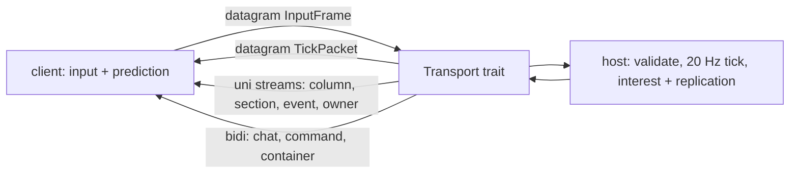
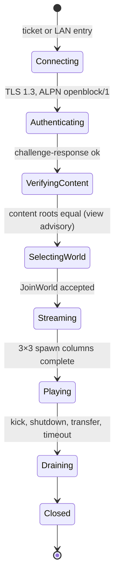

# 18 — Networking and Multiplayer

> Status: normative - Last updated: 2026-11-25
> Depends on: [DEC-004](../decisions.md), [DEC-006](../decisions.md), [DEC-007](../decisions.md), [DEC-008](../decisions.md), [DEC-023](../decisions.md), [DEC-024](../decisions.md), [DEC-025](../decisions.md), [DEC-026](../decisions.md), [DEC-027](../decisions.md), [DEC-029](../decisions.md), [DEC-038](../decisions.md), [DEC-040](../decisions.md), [DEC-043](../decisions.md), [DEC-044](../decisions.md), [DEC-046](../decisions.md), [DEC-048](../decisions.md), [DEC-049](../decisions.md), [DEC-050](../decisions.md), [DEC-052](../decisions.md); [architecture](01-technical-architecture.md), [engine core](02-engine-core.md), [world model](05-world-model.md), [light](07-light-and-weather.md), [gameplay](08-gameplay-survival.md), [items](11-inventory-crafting-items.md), [persistence](17-persistence.md), [server admin](19-server-administration.md), [security](20-security-and-anti-cheat.md); [research 04](../research/04-networking-sota.md)
> Implements: MS-06, MS-07, MS-15

## 1. Purpose and scope

This chapter defines how two OpenBlock processes talk: topology and authority, the `Transport`
boundary and its QUIC implementation, the versioned wire protocol and codecs, the connection
lifecycle, interest-managed streaming and replication, prediction and reconciliation, session and
dimension transfer, LAN discovery, chat and commands, the bandwidth and latency model, and the
simulator used to test all of it.

> **Implementation note (1.0 interim).** The **implemented** transport for the 1.0
> self-hosted milestone is the plain-TCP JSON protocol in §3.13, not the QUIC
> design in §3.3–§3.12. The QUIC/TLS/bit-packed catalog below remains the
> normative target for a later milestone. The interim contract lives in
> `ob_protocol` (messages, framing, chunk snapshot codec) and
> `ob_server::net` (accept/tick/streaming); it is versioned
> `PROTOCOL_VERSION = 3` and is intentionally unencrypted and
> unauthenticated. The matching client connect mode is implemented in
> `ob_client::net` / `ob_client::net_app` (§3.13.7–§3.13.8). Do not expose the
> transport to the public internet without a trusted tunnel or firewall.

The host is authoritative ([DEC-008](../decisions.md)); this chapter is where that becomes bytes.
Every client message is an **intent** — a movement command, a block-edit intent, a container click, a
chat line — never an outcome. Durations are canonical ticks at 20 ct/s; the simulation tick is fixed
at 20 Hz and a 30 Hz setting raises only the snapshot rate ([DEC-038](../decisions.md)). Out of
scope: light and weather *values* ([07](07-light-and-weather.md)); inventory transaction semantics
([11](11-inventory-crafting-items.md)); the save container ([17](17-persistence.md)); validation and
enforcement ([20](20-security-and-anti-cheat.md)); the server's configuration surface and operations
([19](19-server-administration.md)).

## 2. Requirements

| ID | Requirement | Verified by | Milestone |
| --- | --- | --- | --- |
| REQ-NET-001 | Every session MUST have exactly one authoritative host; a client MUST NOT become authoritative for world, entity, inventory or combat state. | Role test at join, review | MS-06 |
| REQ-NET-002 | All messages MUST cross the `Transport` trait; loopback and simulated transports MUST run the production encoder and decoder. | Conformance suite, four transports | MS-06 |
| REQ-NET-003 | Inputs and tick packets MUST use QUIC datagrams; chunks, block events and owner state MUST use independent uni streams; chat, commands and containers MUST use ordered bidi streams ([DEC-023](../decisions.md), [DEC-024](../decisions.md)). | Channel-matrix test | MS-06 |
| REQ-NET-004 | Every datagram MUST be sized from the connection's current maximum datagram size with a 1,200-byte floor; larger payloads MUST be split into numbered application fragments, never IP fragments. | MTU matrix at 1,200/1,280/1,400/1,450 | MS-06 |
| REQ-NET-005 | Transport MUST be TLS 1.3 only; the default identity MUST be a self-signed Ed25519 key pinned by SPKI; a key change MUST require explicit user re-pin. | Pin-change and ticket tests | MS-07 |
| REQ-NET-006 | Player identity MUST be a keypair with challenge-response; whitelists and bans MUST be keyed on the public key, never on IP alone. | Two-key auth, ban tests | MS-07 |
| REQ-NET-007 | QUIC 0-RTT MUST carry only a resume request; any other early message MUST be rejected with `replay_rejected` ([DEC-026](../decisions.md)). | Early-data replay corpus | MS-06 |
| REQ-NET-008 | The handshake MUST compare protocol version, `content_hash` (join-critical and strict), the balance-profile hash and the mod manifest, and MUST close with an actionable kick naming the differing packs; `view_hash` is advisory by default and is compared only when the server opts into strict view matching ([DEC-050](../decisions.md)). | Mismatch fixtures per field | MS-06 |
| REQ-NET-009 | Message IDs MUST be stable and never reused; an unknown ID MUST be a protocol error; a lower minor peer MUST simply not receive newer messages. | Golden catalog digest, negotiation test | MS-06 |
| REQ-NET-010 | The message catalog MUST generate encoder, decoder, size table and Markdown documentation; documentation drift MUST fail CI. | `cargo xtask gen-protocol --check` | MS-06 |
| REQ-NET-011 | Hot-path messages MUST be hand-written bit-packed codecs; every decoder MUST enforce its maximum size before allocating. | Size-table test, fuzz | MS-06 |
| REQ-NET-012 | Connections MUST follow the §3.6 state machine with declared timeouts and MUST reject application messages in the wrong state. | State-machine property test | MS-06 |
| REQ-NET-013 | Every refusal MUST carry a machine-readable reason code, a localised message and a bounded detail string. | Kick-reason fixtures | MS-06 |
| REQ-NET-014 | Reconnect MUST use a short-lived resume token plus TLS resumption; punitive kicks MUST NOT be auto-retried. | Reconnect matrix | MS-06 |
| REQ-NET-015 | The host MUST replicate only each player's interest set, recomputed at least every 4 ticks with 2-chunk hysteresis ([DEC-025](../decisions.md)). | Interest unit and thrash tests | MS-07 |
| REQ-NET-016 | Entity updates MUST be deltas against the last fully acknowledged snapshot, with a full refresh after at most 2 s or 40 ticks. | Loss/reorder convergence test | MS-06 |
| REQ-NET-017 | Block edits MUST be reliable, ordered and per-section-versioned; versions MUST be monotonic `u32`, the host MUST retain four of them, and a skipped edit MUST be repaired by a delta or full resend, never tolerated. | Dropped-event, gap and version-ring tests | MS-06 |
| REQ-NET-018 | Chunk columns MUST use one stream per column, follow the §3.7 priority order, cancel on interest loss and be served from the precompressed cache when unchanged. | Stream-count and cancellation tests | MS-07 |
| REQ-NET-019 | Join MUST be progressive: 3×3 spawn columns first, rings outward, progress at least every 250 ms ([DEC-025](../decisions.md)). | Join benchmark at 10 Mbit/s | MS-06 |
| REQ-NET-020 | Per-player bandwidth and entity caps MUST be host-enforced; a client view distance MUST NOT raise a cap. | Cap-bypass test | MS-07 |
| REQ-NET-021 | Transforms MUST ride datagram snapshots; spawn, despawn and attach MUST be reliable events; a client MUST NOT invent an entity. | Spawn/despawn under loss | MS-06 |
| REQ-NET-022 | Wire entity references MUST be session `NetId`s; persistent UUIDs MUST appear only where restart survival is required ([DEC-043](../decisions.md)). | Wire inspection, save round-trip | MS-06 |
| REQ-NET-023 | Inputs MUST be sequenced, sent redundantly, applied once, buffered and replayed after correction; replay MUST be idempotent by sequence. | Duplicate-replay test | MS-06 |
| REQ-NET-024 | Sub-threshold corrections MUST decay as a render offset; larger ones MUST snap and replay; an epoch or dimension change MUST always snap. | Scripted correction scenarios | MS-06 |
| REQ-NET-025 | Only presentation effects MAY be predicted; damage, loot, durability, block permanence and inventory results MUST NOT be. | Predicted-action matrix | MS-06 |
| REQ-NET-026 | Remote entities MUST render at `now − interp_delay`, adapted from jitter in 50–250 ms, with extrapolation capped at 250 ms; the host tick offset MUST come from snapshot arrivals, never from wall-clock reads in simulation. | Jitter matrix, clock-skew tests | MS-06 |
| REQ-NET-027 | Combat rewind MUST clamp at 200 ms and MUST NOT hit through current solid geometry or resurrect a dead entity ([REQ-GAME-018](08-gameplay-survival.md)). | Rewind corpus at 0/80/150 ms | MS-06 |
| REQ-NET-028 | At 1.0 no mod code MUST run on a client ([DEC-049](../decisions.md)); prediction MUST come from content-hash-covered descriptors, and a post-1.0 both-sides code tier would need a new decision, determinism and a 0.1% correction cutoff. | Descriptor and desync tests | MS-09 |
| REQ-NET-029 | Dimension transfer MUST be atomic: removed from the source and spawned in the destination exactly once, with no item loss or duplication. | Fault-injected transfer | MS-08 |
| REQ-NET-030 | Spectators MUST receive chunks and entities but no owner state, container stream or edit intents; ignored intents MUST be counted. | Spectator corpus | MS-11 |
| REQ-NET-031 | Chat and commands MUST use the ordered control stream, be rate-limited, permission-checked before argument parsing, and rendered as plain text. | Rate, permission, injection tests | MS-07 |
| REQ-NET-032 | LAN discovery MUST be opt-in, advertise no world data beyond name, counts, mode and fingerprint, and MUST NOT bypass pinning. | mDNS capture test | MS-06 |
| REQ-NET-033 | The simulator MUST model latency, jitter, loss, reorder, duplication, bandwidth and blackholes while driving the real client and host code. | Scenario suite in CI | MS-06 |
| REQ-NET-034 | Outbound queues MUST be bounded; a slow peer MUST degrade by shedding background work and MUST NEVER stall the tick. | Blocked-reader test | MS-06 |
| REQ-NET-035 | Column payloads MUST be compressed and cached precompressed; per-tick datagrams MUST NOT be compressed; networking MUST expose the §3.12 metrics and capture format. | Inspection, CPU benchmark, metrics contract | MS-06 |
| REQ-NET-036 | Per-connection, per-IP and per-player rate limits MUST be enforced before payload decode where possible. | Rate-limit tests | MS-15 |
| REQ-NET-037 | Replication MUST NOT change simulation state; encoding the same state and inputs twice MUST produce identical bytes. | Replay hash and byte equality | MS-06 |
| REQ-NET-038 | IPv4 and IPv6 MUST both work, including single-family hosts, without client configuration. | Dual-stack CI | MS-07 |

## 3. Design

### 3.1 Roles and topology

| Process | Role | Transport | Authority | Notes |
| --- | --- | --- | --- | --- |
| `openblock-server` | dedicated host | QUIC/UDP | full | no GPU or audio ([DEC-028](../decisions.md)) |
| integrated host | host inside the client | loopback | full | single-player, "open to LAN" |
| client | input and presentation | QUIC or loopback | none | predicts, never decides |
| P2P host (post-1.0) | host on a player machine | iroh QUIC, relay fallback | full, host-owned world | no authority migration |
| web client (later) | browser client | WebTransport | none | needs a publicly trusted certificate ([OPEN-008](../decisions.md)) |

The host is the same `Host` in every row ([01](01-technical-architecture.md) §3.1); only transport
construction, authentication and process supervision differ. A session owns one active world: the
join names its UUID, and a client presenting cached state for another UUID discards it.



### 3.2 Authority and replicated state classes

Every value belongs to one class; the class fixes channel, cadence and loss policy. A message that
does not fit is a design error, not a new channel.

| Class | Direction | Channel | Cadence | Loss policy |
| --- | --- | --- | --- | --- |
| Input commands | C→S | datagram | 20 Hz, last 3 redundant | repeat; hold after 5 missing |
| Tick packet: player transform, entity deltas, world clock | S→C | datagram | 20 or 30 Hz | superseded by the next snapshot |
| Block edit events | S→C | reliable uni | per tick batch | retransmit; version gap → resend |
| Section resends | S→C | uni, one per section | on request | retransmit |
| Chunk columns | S→C | uni, one per column | join and streaming | retransmit or cancel |
| Entity spawn/despawn/attach | S→C | reliable uni | on change | retransmit |
| Public replicated state: scoreboard, teams, advancements, statistics, boss bars, status effects, entity metadata and equipment, world border, game mode and abilities | S→C | reliable uni, StateChannel `0x54` | on change, coalesced ≤ 4 Hz per channel | retransmit; full channel snapshot on join |
| Owner state: vitals, XP, air, timers | S→C | reliable uni | 20 Hz | retransmit |
| Container traffic | both | reliable bidi | on intent | retransmit ([11](11-inventory-crafting-items.md)) |
| Chat and commands | both | reliable bidi | on input | retransmit |
| Presentation effects | S→C | datagram or reliable | on event | cosmetic, may drop |
| Session control: join, kick, transfer | both | reliable bidi | on change | retransmit |

A client never receives another client's inventory, owner state or command feedback. Public entity
metadata (name, pose, equipment, visible effects, leash and seat) travels on the entity-metadata and
equipment channels of §3.4 on change; anything private stays on the owner stream. At `snapshot_rate_hz = 30` the host emits entity snapshots by sampling its two most recent
tick states and interpolating between them at the snapshot instant; simulation state, tick numbering
and the state hash are unchanged ([DEC-038](../decisions.md)). Block events and owner state stay
tick-cadenced.

### 3.3 Transport layer

The protocol is defined against a trait, not against `quinn` types ([DEC-024](../decisions.md)). It is
object-safe, runtime-agnostic and reports capabilities, so a transport without datagrams cannot be
selected for gameplay.

```rust
pub trait Transport: Send {
    fn capabilities(&self) -> TransportCaps;
    fn connect(&mut self, target: &ConnectTarget, cfg: &TransportConfig) -> Result<PeerId, NetError>;
    fn poll(&mut self, now: Instant, out: &mut dyn TransportEvents, budget: Duration) -> Result<(), NetError>;
    fn send_datagram(&mut self, peer: PeerId, bytes: &[u8]) -> Result<SendOutcome, NetError>;
    fn open_stream(&mut self, peer: PeerId, kind: StreamKind, meta: StreamMeta) -> Result<StreamWriter, NetError>;
    fn accept_stream(&mut self, peer: PeerId) -> Result<Option<InboundStream>, NetError>;
    fn close(&mut self, peer: PeerId, code: CloseCode, reason: &str);
}

pub struct TransportCaps {
    pub datagrams: bool,
    pub max_datagram_size: usize,   // current path estimate, never a constant
    pub max_uni_streams: u8,
    pub migration: bool,
    pub reliable_ordered: bool,
}
```

`SendOutcome` is `Sent | WouldBlock | TooLarge`; `TooLarge` is a caller bug and is counted.
`TransportEvents` yields peer connected/closed, datagrams, stream open/chunk/finish and path change.
The QUIC backend is one quinn endpoint polled by the net-io thread; the simulated backend runs the
same codec on a virtual clock; loopback hands `Arc<[u8]>` across without copying.

| QUIC setting | Value | Why |
| --- | --- | --- |
| `initial_mtu` / `min_mtu` | 1,200 | QUIC's mandatory floor; avoids black holes |
| `mtu_max` | 1,400 | VPN and PPPoE paths; DPLPMTUD stays enabled |
| application datagram cap | `max_datagram_size() − 40` | header + AEAD headroom, recomputed on path change |
| `max_idle_timeout` | 30 s | a paused client is not a dead client; snapshots keep live peers warm |
| keepalive | 10 s | keeps NAT bindings without extra state |
| `initial_rtt` | 100 ms | the 333 ms RFC default makes first loss recovery sluggish |
| congestion control | CUBIC (quinn default) | app-limited flows; no BBR before measurement |
| stream receive window | 48 KiB per stream | 8 streams plus datagram buffers ≈ 512 KiB per peer ([PERF-NET-009](25-performance-budgets.md)) |
| datagram send/receive buffers | 32 KiB each | quinn's 1 MB defaults waste memory per peer |
| max uni streams | 8 per peer | 4 columns in flight plus events, owner state and section resends |
| handshake timeout | 5 s | a half-open handshake is a resource leak |
| Retry | above 70% of the connection budget, or above the endpoint handshake admission rate (`network.handshake_rate_per_second`, default 20/s, [19](19-server-administration.md) §3.2) | stateless address validation under load; excess handshakes get a challenge, not an accept |

**Framing.** One datagram carries one message: `u8 message_id` then the body. A stream begins with
`[kind u8][flags u8][version u8][reserved u8]`, then stream-specific records whose lengths are varints
bounded by the decoder maximum. Datagram fragments carry index and count in the tick-packet header
and are never re-fragmented; IP fragmentation is never used.

| Abuse limit | Default | Scope |
| --- | --- | --- |
| concurrent peers | 256 | endpoint |
| connections per source IP | 4 | endpoint |
| handshakes per source IP | 5 per 10 s | endpoint, token bucket |
| datagrams per second per peer | 120 | connection |
| inbound bytes per peer | 8 KiB/s sustained, 32 KiB burst | connection |
| outbound bytes per peer | 64 KiB/s steady, 2 MiB/s join burst | player ([DEC-025](../decisions.md)) |
| queued outbound bytes per peer | 4 MiB | connection; background work is dropped first |

Application-level per-opcode limits are owned by [20 §3.9.1](20-security-and-anti-cheat.md): input and
ack opcodes get 25/s with a 12-frame burst, container intents 40/s and chat 5 per 10 s, all checked
after authentication and before the validator.

**Identity.** Three modes, default first ([DEC-026](../decisions.md)): `self_signed` (Ed25519 key made
on first run, self-signed certificate, SPKI pinned on first use; a changed key demands an explicit
re-pin), `acme` (TLS-ALPN-01 or DNS-01, publicly trusted, for servers with a domain and UDP 443) and
`provided` (operator key and chain). The fingerprint is BLAKE3-128 of the SPKI DER as 26 base32
characters in groups of four. The ticket is the URI the client already accepts on the command line
and from the single-instance forwarder ([02](02-engine-core.md) §3.5):
`openblock://join/<host>:<port>#fp=<fingerprint>&v=1`, QR-encoded when shared. The fingerprint is a
hint for the user, not a reason to skip verification.

Player identity is separate: the client generates an Ed25519 keypair, the host issues a 32-byte
nonce, and the client signs `("openblock.auth/1", server_fingerprint, nonce, player_key)`. The host
stores the public key on first join (TOFU) unless a one-time join code is configured; bans,
whitelists, ops and permissions are keyed on it, with IP or subnet only as additional evidence. OIDC
is optional (`online_mode = "oidc"`): the host validates a device-code ID token and maps the subject
to a local player record, and a server with OIDC still accepts local keys unless
`allow_local_keys = false`. ACME authenticates the transport, not the operator, so public servers
SHOULD still show their fingerprint.

**0-RTT.** Early data carries exactly one message, `ResumeRequest` with a resume token; the host
answers `ResumeAccepted` or falls back to a full handshake. Any other early message closes with
`replay_rejected` ([DEC-026](../decisions.md)). Edits, chat, commands, container intents, input frames
and join streaming are never sent in 0-RTT; camera state is client-local at that point, so nothing
useful is lost by the restriction.

**Migration and congestion.** Connection IDs allow an address change without a new handshake; server
path validation is always on and client-initiated migration is behind `allow_migration`, verified by
a NAT-rebind test before any Wi-Fi→LTE claim. One congestion controller per connection means a chunk
burst can delay a snapshot, so chunk streams are offered at most 75% of the estimated bandwidth while
snapshots are in flight.

### 3.4 Protocol versioning and message catalog

`PROTOCOL_MAJOR = 1`, `PROTOCOL_MINOR = 0` at MS-06. A major change breaks the wire; a minor change
adds messages or fields. Rules: IDs are permanent and never reused; an unknown core ID is a protocol
error, never skipped; additive fields go at the end or into a tagged extension; a host accepts
`[min_client_protocol_minor, PROTOCOL_MINOR]` and names the range in the kick; connection content
dictionaries are derived from `content_hash` on both sides and never transmitted
([DEC-040](../decisions.md)), so a dictionary-digest mismatch is a content mismatch.

| ID | Message | Dir | Channel | Cadence | Budget | Encoding |
| --- | --- | --- | --- | --- | --- | --- |
| `0x01` | `ClientHello`: version, `content_hash`/`view_hash`, mod manifest, player key | C→S | control | once | 16 KiB | postcard |
| `0x02` | `ServerHello`: version, session, identity mode | S→C | control | once | 1 KiB | postcard |
| `0x03` | `AuthChallenge` / `AuthResponse` | both | control | 1 | 256 B | fixed |
| `0x04` | `ResumeRequest` / `ResumeResult` | both | control | 1 | 128 B | fixed |
| `0x10` | `ContentManifest`: packs, `content_hash`, `view_hash`, `pack_hash`, `balance_profile_hash`, dictionary digest (field list per [15 §3.6](15-content-system.md)) | S→C | control | 1 | 64 KiB | postcard |
| `0x11` | `ContentMismatch`: differing packs | S→C | control | 1 | 2 KiB | postcard |
| `0x12` | `PackOffer` / `PackChunk` | S→C | stream | on demand | 64 KiB | postcard + bytes |
| `0x20` | `JoinWorld`: world UUID, dimensions, rules hash, spawn | S→C | control | 1 | 4 KiB | postcard |
| `0x21` | `JoinProgress`: stage, ready/total columns | S→C | control | 4 Hz | 16 B | fixed |
| `0x30` | `InputFrame`: 1–3 input commands | C→S | datagram | 20 Hz | 48 B | bit-packed |
| `0x31` | `TickAck`: tick, 16-bit fragment bitmap, input sequence | C→S | datagram | 20 Hz | 16 B | bit-packed |
| `0x40` | `TickPacket`: fragment 0–15 of ≤ 16 | S→C | datagram | 20/30 Hz | 1,160 B per fragment, 18,560 B per packet | bit-packed |
| `0x50` | `SectionDelta`: section, version, indices + states | S→C | reliable uni | per tick | 16 KiB | bit-packed |
| `0x51` | `SectionRequest`: chunk, sy, known version | C→S | control | on gap | 24 B | bit-packed |
| `0x52` | `SectionResend`: full section | S→C | uni | on request | 16 KiB | bit-packed |
| `0x53` | `ChunkColumn`: header, sections, heightmaps, light | S→C | uni | streaming | 256 KiB | bit-packed + zstd |
| `0x54` | `StateChannel`: channel id, schema version, revision, typed body | S→C | reliable uni (events stream) | on change, coalesced ≤ 4 Hz per channel | 16 KiB body | bit-packed header + postcard body |
| `0x60` | `EntitySpawn`: NetId, type, transform, initial metadata | S→C | reliable uni | on change | 64 B | bit-packed |
| `0x61` | `EntityDespawn`: NetId, reason | S→C | reliable uni | on change | 8 B | bit-packed |
| `0x62` | `EntityAttach`: passenger, vehicle, seat | S→C | reliable uni | on change | 12 B | bit-packed |
| `0x70` | `OwnerState`: vitals, XP, air, timers | S→C | reliable uni | 20 Hz | 24 B | bit-packed |
| `0x80`–`0x83` | `ContainerOpen` / `Intent` / `Ack` / `Resync` | both | reliable bidi | on intent | 3.5 KiB | bit-packed ([11](11-inventory-crafting-items.md) §4) |
| `0x90` | `ChatSend` / `ChatBroadcast` | both | reliable bidi | on input | 1 KiB | postcard |
| `0x91` | `Command` / `CommandFeedback` | both | reliable bidi | on input | 4/8 KiB | postcard |
| `0xA0` | `EffectEvent`: sound, particles, screen, animation | S→C | datagram | on event | 64 B | bit-packed |
| `0xB0` | `PlayerList`: add, remove, update | S→C | reliable uni | on change | 8 KiB | postcard |
| `0xC0` | `Kick`: reason, detail, retry-after | S→C | control | 1 | 512 B | postcard |
| `0xC1` | `Transfer`: dimension or server, spawn, epoch | S→C | control | on change | 256 B | postcard |
| `0xC2` | `TransferReady`: epoch, loaded columns | C→S | control | after `Transfer` | 16 B | fixed |
| `0xD0` | `ModMessage`: namespace, schema hash, body | both | control | negotiated | 16 KiB | postcard + bytes |
| `0xE0` | `Ping` / `Pong`: nonce, host tick | both | control | 1 Hz | 24 B | fixed |

The catalog is declared once with `ob_protocol::catalog!`; the macro generates dispatch, the size
table used by tests, and `docs/protocol/wire.md`. `openblock-tools wire decode` reads the same catalog,
so a third party can decode a capture without the engine. It is also the only wire surface: a core
feature that changes client-visible state MUST register its message or state channel in the same
commit, and `cargo xtask gen-protocol --check` fails a replicated value that no catalogued message
carries (REQ-NET-010).

`StateChannel` (`0x54`) is the generic carrier for low-rate state that is neither a transform delta
nor a spawn/despawn event. Records are length-prefixed on the reliable `Events` uni stream, so the
message adds no stream and no per-peer buffer; ordering is per channel, a record whose `revision` does
not advance is dropped, and a full channel snapshot is sent at join, on dimension transfer and on
resume. Channel ids are their own `u16` namespace, not message IDs, and an id absent from the catalog is
a protocol error. Channels are entries in the same `catalog!` declaration — it generates their
dispatch and size table too — and are never negotiated as strings:

| Channel | Carries | Owner | Max body |
| --- | --- | --- | --- |
| `0x0001` `scoreboard_objects` | objectives, criteria, display slots | [08 §3.12](08-gameplay-survival.md#312-commands-permissions-statistics-and-onboarding) | 8 KiB |
| `0x0002` `scoreboard_scores` | per-holder score deltas | [08 §3.12](08-gameplay-survival.md#312-commands-permissions-statistics-and-onboarding) | 8 KiB |
| `0x0003` `teams` | team membership, colours, rules | [08 §3.12](08-gameplay-survival.md#312-commands-permissions-statistics-and-onboarding) | 8 KiB |
| `0x0004` `advancements` | progressed criteria, completion ticks, toasts | [08 §3.12](08-gameplay-survival.md#312-commands-permissions-statistics-and-onboarding) | 16 KiB |
| `0x0005` `statistics` | changed `(StatId, u64)` entries, owner-only | [08 §3.12](08-gameplay-survival.md#312-commands-permissions-statistics-and-onboarding) | 16 KiB |
| `0x0006` `boss_bar` | name key, colour, segments, phase | [09 §3.17](09-entities-ai.md#317-replication) | 256 B |
| `0x0007` `status_effects` | visible effect id, amplifier, remaining ct | [09 §3.17](09-entities-ai.md#317-replication) | 64 B |
| `0x0008` `entity_metadata` | custom name, variant, profession, leash, seat | [09 §3.17](09-entities-ai.md#317-replication) | 128 B |
| `0x0009` `entity_equipment` | held item and armour stacks | [09 §3.17](09-entities-ai.md#317-replication) | 256 B |
| `0x000A` `world_border` | centre, radius, warning distances | [19 §3.3](19-server-administration.md#33-world-management) | 32 B |
| `0x000B` `game_mode_abilities` | mode, flags, flying and invulnerability | [08 §3.2](08-gameplay-survival.md#32-player-state-machine-and-replication) | 32 B |

All channels are S→C, reliable and ordered; nothing on them is predicted, and a client never writes
one. Advancement and statistics records are host-computed awards
([AC-META-11](20-security-and-anti-cheat.md#35-validation-matrix)), never client claims.

**Join admission.** `content_hash` is the join-critical root: a mismatch closes with
`content_mismatch` and a Merkle leaf diff. `view_hash` travels in `ContentManifest` for that diff and
for display, but it is advisory by default; a view-only difference is reported in the join screen and
never blocks a join unless the server sets `server.strict_view = true`
([19 §3.2](19-server-administration.md#32-configuration-surface)). Translations are view leaves only,
so two clients with different locale packs join a default server and render the same world
([DEC-050](../decisions.md)).

Combat has no separate message: `AttackIntent` is the validator-facing name of the use/attack command
carried in `InputFrame` (`0x30`), decoded and checked as `AC-COMBAT-05`
([20 §3.5](20-security-and-anti-cheat.md#35-validation-matrix)). The sentence in
[08 §3.6](08-gameplay-survival.md#36-combat) that sends `AttackIntent` on a reliable ordered stream is
superseded by this catalog. Combat results travel on the authoritative owner-state and event paths of
§3.2, never on the input datagram.

Close codes are `0x4F42_0000 | reason`, distinguishing an OpenBlock close from a transport error.
The last column is authoritative: a close marked `no` is final, clears the cached session and is
never retried; a close with a hint or a backoff may be retried only as described.

| Code | Reason | Detail | Auto-retry |
| --- | --- | --- | --- |
| `0x00` | `protocol_error` | message ID and offset | no |
| `0x01` | `version_mismatch` | supported client range | no |
| `0x02` | `content_mismatch` | pack IDs and content hashes; a view-only difference is advisory unless strict view matching is on | no |
| `0x03` | `auth_failed` | generic; never reveals whether a key exists | no |
| `0x04` | `banned` | expiry and appeal text | no |
| `0x05` | `not_whitelisted` | none | no |
| `0x06` | `server_full` | retry-after seconds | after hint |
| `0x07` | `rate_limited` | which limit | with backoff |
| `0x08` | `timeout` | last state | once |
| `0x09` | `invalid_state` | state and message | no |
| `0x0A` | `mod_rejected` | mod ID and hash | no |
| `0x0B` | `server_shutdown` | restart ETA | after hint |
| `0x0C` | `world_mismatch` | world UUID | no; refresh entry |
| `0x0D` | `replay_rejected` | none | retry without 0-RTT |
| `0x0E` | `join_stalled` | last completed column | once |
| `0x0F` | `kicked_by_admin` | operator text | no |
| `0x10` | `transport_error` | stack close code | with backoff |

### 3.5 Encoding

Hot-path messages are bit-packed LSB-first, little-endian for multi-byte fields, no padding. A
decoder reads from a bounded cursor, checks every length against the message maximum before
allocating, and returns `Truncated`, `Overflow` or `InvalidValue` rather than panicking. Control
messages use postcard with versioned structs and a 64 KiB cap; nothing in the hot path uses Serde
([DEC-027](../decisions.md)).

**Input command** (14 B; three per frame, the older two with a `u16` sequence delta):

| Field | Bits | Encoding |
| --- | --- | --- |
| `seq` | 32 | per-connection command sequence |
| `move`, `strafe` | 8 + 8 | quantised −1.0…1.0, 0x80 = 0 |
| `yaw`, `pitch` | 16 + 16 | 1/65,536 turn, 0 = north (−Z); pitch clamped ±90° |
| `buttons` | 16 | jump, sneak, sprint, use/attack, break, offhand |
| `actions` | 8 | edge events: break start/stop, place, use, drop, swap, inventory |
| `flags` | 8 | stale repeat, spectator, reserved |

**Tick packet.** Header 16 B: message ID, flags (`full_state`, snapshot rate), fragment index 0–15 and
fragment count−1 in 4 bits each, `tick u32`, `baseline_tick u32`, `ack_seq u32`. A tick packet is at
most 16 fragments of 1,160 B — an 18,560 B wire maximum — and the per-tick budget of §5
(`PERF-NET-011`, `PERF-NET-008` in [25](25-performance-budgets.md)) caps what is actually sent at
16 KiB. Fragment 0 adds the world clock (day time `u32`,
weather `u8`, flags `u8`) and the local player's authoritative transform (position 3×`i32` at 1/32
block, velocity 3×`i16` at 1/256 block/tick, yaw/pitch, flags = 24 B), then entity deltas by descending
priority and ascending NetId. Every fragment repeats the header and is independently applicable
because every delta is relative to the baseline, so a lost fragment costs one snapshot of those
entities, not correctness.

**Entity delta** (13 B typical, 13–16 B): NetId as a ZigZag varint delta from the previous NetId (1–3 B), flags,
position 3×`i16` at 1/16 block relative to the receiver (6 B, ±2,048 blocks), velocity 3×`i8` at
1/32 block/tick (3 B), yaw and pitch `u8` each. Full-state mode uses absolute `i32` positions.
Anything that must not be lost is a reliable event, never a datagram delta.

**Block edit batch.** Stream record header 16 B (`cx i32`, `cz i32`, `sy u8`, `version u32`, count
varint), then 3.5 B per edit (12-bit local index + 16-bit connection-dictionary state ID). Batches are
capped at 4,096 edits and applied in version order; larger tick batches split into several records.

**Chunk column.** 24-byte header (`cx`, `cz`, `generation u32`, `section_mask u64`, biome palette
length, flags), then sections ascending `sy` with a flags byte (uniform, has light), a palette of
dictionary indices, packed 4/8/16-bit indices in `x + 16*(z + 16*y)` order, 8,192 B of packed light
when present, and three 16-bit heightmaps. The payload is zstd level 1 and capped at 256 KiB. This is
a **wire** encoding, not the save layout ([17](17-persistence.md)); the host caches it keyed by
`(chunk, generation, content_epoch)` and most columns never need re-encoding.

**State channel record.** Stream record header: `channel u16`, `schema_version u16`, `revision u32`,
`body_len` varint, then the postcard body for that channel (§3.4). A body larger than its channel's
catalogue maximum is rejected before decode; a channel the client did not receive in its join snapshot
is a protocol error.

**Control messages** carry `schema_version`, `#[serde(default)]` fields and a declared maximum.
`ModMessage` carries `(namespace, message_id, schema_hash, bytes)`; a message whose namespace or schema
hash was not negotiated in `ClientHello` is rejected, and a mod never defines a core ID.

### 3.6 Connection lifecycle



| Phase | Timeout | On timeout |
| --- | --- | --- |
| TLS handshake | 5 s | close `timeout`, count a failed handshake |
| Authentication | 5 s | close `auth_failed` |
| Content verification | 30 s | close `content_mismatch` on a content-root difference, naming the last verified pack; a view-only difference is advisory unless strict view matching is configured |
| Join streaming | no global limit; 10 s with no completed column warns, 30 s closes | `join_stalled` |
| Playing | idle 30 s, keepalive 10 s | entity persists 120 s for resume |
| Draining | 5 s | force close |

The client renders a localised reason plus the server's detail, never a raw transport error.
Auto-reconnect follows the §3.4 table with backoff 1, 2, 4, 8, 16 s capped at 30 s and five attempts;
`banned`, `kicked_by_admin`, `content_mismatch` and `version_mismatch` clear the session and never
retry. Resume uses the TLS session ticket plus an HMAC resume token (5-minute TTL, bound to the player
key and server fingerprint); the host restores the player entity, inventory and position, and the
client drops prediction history and starts from a full snapshot.

### 3.7 World streaming and replication

**Interest set.** Recomputed every 4 ticks and when the player crosses a chunk boundary. *Columns:*
all chunks within `min(client_view_distance, server_view_distance)` — the **render** distance, because a
client cannot render a column it does not have — with a 2-chunk unload ring; the player's chunk and its
3×3 neighbours are always included, even under a rate cap. On a dedicated server both distances
default to 256 blocks ([DEC-052](../decisions.md)); 512 is an opt-in setting whose cost is published
in [19 §3.2](19-server-administration.md#32-configuration-surface). *Entities:* those whose expanded
AABB intersects the replication radius (`min(simulation_distance, view_distance)`), with 1 s
visibility hysteresis, plus attachments and dimension bosses. *Events:* block edits, block-entity
changes and effects inside the column set, while weather, time, chat and the player list are always
sent. *State channels* (§3.4) are filtered by interest where they name an entity or a holder, sent only
to their owner for `statistics` and `advancements`, and otherwise session-scoped. Interest is a
`BTreeSet`, so the diff yields `Add`/`Remove` work and the scheduler never rescans the world per
player.

| Queue | Contents | Share of the per-tick byte budget | May exceed the cap |
| --- | --- | --- | --- |
| `Safety` | player column + 3×3, section resends, owner/container state | first, unlimited | up to 2× |
| `Near` | columns within 2 chunks, entities within 64 blocks | 40% | no |
| `Prefetch` | columns in the velocity cone 1–2 s ahead | 30% | no |
| `Background` | the rest, farthest first | 30% | no |
| `Warm` | precompressed cache fills for future chunks | leftover | no |

Per tick the host may send `chunk_send_budget_kib_per_tick` (default 24 KiB) of column bytes per
player, rising to 96 KiB when the client is starved and the queue is empty, scheduled deficit
round-robin so `Safety` cannot starve. Compression runs on the I/O pool; a full queue drops
`Background`, never blocks the tick.

**Snapshot and delta.** Entity state is replicated against the last tick whose fragments the client
fully acknowledged; `TickAck` carries the tick and a 16-bit fragment bitmap (one bit per fragment of
§3.5). The host keeps per-entity dirty bits for that baseline, encodes only dirty entities, and
promotes a full state when the baseline is older than 40 ticks (2 s) or the client reconnects. The
per-player byte budget, not the sixteen-fragment wire maximum, decides how much a snapshot carries:
deltas that do not fit are deferred to the next snapshot and marked `not_updated`. The local player's
transform is always sent in full because the client predicts it.

**Block edits** are reliable events applied in per-section version order: a batch applies only when
`version == known + 1`, otherwise the client sends `SectionRequest` and the host answers with a delta
from the four-version ring or a full `SectionResend`. Versions are `u32`, monotonic, and reset only
when the world is replaced.

**Progressive join.** The host sends the 3×3 spawn columns (≤ 1 MB), then expanding rings; the client
spawns when the centre is complete and loads on behind the player, with progress at 4 Hz. Unchanged
columns come from the precompressed cache and are re-encoded only after an edit or content-epoch
change. For very large worlds, spectators and migrations the server MAY advertise an HTTP(S) range
endpoint for a content-addressed `.obworld` archive ([17](17-persistence.md) §3.8); the client may use
it and then still joins through the handshake. It is a bandwidth optimisation, not a second protocol.

**Entities.** Spawn, despawn and attach are reliable events with NetId, dictionary type ID, initial
transform and metadata; transforms then ride datagrams and non-transform metadata rides the
`entity_metadata`/`entity_equipment` state channels. A tick packet carries at most
`entities_per_snapshot` (default 256) deltas: nearest, recently changed, then ascending NetId.
Entities beyond the cap update on alternate ticks and are marked `not_updated`; the client
extrapolates them for at most 250 ms and then holds. The host caps tracked entities per client
(default 512) and never sends another dimension's entities.

The bandwidth model assumes **60 of 200 visible entities change on a typical tick** (30 %, the
[09 §3.17](09-entities-ai.md#317-replication) figure), which is 60 × 13–15 B ≈ 780–900 B per tick, or
15.6–18 KB/s at 20 Hz. A crowded fight changes more than that; the host then defers low-priority deltas
to later ticks rather than raising the rate, which is `RISK-251`, and the 20 KB/s cap of
`PERF-NET-007` is what the benchmark asserts.

**Save interaction.** Join and streaming read the precompressed cache and the immutable
`Arc<ChunkColumn>` snapshots published by the world store, never a lock the save thread holds. When
the save queue exceeds budget the host sheds `Background`, then `Prefetch`, and never delays `Safety`,
the tick or a save ([17](17-persistence.md) §3.5).

### 3.8 Prediction and reconciliation

The client runs the same `ob_sim` player systems for the local player: movement, collision, look,
break progress and placement preview. It sends one command per simulated tick with the previous two
repeated; the host de-duplicates by `seq` over a 64-entry ring, applies in order, and marks a tick
`stale_inputs` when it repeats the last command, and drops any command older than 1 s relative to its
own tick estimate. After five stale ticks the player is held, not extrapolated, so a paused client
cannot slide through a wall.

```text
authoritative = packet.player_state
error_pos = |authoritative.pos - predicted_at(tick)|
error_rot = angle(authoritative.yaw - predicted.yaw)
if epoch changed or error_pos > 4 m or error_rot > 20°: snap, drop visual offset
elif error_pos > 0.1 m or error_rot > 2°: rewind to authoritative, replay seq > ack_seq
else: keep prediction, add the delta to a render-only offset decaying with tau = 100 ms
```

The unacked ring holds 256 commands (12.8 s). Replay is pure and must reproduce the host's state hash
for the same commands; a mismatch is a determinism bug and is reported as one. A client never
predicts another player's movement, entity health, drops, container contents, XP or durability.

**Interpolation.** Remote entities render at `now − interp_delay` with
`interp_delay = clamp(2 × snapshot_interval + 2 × jitter, 50 ms, 250 ms)`, where jitter is the
RFC 3550 running variance of snapshot arrivals. A dry buffer extrapolates for at most 250 ms from the
last two transforms and then freezes; teleports, dimension changes and deaths are never extrapolated.

**Clock sync.** Each tick packet carries the host tick and a sample fraction (0–255 of a tick). The
client filters `host_time − client_time` over the last 20 samples with a minimum-RTT estimator,
tracks offset and drift, and uses the estimate only for presentation. A jump above 500 ms resets the
estimator and clears the interpolation buffer; the simulation never reads a wall clock.

**Lag compensation.** The host keeps 24 ticks (1.2 s) of player AABBs and poses. A melee or projectile
hit rewinds targets by `client_interp_delay + RTT/2`, clamped to 200 ms ([REQ-GAME-018](08-gameplay-survival.md)),
validates reach and line of sight against the rewound boxes and the *current* solid geometry, then
applies damage to the current entity; a dead entity is never resurrected. Discrepancies feed
anti-cheat scoring ([20](20-security-and-anti-cheat.md)).

**Local effects.** Predicted: camera, animations, particles, sounds, break progress, the translucent
placement ghost and the inventory window shadow. A ghost never enters collision, light or a gameplay
query before confirmation.

| Predicted locally | Confirmed by the host before it is real |
| --- | --- |
| local player transform and camera | every block state change |
| swing, use, break animation, particles, sound | item use result, damage, death |
| placement ghost, break progress | block drops, XP, durability loss |
| inventory window shadow ([DEC-023](../decisions.md)) | inventory contents and counts |
| spectator camera | dimension and server transfer |

**Modded prediction.** At 1.0 no mod code runs on a client ([16](16-modding.md) REQ-MOD-026).
Content may ship **prediction descriptors** — content-hash-covered data describing a custom shape,
belt velocity, friction and use timing — and the client simulates movement over them with the
engine's own controller, reconciling exactly like vanilla movement. Anything a descriptor cannot
express stays host-authoritative and may correct; that is the price of not shipping mod code. A
post-1.0 both-sides code tier would need a new decision ([OPEN-006](../decisions.md) is closed by
[DEC-049](../decisions.md)), must be deterministic with an RNG derived from
`(tick, action_seq, mod_id)`, and would be disabled for the session above a 0.1% correction rate over
1,000 actions.

### 3.9 Session and player lifecycle

| Player state | May send | Receives | Notes |
| --- | --- | --- | --- |
| `Connecting` | handshake only | handshake only | tight limits, no compression |
| `Joining` | ping, ack | chunks, world clock, the state-channel snapshot | cannot act or chat |
| `Playing` | inputs, chat, commands, containers, edit intents | interest-set state | full validation |
| `Spectator` | camera inputs | chunks, entities, effects | no owner state, containers or edits |
| `Transferring` | ping | transfer progress | invulnerable, no actions, 10 s cap |
| `Disconnected` | — | — | entity retained 120 s for resume |

A session has an ID, one active world, a player limit, a dimension list and a game-rule hash.
`JoinWorld` carries the world UUID, dimensions, rule hash, spawn and replication rate. A dimension
change is `Transfer { dimension, position, epoch }`: the host removes the player from the source,
flushes its pending edits, assigns the epoch, streams the destination (which the client may already
have cached) and spawns the player once on `TransferReady`. Failure at any step leaves the player in
the source dimension with a message ([REQ-GAME-024](08-gameplay-survival.md)). Server-to-server
transfer is the same message with a ticket instead of a dimension, reserved for the MS-21 proxy.

### 3.10 LAN, loopback and alternate transports

When a host opens to LAN it advertises `_openblock._udp.local` over mDNS with TXT `v=1`,
`w=<world name>`, `p=<players>`, `m=<max>`, `g=<mode>`, `fp=<fingerprint>`, `req=<content hash prefix>`.
No seed, player names or extra addresses; discovery is opt-in per session, stops on close, and never
implies trust — joining still verifies the SPKI. A manual address entry is always available.

Single-player runs the real host on the loopback transport, which hands `Arc<[u8]>` payloads across a
bounded queue. It is not a direct call: the client cannot see host memory, and the same conformance
suite runs against it. P2P uses iroh's key-addressed QUIC with relay fallback and is
host-authoritative with no authority migration. WebTransport is the web path and, because browsers
cannot pin a self-signed SPKI, requires `acme` or `provided`; the protocol must not adopt
browser-only constraints before that front-end exists ([OPEN-008](../decisions.md)).

### 3.11 Chat, commands and community

Chat and commands use the ordered bidirectional stream. Chat is at most 256 UTF-8 characters,
rate-limited to 5 messages per 10 s with a 10-message burst, and rendered as plain text in the local
locale; markup is never interpreted and command feedback is a separate message type. Commands are
permission-checked before argument parsing, rate-limited to 20/s ([08](08-gameplay-survival.md) §3.12),
run in `PostTick` and batch edits into one tick. Names are snake_case ASCII
([DEC-044](../decisions.md)); the canonical command list is in [19](19-server-administration.md) §3.5.
Sign, book and chat text from another player is untrusted: length- and control-character-checked,
translated through Fluent where a key exists, never used as a format string, and not logged by
default.

### 3.12 Metrics, diagnostics and bandwidth model

Networking exports `openblock_net_*` metrics (bytes, datagrams, loss, RTT, queue depth per lane,
rejected handshakes, decode errors), a per-peer bandwidth meter and a bounded wire capture. A
`.obcap` file is a sequence of `[u64 monotonic_ns][u8 direction][u8 lane][u16 stream][u32 len][bytes]`
records with a header naming protocol version and local fingerprint; it contains message bytes and
never TLS keys, player private keys or session tokens, is capped at 64 MiB and is never uploaded
automatically. `openblock-tools wire decode` and `wire stats` read it with the generated catalog.

All numbers below are **models**, replaced by the MS-15 capacity report and reconciled with the
canonical join budgets of [25 §5.3](25-performance-budgets.md). Assumptions: 16³ sections — the storage,
edit, light and network unit ([DEC-048](../decisions.md) clusters them to 32³ for rendering only) — 8–14
non-empty sections per column, zstd level 1 giving 3–4× on a built column, 200-byte column header and
three heightmaps, so ~22 KiB compressed per built column (research 09's surface-explored figure).

| Join radius | Columns | Raw column | Compressed | Join payload | At 10 Mbit/s |
| --- | --- | --- | --- | --- | --- |
| 128 blocks | 81 | 40–90 KiB | 15–25 KiB | 1.3–2.2 MB | 1–2 s |
| 256 blocks | 1,089 | 45–90 KiB | 18–26 KiB | 20–28 MB | 16–22 s |
| 384 blocks | 2,401 | 45–90 KiB | 18–26 KiB | 43–60 MB | 34–48 s |
| 512 blocks | 4,225 | 45–90 KiB | 18–26 KiB | 80–110 MB | 64–88 s |
| 1024 blocks | 16,641 | 45–90 KiB | 18–26 KiB | 320–430 MB | 4.3–5.7 min (discouraged) |

These rows model **full interest completion**, not time-to-playable. The gate is two numbers: spawn
playable within 5 s p95 (`PERF-NET-004`) and the full interest set at the server's render distance (256 blocks by default, 512 when opted in per DEC-052) within 90 s fresh /
150 s built (`PERF-NET-005`). [MS-06](../plan/01-milestones.md#ms-06--networking) still says
"≤ 60 s at 10 Mbit/s"; that milestone wording is stale against this model and will be reconciled at
MS-06 (§8 question 6), not by changing the model here.

| Per-player traffic, 256-block simulation distance | Steady KB/s | Note |
| --- | --- | --- |
| Tick header, world clock, local player | 1.0 | 20 Hz × 50 B |
| Entity deltas, 64 tracked / 20 changed (light scene) | 5–8 | 13 B per changed entity; the 200-entity gate assumes 60 changed, §3.7 |
| State channels, coalesced ≤ 4 Hz | 0.2–1.0 | scoreboard, boss bar, effects, metadata |
| Owner state | 0.6 | 24 B per tick |
| Block edits, 10/s | 0.2 | 3.5 B per edit |
| Chat, commands, player list | < 0.1 | bursty |
| Streaming while walking at 5 m/s | 6–12 | ~0.31 new columns/s |
| **Total steady** | **13–23** | cap 64 KB/s |
| Streaming while flying at 30 m/s | 40–80 | capped, pop-in accepted |
| Join burst | up to 2,048 | 2 MiB/s for ≤ 60 s |

The table is a **co-located** model: every player shares one chunk cache and one interest union, which
is the published 50-player tier of [19 §3.9](19-server-administration.md#39-capacity-planning). Players
scattered across the world each need their own columns — the replicated set is the union of render
distances, and a client cannot render a column it does not have — so the distributed case is a separate,
lower row with its own numbers ([DEC-052](../decisions.md)). At the opt-in 512-block simulation
distance the entity count roughly triples: 25–40 KB/s steady, under the 64 KB/s p95 / 128 KB/s peak cap
of `PERF-NET-001`, with the same 2 MiB/s join burst. Upstream stays under 1.5 KB/s per player (inputs
20 × 48 B plus acks and control), which is why the protocol is deliberately asymmetric.

| Path | RTT | Perceived latency, 20 Hz snapshot, 100 ms interpolation |
| --- | --- | --- |
| loopback | 0 ms | none beyond prediction |
| LAN, wired | 1–3 ms | ~50 ms |
| same region | 15–40 ms | ~65–90 ms |
| cross-continent | 90–180 ms | ~140–230 ms |
| mobile or relayed P2P | 40–120 ms + 20–80 ms relay | ~180–300 ms |


### 3.13 Interim JSON/TCP protocol (implemented for 1.0)

**Status.** Implemented in `crates/protocol` (`ob_protocol`) and
`crates/server/src/net.rs` (`ob_server::net`). It is the contract the client
connect mode builds against. The requirements in §2 still describe the QUIC
target; clauses that mention TLS, keys, datagrams, streams or bit-packed
catalogues do **not** apply to this interim transport. The interim protocol is
plain TCP and JSON, so it can be inspected with `nc` or a small script and
self-hosted without a transport dependency.

#### 3.13.1 Transport and framing

* One TCP connection per client; IPv4 and IPv6 literals, loopback default.
* Every frame is `u32` big-endian payload length followed by UTF-8 JSON. The
  length excludes the four-byte prefix. Zero-length frames are rejected.
* `MAX_FRAME_LEN = 2 MiB` (`ob_protocol::MAX_FRAME_LEN`); the server rejects a
  larger declared length before allocating the payload. Malformed,
  truncated, invalid-UTF-8 and oversized frames produce a `Disconnect` frame
  and close the connection; they never panic.
* Chunk payloads are opaque bytes and travel as **standard padded base64**
  inside the JSON `bytes` field. This keeps frames small without a dependency
  and makes chunk data a single validated blob.
* The server sets a 10 s handshake timeout, a 120 s idle read timeout and a
  15 s socket write timeout. Framing helpers block on the underlying socket;
  callers own these timeouts.
* There is no authentication, encryption, QUIC or TLS in this build. Server
  operators must firewall the port and are expected to put a trusted tunnel in
  front of a public deployment.

#### 3.13.2 Message catalog

`PROTOCOL_VERSION = 3`. Both enums are internally tagged with `"type"`
(snake_case) and serde-derived. Direction is implicit. The v2/v3 additions are
listed after the v1 table; framing and the chunk payload codec are unchanged.
Versions 1/2 clients are refused with `protocol_mismatch`, and the reason names
the server's version so an old client can report an upgrade requirement.

| Dir | `type` | Fields |
| --- | --- | --- |
| C→S | `hello` | `protocol: u16`, `name: String` |
| C→S | `chunk_request` | `cx: i32`, `cz: i32` |
| C→S | `move` | `pos: [f64; 3]`, `yaw: f32`, `pitch: f32` |
| C→S | `block_edit` | `pos: [i32; 3]`, `block: u16` (`0` = break) |
| C→S | `chat` | `text: String` |
| C→S | `ping` | `id: u32` |
| C→S | `disconnect` | — |
| S→C | `hello` | `protocol`, `world_name`, `seed`, `spawn: [f64; 3]`, `content_fingerprint: u64`, `tick: u64`, `day_ticks: u64`, `max_players: u16`, `motd`, `blocks: [{id, name}]` |
| S→C | `join` | `id: u64`, `name: String` |
| S→C | `leave` | `id: u64` |
| S→C | `player_list` | `players: [{id, name, pos, yaw, pitch}]` |
| S→C | `player_state` | `id`, `name`, `pos: [f64; 3]`, `yaw`, `pitch` |
| S→C | `chunk_data` | `cx: i32`, `cz: i32`, `bytes: base64 string` |
| S→C | `block_edit` | `pos: [i32; 3]`, `block: u16`, `player: u64` |
| S→C | `chat` | `from: String`, `text: String` |
| S→C | `pong` | `id: u32` |
| S→C | `disconnect` | `reason: String` |

`tick` is the server tick at which the client joined; `day_ticks` is the length
of one in-game day (`24_000` ticks at 20 Hz). `player_list` is an addition to
the minimal catalog and carries the complete initial roster. The server sends
one `player_state` per roster entry immediately after `join`, then continues
at 10 Hz (every second tick) for every player, including the receiving
client.

**Protocol v2 additions.** Stack DTOs are
`{item: "openblock:...", count: u8, durability?: u16}` (stable names, not
session-local ids).

**Protocol v3 additions.** The player inventory grows to 36 slots and the
equipment addresses move from `9..13` to `36..40`; window addresses still start
at `100`. Slot addresses are hotbar `0..9`, main `9..36`, equipment `36..40`,
open window `100..`. `inventory_sync` carries the 27 main stacks in a second
fixed array, so a v2 client cannot decode it without misreading main slots as
armor; the handshake rejects v2 first. Framing and the chunk codec are
unchanged.

| Dir | `type` | Fields |
| --- | --- | --- |
| C→S | `select_slot` | `slot: u8` |
| C→S | `use_block` | `pos: [i32; 3]` |
| C→S | `attack` | `target?: u64` (omit to raycast) |
| C→S | `inventory_move` | `from: u16`, `to: u16`, `count: u8`, `revision?: u64` |
| C→S | `eat` | — |
| C→S | `equip` | `hotbar_slot: u8` |
| C→S | `respawn` | — |
| C→S | `container_close` | — |
| C→S | `sleep_request` | `pos: [i32; 3]` (foot or head of a bed) |
| C→S | `wake` | — |
| S→C | `player_vitals` | `health: f32`, `hunger: f32`, `armor_defense: u8` |
| S→C | `inventory_sync` | `hotbar: [stack?; 9]`, `main: [stack?; 27]`, `selected: u8`, `equipment: [stack?; 4]` |
| S→C | `selected_slot` | `slot: u8` |
| S→C | `container_open` | `window: u32`, `kind: furnace\|chest`, `pos: [i32; 3]`, `revision: u64`, `slots: [stack?]`, `furnace?: {burn_remaining, burn_total, cook_progress}` |
| S→C | `container_update` | `window`, `revision`, `slots`, `furnace?` |
| S→C | `container_close` | `window: u32`, `reason: String` |
| S→C | `entity_snapshot` | `entities: [entity]` (join snapshot) |
| S→C | `entity_spawn` | `id: u64`, `kind: mob {mob} \| item {stack}`, `pos: [f64; 3]`, `yaw`, `health`, `hurt` |
| S→C | `entity_state` | `entities: [{id, pos, yaw, health, hurt, stack?}]`, sorted by id |
| S→C | `entity_despawn` | `ids: [u64]`, `reason: killed\|picked_up\|despawned\|left_interest` |
| S→C | `damage_event` | `amount: f32`, `cause: String` |
| S→C | `death` | `cause: String` |
| S→C | `respawn` | `pos: [f64; 3]`, `health: f32`, `hunger: f32` |
| S→C | `attack_result` | `target: u64`, `hit: bool`, `damage: f32`, `killed: bool` |
| S→C | `action_rejected` | `action: String`, `reason: String` |
| S→C | `light_update` | `tick: u64`, `sections: [{cx, cy, cz, format: u8, encoding: u8, data: base64}]` |
| S→C | `time_sync` | `tick: u64`, `day_phase: u64`, `day_ticks: u64` |
| S→C | `sleep_state` | `sleeping: bool`, `bed?: [i32; 3]`, `sleepers: [u64]`, `all_sleeping: bool`, `skip_remaining_ticks: u32` |


#### 3.13.3 Handshake and rejection

1. The client sends `hello` with `PROTOCOL_VERSION` and a name matching
   `[A-Za-z0-9_.-]{1,32}`.
2. The server validates the version, name, player cap and optional whitelist
   (case-insensitive names), then replies with `hello`, the client's own
   `join`, one `player_state` per roster entry, `player_list`, and (v2) the
   initial survival/entity sync described in §3.13.9.
3. Existing clients receive `join`. The new client is visible to the tick loop
   only after those frames are queued, so no `player_state` can precede its
   `hello`.
4. Chunk streaming and 10 Hz player-state snapshots follow.

Rejections are a single `ServerMessage::Disconnect { reason }` with a short
stable prefix: `protocol_mismatch`, `server_full`, `invalid_name`,
`name_taken`, `not_whitelisted`, `frame_too_large`, `rate_limited`,
`server_shutdown` or `protocol_error`. The optional `: detail` suffix is for
humans/logs and must not be parsed as machine state.

#### 3.13.4 Chunk snapshot codec

`encode_chunk(registry, column) -> Vec<u8>` produces one deterministic
snapshot for a whole `ChunkColumn`; `decode_chunk(registry, cx, cz, bytes)`
validates it and returns a column with a recomputed heightmap. Payload:

```text
"OBC1" | cx i32 LE | cz i32 LE | section_count u8 (=24)
       | compression u8 (0 raw, 1 zstd) | raw_len u32 LE | body_len u32 LE | body
```

The body writes all 24 sections in ascending `y`:

* storage mode `0`: uniform `u16` block id;
* mode `1/2/3`: `u16` palette length, palette entries as `u16`, then the fixed
  number of `u64` packed index words (256/512/1024 for 4/8/16-bit indices);
* light: flag `0` uniform zero, flag `1` dense 4,096 × `u16`, or flag `2`
  uniform non-zero plus its `u16` word.

The body is zstd-compressed at level 1 when that is smaller. `MAX_CHUNK_BYTES`
and `MAX_CHUNK_BODY_BYTES` are both 1 MiB. Decoding rejects bad magic,
coordinate mismatch, wrong section count, unknown storage/light modes, unknown
block ids, palette indices out of range, length mismatches, decompression
failures and trailing bytes. Encoding the same column twice yields identical
bytes. Block ids are session-local indices; validate the handshake's
`content_fingerprint` (`ob_world::registry_fingerprint`) and `blocks` manifest
before decoding.

#### 3.13.5 Authority, streaming and limits

* **Block edits** are validated in `Host::apply_remote_edit` (creative path) or
  by the exact-cell survival helpers (§3.13.9): registered block, world bounds,
  loaded chunk, breakable current block for a break and air for a placement.
  Both paths reject edits whose centre is more than `REACH + 2 = 7` blocks from
  the sender's last accepted position. Successful edits are applied once,
  broadcast to every client (including the sender) and mark the world dirty.
  Creative edits have no loot/inventory/tool wear; survival edits use the
  inventory, loot, block-entity contents and durability rules.
* **Movement** is client-authoritative in this milestone. The server validates
  that positions are finite, clamps X/Z to the world border and Y to a safe
  range, rejects a jump above 64 blocks from the last position and above a
  generous per-message speed allowance, normalises yaw/pitch and tracks
  reported vertical deltas for fall damage (§3.13.9), then relays the position
  in `player_state`. There is no server-side collision, physics, anti-cheat
  correction or inter-player collision; a later milestone adds
  prediction/reconciliation and server authority. The host's own single-player
  `Player` is **not** a network participant: network play ticks only
  `ServerPlayer`s, and the internal player is not exposed in `player_list`.
* **Streaming** is per client: default interest radius 6 chunks (1–32, opt-in
  512-block radius), default 16 columns generated/sent per player per tick, with
  up to 32 generated while a large interest set is filling. A client
  `chunk_request` is admitted up to 32 chunks from its last position. Columns
  are generated by `Host::ensure_streaming_around`; the network client evicts
  replicated columns outside its ring plus a two-chunk hysteresis, and releases
  their section meshes and far-LOD batches. The dedicated server still keeps the
  union of every player's explored columns for the session, so server memory
  grows with exploration and needs a save-safe unload policy.
* **Rates** per client: moves 30/s (burst 30), edits 20/s (burst 20), chat 5
  per 10 s (burst 5), chunk requests 128/s (burst 64) so a 4,225-column join
  drains in roughly 35–70 s depending on column size, pings 10/s, and an
  inbound-frame ceiling of 120/s (burst 240). The server also caps frames at
  2 MiB and queues at 256 outbound frames per client; a client whose queue
  fills is disconnected rather than stalling the tick.
* **Snapshots** are 10 Hz for player state and entity replication, per-tick
  for chunk streaming, 2 Hz for dirty vitals and 1 Hz for a full inventory
  resync; furnace windows update at 5 Hz. Survival mutations push an immediate
  inventory/vitals/selection sync. Autosave runs every 60 s by default
  (configurable, `0` disables) when dirty; stop/signal saves once more. World
  saves use the existing atomic v4 path and write `network_players.txt`
  alongside the single-player sidecars.
* **Limits**: 8 players by default (1–500), one world, 32 concurrent
  handshakes. The tick loop is the sole writer of the host; reader/writer
  threads never hold the host lock while doing socket I/O.

**1.0.1 correctness clarifications (implemented).** Autosave treats every
completed tick as dirty, not only explicit intents: the world clock/day phase,
network-player hunger/regen, mob ages/AI, furnaces and item physics all advance
in `tick_network`, so an idle connected player is now persisted on the normal
interval and a crash no longer loses hours of elapsed state. Every landed
attack pushes the immediate inventory/vitals/selection sync because it wears the
tool; previously only a tool break did. `inventory_move` revalidates the open
window on every transaction (distance ≤6 m, expected furnace/chest block and a
live block-entity record), not only in the once-per-tick window close loop, so
a teleport and a container move in the same tick cannot use a stale window.
The 10 s handshake limit is an absolute deadline for the whole hello frame, not
a per-read inactivity timeout, so a trickled frame cannot hold one of the 32
handshake slots indefinitely. Entity ids in `items.txt`/`mobs.txt` are rejected
outside the host id space (`0..=2^63-2`) so bit 63 stays reserved for item
entities on the wire and `max + 1` cannot saturate; non-durable stacks in
sidecars cannot carry a durability component.

#### 3.13.6 Non-goals for this milestone

No QUIC, TLS, key authentication, 0-RTT, datagrams, bit-packed catalog,
prediction/reconciliation, server-authoritative player physics, collision
between network players, PvP, server browser or LAN discovery. Protocol v2
does replicate vitals, inventories, equipment, containers, mobs and dropped
items, and persists network players **by name** (see §3.13.9); it still has no
identity/authentication, so a name is not a credential. There is also no
world-directory lock, so run exactly one server process per world. Whitelists
are plain names, not public keys. The handshake fingerprint protects against
silent content-pack mismatch, not against a malicious server.

#### 3.13.7 Client connect-mode contract

The client connect mode is implemented in `crates/client/src/net.rs` (headless
core) and `crates/client/src/net_app.rs` (windowed runtime). It connects TCP,
sends `hello`, compares `protocol`, `content_fingerprint` and `blocks` against
the local registry, then reads `join`, the initial `player_state` frames and
`player_list` before handing the socket to a bounded reader thread. Every
`chunk_data` is decoded with `decode_chunk` on the reader thread and inserted
into the client-owned `World`; a `block_edit` for a column that has not arrived
yet is buffered and replayed when the column is inserted. `move` is sent at
20 Hz only when the local player actually moved or turned, `ping` runs about
once a second, and `disconnect.reason` is treated as a machine-readable prefix.
In the shipped 1.0 v2 client, movement still has no prediction/reconciliation
(the server relays the client's last accepted position), while block edits are
predicted locally and corrected by the server broadcast (see §3.13.8/§3.13.9).

#### 3.13.8 Client connect mode (historical v1; superseded by §3.13.9)

**Status.** The shipped 1.0 client implements the **v2** connect mode in
`ob_client::net` (headless, loopback-tested) and `ob_client::net_app`
(winit/wgpu): protocol-v2 handshake, server-authoritative survival/vitals/
inventory/containers, item and mob replication, and the title/world/connect
front-end. This subsection is retained as the historical **v1** baseline that
the v2 client grew from (and as the design-seam record); statements below such
as "not synced", "creative-only" or "no title screen" describe `v0.1`/`v0.2`,
not the 1.0 build. §3.13.9 is the authoritative v2 survival contract. The
single-player runtime is unchanged; the network runtime does not open, tick,
save or autosave a local `Host`.

##### State machine

```text
CLI --connect HOST:PORT
        |
        v
CONNECTING (worker thread: TCP + Hello/handshake, 5 s timeout)
        |  server Hello/Join/PlayerState/PlayerList validated
        v
LOADING (chunk streaming; spawn chunk + 4 cardinal neighbours required)
        |  threshold reached
        v
PLAYING <-> SETTINGS (simulation paused, no Move; connection stays up)
   |  ^
   |  +-- CHAT INPUT (simulation paused; T opens, Enter sends, Esc cancels)
   v
DISCONNECTED (server Disconnect / EOF / decode error; reason overlay)
   |  Retry / R -> CONNECTING (drops the old client and clears meshes)
   +-> Quit / Esc -> exit
```

Handshake validation rejects a protocol mismatch, a content fingerprint
mismatch or a block manifest that does not match the local registry before any
chunk is decoded. The local player id is captured from the server's `join`
(the roster is a fallback); `PlayerState` echoes of that id are stored for
diagnostics but never drive the camera or remote avatars.

##### CLI and UI

`--connect HOST:PORT` selects the network runtime and is mutually exclusive
with `--world`/`--seed` and the offscreen screenshot flags. `--name NAME` sets
the protocol-valid player name; without it the client generates `playerNNNN`.
The connection/loading overlay shows the server world name, MOTD, player count,
`loaded/target` chunk progress and a restart/quit button pair. A failed or
closed connection shows the server's reason (with friendly text for
`server_full`, `name_taken`, `not_whitelisted`, `server_shutdown`,
`protocol_mismatch`, `invalid_name`, `rate_limited` and `protocol_error`).
In v1 there was no title screen, so the failure actions were Reconnect and
Quit. `--survival`/`--creative` were accepted for launcher compatibility but
the v1 network runtime always used creative building and did not persist a
game-mode change; the v2 client uses the server-selected survival/creative
mode.

##### Chunk loading

The client asks for a square ring of `render distance` chunks (1–16) around
the local player, clamped to the protocol's 16-chunk admission radius. Requests
are deduplicated for 3 s and capped by the same 16/s (burst 8) bucket the
server uses; the server's automatic interest stream runs in parallel. Chunks
that already exist are never replaced, so a late snapshot cannot undo a
confirmed edit. Inserting a column re-marks the four neighbouring loaded
columns for meshing, because face culling reads across the border. The client
does not unload columns; explored memory grows for the session exactly like the
server's network world.

##### Movement and prediction

`ob_sim::step_player` runs at 20 Hz against the replicated world. A `Move` is
queued only when the feet position or look angles changed, at 30/s (burst 30)
matching the server. There is no movement reconciliation: the server clamps and
relays the position, and the client ignores that echo. Block edits are
predicted by applying `world.set_block` immediately, remeshing the affected
sections and sending `BlockEdit`; the server's broadcast is authoritative and
replaces the predicted value. An unconfirmed prediction is reverted after 2 s,
which covers rate-limit drops and out-of-reach rejections without a rollback
protocol. In v1, survival vitals, inventory, crafting and item entities were
not simulated in network mode and the hotbar was the creative palette;
§3.13.9 replaces that with server-authoritative state.

##### Avatars, chat, player list and diagnostics

Remote players are rendered as four flat cubes (two legs, torso and head) with
a stable FNV-1a hue derived from `(id, name)`. Positions and yaw are
interpolated between the last two 10 Hz snapshots over 100 ms. Chat keeps a
bounded 100-line log (the 8 newest lines are drawn) that fades after 10 s;
server-supplied sender/text are cut to 32/256 characters on a character
boundary, control characters become spaces and the whole log retains at most
64 KiB. `T` captures printable ASCII (256-character protocol limit), Enter
sends and Esc cancels, with the client mirroring the server's 5-per-10-s
limit. Tab shows the roster (`id`, name, self marker, own ping). Ping is sent
about once a second and the F3 right column reports
`Net: connected host:port ping Nms players N/max`. Join/leave produce toasts.

##### Client-local versus server-authoritative

| State | Owner in v1 | Notes |
| --- | --- | --- |
| World blocks | server-authoritative | client predicts edits for latency only |
| Player position/look | client-authoritative | server clamps/rate-limits and relays |
| Player physics/collision | client | server has no network-player physics |
| Chat delivery | server relay | sender name comes from the server |
| Roster, joins/leaves | server | `player_list`, `join`, `leave` |
| Chunk streaming | server | client requests missing columns |
| Survival health/hunger | not synced | creative-only prototype; HUD and death screen disabled |
| Inventory/crafting/item entities | not synced | E/C show "not available" toasts |
| Mobs/other entities | not replicated | renderer entity list contains avatars only |
| Day/night time | approximate | `hello.tick + wall clock since join`; no time-of-day messages |
| Settings, textures, audio, FOV | client | persisted exactly as in single-player |

##### Security limits and known deviations

Plain TCP without TLS, authentication or identity: the name is a label, not a
credential, and `--server-password` does not exist yet. Treat the transport as
LAN/trusted-tunnel only. The server remains the edit authority (registered
block id, world bounds, loaded column, breakable/air rules, reach and rate),
but movement is client-authoritative and can be teleported within the server's
per-move distance limit. The client never trusts server-provided chunk payloads
without registry validation, caps every inbound frame at 2 MiB and every
decoded column at the protocol limit, and never panics on a malformed or
truncated stream. In v1, offscreen `--screenshot` was local-world only and
there was no title screen, reconnect token, encryption, inventory or server
browser; 1.0 adds the front-end and v2 state but still has no encryption,
reconnect token or server browser. The settings footer's "Save & quit" only
persists settings and exits because there is no local world in network mode.

The next wave (authoritative survival/inventory and mob replication) added the
messages for vitals, inventory slots, container transactions, item-entity
spawn/despawn and mob transforms described in §3.13.9, kept the existing
`NetworkClient` chunk/edit core, and replaced the creative HUD gating in
`net_app` with a server-driven survival HUD. Movement
prediction/reconciliation and entity interpolation state already have clean
seams (`tick_player`, `RemotePlayer`) for post-1.0 work.

<a id="3139-server-authoritative-survival-protocol-v2"></a>
#### 3.13.9 Server-authoritative survival (protocol v3)

**Status.** Implemented in `ob_server::net_players`, `ob_server::net` and the
protocol v3 catalog; the survival model below was introduced in v2 and the
36-slot inventory/equipment remap is the v3 delta. A network player is a `ServerPlayer`, independent of the
host's internal single-player `Player`; the single-player `Host` path and state
hash are unchanged.

##### ServerPlayer and the joining flow

```text
hello/version/name/whitelist/cap checks
  -> Host::join_network_player(id, name, default_mode)
       saved record with the same case-insensitive name? restore it
       else spawn at the host spawn with the configured default mode
  -> hello, join, player_state(s), player_list
  -> inventory_sync, player_vitals, selected_slot
  -> death (only when reconnecting while dead), entity_snapshot
  -> time_sync, sleep_state
  -> join broadcast to existing players; streaming and 10 Hz player_state
```

`ServerPlayer` carries `id`, `name`, `pos`, `yaw`, `pitch`, `health`, `hunger`,
`dead`, `respawn_pending`, `inventory: [Option<ItemStack>; 36]` (hotbar `0..9`,
main `9..36`),
`selected_slot`, `equipment: [Option<ItemStack>; 4]`, `game_mode`,
`starvation_timer`, `regen_timer`, `fall_distance`, `pending_move_distance`,
dirty flags for sync, the last damage cause, `sleeping`, `bed` (runtime) and
`respawn_point` (persisted). The server's default network mode is **survival**;
`--creative`/`game_mode = "creative"` changes the default for players without a
save, while a saved player keeps its recorded mode.

##### Survival state machine

```text
JOIN -> PLAYING(survival|creative) -> DEAD -> RESPAWN -> PLAYING
             |                           ^
             +-- disconnect -> saved (player.txt-style sidecar)
```

* **Vitals:** the 20 Hz `Host::tick_network` calls the shared
  `advance_vitals` rules for hunger, starvation and regeneration; starvation
  damage is routed through the armor/damage path. Fall damage is derived from
  client-reported vertical deltas: descending moves accumulate a fall distance
  and a level move (the apparent landing) converts it to impact speed
  (`sqrt(2*g*h)`) and `fall_damage`. Armor mitigates it exactly like the
  single-player host. Creative players are reset to full vitals every tick and
  take no damage.
* **Movement:** still client-authoritative. The server validates finite
  values, clamps X/Z to the world border and Y to `WORLD_MIN_Y-32 ..= WORLD_MAX_Y+256`,
  drops moves above 64 m and above a generous per-message allowance
  (horizontal 20 m/s of elapsed time with a 2 m floor; vertical 100 m/s with a
  5 m floor, so a terminal-velocity fall is not mistaken for a teleport), then
  stores the reported position.
  Per-player look angles are normalised. There is no collision or physics
  authority: see "Known limitations".
* **Death:** health reaching zero sets `dead` and `respawn_pending`, sends
  `death { cause }`, closes any window, and ignores actions (movement/chat/ping
  still work). `respawn` resets vitals and position to the player's personal bed
  point when one is set, otherwise to the host spawn, and **keeps
  inventory/equipment**; the server replies `respawn`, fresh vitals, inventory
  sync and selected slot.
* **Disconnect:** the player is moved to an in-memory offline record and
  broadcast as `leave`; a later join with the same name restores the record.

##### Actions

The server reuses the single-player rules by temporarily installing the
network player's pose/inventory/equipment/mode into the host slots
(`Host::with_network_player_action`) and restoring them afterwards. Thus block
loot, tool wear, block-entity contents, armor durability and attack damage
have one implementation.

* `block_edit` is mode-aware. Creative keeps the v1 instant `Host::apply_remote_edit`
  path (no items, no loot). Survival breaks/places at the **exact** reported
  cell after a 7 m reach check: a break validates world bounds, a loaded chunk,
  a registered breakable block, removes it, spawns every loot/container stack
  as an item entity at the block centre and wears the selected tool; a place
  validates a registered non-fluid block, an air cell, a loaded chunk, no
  player-AABB overlap, at least one solid neighbour, and that the selected
  stack contains that block item, then consumes exactly one item.
  `block_edit` is rate-limited to 20/s and the result is broadcast to every
  client (including the sender) as the authoritative edit.
* `attack { target? }` uses the selected weapon's `attack_damage`, a 5.5 m
  AABB reach, hurt/knockback state on the mob, one durability point of tool
  wear, and the normal drop table. When `target` is omitted the server
  raycasts along the player's look direction. Kills remove the mob, spawn its
  drops as item entities and broadcast `entity_despawn { reason: "killed" }`;
  the attacker receives `attack_result`. PvP is not implemented.
* `select_slot`, `eat` (selected edible item, survival, one item, hunger
  restored through `eat`), and `equip { hotbar_slot }` (armor only) are
  validated against the player's authoritative state. `inventory_move` covers
  hotbar/equipment/container transactions; `equip` and equipment-slot moves
  use the shared armor rules.
* Every accepted mutation sends fresh `inventory_sync` + `player_vitals` +
  `selected_slot`; periodic full syncs run at 2 Hz (vitals, when dirty or
  0.5 s) and at most 1 Hz (inventory), so a client can recover from a lost
  delta without a delta protocol.

##### Item pickup

Dropped items remain shared world entities. Each tick every living survival
network player attracts ready items within 3 m toward its chest; once an item
reaches 0.9 m the nearest eligible player with room receives it through the
normal inventory stack rules. A full inventory leaves the entity in the world
and the next-nearest eligible player may take it. Creative players do not pick
up items. The entity is removed exactly once, which is what prevents double
pickup; `entity_despawn { reason: "picked_up" }` is broadcast to clients that
know it.

##### Gameplay use and sleep

`use_block { pos }` is no longer container-only. After the container check it
routes to the same authoritative rules as single-player with the sender's pose
and inventory installed: a hoe tills grass/dirt to `farmland_dry` (one
durability), seeds plant `wheat_0` on farmland with an air cell above and
gameplay light ≥ 9, using a crop harvests stage 3 as 1 wheat + 1–3 seeds and an
immature crop as 1 seed, and a bed starts sleep. Every rejection is an
`action_rejected { action: "use_block", reason }` (`needs_hoe`, `needs_seeds`,
`occupied`, `too_dark`, `not_night`, `obstructed`, `out_of_reach`, ...);
placement additionally rejects a torch without a solid floor and a bed whose
second cell is occupied or unsupported before any item is consumed. Breaking
either bed half removes both; breaking a torch's floor removes the torch.
Server block changes caused by these multi-cell rules are broadcast as one
`block_edit` per changed cell. See §3.13.10 for the sleep messages, light
patches and persistence.

##### Furnace and chest windows

`use_block { pos }` opens a window when the block is a furnace/chest with a
block-entity record, the chunk is loaded and the block centre is within 6 m of
the player. A player owns at most one window. `container_open` carries the
window id, kind, position, content revision, slots (`3` furnace / `27` chest)
and furnace progress. Furnace slots are input/fuel/output. While open the
server checks distance, block existence/kind and death every tick, closes the
window with `container_close` (`out_of_range`, `block_removed`, `death`,
`replaced`, `closed`, `disconnect`) and sends furnace progress `container_update`
at 5 Hz; chest updates are transaction-driven. Content revisions increment
whenever slots change; `inventory_move` may echo the latest revision, and a
present stale revision is rejected with `action_rejected`.

Slot addressing for `inventory_move`: hotbar `0..9`, main `9..36`, equipment
`36..40` and the
open window from `100` (`100..103` furnace, `100..127` chest). Counts must be
positive and no larger than the source; merges respect content max stacks;
incompatible destinations require a full-stack swap; the furnace output is
take-only. Transactions are rollback-safe and conserve stacks.

##### Entity replication

Every 2 ticks (10 Hz) each player receives the mobs and item entities within
64 m: `entity_spawn` for newly visible entities, one `entity_state` batch of
changed entities sorted by ascending id, and `entity_despawn` batches grouped
by reason (`killed`, `picked_up`, `despawned`, `left_interest`). The join
handshake sends an `entity_snapshot` of the current visible set so the client
can render immediately. Mob states carry kind, position, yaw, health and hurt;
item states carry the current stack (so a partial pickup updates the rendered
count). Host item ids and mob ids have independent counters, so wire item ids
have bit 63 set (clients treat ids as opaque) to keep one id space.

Mob AI targets the nearest living survival network player (creative/dead
players are not attacked) and natural spawning is anchored to one alive
network player (lowest id) in network mode. Hostile daylight burn, despawn
age/distance/void, drops and the passive/hostile caps are the existing rules.
When the last network player disconnects, saved mobs and items remain in the
world; there is no per-player entity copy.

##### Persistence and state hash

`network_players.txt` in the world directory holds one line per known player
(online first, then offline records, sorted by lower-case name):

```text
name x y z yaw pitch health hunger dead selected game_mode
     [i<slot>:<item>,<count>[,<durability>]] [e<slot>:<item>,<durability>]
```

Missing files load as empty; malformed lines/items are skipped or clamped like
the other sidecars. Offline records are kept indefinitely, so reconnecting by
name restores position, look, vitals, inventory, equipment, selected slot and
game mode; a dead record stays dead until `respawn`. There is **no identity or
authentication**: anyone who knows a name can resume it, and names are only
unique among online players.

Network runtime state is intentionally **not** part of `Host::state_hash`.
The smoke hash is therefore unchanged by this milestone (single-player
determinism remains authoritative), and network persistence has separate
round-trip tests. Saves happen on the normal autosave interval and once on
stop; a disconnect only moves the player to the offline map (the next save
persists it).

##### Additional limits

| Area | Limit |
| --- | --- |
| `select_slot` | 20/s, burst 20; slot `0..9` |
| `use_block` | 5/s, burst 5; container distance ≤6 m |
| `attack` | 10/s, burst 10; reach 5.5 m; live mob targets only |
| `inventory_move` | 20/s, burst 30; counts ≥1; window addresses require an owned window |
| `eat` | 4/s, burst 4; survival + edible + not full |
| `equip` | 5/s, burst 5; armor items only |
| `respawn` | 1/s, burst 2; only while dead |
| `container_close` | 10/s, burst 10 |
| entity interest | 64 m; 10 Hz; initial join snapshot |
| window progress | 5 Hz furnace updates; chest transaction-driven |

All other existing limits (2 MiB frames, 256 queued outbound frames, moves
30/s, edits 20/s, chat 5/10 s, chunk requests 16/s, 120/s inbound) still apply.

**Client status (1.0 audit).** Client-side ingest caps are implemented in
`ob_client`: even inside the 2 MiB frame limit, a v3 client bounds every
server-controlled array.
`player_list` and the join/player-state stream track at most 1024 remote
players (the handshake preserves the local entry when a hostile roster would
push it past the cut); `entity_snapshot`/`entity_state` apply at most 4096
entries per message; `ReplicatedEntities` caches at most 8192 live ids and
refuses new ids at capacity while still updating known ones. A `respawn`
position must be finite and is clamped to XZ `±30,000,000` and Y
`WORLD_MIN_Y-32..=WORLD_MAX_Y+256`; non-finite input falls back to the last
known good server position, then the local player position. `ChatLog`
sanitises control characters, truncates sender/text to 32/256 characters on a
character boundary and evicts the oldest lines to stay within 100 lines and
64 KiB.

##### Known limitations (documented deviations)

* Movement remains **client-authoritative**. The server clamps bounds and
  per-message speed, but a cheating client can still teleport within the
  allowance, avoid fall damage by never reporting a level/landing move, or
  spoof fall damage onto itself. There is no server-side player physics,
  collision, anti-cheat or prediction/reconciliation.
* No authentication, encryption, identity or session tokens. A name resumes a
  save. Do not expose the port to the internet without a trusted tunnel.
* Mob attacks send `damage_event` but do not apply server-side knockback to
  network players (their movement is client-owned); the client may animate a
  local reaction. There is no PvP, line-of-sight check for melee, shield or
  status effects.
* Natural mob spawning in network mode anchors on one (lowest-id) alive
  player rather than every player; mobs still target the nearest living
  survival player. The 1.2 hostile rule uses `gameplay_light ≤ 7`, so torches
  suppress spawns.
* Sleep uses 100% of connected alive players as the denominator because this
  milestone has no spectator mode or dimension split; creative players count.
  A partial sleep times out after 600 ticks.
* Furnace/chest windows are per connection, not shared: two players opening
  the same chest get independent snapshots updated by the same authoritative
  slot state; there is no lock or "in use" flag.
* Container revisions reject stale *contents* transactions only; furnace
  progress updates reuse the same revision. `inventory_move` may omit the
  revision (legacy convenience), in which case no stale check is possible.
* Item entity ids use the high bit (see above); clients must not interpret
  raw ids as host save ids.
* The host's single-player `Player` is still not a network participant and is
  not present in `player_list`.

##### Client contract for the next client wave

A v3 client must handle the following and replace the v1 creative gating:

| Message | Client behaviour |
| --- | --- |
| `player_vitals` | drive the survival HUD (health/hunger/armor), damage flash, death overlay |
| `inventory_sync` | replace the nine hotbar slots, 27 main slots and four equipment slots (stable item names), highlight selected |
| `selected_slot` | update the held slot; send `select_slot` on 1–9/wheel |
| `container_open` / `container_update` / `container_close` | render a furnace/chest window; send `inventory_move` with slot addresses and the latest revision; close on the server reason |
| `entity_snapshot` / `entity_spawn` / `entity_state` / `entity_despawn` | create/update/remove interpolated mob and item-entity renderables; treat ids as opaque; item states replace counts |
| `damage_event` / `death` / `respawn` | HUD feedback, death screen, enable `respawn` after death; disable actions while dead |
| `attack_result` / `action_rejected` | hit feedback and UI hints (do not treat either as authoritative state) |
| `block_edit` | authoritative world correction, as in v1; survival break/place is sent as `block_edit` and predicted only for the block change |
| `chat`, `join`/`leave`/`player_list`, `chunk_data`, `pong`, `disconnect`, `hello` | unchanged from v1 |

Prediction rules: block placement/breaking may be predicted visually, but the
inventory count, durability, drops and container contents come only from the
server sync. Do not predict vitals, loot pickup, furnace progress or mob
health. Movement stays client-local and is validated/clamped by the server; no
reconciliation is required in this milestone. The client must send
`disconnect` before closing the socket to avoid a stale online player, and must
handle a v1/v2 `disconnect { reason: "protocol_mismatch: ..." }` by upgrading
the protocol crate. New client work must also add a wildcard arm for unknown
server-message variants so future protocol additions do not break the build.

#### 3.13.10 1.2 gameplay light and sleep additions (still protocol v3)

**Status.** Implemented in `crates/protocol` (`LightUpdate`, `TimeSync`,
`SleepState`, `SleepRequest`, `Wake`) and `ob_server::net`. The protocol
version stays **3**: these are additive variants with new `"type"` tags, and the
interim client already ignores unknown server variants (`_ => {}` in
`crates/client/src/net.rs`). No existing payload or slot address changes.
Versions 1/2 are still rejected at the handshake.

##### `light_update`

After a server edit relights a world box, affected sections are queued per
client and sent as one batched `light_update` per tick. Each section carries its
canonical **dense** 4,096 packed words (`[sky:4][R:4][G:4][B:4]`, `LocalPos`
order) in one of two encodings:

| `encoding` | Payload |
| --- | --- |
| `0` (`RAW`) | 8,192 bytes, little-endian `u16` words |
| `1` (`ZSTD`) | zstd level 1 frame of those bytes (used when strictly smaller) |

`format = 1` is the payload format; a decoder rejects any other value before
allocating. `data` is standard padded base64 in JSON. The server:

* batches at most `MAX_LIGHT_SECTIONS_PER_UPDATE = 64` sections per frame
  (≤ ~700 KiB of base64 for incompressible sections, well under the 2 MiB frame
  limit);
* sends at most one batch per player per tick and rate-limits at 10/s with a
  20-frame burst;
* skips sections outside the player's Chebyshev interest radius and keeps a
  per-client reliable queue, so a rate-limited client receives the latest full
  words on a later tick rather than a stale delta;
* never sends generated columns as `light_update`: those light words travel in
  `chunk_data`, and the server drains their dirty marks after streaming.

A client replaces the stored light of each named section wholesale, then remeshes
that section and its snapshot-border neighbours. Light is not predicted; the
server value always wins. Decode with `ob_protocol::decode_light_words`.

##### `time_sync`

`time_sync` publishes the authoritative world clock: absolute `tick`,
`day_phase = tick % day_ticks`, and `day_ticks` (24,000). It is sent in the
handshake, at 1 Hz, and every tick while a sleep fast-forward is running so the
client can animate the shortened night and land exactly on sunrise.

##### `sleep_request`, `wake`, `sleep_state`

A bed use is a `use_block` at the foot or head (v3 convenience) or the explicit
`sleep_request { pos }`. The server validates, in this order: actor alive, not
already sleeping, a two-block bed with the pillow at +Z, distance ≤ 3.5 m, the
sleep window `12,600..=23,400`, and two air cells above both bed halves. Failure
is `action_rejected { action: "sleep", reason }` with `out_of_reach`,
`not_night`, `obstructed`, `bed_malformed`, `not_bed`, `already_sleeping` or
`dead`.

`sleep_state` is personalised (the `bed` field belongs to the receiving
player) and carries the sorted `sleepers` ids, whether every eligible player is
asleep, and the fast-forward ticks left. It is sent on join, on every state
change, every 10 ticks, and every tick during a skip. `wake` leaves the bed
voluntarily; a Move from a sleeping client also wakes it before the position is
applied. Damage clears that player's sleep and the shared skip; the next tick
wakes the remaining sleepers with no skip.

Multiplayer sleep uses 100% of **connected, alive** players as the denominator.
There is no spectator mode or dimension split in this milestone, so those
exclusions are not expressible; creative players are included. When all qualify,
the world clock fast-forwards to the next sunrise over 100 simulated ticks
(each tick adds `ceil(remaining/100)`), then everyone wakes at phase 0. A
partial sleep times out after `SLEEP_REQUEST_TIMEOUT_TICKS = 600` (30 s) and
wakes everyone.

##### Persistence added by this slice

* `crops.txt`: `id x y z stage age hydrated`, sorted by id. A missing file
  (1.0/1.1 world) loads as no crops; rows whose block is no longer wheat or
  whose chunk is not loaded are dropped with a warning.
* `spawn.txt`: the first line remains the 1.0/1.1 world spawn `<x> <y> <z>`; an
  additive `respawn <x> <y> <z>` line stores the personal bed point. Older
  builds ignore the second line.
* `network_players.txt`: an optional `r<x>,<y>,<z>` token after the game-mode
  field stores each network player's bed respawn point. Older rows parse
  unchanged. Sleep itself is runtime state and is not persisted: a reconnecting
  player starts awake at its saved position.
* `world_meta.txt`: `light_version=2`, written only after `world.obs` commits
  (synchronous and asynchronous save paths). Deleting it forces a safe relight
  on the next load.

##### Client contract additions

| Message | Client behaviour |
| --- | --- |
| `light_update` | decode the dense words and replace section light; remesh the section and snapshot neighbours; never predict light |
| `time_sync` | drive the sky day/night factor and the sleep fast-forward animation; do not run a local clock |
| `sleep_state` | show the sleep overlay when `sleeping`, list other sleepers, count down `skip_remaining_ticks`; send `wake` to leave the bed |
| `sleep_request` | optional alternative to `use_block` on a bed; either is accepted |

Known limitations: no bed facing state (pillow always +Z), no thunder/weather
window (only the night window), no bed explosion in other dimensions (there are
no dimensions), no spectator exclusion, and the client still needs to render the
sleep overlay and apply light patches (owner: client wave).

## 4. Data structures and formats

```rust
pub struct PeerId(u32);       // transport-local, never persisted or sent
pub struct NetId(u64);        // session-monotonic entity id, DEC-043
pub enum StreamKind { Control, Chunk, Section, Events, OwnerState, Container, Chat, Pack }
pub enum LaneClass { Safety, Near, Prefetch, Background, Warm }

pub struct InterestSet {
    pub center: ChunkPos,
    pub view_radius: u8,              // chunks, capped by server config
    pub columns: BTreeSet<ChunkPos>,
    pub entities: BTreeSet<NetId>,
    pub revision: u64,
}

pub struct Baseline {
    pub tick: u32,                    // last fully acknowledged tick
    pub fragments: u16,               // bitmap of received fragments, one bit per §3.5 fragment
    pub entity_count: u16,
    pub unacked_sections: Box<[(SectionPos, u32)]>,
}

pub enum JoinStage {
    Handshake,
    Authenticating { challenge: [u8; 32] },
    VerifyingContent { expected: ContentHash, offered: Option<ContentHash> },
    SelectingWorld { world: Uuid },
    Streaming { ready: u16, total: u16, spawn_ready: bool },
    Playing,
    Draining { reason: KickReason },
}
```

`PeerId` is an index into the peer table and is reused after disconnect, so logs pair it with the
player key hash. The baseline is per peer, never per world, and its section list is cleared on a full
resend. `spawn_ready` becomes true when the 3×3 centre is complete: the client may render then but
sends inputs only in `Playing`, and the stage appears in the player list as
"Ada (joining 412/1089)".

The sizes in §3.4 are asserted by a test that encodes a worst-case instance of every message and
compares it with the catalog table, so a change that exceeds a budget fails before review. Captures,
decode output and size tables are generated from the same catalog, so documentation, tooling and
implementation cannot drift.

## 5. Performance budgets

The cross-cutting budgets are canonical in [25 §5.3](25-performance-budgets.md); its `PERF-NET-*`
rows are the source of truth for per-player bandwidth, join time, entity traffic, datagram size and
connection memory. This section adds the network budgets chapter 25 does not state, and repeats the
governing 25 ID where one exists so a reader can trace both.

`PERF-NET-016` (8 ms p95 for 50 players at 256 blocks) is a **phase total**: interest sets, delta
encode, worker compression and queued chunk sends. The tick-thread share is `PERF-TICK-005`'s 4.0 ms
p99 ([25 §5.2](25-performance-budgets.md#52-simulation-tick)); the two are not charged twice to the
35 ms tick ([25 §5.7](25-performance-budgets.md#57-budget-index-and-reconciliation)).

| ID | Budget | Measurement |
| --- | --- | --- |
| PERF-NET-010 | Client receive, decode and apply ≤ 0.4 ms p95 main-thread at 200 entities and 64 KB/s (with PERF-CPU-005) | `net_client_apply` |
| PERF-NET-011 | Tick datagram ≤ 1,200 B payload; ≤ 16 KB per player per tick across ≤ 16 fragments of 1,160 B (18,560 B wire maximum; PERF-NET-008) | fragment test, capture assertion |
| PERF-NET-012 | Steady down ≤ 32 KB/s p95 and ≤ 64 KB/s peak at 256 blocks; ≤ 64/128 KB/s at 512 (PERF-NET-001) | per-peer meter |
| PERF-NET-013 | Join to playable ≤ 5 s p95 at 10 Mbit/s (PERF-NET-004); full 512 interest ≤ 90 s fresh and ≤ 150 s built (PERF-NET-005) | join benchmark |
| PERF-NET-014 | 200 visible entities at 20 Hz ≤ 20 KB/s per player, with ≤ 60 changed per tick at 13–15 B (15.6–18 KB/s; PERF-NET-007) | entity bench |
| PERF-NET-015 | Per-peer buffers ≤ 512 KiB and ≤ 8 MiB server-wide plus the per-player share (PERF-NET-009) | idle/active bench |
| PERF-NET-016 | Host replication for 50 players at 256 blocks ≤ 8 ms p95 per tick on the 4 vCPU reference | load harness, phase metrics |
| PERF-NET-017 | Client input encode and send ≤ 20 µs p99 per tick, zero allocations after warm-up | `net_input_encode` |
| PERF-NET-018 | Entity delta ≤ 16 B, block edit ≤ 5 B amortised, input frame ≤ 48 B | size-table test |
| PERF-NET-019 | Handshake to `Playing` ≤ 2 RTT plus verification; warm-cache reconnect ≤ 5 s at 256 blocks | scripted join |
| PERF-NET-020 | 1,000 idle + 200 active peers ≤ 1 core and ≤ 1.5 GiB (model, MS-15) | capacity benchmark |
| PERF-NET-021 | A lost datagram costs at most one snapshot; convergence within 2 s | loss matrix |
| PERF-NET-022 | State channel: ≤ 16 KiB body per record, ≤ 1 KB/s per player steady, ≤ 128 KiB for the join snapshot of all channels | size-table test, state-channel bench |

## 6. Failure modes and edge cases

| Failure | Detection | Containment | User-visible | Recovery |
| --- | --- | --- | --- | --- |
| Partition | idle timeout, missing acks | entity kept 120 s; client freezes after 500 ms of prediction | reconnecting overlay | resume token + full snapshot |
| Loss or reorder | ack bitmap, sequence rings | deltas recomputed from the old baseline | briefly stale remote motion | automatic |
| Section gap | `version != known + 1` | `SectionRequest`, ring or full resend | brief pop-in | automatic |
| Content mismatch | content digests differ | close before world data | kick naming the packs | install or update packs |
| View-only mismatch | `view_hash` differs, content equal | join proceeds, difference reported | advisory note in the join screen | install the matching view pack, or the server enables strict view matching |
| Mod mismatch | manifest hash | close `mod_rejected` | kick naming the mod | fix the allowlist |
| Cheat attempt | validation, token buckets | reject, count, optionally kick | rubber-band or kick | policy ([20](20-security-and-anti-cheat.md)) |
| DDoS or amplification | handshake rate, Retry, caps | stateless Retry, 3× limit, per-IP quotas, provider scrubbing | new peers fail to connect | provider mitigation |
| MTU black hole | handshake or stream stall after PMTUD | 1,200 floor, fragment cap, disable PMTUD on that path | slower join | automatic |
| Save-lag stall | save queue depth, cache miss | shed `Background` then `Prefetch` | slower ring expansion | automatic |
| Slow client | outbound queue depth | drop background, then reduce entity rate | degraded view | automatic or kick |
| Clock jump | offset outlier | reset estimator and buffer | brief hitch | automatic |
| Transfer failure | no ack in 10 s | abort, stay in source, keep inventory | "transfer failed" | retry |
| Replayed input | sequence ring | ignore, return original ack | none | automatic |
| Malformed message | decoder error | close `protocol_error`, bounded allocation | kick | client bug report |

| Risk | Description | Mitigation | Owner |
| --- | --- | --- | --- |
| RISK-251 | Entity bandwidth grows in crowded fights | per-snapshot cap, alternate ticks, extrapolation cap | MS-15 |
| RISK-252 | 512-block join breaks slow links | cache, progressive rings, optional HTTP range download | MS-07 |
| RISK-253 | Self-signed default trains warning click-through | pin in ticket and UI, explicit re-pin, ACME documented | MS-07 |
| RISK-254 | Prediction drifts from the host | replay hashes, OPEN-002 harness, correction metrics | MS-06 |
| RISK-255 | Protocol churn breaks third-party tools | stable IDs, generated docs, `wire decode` | MS-06 |
| RISK-256 | QUIC cost at 200+ peers exceeds the model | idle bench, `Transport` swap to s2n-quic if measured | MS-15 |

## 7. Testing strategy

The harness, profile catalogue and nightly/weekly tiers are owned by
[24 §3.4](24-testing-benchmarks.md); this table lists the network-specific cases it must run.

| Test | What it proves | Where |
| --- | --- | --- |
| Transport conformance | loopback, simulated, QUIC and later iroh/WebTransport pass one suite | `ob_net` integration |
| Simulator matrix | latency 0/20/80/150/300 ms, jitter 0/10/30 ms, loss 0/1/2/5/30%, 5% reorder, 1% duplication, 10/1/0.128 Mbit/s, blackholes | `tests/net_matrix.rs`, nightly |
| Convergence | two clients editing on a lossy link: world hash, inventory totals and entity set agree within 2 s of the last ack | `tests/convergence.rs` |
| Prediction | 0/80/150 ms RTT: no rubber-band below threshold, snap above, replay hash equals host | `tests/prediction.rs` |
| Join | 128/256/512 joins through the throttle; monotonic progress; spawn playable before completion; p99 tick unaffected | `tests/join_bench.rs` |
| Bots and soak | N bots walk, mine, place, chat, use a chest; 50 bots 24 h; 500-bot join storm; RSS slope ≈ 0 | MS-07 and MS-15 harness |
| Fuzzing | datagram, stream framing, handshake, control postcard, column, section batch, mod message: 10 M mutations/24 h, no panic, OOM or hang | `cargo fuzz`, nightly |
| Capacity | 1,000 idle + 200 active: CPU, memory, pps, handshake rate, Retry | `bench_net_capacity` |
| Capture round-trip | decode and re-encode produce identical bytes; the catalog covers every message | `tests/wire_capture.rs` |
| State channels | join snapshot for every channel, revision ordering, coalescing, per-channel size maxima, unknown channel rejected | `tests/state_channel.rs` |
| Handshake matching | a content difference closes with a diff; a view-only difference joins by default and is refused under strict view matching | `tests/handshake_match.rs` |
| Version matrix | N and N−1 clients; unknown IDs rejected; older minors do not receive newer messages | CI matrix |

The simulator owns a virtual clock and a seeded network model, so a failing scenario is reproducible
from its seed. Every network test ends by comparing a state hash, which is how a test proves
convergence rather than absence of a crash.

## 8. Open questions

| # | Question | Proposal | Owner |
| --- | --- | --- | --- |
| 1 | Protocol support window: N−1, N−2, or current minor only? | Accept the current major and the last two minors, enforced in the handshake and visible in config. Register item needed: protocol support window and deprecation policy. | MS-06 |
| 2 | May a both-sides WASM mod run client code and predict after 1.0? [OPEN-006](../decisions.md) is closed by [DEC-049](../decisions.md): no client code in 1.0, and a client tier is post-1.0 work that would widen the authority model. | A post-1.0 tier would need a manifest flag, deterministic mode and a correction cutoff, plus its own decision before any implementation. Register item needed only when that tier is proposed. | MS-09 (post-1.0) |
| 3 | Should a "seed + edit log" join mode cut bandwidth for vanilla dimensions? | Not in 1.x: it couples clients to generator versions and leaks ungenerated terrain ([DEC-008](../decisions.md), [DEC-046](../decisions.md)). Register item needed only if the bandwidth model is later judged unacceptable. | MS-15 |
| 4 | May a client view distance above the server's chunk-send distance join with pop-in? | Allow with a warning and a visible server cap; refusing punishes good hardware on small servers. | MS-07 |
| 5 | Is UDP 443 a supported alternative port, and is IPv6-only hosting supported at 1.0? | Document and test both in the container smoke test; no protocol change. | MS-13 |
| 6 | Join completion budget: [MS-06](../plan/01-milestones.md#ms-06--networking) says "≤ 60 s at 10 Mbit/s", while 22 KiB per column (§3.12) and [PERF-NET-005](25-performance-budgets.md) imply ≤ 90 s. | Keep the §3.12 model and the two-number gate — playable ≤ 5 s (PERF-NET-004), full interest ≤ 90 s fresh / 150 s built (PERF-NET-005) — and reconcile the milestone wording at MS-06 with measured column size. | MS-06 |
| 7 | Does the server expose an opt-in public-list heartbeat? | No outbound traffic by default; public listing is post-1.0. | MS-16 |

## 9. References

- Decisions: [DEC-004](../decisions.md), [DEC-006](../decisions.md), [DEC-007](../decisions.md),
  [DEC-008](../decisions.md), [DEC-023](../decisions.md), [DEC-024](../decisions.md),
  [DEC-025](../decisions.md), [DEC-026](../decisions.md), [DEC-027](../decisions.md),
  [DEC-029](../decisions.md), [DEC-038](../decisions.md), [DEC-040](../decisions.md),
  [DEC-043](../decisions.md), [DEC-044](../decisions.md), [DEC-046](../decisions.md),
  [DEC-048](../decisions.md), [DEC-049](../decisions.md), [DEC-050](../decisions.md),
  [DEC-052](../decisions.md).
- Chapters: [00](00-conventions.md) §3.4; [01](01-technical-architecture.md) §3.1, §3.8;
  [02](02-engine-core.md) §3.3, §3.7; [05](05-world-model.md) §3.8–§3.11; [07](07-light-and-weather.md)
  §3.12; [08](08-gameplay-survival.md) §3.2, §3.12, §3.14; [11](11-inventory-crafting-items.md) §3.4;
  [17](17-persistence.md) §3.4, §3.8; [19](19-server-administration.md);
  [20](20-security-and-anti-cheat.md); [25](25-performance-budgets.md).
- Research: [networking SOTA](../research/04-networking-sota.md) §1–3 (transport, snapshot/delta,
  bandwidth models); [engine stack](../research/02-engine-and-render-stack.md) §3 (determinism and
  prediction); [persistence](../research/09-persistence-assets-packaging.md) §3.8 (column payloads
  and compression).
- External: RFC 9000 <https://www.rfc-editor.org/rfc/rfc9000>; RFC 9001
  <https://www.rfc-editor.org/rfc/rfc9001>; RFC 9002 <https://www.rfc-editor.org/rfc/rfc9002>;
  RFC 9221 (unreliable datagrams) <https://www.rfc-editor.org/rfc/rfc9221>; RFC 3550 §6.4.1 (jitter)
  <https://www.rfc-editor.org/rfc/rfc3550>; quinn 0.11 <https://docs.rs/quinn/0.11.12/quinn/>;
  rustls 0.23 <https://docs.rs/rustls/0.23.46/rustls/>; MDN WebTransport
  <https://developer.mozilla.org/en-US/docs/Web/API/WebTransport_API>; iroh
  <https://github.com/n0-computer/iroh>.

## Appendix B — Protocol v4 danger slice (2026-11-25)

`PROTOCOL_VERSION` is **4** in both `ob_protocol` and `ob_core`; v1–v3 peers are
rejected before state exchange with
`protocol_mismatch: server protocol 4, client sent N; 1.3 and older clients must
upgrade to a 1.4+ build`. JSON/TCP framing, the 2 MiB frame cap, chunk/light
codecs and inventory addressing are unchanged.

### B.1 New and changed messages

| Direction | Message | Fields |
| --- | --- | --- |
| C→S | `interact_entity` | `id` (server validates 3 m reach, food, cooldown, love state, area caps) |
| S→C | `xp_sync` | `points`, `level`, `progress`, `required` (owner only) |
| S→C | `interact_result` | `id`, `accepted`, `reason` |
| S→C | `explosion` | `pos`, `radius` (block edits still arrive as `block_edit`) |
| S→C | `attack_result` | adds `charge`, `critical`, `cooldown_remaining_ms` |
| S→C | `entity_kind` | adds `projectile { projectile }` (`openblock:arrow`) |
| S→C | `entity_spawn` / `entity_snapshot` | add `variant` (0–3, default 0) and `baby` (default false) |
| S→C | `entity_state_entry` | adds `variant` and `baby` |

`entity_spawn` is used for arrows as well as mobs/items; removing a spent arrow
uses the normal entity interest diff or an immediate despawn. Mob/entity ids are
still opaque: projectile ids carry `1 << 62` in addition to the existing item
namespace bit, and clients must not interpret either.

### B.2 Semantics and persistence

- Breeding is a server action: `interact_entity` consumes food only in survival,
  sets love, schedules the 60-tick birth and returns `interact_result`; a
  successful pairing also sends a short `chat` line and fresh `xp_sync`.
- XP is direct (no orb entity); `xp_sync` is sent on join, after XP changes and
  when the per-player dirty flag is set. `progress`/`required` drive the HUD bar.
- Charged attacks are validated from the server tick clock; a rejected swing
  still sends `attack_result { hit:false, cooldown_remaining_ms }` so the client
  can show the real cooldown. Tool wear, drops and XP only happen on a hit.
- Projectiles, creeper explosions, AI timers and pending births are transient and
  are not written to sidecars. `mobs.txt` appends variant/love/cooldown/growth/
  persistent; `player.txt` appends XP; `network_players.txt` appends
  `xp<points>:<level>`. All older row shapes still load.
- The 1.3 client contract is otherwise unchanged: `InventorySync`, containers,
  light, sleep, roster and prediction behave exactly as in v3.

### B.3 Verification

`ob_protocol` round-trips every new message and pins the version at 4;
`ob_server/tests/net_survival.rs` covers the v3→v4 rejection message, charged
attacks, network breeding + `xp_sync`, arrow entity replication from a skeleton,
mob sync and reconnect; `ob_client/tests/net_loopback.rs` covers replicated
breeding/XP/projectile state reducers and a paced authoritative kill.

## Appendix C — Protocol v5 weather slice (2026-11-26)

`PROTOCOL_VERSION` is **5** in both `ob_protocol` and `ob_core`. Version 4 and
older peers are rejected before state exchange with
`protocol_mismatch: server protocol 5, client sent N; 1.4 and older clients must
upgrade to a 1.5+ build`. JSON/TCP framing, the 2 MiB frame cap, chunk/light
codecs, inventory addressing and the `EntitySnapshot` handshake are unchanged.

### C.1 New messages and enums

| Direction | Message | Fields |
| --- | --- | --- |
| S→C | `weather_sync` | `phase` (`clear`/`precipitating`/`thunder`), `intensity` (0.0–1.0), `remaining_ticks`, `epoch`, `precipitation` (`none`/`rain`/`snow`), `biome`, `weather_factor` (1.0/0.8/0.6) |
| S→C | `lightning_strike` | `pos` (world-space strike centre), `block` (struck solid block), `ignited` (bool), `flash` (bool) |

`weather_sync` is sent once during the join sequence after `entity_snapshot`
and then every 20 ticks (1 s) per player. The phase/intensity/remaining/epoch
are global; `precipitation` and `biome` are resolved at the receiving player's
feet column, so rain and snow can coexist in one storm. `weather_factor` is the
exact multiplier the server used in its gameplay-light query, allowing a client
to reproduce crop/spawn lighting without guessing between phases.

`lightning_strike` is a one-shot visual/audio cue. Any fire placement caused by
the strike arrives as an ordinary broadcast `block_edit` (base id **29** for
`openblock:fire`); clients must not infer a strike from an edit burst or an edit
from a strike. `flash` is currently always true; a later slice may cull far
flashes per player.

### C.2 Persistence and determinism

- Weather/time live in the additive `level.txt` v1 sidecar (`version=1`,
  `time`, `weather_phase`, `weather_remaining`, `weather_intensity` in
  permille, `weather_epoch`). Missing files keep the `player.txt` clock and
  start deterministic clear weather; once present, `level.txt` overrides
  `player.txt`. Unsupported/malformed files fall back with a warning.
- Fire timers live in `fire.txt` (`x y z remaining`, sorted); the fire block
  id is in `world.obs` v4. Both are additive; no existing row layout changes.
  Normal item and creative placement of `openblock:fire` goes through the same
  timed, capped host ignition path as lightning/spread. Only resident cells are
  saved; streaming an unloaded chunk discards the block and timer together.
- Lightning scheduling and candidate order are deterministic from the
  domain-separated `seed ^ WEATHER_STREAM ^ epoch ^ tick` roll and the sorted
  candidate columns, so a reconnect or reload resumes the same stream. The host
  `state_hash` covers weather and fire timers.
- The server sends `weather_sync` at the 1 s cadence even when unchanged, which
  is small and bounded; a future bit-packed transport can switch to change-only
  deltas without changing the semantics.

### C.3 Verification

`ob_protocol::message::tests::weather_wire_tags_and_names_are_stable` pins the
wire tags, enum names and round-trip. The server loopback test
`protocol_v5_weather_sync_lightning_fire_and_reconnect_are_authoritative`
asserts an initial sync, a forced thunder sync, a forced strike followed by the
fire `block_edit`, reconnect sync and save/reload weather stability. Host-level
tests cover determinism, rates, persistence, caps, hydration and extinguishing.
