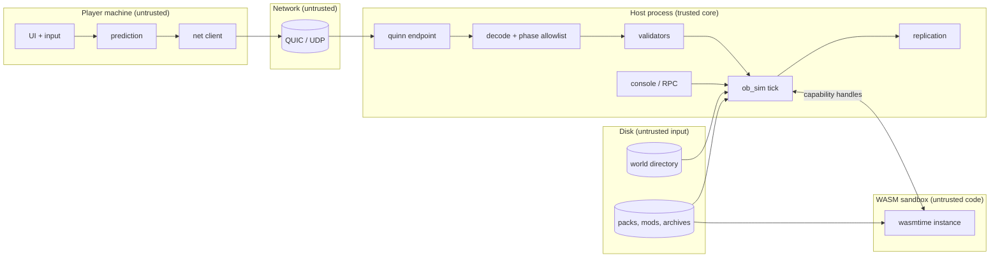
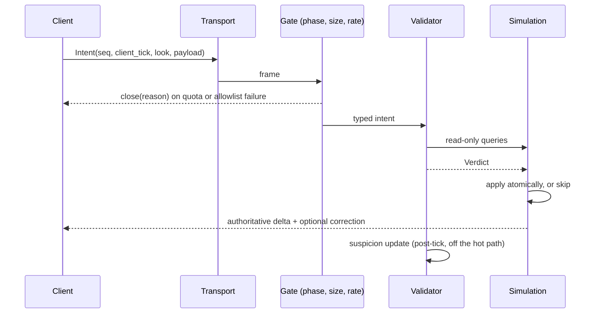
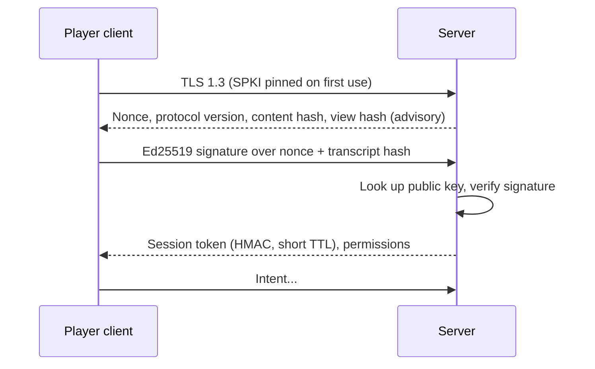

# 20 — Security and Anti-Cheat

> Status: normative - Last updated: 2026-11-24
> Depends on: [DEC-008](../decisions.md), [DEC-020](../decisions.md), [DEC-023](../decisions.md), [DEC-024](../decisions.md), [DEC-026](../decisions.md), [DEC-027](../decisions.md), [DEC-029](../decisions.md), [DEC-038](../decisions.md), [DEC-040](../decisions.md), [DEC-041](../decisions.md), [DEC-042](../decisions.md), [DEC-044](../decisions.md), [DEC-045](../decisions.md), [DEC-049](../decisions.md), [DEC-050](../decisions.md); [conventions](00-conventions.md), [architecture](01-technical-architecture.md), [gameplay](08-gameplay-survival.md), [inventory](11-inventory-crafting-items.md), [modding](16-modding.md), [persistence](17-persistence.md), [networking](18-networking-multiplayer.md), [server administration](19-server-administration.md)
> Implements: MS-06 (transport hardening, validation hooks), MS-09 (sandbox policy), MS-13 (untrusted data), MS-15 (anti-cheat, moderation, abuse), MS-16 (disclosure)

## 1. Purpose and scope

This chapter owns the security posture of OpenBlock: what is trusted, what is
validated, what is logged, what is refused, and what we openly cannot defend
against. It is the normative home of the enforcement policy that
[DEC-029](../decisions.md) requires and of the rules that chapter
[08 §3.14](08-gameplay-survival.md#314-authority-and-anti-cheat-boundaries)
delegates here.

In scope: the threat model and trust boundaries (§3.1–§3.3); the client-authority
rules and the validation matrix keyed to the `AC-*` identifiers (§3.4–§3.6); the
enforcement ladder, evidence bundles and retention (§3.7–§3.8); transport and
admission hardening (§3.9); mod sandbox, content-pack and save-file security
(§3.10–§3.11); identity, privacy and moderation (§3.12–§3.14); cryptography
policy and key handling (§3.15); the documented limits of anti-cheat (§3.16);
and vulnerability disclosure (§3.17).

Out of scope: protocol encoding and framing ([18](18-networking-multiplayer.md));
permission levels and server configuration keys ([19](19-server-administration.md));
the WASM host ABI and capability list ([16](16-modding.md)); the byte layout of
save and pack formats ([15](15-content-system.md), [17](17-persistence.md));
individual gameplay validation formulas ([08](08-gameplay-survival.md),
[10](10-physics-and-collision.md), [11](11-inventory-crafting-items.md)); the
canonical budget table ([25](25-performance-budgets.md)).

Two rules frame everything below. **The client is an adversary with a rendering
budget**: it receives terrain, entity positions and its own inventory by
necessity, and every claim it makes is untrusted until a validator has compared
it with host state ([DEC-008](../decisions.md)). **Client-side anti-cheat is out
of scope**: no kernel driver, no process scan, no screen capture, no "trusted
client" attestation ([DEC-029](../decisions.md)). An open protocol makes those
techniques theatre.

## 2. Requirements

| ID | Requirement | Verification | Milestone |
| --- | --- | --- | --- |
| REQ-SEC-001 | The threat model in §3.1–§3.3 is maintained: every trust boundary and every client→host message has a row, an owner and a test before merge. | Threat-matrix lint against the message catalog | MS-15 |
| REQ-SEC-002 | Only the host writes authoritative state; no message sets position, health, inventory content, block state or damage directly. | Inspection + negative corpus | MS-06 |
| REQ-SEC-003 | Every inbound message is decoded under explicit size, depth and count limits before allocation; an oversized message closes the connection with a machine-readable reason. | Fuzz + negative fixtures | MS-06 |
| REQ-SEC-004 | Every opcode is allowlisted per session phase; unknown or out-of-phase opcodes are rejected before decode. | Unit: phase × opcode matrix | MS-06 |
| REQ-SEC-005 | Every intent is validated by the `AC-*` rule that owns it; a rule may not be disabled at runtime, only have its enforcement level changed. | Inspection + config test | MS-15 |
| REQ-SEC-006 | A validator is pure: it returns a `Verdict` and never mutates state; the tick applies `Accept` or `Correct` atomically and skips `Reject`. | Property test on the intent state machine | MS-15 |
| REQ-SEC-007 | Corrections are authoritative, idempotent and converge within 2 ticks (REQ-GAME-003); a correction never re-applies a rejected action. | Two-client replay | MS-06 |
| REQ-SEC-008 | The enforcement ladder defaults to `correct`; automatic permanent bans are opt-in (`anti_cheat.auto_ban = false` by default) and never triggered by statistical rules alone. | Config-matrix test | MS-15 |
| REQ-SEC-009 | Suspicion scores are per rule family and decay with a 60 s half-life; a kick requires one high-confidence family or two distinct families over threshold. | Unit: scoring model | MS-15 |
| REQ-SEC-010 | False positives on the legitimate-movement corpus are ≤ 0.1% of player-minutes flagged. | Corpus run in the gate | MS-15 |
| REQ-SEC-011 | Each connected player has an evidence ring of ≥ 120 s of inputs plus 1 Hz state hashes; a threshold breach writes a bundle off-tick. | Integration + profiler assertion | MS-15 |
| REQ-SEC-012 | Bundles exclude chat, IP addresses, other players' private state and account identifiers; the player appears only as a salted key hash. | Bundle inspection test | MS-15 |
| REQ-SEC-013 | Bundles are ≤ 2 MiB compressed, retained 7 days by default (30 maximum), and purgeable with one command. | Config + filesystem test | MS-15 |
| REQ-SEC-014 | The per-opcode token buckets of §3.9.1 are enforced before decode; a connection exceeding 3× its budget in 10 s is kicked with a reason. | Load test | MS-06 |
| REQ-SEC-015 | The size, count, nesting and decompression caps of §3.9.2 are enforced before allocation, including the 200:1 ratio and 8 MiB raw caps. | Fuzz + bomb fixtures | MS-06 |
| REQ-SEC-016 | Admission control enforces per-IP and per-subnet connection and handshake limits and enables QUIC Retry under load (§3.9.3). | Abuse/load tests | MS-07 |
| REQ-SEC-017 | QUIC 0-RTT never authorises a state-changing action; every resumed session re-runs authorisation before its first mutating intent. | Negative test | MS-06 |
| REQ-SEC-018 | TLS 1.3 only; plaintext transport is loopback-only or an explicit LAN opt-in; a certificate or pin failure is fatal and cannot be clicked through. | Transport tests | MS-06 |
| REQ-SEC-019 | Replay protection uses a per-connection nonce and a monotonic sequence; duplicate input frames are idempotent and frames older than 1 s are dropped. | Replay test | MS-06 |
| REQ-SEC-020 | Admin tokens are ≥ 256-bit random, kept in a `0600` secret file outside the world directory, compared in constant time, rotatable and never logged; remote admin is disabled by default and loopback-bound, console and RPC require TLS 1.3, and the plaintext RCON-compatible listener is off by default and loopback-only ([19](19-server-administration.md) §3.5). | Token tests + log scan | MS-07 |
| REQ-SEC-021 | WASM mods receive only declared, operator-approved capabilities; no WASI filesystem, network or clock; memory, fuel, epoch, host-call and action quotas are per mod. | Escape corpus | MS-09 |
| REQ-SEC-022 | A mod trap or quota violation rolls back that mod's uncommitted batch, quarantines the mod and leaves the host alive. | Fault injection | MS-09 |
| REQ-SEC-023 | Native plugins are disabled by default, allowlisted by hash, and documented as fully trusted code (OPEN-007). | Default-config test | MS-21 |
| REQ-SEC-024 | Mods and packs load only after signature and BLAKE3 verification against the server's manifest; a mismatch quarantines and refuses. | Negative fixtures | MS-09 |
| REQ-SEC-025 | Content packs are schema-validated before registry freeze; validation is the security boundary and no pack-supplied code or path is executed. | Pack corpus | MS-09 |
| REQ-SEC-026 | World directories, archives and imported structures follow the §3.11 guards (traversal, symlink, bombs, caps) and can never load code. | Hostile-archive corpus | MS-13 |
| REQ-SEC-027 | Server identity is an Ed25519 key pinned by SPKI on first use; a changed key requires an explicit re-pin and is logged as a warning. | Integration test | MS-07 |
| REQ-SEC-028 | Player identity is a keypair; no password is transmitted or stored; bans and permissions key on public keys, never on IPs alone. | Protocol inspection | MS-07 |
| REQ-SEC-029 | Private keys live in the OS keychain when available, otherwise a `0600` file; they never appear in logs, crash reports or bundles. | Inspection + crash-report test | MS-07 |
| REQ-SEC-030 | No IP addresses are logged by default; abuse correlation uses a salted hash with a documented retention window. | Log inspection | MS-15 |
| REQ-SEC-031 | The §3.14 data inventory is complete and `openblock-server data export\|purge` implements access and deletion for player-keyed data. | Tool test | MS-15 |
| REQ-SEC-032 | Chat filtering is a server-side hook set, bounded in latency and optional; the report flow produces an evidence bundle. | Integration | MS-15 |
| REQ-SEC-033 | Mute, kick, ban and unban carry a machine-readable reason and operator identity and append to a tamper-evident audit log. | Audit test | MS-15 |
| REQ-SEC-034 | Cryptography uses rustls/quinn and reviewed crates only; no home-made primitive; no MD5 or SHA-1 for security; BLAKE3 for content hashing. | `cargo deny` + review | MS-06 |
| REQ-SEC-035 | Key rotation follows §3.15.3 with an overlap window, a published fingerprint change and a working rollback. | Rotation drill | MS-07 |
| REQ-SEC-036 | Disclosure follows `SECURITY.md`: private report, 3-day acknowledgement, 10-day triage, 90-day default embargo, CVE request, out-of-band release. | Process audit | MS-00/MS-16 |
| REQ-SEC-037 | Dependency audit (advisories, licences, sources) runs in CI and blocks on a high-severity advisory. | `cargo deny` gate | MS-00 |
| REQ-SEC-038 | X-ray is documented as unpreventable; the product offers statistical detection and opt-in ore obfuscation and never claims prevention. | Documentation review + setting test | MS-15 |
| REQ-SEC-039 | Total validation cost is ≤ 5% of the tick budget (PERF-SEC-001). | Bench gate | MS-15 |
| REQ-SEC-040 | Attacker-controlled strings are escaped, truncated to 256 bytes and rate-limited before they reach a log line. | Fuzz + log-flood test | MS-06 |
| REQ-SEC-041 | A red-team exercise and the §7.3 penetration-test checklist are completed before 1.0 with no open high-severity finding. | MS-15 exit criterion | MS-15/MS-16 |
| REQ-SEC-042 | A handler panic on the server is contained (`panic = "unwind"`) and does not end other players' sessions. | Fault injection | MS-06 |

## 3. Design

### 3.1 Assets and actors

| Asset | Why it matters | Owner chapter |
| --- | --- | --- |
| World integrity | Players' builds are irreplaceable; silent corruption is worse than downtime | [17](17-persistence.md) |
| Item and economy integrity | Duplication destroys progression and server trust | [11](11-inventory-crafting-items.md) |
| Identity and access | Ops, bans and whitelists are only as strong as key handling | this chapter, [19](19-server-administration.md) |
| Privacy | IP addresses, chat and play patterns are personal data | this chapter |
| Availability | Tick time, bandwidth, disk and memory are the griefing surface | [18](18-networking-multiplayer.md), [19](19-server-administration.md) |
| Content integrity | A tampered pack or mod is remote code execution in the player's session | [15](15-content-system.md), [16](16-modding.md) |
| Client integrity | The client parses hostile world and server data | [03](03-rendering.md), [17](17-persistence.md) |
| Operator credentials | RPC/console tokens are the highest-value secret on a server | [19](19-server-administration.md) |

| Actor | Capability | Primary goal |
| --- | --- | --- |
| Cheating player | Modified client, full protocol knowledge, automation | Advantage: speed, reach, x-ray, duplication |
| Griefer | Legitimate client, social engineering, timing | Destroy builds, harass players, exhaust the server |
| Malicious mod author | Ships a pack or WASM module others install | Data theft, world writes, botnet participation |
| Malicious server | Controls terrain, chat, packs and snapshots | Attack the client: crash, path traversal, exploit parser |
| Network attacker | On-path or off-path, no credentials | Impersonate, replay, flood, downgrade |
| Malicious save/pack | A file a player was told to open | Code execution, path escape, memory exhaustion |
| Insider / hosting provider | Filesystem, backups, console access | Read player data, alter worlds |
| Bot swarm | Many cheap connections | Exhaust handshakes, connections or tick time |
| Curious player | Renders what is sent | Learn hidden ore and structures (x-ray) |

### 3.2 STRIDE analysis

| Threat | Concrete instance | Control | Requirement |
| --- | --- | --- | --- |
| **S**poofing | Client claims a display name or player key it does not hold; server impersonated on first connect | Challenge-response inside TLS; Ed25519 SPKI pin with explicit re-pin | REQ-SEC-027, REQ-SEC-028 |
| **T**ampering | Edited input frames, replayed block edits, modified pack files | Host authority, per-connection nonce + sequence, signed pack manifests | REQ-SEC-002, REQ-SEC-019, REQ-SEC-024 |
| **R**epudiation | "I never ran that command"; disputed ban | Append-only audit log with operator identity; evidence bundle | REQ-SEC-011, REQ-SEC-033 |
| **I**nformation disclosure | Ore visible through chunks, another player's health or hunger, shader-pack occupancy queries, logs with IPs | Interest sets, private fields, no world queries in shader packs (DEC-045), hashed IPs | REQ-SEC-030, §3.16 |
| **D**enial of service | Handshake flood, decompression bomb, log flood, entity-spam packets, inventory click storm | Admission control, caps, token buckets, Retry, log rate limits | REQ-SEC-014 … REQ-SEC-016, REQ-SEC-040 |
| **E**levation of privilege | Command parsing before permission check; mod capability escalation; container slot confusion; op token replay | Permission before argument parse, capability handles, slot validation, expiring tokens | REQ-SEC-004, REQ-SEC-020, REQ-SEC-021 |

### 3.3 Trust boundaries



| Boundary | What crosses | Control | Owner |
| --- | --- | --- | --- |
| **B1** UI → prediction | Local input | None needed: prediction is client-local and always reconcilable | [18](18-networking-multiplayer.md) |
| **B2** Network → transport | Every client claim | TLS 1.3, pinning, admission control, quotas, 0-RTT restrictions | §3.9, [18](18-networking-multiplayer.md) |
| **B3** Transport → decode | Untrusted bytes | Size/count/depth caps, phase allowlist, typed errors | §3.9.2, [18](18-networking-multiplayer.md) |
| **B4** Decode → simulation | Intents | The `AC-*` validators: the security-critical boundary | §3.5 |
| **B5** Host → WASM | Capability handles | Declared capabilities, quotas, no WASI, rollback on trap | §3.10, [16](16-modding.md) |
| **B6** Host → native plugin | Arbitrary code | None: the boundary is removed by operator consent (OPEN-007) | §3.10 |
| **B7** Host → disk | Worlds, packs, archives | Path/symlink/bomb guards, schema validation, signature checks | §3.11, [17 §3.10](17-persistence.md#310-security-and-untrusted-input) |
| **B8** Host → admin surface | Commands, metrics, tokens | Loopback default, TLS for remote, scoped expiring tokens, audit | §3.9.5, [19](19-server-administration.md) |
| **B9** Update channel → client | Binaries, packs | Signed manifests, delta verification, rollback | [22](22-platforms-and-distribution.md) |

### 3.4 Authority rules

1. Only the host mutates simulation state. A message carries an *intent* with a
   sequence number, the client tick it was formed on and the look vector that
   produced it — never an outcome ([DEC-008](../decisions.md)).
2. A validator runs at the owning system's commit point, before state is
   published: movement validates the `MoveTrace` the shared solver produced
   ([10 §3.12](10-physics-and-collision.md#312-prediction-and-anti-cheat-interface)),
   interaction validates before the edit applies. It receives read-only queries
   against the current tick's world and returns `Verdict::Accept`,
   `Verdict::Correct(correction)` or `Verdict::Reject(rule)`.
3. `Accept` applies the intent; `Correct` applies the authoritative value and
   queues a correction; `Reject` applies nothing and counts as evidence.
4. Client-supplied values never widen a budget: declared view distance, RTT,
   tick rate, ping or "I am an operator" are claims, not facts.
5. A rejected intent is not a protocol error. The stream stays open; the player
   receives a correction and the rule counter increments.
6. Opcode allowlists change with session phase (handshake → configuration →
   playing → draining); anything out of phase is rejected before decode.
7. Validators are deterministic and side-effect free, so a replay reproduces
   every verdict.
8. A client tick in an intent is advisory: it may make an action later, never
   earlier, than host time. Cooldowns, break progress, use time and rewind are
   measured from the host tick that accepted the start, so a forged `start_tick`
   can only lose time.



### 3.5 Validation matrix

The identifiers `AC-MOVE-01 … AC-SPAWN-12` are defined by
[08 §3.14](08-gameplay-survival.md#314-authority-and-anti-cheat-boundaries); that
table stays the owner of gameplay rows. `AC-CHAT-13` and `AC-RATE-14` are
transport-level rules registered here because they apply to every session, not
to a mechanic. Intent names follow chapter 08's vocabulary; on the wire they are
input commands packed into `InputFrame` or one of the `0x80` container messages
([18 §3.4](18-networking-multiplayer.md#34-protocol-versioning-and-message-catalog)).
Validators see decoded intents and never inspect wire messages, so the matrix is
transport-independent.

| Rule | Intent | Host check | Threshold and tolerance | Verdict on breach |
| --- | --- | --- | --- | --- |
| AC-MOVE-01 | `MoveInput`; the host produces a `MoveTrace` ([10 §3.12](10-physics-and-collision.md#312-prediction-and-anti-cheat-interface)) | Validate the trace from the same solver the client predicts with: speed, acceleration, collision consistency, noclip, fly | Horizontal speed > allowed for state × 1.02 + 0.05 m/s on ≥ 3 consecutive ticks, or any tick > 1.5×; vertical > 1.2× jump/terminal (8.4 / 78.4 m/s); end position deeper than 1 mm inside a solid shape (the solver separates by `COLLISION_EPS` = 1e-7 m); airborne > 400 ct without jump, vehicle, gliding or `world.allow_flight` | `Correct` when error > 0.1 m; rubber-band above 1.0 m; `Reject` + score for repeated or noclip |
| AC-BREAK-02 | `BreakIntent { pos, face, tool_slot, start_tick }` | Tool present, harvest level, hardness × speed formula of 08 §3.8, host-measured elapsed time, reach, LoS, protection, mode | Elapsed < 0.8 × expected ct; reach > 4.5 m (5.0 m creative) + 0.1 m epsilon; LoS raycast blocked; wrong tool slot | `Reject`, no drop, no edit; score 2 (soft) / 8 (hard) |
| AC-PLACE-03 | `PlaceIntent { pos, face, item_slot, rotation }` | Target replaceable or adjacent face, item present, stack count, collision with entities, protection, world border | Reach > 4.5 m (5.0 m creative); unsupported face; entity intersection; item absent; sustained rate > 12/s | `Reject`; score 3; rate excess escalates to AC-RATE-14 |
| AC-INV-04 | `ContainerIntent { window, slot, button, mode, revision }` | Window open, distance ≤ 6 m, slot exists, stack and component limits, then conservation across every touched inventory plus cursor ([11 §3.4](11-inventory-crafting-items.md#34-the-inventory-transaction-protocol)) | Rate > 40/s sustained or 60 burst; stale revision; conservation mismatch beyond the allowed deltas | Rollback, resync, score 6; conservation failures are always logged |
| AC-COMBAT-05 | `AttackIntent { target, client_tick, look, charge }` | Liveness, damageability, dimension, reach, LoS, cooldown, i-frames, 200 ms rewind cap | Distance > 3.0 m (5.0 m creative) + 0.1 m; blocked current LoS; charge < 900; rewind > 4 ct; rotation delta > 90°/tick with a simultaneous hit | `Reject`; score 4; rotation-snap heuristic is annotation-only |
| AC-PROJ-06 | `UseItem` with a projectile | Spawn intent, charge time, item, trajectory re-simulated host-side, first hit | Charge mismatch > 2 ct; spawn inside a solid; > 10 projectiles/s | `Reject`; score 3 |
| AC-USE-07 | `UseItemIntent { slot, hand, tick }` | Use time, interruption, food cap, item matches slot, count | Early completion > 2 ct; item changed mid-use; count below 1 | `Reject`; score 2 |
| AC-SLEEP-08 | `UseBed { pos }` | Bed present and unobstructed, distance, dimension, time window | Distance > 3.5 m; bed destroyed or blocked; wrong dimension | `Reject`; score 2 |
| AC-PORTAL-09 | Portal entry | Frame validity, cooldown, destination, transfer state | Entry from a non-portal block; cooldown active; second transfer while `Transferring` | `Reject`; score 5 (transfer duplication is high value) |
| AC-CMD-10 | `Command { text }` | Permission level before argument parsing, rate, selector count, edit volume | > 20 commands/s; edits > 32,768 blocks; selectors > 1,024 entities; chain > configured cap | `Reject` + audit; score 5 |
| AC-META-11 | Statistics/advancement claims | Never accepted from clients; awards are host-computed | Any client message that names an award | Protocol error, `Reject`, score 8 |
| AC-SPAWN-12 | `Respawn { choice }` | Only while `Dead`; safe-spawn search host-side | Respawn while alive; destination inside a solid | `Reject`; score 1 |
| AC-CHAT-13 | `ChatSend { text }`, `Command` echo | Length, UTF-8 validity, rate, filter hooks | > 256 bytes; > 5 messages/10 s; control characters | Drop, annotate, escalate at 3× |
| AC-RATE-14 | Any opcode | Token bucket and byte budget per connection (§3.9.1) | Any bucket exhausted; > 3× budget in 10 s | Drop or kick with reason; metric increment |

Every row is implemented once in `ob_server` and tested once by the rule's
negative vector in the cheat corpus (§7.1). A row without a bot and a test is an
open TODO tracked against MS-15.

### 3.6 Scoring and detection heuristics

Each accepted or rejected intent updates a per-player, per-family score. Scores
decay exponentially with a 60 s half-life, so an honest player who lags once is
forgotten long before a moderator sees the name.

| Signal family | Weight per event | Cap per minute | Escalation |
| --- | --- | --- | --- |
| Speed / fly / noclip | 8 | 120 | Kick at 60 within 10 min |
| Reach / LoS on blocks or entities | 4 | 80 | Rubber-band, annotate at 24 |
| Mining-time mismatch | 6 | 90 | Annotate at 30, kick at 60 |
| Inventory conservation | 10 | 100 | Always logged; rollback + kick at 60 |
| Combat rewinds / rotation snap | 3 | 60 | Annotation only unless combined |
| Packet-rate abuse | 5 | 150 | Kick at 60 |
| Statistical x-ray score (§3.16) | 0 | — | Annotation and report only, never auto-action |

Statistical rules (ore-to-stone ratio, time-to-ore, branch-mining entropy) carry
no automatic action. They create a review queue entry with an evidence bundle,
because a competent cheater can stay under any statistical threshold and an
enthusiastic child should not be banned by an estimator.

### 3.7 Enforcement ladder

| Level | Trigger | Action | Player sees | Config key |
| --- | --- | --- | --- | --- |
| 0 Off | `anti_cheat.mode = off` | Validators still run (authority is not optional); scoring and automatic bundles disabled, operator-requested bundles still work | Nothing | `anti_cheat.mode` |
| 1 Log | Any violation | Structured event with rule, tick, values | Nothing | `anti_cheat.mode` |
| 2 Annotate | Family score ≥ 10 | Same, plus a case ID and a short ring | Nothing | `anti_cheat.annotate_score` |
| 3 Correct | Position or inventory error above tolerance | Authoritative correction, rubber-band | Position snap or block revert | `anti_cheat.max_corrections_per_minute` |
| 4 Kick | Score ≥ 60 in one family or two families ≥ 24 | Disconnect with machine-readable reason | "Removed: movement (AC-MOVE-01)" | `anti_cheat.kick_score` |
| 5 Ban | Operator decision, or `anti_cheat.auto_ban = true` and score ≥ 120 | Key ban with expiry and case link | "Banned: <reason>" | `anti_cheat.auto_ban` |

The ladder is a state machine per player: a kick never escalates itself, bans
carry an expiry (default 7 days, `0` = permanent), and every transition appends
to the audit log with the triggering evidence case. `/ob pardon` restores access
and is itself audited. Config keys are snake_case ASCII ([DEC-044](../decisions.md));
the normative key list, types, defaults and reload classes are the `[anti_cheat]`
section of [19 §3.2](19-server-administration.md#32-configuration-surface), which this
chapter consumes and does not restate; hyphenated spellings from older documentation are
accepted on input and normalised on output.

### 3.8 Evidence bundles and privacy

An evidence bundle is the unit of appeal review and bug reporting. It is
written by the host, off-tick, when a player crosses the annotate threshold or
when an operator requests it.

| Section | Content | Encoding |
| --- | --- | --- |
| Header | Magic `OBEB`, version, tick range, triggering rule, world UUID, session, key hash, server version, content hash, CRCs | 128 B, §4 |
| Inputs | The ring's input frames with sequence numbers and applied verdicts | zstd, canonical |
| State | 1 Hz state hashes for the player and nearby entities | 32 B per sample |
| Violations | Rule, tick, claimed vs authoritative values, verdict | postcard list, ≤ 4,096 |
| Context | Optional 5×5×5 block sample and a 64-block position track for movement cases | flag-gated |

Privacy rules are part of the format, not a policy afterthought: no chat, no IP
address, no other player's inventory or vitals, no display name — the subject is
a salted BLAKE3-128 key hash, and the salt is per world and never exported.
Bundles live in `<world>/cases/<case-id>.obeb`, default retention 7 days, maximum
30, purged by `openblock-server cases purge --older-than`. Export is an explicit
operator command; the tool prints the case's tick range and rule so a moderator
knows what they are sharing before they copy it.

### 3.9 Transport and admission hardening

#### 3.9.1 Per-opcode rate limits

Transport-level datagram and byte limits belong to [18 §3.3](18-networking-multiplayer.md#33-transport-layer);
the table below is the application layer, checked after authentication and
before the validator.

| Class | Opcodes | Sustained | Burst | On exceed |
| --- | --- | --- | --- | --- |
| Input | `InputFrame`, `TickAck` | 25/s (headroom over 20 ct/s) | 12 | Drop; > 3× → kick |
| Block | break, place and use commands inside `InputFrame` | 12/s | 20 | Drop; score |
| Container | `ContainerOpen`, `ContainerIntent` | 40/s | 60 | Drop; resync; score |
| Chat and commands | `ChatSend`, `Command` | 5 per 10 s chat; 20/s commands | 3 / 10 | Mute window; audit |
| Session | `ResumeRequest`, `Ping` | 1/s each | 2 | Drop |
| Discovery | `ClientHello` | 2/s per connection | 4 | Close |
| Handshake | TLS/QUIC `Initial` per source IP | 5 per 10 s | 5 | Retry required; then drop |

#### 3.9.2 Size, count and decompression caps

Wire maxima come from the message catalog ([18 §3.4](18-networking-multiplayer.md#34-protocol-versioning-and-message-catalog));
decoded-object caps come from the save decoder ([17 §3.10](17-persistence.md#310-security-and-untrusted-input)).
Both are checked before allocation.

| Item | Cap | Enforced |
| --- | --- | --- |
| Unreliable datagram payload | `max_datagram_size() − 40` (≈1,160 B) | before decode ([18 §3.3](18-networking-multiplayer.md#33-transport-layer)) |
| Control message | 64 KiB | before allocation |
| `ChunkColumn` on the wire / `SectionResend` | 256 KiB / 16 KiB | catalog maximum, checked before send and after decode ([18 §3.4](18-networking-multiplayer.md#34-protocol-versioning-and-message-catalog)) |
| `StateChannel` record | 16 KiB body per channel record; per-channel maxima in the catalog | before decode, against the channel id's declared maximum ([18 §3.4](18-networking-multiplayer.md#34-protocol-versioning-and-message-catalog)) |
| Decoded chunk payload | 8 MiB raw; 64 sections; 65,536 palette entries; 4,096 entities; 65,536 ticks | before allocation ([17 §3.10](17-persistence.md#310-security-and-untrusted-input)) |
| Component nesting / components per stack | depth 4 / 256 | schema validator |
| Decompression ratio | 200:1, abort on exceed | streaming decoder |
| Connection byte budget | 4 MiB queued outbound; 8 KiB/s sustained, 32 KiB burst inbound | transport backpressure ([18 §3.3](18-networking-multiplayer.md#33-transport-layer)) |
| Log line from attacker input | 256 bytes, escaped, rate-limited | logger wrapper |

#### 3.9.3 Admission control

- Default `max_connections = 256`, `max_connections_per_ip = 4`, plus a
  per-subnet cap of 32 (IPv4 `/24`, IPv6 `/64`) with an explicit allowlist for
  LAN proxies ([18 §3.3](18-networking-multiplayer.md#33-transport-layer)).
- QUIC Retry is required under load above [18](18-networking-multiplayer.md)'s
  threshold (70% of the connection budget or the endpoint handshake admission
  rate, `network.handshake_rate_per_second`, default 20/s in
  [19](19-server-administration.md) §3.2); address-validation tokens are keyed
  per endpoint and rotate hourly.
- Stateless resets for unknown connection IDs, so an off-path flood cannot hold
  state. Per-connection memory is pre-reserved from a bounded pool, so admission
  fails cleanly instead of exhausting the heap.
- Idle timeout 30 s; `initial_rtt = 100 ms` seeded from a pre-handshake ping;
  stream receive windows 48 KiB per stream (8 concurrent) and datagram
  send/receive buffers 32 KiB each, ≈ 512 KiB worst case per peer
  ([18 §3.3](18-networking-multiplayer.md#33-transport-layer), PERF-NET-009).
- Public servers are documented to sit behind a UDP DDoS-scrubbing provider;
  the server cannot absorb a volumetric flood and does not pretend to.

#### 3.9.4 Replay, resume and 0-RTT

Each connection carries a 128-bit nonce from the handshake and a 64-bit
monotonic sequence per direction. Input frames are idempotent by sequence, so a
duplicated datagram is dropped rather than re-applied; frames older than 1 s
relative to the server's estimate are stale and dropped. A QUIC session ticket
resumes the transport only: the client must still present its key challenge
before any mutating opcode is accepted, and 0-RTT data carries only the
`ResumeRequest` ([18 §3.3](18-networking-multiplayer.md#33-transport-layer));
camera state is client-local until `Playing`, so the restriction loses nothing
useful ([DEC-026](../decisions.md)).

#### 3.9.5 Admin tokens

The console is local by default; remote console and RPC are disabled unless the
operator enables them, bind to loopback and require TLS 1.3 and a token file
([19](19-server-administration.md), REQ-SRV-017/025). Token generation, `0600`
storage outside the world directory, constant-time comparison, rotation, the
`read`/`moderate`/`admin` session scopes and the audit fields are specified once
in [19 §3.5](19-server-administration.md#35-console-and-rpc), which owns the admin
surface. This chapter requires that tokens are never logged or echoed in errors,
are redacted from crash reports and config dumps (REQ-ARCH-016), and that every
authenticated call is audited with its token prefix, scope and salted
source-address hash (REQ-SEC-020).

The optional RCON-compatible listener is exempt from the TLS 1.3 requirement
because its protocol is plaintext by definition: it MUST stay disabled unless
enabled, MUST bind a loopback address only, and is reached through an SSH tunnel
when an operator needs it ([19 §3.5](19-server-administration.md#35-console-and-rpc),
[§3.10](19-server-administration.md#310-security-hardening)). It never authorises
a remote bind.

### 3.10 Mod sandbox security

#### 3.10.1 Capability enforcement

A WASM mod declares capabilities in its manifest; the operator approves a
subset; the host binds exactly that subset to the instance. A capability is a
handle, never a pointer or a global, and every host call re-checks the handle's
capability and the mod's remaining quota.

| Capability | Host calls it unlocks | Enforced limit (owner: 16 §3.2) |
| --- | --- | --- |
| `world.read` | `get_block`, `get_light`, `get_biome`, `raycast` | host calls: 10,000/tick per mod; world queries also capped at 1,000/tick ([10 §3.10](10-physics-and-collision.md#310-collision-query-api-for-mods)) |
| `world.write` | `set_block`, `spawn_entity`, `set_block_entity` | actions: 4,096/tick, 512 block cells per call |
| `entity.read` | `entity_pos`, `entity_state`, `query_entities` | host-call quota |
| `storage` | `kv_get`, `kv_put` | 8 MiB, 4,096 keys, 1 MiB per value |
| `ui` | `send_message`, `open_screen` | event quota: 16,384/tick, coalesced |
| `network` | `send_plugin_message` | 32 KiB/s per player, 1 MiB/s per mod |
| `scheduler` | `after_ticks`, `cancel` | 64 deferred queries outstanding |

Capability and host-call names here are illustrative: [16](16-modding.md) owns the
canonical ABI surface and every quota value, and this chapter owns the enforcement
rule that no handle works without a declared, approved capability. CPU is bounded
per callback by an epoch deadline (1 ms) and, in deterministic mode, by 25 M fuel;
all mods together receive 1.5 ms/tick; guest memory is capped at 64 MiB. A hard
limit (deadline, memory, trap) disables and quarantines the mod and rolls back its
batch; a soft limit (host calls, events, storage, logging) fails the call and is
counted ([REQ-MOD-005](16-modding.md)).

#### 3.10.2 Escape vectors and controls

| Vector | Control |
| --- | --- |
| Filesystem and network access | No WASI `fs`/`net`/`clock` imports linked at all; only the OpenBlock host ABI |
| Host-call confusion between mods | Capability handles are instance-scoped and unforgeable; there is no global "current mod" |
| Unbounded allocation | `StoreLimits` memory cap, fallible allocations, host-side input caps |
| Infinite loop / trap storm | Fuel plus epoch deadline per call; a trap disables the mod and rolls back its batch |
| Determinism side channel | Host-provided RNG seeded per `(world, mod, tick)`; no clock or thread APIs |
| Cross-mod interference | Separate stores and separate action batches committed in registration order |
| Native plugin | Out of scope of the sandbox: allowlisted by hash, run in a supervised worker process by default, documented as trusted (OPEN-007, [16 §3.9](16-modding.md)) |

#### 3.10.3 Supply chain

Mods and packs ship a signed manifest (Ed25519) listing every file's BLAKE3 hash;
the server records the manifest hash and sends it in the content handshake. The
client verifies before loading and quarantines a mismatch under
`<data>/quarantine/`. Servers allowlist WASM modules by hash; packs from a server
are downloaded only over the authenticated session and never executed. At 1.0 there
is no client-side mod runtime at all ([DEC-049](../decisions.md)), so the only
executable artifacts in this threat model are server-side: the WASM host of
[16](16-modding.md) and the operator-allowlisted native tier. A public
mod index is curated and links to source and hashes; "verified" means "hash
recorded and source reviewed", never "reproducible build" — we do not claim
reproducibility we cannot test. A quarantined mod is never retried automatically.

### 3.11 Content pack and save-file security

Content packs and saves are the same class of input: structured data from
outside the trust boundary. The rules below are the policy; the byte-level
implementation for saves is [17 §3.10](17-persistence.md#310-security-and-untrusted-input).

| Threat | Control |
| --- | --- |
| Path traversal (`../`, absolute, `C:\`, UNC, NUL) | Every pack path is a single normal component; canonicalised path must stay under the pack root |
| Symlink escape | `O_NOFOLLOW`/reparse-point flags; imports reject symlinked entries outright |
| Zip or decompression bomb | Cap entry count, per-entry and total uncompressed size, 200:1 ratio, streaming abort |
| Duplicate or case-colliding names | Reject after case-folding and Unicode normalisation on archive import |
| Schema confusion | Generated per-kind schema validated before registry freeze; unknown fields rejected except explicitly forward-compatible ones |
| Resource exhaustion | Caps from §3.9.2 plus archive limits: ≤ 64 MiB compressed, ≤ 256 MiB expanded, ≤ 20,000 entries, bounded ratio ([15](15-content-system.md), REQ-CONTENT-032) |
| Executable content | No `.wasm`, native library or script is loaded from a content pack; only the mod loader loads code, and only from the configured mod directory |
| Quarantine | A rejected pack is moved aside with its hash and error, never partially loaded |

Validation errors are collected and reported with file, JSON pointer and
expected type; the first hundred are shown and the rest counted. Error messages
never echo an attacker-controlled path into a log line unescaped.

### 3.12 Identity, accounts and privacy



There is no password and no mandatory central account ([DEC-026](../decisions.md)).
A player's identity is their public key; the display name is a mutable claim
that an operator can moderate. A central account service (OIDC device flow) is
optional and must never be required by a self-hosted server.

| Ban-evasion tactic | Mitigation | Honest limit |
| --- | --- | --- |
| Generate a new keypair | Whitelist/invite worlds; reputation and play-time gates; manual review | Free keys cannot be prevented |
| Same machine, new key | Salted IP/subnet hash correlation, only for moderation and with retention limits | Shared NAT and CGNAT produce false positives |
| Reconnect from a new address | Key ban with optional IP/subnet evidence recorded on the ban (never the sole key) | VPNs and mobile networks defeat it |
| Evade a chat mute | Mute is keyed on the key; new key → new name, which chat filtering and reports catch | Social, not technical |

The operator is the data controller for a self-hosted world. The server must
therefore make deletion real and documented: `data export <key>` writes a
human-readable dump and `data purge <key>` removes player data, statistics,
advancements and case bundles; both are audited, and the commands are part of
the server command schema owned by [19](19-server-administration.md). No telemetry is collected
by the game or the server ([vision §3](../vision.md)).

### 3.13 Abuse, moderation and reports

- **Chat**: length and UTF-8 bounds, control characters stripped, rate-limited.
  Filter hooks run server-side in-process with a 1 ms budget per message; a
  slow hook is skipped and counted rather than delaying the tick. Ships with a
  naive word-list filter that is off by default, because a bad filter is worse
  than none for small communities.
- **Reports**: `/ob report <player> <reason>` snapshots the reporter's recent
  context and the subject's evidence ring into a case; the subject is not
  notified. A server with no moderators configured still stores the case and
  says so.
- **Moderation actions**: mute (with duration), kick, ban and pardon, each with a
  required reason and the operator's token/key hash. The audit log is append-only
  JSON Lines with a chained BLAKE3 of the previous line, 0600, rotated with
  90-day retention, so silent edits are detectable ([19](19-server-administration.md),
  REQ-SRV-015).
- **Griefing tools**: spawn protection, per-rank build limits, optional
  block-edit logging (a bounded ring per player), and restore-from-backup are
  the supported answers; there is no magic "undo everything" command.
- **Voice chat**: post-1.0 ([DEC-031](../decisions.md)); shipping it requires
  server-side relay moderation, per-player mute, and the same report flow, and
  it is feature-gated off by default.

### 3.14 Privacy and data inventory

| Data | Where | Purpose | Retention | Deletion |
| --- | --- | --- | --- | --- |
| Player public key and name | World player data, whitelist, bans | Identity and access | Life of the world | `data purge` |
| IP address | Memory only by default | Connection handling | Connection lifetime | n/a |
| Salted IP hash | Op/moderation log (opt-in) | Abuse correlation | 30 days default | log rotation |
| Chat | Server log, only if enabled (default off) | Moderation | Operator-configured, 7 days when enabled | log rotation |
| Evidence bundles | `<world>/cases/` | Appeals, forensics | 7 days default, 30 max | `cases purge` |
| Play statistics | Player data | Progression | Life of the world | `data purge` |
| Crash reports | Local client data | Debugging | Local, user-deleted | file delete |

No identifier is sent to the project. Crash reports are local-only and exclude
world data, chat and identities unless the user opts in ([REQ-ARCH-016](01-technical-architecture.md)).

### 3.15 Cryptography policy

| Purpose | Primitive | Implementation |
| --- | --- | --- |
| Transport | TLS 1.3, AEAD, X25519+ML-KEM-768 hybrid | `rustls` 0.23 via `quinn` 0.11 |
| Server identity | Ed25519 | `ed25519-dalek` (reviewed), SPKI pinning |
| Player identity | Ed25519 challenge-response | same |
| Content and state hashing | BLAKE3 | `blake3` |
| Admin/session tokens | 256-bit CSPRNG, BLAKE3 at rest | `getrandom` + `blake3` |
| Password storage | Not used | — |

Rules: no home-made primitives, no custom protocol crypto, no MD5/SHA-1 for
security purposes, no disabled certificate verification (TOFU pinning is an
explicit, visible mode, not a bypass), constant-time comparison for all secrets,
and `zeroize` on key material in memory. Private keys live in the OS keychain
when available, otherwise a `0600` file outside the world directory; they are
excluded from backups by default and never enter a crash report. Rotation issues
the new key alongside the old one, publishes the new fingerprint and a
`key_rotation` log line, and keeps the old key acceptable for a configurable
overlap (default 24 h) so a rotation does not lock out a running session.

### 3.16 What anti-cheat cannot do

X-ray is not preventable in a voxel game that must send terrain to render it.
The client can always read the blocks it is sent, and obfuscating them breaks
prediction, caves and legitimate mining. We therefore ship three honest tools:

1. **Statistical detection.** Ore-to-stone ratio, time-to-ore, ore-face exposure
   and branch-mining entropy compared with the server's own distribution.
   Signals annotate and queue a case; they never punish automatically.
2. **Opt-in ore obfuscation.** `anti_cheat.ore_obfuscation = "adjacency" | "proximity"`
   withholds ore identity until a player is within a configured radius or has
   exposed a face, at the cost of a second cached chunk variant per section,
   prediction mismatches on long-range mining and a visible pop-in. Off by
   default; documented as a trade, not a cure.
3. **Replay forensics.** Bundles make review fast for a human, which catches the
   cheats no statistic catches.

The same honesty applies elsewhere: movement validation catches naive speed and
fly but not a good aimbot; combat validation catches reach and cooldown but not
perfect prediction; inventory conservation catches duplication but not a
duplication that conserves counts. The product promises a fair server, not a
cheat-free one.

### 3.17 Disclosure and security releases

1. Report privately via the address and GitHub Security Advisory link in
   `SECURITY.md`; never in a public issue.
2. Acknowledge within 3 business days, triage (CVSS 4.0 severity) within 10.
3. Fix privately on a security branch; the reporter gets a draft advisory and
   credit unless they decline.
4. Default embargo 90 days, shortened when a fix ships and lengthened only by
   mutual agreement. Request a CVE through GitHub or MITRE.
5. Release a patch on the oldest supported minor line, plus the current line;
   security releases bypass the normal cadence, are signed, and carry no
   unrelated changes.
6. Publish the advisory with affected versions, mitigation and credit after the
   release is downloadable.

A server operator's response is documented too: rotate keys, invalidate admin
tokens, take a backup, and read `<world>/cases/` before upgrading. There is no
bug bounty at 1.0; there is a named security maintainer and a release gate.

## 4. Data structures and formats

```rust
pub enum EnforcementMode { Off, Log, Correct, Kick }

pub struct AntiCheatConfig {
    pub mode: EnforcementMode,              // default Correct
    pub auto_ban: bool,                     // default false
    pub kick_score: u32,                    // default 60
    pub annotate_score: u32,                // default 10
    pub evidence_seconds: u16,              // 30..=300, default 120
    pub evidence_retention_days: u8,        // 1..=30, default 7
    pub max_corrections_per_minute: u16,    // default 30
    pub ore_obfuscation: OreObfuscation,    // default Off
}

#[derive(Copy, Clone)]
pub enum RuleId {
    Move, Break, Place, Inv, Combat, Proj, Use,
    Sleep, Portal, Cmd, Meta, Spawn, Chat, Rate,
}

pub enum Verdict {
    Accept,
    Correct(Correction),          // authoritative value + why
    Reject { rule: RuleId, score: u16, detail: Detail },
}

pub struct Correction {
    pub kind: CorrectionKind,     // Position, Flags, Inventory, Block, Mode
    pub tick: Tick,
    pub replay_inputs_from: Option<Seq>,
}

pub struct Violation {
    pub rule: RuleId,
    pub tick: Tick,
    pub claimed: SmallVec<[i64; 4]>,
    pub authoritative: SmallVec<[i64; 4]>,
    pub verdict: VerdictKind,     // Accepted, Corrected, Rejected
}

pub struct Suspicion {
    pub family: [u16; 14],        // indexed by RuleId
    pub last_decay_tick: Tick,
    pub case: Option<CaseId>,
}

/// 128 bytes, little-endian, size checked at compile time.
#[repr(C)]
pub struct EvidenceHeader {
    pub magic: [u8; 4],           // b"OBEB"
    pub version: u16,             // 1
    pub flags: u16,               // bit0 position track, bit1 block samples
    pub world_uuid: [u8; 16],
    pub session: u64,
    pub tick_first: u64,
    pub tick_last: u64,
    pub rule: u16,
    pub pad0: u16,                // explicit padding: keeps the CRCs 4-byte aligned
    pub key_hash: [u8; 16],       // salted BLAKE3-128 of the player key
    pub server_version: [u8; 8],  // packed semver
    pub content_hash: [u8; 32],
    pub inputs_crc32c: u32,
    pub hashes_crc32c: u32,
    pub reserved: [u8; 12],
}
const _: () = assert!(core::mem::size_of::<EvidenceHeader>() == 128);
```

The correction path is deliberately small: the client receives the
authoritative value, the tick it belongs to and the input sequence to replay
from. Everything else is the ordinary snapshot/delta stream
([18](18-networking-multiplayer.md)). Bundle sections are length-prefixed
before their zstd payload, so a reader can skip the input section without
decompressing it, and a truncated bundle is detectable from its header CRCs.

## 5. Performance budgets

| ID | Budget | Measurement |
| --- | --- | --- |
| PERF-SEC-001 | All validation (decode gates, validators, scoring) ≤ 5% of a 50 ms tick: ≤ 2.5 ms p99 at 50 players | `bench_validation_50` |
| PERF-SEC-002 | Movement validation ≤ 8 µs p99; break/place ≤ 12 µs; container ≤ 20 µs; combat ≤ 15 µs | per-rule benches (PERF-GAME-003 owns the combat figure) |
| PERF-SEC-003 | Token-bucket and allowlist check ≤ 100 ns per message amortised; ≤ 0.2 ms per tick at 50 players | `bench_admission` |
| PERF-SEC-004 | Evidence ring ≤ 512 KiB per player (120 s inputs + 1 Hz hashes); 25 MiB at 50 players | RSS instrumentation |
| PERF-SEC-005 | Bundle write ≤ 50 ms, off-tick, no tick stall; ≤ 2 MiB compressed | profiler assertion |
| PERF-SEC-006 | Handshake handling: ≥ 250 attempts/s on the 4-vCPU reference once Retry is engaged, with Retry required above the default 20/s endpoint rate; ≤ 256 KiB per connection | load generator |
| PERF-SEC-007 | Suspicion update ≤ 2 µs per event, amortised off the hot path | `bench_scoring` |
| PERF-SEC-008 | A rejected intent costs less than 25% of an accepted one (early-out ordering) | differential bench |

The 5% figure is a ceiling, not a target: at 50 players the modelled cost of the
matrix is about 1.9 ms, leaving headroom for server-side ore obfuscation to be
paid for by its own budget when enabled.

## 6. Failure modes and edge cases

- **Lag spike mistaken for speed hack.** Correction tolerance is 1.0 m and the
  kick needs three consecutive breaches or two families; a single long frame
  cannot kick. A server that drops below 15 TPS pauses scoring.
- **Clock manipulation on the client.** Client ticks are estimates; validators
  use server ticks and the rewound position history, never a client timestamp.
- **Teleport or dimension change.** The movement validator resets its prediction
  base on any host-initiated teleport and skips the next input; otherwise the
  first post-teleport frame looks like a 1,000-block sprint.
- **Mode change mid-action.** Flags are evaluated at intent time and at commit
  time (08 §3.1); an intent accepted as creative does not commit after a switch
  to survival.
- **Resync storm.** A corrected inventory that diverges again within 5 s
  triggers a full window resync, then a kick, then a case; the loop is bounded
  so a bug cannot spin the tick.
- **Evidence disk full.** Bundle writing fails soft: a metric increments, the
  case records "bundle unavailable", and the player is never punished harder
  because a disk was full.
- **Hash mismatch on a resumed session.** The 0-RTT data is dropped and the
  connection falls back to a full handshake; it is never accepted on trust.
- **Mod writes during rollback.** Capability handles are revoked first, then the
  batch is discarded; a mod cannot observe half-applied state.
- **Two operators ban the same key.** Bans are idempotent by key hash; the second
  call updates the reason and reuses the case.
- **Token leak in a log line.** The logger redacts anything matching the token
  prefix pattern; the audit entry stores only the prefix, and a leaked token can
  be revoked without changing the server key.
- **A pack validates but is huge.** Validation runs against caps, not against
  trust; a pack that exceeds the budget is refused with the cap named.

## 7. Testing strategy

### 7.1 Cheat bot corpus

The bot harness is a scripted client (the same code path as the network
simulator, [24](24-testing-benchmarks.md)) that can send legal and illegal
intents. Each bot names the rule it targets and the expected detection latency.

| Bot | Rule | Expected outcome |
| --- | --- | --- |
| `speed_walk` | AC-MOVE-01 | Corrected within 3 ticks; kick within 5 s at 1.5× |
| `fly_hover` | AC-MOVE-01 | Corrected, then kicked ≤ 5 s |
| `noclip` | AC-MOVE-01 | Rejected, kicked ≤ 2 s |
| `reach_place` | AC-PLACE-03 | Rejected, no block appears |
| `reach_attack` | AC-COMBAT-05 | Rejected, target unharmed |
| `nuker` | AC-BREAK-02 | Rejected, no drops, kick ≤ 5 s |
| `fast_break` | AC-BREAK-02 | Rejected below 0.8× expected time |
| `dupe_click` | AC-INV-04 | Rollback + resync; zero net items |
| `aura` | AC-COMBAT-05 | Rejected on rotation/rewind heuristic; annotated |
| `chat_flood` | AC-CHAT-13 | Dropped, mute window, no tick impact |
| `packet_flood` | AC-RATE-14 | Kicked with reason |
| `handshake_flood` | §3.9.3 | Retry then drop; no state growth |

Every bot also runs in a "legitimate" variant (same movement with 150 ms RTT
and 5% loss, same clicks at human speed) and must produce zero actions; this is
the false-positive corpus from REQ-SEC-010.

### 7.2 Fuzzing

`cargo-fuzz` targets cover every decoder before the validator: handshake,
control messages, input frames, tick-packet deltas, chunk blobs, chat and
command parsers. Invariants: no panic, no allocation above cap, no read outside
the buffer, no unbounded loop, and every failure is a typed error that closes
the connection with a reason. The escape corpus for the module sandbox includes
known WASM escape patterns, malformed modules, fuel bombs and host-call
confusion attempts; all must be quarantined without host impact.

### 7.3 Penetration-test checklist and red team

Before 1.0, a checklist run covers: TLS configuration and pinning; handshake
flood; connection exhaustion; malformed QUIC frames; decompression bombs; path
traversal through packs, worlds and structures; pack signature bypass; admin
token handling and log redaction; permission bypass through command arguments
and selectors; container slot confusion; evidence-bundle privacy; key storage on
all three OSes; update-manifest verification. A red-team exercise with at least
one external tester targets the anti-cheat rules and the sandbox, and its
findings are triaged as security issues with the same SLAs.

### 7.4 Continuous checks

Dependency audit (`cargo deny` for advisories, licences, sources) runs on every
PR and nightly against the advisory database; a high-severity advisory blocks
the merge and the release. A nightly build runs the cheat corpus, the fuzzers
and a two-hour soak with 50 bots. A negative control asserts a deliberately
disabled validator is caught by the cheat corpus, so the corpus cannot silently
stop testing anything.

## 8. Open questions

1. **Register item needed: enforcement defaults and auto-ban policy** (MS-15).
   This chapter proposes `correct` by default, kick at 60, bans opt-in.
2. **Register item needed: opt-in server-side ore obfuscation** (MS-15). It trades
   prediction and CPU for x-ray resistance; confirm it stays off by default and
   out of the parity corpus ([DEC-018](../decisions.md), [DEC-045](../decisions.md)).
3. **Register item needed: evidence retention and access model** (MS-15).
   7 days / 30 maximum and operator-only export are proposals, not decisions.
4. **Hashed IP/subnet correlation for ban evasion** (MS-15). Useful for
   moderation, risky on shared networks; ship as a documented opt-in?
5. **Native plugin isolation** (MS-21, OPEN-007). A supervised process changes the
   trust story from "trusted code" to "contained code"; not a 1.0 requirement.
6. **Admin RPC transport** (MS-07). Loopback HTTP, Unix socket or SSH-tunnel-only;
   the token model is transport-independent, the threat model is not.
7. **Built-in chat filter vs hook-only** (MS-15). A naive word list is cheap and
   often harmful; some communities prefer nothing built in.
8. **Voice chat moderation** (MS-16, post-1.0). Relay moderation, mute persistence
   and report integration must be specified before the feature gate opens.
9. **Optional at-rest world encryption** (MS-13/MS-16). Protects stolen disks,
   breaks deduplicated backups; needs a decision and a UI.
10. **Security staffing for the 1.0 window** (MS-16). A named maintainer and a
    rota, not a paragraph.

## 9. References

- Decisions: [DEC-008](../decisions.md), [DEC-020](../decisions.md), [DEC-023](../decisions.md), [DEC-024](../decisions.md), [DEC-026](../decisions.md), [DEC-027](../decisions.md), [DEC-029](../decisions.md), [DEC-038](../decisions.md), [DEC-040](../decisions.md), [DEC-041](../decisions.md), [DEC-042](../decisions.md), [DEC-044](../decisions.md), [DEC-045](../decisions.md), [DEC-049](../decisions.md), [DEC-050](../decisions.md).
- Chapters: [00](00-conventions.md), [08 §3.14](08-gameplay-survival.md#314-authority-and-anti-cheat-boundaries), [09](09-entities-ai.md), [11 §3.4](11-inventory-crafting-items.md#34-the-inventory-transaction-protocol), [15](15-content-system.md), [16](16-modding.md), [17 §3.10](17-persistence.md#310-security-and-untrusted-input), [18](18-networking-multiplayer.md), [19](19-server-administration.md), [24](24-testing-benchmarks.md), [25](25-performance-budgets.md).
- Research: [networking SOTA](../research/04-networking-sota.md) §6 (transport, identity, rate limiting, anti-cheat, mods); [Weft teardown](../research/01-weft-teardown.md) §7 and lesson 20 (client-authoritative movement as the counter-example); [modding and content](../research/06-modding-and-content-system.md).
- Milestones: [MS-06](../plan/01-milestones.md), [MS-09](../plan/01-milestones.md), [MS-15](../plan/01-milestones.md), [MS-16](../plan/01-milestones.md).
- External: RFC 9000 (QUIC) <https://www.rfc-editor.org/rfc/rfc9000>; RFC 8446 (TLS 1.3) <https://www.rfc-editor.org/rfc/rfc8446>; RFC 8032 (Ed25519) <https://www.rfc-editor.org/rfc/rfc8032>; NIST FIPS 203 (ML-KEM) <https://csrc.nist.gov/pubs/fips/203/final>; BLAKE3 <https://github.com/BLAKE3-team/BLAKE3>; OWASP ASVS <https://owasp.org/www-project-application-security-verification-standard/>; CVSS v4.0 <https://www.first.org/cvss/v4-0/>; Microsoft STRIDE <https://learn.microsoft.com/en-us/azure/security/develop/threat-modeling-tool-threats>; wasmtime `StoreLimits` <https://docs.rs/wasmtime/latest/wasmtime/>; quinn Retry <https://docs.rs/quinn/latest/quinn/>.
