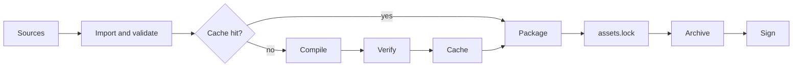

# 21 — Tooling and Pipelines

> Status: normative · Last updated: 2026-11-24
> Depends on: [DEC-009](../decisions.md), [DEC-017](../decisions.md), [DEC-019](../decisions.md), [DEC-020](../decisions.md), [DEC-033](../decisions.md), [DEC-035](../decisions.md), [DEC-040](../decisions.md), [DEC-041](../decisions.md), [DEC-046](../decisions.md), [DEC-047](../decisions.md), [conventions](00-conventions.md), [03-rendering](03-rendering.md), [04-shaders-and-visuals](04-shaders-and-visuals.md), [17-persistence](17-persistence.md)
> Implements: MS-05, MS-08, MS-09, MS-16

## 1. Purpose and scope

This chapter specifies how source material becomes runtime content: the asset compiler, the content
pack compiler and validator, the mod development loop, world tools, in-game debug tooling, build
automation, generated documentation and localization tooling — plus the budgets and tests that keep
them honest.

Tools are part of the product contract: contributors use `xtask` and the asset build, content and
mod authors use the validator, template and dev server, operators use pregeneration, maps and world
repair. The first-party game is built by the same pipeline as third-party content
([DEC-019](../decisions.md)); a private base-pack tool would be a design error. Registry semantics
([15](15-content-system.md)), the host ABI ([16](16-modding.md)), save framing
([17](17-persistence.md)) and installers ([22](22-platforms-and-distribution.md)) live elsewhere.

Five rules govern everything below. **One pipeline:** shipped assets and packs are produced only by
`openblock-tools`; hand-edited compiled artifacts are rejected. **Hash inputs, not clocks:**
incremental builds key on content hashes, tool and encoder versions, and profiles; mtimes are hints.
**Deterministic where observable:** asset output, archives, schemas and docs are reproducible, so a
diff means a real change. **Tools never extend the runtime:** the host validates what it loads even
when a tool produced it. **Read-only by default:** world tools take a shared lock
([17](17-persistence.md)) and write only when the command names the write and takes a backup or a dry
run.

## 2. Requirements

| ID | Requirement | Verification | Milestone |
| --- | --- | --- | --- |
| REQ-TOOL-001 | Every asset and pack shipped in a release MUST be produced by `openblock-tools` from sources under a pack root with a recorded encoder profile; a compiled artifact without a matching pipeline record MUST fail the build. | `asset verify` over release artifacts | MS-05 |
| REQ-TOOL-002 | Two builds with identical source bytes, tool version, profile and encoder version MUST produce byte-identical outputs on the same target. | Double-build hash diff in CI | MS-05 |
| REQ-TOOL-003 | Cross-platform builds MUST produce identical decoded asset content (mip texels, layer table, model geometry, font masks, audio PCM) and MUST record source and output hashes; compressed-payload byte equality is required per encoder release, with the uncompressed profile as the reproducibility reference. | Linux/Windows/macOS hash job | MS-05 |
| REQ-TOOL-004 | Texture import MUST accept only PNG or TGA with declared colour space and alpha intent, square power-of-two dimensions in `[16, 1024]`, and MUST report file, row and column of every rejection. | Import fixture suite | MS-05 |
| REQ-TOOL-005 | Mipmaps MUST be generated at build time in linear light with a fixed 2×2 filter, coverage-preserving alpha for cutout layers and renormalised normals; the runtime MUST NOT generate mips. | Golden mip hashes + runtime inspection | MS-05 |
| REQ-TOOL-006 | Compression profiles MUST be BC7 sRGB for albedo, BC5 for normals, BC7/BC4 for mask and roughness, ASTC 4×4/6×6 for mobile and RGBA8 as fallback; the selected profile MUST be recorded per layer. | Profile manifest diff | MS-05 |
| REQ-TOOL-007 | Each compiled texture MUST be KTX2 with `vkFormat`, correct `levelCount`, one DFD, `KTXorientation=rd`, and an `OB.encode` metadata entry carrying source hash, encoder id and profile; output MUST pass `ktx validate`. | `ktx validate` job | MS-05 |
| REQ-TOOL-008 | A texture array MUST have one layer resolution declared per pack; sources MUST match it or be integer-upscaled by nearest-neighbour; layer indices MUST be assigned in sorted resource-ID order and stay stable within a content epoch. | Array layout golden file | MS-05 |
| REQ-TOOL-009 | Layer count MUST be validated against the granted `max_texture_array_layers`; overflow MUST fail validation with the offending layer IDs and point at the compatibility atlas path, never silently truncate. | Limit fixture at 4096+1 | MS-05 |
| REQ-TOOL-010 | glTF 2.0, Blockbench `.bbmodel` and MagicaVoxel `.vox` MAY be imported at build time only; no release binary may contain a glTF, `.bbmodel` or `.vox` parser. | `cargo tree` + artifact scan | MS-09 |
| REQ-TOOL-011 | Model validation MUST reject degenerate quads, UVs outside the declared atlas, missing texture references, part cycles, more than 64 parts, more than 2,048 quads per model and non-finite transforms. | Model fixture corpus | MS-09 |
| REQ-TOOL-012 | Compiled models MUST use `.obmodel` (§4.4) with quantised positions and no runtime JSON parsing; the loader MUST reject unknown versions instead of guessing. | Round-trip + version negative test | MS-09 |
| REQ-TOOL-013 | Animation clips MUST be sampled at 30 Hz into quantised part tracks — translation 1/1024 block, 16-bit normalised rotation, explicit loop flag — and clips over 120 s or 256 keys per part MUST be rejected. | Clip fixture + runtime inspection | MS-09 |
| REQ-TOOL-014 | The default UI font MUST compile to the bitmap atlas format of [23](23-accessibility-localization.md) at 1×, 2× and 3× integer scales with a metrics table and deterministic masks; the vector fallback MUST be rasterised at runtime into the page cache defined there. | Atlas golden hash | MS-05 |
| REQ-TOOL-015 | Every shipped locale MUST have glyph coverage for every character in its catalogs and in base-pack content strings; a missing glyph MUST fail the localization build with locale, message ID and codepoint. | Coverage report | MS-16 |
| REQ-TOOL-016 | Audio MUST be encoded offline to Ogg Vorbis at 48 kHz (mono SFX, stereo music and ambience) with pinned encoder settings, normalised to the per-bus LUFS-I targets and −1 dBTP ceiling of [14 §3.8](14-audio.md#38-categories-loudness-and-dynamic-range), and with explicit loop points and recorded loudness. | Decode hash + loudness report | MS-05 |
| REQ-TOOL-017 | Every WGSL module and shader-pack hook MUST be assembled and validated with naga 30 before packaging, and every error MUST map back to a source file, line and column. | Assemble-failure fixtures | MS-05 |
| REQ-TOOL-018 | The build MUST enumerate reachable pipeline variants for the loaded content and preset, cap each family at 64, and write the variant set hash consumed by the runtime; a runtime variant outside the manifest is a bug. | Variant-count report + runtime assert | MS-05 |
| REQ-TOOL-019 | Pipeline-cache warming MUST be validated in CI: base-set variants compile behind the loading screen, zero compiles occur after the first frame, and warm-cache hit rate is at least 90%. | Compile-counter artifact | MS-05 |
| REQ-TOOL-020 | `assets.lock` MUST be canonical JSON sorted by asset ID, recording source and output BLAKE3, size, kind, profile, tool and encoder versions, license and attribution; regenerating it MUST be a no-op when nothing changed. | Drift check | MS-05 |
| REQ-TOOL-021 | Every source asset MUST have a `.license` sidecar and an `asset-register.tsv` row with SPDX ID, creator, source URL and modifications; a missing or unknown license MUST fail the build and block the release. | Asset-register gate | MS-05 |
| REQ-TOOL-022 | The build cache MUST be content-addressed by the §4.1 key, verified on read, safe to delete, and outside any world directory; a corrupt entry is evicted and rebuilt, never trusted. | Cache corruption test | MS-05 |
| REQ-TOOL-023 | Incremental builds MUST hash all inputs that affect output; modification time alone MUST NOT decide reuse, and a tool or encoder version bump MUST invalidate every affected entry. | Touch-without-change and version-bump tests | MS-05 |
| REQ-TOOL-024 | `xtask pack build` MUST run the §3.7 phases in order, emit one canonical archive, and refuse to publish when any error-severity diagnostic exists. | Integration test | MS-05 |
| REQ-TOOL-025 | The validator MUST report every diagnostic with a stable code, severity, path, optional span, JSON pointer, message and fix hint, and MUST NOT panic on any input in the fuzz corpus. | Diagnostics golden + pack fuzz | MS-05 |
| REQ-TOOL-026 | Dependency resolution MUST support semver ranges, `requires`, `load_after` and `load_before`, pin exact hashes in a lockfile, reject cycles with the full path, and order packs by `(priority, id, version, content_hash)`. | Resolution fixtures | MS-05 |
| REQ-TOOL-027 | Pack schema migrations MUST run in order on an in-memory tree, be dry-runnable, preserve unknown fields where the schema allows it, and refuse to downgrade. | Migration fixtures | MS-09 |
| REQ-TOOL-028 | Pack archives MUST be deterministic: sorted names, fixed 1980-01-01 timestamps, no extra fields or data descriptors, stored already-compressed payloads, pinned deflate for text, and no symlinks, absolute paths, duplicates or case collisions. | Unzip-diff and hostile-archive tests | MS-16 |
| REQ-TOOL-029 | `xtask pack sign` MUST produce an Ed25519 detached signature over the manifest root together with `id`, `version` and `content_format`, carrying a `key_id`; `verify` MUST reject a wrong key, a modified root or a modified archive. | Signature negative tests | MS-16 |
| REQ-TOOL-030 | `xtask pack new`, `validate`, `build`, `sign`, `index`, `inspect`, `migrate` and `diff` MUST exist with the §4.5 exit codes and `--format=json` output. | CLI contract tests | MS-05 |
| REQ-TOOL-031 | `xtask pack index` MUST emit a canonical, reproducible JSON index of id, version, hashes, download URL, license and signer key for a directory of archives. | Reproducibility diff | MS-16 |
| REQ-TOOL-032 | `xtask mod new` MUST generate a buildable mod with a manifest, one block, one item, one recipe, one test and a README pinned to the current API major; it MUST build and test with no network access. | Template smoke test | MS-09 |
| REQ-TOOL-033 | `xtask mod dev` MUST watch sources, rebuild the mod, validate capabilities and hot-swap it while preserving world state in ≤ 5 s; a failed build keeps the previous module running. | Timed integration test | MS-09 |
| REQ-TOOL-034 | The ABI schema owned by [16](16-modding.md) MUST be the single source for generated guest bindings, the C header and reference documentation; CI MUST fail when generated files drift. | Regenerate-and-diff | MS-09 |
| REQ-TOOL-035 | Public API documentation MUST build with rustdoc `-D warnings` and intra-doc links; the ABI reference and content schema reference MUST be generated, versioned and link-checked. | Docs CI job | MS-16 |
| REQ-TOOL-036 | The mod profiler and log viewer MUST attribute CPU time, memory high-water and host-call counts per mod and version, and MUST redact secrets and absolute home paths. | Profiler artifact + redaction test | MS-09 |
| REQ-TOOL-037 | The example gallery MUST build and test every example against the current API in CI, and each example MUST declare its supported API range and expected result. | Gallery CI job | MS-09 |
| REQ-TOOL-038 | The pregenerator MUST be resumable (`--resume`), write a state file, refuse to overwrite an existing column, report progress at least every 5 s, and stop cleanly on SIGINT. | Interrupt/resume test | MS-08 |
| REQ-TOOL-039 | The map renderer MUST open a world read-only, stream regions and produce a deterministic PNG/JSON map for height, biome, light or slope with a documented palette; it MUST NOT require client assets. | Golden map hashes | MS-08 |
| REQ-TOOL-040 | Biome, structure and seed viewers MUST call `ob_worldgen` with the world's recorded fingerprint and content hash, and MUST NOT write to the world. | Read-only assertion + viewer diff | MS-08 |
| REQ-TOOL-041 | `world verify` MUST check every region header, index and record checksum and exit 65 on corruption; its `--repair` mode MUST be dry-run by default, take a backup before writing and quarantine bytes rather than dropping them. | Corruption fixtures | MS-16 |
| REQ-TOOL-042 | `world regen_chunks` MUST refuse without a fingerprint mismatch report, default to dry-run, regenerate only unedited chunks, take a backup, and require `--force` before writing. | Dry-run + edited-chunk test | MS-08 |
| REQ-TOOL-043 | World import/export MUST validate the archive manifest, hashes, paths and sizes before writing anything, and MUST leave no partial world or structure on failure ([17](17-persistence.md)). | Hostile-archive corpus | MS-16 |
| REQ-TOOL-044 | In-game debug tools MUST be unavailable without `--debug-tools` or a developer build, MUST be read-only except through permission-checked commands, and MUST NOT change the state hash. | Hash comparison with tools on/off | MS-05 |
| REQ-TOOL-045 | The replay recorder and inspector MUST record the complete input log of [02 §3.10](02-engine-core.md#310-determinism-harness), replay to an identical state hash, and scrub chat and player names from exports by default. | Replay hash + scrub test | MS-05 |
| REQ-TOOL-046 | `xtask` MUST be the single developer entry point: every CI check has an `xtask` equivalent, each command documents its exit codes, and no shell script outside `xtask` performs a shipped build step. | Command inventory + CI parity | MS-16 |
| REQ-TOOL-047 | Unsigned release artifacts MUST be reproducible: two clean builds in different directories with the pinned toolchain, `--locked`, `SOURCE_DATE_EPOCH` and path remapping MUST produce identical hashes. | Two-directory build diff | MS-16 |
| REQ-TOOL-048 | One `version.toml` MUST be the source for game, protocol, save-format, data, content-format and mod-API versions and build metadata; generated constants and `--version` MUST match it, and a dirty tree MUST be marked. | Version fixture + CLI test | MS-16 |
| REQ-TOOL-049 | The documentation site MUST build from `docs/`, render Mermaid from source, and fail on a broken relative link or anchor; no generated binary images are committed. | Link-check job | MS-16 |
| REQ-TOOL-050 | Localization tooling MUST round-trip Fluent catalogs without reordering or losing message IDs and comments, validate placeholder parity and plural categories, generate the `en-XA` (+30%) and `en-XZ` (+100%) pseudo-locales, and leave `.oblang` packaging to [23](23-accessibility-localization.md). | Round-trip + lint tests | MS-16 |
| REQ-TOOL-051 | `xtask dist` MUST assemble pack archives and release bundles through the same deterministic writer as `pack build`; the update manifest and signing are owned by [22](22-platforms-and-distribution.md). | Dist reproducibility test | MS-16 |
| REQ-TOOL-052 | Tools MUST NOT panic on user input: invalid paths, archives, packs and world files return typed errors with exit codes 0, 2, 65 or 70 and never leave a partial output. | Fuzz + exit-code matrix | MS-05 |
| REQ-TOOL-053 | A missing or broken asset MUST degrade at runtime to the documented placeholder (checker texture, cube model, silent sound) with one actionable log line, never a crash; the host MUST NOT load client assets at all. | Fault-injection test | MS-05 |

## 3. Design

### 3.1 Pipeline stages



| Stage | Inputs hashed into the cache key | On failure |
| --- | --- | --- |
| Discover | pack root listing, manifest hash | `PACK-6001` unreadable root |
| Import | source bytes, kind, import options | `PACK-3xxx`, names file and offset |
| Transform | source hash, profile, encoder id/version, tool version | `PACK-3xxx`, keeps previous cache entry |
| Package | sorted asset output hashes, archive options | `PACK-6xxx`, writes nothing |
| Sign | manifest root, key id | `PACK-6xxx`, no partial signature |

The pipeline is a pure function of `(pack tree, tool version, encoder versions, target profile)`;
wall-clock time, absolute paths, file ordering, locale and thread count MUST NOT enter an output
byte. Import and transform run as one job per asset on the shared worker pool and merge in sorted ID
order, so thread count and completion order cannot affect bytes. Manifest paths are relative,
`/`-separated and lower-case; a source root inside a build output directory is rejected.

### 3.2 Textures

A texture is imported to RGBA8 or the declared format, validated, mip-mapped, block-compressed,
wrapped in KTX2 and recorded. Colour space (albedo sRGB, normal/mask linear) and alpha intent
(`opaque`, `cutout`, `blend`) are explicit; a cutout texture without alpha is an error in the base
pack.

| Property | Rule |
| --- | --- |
| Dimensions | square, power of two, 16–1024; one layer resolution per pack, integer nearest upscale only (16 default, 32/64 HD) |
| Mips | full chain to 1×1; 2×2 box filter on 16-bit linear values; alpha-weighted for cutout; normals renormalised per level |
| Colour conversion | sRGB↔linear through a 256-entry integer LUT; no float in the mip byte path |
| Compression | BC7 (albedo, mask), BC5 (normal XY, Z reconstructed), BC4 (single channel), ASTC 4×4/6×6, RGBA8 fallback |
| KTX2 | `vkFormat`, `levelCount`, one DFD, `KTXorientation=rd`, `KTXwriter`, `OB.encode` JSON metadata |

Texture arrays are one array per channel set as fixed by
[03 §3.7](03-rendering.md#37-textures-samplers-and-material-binding); "page" here means that array.
`max_texture_array_layers` is requested at 4096 desktop and 1024 mobile ([DEC-017](../decisions.md));
validation rejects overflow and points at the atlas compatibility path. Indices follow sorted
resource ID and are recorded in the array layout, so `mymod:new_ore` appends without moving existing
UVs; a removed layer leaves a transparent gap until the next content epoch reallocates the array.

### 3.3 Models and animation

Model import is a build-time converter, never a runtime dependency. glTF 2.0 arrives through the
`gltf` crate, Blockbench `.bbmodel` through a parser for its documented JSON, and `.vox` through a
voxel-to-quads converter for props. All three normalise into one intermediate tree: parts with local
transforms, quads with positions quantised to 1/16 block, a face normal index, UV in the declared
atlas, tint index and material flags.

Validation catches what a GPU would reject at run time: zero-area quads after quantisation, UVs
outside `[0,1]`, a texture reference absent from the pack, a part cycle, non-finite transforms, scale
outside `[1/16, 16]`, more than 64 parts, more than 2,048 quads, or an animation track naming a
missing part. Entity animation is part-transform only — the renderer evaluates transforms on the CPU
into instance data ([03 §3.8](03-rendering.md#38-entities-items-particles-and-overlays)), so 1.0 has
no bone palette, skinning or GPU animation. Sampling is fixed at 30 Hz with a 1/1024-block quantum
and a 16-bit normalised quaternion, so two machines evaluating a clip produce identical transforms.

### 3.4 Fonts and audio

**Fonts.** The default UI font is OFL 1.1 and compiles to the bitmap atlas of
[23 §3.6](23-accessibility-localization.md) at 1×, 2× and 3× integer scales, with deterministic
masks and a metrics table; the vector path follows the on-demand page cache defined there. The build
verifies coverage for every shipped catalog and every base-pack string, and that each locale's
fallback terminates in a bundled font.

**Audio.** Sources are WAV or FLAC; the pinned encoder produces Ogg Vorbis at 48 kHz — mono SFX,
stereo music and ambience. Each clip is normalised to its bus target from
[14 §3.8](14-audio.md#38-categories-loudness-and-dynamic-range), measured LUFS-I and true peak are
recorded in the bank manifest, and loop points are sample offsets with start below end inside the
file. Decoding is `symphonia`; Opus is reserved for post-1.0 voice chat ([DEC-031](../decisions.md)).

### 3.5 Shaders

Shader compilation uses the same assembler as the runtime
([04 §3.7.2](04-shaders-and-visuals.md#372-module-composition)): fixed module order, declared
imports, pipeline-overridable constants, no preprocessor. The build imports WGSL from the pack,
resolves modules once, assembles each reachable variant, validates it with naga 30 against the
reflected layout of [03 §3.7](03-rendering.md#37-textures-samplers-and-material-binding), and writes
the variant set with its hash.

| Output | Content | Consumer |
| --- | --- | --- |
| `shaders.lock` | module hashes, variant keys, naga result, source map | runtime assembler, CI |
| variant set | reachable combinations per preset, capped at 64/family | loading-screen compiler |

Errors map assembled offsets back to pack file, line and column for the validator and overlay.
Pipeline cache files are driver- and adapter-specific and are **not** shipped; the first run compiles
the base set behind the loading screen and persists the cache under the user cache directory keyed by
`(adapter, driver, backend, descriptor hash, shader hash, variant key)` ([03 §3.1](03-rendering.md)).
A shader pack compiles through the same tool; a failing pack is disabled, not the game
([04 §3.8.3](04-shaders-and-visuals.md#383-validation-and-failure-isolation)).

### 3.6 Asset manifest, provenance and cache

`assets.lock` records what the pipeline did: canonical JSON, sorted records and keys, integers only,
no timestamps, absolute paths, user or host names. It is checked in, regenerated by
`xtask asset build` and compared in CI; a diff is a content change or a bug, and the review says
which. Provenance is a source artifact: every binary or font source has a sibling `.license` file and
an `asset-register.tsv` row with SPDX ID, creator, source URL, modifications and an evidence URL, and
the compiler refuses an asset without them. `xtask asset register` renders `CREDITS.md` grouped by
license; `THIRD-PARTY-NOTICES.md` for code dependencies is generated from the locked crate graph by
`cargo-about` and shipped by [22](22-platforms-and-distribution.md). Base pack CC BY 4.0,
placeholders CC0, fonts OFL 1.1 ([DEC-009](../decisions.md)); any other license needs a register
entry and review.

The build cache lives under the user cache directory (`~/.cache/openblock/build`,
`%LOCALAPPDATA%\openblock\build`, `~/Library/Caches/openblock/build`) and keys on
`BLAKE3("ob-asset-key/1" ‖ source ‖ kind ‖ profile ‖ encoder ‖ tool ‖ options)`. Entries are written
temp-then-rename, verified against the recorded output hash on read, evicted on mismatch and capped
by LRU at 10 GiB. The **runtime** pack cache is different and belongs to
[17 §3.9](17-persistence.md#39-asset-cache-and-thumbnails); the two MUST NOT share a directory or a
trust model.

### 3.7 Content pack compiler and validator

The table groups the [15 §3.3](15-content-system.md#33-the-pipeline) stages by tool responsibility;
that chapter owns their semantics and order.

| Phase | Checks | Owner |
| --- | --- | --- |
| Discover | symlinks, absolute paths, duplicates, case collisions, entry count, compressed and unpacked caps | tooling |
| Parse/schema/migrate | manifest, syntax, depth ≤ 64, JSON Schema from Rust types, unknown fields, ranges, cross-field rules, ordered migration with dry-run | [15](15-content-system.md) |
| Link/freeze | resource IDs, tags, recipes, loot, models, textures, sounds, UI, dependencies, layer order | [15](15-content-system.md) |
| Assemble | asset resolution, content/view/behaviour leaf split | tooling + 15 |
| Hash/sign/emit | canonical archive, manifest root, Ed25519, lock, report, index entry | tooling |

Limits are enforced before allocation: pack ≤ 64 MiB compressed and ≤ 256 MiB unpacked, ≤ 20,000
entries, ratio ≤ 200:1, ≤ 10,000 recipes, ≤ 4,096 states per block, textures ≤ 1,024², WASM ≤ 16 MiB.
They extend the save-side limits in [17 §3.10](17-persistence.md#310-security-and-untrusted-input).

Diagnostics use stable ranges: `PACK-1xxx` syntax/schema, `PACK-2xxx` link/conflict, `PACK-3xxx`
asset compilation, `PACK-4xxx` dependency resolution, `PACK-5xxx` migration, `PACK-6xxx`
archive/hash/signature. A diagnostic carries code, severity, message, pack, path, span, pointer,
hint and docs (§4.5); the human renderer prints `path:line:column` with an excerpt and hint, the JSON
renderer one object per line. The validator reports every reachable error, not just the first.

**Dependencies and lockfile.** A pack declares `id`, `version`, `side`, `requires`, `optional`,
`load_after`, `load_before`, `content_format` and a schema version. Resolution takes semver ranges,
prefers the highest allowed version and pins exact hashes in `pack.lock` for offline operation.
Cycles fail with the full path; tie-breaking is `(priority, id, version, content_hash)` and two edits
to one field at one phase conflict, as [DEC-019](../decisions.md) requires.

**Signing.** `pack build` hashes the canonical manifest root (the Merkle root over content, view and
behaviour leaves owned by [15](15-content-system.md)) and the archive separately. `pack sign` signs
the root together with `id`, `version` and `content_format` using Ed25519 and writes `pack.sig`
(§4.3); the archive hash goes in the index entry for download integrity. Rotation publishes a new key
id; verification trusts only configured ids. Unsigned local packs are allowed in development, and a
server that requires signatures refuses them — the switch belongs to [19](19-server-administration.md).

### 3.8 Mod development tooling

| Tool | Command | Behaviour |
| --- | --- | --- |
| Template | `xtask mod new <name> [--template <name>]` | manifest, one block, item, recipe, command, WASM entry point, test, README; pinned API major; offline build |
| Build/dev | `xtask mod build`, `xtask mod dev` | WASM build with manifest and capability validation; watch, rebuild and hot-swap with state preserved |
| ABI schemas | `xtask abi generate` | guest Rust crate, C header and reference docs from the [16](16-modding.md) schema; drift fails CI |
| Profiler | `xtask mod profile` / overlay | per-mod CPU, memory high-water, host calls, quota; 600-tick ring; JSON export |
| Log viewer | `openblock-tools log view` | JSON log and span decoding, filter by mod/target/level, redacted paths, opens diagnostics bundles |

The dev server runs the real host over a loopback transport, not a mock: `OPENBLOCK_DEV=1`, debug
tools and the pack watcher enabled, no public interface. Hot reload follows [02 §3.6](02-engine-core.md)
— instantiate the new module, run `init` against the existing registry, hand over state through the
documented snapshot API, then drop the old instance. A trap during `init` keeps the old module and
reports the trap with the last host call.

### 3.9 World tools

The pregenerator walks the requested area in ring order, generates through the normal deterministic
pipeline and saves; it never rewrites an existing column and never changes the fingerprint. It is
resumable from `pregen.state`, which records the fingerprint, content hash and queue cursor.

| Tool | Command | Guarantee |
| --- | --- | --- |
| Pregenerate | `openblock-server pregen --center <x,z> --radius <blocks> [--threads N] [--resume] [--dry-run]` | resumable; skips existing columns; prints columns/s and ETA |
| Map | `openblock-tools world map --dimension <id> --area <x,z,w,h> --layer height\|biome\|light\|slope --scale <n> --out map.png` | read-only, streamed, deterministic palette, no client assets |
| Inspect/view | `world info`, `world chunk`, `world dump`, `world biomes`, `world structures`, `worldgen gallery` | read-only; worldgen viewers use the recorded fingerprint and persisted starts |
| Verify | `world verify [--region <x,z>] [--json] [--repair]` | every header, index and record CRC; repair is dry-run first; exit 65 on corruption |
| Regenerate | `world regen_chunks --chunks <range> --dry-run` then `--force` | fingerprint diff, unedited chunks only, backup, never on a running world |
| Import/export | `world import --input <archive>`, `world export --output <dir>` | validate before write, no partial output ([17 §3.8](17-persistence.md#38-backups-restore-import-and-export)) |

The map palette is content-defined for biomes and fixed for the height ramp, so two machines with
the same packs produce the same PNG; hill shading uses integer arithmetic on the 8-bit height field.

### 3.10 In-game debug tooling

| Tool | Toggle | Data source | Restriction |
| --- | --- | --- | --- |
| Entity browser | `F3+E` | live snapshot, sorted by NetId | inspect/select; teleport is a permission-checked command |
| Block browser | `F3+B` | frozen registry and state table | placement uses the normal edit intent |
| Content inspector | overlay panel | pack layers, resolved entry, hashes, diagnostics | read-only |
| Performance overlay | `F3+F` | `ob_core` diagnostics ring | labels each row with its budget |
| Netgraph | `F3+N` | client transport stats | client only |
| Replay recorder/inspector | `--record <file>`; `openblock-tools replay` | input log, event log, protocol capture | writes only; inspector in the tools binary |
| Redstone debugger | `F3+R` | signal values, update-order trace | read-only overlay |
| Visualisers | `F3+P`, `F3+L` | pathfinding nodes/costs; sky/block light, queue depth, slices | debug builds or `--debug-tools`; read-only |

All are compiled behind `debug-tools`, enabled by `--debug-tools` or a developer build, and excluded
from release benchmarks ([MS-03](../plan/01-milestones.md)). A test replays 1,000 ticks with tools on
and off and asserts an equal state hash; a leak into the simulation is a desync-class bug.

### 3.11 Build automation, versioning, docs and localization

`xtask` is a Rust binary, not shell scripts, because CI, contributors and release engineering call it.

| Command | Purpose | Exit codes |
| --- | --- | --- |
| `xtask ci [--fast]` | fmt, clippy `-D warnings`, nextest, deny, rustdoc, shaders, arch guard | 0/1/2 |
| `xtask asset build\|verify\|register\|check` | pipeline, manifest check, credits, licence gate | 0/65/70 |
| `xtask pack new\|validate\|build\|sign\|index\|inspect\|migrate\|diff` | pack lifecycle | 0/2/65/70 |
| `xtask mod new\|build\|dev\|profile` | mod loop | 0/2/65/70 |
| `xtask world verify\|repair\|map\|regen` | world tool wrapper | 0/65/70 |
| `xtask docs`, `xtask lang`, `xtask abi` | generated docs, translation round trip, ABI bindings | 0/1/2/65 |
| `xtask dist` | release bundles ([22](22-platforms-and-distribution.md)) | 0/2/65/70 |

**Version stamping.** `version.toml` holds `game`, `protocol`, `save_format`, `data_version`,
`content_format` and `mod_api`; the build validates it, generates `ob_core::version` constants and
embeds the commit id from `SOURCE_DATE_EPOCH`/git, marking `+dirty` on a modified tree. `--version`
prints all six numbers, the commit and the target triple; no other file hard-codes a version.

**Reproducible builds.** Pinned toolchain and `Cargo.lock`, `--locked`, `SOURCE_DATE_EPOCH` at the
tagged commit time, `--remap-path-prefix=$PWD=/build`, deterministic strip, sorted archives and fixed
metadata. Linux and Windows unsigned artifacts are compared across two clean directories in CI;
macOS is compared before signing because notarisation adds tickets. Signed artifacts are attestable,
not bit-identical, so the release publishes unsigned hashes plus signature and SBOM.

**Documentation generation.** The site builds from `docs/` with a pinned generator, renders Mermaid
from fenced source at view time, and fails on a broken repo-relative link or anchor. Rustdoc builds
for all public crates with `-D warnings` and intra-doc links. The protocol reference is generated
from the message catalog owned by [18](18-networking-multiplayer.md), the content schema reference
from the Rust types that produce the JSON Schema; both are checked in and a regeneration diff fails
CI. Generated pages carry generator version and source revision.

**Localization.** Fluent `.ftl` is the source of truth and the repository is authoritative.
`xtask lang export` and `import` round-trip catalogs without reordering or dropping comments, and
reject placeholder mismatches (`{ $count }` versus `{ $counts }`) and unknown message IDs;
`xtask lang pseudo` generates `en-XA` with accents, brackets and +30% expansion, and `en-XZ` at
+100%, so truncation is visible before translators work. Weblate consumes the FTL files directly; an
XLIFF exchange is supported only if the project moves, because nothing may replace the FTL source.
`xtask lang check` and `xtask lang pack` (`.oblang`) are owned by [23 §3.9](23-accessibility-localization.md#39-locale-packs-and-the-community-workflow).

## 4. Data structures and formats

### 4.1 Cache key

```rust
pub struct AssetKey {
    pub source: Hash,          // BLAKE3 over source bytes
    pub kind: AssetKind,       // Texture | Model | Font | Audio | Shader | Ui
    pub profile: ProfileId,    // target + compression + colour space
    pub encoder: EncoderId,    // name + version
    pub tool: Version,         // openblock-tools version
    pub options: Hash,         // canonical option map
}
// key = BLAKE3(b"ob-asset-key/1" || source || kind || profile || encoder || tool || options)
```

Cache layout is `<cache>/openblock/build/<kind>/<aa>/<key>/` with output, `meta.json` and atomic
staging; there is no authoritative index, and a missing one is rebuilt by scanning.

### 4.2 `assets.lock`

```json
{"schema":"openblock.assets/1","tool":"0.9.3","records":[
  {"id":"openblock:block/stone","kind":"texture",
   "source":{"path":"base/textures/block/stone.png","blake3":"..."},
   "output":{"path":"base/compiled/tex/stone.ktx2","blake3":"...","size":1096},
   "profile":"bc7-srgb-mip","encoder":"intel_tex_2/0.5.0","tool":"0.9.3",
   "license":"CC-BY-4.0","attribution":"OpenBlock Art Team","reviewer":"art"}]}
```

Records and keys are sorted, and paths are relative to the pack root. The lock feeds the archive
writer and `CREDITS.md`; the game never reads it at runtime.

### 4.3 Pack signature

The manifest schema belongs to [15](15-content-system.md); the compiler requires canonical `id`,
`version`, `schema_version`, `side`, `layer`, `requires`, `optional`, `load_after`, `load_before`,
`content_format`, `api`, `license`, `description`, `icon` and declared asset roots. `pack.sig`:

```json
{"schema":"openblock.pack-signature/1","key_id":"ob-release-2026","alg":"ed25519",
 "id":"kiln:recolour","version":"1.2.3","content_format":1,
 "root":"blake3:...","signature":"base64:..."}
```

### 4.4 `.obmodel`

| Offset | Size | Field |
| ---: | ---: | --- |
| 0 | 4 | magic `OBM1` |
| 4 | 2 | major = 1; minor |
| 8 | 2 | part count (`≤ 64`) |
| 10 | 2 | quad count (`≤ 2048`) |
| 12 | 2 | texture reference count (`≤ 8`) |
| 14 | 2 | animation clip count |
| 16 | 4 | total byte length |
| 20 | 4 | CRC32C over the body; 8 reserved zero bytes follow |
| 32 | … | part table, quads, UV atlas, clip tables |

A quad record is position `i16 ×3` (1/16 block), normal index `u8`, UV `u16 ×2` (1/4096 units), tint
`u8`, flags `u8`, padded to 16 bytes. Clip times are `u16` in 1/30 s from clip start, bounding a clip
to 120 s. All integers are little-endian.

### 4.5 Diagnostics and exit codes

```rust
pub struct Diagnostic {
    pub code: &'static str,      // "PACK-2001"; ranges in §3.7
    pub severity: Severity,      // Error | Warning | Note
    pub message: String,         // one line: expected and found
    pub pack: PackRef,           // id, version, layer
    pub path: Utf8PathBuf,       // relative to the pack root
    pub span: Option<Span>,      // 1-based line/column plus byte offsets
    pub pointer: Option<String>, // RFC 6901 JSON Pointer
    pub hint: Option<String>,    // suggested fix, never applied
    pub docs: &'static str,      // spec anchor for the code range
}
```

Exit codes are 0 success, 2 usage/config, 65 invalid pack/world/archive/signature and 70 internal
with output cleaned up ([02 §3.11](02-engine-core.md#311-errors-panics-and-exit-codes)).

## 5. Performance budgets

[Chapter 25 §5.5](25-performance-budgets.md#55-io-loading-and-tooling) is the authoritative tooling
table: PERF-TOOL-001, 003, 005 and 007 are indexed from it and MUST NOT be redefined; the other IDs
are this chapter's allocations and MUST be registered in `perf/budgets.toml` ([REQ-PERF-001](25-performance-budgets.md)).

| ID | Budget | Measurement |
| --- | --- | --- |
| PERF-TOOL-001 | Indexed: full asset build ≤ 8 min; pack validate ≤ 400 ms/pack, ≤ 30 s/100 packs | [25](25-performance-budgets.md) |
| PERF-TOOL-002 | Developer loop: texture edit ≤ 2 s p95, shader variant set ≤ 8 s p95, mod hot reload ≤ 5 s p95 | Timed edits |
| PERF-TOOL-003 | Indexed: PR CI ≤ 25 min p95 excluding queue; benchmark suite ≤ 20 min (five scenes × three runs) | [25](25-performance-budgets.md) |
| PERF-TOOL-004 | Archive write ≥ 300 MiB/s; build-cache hit ≥ 95% on a one-file change | Criterion bench |
| PERF-TOOL-005 | Indexed: pregenerate 2,000×2,000 blocks ≤ 10 min on 8 threads | [25](25-performance-budgets.md) |
| PERF-TOOL-006 | Docs site with link check ≤ 90 s; lang export/import of 10,000 messages ≤ 5 s | CI artifact |
| PERF-TOOL-007 | Indexed: client ≤ 40 MB, server ≤ 40 MB, base assets ≤ 150 MB | [25](25-performance-budgets.md) |
| PERF-TOOL-008 | Inspection tools: verify 4,096 regions ≥ 150 MiB/s per worker and ≤ 60 s; map 2,000² ≤ 20 s; debug overlay ≤ 0.30 ms | Disk/timed bench |

## 6. Failure modes and edge cases

| Failure | Detection | Behaviour |
| --- | --- | --- |
| Output differs between runs | CI double-build hash diff | fail, print the first differing asset ID and cache key; never publish |
| Stale or corrupt cache | encoder version in the key; output hash on read | affected entries miss; corrupt entries evict and rebuild, never used |
| Broken source asset | import or validation error | build fails with `PACK-3xxx`; the previous archive stays untouched |
| Missing license sidecar | asset-register gate | build fails, asset not packaged, release blocked |
| Schema drift | regenerate-and-diff in CI | fail with the generated path and the changed field |
| Interrupted archive write | temp directory plus rename | no partial archive; the previous archive stays valid |
| Dependency cycle | resolver | `PACK-4002` with the full cycle; no build |
| Signature mismatch | verifier | reject, name the key id and expected root |
| Missing glyph | coverage check | fail that locale, list message ID and codepoint |
| Missing texture/model/sound at runtime | loader | documented placeholder plus one log line; never a crash |
| World tool opened while a host runs | shared lock | refuse with the holder's PID ([17](17-persistence.md)) |

| Risk | Description | Likelihood | Impact | Mitigation |
| --- | --- | --- | --- | --- |
| RISK-401 | Pipeline drifts from runtime interpretation | Medium | High | one schema source; runtime loads tool output in CI smoke tests |
| RISK-402 | Build cache makes wrong reuse the normal case | Low | High | hash every input; verify output on read; double-build gate |
| RISK-403 | Tooling grows into a second product and stalls content | Medium | Medium | CLI-first, no editor; every tool named by a milestone exit criterion |
| RISK-404 | Validator accepts what the host rejects | Medium | High | shared validator crate and identical error path |
| RISK-405 | Debug tools leak into simulation and break replays | Low | High | feature gate, read-only contract, hash equality test |

## 7. Testing strategy

- **Golden hashes and double builds.** A fixture pack exercises every asset kind and profile;
  `assets.lock` and output hashes are golden files, and each CI job builds the pack twice in
  different directories, plus once each at `--threads 1` and `--threads 8`. An accidental encoder
  change becomes a reviewed golden update, never a silent one.
- **Toolkit integration.** `pack new → build → validate → sign → verify → index` runs per OS;
  `mod new → build → dev reload → command` runs on the test host and is timed against the template
  target.
- **Round trips.** Pack build → unzip → rebuild gives identical archives; world and structure
  export → import preserves hashes; Fluent export → import preserves IDs, comments and placeholders;
  schema → generated docs → schema is a fixed point.
- **Negative and fuzz tests.** Packs, archives, models, fonts, world files and signatures have fuzz
  targets; every rejection is a diagnostic, never a panic. Hostile archives share traversal,
  symlink, case-collision and zip-bomb cases with [17](17-persistence.md).
- **External validators and contracts.** KTX2 passes `ktx validate`, shaders pass naga, archives are
  read by a second implementation. Every `xtask` command tests its exit code, `--format=json` schema
  and "no partial output on failure"; `xtask ci` and the CI workflow are compared by parsed command
  lists.
- **Manual checklists.** Font rendering at three scales, click-free audio loops, map colours against
  the biome table, and a full template run with the network disabled.

## 8. Open questions

| # | Question | Proposal | Owner |
| --- | --- | --- | --- |
| 1 | Register item needed: is compressed-payload byte equality across CPU architectures a release requirement, or is decoded equality plus per-encoder hashes sufficient? | Decoded equality required; per-encoder byte equality verified at upgrades, uncompressed profile as reference. | MS-05 |
| 2 | Register item needed: texture array resolution policy for third-party packs, and whether uncompressed RGBA8 base textures are acceptable at 1.0. | One resolution per pack with integer upscale; keep BC7 for the base pack. | MS-05/MS-16 |
| 3 | Register item needed: how mod assets ship when one payload must serve several GPUs. | Precompiled per-platform payloads in 1.0; universal Basis/ASTC only with a decision and first-use cache. | MS-09 |
| 4 | Register item needed: skeletal entity animation at 1.0 or part transforms only? | Part transforms only; skinning adds a runtime path the renderer does not need. | MS-12 |
| 5 | Register item needed: is `openblock-tools` shipped to players or CI-only, and are world tools CLI-only at 1.0? | Ship with server tarballs and as a separate download; CLI plus an in-game map item later, GUI post-1.0. | MS-16 |

## 9. References

- [DEC-009, DEC-017, DEC-019, DEC-020, DEC-033, DEC-035, DEC-040, DEC-041, DEC-046, DEC-047](../decisions.md)
- [Conventions](00-conventions.md) — identifiers, units, chapter template, determinism rules
- [Rendering](03-rendering.md) and [Shaders and visuals](04-shaders-and-visuals.md) — texture arrays, binding, pipeline cache, module assembly, pack validation
- [Persistence](17-persistence.md) — world lock, asset cache, repair, import/export limits; [research 09](../research/09-persistence-assets-packaging.md) — KTX2/BC7, deterministic packs, cache keys
- [Research 02](../research/02-engine-and-render-stack.md), [research 06](../research/06-modding-and-content-system.md) and [research 07](../research/07-legal-licensing-and-ip.md) — naga/texture tooling, pack manifests and hashing, provenance and licenses
- [Milestones](../plan/01-milestones.md), [roadmap](../plan/00-roadmap.md), [work breakdown](../plan/03-work-breakdown.md)
- Khronos KTX2 — <https://github.com/KhronosGroup/KTX-Specification>; naga — <https://docs.rs/naga/30.0.2/naga/>; `intel_tex_2` — <https://docs.rs/intel_tex_2/0.5.0/intel_tex_2/>; glTF 2.0 — <https://registry.khronos.org/glTF/specs/2.0/glTF-2.0.html>
- Xiph Ogg Vorbis — <https://xiph.org/vorbis/>; reproducible builds — <https://reproducible-builds.org/docs/>; Fluent — <https://projectfluent.org/>; BLAKE3 — <https://github.com/BLAKE3-team/BLAKE3>; Ed25519 — <https://www.rfc-editor.org/rfc/rfc8032>; `cargo-about`/`cargo-deny` — <https://github.com/EmbarkStudios/cargo-about>; REUSE 3.3 — <https://reuse.software/spec-3.3/>
