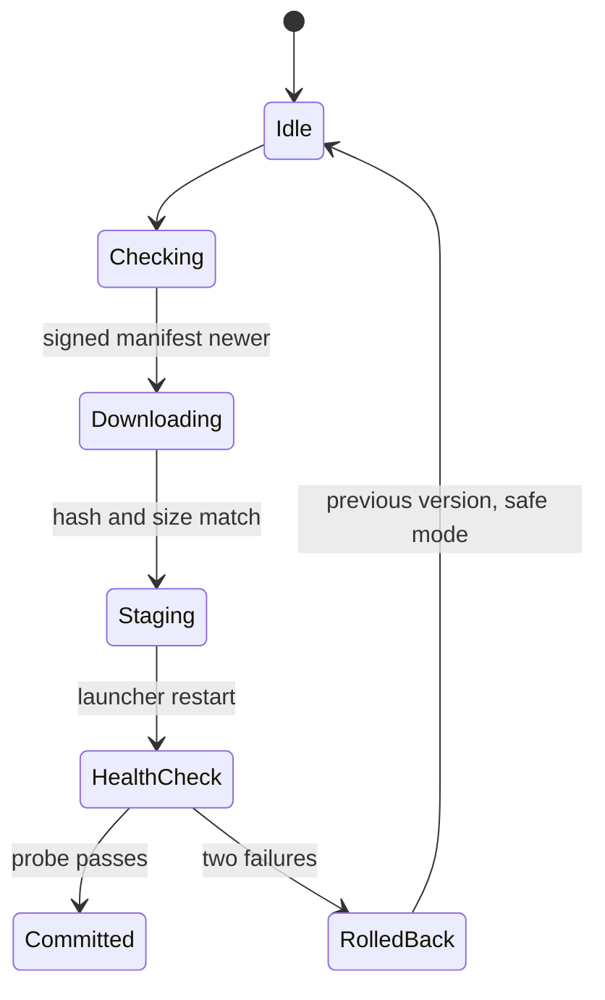

# 22 — Platforms and Distribution

> Status: normative · Last updated: 2026-11-24
> Depends on: [DEC-009](../decisions.md), [DEC-016](../decisions.md), [DEC-017](../decisions.md), [DEC-028](../decisions.md), [DEC-034](../decisions.md), [DEC-035](../decisions.md), [DEC-037](../decisions.md), [DEC-042](../decisions.md), [02-engine-core](02-engine-core.md), [03-rendering](03-rendering.md), [17-persistence](17-persistence.md), [21-tooling-and-pipelines](21-tooling-and-pipelines.md), [vision §9](../vision.md#9-platforms-and-hardware)
> Implements: MS-13, MS-16

## 1. Purpose and scope

This chapter defines where OpenBlock runs at 1.0, on what hardware, how builds are produced and
signed, how they are packaged and distributed, how the game updates itself without bricking an
install, what crash reporting and telemetry are permitted, and how platform conventions shape input
and UX.

Out of scope: the platform abstraction inside the engine ([02](02-engine-core.md)), render presets
([03](03-rendering.md)), save migrations ([17](17-persistence.md)), packaging tools
([21](21-tooling-and-pipelines.md)), accessibility features ([23](23-accessibility-localization.md))
and server operations ([19](19-server-administration.md)).

Three rules frame the chapter. **The desktop is the product at 1.0:** Windows, Linux and macOS ship,
servers ship everywhere they are useful, and mobile and web are explicitly later
([DEC-034](../decisions.md)). **Distribution is not a feature gate:** the same signed build reaches
every channel. **Failure is designed for:** an update, signature, driver or store rejection must
degrade to a playable previous state, not to a lost install.

## 2. Requirements

| ID | Requirement | Verification | Milestone |
| --- | --- | --- | --- |
| REQ-PLAT-001 | 1.0 client binaries MUST primarily target **Fedora Linux 44/45 x86_64 (Wayland-first)**, and MUST also ship Windows 10 22H2/11 x86_64 and macOS 12+ universal2 as supported secondary platforms; any other client target is post-1.0 ([DEC-054](../decisions.md)). | Release artifact inventory | MS-16 |
| REQ-PLAT-002 | Dedicated servers MUST build for Linux, Windows and macOS on x86_64 and aarch64 (static musl on Linux), and MUST run with no GPU, display server or audio device. | Container/no-DRI CI ([REQ-ARCH-012](01-technical-architecture.md)) | MS-13 |
| REQ-PLAT-003 | Graphics backends MUST be **Vulkan on Linux (the Fedora reference path)**, DX12 primary with Vulkan as an option on Windows, and Metal on macOS; the Linux matrix MUST cover Mesa RADV and ANV and the NVIDIA driver, and each shipped backend MUST pass the §7 smoke test. | Per-backend CI job + driver matrix | MS-13 |
| REQ-PLAT-004 | The x86_64 baseline MUST be `x86-64-v2` (SSE4.2, POPCNT) with a runtime check that fails with an actionable message on older CPUs; `target-cpu=native` MUST NOT be shipped and aarch64 assumes mandatory NEON. | CPUID fixture + binary inspection | MS-13 |
| REQ-PLAT-005 | Display requirements MUST be 1280×720 minimum, per-monitor DPI from 1.0 to 3.0, borderless/windowed/fullscreen modes, and HDR output disabled at 1.0. | Scale matrix + display fixture | MS-16 |
| REQ-PLAT-006 | Audio MUST use **PipeWire-first on Linux/Fedora** with PulseAudio and ALSA fallbacks, WASAPI on Windows and CoreAudio on macOS; a missing device MUST start muted and retry, never abort. | Device-removal test | MS-13 |
| REQ-PLAT-007 | Config, data, cache and log directories MUST follow §3.1 per OS, be overridable by `--data-dir`, and no file may be written outside them without explicit user action. | Path tests per OS | MS-13 |
| REQ-PLAT-008 | A second client launch for one data directory MUST forward its arguments to the running instance and exit; `--multi-instance` opts out for tests ([REQ-CORE-017](02-engine-core.md)). | Two-process test | MS-13 |
| REQ-PLAT-009 | The client MUST run without administrator/root and without requiring elevation; any first-run firewall prompt for outbound UDP MUST be documented and optional, and only a dedicated server listens for inbound UDP. | Clean-VM install test | MS-16 |
| REQ-PLAT-010 | Every 1.0 platform in §3.1 MUST build and pass its smoke test in CI before a release tag is accepted. | Release gate | MS-16 |
| REQ-PLAT-011 | The hardware tiers of [25 §3.1](25-performance-budgets.md#31-hardware-tiers) MUST be published and each MUST meet its target on the named hardware class; Steam Deck is a verification target, not a gate tier. | Bench-box + Deck measurement | MS-16 |
| REQ-PLAT-012 | First-run auto-detection MUST map the detected CPU, GPU, RAM and display to a preset conservatively, show what it detected, persist the result and never override a user choice silently; `--safe-mode` forces the lowest preset. | Detection fixtures + first-run test | MS-16 |
| REQ-PLAT-013 | On Steam Deck (1280×800, `medium`, 256-block render distance) the client MUST sustain ≥ 40 FPS average and ≥ 30 FPS 1% low as a verification target, with controller-only navigation. | Deck measurement | MS-16 |
| REQ-PLAT-014 | Cargo profiles MUST follow §3.3: client and distribution builds use `panic = "abort"`, the dedicated server profile uses `panic = "unwind"`, and neither may be changed without a decision ([DEC-042](../decisions.md)). | Profile inspection + panic test | MS-13 |
| REQ-PLAT-015 | Linux binaries MUST be built in a **Fedora 44 build root** (the glibc baseline for the supported Fedora window) rather than on the newest distribution; Windows and macOS MUST use native runners, and cross-compilation MUST NOT be the only build path for a shipped target. | Runner inventory + `ldd --version` check | MS-13 |
| REQ-PLAT-016 | Windows executables, DLLs, installers and the uninstaller MUST be Authenticode-signed with SHA-256 and an RFC 3161 timestamp from a key held in an HSM or managed signing service. | `signtool verify /pa` | MS-16 |
| REQ-PLAT-017 | The macOS app MUST be Developer-ID signed with hardened runtime, notarised with `notarytool --wait`, stapled and verified with `spctl --assess`; `disable-library-validation` MUST NOT be used at 1.0. | Notarisation log + `codesign -dv` | MS-16 |
| REQ-PLAT-018 | Linux archives and the update manifest MUST publish SHA-256 and BLAKE3 checksums plus an Ed25519 or minisign signature; Flatpak and Steam signatures are accepted in addition, never instead. | Checksum verification test | MS-16 |
| REQ-PLAT-019 | Unsigned Linux and Windows artifacts MUST be reproducible across two clean directories; macOS is verified before signing, and signed artifacts are attested rather than claimed bit-identical. | Two-directory diff | MS-16 |
| REQ-PLAT-020 | Release builds MUST use `sccache` or an equivalent cache, and a cold single-target build MUST complete within §5 on the CI runners. | CI timing artifact | MS-16 |
| REQ-PLAT-021 | Binary and install-size budgets of §5 MUST be enforced; a regression above 10% needs a written reason and a size review. | `cargo-bloat` + artifact size gate | MS-16 |
| REQ-PLAT-022 | Every artifact MUST contain license texts, `THIRD-PARTY-NOTICES.md`, an SBOM and an embedded dependency list from `cargo-auditable`. | Artifact inspection | MS-16 |
| REQ-PLAT-023 | GitHub Releases MUST be the primary channel, carrying every desktop and server artifact, checksums, SBOM, changelog and the signed update manifest. | Release checklist | MS-16 |
| REQ-PLAT-024 | Windows packaging MUST be a per-user MSI needing no elevation plus a portable zip; uninstall MUST preserve saves and settings. | Clean-VM install/uninstall | MS-16 |
| REQ-PLAT-025 | Fedora-facing packaging MUST provide a **Flathub Flatpak (player default)**, a **COPR RPM** following the Fedora Packaging Guidelines (SPDX `License` field, `.desktop`, AppStream metainfo, no privileged helpers), and an AppImage/`.tar.zst` fallback; AUR is best effort; Flatpak MUST use portals and MUST NOT self-update. | Flathub review + RPM lint + sandbox test | MS-16 |
| REQ-PLAT-026 | macOS packaging MUST be a universal2 `.app` in a DMG, notarised and stapled, with no kernel extensions and minimal entitlements. | Gatekeeper clean-machine test | MS-16 |
| REQ-PLAT-027 | Server distribution MUST include a **Fedora RPM with a hardened systemd unit and a firewalld service definition** for the primary platform, plus Linux/Windows/macOS archives and a multi-arch container image with non-root UID, read-only root, `/data` volume, health check and 30 s SIGTERM drain. Runtime operations, backups and runbooks are owned by [19](19-server-administration.md). | Image inspection + systemd/firewalld test + Kubernetes smoke | MS-16 |
| REQ-PLAT-028 | No channel may receive content, features or binaries that the direct download lacks; the only permitted differences are store-integrated updates and store-mandated metadata. | Store manifest diff | MS-16 |
| REQ-PLAT-029 | Steam builds MUST use Steamworks depots and Steam's updater; the self-updater MUST be disabled when `SteamAppId` is present, and Steam Deck verification MUST follow the §3.4 checklist. | Steam build + Deck review | MS-16 |
| REQ-PLAT-030 | itch.io builds MUST be uploaded via butler and MUST match the GitHub artifacts byte-for-byte before signing differences are accounted for. | Hash comparison | MS-16 |
| REQ-PLAT-031 | Store listings, metadata, screenshots and copy MUST NOT use Minecraft names, marks, fonts or screenshots, and MUST carry the non-affiliation disclaimer ([DEC-037](../decisions.md)). | Store-listing review | MS-16 |
| REQ-PLAT-032 | The updater MUST verify an Ed25519 signature over the canonical update manifest and the BLAKE3 and size of every artifact before staging, and MUST refuse anything unsigned or mismatched. | Signature/size negative tests | MS-16 |
| REQ-PLAT-033 | Updates MUST install into a versioned directory, switch atomically, keep the current and two previous versions, run a health check and roll back after two consecutive failures into safe mode. | Fault-injected update test | MS-16 |
| REQ-PLAT-034 | A delta patch MUST be applied only when the installed artifact is the version named by `delta_from`, the patch is at most 70% of the full artifact and the reconstructed BLAKE3 matches; otherwise the full artifact is downloaded. | Delta/patch fixtures | MS-16 |
| REQ-PLAT-035 | Channels MUST be `stable`, `beta` and `nightly` with monotonic versions per channel; stable MUST refuse a downgrade unless `--allow-downgrade` is passed and the save format is compatible. | Channel transition tests | MS-16 |
| REQ-PLAT-036 | Update checking MUST be non-blocking and opt-out; an offline, failed or slow check MUST never delay launch, and an interrupted download MUST resume or leave the install untouched. | Network fault matrix | MS-16 |
| REQ-PLAT-037 | The dedicated server MUST NOT self-update by default; Steam and Flatpak installs MUST delegate updates to their storefront. | Config inspection + store test | MS-16 |
| REQ-PLAT-038 | Crash reporting MUST be opt-in on the client and disabled by default on servers and in server containers; no report, minidump or diagnostic bundle may be uploaded without explicit consent. | Consent test + network capture | MS-16 |
| REQ-PLAT-039 | A crash report MUST contain §4.4 fields and MUST exclude world data, chat, player names, seeds, tokens and absolute home paths unless the user opts in to a bundle. | Schema + redaction test | MS-16 |
| REQ-PLAT-040 | `--diagnose` MUST produce a local, redacted diagnostics archive that is never uploaded automatically, and crash symbols MUST be archived per release for supported versions. | Bundle test + symbol inventory | MS-16 |
| REQ-PLAT-041 | Telemetry MUST be off by default and, when opted in, limited to the aggregate fields in §3.7; the collector schema MUST be public and CI-checked. | Event-schema diff + consent test | MS-16 |
| REQ-PLAT-042 | The data inventory in §3.7 MUST list every collected field, its purpose, retention and deletion path, and MUST be published in the privacy policy before 1.0. | Privacy review | MS-16 |
| REQ-PLAT-043 | Android is post-1.0 and MUST then meet §3.8: API 26+, arm64-v8a, Vulkan 1.1, 48 dp touch targets, safe areas, back gesture and foreground-only simulation. | Mobile test matrix (MS-19) | MS-19 (post-1.0) |
| REQ-PLAT-044 | Controller glyphs MUST adapt to Xbox, PlayStation, Switch and Steam Deck layouts; hot-plug MUST not lose input, and macOS MUST follow standard menu-bar conventions. | Input matrix + platform review | MS-16 |
| REQ-PLAT-045 | Accessibility platform hooks MUST expose labels, roles and actions through AccessKit to UIA, NSAccessibility and AT-SPI, and MUST honour OS reduce-motion, high-contrast and text-scale settings ([23](23-accessibility-localization.md)). | Narrator smoke test per OS | MS-16 |
| REQ-PLAT-046 | Versioning MUST use semver for the game with independent protocol, save, data, content-format and mod-API versions; `--version` MUST print all of them plus the commit and target. | Version fixture | MS-16 |
| REQ-PLAT-047 | A release MUST pass the §3.10 checklist, including an update from the previous two releases and a rollback rehearsal, before the manifest is published. | Release checklist | MS-16 |
| REQ-PLAT-048 | Support policy MUST be: the latest and previous minor receive security fixes for 12 months after the next minor ships; the last minor of each major is the LTS line, released annually with 12 months of security and save fixes; saves migrate forward indefinitely. | Published policy + fixture saves | MS-16 |
| REQ-PLAT-049 | Removing a platform MUST be announced 12 months ahead, keep security fixes until the final build, and archive documentation and symbols. | Policy review | MS-16 |
| REQ-PLAT-050 | Every failure class in §6 MUST have a documented detection, rollback and operator/user message, exercised by the update, install and store tests. | Failure-matrix test | MS-16 |
| REQ-PLAT-051 | CI MUST build and test the workspace in **Fedora 44 and Fedora 45 containers on every pull request** ([DEC-054](../decisions.md)), and a nightly job MUST run the client smoke test in a Fedora Wayland VM; a release tag MUST NOT be accepted without both. | CI job list + nightly artifact | MS-00, MS-16 |
| REQ-PLAT-052 | The Fedora RPM MUST install the client under `/usr/bin` with `.desktop`, AppStream, icon and `.obworld` MIME files, and the server RPM MUST install the hardened systemd unit, firewalld service and sysusers/tmpfiles definitions; `rpmlint` MUST pass in CI. | `rpmlint` + install/remove test in a Fedora container | MS-16 |
| REQ-PLAT-053 | The Wayland path MUST support fractional scaling from 1.0 to 3.0 without blurry text, IME composition, layout switching and pointer confinement; when the session is X11/XWayland the client MUST degrade explicitly (documented limitation, no silent difference in input behaviour). | Wayland/X11 input matrix in the Fedora VM | MS-13, MS-16 |

## 3. Design

### 3.1 Platform matrix and per-platform rules

| Priority | Platform | Artifacts | Graphics / audio | Minimum | Notes |
| --- | --- | --- | --- | --- | --- |
| **1 — primary** | **Fedora Linux 44/45, x86_64** (Workstation, KDE, Silverblue; Fedora Server for hosting) | Flathub Flatpak (default), COPR RPM, AppImage, `.tar.zst`, server RPM, container | **Vulkan** (Mesa RADV/ANV or NVIDIA from RPM Fusion), **PipeWire**, Wayland-first | x86-64-v2, 8 GiB, Wayland or X11 session | Reference platform for performance, CI, packaging and support ([DEC-054](../decisions.md)) |
| 2 — supported secondary | Windows 10 22H2 / 11, x86_64 | MSI (per-user), portable zip | DX12 primary, Vulkan option; WASAPI | x86-64-v2, 8 GiB | Authenticode, SmartScreen reputation |
| 2 — supported secondary | macOS 12+, universal2 | `.app` in DMG | Metal; CoreAudio | Apple Silicon or Intel, 8 GiB | Developer ID, notarised, stapled |
| 3 — best effort | Other Linux x86_64 distros | Flatpak, AppImage, `.tar.zst` | Vulkan; PipeWire/PulseAudio/ALSA | Vulkan-capable driver, 8 GiB | No distro-specific packaging promise at 1.0 |
| 3 — best effort | Linux aarch64 | `.tar.zst`, container | Vulkan; PipeWire | 8 GiB | Build published, support best effort |
| Server — primary | **Fedora Server 44/45, x86_64** | RPM + hardened systemd unit + firewalld service, container | none | 2 GiB RAM | Headless, no display or audio |
| Server — secondary | Linux aarch64, Windows, macOS | archives, container | none | 2 GiB RAM | Console binary, not a service |
| Post-1.0 | Android arm64 | AAB | Vulkan 1.1 | API 26, 4 GiB | MS-19, touch UI |
| Post-1.0 | Steam Deck (SteamOS/Flatpak) | Flatpak/AppImage on SteamOS | Vulkan; PipeWire | 16 GiB | Verification target (REQ-PLAT-013) |
| Aspirational | WebGPU | — | WebGPU | — | [OPEN-008](../decisions.md) |

Fedora 44 (released 2026-04-28, supported until 2027-06) and Fedora 45
(released 2026-11-03) are the launch window; support rolls forward with Fedora's
current-plus-previous window, and the CI matrix moves in the same release that a
Fedora version reaches end of life. Windows 10 22H2 is the Windows floor because
older builds lack the DX12/WARP combinations wgpu 30 expects; the Linux baseline
is the glibc shipped with Fedora 44 (build in a `fedora:44` container, never on
the newest distro); macOS 12 is the Metal floor. CPU features are checked at
startup, so an older CPU gets "OpenBlock requires SSE4.2 and POPCNT" rather than
SIGILL.

#### 3.1.1 Fedora reference platform

Fedora is not just the first row: it defines the reference environment.

- **Session:** Wayland-first. The client must be correct under GNOME and KDE
  Wayland (fractional scaling, IME, keyboard layout switching, pointer
  confinement for drag operations) with an X11/XWayland fallback. There must be
  no X11-only code path in the default configuration.
- **Graphics:** Vulkan through wgpu. The validation matrix is Mesa RADV (AMD),
  Mesa ANV (Intel) and the NVIDIA proprietary driver (RPM Fusion); a machine
  with no Vulkan-capable driver gets an actionable error, not a black window.
  OpenGL/GLES is not a supported fallback on Linux.
- **Audio:** PipeWire (the Fedora default), through the ALSA compatibility
  layer; PulseAudio and bare ALSA remain supported fallbacks.
- **System services:** systemd for the dedicated server (journald logging,
  `Restart=on-failure`, sandboxing), firewalld service definition for the QUIC
  UDP port, no custom SELinux policy required (the client is an unconfined user
  application; the server runs under systemd sandboxing rather than a bespoke
  domain).
- **Filesystem:** XDG Base Directory paths on Btrfs including subvolumes and
  snapshots; saves are ordinary files, so snapshot/rollback works, and
  reflink-based backups are available (ch17).
- **Desktop integration:** `.desktop` entry, AppStream metainfo, themed icons,
  `.obworld` MIME association, and a portal-based file chooser inside the
  Flatpak.
- **Gaming stack:** the Flatpak/AppImage build works without Steam; Steam
  installs use the Steam Linux Runtime container and Proton is never required
  for the native build. Steam Input is supported through standard gamepad APIs.


| Area | Windows | Linux | macOS |
| --- | --- | --- | --- |
| Config | `%APPDATA%\OpenBlock\config.toml` | `$XDG_CONFIG_HOME/openblock/config.toml` | `~/Library/Application Support/OpenBlock/config.toml` |
| Data | `%APPDATA%\OpenBlock\data` | `$XDG_DATA_HOME/openblock/data` | `~/Library/Application Support/OpenBlock/data` |
| Cache | `%LOCALAPPDATA%\OpenBlock\cache` | `$XDG_CACHE_HOME/openblock/cache` | `~/Library/Caches/OpenBlock` |
| Logs | `<data>/logs` | `<data>/logs` | `<data>/logs` |
| Display | per-monitor DPI v2, long-path aware | Wayland fractional scaling, X11 fallback | backing scale, fullscreen green button |
| Audio | WASAPI shared mode | PipeWire, PulseAudio, ALSA fallback | CoreAudio default device |
| Permissions | none beyond the user profile | none; Flatpak uses portals | none; no accessibility prompt unless narrator is enabled |
| Single instance | named mutex | abstract socket | instance lock file plus `open` forwarding |

A second launch forwards `--join`, `--world` and filesystem arguments to the running instance
([REQ-CORE-017](02-engine-core.md)); `--data-dir` relocates everything. The Windows installer never
elevates, the macOS app writes nothing next to the bundle, and the AppImage mounts read-only.

### 3.2 Hardware tiers and auto-detection

| Tier | CPU | GPU / memory | RAM | Display / distance | Preset | Target |
| --- | --- | --- | --- | --- | --- | --- |
| Minimum (`potato`/`low`) | 4 cores/8 threads, Ryzen 3 3100 or i3-10100 class | GTX 1060 6 GB / RX 580 8 GB | 8 GiB | 720p, 128–192 blocks | `low` | 60 FPS at 128–192 blocks |
| Recommended | 6 cores/12 threads, Ryzen 5 5600 or i5-12400 | RTX 2060 / RX 6600, 8 GB | 16 GiB | 1080p 120–144 Hz, 384 blocks | `medium` | 120 FPS at 384 blocks |
| Reference (all gates) — **Fedora Workstation 45, Wayland, Vulkan** | 8 cores/16 threads, 5800X3D or i7-12700 | RTX 3060 12 GB / RX 6600 XT | 32 GiB | 1080p 144 Hz, 512 blocks | `high` | ≥ 120 FPS avg, p99 ≤ 11.1 ms ([25 §5](25-performance-budgets.md#5-performance-budgets)) |
| Steam Deck (verification, not a gate tier) | 4 cores/8 threads Zen 2, 8 RDNA2 CUs | integrated | 16 GiB | 1280×800, 256 blocks | `medium` | ≥ 40 FPS avg, 1% low ≥ 30 |

The client tiers are those of [25 §3.1](25-performance-budgets.md#31-hardware-tiers); the bench box
and reference server are CI/server roles there, and Steam Deck is a verification target, not a
gate tier. The reference client and bench box run **Fedora Workstation 45 (Wayland, Vulkan)**
([DEC-054](../decisions.md)); Windows and macOS are supported but are not the source of the gate
numbers. Anything else is a `Report` row. The 144 FPS mode is verified on the reference machine
at 512 blocks and remains subject to [OPEN-003](../decisions.md); 120 FPS is the release floor. A
client needs 1 GiB free for the install and cache; a server needs 2 GiB plus the world size.

Auto-detection reads `wgpu::AdapterInfo`, OS-reported RAM, logical cores, CPU features and the
primary display, then maps them conservatively: software adapters get `potato` at 128 blocks;
integrated GPUs at most `low`; discrete GPUs follow a maintained allowlist; under 8 GiB RAM or four
cores caps at `low` and 128 blocks. It runs on first launch and on "detect again", never over a user
choice ([REQ-RENDER-029](03-rendering.md)), shows "Detected: <GPU>, <CPU>, <RAM> → <preset>", and
`--safe-mode` bypasses it, disabling packs, shaders and native plugins at the lowest preset.

### 3.3 Build system, signing and reproducibility

The Linux release build root is **`fedora:44`** (the oldest supported Fedora at launch),
not the newest distribution, so the shipped binary runs on Fedora 44 and later without
newer-glibc symbols; the CI matrix builds in both `fedora:44` and `fedora:45` and runs the
gated smoke tests on each ([REQ-PLAT-015](#2-requirements), [REQ-PLAT-051](#2-requirements)).

| Profile | Used by | opt | LTO | codegen units | panic | debug | strip |
| --- | --- | ---: | --- | ---: | --- | --- | --- |
| `dev` | daily development | 1 | off | 256 | unwind | 2 | none |
| `release` | client, tools | 3 | thin | 1 | abort | split | symbols |
| `server` | dedicated server | 3 | thin | 1 | unwind | split | symbols |

Client and distribution builds abort on panic because a half-updated renderer is not worth
continuing; the server unwinds so a job panic or WASM trap can be contained ([DEC-042](../decisions.md)).
Release and server profiles keep split debug info so crash reports symbolise without shipping symbols.

| Target | Runner | Toolchain / SDK | Artifact |
| --- | --- | --- | --- |
| `x86_64-pc-windows-msvc`, `aarch64-pc-windows-msvc` | `windows-2025` native, ARM runner | MSVC 19.4x, Windows SDK 10.0.26100 | MSI, zip, PDBs |
| `x86_64-unknown-linux-gnu` | Ubuntu 22.04 container | glibc 2.35, GCC 12 | AppImage, Flatpak, tar.zst |
| `x86_64-unknown-linux-musl` | Alpine or `cargo-zigbuild` | musl 1.2 | static server, image |
| `aarch64-unknown-linux-musl` | ARM runner, native | musl 1.2 | static server, image |
| `x86_64-apple-darwin` + `aarch64-apple-darwin` | macOS runners | Xcode 16+, deployment target 12.0 | universal2 app/DMG, server |

Windows and macOS use native runners: the MSVC libraries and the Apple SDK turn cross-compilation
into support burden. Linux builds in the oldest supported container because glibc compatibility is
forward-only. `sccache` keys on toolchain, target, features and `Cargo.lock`, targeting a 70–90% hit
rate and the §5 cold-build budget.

**Signing.** Windows uses Authenticode SHA-256 with an RFC 3161 timestamp; the certificate lives on
an HSM or managed signing service, never as a file in CI. Every executable, DLL, installer and the
uninstaller is signed, because an unsigned updater is remote code execution and SmartScreen
reputation is per certificate. macOS uses Developer ID Application with hardened runtime and minimal
entitlements (`allow-jit` only if the client embeds a JIT; `disable-library-validation` is forbidden
at 1.0), then `notarytool submit --wait`, `stapler staple` and `spctl --assess` on a clean machine.
The universal app is built per architecture, lipo-joined, then signed as one bundle; servers are
notarised separately. Linux publishes BLAKE3/SHA-256 sums and an Ed25519/minisign signature over the
artifacts and manifest; Flatpak and Steam add their own.

**Reproducibility.** The recipe is [21 §3.11](21-tooling-and-pipelines.md): pinned toolchain,
`--locked`, `SOURCE_DATE_EPOCH` from the tag, `--remap-path-prefix`, deterministic strip and sorted
archives. Linux and Windows unsigned artifacts are compared across two clean directories; macOS is
compared before notarisation because the ticket changes the bundle. Signed artifacts are attested,
not bit-identical. Every artifact embeds `cargo-auditable` metadata and ships a CycloneDX SBOM,
`THIRD-PARTY-NOTICES.md`, both licence texts and asset credits.

### 3.4 Packaging formats and storefront policy

| Channel | Artifacts | Updates | Constraints |
| --- | --- | --- | --- |
| GitHub Releases (primary) | MSI, zip, AppImage, tar.zst, DMG, server archives, container digest | self-updater | we own signing, CDN and manifest |
| Steam | depot builds via SteamPipe | Steam | onboarding, Deck verification, no self-updater |
| itch.io | zip/DMG via butler | self-updater or manual | demo/beta channel, no DRM |
| **Flathub (Fedora player default)** | Flatpak | OSTree | sandbox and portals, AppStream metadata, review |
| **COPR (Fedora native)** | RPM (client and server) | dnf | Fedora Packaging Guidelines; bundled Rust crates disclosed; not Fedora-repository-compliant until OPEN-021 closes |
| AUR | `PKGBUILD` source and `-bin` | pacman | community-maintained, no bundled libraries |
| Container | multi-arch image | registry tag | non-root, read-only root, `/data`, health check |

GitHub Releases is the direct-download channel and updater source because it keeps signing, CDN and
rollback in our hands and survives a store delisting; for Fedora players the recommended install is
the Flathub Flatpak, with the COPR RPM for native installs — a real risk for a voxel game
([research 07 §4](../research/07-legal-licensing-and-ip.md)). Steam is the reach channel with its own
updater, disabled self-updater when `SteamAppId` is set. itch.io carries demo and beta builds through
butler. Flathub follows once portals for saves and packs are tested; a Flatpak cannot self-update and
must not write outside its sandbox. AUR is a recipe, not a distribution we control. The container
image is the server's preferred deployment: multi-stage musl, a minimal base chosen by the Wasmtime
audit, UID 10001, `/data` volume, read-only root, `cap_drop: ALL`, `no-new-privileges`, an exec
health check and a SIGTERM drain within 30 s.

**Fedora (primary).** The player-facing default is the **Flathub Flatpak**: it bundles
the Rust crates and assets, runs sandboxed with portals for saves and pack import,
and avoids the Fedora Rust unbundling problem. Native installs use a **COPR RPM**
that follows the Fedora Packaging Guidelines (SPDX license expression, `.desktop`,
AppStream metainfo, icons, MIME type, no privileged helper, no bundled system
libraries); because the game bundles Rust crates, the COPR package is explicitly
labelled as not yet Fedora-repository-compliant, and unbundling via cargo2rpm is
tracked as [OPEN-021](../decisions.md). The dedicated server ships as a separate
RPM containing the binary, a hardened systemd unit (`DynamicUser`-style isolation
with a `StateDirectory`, `ProtectSystem=strict`, `NoNewPrivileges`, `PrivateTmp`,
`MemoryMax`), a firewalld service definition for the QUIC UDP port, and sysusers
and tmpfiles entries; installation and removal are tested inside a Fedora
container in CI. AppImage and `.tar.zst` remain available for portability and
for non-Fedora distributions. **Windows MSI** installs per user into
`%LOCALAPPDATA%\Programs\OpenBlock`, registers an uninstall entry, optionally
associates `.obworld` and upgrades in place; uninstall removes program files only,
keeping saves, packs and settings unless the user checks "delete my data", and the
MSI passes WiX ICE validation in CI. **macOS** ships a DMG with the relocatable
app; it writes only to Application Support and installs no privileged helper.

**Storefront policy.** Builds are identical across channels; the only permitted differences are
store-integrated updates and store metadata. No channel-exclusive content, no always-online
single-player, no DRM beyond the storefront client, no telemetry by default. Listings avoid Minecraft
names, marks, fonts and screenshots, and carry the disclaimer, age rating, privacy link and licence.
A store rejection is a distribution event: the direct download stays live while it is resolved.
Fedora-specific storefront work (Flathub review, COPR rebuilds per Fedora release, RPM lint) is
MS-16 work and is scheduled before Windows/macOS storefront polish ([DEC-054](../decisions.md)).

**Steam Deck verification.** Native Linux (no Proton), 1280×800 with legible text at 100% UI scale,
default controller configuration with on-screen glyphs, suspend/resume that re-establishes audio and
network, no launcher interstitial, ≥ 30 FPS at defaults with the §3.2 target, and the on-screen
keyboard for text fields. Cloud saves are optional; Deck verification is a gate once Steam ships.

### 3.5 The auto-updater

```json
{"schema":"openblock.update/1","channel":"stable","version":"1.2.3","min_launcher":"1.0.0",
 "issued_at":"2026-11-24T12:00:00Z","key_id":"ob-release-2026","min_version":"1.2.0",
 "artifacts":[{"target":"x86_64-pc-windows-msvc","url":"https://.../OpenBlock-1.2.3-windows-x86_64.msi",
   "size":38211042,"blake3":"...","delta_from":"1.2.2","delta_url":"https://.../1.2.2-1.2.3.patch",
   "delta_size":5120344}],
 "signature":"base64:..."}
```

The signature covers the canonical JSON with `signature` removed. It carries a key id and is checked
against a rotation list pinned in the launcher; the manifest's `min_version` floor and monotonic
per-channel versions block a rollback to an older signed manifest. TLS protects transport; the
signature protects a compromised CDN and a stale mirror, and `min_launcher` prevents an old launcher
from installing a version it cannot start.



Installs are versioned directories (`versions/1.2.3/`) with a stable launcher and a `current` junction
or symlink. Windows cannot replace a running `.exe`, which is why the launcher exists; macOS replaces
the whole `.app` atomically; the AppImage replaces itself and relaunches. `pending.json` records
target, previous version and health token. The health check starts the new version with
`--health-check`, creates a device, loads a fixed probe world, presents frames, ticks for 30 s and
writes a success marker. Any crash, hang or missing marker is a failure; two consecutive failures
mark the version bad, switch `current` back, keep the previous two versions and start in safe mode.

Delta patches use zstd reference-prefix mode with the old artifact as decoder prefix. A patch is
offered only for the immediately previous version and only when it is at most 70% of the full
artifact; the updater verifies the reconstructed BLAKE3 and falls back to the full download on any
mismatch. Patches expire after three releases to bound CDN cost.

Channels are `stable`, `beta` and `nightly`; LTS is a support line and a hotfix is a release
kind, both delivered through `stable`, not a fourth channel ([REQ-PLAT-035](#2-requirements)).
Stable rollout is staged 5% → 25% → 100% over 48 h and pauses on a health-check or
crash-signature regression ([plan/06](../plan/06-release-and-operations.md)); pre-release
versions never supersede stable. Nightly builds expire after 90 days, are never offered to
stable users, and are unsigned developer artifacts outside the self-updater; only signed stable and
beta artifacts install automatically. Switching channels is explicit and follows version ordering, and
a downgrade needs `--allow-downgrade` plus a readable save format. Checking is non-blocking, enabled by
default, disabled with `OPENBLOCK_NO_UPDATE=1` or the settings switch, and a failed check is one log
line, never a launch delay. The updater checks free space (two artifacts plus 500 MB), resumes with
HTTP ranges where supported, and never deletes the running install. Servers do not self-update;
Steam, Flatpak and AUR delegate to their channel.

### 3.6 Crash reporting and diagnostics

The default is a local crash report, no upload. The panic hook and fatal-signal handler in `ob_core`
write a JSON report and, when minidumps are enabled, a minidump through a separate crash-reporter
process (`sentry-minidump`-class design), because writing one inside the crashing process is
unreliable. On a dedicated server crash reporting is off by default and no minidump is written unless
the operator enables it; server core dumps are governed by the OS.

The field set is specified in §4.4; world data, chat, player names, seeds, tokens, home paths and IP
addresses are never included. Upload is opt-in with a plain-language dialog at first crash, a
permanent setting and an "always ask" state. Reports are retained 90 days; symbols are retained for
every supported release so old crashes stay readable. `--diagnose` writes a local ZIP with the
report, redacted config, GPU capabilities, pack hashes and logs, never uploaded automatically.

### 3.7 Telemetry, privacy and the data inventory

Telemetry is off by default, with no event queued or sent before consent. When a user opts in, only
aggregate operational fields are collected:

| Event | Fields | Purpose |
| --- | --- | --- |
| `session_start` | version, channel, OS family, CPU/GPU class, driver, RAM class, preset, locale, install ID | hardware and preset coverage |
| `session_end` | duration bucket, frame-time p50/p95 buckets, load-time bucket, crash flag | performance and stability |
| `content_load` | pack count, content/view hash prefixes, load-time bucket | content pipeline health |

No names, chat, seeds, world names, coordinates, IP addresses, per-tick timelines or identifiers
beyond a random install ID the user can reset. Retention is 13 months, the collector schema is
published and diffed in CI, and a public dashboard shows what is collected. Deletion is by install
ID; the privacy policy lists purpose, retention and contact. Server operators get a template and a
retention guide, because server logs and player data are their responsibility; Prometheus metrics on
a self-hosted server are operator-owned and not telemetry.

### 3.8 Platform-specific input and UX constraints

**Android (post-1.0).** API 26+, arm64-v8a only, Vulkan 1.1, 4 GiB RAM minimum, touch targets of at
least 48 dp, safe areas for cutouts and gesture bars, back gesture opens pause rather than quitting,
no hover states, controller and keyboard support, foreground-only simulation with a save on
backgrounding, thermal and battery awareness, scoped storage and a Play data-safety declaration
consistent with §3.7.

**Controllers and desktops.** Glyphs follow the active controller (Xbox, PlayStation, Switch, Steam
Deck), hot-plug reconfigures prompts without dropping input, the layout is remappable, and no action
depends on a platform-specific button. **macOS** follows the standard menu bar: About, Settings
(Cmd+,), Services, Quit (Cmd+Q), Window and Help menus; the green button enters fullscreen and there
is no custom title bar in windowed mode. **Fedora Linux** is Wayland-first: fractional scaling, IME composition, layout switching
and pointer confinement must work under GNOME and KDE Wayland, with X11/XWayland as an
explicit fallback; the client ships a `.desktop` file, AppStream metadata, themed icons
and a MIME association for `.obworld`. Gamepads are read through the standard evdev/hidraw
APIs, work with Steam Input, and need no udev rule beyond the desktop's default. **Windows** is per-user, long-path and DPI aware,
with no global hotkeys. Text fields support IME and clipboard, and focus loss pauses single-player
while a hosted server keeps running.

### 3.9 Accessibility platform hooks

OpenBlock exposes its retained UI through AccessKit: UIA on Windows, NSAccessibility on macOS and
AT-SPI on Linux. Menus, buttons, inventory slots and dialogs publish role, label, value and actions;
the narrator uses OS speech. The client reads OS reduce-motion, high-contrast and text-scale settings
and maps them to [23](23-accessibility-localization.md). No gameplay-critical information may be
conveyed by colour alone. The tree is tested with Narrator, VoiceOver and Orca in the release
checklist; automation asserts every interactive widget has a non-empty label.

### 3.10 Release engineering, versioning and support

Versioning is semver for the game (`1.2.3`, `1.3.0-beta.2`, `2.0.0-rc.1`) with independent
`protocol`, `save_format`, `data_version`, `content_format` and `mod_api` numbers, all printed by
`--version`; `min_launcher` gates the launcher and save compatibility gates the world. A patch
release contains fixes only; a minor may add content and APIs; a major may change saves (with
migrations) and the protocol.

| Release step | Gate |
| --- | --- |
| Freeze and changelog | changes since the last tag reviewed, upgrade notes drafted |
| CI and benchmarks | all gates green, perf report attached, no unexplained regression |
| Save compatibility | fixtures from every prior release migrate; `1.0` saves open in the next patch |
| Legal | trademark clearance sign-off ([DEC-037](../decisions.md)), EULA, privacy policy and notices reviewed |
| Build and sign | matrix complete, Authenticode, notarisation and checksums verified |
| Clean-machine smoke | install, launch, play 10 minutes, uninstall on clean VMs per OS |
| Update rehearsal | N−2 → N and N−1 → N, delta and full, plus a forced rollback |
| Publish | SBOM, notices, credits, source tag and container digests; GitHub Release, other channels, then the signed manifest; monitor 72 h and triage |

Support policy: the latest and previous minor receive security fixes for 12 months after the next
minor ships; the last minor of a major is the LTS line, released annually with 12 months of security
and save fixes. Saves migrate forward indefinitely, a newer save never opens in an older build, the
protocol supports the current and previous minor, and the mod API stays compatible across `1.x` with
deprecation warnings for at least two minors or six months. Server operators get breaking-change notes
two weeks ahead. Removing a platform follows the same 12-month notice, with a final build, archived
docs and preserved symbols.

## 4. Data structures and formats

### 4.1 Update manifest

```rust
pub enum Channel { Stable, Beta, Nightly }

pub struct UpdateManifest {
    pub schema: &'static str, pub channel: Channel, pub version: Version,
    pub min_launcher: Version, pub min_version: Version, pub issued_at: Timestamp, pub key_id: String,
    pub artifacts: Vec<Artifact>,
    pub signature: Signature,    // over canonical JSON without this field
}

pub struct Artifact {
    pub target: String,          // "x86_64-pc-windows-msvc"
    pub url: String, pub size: u64, pub blake3: Hash,
    pub delta_from: Option<Version>, pub delta_url: Option<String>, pub delta_size: Option<u64>,
}
```

The canonical form is UTF-8, sorted keys, no insignificant whitespace, `\n` terminated, integers
unquoted; the signature is Ed25519 over those bytes with the `signature` member removed.

### 4.2 Install layout

```text
<install root>/
  OpenBlock[.exe]          stable launcher, rarely updated, signed
  versions/1.2.3/          full client or server payload; previous kept
  current -> versions/1.2.3
  pending.json             target, previous, health token, started_at
  health.ok                written by a successful health check
```

User data never lives under the install root. The launcher reads `pending.json`, starts the new
version with `--health-check`, waits for the marker, and commits or rolls back; a missing
`pending.json` is the steady state.

### 4.3 Platform identifiers and artifact naming

`PlatformId` is a closed enum (`WindowsX64`, `LinuxX64`, `LinuxArm64`, `MacUniversal`,
`ServerLinuxX64`, `ServerLinuxArm64`, `ServerWindowsX64`, `ServerMacX64`, `ServerMacArm64`,
`AndroidArm64`) mapped to target triples in one table. Names follow
`OpenBlock-<version>-<platform>[-<kind>].<ext>` (`OpenBlock-1.2.3-windows-x86_64.msi`,
`openblock-server-1.2.3-linux-x86_64.tar.zst`): lower-case ASCII, no spaces, stable across releases.

### 4.4 Crash report

| Field | Type | Included by default |
| --- | --- | --- |
| `schema`, `version`, `commit`, `target`, `channel`, `os`, `kernel` | string | yes |
| `cpu_class`, `gpu`, `driver`, `ram_class` | string | yes |
| `packs[]` (`id`, `version`, `hash`) | array | yes |
| `panic`, `backtrace`, `threads[]`, `log_tail` (redacted), `state_hash` | mixed | yes |
| `minidump` | bytes | only with explicit consent |
| `world`, `chat`, `player_names`, `seed`, `ip`, `tokens` | — | never |
| `install_id` | UUID | only if telemetry is also opted in |

## 5. Performance budgets

| ID | Budget | Measurement |
| --- | --- | --- |
| PERF-PLAT-001 | Client install / binary / assets | ≤ 250 MB total; binary ≤ 40 MB per architecture (≤ 80 MB macOS universal); base assets ≤ 150 MB ([25 PERF-TOOL-007](25-performance-budgets.md)) |
| PERF-PLAT-002 | Server binary / container image | ≤ 40 MB with Wasmtime; image ≤ 60 MB |
| PERF-PLAT-003 | Cold start to main menu | ≤ 10 s SATA p95, ≤ 4 s NVMe; warm ≤ 3 s ([25 PERF-LOAD-001/002](25-performance-budgets.md)) |
| PERF-PLAT-004 | Update check | ≤ 1.5 s p95 and never blocking the first frame |
| PERF-PLAT-005 | Staged update apply after download | ≤ 2 s; delta reconstruction ≤ 5 s |
| PERF-PLAT-006 | Update manifest verify | ≤ 5 ms; manifest ≤ 8 KB |
| PERF-PLAT-007 | Windows MSI install / uninstall | ≤ 60 s / ≤ 30 s |
| PERF-PLAT-008 | Crash report write | ≤ 100 ms p99 excluding symbolisation; minidump ≤ 2 s off-thread |
| PERF-PLAT-009 | CI release builds | cold build per target ≤ 20 min; release matrix ≤ 60 min; PR gate is [PERF-TOOL-003](25-performance-budgets.md) |
| PERF-PLAT-010 | Platform smoke test | ≤ 3 min per target |
| PERF-PLAT-011 | Server container start to ready | ≤ 2 s without a world; ≤ 10 s with a world |

## 6. Failure modes and edge cases

| Failure | Detection | Recovery |
| --- | --- | --- |
| Notarisation or signature rejected/expired | `notarytool`, `signtool`, `codesign` | fix entitlement or rotate the key, re-sign, republish; the previous release stays live |
| Store rejection or delisting | store review or notice | direct download and updater continue; publish a factual statement and resubmit |
| Update crashes on launch or is interrupted | missing `health.ok` twice | roll back, safe mode, keep the bad version for diagnosis, clean staging |
| Delta patch fails or corrupts | reconstructed hash mismatch | discard, download the full artifact, retry once |
| Disk full during staging | free-space check and write error | abort before switching, delete staging, report required space |
| Driver crash or black screen | crash marker plus repeated failure | safe mode: lowest preset, no packs or shaders; offer a driver report link |
| Distro library mismatch (Vulkan, Wayland) | loader error and `--diagnose` | name the missing library; fall back to X11 or GL where available |
| Audio device disappears | device error | start muted, retry on hot-plug, never abort |
| Windows SmartScreen warning | reputation, not verification | signed builds and a consistent certificate; document the first-run prompt |
| Steam Deck verification fails | review checklist | fix input/legibility and resubmit; no blocker on other channels |

| Risk | Description | Likelihood | Impact | Mitigation |
| --- | --- | --- | --- | --- |
| RISK-601 | Signing key compromise or loss | Low | Extreme | HSM custody, dual control, rotation list, re-sign procedure |
| RISK-602 | Updater bricks installs on one OS | Low | Extreme | staged dirs, health check, two-version retention, rollback rehearsal |
| RISK-603 | Store delisting removes distribution | Medium | High | GitHub primary, direct downloads, mirrored artifacts and manifests |
| RISK-604 | Linux library drift breaks the binary | Medium | Medium | glibc 2.35 baseline, Flatpak runtime, container static server |
| RISK-605 | Crash uploads leak personal data | Low | High | opt-in, redaction, field schema, retention limit, local-first default |
| RISK-606 | Hardware auto-detect picks an unplayable preset | Medium | Medium | conservative mapping, visible result, easy override, safe mode |

## 7. Testing strategy

- **Per-platform smoke tests.** Every CI target launches the client with `--smoke-test` (create a
  device, present 60 frames to an offscreen or virtual surface, exit 0), starts the server for 200
  ticks and runs `openblock-tools --version`; failures block the release. **Fedora is a required
  matrix entry**: `fedora:44` and `fedora:45` container jobs build and test every PR, and a nightly
  Wayland-VM job runs the client smoke test under a real compositor (GNOME and KDE sessions).
- **VM and emulation limits.** Linux CI uses lavapipe for validation coverage, never for performance
  claims; Windows and macOS runners are real machines but not GPU-diverse, so a nightly real-GPU job
  covers AMD (RADV), Intel (ANV) and NVIDIA on Fedora, plus Apple silicon. The Fedora VM jobs cover
  Wayland/PipeWire/systemd integration, not performance. ARM performance is measured on ARM hardware, never emulated.
- **Install and update tests.** MSI install/upgrade/uninstall and save preservation in Windows
  Sandbox; a fresh macOS user for Gatekeeper; Docker as non-root with a read-only root; Flatpak in
  its sandbox. Updates cover N−2 → N and N−1 → N full and delta, an interrupted download, bad
  signature, wrong size, corrupted patch, two failed health checks, downgrade and channel switch.
- **Store validation.** Fedora-first: `rpmlint` plus install/upgrade/remove of the client and server
  RPMs in `fedora:44`/`fedora:45` containers; `flatpak-builder --run` and Flathub lint (including
  portals and no network outside declared permissions); systemd unit verification with
  `systemd-analyze verify` and a firewalld open-close test; then WiX ICE, AppImage extraction,
  Steam depot install and Deck review, AUR build in a clean chroot.
- **Crash, privacy and accessibility.** A forced panic writes a redacted report; a network capture
  proves no upload without consent; the collector schema diff fails CI on unreviewed fields; every
  interactive widget has a non-empty AccessKit label, with Narrator, VoiceOver and Orca manual passes.
- **Budget tests.** Artifact sizes, cold start, update apply, install and CI times are recorded per
  release and compared with §5; a regression over 10% needs a written reason.

## 8. Open questions

| # | Question | Proposal | Owner |
| --- | --- | --- | --- |
| 1 | Register item needed: is Steam a 1.0 channel or post-1.0, given storefront work and Deck verification? | Ship GitHub first, add Steam when the Deck checklist passes; do not block 1.0 on it. | MS-16 |
| 2 | Register item needed: who holds the Windows and Apple signing keys, and what is the rotation and recovery procedure? | Release manager plus a second custodian, keys in an HSM, documented recovery. | MS-16 |
| 3 | Register item needed: should the updater run on Linux outside AppImage (Flatpak/AUR own their updates)? | Only AppImage and the manual tarball self-update; Flatpak, AUR and Steam delegate. | MS-16 |
| 4 | Register item needed: how long macOS Intel is supported, and whether Windows aarch64 becomes a client target. | Keep universal2 while macOS 12 is supported; no Windows ARM client before a native runner and measured tier. | MS-16 |
| 5 | Register item needed: does an opt-in telemetry programme exist, or is diagnostics-only permanent, and is crash upload self-hosted? | Self-host any collector; keep telemetry off unless a concrete coverage question needs it; publish the schema either way. | MS-16 |
| 6 | Register item needed: Android minimum API and store scope (Play only, or F-Droid too)? | API 26, Play first, F-Droid if the build is fully free of Play services. | MS-19 |
| 7 | Register item needed: Fedora distribution route — Flathub plus a bundled-COPR RPM, or unbundling via cargo2rpm for an official Fedora repository package? | Flathub/COPR at 1.0, evaluate cargo2rpm unbundling after 1.0; keep both buildable so the choice is reversible. | MS-16 |

## 9. References

- [DEC-009, DEC-016, DEC-017, DEC-028, DEC-034, DEC-037, DEC-042](../decisions.md)
- [Vision §9 — platforms and hardware](../vision.md#9-platforms-and-hardware)
- [Engine core](02-engine-core.md) — platform layer, paths, single instance, crash hooks
- [Rendering](03-rendering.md) — backends, capabilities, presets and GPU budgets
- [Tooling and pipelines](21-tooling-and-pipelines.md) — reproducible builds, version stamping, dist
- [Accessibility and localization](23-accessibility-localization.md) — AccessKit, fonts, UI scale
- [Persistence](17-persistence.md) — save compatibility and migration promises
- [Milestones](../plan/01-milestones.md), [roadmap](../plan/00-roadmap.md), [release and operations](../plan/06-release-and-operations.md)
- [Research 09 — persistence, assets and packaging](../research/09-persistence-assets-packaging.md) — target matrix, signing, updater, container
- [Research 07 — legal, licensing and IP](../research/07-legal-licensing-and-ip.md) — storefront policy, notices, delisting risk
- Microsoft Authenticode and Azure Trusted Signing — <https://learn.microsoft.com/azure/trusted-signing/>; Apple notarisation — <https://developer.apple.com/documentation/security/notarizing-macos-software-before-distribution>
- Steamworks upload and Steam Deck compatibility — <https://partner.steamgames.com/doc/store/uploadsteam>, <https://partner.steamgames.com/doc/steamdeck>
- itch.io butler — <https://itch.io/docs/butler/>; Flathub — <https://docs.flathub.org/>; Arch AUR — <https://wiki.archlinux.org/title/Arch_User_Repository>
- Docker multi-platform builds — <https://docs.docker.com/build/building/multi-platform/>; reproducible builds — <https://reproducible-builds.org/docs/>; CycloneDX — <https://cyclonedx.org/>; Ed25519 — <https://www.rfc-editor.org/rfc/rfc8032>; zstd — <https://facebook.github.io/zstd/zstd_manual.html>
- AccessKit — <https://accesskit.dev/>; ITU-R BS.1770 loudness — <https://www.itu.int/rec/R-REC-BS.1770>
